**产品名称**：Han 内容发布社区  
**密级**：内部公开  
**设计版本**：`article-management-design-ir01-r06`  
**拟制**：Feature-Designer  
**日期**：2026-10-20  
**评审**：待独立 Reviewer  
**批准**：未批准

# Han 文章管理与内容治理详细设计

**Keywords 关键词**：文章 Article；正交状态 Orthogonal State；派生可见性 Derived Visibility；游标分页 Cursor Pagination；条件请求 Conditional Request；永久删除 Permanent Deletion；无归属文章 Orphan Article

**Abstract 摘要**：本设计覆盖文章生命周期和跨备份永久删除。S16 使用唯一 strict tagged union：Ready 为完整 20 字段非 null 证据，Unavailable 仅 6 个状态字段；两个接口每次只返回一个 variant。稳定 input_digest、run→backup 原子绑定和 completed_at 幂等合同保持。设计覆盖 8 条用户故事、S1–S16；当前仍是绿地草稿。

## §决策追溯

### §status 流转

| 日期 | 状态 | 拍板人 | 关联事件 |
|---|---|---|---|
| 2026-10-20 | draft | Feature-Designer | 基于 requirements r16、architecture r08、两份 boundary r07、identity design r05 与 ADR-0001～0019 初始化 |
| 2026-10-20 | draft | Feature-Designer | 依据 review r01、architecture r09、两份 boundary r08 与 ADR-0020 修复 F001～F004，形成 r02 |
| 2026-10-20 | draft | Feature-Designer | 依据 review r02 与 article boundary r09 收窄作者受控详情披露，关闭 N001，形成 r03 |
| 2026-10-20 | draft | Feature-Designer | 依据 architecture r10、两份 boundary 最新基线与 identity review r06 N001，补充 S16 provider 证据合同，形成 r04 |
| 2026-10-20 | draft | Feature-Designer | 依据 architecture r11、两份 boundary 最新基线与 article review r04，固定唯一 v1 schema 并关闭 N001～N003，形成 r05 |
| 2026-10-20 | draft | Feature-Designer | 依据 architecture r12、两份 boundary 最新基线与 article review r05，将 v1 固定为 ready/unavailable strict tagged union，形成 r06 |

### §评审整改记录

| Finding | 整改结论 | 主要落点 |
|---|---|---|
| AM-DES-R01-F001 | 引入 accepted Article Deletion Journal：`deletion_pending`、DeletionOperation、独立 namespace tombstone、fsync、finalizer、旧备份重放与 inventory/key 留存 | §2.4.3、§3.1、§3.3.1、所有删除 Story、§3.4.5～3.4.7、§4～6 |
| AM-DES-R01-F002 | 作者可受控读取并修改自己仍有归属的隐藏文章；修改只动 title/body/version，违规和其他隐藏约束不变 | §3.2、§3.3.1、§3.3.4、§3.5 |
| AM-DES-R01-F003 | 固定成员 keyset 分批扫描算法：批量读取作者状态、过滤并持续扫描到 limit+1 可见项或耗尽 | §2.4.1、§3.3.1、§3.3.3、§6.1 |
| AM-DES-R01-F004 | 将通知拆成每收件人状态机和短事务原子 claim；增加 lease、退避、最大尝试、错误分类与重复投递残余风险 | §3.1.6、§3.3.1、§3.3.8、§3.4.8、§4～6 |
| AM-DES-R02-N001 | 作者受控详情改为独立最小投影：内容 + ETag + `moderation_status` + `editable`；完整治理字段仅管理员可见 | §3.2、§3.3.1、§3.3.4、§3.4.1、§3.5、§5～6 |
| IA-DES-R06-N001 provider sync | 由 article 持久化 run+backup+namespace 绑定的不可变 DeletionReplayEvidence，并向 identity 只读提供版本化 DTO | §3.1、§3.3.1、§3.4.2/6/7、§4～6 |
| AM-DES-R04-N001 | DTO 固定为唯一 20 字段 v1，前 16 字段 canonical；统一计数名称与 operation/audit counts | §3.3.1、§3.4.2/7、§6.1 |
| AM-DES-R04-N002 | 新增稳定 input_digest；输入不变复用首份 ref/digest/completed_at，变化才追加 evidence | §3.3.1、§3.4.7、§6.1 |
| AM-DES-R04-N003 | DeletionReplayRun 唯一 `(run_id,namespace)`；backup 首绑不可变并原子 insert/lock | §3.3.1、§3.4.7、§6.1 |
| AM-DES-R04-N001 final variant | Ready 固定完整 20 字段非 null；Unavailable 仅 6 字段，两个接口各自只返回一个 variant | §3.3.1、§3.4.2/7、§6.1 |

### §输入基线

| 输入 | 接受状态 | 本设计消费范围 |
|---|---|---|
| [requirements r16](../../requirements/requirements.md) | checkpoint `decision-e3af3912166f7287e8324488cad1cf1b87ba1034fca3378d3e0467a23751592d` accepted | 8 条主责 US、隐私/邮件/恢复约束与未决项 |
| [architecture r12](../../design/architecture.md) | checkpoint `decision-0347e1026fd9148ad16f66750023cb50445a1d7c133db6d82669ea14865b318f` accepted | ready/unavailable tagged union、string scope 与非 ready fail closed |
| [article boundary r12](../../design/article-management/boundary.md) | accepted；当前载体 SHA-256 `a4d70c060a7d3d8fe986bc32b7047b28c57e2fe8b19733d423f5a56814ede5e4` | 最终 provider variant、fixture 与 S1–S16 |
| [identity boundary r11](../../design/identity-auth/boundary.md) | accepted；当前载体 SHA-256 `fb5197625eafc07bf0a98e5f09abd7c60e018ee6507bc1d47b88dc40b651767c` | ready-only digest 验证与 unavailable 立即关闭 Gate |
| [identity design r06](../identity-auth/design.md) / [review r06](../../../../../.spec/wip/identity-auth/review-design-r06.md) | review 新增 `IA-DES-R06-N001` | stale/错 backup ready 证据缺口；article 只提供公开 seam |
| [article review r01](../../../../../.spec/wip/article-management/review-design-r01.md) | NOT PASS；F001～F004 | 本修订的缺陷证据与复审条件 |
| [article review r02](../../../../../.spec/wip/article-management/review-design-r02.md) | 原 findings 已关闭；新增 N001 | 作者详情过度披露的缺陷证据 |
| [article review r03](../../../../../.spec/wip/article-management/review-design-r03.md) | PASS；r03 设计基线已接受 | 本修订的 provider 基线 |
| [article review r04](../../../../../.spec/wip/article-management/review-design-r04.md) | NOT PASS；N001～N003 | DTO/canonical、completed_at 幂等与并发 backup 绑定缺口 |
| [article review r05](../../../../../.spec/wip/article-management/review-design-r05.md) | N002/N003 closed；N001 still-open | inventory_scope/非 ready variant 最后差异 |

### §默认假设

| ID | 假设内容 | 依据 | 影响章节 | 状态 |
|---|---|---|---|---|
| AM-A1 | JSON 使用 UTF-8，拒绝未知字段和重复字段；时间使用 UTC RFC 3339；公共 ID 为不透明字符串，数据库使用 UUID | identity design 已采用同一公共表示；REST 需要确定语义 | §3.3、§3.4 | 默认采用 |
| AM-A2 | 列表采用基于 `(created_at,id)` 的 keyset cursor；cursor 是版本化 Base64URL JSON，绑定列表视图，不作为授权边界 | 倒序列表在并发新增时需稳定；不新增密钥或跨模块机制 | §2.4、§3.3.1、§3.4 | 默认采用 |
| AM-A3 | Article 使用单调递增 `version`，详情 ETag 为强 ETag；修改、治理、转移和删除要求 `If-Match` | 防止静默覆盖，不扩展 ADR-0015 的 Idempotency-Key 范围 | §2.4、§3.3.1、各 Story | 默认采用 |
| AM-A4 | 标题和正文按文本保存并通过 JSON 字符串输出；服务端不解释 HTML，消费者必须上下文转义，不允许把正文直接注入 HTML | 格式仍待拍板；该安全基线不妨碍以后经确认增加 Markdown | §2.4、§3.3.1、§5 | 默认采用 |
| AM-A5 | 转移事务创建 TransferNotice 及两个独立 recipient；dispatcher 以短事务原子 claim/lease 后在事务外 best effort 投递 | 转移不得因通知失败回滚；关闭并发 worker 与崩溃恢复缺口 | §3.3.1、§3.3.7、§3.4.8 | 默认采用 |
| AM-A6 | 永久删除使用 ADR-0020 协议：先 `deletion_pending` 隐藏并创建 DeletionOperation，再写外部 tombstone，最后 finalizer 物理删除与审计 | 跨旧备份保持永久删除；不保存软删除正文或内容副本 | §2.4、§3.3.1、删除 Story、§3.4.5～3.4.7 | 已接受上游合同 |
| AM-A7 | 普通成员只得到“文章不可用”；作者受控详情只得到内容、ETag、`moderation_status` 与 `editable`；管理员治理响应保留完整类别和原因 | accepted article boundary r12 继承 | §3.2、§3.3.1、§3.3.4、§5 | 已确认合同 |
| AM-A8 | 已完成物理删除后的新请求返回 `404 article.unavailable`；同一 pending 删除可由 finalizer/原授权调用继续收敛，但不扩展 Idempotency-Key | S9 禁止擅自扩大键式幂等；ADR-0020 要求 finalizer 幂等 | §3.3.1、删除 Story | 默认采用 |
| AM-A9 | 强 ETag 只接受一个精确标签；拒绝 weak ETag、多值和 `If-Match:*` | review r01 非阻断建议；避免实现差异 | §3.3.1、§5 | 默认采用 |

### §方向性待拍板

| ID | 问题 | 当前草稿处理 | 对实施 Gate 的影响 |
|---|---|---|---|
| AM-Q1 | 标题/正文允许的格式、最大长度及空白规则 | 字段固定为字符串；非空白校验成立；最大长度与是否支持 Markdown 均为 TBD | 校验器和前端渲染实现前必须拍板 |
| AM-Q2 | 分页默认值、上限、文章规模和响应时间目标 | `limit` 可选，缺省值与最大值来自配置；目标数值均为 TBD | 不阻塞接口评审，阻塞容量验收 |
| AM-Q3 | 永久删除是否要求 UI 二次确认 | API 不信任 UI 确认，始终独立鉴权、ETag 与审计 | 不阻塞后端设计；阻塞最终 UX |
| AM-Q5 | 是否提供转移通知人工重发与投递结果查询 | 只有自动 best-effort dispatcher，无人工重发公共 API | 不阻塞转移主流程；新增消费者时回需求与边界 |
| AM-Q6 | `TransferNotice`、AuditEvent、邮件快照、RPO/RTO、Recovery Journal 的运行参数与留存 | 机制固定，所有无来源数字写 TBD | 部署/灾备演练前必填 |
| AM-Q7 | 适用地区、数据控制者、处理依据和获批准 SMTP 处理方 | ProcessingGate 缺任一值时 dispatcher 不 claim，不连接 SMTP | 转移可提交；通知能力不得对外宣称已开放 |
| AM-Q8 | Article tombstone 保留周期、可恢复备份 inventory、退役证明、finalizer 容量及 key 保留条件 | tombstone/key 至少保留到所有早于删除时间的可恢复备份退役；具体值 TBD | 上线与灾备演练前必填 |
| AM-Q13 | DeletionReplayEvidence 版本退役、归档、记录保留及 canonical digest 演进策略 | v1 字段和 fail-closed 固定；未知版本不能视为 ready | 灾备演练前必填 |

本轮消费既有 ADR-0020，不新增决定。keyset cursor、ETag/version、通知 claim/lease 和文本安全输出均局限于 article-management，且不改变跨模块边界。若把 Idempotency-Key 扩展到文章写接口、增加富文本执行格式或新增外部通知系统，则必须返回 ADR。

## List of abbreviations 缩略语清单

| 缩略语 | 英文全名 | 中文解释 |
|---|---|---|
| ETag | Entity Tag | HTTP 资源版本标识；本设计用它做乐观并发前置条件 |
| CAS | Compare-And-Swap | 比较并交换；本质是“版本仍相同才写入”，本文由 `If-Match + version` 实现 |
| CSRF | Cross-Site Request Forgery | 浏览器自动携带 Cookie 时的跨站写请求伪造风险 |
| FMEA | Failure Mode and Effects Analysis | 失效模式与影响分析 |
| RPO | Recovery Point Objective | 可接受的数据恢复点目标 |
| RTO | Recovery Time Objective | 可接受的恢复时长目标 |

## 1 特性需求概述（IR/SR）

### 1.1 需求元数据

| 需求 | 客户价值 | 需求来源 | 优先级 | 提出人 | 责任人 | 工作量 |
|---|---|---|---|---|---|---|
| `US-ARTICLE-01.1` 创建文章 | 已登录用户可发布内容 | IR-01 内容发布社区首期闭环 | 首期必须 | `current-user` checkpoint | article-management | TBD |
| `US-ARTICLE-02.1` 发现并阅读文章 | 用户可发现并消费内容 | 同上 | 首期必须 | 同上 | article-management | TBD |
| `US-ARTICLE-03.1` 修改现有文章 | 作者可修正内容 | 同上 | 首期必须 | 同上 | article-management | TBD |
| `US-ARTICLE-04.1` 删除现有文章 | 作者可永久移除内容 | 同上 | 首期必须 | 同上 | article-management | TBD |
| `US-IDENTITY-03.2` 删除他人文章 | 管理员可履行普通内容管理职责 | IR-01 管理员治理 | 首期必须 | 同上 | article-management | TBD |
| `US-IDENTITY-03.8` 处置无归属文章 | 删除账号遗留内容可被安全处置 | IR-01 账号删除与文章保留 | 首期必须 | 同上 | article-management | TBD |
| `US-IDENTITY-03.9` 发送文章转移通知 | 新作者与已删除原作者知晓归属变化 | IR-01 事务性通知 | 首期必须 | 同上 | article-management | TBD |
| `US-IDENTITY-03.12` 违规治理 | 管理员可隐藏暴力、色情内容并保留其他隐藏约束 | IR-01 内容治理 | 首期必须 | 同上 | article-management | TBD |

### 1.2 已确认验收主线

1. 文章只含标题和正文，创建即 `published`，没有草稿或下线。
2. 所有列表、详情和写操作都要求有效会话；列表按 `created_at` 倒序并分页。
3. 作者可修改自己仍有归属且未进入永久删除协议的文章，包括 violating 文章；管理员不能修改他人文章，修改不清除任何治理约束。
4. 普通、违规和无归属文章的永久删除都必须经过外部 tombstone 和物理删除双完成，旧备份开放前重放删除事实。
5. `publication_state`、`violation_state`、可空 `author_id` 与 identity 的 `User.status` 正交决定成员可见性。
6. 只允许 `orphaned_from_user_id` 非空的待处置无归属文章恢复公开、转移或按无归属路径删除。
7. 转移前持久化新作者和已删除原作者地址快照；通知失败不回滚转移。
8. canonical 删除和恢复核对 `kept_deleted` 使用同一协作；零文章、多文章和违规文章均有确定结果。

### 1.3 范围

**纳入**：文章 CRUD、作者受控读取自有隐藏文章、已认证列表/详情、作者与管理员删除、违规判定/解除/删除、无归属列表/详情/恢复公开/转移/删除、转移通知、Article Deletion Journal/finalizer、canonical 删除协作、审计、恢复门禁。

**排除**：评论、收藏、关注、标签、搜索、草稿、下线、申诉、自动审核、版本历史、回收站、文章恢复、匿名访问、管理员修改他人文章、通知人工重发。

## 2 需求场景分析

### 2.1 特性来源与用户价值

Han 首期需要一个最小但闭合的内容生命周期。文章创建、发现、修订和删除形成普通用户主线；账号停用、账号删除、人工违规判断和作者转移形成治理主线。两条主线共享同一个 Article 权威对象，但不得用单一 `visibility` 字段互相覆盖。

### 2.2 系统上下文

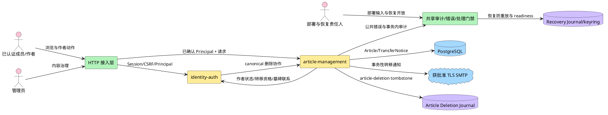

**说明**：HTTP 接入层和 identity-auth 先把 Cookie 转换成可信 Principal；article-management 不解析 Cookie、密码或 CSRF。文章模块拥有 Article、TransferNotice、DeletionOperation 和独立 `article-deletion` namespace；Recovery Journal 的 `recovery/*` namespace 仍由恢复能力拥有，两者只共享持久卷/keyring 基础设施。

### 2.3 特性影响分析

| 视角 | 影响 |
|---|---|
| 运行 | PostgreSQL 保存文章、通知和 DeletionOperation；外部 Article Deletion Journal 保存最小 tombstone；SMTP 只承接转移通知；恢复期间 readiness 关闭 |
| 开发 | `internal/article` 按 handler/service/repository 分层；跨模块只允许 service 端口 |
| 部署 | 数据库、canonical origin、SMTP TLS/处理方、分页与容量配置来自环境或受控登记 |
| 场景 | 普通文章路径与治理路径共享 Article，不共享授权判断或通知失败语义 |
| 数据 | 新增 Article、TransferNotice/Recipient、DeletionOperation、DeletionReplayRun/Evidence；外部 tombstone/evidence 无内容或 PII；identity 只消费 DTO |

### 2.4 特性级方案选择

#### 2.4.1 分页选择

文章列表需要在新文章持续写入时保持稳定。常见方案是 offset、页码和 keyset cursor；本设计参考 PostgreSQL keyset pagination 的“以稳定排序键继续扫描”思想，不借用任何产品整体架构。

| 方案 | 实现机制 | 优势 | 劣势 |
|---|---|---|---|
| offset/limit | 跳过 N 行 | 客户端简单；可跳页 | 深页扫描成本增长；并发新增导致重复或漏项 |
| 页码 | 页码换算 offset | 用户理解直观 | 继承 offset 缺陷；总页数需额外统计 |
| keyset cursor | 以最后一条 `(created_at,id)` 继续 | 并发新增不扰动已翻页窗口；索引可直接支持 | 不支持任意跳页；cursor 需版本化 |

本项目只要求顺序分页，不要求跳页或总页数，因此选择 keyset cursor。成员列表不用数据库长事务 read view，而采用有界 SQL 批次的持续扫描：

1. CursorCodec 集中解码并验证版本、view、RFC 3339 时间范围、UUID 格式和完整字段；cursor 不承担授权。
2. Repository 从 cursor 之后按 `(created_at DESC,id DESC)` 读取一个配置化候选批次；批次大小数值 TBD，但必须不小于 `limit+1`。
3. `IdentityAuthorStatusReader` 对该批候选中的非空 author_id 一次批量读取状态。
4. VisibilityPolicy 过滤候选并按原顺序追加可见项。
5. 可见项达到 `limit+1` 时停止；不足则以“最后扫描候选”作为内部扫描位置继续下一批，直到取得 `limit+1` 可见项或候选耗尽。
6. 响应只返回前 `limit` 项；`next_cursor` 基于“最后返回的可见项”。第 `limit+1` 个可见项不消费，下页会再次扫描并返回。
7. 全部候选耗尽时 `next_cursor=null`。隐藏密集区可能增加内部批次数，但不能形成空页后仍有稳定可见项被跳过的结果。

在文章集合和可见性不变的遍历中，该算法保证可见项不漏、不重复；同时间戳由 ID 打破平局。并发新增且排序键新于当前 cursor 的文章只会在重新从首页读取时出现，不插入当前遍历；内容修改不改变排序；遍历期间的违规/停用/删除变化按每次请求的当前事实计算，不提供跨请求快照保证。

#### 2.4.2 并发更新选择

| 方案 | 实现机制 | 优势 | 劣势 |
|---|---|---|---|
| 最后写入者覆盖 | 不比较版本 | 实现最少 | 作者修改、违规治理和转移可互相静默覆盖 |
| 时间戳比较 | 比较 `updated_at` | 字段直观 | 时钟精度和序列化造成歧义 |
| `version + ETag` | 每次写递增版本，`If-Match` 比较 | HTTP 标准；精确发现冲突；不依赖时钟 | 客户端写前必须读取当前 ETag |

选择 `version + ETag`。治理和永久删除属于不可逆或高影响动作，要求客户端显式确认自己看到的版本；其劣势由管理界面先读详情再操作缓解。

#### 2.4.3 永久删除选择

| 方案 | 实现机制 | 优势 | 劣势 |
|---|---|---|---|
| 软删除 | 保存正文并标记 deleted | 易恢复、易追踪 | 直接违反不可恢复；内容仍可被应用取回 |
| 归档后删除 | 正文转移到归档存储 | 可审计 | 仍保存可恢复内容；新增存储 |
| 物理删除 + 最小审计 | 只删除业务库 Article | 活跃库不可恢复 | 旧备份会复活删除前内容，已被 review r01 否决 |
| 外部 tombstone + finalizer | 先隐藏和登记操作，外部耐久 tombstone 后物理删除 | 跨业务库备份恢复可重放；不保存内容 | 引入跨介质协议、inventory 和 key 留存 |

依据 ADR-0020 选择外部 tombstone + finalizer。授权与 ETag 通过后，数据库事务把 Article 置为内部 `deletion_pending` 并创建 DeletionOperation；Article 立即对成员、作者和管理员全部不可见。`article-deletion/*` namespace 原子追加 tombstone 并 fsync 后，finalizer 在新事务物理删除 Article、追加 AuditEvent 并完成 operation。API 只有在 tombstone 与物理删除双完成后返回 204。

Journal 成功而数据库步骤失败时，Article 保持 `deletion_pending`，后台 finalizer 和授权重试继续收敛，永不恢复公开。旧备份恢复后、readiness 开放前必须重放全部有效 tombstone。tombstone 不保存标题、正文、内容摘要、邮箱或其他 PII。

#### 2.4.4 正文存储与输出安全

| 方案 | 实现机制 | 优势 | 劣势 |
|---|---|---|---|
| 原始文本 + JSON 转义 | 数据库存 text，消费者按文本渲染 | 无脚本执行面；不绑定富文本格式 | 无富文本能力 |
| 保存原始 HTML | 直接存/渲染 HTML | 表达力强 | XSS 面最大；需成熟 sanitizer 和策略 |
| Markdown 源文 + 安全渲染 | 存源文，读取时渲染 | 可读性和表达力折中 | 需拍板方言、链接、HTML 和 sanitizer |

需求尚未确认格式，因此选择“文本存储、JSON 输出、禁止服务端解释 HTML”作为安全底线。若未来选 Markdown，必须保留源文、使用获批准渲染与 sanitizer，并重新评审输出合同；不能把本期正文直接当可信 HTML。

## 3 特性/功能实现原理

### 3.1 总体方案

#### 3.1.1 主轴

全文以 Article 数据流为主轴：`业务 Article → 删除 tombstone/operation → 恢复重放 → 不可变 evidence → identity DTO Gate`。每个动作只改变自己拥有的事实；永久删除和恢复证据都不复制内容。

#### 3.1.2 逻辑视图：业务能力

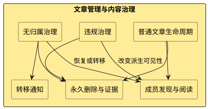

**说明**：普通生命周期、违规治理和无归属治理都作用于 Article，但分别拥有内容、违规事实和归属处置。永久删除是三个入口共享的终态；通知只跟随已提交的转移事实。

#### 3.1.3 逻辑视图：核心对象

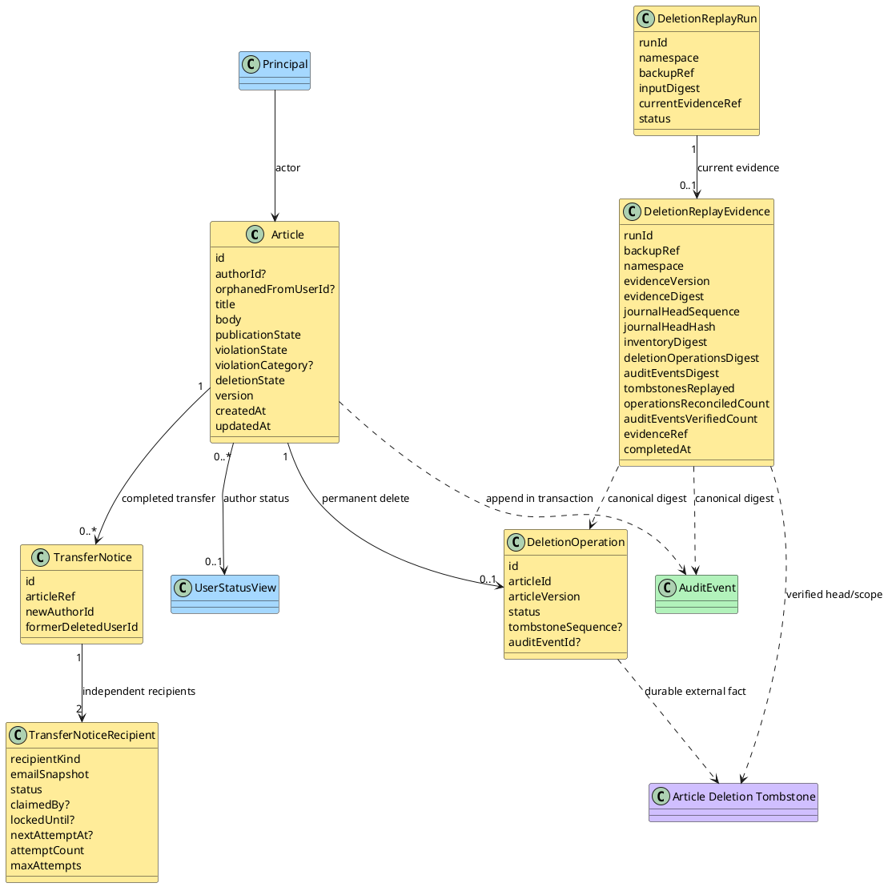

**说明**：Article 是内容、归属、发布意图和违规事实的唯一权威；`deletion_pending` 只表示删除协议正在收敛。DeletionReplayEvidence 是 article-owned 不可变恢复证据，绑定当前 run/backup/namespace，只保存删除重放摘要和计数，不保存文章内容或 PII。

#### 3.1.4 逻辑视图：代码框架

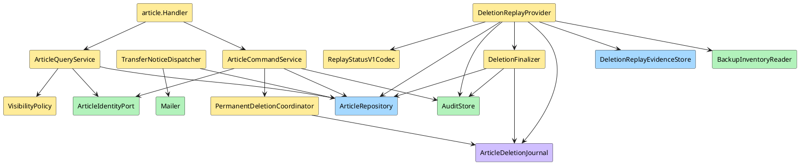

**说明**：DeletionReplayProvider 统一实现 `ReplayAndVerify/ReadStatus`，持久化不可变 evidence，并向 identity 仅返回 DTO。identity 不获得 Journal、inventory、DeletionOperation、AuditEvent 或 evidence 表读取权。

#### 3.1.5 开发视图

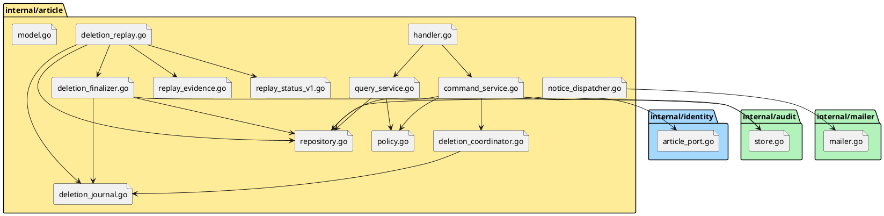

**说明**：目录按 ADR-0008 保持业务模块可见。article 不导入 identity 的 repository 或表实现；`article_port.go` 暴露最小 service 接缝。实际文件名是设计落点，不表示仓库已经存在这些文件。

#### 3.1.6 进程视图

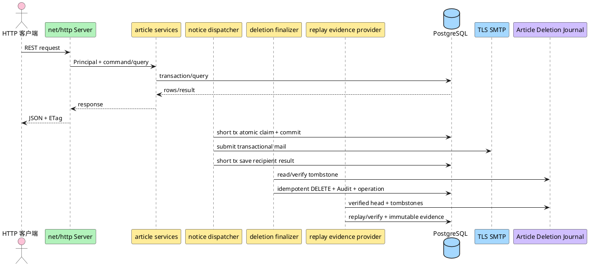

**说明**：Replay provider 在维护模式内运行。相同 run+backup 可读取现有匹配 evidence；输入变化时重新收敛并追加新 evidence。旧 evidence 不更新，只是不再代表当前 ready。

#### 3.1.7 物理视图

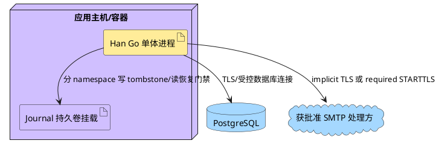

**说明**：Article、TransferNotice/Recipient、DeletionOperation 和 DeletionReplayEvidence 位于 PostgreSQL。持久卷提供两个独立 namespace；evidence 绑定 `article-deletion` 当前 head，但不进入持久卷或 identity 数据所有权。

#### 3.1.8 场景视图（+1）

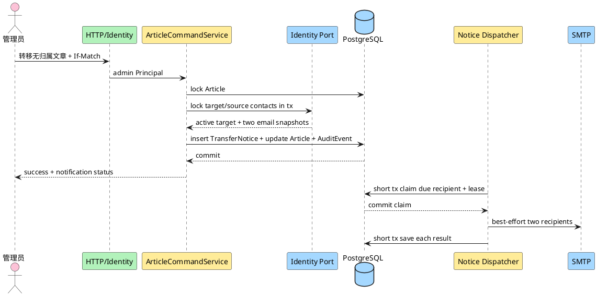

**说明**：通知地址在清除 `orphaned_from_user_id` 前进入独立 recipient。提交后 Article 已转移；两路 SMTP 状态和 lease 独立。数据库 claim 在 SMTP 前已提交，网络调用不跨数据库事务。

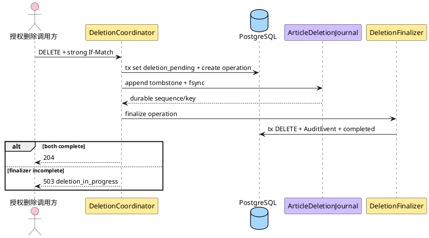

**说明**：删除请求先让 Article 对所有消费者不可见，再写业务数据库外 tombstone。204 只对应 tombstone 与物理删除双完成；Journal 成功而数据库失败时，Article 保持 pending，由 finalizer 继续收敛。

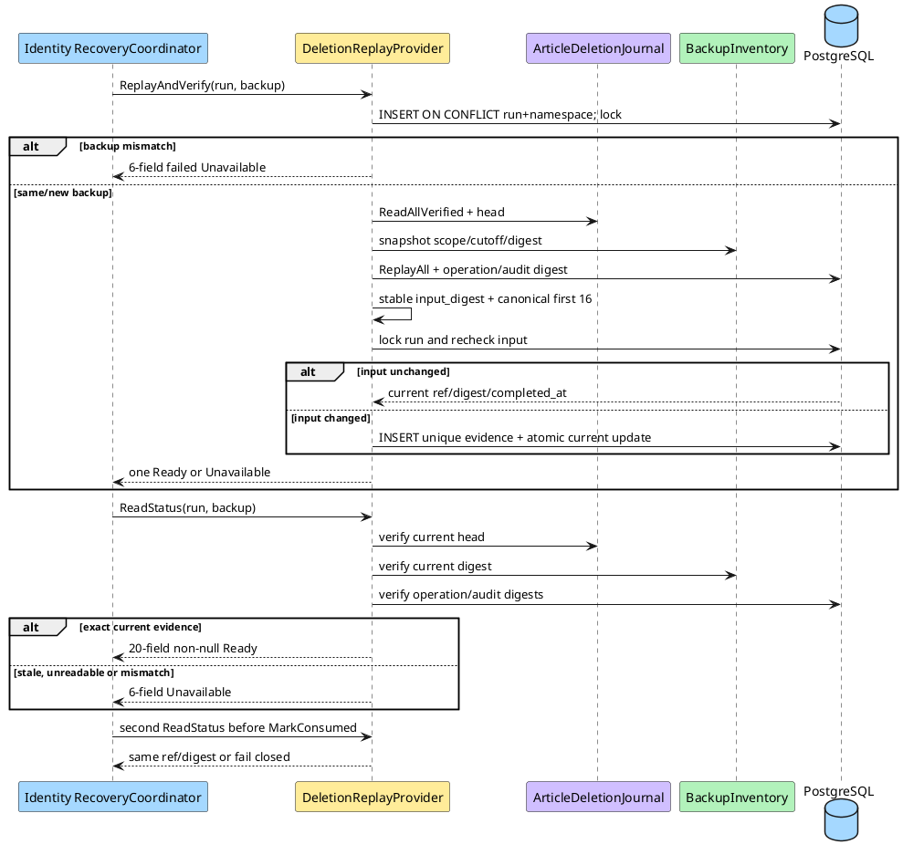

**说明**：唯一 run 行先绑定 backup；同 backup 并发由行锁和 evidence 唯一约束收敛为同一 ref/digest/time，错 backup 一方稳定失败。Identity 使用共享 fixture 重算 DTO digest，并在 MarkConsumed 前二次读取。

#### 3.1.9 Story 拼图与依赖

| 特性维度 | 01 创建 | 02 浏览 | 03 修改 | 04 作者删除 | 05 管理员删除 | 06 无归属处置 | 07 转移通知 | 08 违规治理 |
|---|---:|---:|---:|---:|---:|---:|---:|---:|
| 身份/权限 | ✓ | ✓ | ✓ | ✓ | ✓ | ✓ | ✓ | ✓ |
| 内容与版本 | ✓ | ✓ | ✓ | ✓ | ✓ | ✓ | 读 | ✓ |
| 正交状态/可见性 | 初始化 | 核心 | 保持 | 终态 | 终态 | 核心 | 保持 | 核心 |
| 审计 | 运行日志 | 不适用 | 运行日志 | ✓ | ✓ | ✓ | ✓ | ✓ |
| 邮件/隐私 | 不适用 | 不适用 | 不适用 | 不适用 | 不适用 | 快照 | 核心 | 不适用 |
| 删除/恢复 | 不适用 | 双 Journal 门禁 | 不适用 | Deletion Journal | Deletion Journal | 处置集合/Deletion Journal | 清理前置 | 违规保留/Deletion Journal |

### 3.2 用户与调用方行为

| 调用方动作 | 页面/调用状态 | 成功反馈 | 失败反馈 |
|---|---|---|---|
| 创建文章 | 标题/正文输入 | 进入详情；返回 201、Location、ETag | 字段错误；未产生文章 |
| 浏览列表/详情 | 加载、空列表、下一页 | 倒序 items；详情含标题正文 | 未登录 401；不存在/不可见/已删除统一不可用 |
| 修改自己的文章 | 普通详情或“我的文章”受控详情取得 ETag | 作者响应仅返回内容、通用受限状态和 editable；违规文章仍隐藏 | 非作者/已删/删除 pending 不可用；冲突 412 |
| 作者删除 | 删除确认交互待拍板 | tombstone 与物理删除双完成后 204 | 未双完成返回 503，文章保持不可见并收敛 |
| 管理员删除普通文章 | 管理详情后操作 | 双完成 204 + 审计 | 非普通状态使用对应治理入口 |
| 查看无归属文章 | 管理列表/详情 | 返回隐藏原因、版本和处置能力 | 非管理员 403；非待处置文章不可用 |
| 恢复公开/转移/删除无归属文章 | 基于管理详情与 ETag | 新状态、通知排队或 204 | 违规恢复公开 409；目标不合格 422；冲突 412 |
| 判定/解除/删除违规文章 | 管理详情与 ETag | 隐藏原因重算或 204 | 非管理员 403；错误状态 409 |
| 恢复协调方核对文章删除重放 | 维护模式、run+backup | 返回唯一 Ready 或 Unavailable | Unavailable 立即禁止 MarkConsumed/open |

### 3.3 Story 详细设计

#### 3.3.1 共享基础

##### 实现设计

所有 HTTP 请求先经过 identity 接入层。安全方法只要求有效 Session；`POST/PUT/DELETE` 还要求 `X-CSRF-Token`。article handler 收到的 Principal 至少含 `user_id,role,is_initial_admin,status,onboarding_gate`；受限或非 active Principal 不进入文章服务。

成员可见性公式是：

```text
exists
AND deletion_state = active
AND publication_state = published
AND violation_state = clear
AND (author_id IS NULL OR author.status = active)
```

管理员可通过治理详情查看所有 `deletion_state=active` 文章的完整 `violation_category` 与 `hidden_reasons`，但不能查看 `deletion_pending` 内容。作者可通过受控“我的文章详情”读取 `author_id=Principal.user_id` 且 deletion active 的文章，包括 violating 文章，以取得内容和 ETag；作者投影只给出 `moderation_status=normal|restricted` 与 `editable=true`，不返回类别或原因。普通成员仍按成员可见性处理，受限文章统一 404。

##### 类/组件设计

| 组件 | 唯一职责 | 不变量 |
|---|---|---|
| `ArticleCommandService` | 创建、修改、治理、转移和永久删除 | 写前授权、锁行、版本比较、状态转换和事务边界集中 |
| `ArticleQueryService` | 成员与管理员查询 | 所有成员查询必须调用 VisibilityPolicy |
| `CursorCodec` | 集中编码/解码 cursor | 校验版本、view、时间/UUID 范围；不承担授权 |
| `VisibilityPolicy` | 从 Article + User.status 派生可见性和原因 | 不持久化结果，不修改状态 |
| `AuthorProjectionPolicy` | 把自有 Article 投影为 normal/restricted + editable | 只输出通用状态，不输出治理类别或原因集合 |
| `ArticleRepository` | Article/TransferNotice/Recipient/DeletionOperation/ReplayEvidence SQL 与行锁 | 不解释 Principal 或角色 |
| `ArticleIdentityPort` | 批量作者状态、转移双方资格/联系、retained_email 清理协作 | 不复制 identity 内部实现 |
| `AuditStore` | 在调用方事务追加 AuditEvent | 无更新/删除 |
| `TransferNoticeDispatcher` | claim 到期 recipient 并在事务外调用 Mailer | 不能更新 Article；每个收件人独立 lease/结果 |
| `PermanentDeletionCoordinator` | 建立 pending/operation、耐久 tombstone、同步尝试 finalizer | 204 只在双完成后 |
| `ArticleDeletionJournal` | `article-deletion/*` 最小 tombstone、验链、fsync、inventory 核对 | 不保存内容/PII；不混用 recovery namespace |
| `DeletionFinalizer` | 从 tombstone 幂等物理删除、审计、完成 operation | Journal 成功后不得恢复公开 |
| `DeletionReplayProvider` | `ReplayAndVerify/ReadStatus`、输入快照、证据生成和失效判断 | 所有接口按 run+backup；identity 只消费 DTO |
| `DeletionReplayEvidenceStore` | 追加不可变 evidence 与维护当前 run 指针 | evidence 无 UPDATE/DELETE；旧 ready 不覆盖 |
| `BackupInventoryReader` | 读取当前 backup scope/cutoff 和 canonical digest | 不由 article 推断或改写 inventory |
| `ReplayStatusV1Codec` | Ready 20 字段 canonical/digest 与 Unavailable 6 字段 serializer | 两个独立类型；禁止混合字段、额外字段、null 或隐式类型转换 |

##### 接口设计

**公共表示**

```json
{
  "id": "opaque-id",
  "title": "标题",
  "body": "正文",
  "author": {"kind": "user", "id": "opaque-user-id"},
  "publication_state": "published",
  "violation_state": "clear",
  "created_at": "2026-10-20T00:00:00Z",
  "updated_at": "2026-10-20T00:00:00Z"
}
```

成员响应不返回 `orphaned_from_user_id`、通知邮箱、违规类别或隐藏原因。匿名文章返回 `{"kind":"anonymous","id":null,"label":"匿名"}`。管理员治理表示在上述基础上增加 `orphaned_from_user_id`、`violation_category`、完整 `hidden_reasons` 和 `version`。

**作者受控详情表示**

```json
{
  "title": "标题",
  "body": "正文",
  "moderation_status": "restricted",
  "editable": true
}
```

ETag 只通过响应 Header 返回，不在 body 复制 ID 或 version。对于 violating 自有文章，`moderation_status` 固定为 `restricted`；成员可见的普通自有文章为 `normal`。成功响应严格使用字段 allowlist：`title,body,moderation_status,editable`。禁止出现 `violation_state`、`violation_category`、`hidden_reasons`、`publication_state`、`orphaned_from_user_id`、作者账号状态或删除内部状态；作者 serializer 不得复用管理员治理 DTO。

**列表 envelope**

```json
{"items": [], "next_cursor": null}
```

`limit` 可省略；缺省值和最大值均为 TBD 配置。cursor payload 为 `{"v":1,"created_at":"...","id":"...","view":"member|admin_all|admin_violating|admin_orphan"}` 的 Base64URL 编码；CursorCodec 校验版本、字段、排序、时间/UUID 合法范围和 view 绑定。成员列表按下列循环执行：

```text
scan_after = request_cursor
visible = []
repeat:
  candidates = repository.fetchBatch(scan_after, candidate_batch_size)
  if candidates empty: exhausted = true; break
  statuses = identityAuthorStatusReader.batchGet(candidates.author_ids)
  for candidate in candidates:
    scan_after = candidate.sort_key
    if VisibilityPolicy.memberVisible(candidate, statuses):
      visible.append(candidate)
      if len(visible) == limit + 1: break repeat
  if candidates shorter than candidate_batch_size: exhausted = true; break
items = visible[0:limit]
next_cursor = cursor(last(items)) only when len(visible) == limit + 1
```

内部批次以最后扫描候选推进，公共 cursor 只以最后返回可见项推进。这样长隐藏区间不会造成错误空页或跳过后续可见项；下页允许重扫上一页为探测 `limit+1` 而读过的隐藏候选，但不会重复返回可见项。

**ETag/并发**

- ETag 形式为 `"article-<id>-v<version>"`。
- 创建 201、成员详情、作者受控详情、管理员详情、修改/治理/转移 200 返回 ETag。
- `PUT`、全部治理 `POST` 与全部 `DELETE` 要求 `If-Match`。
- `If-Match` 只接受一个与当前资源完全相等的强 ETag；weak ETag、逗号多值、非法语法和 `*` 返回 400 `request.invalid_precondition`。
- 缺失返回 428 `request.precondition_required`；不匹配返回 412 `article.precondition_failed`。
- 条件请求不是 Idempotency-Key；超时后客户端必须重新读取资源确认结果。

所有成功 JSON 响应使用 `Content-Type: application/json; charset=utf-8` 与 `X-Content-Type-Options: nosniff`。前端必须把 title/body 写入文本节点或使用上下文编码，不得直接赋给 `innerHTML`。

**公共错误注册**

| HTTP | code | message 语义 | 可重试 | 责任边界 |
|---:|---|---|---|---|
| 400 | `request.invalid_json` | 请求格式不正确 | 修正后 | HTTP decoder |
| 400 | `request.invalid_cursor` | 分页游标无效 | 修正后 | cursor decoder |
| 400 | `request.invalid_precondition` | 资源版本条件格式无效 | 修正后 | conditional request parser |
| 401 | `auth.session_required` | 需要重新登录 | 是 | identity middleware |
| 403 | `auth.csrf_failed` | 请求安全校验失败 | 否 | CSRF middleware |
| 403 | `auth.forbidden` | 无权执行该操作 | 否 | ArticleAuthorization |
| 404 | `article.unavailable` | 文章不存在或不可用 | 否 | ArticleQuery/CommandService |
| 409 | `article.invalid_state` | 当前文章状态不允许该操作 | 状态变化后 | ArticleStatePolicy |
| 412 | `article.precondition_failed` | 文章已变化，请刷新后重试 | 重新读取后 | version compare |
| 422 | `article.validation_failed` | 标题或正文不符合要求 | 修正后 | ArticleValidator |
| 422 | `article.transfer_target_invalid` | 目标用户不能成为新作者 | 修正目标后 | identity target qualification |
| 428 | `request.precondition_required` | 必须提供当前资源版本 | 读取后 | HTTP conditional middleware |
| 429 | `request.rate_limited` | 请求过于频繁 | 是 | shared rate limit |
| 503 | `platform.processing_gate_closed` | 通知能力尚未开放 | 配置后 | ProcessingGate；只用于通知查询/运维边界，不回滚转移 |
| 503 | `article.deletion_in_progress` | 删除正在完成，请稍后核对 | 是 | PermanentDeletionCoordinator |
| 503 | `platform.database_unavailable` | 服务暂时不可用 | 是 | repository boundary |
| 503 | `platform.recovery_in_progress` | 服务正在恢复 | 是 | readiness/recovery gate |
| 503 | `platform.dependency_unavailable` | 依赖暂时不可用 | 是 | identity/mailer adapter |
| 500 | `platform.internal_error` | 服务内部错误 | 视情况 | top-level boundary |

错误 envelope 继承 ADR-0014：`code,message,field_errors?,trace_id`。成员访问不可见、已删除或不存在文章一律使用 `article.unavailable`，不披露隐藏原因。

**接口总表**

| 方法与路径 | 消费者 | 成功 | 权限/状态 |
|---|---|---|---|
| `POST /api/v1/articles` | 已认证成员 | 201 Article + Location + ETag | active Principal |
| `GET /api/v1/articles` | 已认证成员 | 200 list envelope | 只返回成员可见 |
| `GET /api/v1/articles/{id}` | 已认证成员 | 200 Article + ETag | 只返回成员可见 |
| `GET /api/v1/users/me/articles/{id}` | 当前作者 | 200 AuthorEditView + ETag | 仍有归属且 deletion active；受限仅返回 restricted/editable |
| `PUT /api/v1/articles/{id}` | 作者 | 200 AuthorEditView + ETag | 仍有归属且 deletion active；If-Match |
| `DELETE /api/v1/articles/{id}` | 作者或管理员 | 双完成后 204 | 作者删自己的普通文章；管理员删他人普通文章；If-Match |
| `GET /api/v1/admin/articles` | 管理员 | 200 admin list | `view=all|violating|hidden` |
| `GET /api/v1/admin/articles/{id}` | 管理员 | 200 admin detail + ETag | deletion active；pending 不可见 |
| `POST /api/v1/admin/articles/{id}/violation` | 管理员 | 200 admin detail + ETag | clear → violating；If-Match |
| `POST /api/v1/admin/articles/{id}/restore` | 管理员 | 200 admin detail + ETag | 只清除 violating；If-Match |
| `DELETE /api/v1/admin/articles/{id}` | 管理员 | 双完成后 204 | 仅违规文章；If-Match |
| `GET /api/v1/admin/orphan-articles` | 管理员 | 200 admin list | 只返回待处置无归属 |
| `GET /api/v1/admin/orphan-articles/{id}` | 管理员 | 200 admin detail + ETag | `orphaned_from_user_id` 非空 |
| `POST /api/v1/admin/orphan-articles/{id}/publish` | 管理员 | 200 admin detail + ETag | clear + held；If-Match |
| `POST /api/v1/admin/orphan-articles/{id}/transfer` | 管理员 | 200 transfer result + ETag | 目标 active；If-Match |
| `DELETE /api/v1/admin/orphan-articles/{id}` | 管理员 | 双完成后 204 | 待处置无归属；If-Match |

**请求字段**

| 入口 | 字段 | 类型 | 必填 | 校验/默认 |
|---|---|---|---:|---|
| 创建/修改 | `title` | string | 是 | 至少含非空白字符；格式与最大长度 TBD |
| 创建/修改 | `body` | string | 是 | 至少含非空白字符；格式与最大长度 TBD |
| 成员/管理列表 | `cursor` | query string | 否 | 缺省从首条开始；必须匹配列表 view |
| 成员/管理列表 | `limit` | query integer | 否 | 缺省值/上限来自配置，数值 TBD |
| 违规判定 | `category` | string enum | 是 | `violence` 或 `sexual` |
| 无归属转移 | `new_author_id` | opaque string | 是 | identity 必须判定 active 且可作为作者 |

**写接口事务、审计、并发与重试合同**

| 写入口 | If-Match | 单事务内容 | AuditEvent | Idempotency-Key/重试 |
|---|---:|---|---|---|
| 创建 | 否 | INSERT Article | 不要求业务审计；只做低敏运行日志 | 不接受；超时后需核对 |
| 修改 | 是 | lock + UPDATE Article | 不要求业务审计；只做低敏运行日志 | 不接受；412 后重读 |
| 作者/管理员普通删除 | 是 | T1 pending+operation；Journal fsync；T2 DELETE+Audit+completed | `article.delete` 在 finalizer 事务 | 不接受 key；pending 可继续收敛 |
| 判定/解除违规 | 是 | lock + UPDATE Article + AuditEvent | `article.violation.mark/clear` | 不接受；当前状态不作幂等成功 |
| 删除违规 | 是 | 同一永久删除协议 | `article.violation.delete` 在 finalizer 事务 | 不接受 key；pending 不再可见 |
| 无归属公开 | 是 | lock + UPDATE + AuditEvent + retained_email 条件清理 | `article.orphan.publish` | 不接受；完成后对象退出待处置集合 |
| 无归属转移 | 是 | lock parties + INSERT Notice + UPDATE Article + AuditEvent + 条件清理 | `article.orphan.transfer` | 不接受；通知在提交后 best effort |
| 无归属删除 | 是 | 同一永久删除协议；finalizer 后条件清理 | `article.orphan.delete` 在 finalizer 事务 | 不接受 key；双完成才 204 |

**S16 内部 provider 接口**

| 接口 | 调用方 | 输入 | 输出 | 失败语义 |
|---|---|---|---|---|
| `ReplayAndVerify` | RecoveryCoordinator | `run_id,backup_ref` | 恰好一个 Ready 或 Unavailable | 未完成/失败只返回 6 字段 Unavailable |
| `ReadStatus` | RecoveryCoordinator | `run_id,backup_ref` | 恰好一个 Ready 或 Unavailable | 非 ready 不得返回任何 evidence 字段 |

`ArticleDeletionReplayStatus` v1 是 strict tagged union。`ReplayAndVerify` 与 `ReadStatus` 每次必须且只能返回一个 variant，禁止合并字段或用零值伪装另一 variant。

**Ready variant：完整 20 字段，全部必填且非 null**

| 顺序 | 字段 | JSON 类型 | canonical |
|---:|---|---|---:|
| 1 | `evidence_version` | string | 是 |
| 2 | `run_id` | string | 是 |
| 3 | `backup_ref` | string | 是 |
| 4 | `namespace` | string | 是 |
| 5 | `journal_head_sequence` | integer | 是 |
| 6 | `journal_head_hash` | string | 是 |
| 7 | `inventory_scope` | string | 是 |
| 8 | `backup_cutoff` | string，UTC RFC 3339 | 是 |
| 9 | `inventory_digest` | string | 是 |
| 10 | `deletion_operations_digest` | string | 是 |
| 11 | `audit_events_digest` | string | 是 |
| 12 | `tombstones_total` | integer | 是 |
| 13 | `tombstones_replayed` | integer | 是 |
| 14 | `already_absent` | integer | 是 |
| 15 | `deletion_operations_reconciled_count` | integer | 是 |
| 16 | `audit_events_verified_count` | integer | 是 |
| 17 | `status` | string，固定 `ready` | 否 |
| 18 | `evidence_digest` | string | 否 |
| 19 | `evidence_ref` | string，opaque | 否 |
| 20 | `completed_at` | string，UTC RFC 3339 | 否 |

唯一重放计数字段名是 `tombstones_replayed`；禁止 `replayed` 等别名。`inventory_scope` 固定为 JSON string。Canonical JSON 只包含前 16 字段，按表中顺序、UTF-8、无 BOM、无多余空白输出；明确排除 `status,evidence_digest,evidence_ref,completed_at`。

共享 ready fixture：

```json
{
  "evidence_version": "article-deletion-replay/v1",
  "run_id": "run-01",
  "backup_ref": "backup-2026-10-20T00:00:00Z",
  "namespace": "article-deletion/v1",
  "journal_head_sequence": 7,
  "journal_head_hash": "sha256:aaaa",
  "inventory_scope": "recoverable-backups-before-cutoff",
  "backup_cutoff": "2026-10-20T00:00:00Z",
  "inventory_digest": "sha256:bbbb",
  "deletion_operations_digest": "sha256:cccc",
  "audit_events_digest": "sha256:dddd",
  "tombstones_total": 3,
  "tombstones_replayed": 2,
  "already_absent": 1,
  "deletion_operations_reconciled_count": 3,
  "audit_events_verified_count": 3,
  "status": "ready",
  "evidence_digest": "sha256:169e0f30407867083598ab146c950968e1b5f508ed4fd5d5198bb61e788926a7",
  "evidence_ref": "evidence-01",
  "completed_at": "2026-10-20T01:00:00Z"
}
```

对应 canonical bytes 是前 16 字段的单行 JSON，fixture digest 固定为 `sha256:169e0f30407867083598ab146c950968e1b5f508ed4fd5d5198bb61e788926a7`。Identity 只从完整 DTO 前 16 字段重算摘要，并比较 RecoveryRun.backup_ref 与两次读取的 evidence_ref/evidence_digest；不得读取 article 内部表。

```json
{"evidence_version":"article-deletion-replay/v1","run_id":"run-01","backup_ref":"backup-2026-10-20T00:00:00Z","namespace":"article-deletion/v1","journal_head_sequence":7,"journal_head_hash":"sha256:aaaa","inventory_scope":"recoverable-backups-before-cutoff","backup_cutoff":"2026-10-20T00:00:00Z","inventory_digest":"sha256:bbbb","deletion_operations_digest":"sha256:cccc","audit_events_digest":"sha256:dddd","tombstones_total":3,"tombstones_replayed":2,"already_absent":1,"deletion_operations_reconciled_count":3,"audit_events_verified_count":3}
```

**Unavailable variant：只允许 6 字段**

| 顺序 | 字段 | JSON 类型 |
|---:|---|---|
| 1 | `evidence_version` | string，固定 `article-deletion-replay/v1` |
| 2 | `run_id` | string |
| 3 | `backup_ref` | string |
| 4 | `namespace` | string，固定 `article-deletion/v1` |
| 5 | `status` | string：`pending|unknown|failed` |
| 6 | `reason_code` | string，稳定内部分类 |

```json
{
  "evidence_version": "article-deletion-replay/v1",
  "run_id": "run-01",
  "backup_ref": "backup-2026-10-20T00:00:00Z",
  "namespace": "article-deletion/v1",
  "status": "pending",
  "reason_code": "replay_in_progress"
}
```

Unavailable 禁止携带任何 ready canonical 字段、`evidence_digest`、`evidence_ref` 或 `completed_at`；也禁止用 null、空字符串或零值补成 20 字段。Identity 收到 Unavailable 后立即 fail closed，不重算 digest。

`reason_code` 稳定分类：pending 使用 `replay_in_progress`；unknown 使用 `evidence_missing|evidence_stale|unsupported_evidence_version`；failed 使用 `backup_binding_mismatch|evidence_unreadable|verification_failed|dependency_unavailable`。

##### 数据结构设计

**Article**

| 字段 | 类型/约束 | 说明 |
|---|---|---|
| `id` | UUID PK | 公共不透明 ID |
| `author_id` | UUID NULL，FK `users(id)` ON DELETE RESTRICT | 当前作者；NULL 为无归属 |
| `orphaned_from_user_id` | UUID NULL，FK `users(id)` ON DELETE RESTRICT | 删除来源；不表示作者 |
| `title` | text NOT NULL | 长度/格式 TBD；至少含非空白字符 |
| `body` | text NOT NULL | 长度/格式 TBD；至少含非空白字符 |
| `publication_state` | `published|held` | 无 draft/offline |
| `violation_state` | `clear|violating` | 正交违规事实 |
| `violation_category` | `violence|sexual` NULL | violating 时必填；clear 时为空 |
| `deletion_state` | `active|deletion_pending` | 内部永久删除协议；pending 对所有消费者不可见 |
| `deletion_operation_id` | UUID NULL，FK DeletionOperation | pending 时必填，active 时为空 |
| `version` | bigint NOT NULL，起始 1 | 每次内容或治理写递增 |
| `created_at` | timestamptz NOT NULL | 创建顺序 |
| `updated_at` | timestamptz NOT NULL | 最后业务写时间 |

检查约束：

1. `publication_state='held'` 当且仅当 `author_id IS NULL AND orphaned_from_user_id IS NOT NULL`。
2. `orphaned_from_user_id IS NOT NULL` 时 `author_id IS NULL`。
3. `violation_state='violating'` 当且仅当 `violation_category IS NOT NULL`。
4. `deletion_state='deletion_pending'` 当且仅当 `deletion_operation_id IS NOT NULL`。
5. `version >= 1`。

索引：

- `(created_at DESC,id DESC)` 支持成员基础分页。
- `(author_id)` 支持 canonical 删除锁定与作者查询。
- `(orphaned_from_user_id,created_at DESC,id DESC)` 支持待处置集合与 retained_email 清理。
- `(violation_state,created_at DESC,id DESC)` 支持违规治理。
- `(deletion_state,created_at DESC,id DESC)` 支持所有消费者先排除 pending。
- 成员可见性还需连接 User.status；容量和执行计划目标为 TBD，不提前复制账号状态。

**TransferNotice**

| 字段 | 类型/约束 | 说明 |
|---|---|---|
| `id` | UUID PK | 通知记录 |
| `article_ref` | UUID NOT NULL，无内容 FK 恢复语义 | 关联已转移文章 ID，文章后续删除仍可留证 |
| `new_author_id` | UUID NOT NULL | 新作者 |
| `former_deleted_user_id` | UUID NOT NULL | 已删除原作者墓碑 |
| `created_at`,`updated_at` | timestamptz | 生命周期 |

**TransferNoticeRecipient**

| 字段 | 类型/约束 | 说明 |
|---|---|---|
| `notice_id` | UUID FK TransferNotice | 与 recipient_kind 组成 PK |
| `recipient_kind` | `new_author|former_deleted_author` | 每个 notice 恰好各一行 |
| `email_snapshot` | text NOT NULL | 事务内快照，不对公共 API 输出 |
| `status` | `pending|retry_wait|processing|accepted|failed_terminal` | 每收件人独立状态机 |
| `claimed_by` | text NULL | processing 时 worker 实例标识 |
| `locked_until` | timestamptz NULL | processing lease；到期可回收 |
| `next_attempt_at` | timestamptz NULL | retry_wait 的最早 claim 时间 |
| `attempt_count` | bigint NOT NULL | 已 claim 的发送尝试次数；Gate 竞态释放也保守计入 |
| `max_attempts` | bigint NOT NULL | 创建时保存配置快照；数值 TBD |
| `last_attempt_at` | timestamptz NULL | 最后发送开始时间 |
| `accepted_at` | timestamptz NULL | SMTP accepted 时间 |
| `failure_bucket` | text NULL | 低敏错误分类，不保存 SMTP 原文 |
| `created_at`,`updated_at` | timestamptz | 生命周期 |

TransferNotice/Recipient 不保存标题、正文、邮件正文或营销 purpose。purpose 固定为 `orphan_article_transfer_notice`。Gate 关闭时 recipient 保持 pending/retry_wait，不进入 processing，也不增加 attempt_count。

**DeletionOperation**

| 字段 | 类型/约束 | 说明 |
|---|---|---|
| `id` | UUID PK | tombstone 的稳定 operation ID |
| `article_id` | UUID NOT NULL UNIQUE | 一个 Article 只允许一个活动永久删除协议 |
| `article_version` | bigint NOT NULL | 授权与 If-Match 通过时的版本 |
| `delete_kind` | `ordinary|violating|orphan` | 决定审计 action 和无归属清理 |
| `actor_user_id`,`actor_role` | UUID/string | 最小责任主体，不写入外部 tombstone |
| `orphaned_from_user_id` | UUID NULL | 仅 DB 内用于 finalizer 后 retained_email 清理 |
| `status` | `pending_journal|journaled|finalizing|completed` | 不提供取消/恢复状态 |
| `tombstone_sequence` | bigint NULL | Journal 耐久后记录 |
| `journal_key_id`,`journal_key_version` | string NULL | 对账引用 |
| `claimed_by`,`locked_until` | NULLable | finalizer lease |
| `audit_event_id` | UUID NULL | completed 时必填 |
| `started_at`,`completed_at` | timestamptz | 协议时间 |

**ArticleDeletionTombstone（业务数据库外）**

| 字段 | 约束 |
|---|---|
| `namespace` | 固定 `article-deletion/v1` |
| `sequence` | namespace 内单调递增 |
| `article_id`,`article_version`,`deletion_operation_id`,`deleted_at` | ADR-0020 允许的最小删除事实 |
| `key_id`,`key_version`,`stage` | stage 固定 `tombstoned` |
| `previous_record_hash`,`record_hmac` | 独立校验链；HMAC 输入含 namespace 做域分离 |

tombstone 禁止 title、body、内容摘要、author_id、邮箱或其他 PII。Journal provider 使用独立文件/记录链，持锁校验后原子追加或同目录 copy-on-write，`fsync` 文件并 `fsync` 目录后才返回耐久；部分写、链损坏、未知 key、权限或空间错误全部 fail closed。

**DeletionReplayRun**

| 字段 | 类型/约束 | 说明 |
|---|---|---|
| `run_id`,`namespace` | 复合 PK / UNIQUE | 唯一所有权键；namespace 固定 `article-deletion/v1` |
| `backup_ref` | string NOT NULL | 首次插入绑定后不可修改，不属于唯一键 |
| `input_digest` | string NULL | 当前 covered input 的稳定摘要 |
| `current_evidence_ref` | string NULL | 仅指向当前 input_digest 对应 evidence |
| `status` | `running|failed|ready` | 对外 running/no evidence 投影为 unknown |
| `last_error_bucket` | text NULL | 低敏失败分类 |
| `started_at`,`updated_at` | timestamptz | 续跑协调 |

创建使用 `INSERT ... ON CONFLICT (run_id,namespace) DO NOTHING`，随后按 `(run_id,namespace)` `SELECT ... FOR UPDATE`。锁内比较 backup_ref：相同 backup 才继续；不同 backup 的调用稳定返回 failed，不能插入第二行、改写已绑定 backup 或破坏已绑定 backup 的运行状态。

**DeletionReplayEvidence**

| 字段 | 类型/约束 | 说明 |
|---|---|---|
| `evidence_version` | string NOT NULL | 当前 canonical 版本 `article-deletion-replay/v1` |
| `run_id`,`backup_ref`,`namespace` | NOT NULL | DTO canonical 字段 |
| `journal_head_sequence`,`journal_head_hash` | NOT NULL | 已验链 Journal head |
| `inventory_scope` | string NOT NULL | 已核对 inventory scope 的稳定标识 |
| `backup_cutoff` | timestamptz NOT NULL | 当前 backup 的恢复点上界 |
| `inventory_digest` | string NOT NULL | inventory canonical snapshot 摘要 |
| `deletion_operations_digest` | string NOT NULL | 按 operation ID 排序的状态/版本/完成事实摘要 |
| `audit_events_digest` | string NOT NULL | 按 operation/事件 ID 排序的删除审计摘要 |
| `tombstones_total`,`tombstones_replayed`,`already_absent` | bigint NOT NULL | `tombstones_total = tombstones_replayed + already_absent` |
| `deletion_operations_reconciled_count` | bigint NOT NULL | 已核对 operation 数 |
| `audit_events_verified_count` | bigint NOT NULL | 已核对删除审计数 |
| `evidence_digest` | string NOT NULL | 前 16 canonical 字段的 SHA-256 |
| `evidence_ref` | string PK | 稳定 opaque 引用 |
| `completed_at` | timestamptz NOT NULL | 首次创建该 evidence 的元数据时间，不参与 digest |

EvidenceStore 只提供 INSERT/按键查询，不提供 UPDATE/DELETE。唯一约束为 `(run_id,namespace,evidence_version,evidence_digest)`；并发同 backup 重算由该约束与 run 行锁共同保证只产生一个语义 evidence。旧行保持不可变，current 指针只在 input_digest 变化时更新。

`input_digest` 对稳定 source-input 文档计算 SHA-256，覆盖 run/backup/namespace、Journal head、inventory snapshot、operation/audit 输入；不含当前时间。`evidence_digest` 严格使用 DTO 前 16 字段的共享 canonical fixture。`completed_at` 在首次成功 INSERT 时生成；输入未变化时必须复用原 evidence_ref/digest/completed_at，不读取新时钟值。

#### 3.3.2 Story：创建文章（US-ARTICLE-01.1）

##### 实现设计

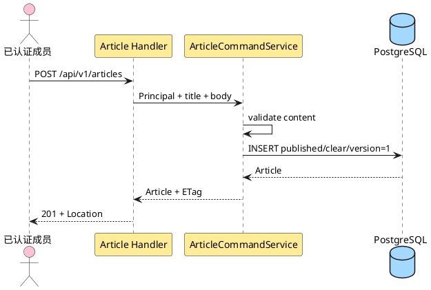

**说明**：作者来自 Principal，不接受请求体 author_id。数据库写入失败时没有 Article；创建不产生草稿或第二次发布动作。

##### 类/组件设计

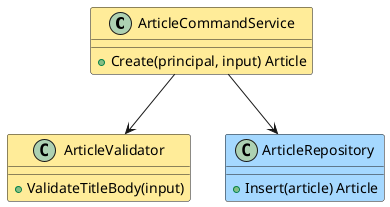

**说明**：Validator 只验证已拍板规则；Service 固定作者、`published/clear` 和版本。Repository 依赖数据库约束兜底，但不补业务默认。

##### 接口设计

请求 `{"title":"string","body":"string"}`，两字段必填且不得只含空白；未知字段拒绝。成功 201 返回完整成员 Article、`Location: /api/v1/articles/{id}` 和 ETag。未登录返回 401；校验失败 422；数据库失败不得返回创建成功。该接口不接受 `Idempotency-Key`，网络超时后客户端通过列表或业务上下文核对，不得盲目认为重试无重复。

##### 数据结构设计

新增一行 Article：`author_id=principal.user_id`、`orphaned_from_user_id=NULL`、`publication_state=published`、`violation_state=clear`、`violation_category=NULL`、`deletion_state=active`、`deletion_operation_id=NULL`、`version=1`。不创建 TransferNotice、DeletionOperation 或 AuditEvent；结构化运行日志不记录 title/body。

#### 3.3.3 Story：发现并阅读文章（US-ARTICLE-02.1）

##### 实现设计

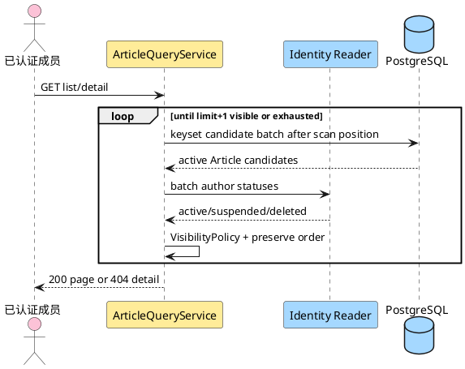

**说明**：列表按稳定 keyset 分批扫描，过滤后不足一页就继续读取下一候选批次；只有取得 `limit+1` 可见项或耗尽才返回。详情在返回正文前再次判断。成员无法从 404 区分不存在、违规、作者停用、pending 或已删除。

##### 类/组件设计

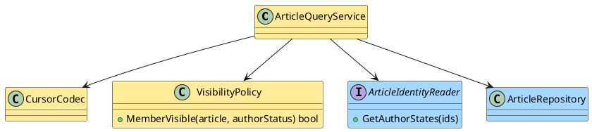

**说明**：VisibilityPolicy 是唯一成员可见性入口。CursorCodec 集中范围验证和 view 绑定。identity 缺少作者状态时 fail closed；不把缺失解释为匿名，只有 `author_id=NULL` 才是匿名。

##### 接口设计

`GET /api/v1/articles?cursor=&limit=` 返回 200 envelope；空列表是 `items=[]`。`GET /api/v1/articles/{id}` 返回 200 Article + ETag。列表不返回 body，只返回 `id,title,author,created_at,updated_at`；详情返回 body。非法 cursor 返回 400，超出配置上限的 limit 返回 422。未登录 401；隐藏/不存在/已删统一 404。

##### 数据结构设计

列表使用 `(created_at,id)` 索引，以配置化候选批次循环到 `limit+1` 可见项或耗尽。公共 cursor 基于最后返回可见项；静态集合中可见项不漏不重，同时间戳由 ID 稳定排序。查询不修改 Article、User、AuditEvent 或访问时间；浏览行为无写副作用。

#### 3.3.4 Story：修改现有文章（US-ARTICLE-03.1）

##### 实现设计

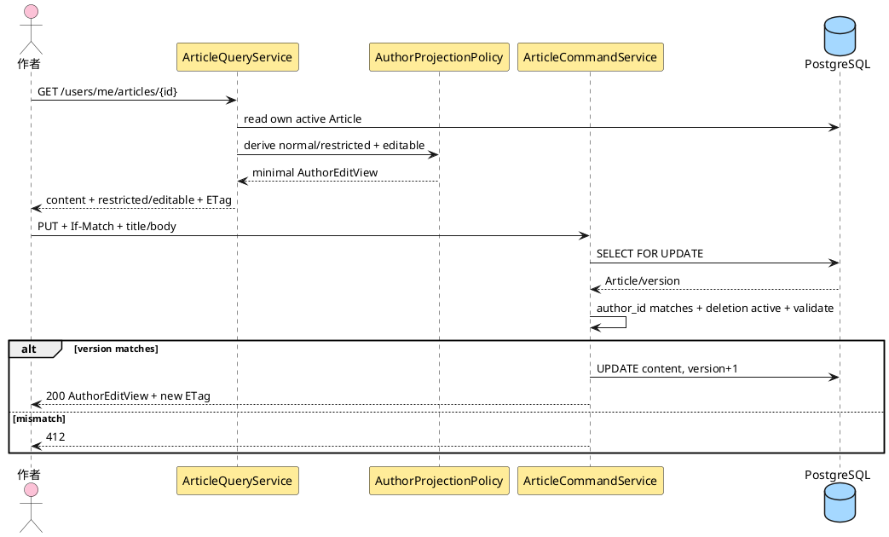

**说明**：修改是完整替换标题和正文。作者受控详情只按当前 Principal 与 `author_id` 精确匹配，不采用成员公开可见性；因此 active 作者可读取并修改自己的 violating 文章。AuthorProjectionPolicy 把全部治理原因折叠为通用 restricted，不披露类别或原因集合。修改后违规事实和所有其他治理字段原样保留，成员公开详情仍返回 404。

##### 类/组件设计

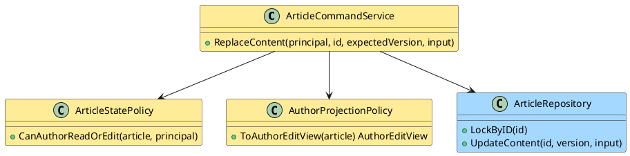

**说明**：StatePolicy 要求 Article 存在、`deletion_state=active`、`author_id=principal.user_id`。管理员角色不产生编辑权限；管理员只有同时是该文章作者时才通过。AuthorProjectionPolicy 与管理员治理 serializer 物理分离，更新不改变发布、违规、删除来源或归属字段。

##### 接口设计

`GET /api/v1/users/me/articles/{id}` 返回当前作者自己的 AuthorEditView 与 ETag。若文章受违规约束，body 只含内容、`moderation_status="restricted"`、`editable=true`；不得含 `violation_category`、`violation_state` 或 `hidden_reasons`。`PUT /api/v1/articles/{id}` 请求与创建相同，并要求强 If-Match；成功 200 返回同一最小 AuthorEditView 与新 ETag。普通非作者返回 404；管理员非作者返回 403；管理员作为作者时按作者身份处理。校验失败 422，冲突 412。

##### 数据结构设计

只更新 `title,body,updated_at,version=version+1`。`created_at,author_id,orphaned_from_user_id,publication_state,violation_state,violation_category,deletion_state` 全部保持不变。violating 文章修改后继续 violating 且成员不可见。失败事务不产生部分字段更新。

#### 3.3.5 Story：作者删除现有文章（US-ARTICLE-04.1）

##### 实现设计

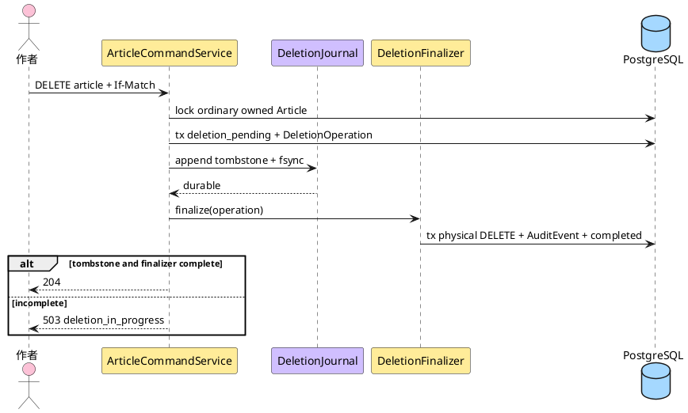

**说明**：第一事务先隐藏文章并登记 operation；Journal 使用独立 namespace 耐久化最小 tombstone；finalizer 的第二事务物理删除、审计并完成 operation。Journal 成功而第二事务失败时不恢复文章，后台继续收敛。

##### 类/组件设计

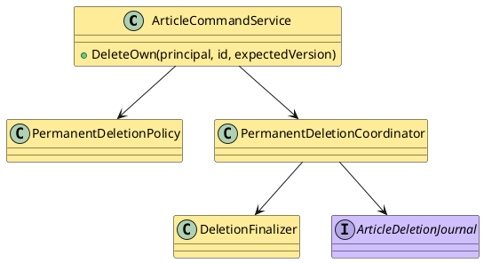

**说明**：PermanentDeletionPolicy 限制该入口只处理作者自己的普通文章。三个删除入口共享 Coordinator/Finalizer；区别只在授权、delete_kind、审计 action 和无归属清理。

##### 接口设计

`DELETE /api/v1/articles/{id}` 要求强 If-Match。作者自己的普通文章只有双完成后返回 204。Journal 或 finalizer 未完成返回 503 `article.deletion_in_progress`，但 Article 已对成员、作者和管理员全部不可见；同一授权调用可推动既有 operation 收敛。完成后的新 GET/DELETE 均 404，不提供恢复 token、撤销窗口或软删除状态。

##### 数据结构设计

T1 写 `Article.deletion_state=deletion_pending`、`deletion_operation_id` 和 DeletionOperation；tombstone fsync 后 T2 删除 Article，并写 `audit_event_id/status=completed`。若存在历史 TransferNotice，不删除通知证据，但其 `article_ref` 不能用于重建内容。AuditEvent 保存 actor、action=`article.delete`、target ID、outcome、trace_id、删除前 version，不保存标题、正文或邮箱。

#### 3.3.6 Story：管理员删除他人普通文章（US-IDENTITY-03.2）

##### 实现设计

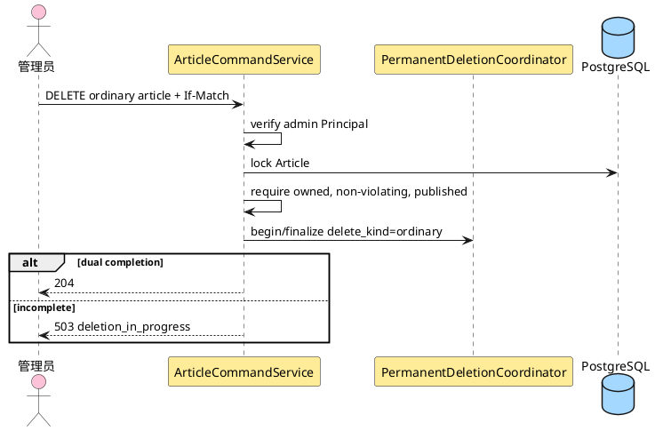

**说明**：管理员与作者复用同一路径，但授权分支明确。管理员不能借该权限调用 PUT；违规和无归属文章必须进入专用治理路径。

##### 类/组件设计

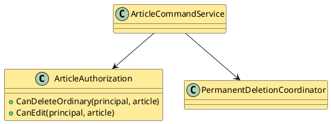

**说明**：删除权限和编辑权限是两个独立方法，防止“管理员可删除”被错误推导成“管理员可修改”。

##### 接口设计

管理员调用 `DELETE /api/v1/articles/{id}`，要求强 If-Match。普通文章定义为 `author_id IS NOT NULL`、`publication_state=published`、`violation_state=clear`、`deletion_state=active`；作者可以 active 或 suspended。双完成后 204。普通成员删除他人文章返回 404；管理员对违规或无归属文章返回 409 `article.invalid_state` 并指向相应管理流程。

##### 数据结构设计

复用作者删除的 DeletionOperation/tombstone/finalizer；metadata 增加 `authority=administrator`，不保存文章内容。Journal 前失败可回滚或保持 pending 安全重试；Journal 后失败必须保持 pending 并继续 finalizer。

#### 3.3.7 Story：处置无归属文章（US-IDENTITY-03.8）

##### 实现设计

```plantuml
@startuml
skinparam shadowing false
skinparam defaultFontName "Microsoft YaHei"
actor "管理员" as admin #fcc2d7
participant "ArticleCommandService" as s #ffec99
participant "Identity Port" as identity #a5d8ff
participant "AuditStore" as audit #b2f2bb
participant "DeletionCoordinator" as deletion #ffec99
database "PostgreSQL" as db #a5d8ff
admin -> s : publish / transfer / delete + If-Match
s -> db : lock pending orphan Article
alt publish
  s -> s : require violation clear
  s -> db : published + clear source + version
  s -> audit : publish evidence
  s -> identity : clear if no pending articles
else transfer
  s -> identity : lock target and source contacts
  identity --> s : eligible target + snapshots
  s -> db : insert TransferNotice + new author + published + clear source
  s -> audit : transfer evidence
  s -> identity : clear if no pending articles
else delete
  s -> deletion : begin/finalize delete_kind=orphan
end
s --> admin : committed result
@enduml
```

**说明**：三个动作都要求 `author_id=NULL` 且 `orphaned_from_user_id` 非空。恢复公开和转移在清除来源前完成必要快照或确认；最后一个待处置文章完成后，identity 才能清理 retained_email。

##### 类/组件设计

```plantuml
@startuml
skinparam shadowing false
class OrphanDispositionService #ffec99 {
  +PublishAnonymous(...)
  +Transfer(...)
  +Delete(...)
}
interface ArticleIdentityPort #a5d8ff {
  +LockTransferParties(tx, targetId, tombstoneId)
  +ClearRetainedEmailIfEligible(tx, tombstoneId, fact)
}
class ArticleRepository #a5d8ff
class TransferNotice #ffec99
class PermanentDeletionCoordinator #ffec99
OrphanDispositionService --> ArticleIdentityPort
OrphanDispositionService --> ArticleRepository
OrphanDispositionService --> TransferNotice
OrphanDispositionService --> PermanentDeletionCoordinator
@enduml
```

**说明**：Identity Port 在同一数据库事务内锁定目标用户和删除墓碑，避免资格检查后状态变化。完成事实由文章模块计算，identity 再决定清理自己的字段。

##### 接口设计

- `GET /api/v1/admin/orphan-articles` 与 `/{id}` 只接受管理员。
- `POST .../{id}/publish` 无 body；要求 `violation_state=clear`。
- `POST .../{id}/transfer` body 为 `{"new_author_id":"opaque"}`；目标必须 active、非 deleted、非 suspended。
- `DELETE .../{id}` 永久删除。

全部写接口要求强 If-Match。publish/transfer 成功 200 返回管理员 Article + ETag；delete 双完成后 204，未完成返回 deletion_in_progress 且文章不可见。转移仍违规时成功，但响应 `hidden_reasons` 继续含 `violation`。仍有归属、已恢复匿名公开、已转移或已删除的文章不再是待处置对象，返回 404/409 而不重复执行。

##### 数据结构设计

状态转换：

| 动作 | 前置 | Article 结果 | retained_email |
|---|---|---|---|
| 恢复公开 | held、clear、source 非空 | author NULL、source NULL、published、clear | 最后一篇完成后可清理 |
| 转移非违规 | held、clear、source 非空 | author=target、source NULL、published、clear | 快照持久后可清理 |
| 转移违规 | held、violating、source 非空 | author=target、source NULL、published、violating | 快照持久后可清理 |
| 永久删除 | held、source 非空 | pending 隐藏 → tombstone → 物理删除 | finalizer 删除后统计，最后一篇完成才清理 |

#### 3.3.8 Story：发送文章转移通知（US-IDENTITY-03.9）

##### 实现设计

```plantuml
@startuml
skinparam shadowing false
skinparam defaultFontName "Microsoft YaHei"
participant "ProcessingGate" as gate #b2f2bb
participant "Notice Dispatcher" as d #ffec99
database "PostgreSQL" as db #a5d8ff
participant "Mailer" as m #b2f2bb
participant "TLS SMTP" as smtp #a5d8ff
d -> gate : evaluate mail capability
alt gate closed
  d -> d : do not claim
else gate open
  d -> db : short tx atomic claim one due recipient
  db --> d : processing + lease committed
  d -> m : send outside DB transaction
  m -> smtp : TLS SMTP
  smtp --> m : accepted / transient / permanent
  d -> db : short tx accepted/retry_wait/failed_terminal
end
@enduml
```

**说明**：转移事务创建两个 pending recipient。Dispatcher 每轮先评估 Gate，关闭时不 claim、不增加 attempt_count，也不连接 SMTP。claim 事务在网络发送前提交；结果事务在发送后单独提交，明确不得跨 SMTP 持有数据库事务。

##### 类/组件设计

```plantuml
@startuml
skinparam shadowing false
class TransferNoticeDispatcher #ffec99 {
  +DispatchPending()
}
class TransferNoticeRepository #a5d8ff {
  +ClaimDueRecipient(workerId, now)
  +SaveRecipientResult(claim, result)
  +RecoverExpiredLease(now)
}
interface ProcessingGate #b2f2bb
interface Mailer #b2f2bb
TransferNoticeDispatcher --> TransferNoticeRepository
TransferNoticeDispatcher --> ProcessingGate
TransferNoticeDispatcher --> Mailer
@enduml
```

**说明**：Repository 用 `UPDATE ... WHERE status/next_attempt_at/locked_until ... RETURNING` 或 `FOR UPDATE SKIP LOCKED` 的短事务原子 claim。processing lease 到期后可重新 claim；两个 recipient 是两行，互不阻塞。Dispatcher 不拥有 SMTP TLS 细节，只提交 purpose allowlist 中的命令。

##### 接口设计

转移响应示例：

```json
{
  "article": {"id":"...","publication_state":"published","violation_state":"clear","version":8},
  "notification": {
    "id":"...",
    "delivery_capability":"open",
    "recipients":[
      {"kind":"new_author","status":"pending"},
      {"kind":"former_deleted_author","status":"pending"}
    ]
  }
}
```

公共 API 不返回邮箱、SMTP 响应或失败原文。没有人工重发 endpoint。部署门禁缺失时转移仍可成功，两个 recipient 保持 `pending`，响应增加 `delivery_capability:"closed"`；系统和发布材料不得宣称通知能力已开放。邮件 purpose 只能是 `orphan_article_transfer_notice`，不得营销。

##### 数据结构设计

每个 recipient 独立执行：

```text
pending -> processing
retry_wait(due) -> processing
processing -> accepted
processing -> retry_wait         transient error and attempts remain
processing -> failed_terminal    permanent error or max_attempts reached
processing(lease expired) -> processing by another worker
```

瞬时错误包括连接超时/重置、SMTP 4xx/421 和可恢复依赖故障；永久错误包括明确的收件人/内容 5xx 拒绝。TLS/证书/主机名或安全配置失败触发告警并进入 retry_wait；Gate 随后关闭时停止 claim。`accepted` 只表示 SMTP 受理。若 SMTP 已受理但进程在保存 accepted 前崩溃，lease 到期后会重复投递；这是明确的 at-least-once 残余风险，追加 `article.transfer_notice.duplicate_risk` 审计/告警，不回滚转移。每次终态写入记录最小 AuditEvent，不保存邮箱全文或正文。

#### 3.3.9 Story：隐藏、解除判定与删除违规文章（US-IDENTITY-03.12）

##### 实现设计

```plantuml
@startuml
skinparam shadowing false
skinparam defaultFontName "Microsoft YaHei"
actor "管理员" as admin #fcc2d7
participant "ArticleCommandService" as s #ffec99
participant "VisibilityPolicy" as p #ffec99
participant "AuditStore" as audit #b2f2bb
participant "DeletionCoordinator" as deletion #ffec99
database "PostgreSQL" as db #a5d8ff
admin -> s : violation / restore / delete + If-Match
s -> db : lock Article
alt mark violation
  s -> db : violating + category + version
  s -> audit : mark evidence
else restore
  s -> db : clear + category null + version
  s -> p : rederive other hidden reasons
  s -> audit : restore evidence
else delete
  s -> deletion : begin/finalize delete_kind=violating
end
s --> admin : result
@enduml
```

**说明**：解除违规只删除 violation 约束。作者停用或 orphan hold 仍成立时，文章继续隐藏；删除直接进入终态。

##### 类/组件设计

```plantuml
@startuml
skinparam shadowing false
class ModerationService #ffec99 {
  +MarkViolation(category)
  +ClearViolation()
  +DeleteViolating()
}
class VisibilityPolicy #ffec99
class ArticleRepository #a5d8ff
interface AuditStore #b2f2bb
class PermanentDeletionCoordinator #ffec99
ModerationService --> VisibilityPolicy
ModerationService --> ArticleRepository
ModerationService --> AuditStore
ModerationService --> PermanentDeletionCoordinator
@enduml
```

**说明**：ModerationService 只拥有违规事实，不改变作者状态或来源。VisibilityPolicy 在写后给出当前隐藏原因，供管理员响应。

##### 接口设计

- `POST /api/v1/admin/articles/{id}/violation` body 为 `{"category":"violence|sexual"}`。
- `POST /api/v1/admin/articles/{id}/restore` 无 body，只表示解除违规判定，不表示恢复已删除文章。
- `DELETE /api/v1/admin/articles/{id}` 只删除当前 violating 文章。

全部要求管理员、CSRF 与强 If-Match。重复判定、对 clear 状态 restore、用违规删除入口删除 clear 文章均返回 409；冲突返回 412。成员详情在 violating 后立即变为 404；删除入口只有 tombstone/物理删除双完成后返回 204。

##### 数据结构设计

判定写 `violation_state=violating,violation_category=<category>,version+1`；解除写 clear/null/version+1；不改变 `publication_state,author_id,orphaned_from_user_id`。删除进入共享 DeletionOperation 协议，finalizer 物理移除 Article，AuditEvent 不保存正文。

### 3.4 跨模块、状态、事务与恢复合同

#### 3.4.1 正交状态与有效可见性

| publication | violation | author | author status | 成员结果 | 管理员结果 |
|---|---|---|---|---|---|
| published | clear | active user | active | 可见 | 可见 |
| published | clear | user | suspended | 隐藏 `author_suspended` | 可治理 |
| published | clear | NULL | 不适用 | 匿名可见 | 可治理 |
| published | violating | 任意 | 任意 | 隐藏 `violation` | 可治理 |
| held | clear/violating | NULL + source | 不适用 | 隐藏 `orphan_hold`，违规可叠加 | 可处置 |

`deletion_state=deletion_pending` 覆盖上表：成员、作者受控详情和管理员均不得读取正文或治理，只有 deletion coordinator/finalizer 可访问最小删除字段。`held + author_id 非空`、`held + source 为空` 和 `source 非空 + published` 均非法。永久删除完成后 Article 行不存在。

同一权威状态投影为三个互不复用的消费者视图：

| 消费者 | 投影 |
|---|---|
| 普通成员 | 只返回成员可见文章；受限、pending、已删或不存在统一 404 |
| 当前作者 | 精确匹配 author_id；返回内容、ETag、`moderation_status=normal|restricted`、`editable=true`；不返回类别或原因集合 |
| 管理员治理 | 返回完整 `violation_state/category`、`hidden_reasons`、归属和版本，用于治理 |

`moderation_status` 和 `editable` 是消费者投影，不是 Article 持久化权威字段。restricted 只说明当前文章受治理约束，不说明是哪一种约束。

#### 3.4.2 S1–S16 设计映射

| 接缝 | article-management 落点 |
|---|---|
| S1 同源与身份 | 只接收 Principal；写请求继承 Session/CSRF；不解析 Cookie |
| S2 作者状态与可见性 | VisibilityPolicy + `GetAuthorStates`；不复制 User.status |
| S3 停用/恢复 | 文章零写入，读取时派生；违规事实不变 |
| S4 canonical 删除 | `OrphanArticlesCanonical(tx,user_id)` 重建 NULL/held/source/违规保留与审计 |
| S5 无归属处置/清理 | 三种处置退出待处置集合；快照后调用 `ClearRetainedEmailIfEligible` |
| S6 邮件/TLS | TransferNotice + ProcessingGate + Mailer；best effort，不营销 |
| S7 分级治理 | Principal role；管理员可删/治理但不可改他人内容 |
| S8 公共错误 | 继承 envelope；article 只注册自身稳定 code |
| S9 幂等 | 不接受 Idempotency-Key；If-Match 只防并发覆盖 |
| S10 审计 | 治理/转移与审计同事务；永久删除审计与 finalizer 物理 DELETE 同事务 |
| S11 Article Deletion Journal | pending + DeletionOperation + 独立 tombstone + finalizer；双完成才 204 |
| S12 隐私/部署门禁 | 邮件只用两路快照；Gate 缺失不连接 SMTP |
| S13 恢复信任根 | readiness 关闭时所有文章 API 503；article 不改身份状态 |
| S14 kept_deleted/RPO | 幂等重放 canonical 删除；不提供文章恢复 |
| S15 Journal/keyring | 只消费恢复开放结果；缺 key/不一致时不接业务流量 |
| S16 replay evidence Gate | v1 是 strict tagged union：Ready 20 字段全非 null、inventory_scope 为 string、前 16 canonical；Unavailable 仅 version/run/backup/namespace/status/reason_code，状态限 pending/unknown/failed且禁 evidence 字段。两个接口各返回一个 variant；run/input/completed_at 合同保持 |

#### 3.4.3 canonical 删除端口

```text
OrphanArticlesCanonical(tx, deletedUserID) ->
  {newly_orphaned_count, already_orphaned_count, pending_orphan_count}
```

算法合同：

1. identity 在同一事务锁定目标 User 墓碑和标识生命周期。
2. article 锁定 deletion active 且 `author_id=deletedUserID` 或 `orphaned_from_user_id=deletedUserID` 的 Article；deletion pending 由 finalizer 独立收敛，不回退。
3. 对仍由该用户拥有的每篇 active Article 写 `author_id=NULL, publication_state=held, orphaned_from_user_id=deletedUserID, version+1`；`violation_state/category` 不变。
4. 已经 `NULL/held/source=deletedUserID` 的行视为幂等完成，不再递增版本。
5. 已恢复匿名公开、已转移或已永久删除的文章不回退到 held；它们已退出待处置集合。
6. 每个新无归属化结果与最小 AuditEvent 同事务；任一失败回滚 User 删除和文章变化。
7. 返回当前 `pending_orphan_count`。为 0 时 identity 可在同事务清理 retained_email；大于 0 时必须保留。

| 场景 | canonical 结果 | retained_email |
|---|---|---|
| 零文章 | 无 Article 写入，pending=0 | 同事务清理 |
| 一篇/多篇普通文章 | 全部置 NULL/held/source，pending>0 | 保留 |
| 含违规文章 | 同样无归属化，violating/category 原样保留 | 保留 |
| kept_deleted 重放且已无归属化 | no-op，返回实际 pending | 按实际 pending 决定 |
| 文章已恢复/转移/删除或 deletion pending | 不回退、不重建；pending 交 finalizer | 若无其他待处置 active/pending orphan，由对应 finalizer/事务决定清理 |

#### 3.4.4 转移与通知地址清除顺序

1. 锁定待处置 Article。
2. 通过 identity 端口锁定 active 目标 User 与 deleted 来源墓碑。
3. 取得新作者邮箱和 `retained_email`；任一缺失视为不变量故障，转移不提交。
4. 插入 TransferNotice 和两个 `status=pending` 的 recipient 地址快照；业务事务不调用 SMTP。
5. 更新 Article：新作者、`published`、清除 source、保留 violation、version+1。
6. 插入转移 AuditEvent。
7. 重新统计该墓碑 pending 文章；为 0 时调用 identity 清理 retained_email 并追加标识清理审计。
8. 提交事务。
9. Dispatcher 在事务外先评估 ProcessingGate；关闭时不 claim，开放时按 §3.4.8 best effort 发送。

这条顺序保证 identity 联系地址可以在 Article 清除来源后安全删除，也保证 SMTP 失败不回滚转移。

#### 3.4.5 永久删除协议与 finalizer

**开始删除 T1**

1. 解析单个强 If-Match，服务端校验 Principal、删除入口和当前 Article version。
2. 锁定 `deletion_state=active` Article，创建 DeletionOperation `pending_journal`；记录 article ID/version、delete_kind、最小 actor 和 orphan source。
3. Article 写 `deletion_state=deletion_pending,deletion_operation_id=<op>,version+1` 并提交。提交后所有业务查询立即排除该行。
4. 若发现相同 Article 已有未完成 operation，授权调用只继续该 operation，不创建第二个 operation；这不是 Idempotency-Key 扩展。

**耐久 tombstone**

5. Coordinator 调用 `ArticleDeletionJournal.Append`。Journal 在 `article-deletion/v1` 独立链校验后追加 tombstone，fsync 文件与目录。
6. append 成功后把 operation 标为 `journaled` 并记录 sequence/key 引用；若这次 DB 更新失败，tombstone 仍是权威删除事实，finalizer 可通过 operation ID 对账。
7. append 失败时 API 不成功；Article 保持不可见 pending，由后台 writer 重试。禁止把它恢复为 active。

**幂等 finalizer T2**

8. Finalizer 先验证 tombstone，再以短事务原子 claim `journaled` 或 lease 到期的 `finalizing` operation，提交 claim 后开启最终数据库事务；并发 finalizer 只能有一个有效 lease owner。
9. 当前库有相同 pending operation 时物理 DELETE Article，追加最小 AuditEvent，把 operation `completed` 并记录 audit_event_id。
10. 旧备份中 operation 缺失时按 tombstone 重建最小 journaled operation；Article active 且 `version <= tombstone.article_version` 时执行恢复重放删除。active Article version 大于 tombstone version 视为 ID 复用/数据不一致，保持停服。
11. Article 已不存在时幂等完成 operation；若原审计不在恢复点，追加 `article.deletion.replay` 系统审计，不重建内容。
12. delete_kind=orphan 时，finalizer 删除后在同一事务统计来源墓碑的剩余待处置/pending orphan；满足条件才调用 identity 清理 retained_email。
13. API 只在 Journal tombstone 可验证且 operation completed 后返回 204；否则返回 `article.deletion_in_progress` 或依赖错误。

finalizer 不跨 Journal fsync 或 SMTP 持有数据库事务。AuditEvent 不保存 title/body/内容摘要/邮箱。任何步骤都没有恢复公开、撤销删除或从 tombstone 重建 Article 的分支。

#### 3.4.6 Article Deletion Journal 合同

| 方法 | 输入 | 成功保证 | 失败语义 |
|---|---|---|---|
| `Append` | article ID/version、operation ID、deleted_at、完整 keyring | 独立 namespace 原子追加并完成 file+directory fsync | 不可写、空间不足、链/key 错误均 fail closed |
| `ReadAllVerified` | 完整 retained keyring | 返回按 sequence 验链的全部有效 tombstone | 部分写、重复 sequence、未知/缺 key 拒绝 |
| `FindByOperation` | operation ID | 返回唯一 tombstone 或 absent | 多条冲突记录视为损坏 |
| `ReplayAll` | 恢复数据库事务入口、备份标识 | 每个 tombstone 幂等完成 finalizer/对账 | 任一失败保持 readiness 关闭 |
| `VerifyInventory` | backup inventory、tombstone/key inventory | 证明仍可恢复的旧备份都有可验证 tombstone/key 覆盖 | 证据缺失不得退役记录/key或开放演练结论 |

`recovery/*` 与 `article-deletion/*` 可共享受控持久卷、锁、原子文件替换和完整 keyring loader，但使用不同文件/记录链、接口和 HMAC namespace domain。任何 namespace 混用都视为损坏。

tombstone 与对应 key 至少保留到 backup inventory 证明所有 `backup.created_at < tombstone.deleted_at` 的可恢复备份已经退役。Inventory 至少包含 backup ID、创建时间、可恢复/退役状态、退役时间与责任证据；周期、容量和退出阈值均为 TBD。删除 tombstone、key 或 inventory 记录属于运行授权，不由业务清理任务自动执行。

#### 3.4.7 DeletionReplayEvidence 与恢复开放门禁

**ReplayAndVerify(run_id,backup_ref)**

1. 维护模式关闭 readiness。先执行 `INSERT(run_id,namespace,backup_ref) ... ON CONFLICT DO NOTHING`，再按 `(run_id,namespace)` 行锁读取；首次插入绑定 backup，已存在且 backup 不同的调用只返回 6 字段 `status=failed` Unavailable，不改写 run，也不创建第二行。
2. 相同 backup 的调用把 run 置 running 后释放短事务锁；验证完整 keyring/Journal，取得 head，读取 inventory，并执行 ReplayAll 与 operation/audit 对账。
3. 计算稳定 `input_digest`：覆盖 evidence_version、run/backup/namespace、Journal head、inventory scope/cutoff/digest、operation/audit source snapshot 与全部计数；不含 status、evidence ref/digest 或当前时间。
4. 生成 v1 canonical 前 16 字段，字段名和顺序必须与共享 fixture 完全一致；计数使用 `tombstones_replayed`、`deletion_operations_reconciled_count`、`audit_events_verified_count`。
5. 持久化前重新取得 `(run_id,namespace)` 行锁，并重读 Journal head/inventory/operation/audit 快照；与候选 input_digest 不同则释放锁并重新计算，不发布 ready。
6. 若 run.input_digest 与候选相同且 current evidence 可读，则直接返回同一 `evidence_ref/evidence_digest/completed_at`；不得读取新时钟或插入新 evidence。
7. 若 input_digest 变化，先计算不含 completed_at 的 evidence_digest。按 `(run_id,namespace,evidence_version,evidence_digest)` 查找：已存在则复用；不存在才生成一次 opaque evidence_ref 与 completed_at 并 INSERT。
8. 在同一事务原子更新 run.input_digest/current_evidence_ref/status=ready。旧 evidence 不修改；唯一冲突时读取胜出行并返回其 ref/digest/completed_at。

**ReadStatus(run_id,backup_ref)**

1. 按 `(run_id,namespace)` 读取并比较 backup_ref。缺 run/current evidence或运行中返回 6 字段 `pending|unknown` Unavailable；错 backup 返回 6 字段 failed Unavailable。
2. current evidence 旧/未知版本、不可读、行内 digest 重算不匹配或结构损坏，只返回 6 字段 unknown/failed Unavailable。
3. 重算当前 input_digest。与 run.input_digest 不同，或 current ref 未指向相同 evidence，旧 ready 立即失效并返回 6 字段 unknown Unavailable；必须再次 ReplayAndVerify。
4. 只有 input、完整 v1 schema 和 evidence 均匹配才返回 20 字段全非 null Ready。Identity 从 Ready 前 16 字段重算 digest，并在 MarkConsumed 前第二次 ReadStatus；两次 ref/digest 必须完全相同。
5. 任一调用路径只构造一个 variant；Unavailable serializer 无法设置 canonical/digest/ref/time，Ready serializer 无 `reason_code`。

**崩溃续跑**

- 原子 run 插入后、replay 前崩溃：同 backup 续跑；不同 backup 稳定 failed。
- replay/input_digest 完成但 evidence 事务前崩溃：run 为 running/unknown；同 backup 重算同一 input。
- evidence/current 原子事务提交前崩溃：两者均不可见；重跑由唯一约束生成或找到同一 evidence。
- evidence/current 原子事务提交后、响应前崩溃：ReadStatus 返回同一 ref/digest/completed_at。
- Journal head、inventory、operation 或 audit 在任一点变化：旧 evidence 保留作历史，但不能继续代表 ready。

**恢复顺序**

维护模式 → Recovery Journal Begin → 恢复 DB/RecoveryRun → 身份终结与 canonical 删除 → `ReplayAndVerify(run,backup)` → identity `ReadStatus(run,backup)` 用共享 v1 fixture 规则重算 digest → 两个 namespace 分别通过 → identity 第二次 `ReadStatus(run,backup)` 并确认 ref/digest 未变 → Recovery Journal MarkConsumed → 开放 readiness。

恢复协调方不能调用文章恢复端口，因为该端口不存在。Identity 收到 Unavailable 立即停止，不重算 digest；Ready 缺失/额外/null/类型错误或摘要不匹配同样停服。旧版本、错 backup、Deletion Journal/key/inventory 不完整或重放失败时，所有文章 REST 返回 `platform.recovery_in_progress`。

#### 3.4.8 TransferNotice recipient 状态机

原子 claim 条件是：同一数据库事务读取到 ProcessingGate 已开放，recipient 为 `pending`，或为到期 `retry_wait`，或为 lease 已到期的 `processing`；`attempt_count < max_attempts`。claim 短事务写 `processing,claimed_by,locked_until,last_attempt_at,attempt_count+1` 后提交。发送前再次读取 Gate；若已关闭，释放为 retry_wait 且不连接 SMTP，attempt_count 保守计入本次已 claim 尝试。

Mailer 在数据库事务外调用。结果短事务只有在 `status=processing AND claimed_by=<worker> AND locked_until` 仍匹配时更新：

- SMTP accepted → `accepted`，终态；
- 瞬时错误且仍有尝试 → `retry_wait,next_attempt_at`；
- 永久错误或达到 max_attempts → `failed_terminal`，终态；
- lease 已被其他 worker 回收 → 当前 worker 不覆盖新 owner，记录竞争告警。

两个 recipient 分别 claim、发送和收敛。Gate 关闭时不 claim；Gate 重开后 pending/retry_wait 自动恢复。SMTP accepted 后进程在结果提交前崩溃会导致 lease 到期重发，这是明确残余风险；使用 notice/recipient/attempt/worker/trace 审计关联，不声称 exactly-once。

### 3.5 UX/API 联合走查

| UX 承诺 | API 支撑 | 失败语义 |
|---|---|---|
| 创建后直接可读 | POST 201 + GET detail | 创建失败无 Article |
| 倒序分页 | keyset 分批扫描至 limit+1 visible/耗尽 | invalid_cursor；静态集合不漏不重 |
| 修改普通/违规自有文章 | AuthorEditView 取得内容、restricted/editable 和 ETag；PUT 只改内容 | 不披露类别/原因；违规仍隐藏；非作者拒绝；412 刷新 |
| 删除不可恢复 | pending + tombstone + finalizer 双完成 | 未完成 503 且持续隐藏；完成后 404 |
| 管理员不能改他人 | PUT 仅作者 | 管理员非作者拒绝 |
| 违规只移除一个约束 | restore 只清 violation | 其他 hidden_reasons 保留 |
| 转移通知失败不回滚 | transfer 先提交 Notice/Article | 状态在 notification 中独立表达 |
| 门禁缺失不发邮件 | recipient 保持 pending/retry_wait，不 claim | 不把转移伪装失败 |
| 当前备份重放证据 | 每次只返回 Ready 或 Unavailable | Unavailable 立即 fail closed；Ready 严格 20 字段后才可继续 |

## 4 可靠性/可用性/Function Safety 设计

### 4.1 软件功能流 FMEA

| 失效模式 | 影响 | 检测 | 规避/恢复 | 验证 |
|---|---|---|---|---|
| 成员查询漏掉可见性条件 | 泄露违规/停用/无归属内容 | 集成测试、查询评审 | 所有成员读取只经 QueryService/VisibilityPolicy | 组合状态矩阵 |
| 版本检查缺失 | 修改或治理静默覆盖 | 428/412 指标 | 所有高影响写统一条件中间件 + 行锁 | 并发双写 |
| 审计插入失败 | 无删除/治理证据 | 事务错误 | 高风险写 fail closed | 故障注入 |
| Deletion Journal append/fsync 失败 | 删除事实未脱离备份域 | Journal 错误/告警 | 不返回 204；Article 保持 pending 并重试 | 文件/目录 fsync 故障 |
| Journal 成功但 DB finalizer 失败 | Article 尚未物理删除 | operation/journal 对账 | 保持不可见；幂等 finalizer 继续 | 崩溃点故障注入 |
| 旧备份恢复含已删 Article | 永久删除内容复活 | tombstone replay 对账 | readiness 前 ReplayAll 幂等删除 | 普通/违规/无归属三类演练 |
| backup A 的 ready 被 backup B 复用 | 错误开放未重放备份 | run/backup 绑定比较 | 同 run 错 backup 直接 failed | 错 backup 负向测试 |
| 同 run 双 backup 并发各自插入 | 一个 run 出现两个真相 | `(run_id,namespace)` 唯一冲突 | 原子 insert + 行锁；失败方不改 run | 双事务并发压测 |
| 输入未变但 completed_at 更新 | 重复 evidence/ref/digest 漂移 | input_digest/current ref 比较 | completed_at 仅首份元数据，canonical 排除 | 连续/并发重试 |
| DTO 字段缺失、改名或类型漂移 | consumer 无法重算或错误开放 | 共享 20 字段 fixture | schema/canonical 契约 fail closed | producer/consumer 双向契约 |
| Ready/Unavailable 字段混合 | consumer 误把失败当证据 | 独立 serializer 与严格额外字段拒绝 | 每次只构造一个 variant | 混合/null/额外字段负向测试 |
| Journal/inventory/operation/audit 变化后复用旧 ready | stale 证据绕过重放 | ReadStatus 重算当前摘要 | 任一输入漂移返回 unknown | 四类输入逐项变更 |
| evidence 持久化中途崩溃 | 续跑重复或错误 ready | run 状态/current pointer/唯一摘要 | 同 run+backup 幂等找回或重算 | 三个崩溃点测试 |
| evidence 旧版本/不可读/摘要损坏 | 无法证明当前 ready | version/digest/行读取校验 | unknown/failed，保持停服 | 版本和损坏注入 |
| SMTP 瞬时/永久失败 | 通知未受理 | recipient 状态/告警 | retry_wait 或 failed_terminal；不回滚转移 | 两收件人独立失败 |
| SMTP accepted 后进程崩溃 | 可能重复投递 | lease/attempt/审计 | lease 重试；明确 at-least-once 风险 | accepted 崩溃注入 |
| 双 worker 同时发送 | 重复投递 | claim owner/lease | 原子 claim；短事务 | 竞争测试 |
| Gate 缺失仍发信 | 隐私/部署违规 | startup/gate 指标 | dispatcher 先评估 Gate | 缺每一输入 |
| canonical 删除部分成功 | User 已删但文章仍有归属 | 事务回滚、恢复 Gate | 单库同事务 + 幂等重放 | 零/多/违规矩阵 |
| Journal/tombstone 含内容或 PII | 扩大隐私和恢复面 | schema/序列化审查 | 固定 allowlist 字段 | 负向序列化测试 |

### 4.2 冗余与恢复

业务内容不做应用层冗余副本。Article Deletion Journal 只保存最小删除事实，DeletionReplayEvidence 只保存恢复摘要，两者都不是内容备份或 Article 真相源。PostgreSQL 恢复后先执行 canonical 删除、ReplayAll 和 evidence 验证；不允许从 AuditEvent、Notice、DeletionOperation、tombstone 或 evidence 重建正文。

### 4.3 故障管理

- 检测：HTTP 状态、稳定错误 code、trace_id、审计结果、DeletionOperation/Journal/evidence 对账、recipient 状态/lease、dispatcher 队列深度和恢复 readiness。
- 隔离：SMTP 故障只影响通知；数据库故障使文章读写 fail closed。
- 定位：日志记录 article ID、actor ID、operation、version、trace_id 和低敏 failure bucket，不记录正文或邮箱。
- 恢复：普通冲突由重新读取 ETag 解决；通知由 lease 重试；永久删除由 tombstone finalizer；数据库恢复要求 evidence 与两个 namespace 分别通过。

### 4.4 过载控制

入口限流、数据库连接池、列表 limit/候选批次、dispatcher/finalizer 并发、lease、SMTP 超时与重试上限全部可配置，目标数字为 TBD。成员列表不返回总数；隐藏密集时允许多批扫描并记录 scanned/visible 比率。dispatcher/finalizer 使用原子 claim，过载时延后工作而不恢复公开或丢失转移事实。指标标签禁止 article_id/user_id/trace_id 等高基数值。

### 4.5 升级与前向兼容

数据库迁移与代码同批发布。上线 deletion_state/operation 前，所有读查询必须先兼容并排除 pending，再开放删除入口。Evidence reader 只识别批准版本；未知版本返回 unknown，不做降级。cursor 带版本，无法识别的版本返回 invalid_cursor。增加响应字段保持旧客户端可忽略；改变既有字段语义或 endpoint 需要兼容性评审。

### 4.6 人因差错

永久删除、转移和违规治理要求管理员先读取当前 ETag，降低操作陈旧对象的风险。UI 二次确认待拍板，但 API 永不依赖前端确认。管理响应显示目标 ID、当前状态和隐藏原因，不显示通知邮箱。

### 4.7 故障预测预防

建议指标维度：请求延迟/结果、412 冲突率、候选扫描/可见比、recipient 状态、deletion_pending 年龄、tombstone append/fsync、finalizer 重试、replay 数、evidence unknown/failed/stale/重算、错 backup 拒绝、canonical 删除失败、审计失败和联合 readiness。阈值全部 TBD。

### 4.8 公共系统依赖

| 依赖 | 失败策略 |
|---|---|
| identity Principal/作者状态 | 认证或状态缺失 fail closed |
| PostgreSQL | 读写失败 503；高风险事务全回滚 |
| AuditStore | 高风险写 fail closed |
| ProcessingGate | 不 claim recipient，不发送邮件 |
| Mailer/SMTP | recipient retry_wait/failed_terminal，不回滚转移 |
| Article Deletion Journal/keyring | 日常删除 fail closed；恢复保持停服 |
| Backup inventory | 无法证明 tombstone/key 可退役时继续保留 |
| DeletionReplayEvidenceStore | 不可读、旧版本、摘要不匹配时 unknown/failed |
| Recovery Gate | 两个 namespace 未分别通过时不接受文章业务 |

## 5 安全/隐私/韧性设计

### 5.1 二层数据流图

```plantuml
@startuml
skinparam shadowing false
skinparam defaultFontName "Microsoft YaHei"
actor "成员/管理员" as actor #fcc2d7
component "Identity RecoveryCoordinator" as recovery #a5d8ff
rectangle "同源 HTTP 信任边界" #e9ecef {
  component "Session/CSRF/Principal" as auth #b2f2bb
  component "Article Handler/Service" as article #ffec99
}
rectangle "持久化信任边界" #e9ecef {
  database "Article/Notice/DeletionOperation/Evidence" as data #a5d8ff
  database "AuditEvent/User/Gate" as shared #a5d8ff
}
cloud "TLS SMTP 处理方" as smtp #a5d8ff
database "Article Deletion Journal" as deletionJournal #d0bfff
actor --> auth : Cookie + CSRF + JSON
auth --> article : trusted Principal
article --> data : content/state/notice
article --> shared : status/contact/audit/gate
article --> smtp : transaction notice
article --> deletionJournal : minimal tombstone + fsync
recovery --> article : ReplayAndVerify / ReadStatus
article --> recovery : replay status DTO only
@enduml
```

**说明**：DeletionReplayEvidence 保留在 article 数据边界内；跨模块只输出只读 DTO。identity 不获得 evidence 表、Journal、inventory、operation 或 audit 的读取能力。

### 5.2 STRIDE 分析

| 类别 | 威胁场景 | 控制 | 残余风险/验证 |
|---|---|---|---|
| S 冒充 | 伪造作者/admin | 服务端 Session Principal；author_id 不取请求体 | 会话测试 |
| T 篡改 | 篡改 cursor/ETag/状态字段或 tombstone 链 | CursorCodec；强 If-Match；namespace HMAC/previous hash/fsync | 模糊、链损坏和 key 缺失测试 |
| T 篡改证据 | 替换 backup、digest 或旧 ready | run+backup 复合键、canonical digest、当前输入重核 | 错 backup/摘要/旧版本测试 |
| R 抵赖 | 否认删除/治理/转移 | AuditEvent、DeletionOperation、外部 tombstone 与 trace_id 对账 | DB/主机高权限仍依赖权限与备份治理 |
| I 泄露 | 通过 404、错误、日志泄露正文/邮箱 | 成员统一 unavailable；最小错误；PII 不日志 | 日志扫描 |
| D 拒绝服务 | 大正文、隐藏密集分页、通知/删除积压 | 长度/limit/批次、连接池、dispatcher/finalizer 并发 | 数值 TBD，容量测试 |
| E 提权 | 普通用户调用管理接口；管理员修改他人 | 每请求角色/目标检查；删除权与编辑权分离 | 授权矩阵测试 |

### 5.3 产品安全红线对照

| 红线 | 本设计满足方式 |
|---|---|
| A1 后门/隐藏接口/营销 | 只存在本文 REST；无隐藏治理入口；Mailer purpose allowlist 无营销 |
| A1 隐私违规 | 地址只为转移通知；ProcessingGate；清理前先快照；不宣称法律合规 |
| A2 管理接口隔离 | 所有管理接口要求 Session、CSRF、管理员角色、目标状态与 ETag |
| A2 禁硬编码密钥/私有算法 | SMTP/配置来自环境；不新增加密算法 |
| A2 凭据/敏感数据 | article 不接触密码；通知邮箱不进公共响应、日志或审计 |
| A2 治理信息最小披露 | 作者 serializer 使用字段 allowlist，只给 restricted/editable；完整类别和原因仅管理员治理 DTO |
| A2 namespace/密钥 | `recovery/*` 与 `article-deletion/*` 独立链和 HMAC domain；key 来自完整受控 keyring |
| A2 跨模块最小权限 | identity 只消费 ReplayStatus DTO，不读 article 内部证据和删除表 |
| A2 variant fail closed | 只有完整非 null Ready 可重算；Unavailable 只含 6 字段并立即关闭 Gate |
| A2 审计不可删改 | 只追加 AuditEvent；应用无 UPDATE/DELETE |
| B 每请求授权 | Handler 建 Principal，Service 再检查对象与动作 |
| B 服务端认证 | author/admin/target 资格全部服务端判定 |
| B 最小权限 | 作者只读写仍归属自己的文章；管理员治理但不能修改他人；finalizer 只做删除收敛 |
| B 安全传输 | HTTP 部署 TLS；SMTP 仅隐式 TLS/强制 STARTTLS 并验证链/主机名 |

### 5.4 隐私风险分析

| 数据 | 目的 | 处理 | 保护 | 留存 |
|---|---|---|---|---|
| 标题/正文 | 发布与阅读 | PostgreSQL text、JSON 输出 | 授权过滤、无日志/审计正文 | Article 生命周期；永久删除物理移除 |
| author_id | 归属与授权 | 连接 User | 不透明 ID | Article 生命周期 |
| orphaned_from_user_id | 待处置与清理 | 连接 deleted 墓碑 | 仅管理员/内部 | 处置完成即清除 |
| 两路邮箱快照 | 转移通知 | TransferNotice | 不公共输出、不日志、受限查询 | TBD；不得早于通知/核对需要 |
| violation category | 治理事实 | Article + Audit 最小元数据 | 管理员可见 | Article 生命周期；删除后只留审计类别 |
| AuditEvent | 追责 | 只追加 | 最小字段 | TBD |
| DeletionOperation | 协调永久删除 | ID/version/actor/状态，不保存内容 | 内部受限；完成后留存 TBD | TBD |
| Article tombstone | 跨备份重放删除 | 外部最小 allowlist | HMAC 链、namespace 隔离、无 PII | 直到旧备份 inventory 退役，周期 TBD |
| DeletionReplayEvidence | 证明当前 run/backup 重放完成 | Journal/inventory/operation/audit 摘要与计数 | 不含内容/PII；不可变；DTO 最小输出 | 保留/归档策略 AM-Q13 |
| 作者治理投影 | 支持作者修订受限自有文章 | 只派生 normal/restricted 与 editable | 不返回类别、完整原因或账号治理状态 | 不持久化 |

邮件快照不是登录、恢复账号或营销资料。retained_email 清理后只能使用 TransferNotice 内已独立留存的快照完成既定通知，不能扩展用途。

### 5.5 韧性设计

- 异常输入：严格 JSON、字段错误、枚举和 DB CHECK 双层校验。
- 输出隔离：成员、作者和管理员使用独立响应类型；作者字段 allowlist 防止治理 DTO 字段串入。
- 依赖不可用：identity/DB/Audit 高风险写 fail closed；Deletion Journal 故障保持 pending/停服；SMTP 收敛为 recipient 状态。
- 配置错误：分页/长度/连接/SMTP 配置非法时启动失败或能力关闭，不使用弱回退。
- 进程崩溃：Article pending 不恢复公开；finalizer/recipient processing 通过 lease 恢复；accepted 后崩溃可能重复投递并审计。
- 恢复证据崩溃：evidence INSERT、current pointer 和响应三个阶段均可按同一 canonical digest 幂等续跑。
- 升级回退：cursor/version/枚举前向兼容；DeletionOperation/tombstone 不可被旧版本忽略，迁移失败不开放 readiness。
- 资源不足：限制请求体、分页、连接和 dispatcher 并发；数值 TBD。

## 6 特性非功能性质量属性相关设计

### 6.1 可测试性

- 单元：VisibilityPolicy、AuthorProjectionPolicy、作者受控读取策略、状态转换、validator、集中 CursorCodec、强 ETag parser、授权矩阵、recipient 错误分类。
- 分页集成：可见/违规/停用/held/deletion_pending 交错、同时间戳、连续隐藏区、空结果、多个候选批次；静态集合断言可见项不漏不重。并发新增只在重开首页出现，内容更新不改顺序。
- 删除集成：普通/违规/无归属三类删除均验证 pending 隐藏、tombstone fsync、finalizer/Audit 同事务、204 双完成；Journal 成功 DB 失败后继续收敛。
- 恢复演练：备份 → 三类永久删除 → 恢复旧备份 → 验证 `article-deletion/*` 全 tombstone 重放后所有成员/作者/admin 入口均不可读；namespace 混用、缺 key、链损坏、inventory 缺失均保持停服。
- Ready fixture：producer/consumer 逐字段断言 20 个名称、固定顺序、JSON 类型、全部必填非 null和 `inventory_scope` string；canonical digest 必须为 `169e0f30407867083598ab146c950968e1b5f508ed4fd5d5198bb61e788926a7`。
- Canonical 排除：分别改变 status、evidence_digest、evidence_ref、completed_at 不改变重算 digest；任一前 16 字段变化必须改变 digest。
- Unavailable fixture：只允许 6 字段，状态覆盖 pending/unknown/failed；添加任一 canonical/digest/ref/time 字段、null、额外字段或 status=ready 均拒绝。Ready 添加 reason_code 或使用非 ready status 同样拒绝。
- 幂等 evidence：同 run+backup 连续、并发和响应丢失重试，在 input_digest 不变时返回相同 evidence_ref/evidence_digest/completed_at，Evidence 行数不增加。
- 输入变化：分别改变 Journal head、inventory、operation、audit，确认 input_digest 变化、追加或复用唯一新 evidence 并原子更新 current 指针；旧 ready 不再返回。
- 并发绑定：`ReplayAndVerify(run,backupA)` 与 `(run,backupB)` 并发时只能一个 backup 首绑成功，表中只有一行；失败方稳定 failed。相同 backup 并发收敛到同一 evidence。
- 崩溃续跑：覆盖 run 插入后、replay 后、evidence/current 原子事务提交前、提交后未响应四个点；不得产生第二 run、语义重复 evidence 或提前 MarkConsumed。
- Variant 接口：ReplayAndVerify/ReadStatus 每次断言恰好一个 variant；错 backup、旧版本、摘要损坏返回 Unavailable，二次 Ready ref/digest 变化 fail closed。
- 通知集成：双 worker 竞争、Gate closed→open、pending/retry_wait/processing/accepted/failed_terminal、lease 到期、最大尝试、瞬时/永久错误、两收件人独立、accepted 后崩溃重复风险。
- 契约：16 个 REST endpoint 的字段、错误、Content-Type、nosniff、强 If-Match、权限和兼容性。
- F002/N001 回归：active 作者读取/修改普通与 violating 自有文章；restricted 响应只允许 `title,body,moderation_status,editable`，ETag 在 Header；断言序列化 JSON 不含 ID/version、`violation_state`、`violation_category`、`hidden_reasons`、账号状态或内部删除字段。修改后服务端 violation/category 不变且成员仍 404；管理员治理详情仍含完整类别/原因；普通非作者和管理员非作者拒绝。

详细测试场景和覆盖率清单由后续 `test-plan.md` 承载；本文不预设无来源覆盖率数字。

### 6.2 可服务性

结构化日志字段增加 run_id 摘要、backup_ref 摘要、input_digest、evidence_version/ref 摘要、status 和 failure_bucket；不得记录 evidence canonical 明文中的外部敏感引用。AuditEvent 用于业务追责，Journal/operation/evidence 用于删除恢复对账，日志用于诊断。

### 6.3 可演进性

变化点包括内容格式、可见性原因、通知渠道、治理类别和 evidence canonical version。v1 的 20 字段、前 16 顺序、类型和排除字段不可原位修改；任何字段新增/改名/改型必须发布新版本并提供共享 fixture。未知版本 fail closed。

### 6.4 开放性

公开接口只有 REST + JSON。没有 Webhook、事件总线、插件 API 或第三方写入接口。内部端口是模块化单体接缝，不承诺跨进程协议。

### 6.5 兼容性

API 前缀固定 `/api/v1`。REST 新增字段按既有兼容策略；ArticleDeletionReplayStatus v1 是封闭 schema，不适用“客户端忽略新字段”，字段集合必须精确匹配 fixture。证据演进发布 v2，不能扩展 v1。

### 6.6 可伸缩性/可扩展性

keyset 分批扫描和组合索引支持数据增长；候选扫描/可见比用于识别隐藏密集成本。目标文章数、QPS、P95、连接池、候选批次、dispatcher/finalizer 并发、lease 与 SMTP 吞吐全部 TBD。未有容量证据前不增加缓存、搜索引擎或消息队列。

### 6.7 可用性

数据库不可用时文章能力不可用；Deletion Journal/evidence/inventory 不可用时恢复不开放；SMTP 不可用时转移仍可完成并保留 recipient。SLA、RPO、RTO 均 TBD。恢复 Gate 优先保证当前 run+backup evidence 精确匹配，而非追求快速开放。

### 6.8 DFx 与资料

| 维度 | 设计措施 | 验证 |
|---|---|---|
| 可部署 | 环境配置一次性校验，迁移同批，两个 Journal namespace 独立 | 缺配置/错枚举/混 namespace 启动失败 |
| 可运维 | recipient lease、DeletionOperation、inventory、evidence、审计、trace、readiness | 故障演练 |
| 可诊断 | 稳定错误 + 低敏日志 | 错误映射审查 |
| 可恢复 | canonical 删除、tombstone replay、evidence 重算和 finalizer 幂等；无文章恢复 API | kept_deleted + 错 backup/崩溃续跑演练 |
| 可移植 | net/http + PostgreSQL + SMTP 标准协议 | 目标环境验证 |
| 可文档化 | REST 表、状态矩阵、运行输入 TBD 清单 | Reviewer 检查 |

### 6.9 License 与供应链

本特性不新增第三方依赖。Go 标准库、PostgreSQL 驱动和已批准项目依赖由项目级供应链管理；若引入 Markdown/sanitizer，必须先做依赖与 License 评审。

## 7 词汇表

| 术语 | 定义 |
|---|---|
| 正交状态 | 各自拥有独立事实、互不覆盖；对标状态组合而非单一原因枚举 |
| 派生可见性 | 从发布意图、违规事实、作者归属和账号状态实时计算的结果，不持久化第二份权威 |
| 无归属文章 | `author_id=NULL`；只有 `orphaned_from_user_id` 非空时仍属于待处置集合 |
| canonical 删除 | 日常删除和恢复 `kept_deleted` 都复用的完整账号删除协作 |
| 永久删除 | 活跃业务库物理删除 Article，应用无恢复动作或内容副本 |
| accepted 邮件 | SMTP 已受理提交，不等于最终送达 |
| deletion_pending | Article 永久删除协议的内部不可见中间态；不是软删除或可恢复状态 |
| DeletionOperation | 连接 pending、外部 tombstone、finalizer、AuditEvent 与完成结果的协调记录 |
| Article Deletion Journal | 业务数据库外、独立 namespace 的最小文章删除事实链 |
| DeletionReplayEvidence | 绑定 run、backup、namespace 和已验证输入快照的 article-owned 不可变恢复证据 |
| ArticleDeletionReplayStatus | 供 identity 只读消费的版本化 DTO；ready 仅表示当前输入精确匹配 evidence |

## 8 其它说明

- 当前无业务代码、schema、测试和项目检查命令，所有实现路径均为拟议落点。
- 本设计不复制 identity 内部凭据、会话、隐私证据或 Recovery Journal 实现；identity 只消费 replay status DTO。
- [stories.md](stories.md) 只作为任务拆解输入，不是设计论据。

## 9 需求分解分配表

| US | UX/调用方 | API | 组件 | 数据/状态 | 验证入口 |
|---|---|---|---|---|---|
| US-ARTICLE-01.1 | 创建表单 | POST articles | Command/Validator | Article 初始状态 | 创建失败无行 |
| US-ARTICLE-02.1 | 列表/详情 | GET list/detail | Query/Visibility/CursorCodec | 分批扫描 cursor/派生可见性 | 隐藏密集且不漏不重 |
| US-ARTICLE-03.1 | 编辑 | AuthorEditView + PUT | Command/StatePolicy/AuthorProjection | version+内容，治理字段不变 | restricted 最小披露与管理员完整视图 |
| US-ARTICLE-04.1 | 作者删除 | DELETE article | DeletionCoordinator/Finalizer | pending+operation+tombstone | 旧备份不可复活 |
| US-IDENTITY-03.2 | 管理删除 | DELETE article | Authorization/DeletionCoordinator | 同一删除协议 | 管理员不能 PUT |
| US-IDENTITY-03.8 | 无归属治理 | admin orphan endpoints | OrphanDisposition/DeletionFinalizer | held/source/transfer/delete | 零/多/违规/删除矩阵 |
| US-IDENTITY-03.9 | 通知状态 | transfer response | Dispatcher/Mailer/Gate | Notice + 2 Recipient leases | 竞争/崩溃/错误分类 |
| US-IDENTITY-03.12 | 违规治理 | violation/restore/delete | Moderation/Visibility/DeletionCoordinator | violating/category/delete | 解除不清其他原因 |

S16 是上述永久删除 Story 的共享恢复提供能力，不新增用户故事：DeletionReplayProvider 负责 ReplayAndVerify、ReadStatus 和不可变 evidence。

## 10 信息需求

| 信息 | 状态 | 责任方向 |
|---|---|---|
| 标题/正文格式与长度 | TBD | 需求提出人 |
| 分页默认/上限、容量与性能 | TBD | 项目负责人/技术代表 |
| 删除二次确认与隐藏原因文案 | TBD | 需求提出人/UX |
| 通知人工重发 | 当前排除 | 新需求时回边界 |
| SMTP 处理输入 Q9 | 部署前必填 | 部署责任人 |
| RPO/RTO/Journal/留存参数 | 灾备前必填 | 运行/安全责任人 |
| tombstone 保留、backup inventory、finalizer 容量与 key 退役 | 上线/灾备前必填 | 项目/运行/安全/文章设计责任人 |
| evidence v1 退役、归档、保留与后续版本演进 | 灾备前必填；v1 不原位变更 | 项目/运行/文章设计责任人 |

## 11 参考资料清单

- [requirements r16](../../requirements/requirements.md)
- [architecture r12](../../design/architecture.md)
- [article-management boundary r12](../../design/article-management/boundary.md)
- [identity-auth boundary r11](../../design/identity-auth/boundary.md)
- [identity-auth design r06](../identity-auth/design.md)
- [article-management review r01](../../../../../.spec/wip/article-management/review-design-r01.md)
- [article-management review r02](../../../../../.spec/wip/article-management/review-design-r02.md)
- [article-management review r03](../../../../../.spec/wip/article-management/review-design-r03.md)
- [article-management review r04](../../../../../.spec/wip/article-management/review-design-r04.md)
- [article-management review r05](../../../../../.spec/wip/article-management/review-design-r05.md)
- [identity-auth review r06](../../../../../.spec/wip/identity-auth/review-design-r06.md)
- [ADR 索引](../../decisions/README.md)
- [内容 ADR](../../decisions/content.md)
- [框架 ADR](../../decisions/framework.md)
- [身份 ADR](../../decisions/identity.md)

## 附录 A：颜色 legend

| 颜色 | 含义 |
|---|---|
| `#ffec99` 黄 | 本特性主体 |
| `#a5d8ff` 蓝 | 数据源/协议依赖 |
| `#b2f2bb` 绿 | 运行时执行依赖 |
| `#d0bfff` 紫 | 基础设施/部署底座 |
| `#fcc2d7` 粉 | 用户角色/业务特性 |
| `#e9ecef` 灰 | 独立路径/信任边界 |

## 附录 B：完整性自检

| 自检项 | 结果 |
|---|---|
| 8 条 US | 通过：各有固定四块详细设计及分配表 |
| S1–S16 | 通过：§3.4.2 逐条映射；S16 提供不可变 replay evidence Gate |
| REST 精确性 | 通过：16 个 endpoint、字段、权限、错误、强 ETag、事务和审计已定义 |
| 正交状态 | 通过：公式、矩阵、DB CHECK 和转换一致 |
| canonical 删除 | 通过：零/多/违规/kept_deleted 矩阵与 retained_email 顺序齐全 |
| F001 | 通过：pending、DeletionOperation、独立 tombstone/fsync、finalizer、204 双完成、旧备份 ReplayAll、inventory/key 留存齐全 |
| F002 | 通过：作者受控读取/修改 violating 自有文章；治理约束不变；非作者拒绝 |
| F003 | 通过：候选分批扫描到 limit+1 visible/耗尽，cursor 与并发语义固定 |
| F004 | 通过：每收件人五态、claim/lease/退避/最大尝试、错误分类与重复风险齐全 |
| N001 | 通过：AuthorEditView 字段 allowlist；restricted/editable 最小披露；管理员完整、成员 404 |
| 通知 | 通过：双路快照、Gate 不 claim、TLS、best effort、非营销和清理前置齐全 |
| R04-N001 | 通过：唯一 20 字段 DTO、前 16 canonical、完整 counts/ref 与共享 fixture |
| R04-N002 | 通过：stable input_digest；输入不变复用同 ref/digest/completed_at |
| R04-N003 | 通过：run+namespace 唯一、backup 首绑不可变、原子 insert/lock、错 backup failed |
| R05-N001 | 通过：Ready 20 字段非 null、Unavailable 6 字段、接口单 variant 与负向测试 |
| S16 provider | 通过：strict tagged union、input 变化追加、DTO-only 与二次 Ready 读取 |
| 恢复 | 通过：evidence ready 后才双 namespace/MarkConsumed；无文章恢复 |
| 4+1 | 通过：逻辑三层、开发、进程、物理、场景均有图和说明 |
| FMEA/STRIDE/红线/隐私/DFx | 通过 |
| 数字 | 通过：无来源容量/时延/留存数字均为 TBD |
| PlantUML 静态规则 | 待本轮静态脚本核验；本机无渲染器，不安装 |
| 实现声明 | 通过：明确绿地、未实现 |

## 确认记录

当前为 `article-management-design-ir01-r06` draft，已按 review r05 修复最后的 variant 差异，待独立 Reviewer 复审；尚未通过实施 Gate。下方 checkpoint 仅记录 r03 历史基线接受，不表示 r06 已接受。
<!-- ADD:CHECKPOINT decision-e8846ab96c02af777ea9e8b24847c465e9a6e64118b0a3305ba982de29e0b5a5 -->
- ADD-CHECKPOINT {"conclusion":"deferred:hold","confirmations":[{"decidedAt":"2026-10-20T09:02:23.150Z","decisionState":"accepted","remark":"接受 article-management-design-ir01-r03 作为通过独立评审的详细设计基线。","role":"当前设计负责人","scope":["设计成果","需求覆盖","提交依据"],"stableId":"current-user"},{"decidedAt":"2026-10-20T09:02:23.150Z","decisionState":"deferred","remark":"实施 Gate 暂缓；待产品、容量与运行输入补齐后再承接任务规划。","role":"下一任务规划 / 开发责任人或指定技术代表","scope":["方案","契约","实现及验证条件能否承接"],"stableId":"current-user"}],"decidedAt":"2026-10-20T09:02:23.150Z","decisionId":"decision-e8846ab96c02af777ea9e8b24847c465e9a6e64118b0a3305ba982de29e0b5a5","deliveryUnit":"ir-01-content-community","objectVersion":{"digest":"sha256:d96c748b175f1bdf395c35c1bf27836806813f2e0745b265e2ec6c8fe0547ac6"},"producer":"current-user","receiver":"current-user","recordedAt":"2026-10-20T09:02:23.708Z","schemaVersion":1,"stage":"design"}

| 角色 | 实际人 | 确认内容 | 结论 | 时间 | 备注 |
| --- | --- | --- | --- | --- | --- |
| 当前设计负责人 | current-user | 设计成果<br>需求覆盖<br>提交依据 | accepted | 2026-10-20T09:02:23.150Z | 接受 article-management-design-ir01-r03 作为通过独立评审的详细设计基线。 |
| 下一任务规划 / 开发责任人或指定技术代表 | current-user | 方案<br>契约<br>实现及验证条件能否承接 | deferred | 2026-10-20T09:02:23.150Z | 实施 Gate 暂缓；待产品、容量与运行输入补齐后再承接任务规划。 |

<!-- /ADD:CHECKPOINT decision-e8846ab96c02af777ea9e8b24847c465e9a6e64118b0a3305ba982de29e0b5a5 -->
<!-- ADD:CHECKPOINT decision-b1f45c78289c05b46e3304495e6a5f5112bf47357615df6fce5650f63cf869f8 -->
- ADD-CHECKPOINT {"conclusion":"deferred:reorder","confirmations":[{"decidedAt":"2026-10-20T12:17:09.249Z","decisionState":"accepted","remark":"接受 article-management-design-ir01-r06 作为通过独立评审的最终设计基线。","role":"当前设计负责人","scope":["设计成果","需求覆盖","提交依据"],"stableId":"current-user"},{"decidedAt":"2026-10-20T12:17:09.249Z","decisionState":"deferred","remark":"实施 Gate 暂缓；先进入 test-plan，待未决输入补齐后再承接任务规划。","role":"下一任务规划 / 开发责任人或指定技术代表","scope":["方案","契约","实现及验证条件能否承接"],"stableId":"current-user"}],"decidedAt":"2026-10-20T12:17:09.249Z","decisionId":"decision-b1f45c78289c05b46e3304495e6a5f5112bf47357615df6fce5650f63cf869f8","deliveryUnit":"ir-01-content-community","objectVersion":{"digest":"sha256:ed1a13b7f3d2e9f2c63b47d66d26469ea19315c42ace9cbe49db9f206880e4e0"},"producer":"current-user","receiver":"current-user","recordedAt":"2026-10-20T12:17:10.367Z","schemaVersion":1,"stage":"design"}

| 角色 | 实际人 | 确认内容 | 结论 | 时间 | 备注 |
| --- | --- | --- | --- | --- | --- |
| 当前设计负责人 | current-user | 设计成果<br>需求覆盖<br>提交依据 | accepted | 2026-10-20T12:17:09.249Z | 接受 article-management-design-ir01-r06 作为通过独立评审的最终设计基线。 |
| 下一任务规划 / 开发责任人或指定技术代表 | current-user | 方案<br>契约<br>实现及验证条件能否承接 | deferred | 2026-10-20T12:17:09.249Z | 实施 Gate 暂缓；先进入 test-plan，待未决输入补齐后再承接任务规划。 |

<!-- /ADD:CHECKPOINT decision-b1f45c78289c05b46e3304495e6a5f5112bf47357615df6fce5650f63cf869f8 -->
