**产品名称**：Han 内容发布社区  
**密级**：内部公开  
**设计版本**：`article-management-design-ir01-r30`
**拟制**：Feature-Designer  
**日期**：2026-11-02
**评审**：待独立 Reviewer  
**批准**：未批准

# Han 文章管理与内容治理详细设计

**Keywords 关键词**：文章 Article；正交状态 Orthogonal State；派生可见性 Derived Visibility；游标分页 Cursor Pagination；条件请求 Conditional Request；永久删除 Permanent Deletion；无归属文章 Orphan Article

**Abstract 摘要**：本设计覆盖文章生命周期、跨备份永久删除及其生产组合。S16 使用唯一 strict tagged union；Article 配置、Deletion Journal/keyring、三条 DELETE 路由、后台 finalizer worker 与 `cmd/han-server` 生命周期均在同一生产组合根内 fail closed。设计覆盖 8 条用户故事、S1–S16；当前仍是草稿，不表示生产接线已经实现。

r17 补齐已提交转移的通知消费：recipient 五态、同事务 Gate/claim、事务外 SMTP、租约所有权、耗尽收敛、最小邮件、审计与唯一生产 worker 生命周期；只细化 Story7/US-IDENTITY-03.9。S6.2 最终源码与报告只读，已审删除/邮箱清理合同不变；本增量待 Lead 复核与非作者评审，不借用历史 accepted/checkpoint。

r19 补齐接口总表中普通管理员两个 GET 的内部读取设计，归属 Story8，并与 Story2/3 交叉引用；复用现役 ArticleQueryService、候选 SQL、identity reader 和 12 字段 AdminArticleView。Lead 已依据用户持续授权采用核心方案并明确本轮设计写入；这不是人的成果 accepted/checkpoint。当前增量仍为 draft，待非作者设计评审，不表示 endpoint、测试或生产接线已实现。

r20 仅修 Pauli 独立 R01 的 MEDIUM `AM-DES-R19-ADMIN2-R01-F001`：新管理员列表 Handler 在判断参数 presence 前完整解析 RawQuery，整体解码错误用既有 422 拒绝，禁止采用部分解析结果或丢错助手；同步 Story8/§8.6，并注明新读取内部错误的 500 映射注意。原 R01 为 CHANGES REQUIRED，本修订待 Pauli R02，不自记 finding CLOSED、Review PASS 或人的 accepted/checkpoint。

r21 纠正 Admin2 对“现役 readiness/recovery 请求 Guard”的错误前提：实际 root 可复用 Trace、路由、Session/AccessGeneral 链，通用恢复请求隔离与恢复完成后的生产开流连接尚未承载。ADR-0018/0020 的完整恢复前不开流要求不变；Case18 恢复子断言及 S8.2 整卡关闭保持阻塞，七个内层文件的组件合同不变。原 R01 失败与 r20 R02 有界 PASS 均保留，本修订待新的独立设计评审，不扩用历史结果或人的确认。

r22 为 [ISSUE-article-management-0001](../../../../../.spec/issues/ISSUE-article-management-0001.md) 澄清恢复计数：每轮实际重放结果与只读 Facts 分离，首份已提交 immutable evidence 绑定真实分项；Ready20/first16、唯一 authority、数据所有权和恢复隔离义务不变。用户一般授权由 Lead 明确采用发布时绑定方案并授本设计单文件写窗；这不等于人的设计 accepted/checkpoint、Issue 修复或评审通过。Story r10 验收不变，生产修复与新增测试另待授权。

r23 承接 [architecture r32](../../design/architecture.md) §6.2.5 与 [ADR-0027 r02](../../decisions/framework.md#adr-0027)，输入 r22 SHA256 `8C6FEAEFDDC1234B550D8AFCD0E3B45B53527A5F688426CF93798724AA39F66E`；architecture SHA256 `89605FAF5D0C7C663791086112E6BD1A33FC5C309A01E6DBCAA2C91795B0A27E`，framework SHA256 `329631B71E692E96D8B8FA918686E7942AE549B492E1B3A4B69F03C889F81F5C`。本次仅在 Story4 共享删除/证据基础及 Story8 请求前提补全局 runtime 后继；identity consumer/唯一 Store 与开放业务责任不迁移，article 拥有独立 namespace 写者、发布真实性与历史 port。当前 Feature-Designer 按 Main 四文件 WRITE START 形成局部建议，待 Main 实核、非作者评审和人的精确接纳，仍 draft/unknown。

恢复边界沿 accepted article boundary r13 与 identity 已接收 r11 的 S13–S16 原语义；identity 当前 r13 草案不提升 accepted。原 r22 首份已提交计数、Facts/Input、current freshness 与 operation/worker 算法保留。r23 新增来源元数据不改 S16 DTO、canonical 或 tombstone HMAC/payload；旧修订中“不增 migration/仅原修复文件”的表述继续只约束该旧 Issue 切片，不覆盖本次独立 runtime 后继。其他历史/确认记录/旧 Story 不作全量重新对账。

**本轮恢复增量现行元数据（2026-10-29）**：初稿/返工说明中的“待独立评审／两项 OPEN”保留为各自提交时的历史；RECOVERY-DES-R01 CHANGES REQUIRED → Kuhn [R02报告](../../../../../.spec/wip/recovery-runtime/evidence-design-r01/review-r02/review-report.md)／[receipt](../../../../../.spec/wip/recovery-runtime/evidence-design-r01/review-r02/receipt.md) 有界设计复审 PASS，F001/F002 均 CLOSED（仅设计层），OPEN/LIMITED/NEW=0；Main 已全文核报告、receipt、修复 diff 并技术接收。R02 结论仅适用报告列明的受审 SHA，不倒签原 R01，也不预签本次最终元数据核验。

**本轮实际产出者**：Banach／add-feature-designer／runtimeID `01a18389-57ab-7b70-8c86-82a61e7729f1`（Agent 来源，非人的签字）；版本仍 r23、status 仍 draft、人的精确接纳 unknown，不代 implementable/checkpoint/Code/Case/test PASS。ADR/index 的最终 SHA 刷新由 Arch 另串行处理。

## §决策追溯

**r28 / B13J D04 canonical orphaning 生产落点**：输入 r27 SHA256 `4D46B307CB73C9F35A9146B35724970283B5A3BC7833F0B8EE8CC6854345128A`。依据同轮 D04 的 11 端口清单（identity `:3615` 的 `articleAccount` 行）与 gap-map U6，仅固定 `ArticleAccountPort` 的 canonical orphaning 语义 owner 在 article 侧 `CommandService.OrphanArticlesCanonical`／`CanonicalOrphanRepository`／`OrphanArticlesCanonicalAuditor`，生产装配点唯一为 `cmd/han-server` 以 `identity.ArticleAccountPortFunc` 桥接，identity 不得复制 SQL 或另建第二实现；未装配前账号删除保持 closed。语义保持既有（同一调用方事务、幂等置空作者、写 `held` 与来源关联、保留违规、newly/already/pending、trace 只以 ctx 为唯一权威），不重写原合同。实际产出者 Arch-Designer（Agent，非人的签字）；仍 draft、人的精确接纳 unknown，本节是待实施合同，不声明符号已接线、root 装配完成或任何测试／演练已通过。

**r27 / B13D S4.8 旧 publication verifier 与固定装配增量**：输入 r26 SHA256 `443C55E3E89EDBE4CF0870036BB662ED2E64B1A70F8BC5609F18025DBA71D267`。Main 全文读 Noether receipt/assembly/selftest 准备材料后按用户 standing 授权采用唯一 verifier 签名，依据 [Article 单文档 WRITE START](../../../../../.spec/wip/recovery-runtime/evidence-b13d-r01/a48-design-write-start-r01.json) 仅补 §3.4.7 既有独立旧来源核验责任和同 Store 固定 typed 装配。17字段canonical、0011 DDL/状态、现有ports/新鲜与历史分工、旧C2及其他技术合同不变；不应用/编译Temp草稿，不创造旧批准、Runtime authority或第二pool。实际作者 Banach／add-feature-designer／runtimeID `01a18389-57ab-7b70-8c86-82a61e7729f1`（非人的签字）；仍draft、人的精确接纳unknown，本增量待Main实核和非作者独立评审，不预签Review/测试PASS、implementable/checkpoint或原十源码窗口。identity r55已由Main另行冻结，本增量不读改该对象或其进行中的评审；历史记录按原时点保留。

**r26 / C2 namespace 原生命期 join 增量**：输入 r25 SHA256 `1D1CEE350E4FD93B3B8700FD2D48F00BA2E70561FDCD8D0630B2741CF7A45F31`、identity r53 SHA256 `DD61F4B89C94CE91F1E1317056ACAC1D7F8F464B2963DFDC59FF9C358590A6F0`。Main 按用户 standing 推荐值授权采用原 owner [C2 咨询](../../../../../.spec/wip/recovery-runtime/evidence-b13c-r01/c2-ownership-consult-r01/consult.md)，仅给两 design 写窗；本版在 §3.4.6 固定私有 lease/实际终结事件和原调用生命期，保留 C1 公开合同、r25 F001 本地先供 snapshot→Runtime 独立后证及 Complete 最终线性化。r53/r25 的 [Dirac R02](../../../../../.spec/wip/recovery-runtime/evidence-b13c-r01/c1-design-review-r02/review-report.md) 设计 F001 CLOSED 链保留；[Main directed R02](../../../../../.spec/wip/recovery-runtime/evidence-b13c-r01/main-a47-directed-r02/receipt.md) 的 ownership 一叶编译行为 FAIL、PG13 ordinary/race PASS 仅按其实际范围引用，C2 资源实现仍 OPEN，不是本作者新执行/独立 CodeReview。实际作者 Banach／add-feature-designer／runtimeID `01a18389-57ab-7b70-8c86-82a61e7729f1`（非人的签字）；仍 draft、人的精确接纳 unknown，本增量待 Main 实核及原 Dirac 独立评审，不预签 PASS/implementable 或源码窗口。原历史/确认记录按当时时点保留。

**r25 / B13C-DESIGN-R01-F001 定点修订**：输入 r24 SHA256 `69C56796285F8187FBF2261D90183A519962A7F3EAF0A7788D558370C7CAC619`。[Dirac R01](../../../../../.spec/wip/recovery-runtime/evidence-b13c-r01/c1-design-review-r01/review-report.md) SHA256 `8BC76F4789D4C32DD58F5B273CB4E0B6AAEE7BD95E2B33608FAE95762A0DD9BB` 为 CHANGES REQUIRED（唯一 MEDIUM F001）；Main 已按用户持续推荐值授权采用最小修复，仅澄清 §3.4.6 的 article 本地供证与 Runtime 独立后证先后。identity r53 SHA256 `DD61F4B89C94CE91F1E1317056ACAC1D7F8F464B2963DFDC59FF9C358590A6F0` 保持冻结，C2 合同不改、代码仍 OPEN。实际作者仍为 Banach／add-feature-designer／runtimeID `01a18389-57ab-7b70-8c86-82a61e7729f1`（非人的签字）；本版仍 draft、人的精确接纳 unknown，待 Main 实核及原 Reviewer 定点复审，不自行标 F001 CLOSED/Review PASS 或授权源码。

**r24 / B13C Article C1/C2 增量**：输入 r23 SHA256 `2223BE4D005753FBF8D8AE0116F6926A7E8C044482BCBB0FADAB811677066350`；配套 [identity design](../identity-auth/design.md) 输入 r52 SHA256 `5173FF8830142CA7E699AEB7A49945E8D6694C67372A1F3F2D557FF3B119ACAB`，本版同其 r53 固定已承诺 Install 的窄 producer/独立来源、bound 同 manifest 重入与本节受控冷打开。Main 已按用户持续推荐值授权采用并给两 design 精确写窗，另明确追加 C2 completion 差量；实际产出者 Banach／add-feature-designer／runtimeID `01a18389-57ab-7b70-8c86-82a61e7729f1`（非人的签字）。仍 draft，人的精确接纳 unknown，本增量待 Main 实核与非作者独立评审；原 r23“本轮”与 Review/确认记录保持历史时点。只补 Story4 协调接线与 Append 最终完成边界，不改原 Story/既有验收、tombstone/HMAC、S16/publication、worker/Finalizer/SQL、S49 Store/canonical/metadata 或批准来源，不声称完整 Install/root 已交付。

### §status 流转

| 日期 | 状态 | 拍板人 | 关联事件 |
|---|---|---|---|
| 2026-10-29 | draft | Banach（Agent；技术采用来源为 Main） | r27 精确化旧publication verifier只读签名/独立checkpoint证明与sameStore一次固定装配；原17canonical/DDL/ports/C2不改，待非作者设计评审，人的接纳unknown，不授原十源或Go/PG |
| 2026-10-29 | draft | Banach（Agent；技术采用来源为 Main） | r26 定点补 C2 私有 WaitReleased 的实际终结证明与原 WorkLease/action 真 join；不加 Runtime 债 API、不改 C1/F001 供证顺序或成功 Complete，待非作者设计评审，人的精确接纳 unknown，资源代码仍 OPEN |
| 2026-10-29 | draft | Banach（Agent；技术采用来源为 Main） | r25 仅修 B13C-DESIGN-R01-F001：本地协调/纯读核验后先向 Runtime 供 snapshot，Runtime 再作独立后证接受 Install；保留 R01 失败链、C2 及历史确认，待原 Reviewer 复审，人的精确接纳 unknown |
| 2026-10-29 | draft | Banach（Agent；技术采用来源为 Main） | r24 定点补 C1 Install→协调/cold open 接缝，并按 Main 追加授权补 C2 Append 最终完成边界；人的精确接纳 unknown，待非作者设计评审，未授源码窗口或签验证 PASS |
| 2026-10-20 | draft | Feature-Designer | 基于 requirements r16、architecture r08、两份 boundary r07、identity design r05 与 ADR-0001～0019 初始化 |
| 2026-10-20 | draft | Feature-Designer | 依据 review r01、architecture r09、两份 boundary r08 与 ADR-0020 修复 F001～F004，形成 r02 |
| 2026-10-20 | draft | Feature-Designer | 依据 review r02 与 article boundary r09 收窄作者受控详情披露，关闭 N001，形成 r03 |
| 2026-10-20 | draft | Feature-Designer | 依据 architecture r10、两份 boundary 最新基线与 identity review r06 N001，补充 S16 provider 证据合同，形成 r04 |
| 2026-10-20 | draft | Feature-Designer | 依据 architecture r11、两份 boundary 最新基线与 article review r04，固定唯一 v1 schema 并关闭 N001～N003，形成 r05 |
| 2026-10-20 | draft | Feature-Designer | 依据 architecture r12、两份 boundary 最新基线与 article review r05，将 v1 固定为 ready/unavailable strict tagged union，形成 r06 |
| 2026-10-23 | draft | Feature-Designer | 依据用户授权采用首期最小安全建议，关闭 AM-Q1 并同步内容校验、输出安全与测试边界，形成 r07 |
| 2026-10-23 | draft | Feature-Designer | 依据 AM-Q1 r07 增量评审 F002 与用户采用的容量建议，固定 Article 写请求 262144-byte wire 上限及非法 UTF-8 fail-closed 合同，形成 r08 |
| 2026-10-23 | draft | Feature-Designer | 同步实际 accepted article boundary r13 revision 与载体 SHA-256，消除并行顺序产生的输入引用漂移；业务、byte 与 UTF-8 合同不变，形成 r09 |
| 2026-10-23 | draft | Feature-Designer | 依据 `B6A-G4-R01-F001` 与用户采用建议值的授权，补齐 Article production config、Journal/keyring provider、DELETE router、finalizer worker 与资源生命周期，形成 r10 |
| 2026-10-25 | draft | Feature-Designer | 依据用户明确“对待确认或决策项采用建议值并继续”的批准，固定 production `QueryConfig` 的环境变量、结构校验、启动失败顺序与验证合同，解除 `ARTICLE-S2.1-REV-R01-F001` 的设计输入阻塞，形成 r11 |
| 2026-10-25 | draft | Feature-Designer | 依据 QueryConfig 增量 Design Review R01 的 `AM-DES-R11-QC-R01-F001` 与 Lead 采用的修订建议，分离字段 parser 边界、完整配置交叉约束失败和合法成功 tuple，形成 r12 |
| 2026-10-25 | draft | Feature-Designer | 消费 `article-management-S4.2` 实现候选与 Code Review R01（SHA-256 `777CF2B5029049F86E8B2484DC69C28C11A068A9252F65AB17E8EC97647165C1`）的 3 HIGH + 2 MEDIUM，固定 production source、attempt CAS、UTC 微秒、ReplayStatus authority、input drift、真实 PostgreSQL 验证与精确写集，形成 r13；不表示代码 finding 已关闭 |
| 2026-10-25 | draft | Feature-Designer | 依据 design r13 独立评审 R01 的 F001～F003、architecture r28 与 ADR-0020，补齐 concrete inventory 文件 provider、内部 attempt 读取与 Begin commit-unknown 重试合同，并同步现役 architecture/identity boundary 基线，形成 r14；不表示独立复审已通过 |
| 2026-10-27 | draft | Feature-Designer | 依据用户授权采用有依据建议、Lead 采用的三项最小方案及 HEAD `6da8abbceb0fa197364810a92a8fa2d97b38ddca` 工作树代码，局部补齐 §3.3.7、§3.4.4/5 的 Identity/Article/operation 锁边界、NOWAIT 退让与同事务完成事实，形成 r15。原文载体 SHA-256 为 `AC52E658247CED89A57C54B38C7F55FA9AA56772406A42F178678B1C1D5108A5`；沿用 ADR-0013/0020，不改业务 API、数据所有权或 tombstone。待独立 DesignReview；末尾 r14 及更早确认记录仅为历史，不适用于 r15，不新增 checkpoint 或逐角色签字 |
| 2026-10-27 | draft | Feature-Designer | 依据原非作者 Avicenna R01 `CHANGES REQUIRED` 的 HIGH `AM-DES-R15-S62-R01-F001` 及 Lead 采用的最小兼容建议，补齐 ordinary/violating pending 后删除作者的最终邮箱清理；同步 N001 transfer 邮箱限定、N002 权威 UTC 微秒 lease 比较，形成 r16。输入 r15 SHA-256 `0435103681F17C01474A401872F7D0229EEA1B1A2ADD14A7693658F4553863D6`；不改 operation kind/历史、tombstone/schema 或业务 API。待原 Reviewer R02，未声称 finding 已独立关闭；历史确认不扩用到 r16 |
| 2026-10-27 | draft | Feature-Designer | 依据本轮正式委派及用户持续授权采用有证据建议，消费 r16 SHA-256 `CB3CFA97CC1E4D7404B2DFD5E2A70B78B2FB790B79A3D64233F56355B3F22DCC` 与固定 HEAD 工作树，补齐 Story7 dispatcher 和 production composition，形成 r17；沿用 ADR-0006/0008/0011/0016/0017/0022，不改 HTTP、Article 生命周期、schema 或 S6.2 语义。未实施、未登记规划、未发邮件；本修订未取得精确人的结果确认或独立 Review，不新增 checkpoint |
| 2026-10-27 | draft | Feature-Designer | r18 仅修独立 Review R01 的 HIGH `AM-DES-R17-NOTICE-R01-F001`：首次 Reconcile 前接入同一 signal/父取消协调器、共享 deadline、当前结果有界清算与实际 join。输入 r17 SHA-256 `670EFF7E1206DA197E9DF557DB0C150A3D78C9952319F0E30F68CA2482FE644C`；报告 [notice R01](../../../../../.spec/wip/article-management/review-design-r17-notice-r01.md) SHA-256 `1C51D766F9F2B811558F4BE124878875CC5A5FEBCEC49FD5E04B41C875382950`；Lead 已采纳修复建议。仅设计修正、待原 Reviewer 复审，不声明 finding CLOSED 或人的 accepted，不新增 checkpoint |
| 2026-10-27 | draft | Feature-Designer | r19 依据 Lead 对 Admin2 核心方案的采用及本轮 WRITE START，补齐既有两个管理员 GET、独立 hidden cursor、严格身份失败、12 字段投影与 Story/实现影响面。输入 r18 SHA-256 `CAC652FE545576AF6F93443681A62FB2362855474AFD86BF4CAE20F9077E0ED3`；不新增 US/endpoint/ADR，不重开旧有效任务。仅本设计和相关 Story 增量，未取得本修订人的结果确认或独立 Review，不新增 checkpoint |
| 2026-10-27 | draft | Feature-Designer | r20 按 Lead 采纳的 F001 有界修复补齐新管理员列表 RawQuery 完整解析、错误归属/优先级与零下游调用验收，同步 stories r09；输入 r19 SHA-256 `19A06AE6FB78DB1C4F0F31A34FCFF789936AE467004CA660C2F211D14688C3CA`。保留原失败报告，待 Pauli R02，不修改旧 member/orphan 语义、公共错误码、五生产/四测试边界或人的确认 |
| 2026-10-28 | draft | Feature-Designer | r21 依据 Harvey 当前接线证据与 Dalton G0 缺口纠正现状，区分内层/真实 root 组件证据与未交付的系统恢复门禁；原 ADR/边界/Case18 安全义务不降级，不扩 S8.2 九文件。输入 r20 SHA-256 `6884431B6164140E5593A8253AC20E8EB1C59C1AD71B86558B6D1A8C99BF037A`、stories r09 SHA-256 `A2BA7746F30B1C9B60DB4337995FC0A0E52DD55BFF984BAA784C20331D80C569`；本增量独立评审与人的接收仍待定 |
| 2026-10-28 | draft | Feature-Designer | r22 依据 Lead 对 ISSUE-article-management-0001 的发布时绑定/Facts 内部接缝方案采用及本轮 WRITE START，最小澄清计数、刷新、并发胜出、历史复用与 commit unknown；输入 r21 SHA-256 `A4C9FD6589DC5FDE912DE8E5CD6C076268AD077A218F9866439B9477A479C3BA`。仅本 design.md，Story/公共协议/schema/identity/root 不变；待非作者独立评审与实际人的成果接收，不声明缺陷已修复或关闭 |

### §评审整改记录

| Finding | 整改结论 | 主要落点 |
|---|---|---|
| AM-DES-R19-ADMIN2-R01-F001 | 新列表 Handler 先 error-aware 解析完整 RawQuery，任意解析错误整体 422、零 service/repository/identity；成功后仅用完整 map 区分遗漏/重复并执行原字段规则。原 R01 CHANGES REQUIRED 保留；设计已修订送 R02，未独立关闭 | §3.3.9 HTTP 转换、§8.6、Story8 |
| AM-DES-R17-NOTICE-R01-F001 | 明确首次调谐与运行态使用同一取消协调器；signal/父取消先固定共享 deadline，再停止后续动作、取消在途调用、有界清算并实际 join；已修订送复审，未独立关闭 | §3.1.6、§3.3.8 production 第5～7项、§6.1、§8.5 |
| AM-DES-R01-F001 | 引入 accepted Article Deletion Journal：`deletion_pending`、DeletionOperation、独立 namespace tombstone、fsync、finalizer、旧备份重放与 inventory/key 留存 | §2.4.3、§3.1、§3.3.1、所有删除 Story、§3.4.5～3.4.7、§4～6 |
| AM-DES-R01-F002 | 作者可受控读取并修改自己仍有归属的隐藏文章；修改只动 title/body/version，违规和其他隐藏约束不变 | §3.2、§3.3.1、§3.3.4、§3.5 |
| AM-DES-R01-F003 | 固定成员 keyset 分批扫描算法：批量读取作者状态、过滤并持续扫描到 limit+1 可见项或耗尽 | §2.4.1、§3.3.1、§3.3.3、§6.1 |
| AM-DES-R01-F004 | 将通知拆成每收件人状态机和短事务原子 claim；增加 lease、退避、最大尝试、错误分类与重复投递残余风险 | §3.1.6、§3.3.1、§3.3.8、§3.4.8、§4～6 |
| AM-DES-R02-N001 | 作者受控详情改为独立最小投影：内容 + ETag + `moderation_status` + `editable`；完整治理字段仅管理员可见 | §3.2、§3.3.1、§3.3.4、§3.4.1、§3.5、§5～6 |
| IA-DES-R06-N001 provider sync | 由 article 持久化 run+backup+namespace 绑定的不可变 DeletionReplayEvidence，并向 identity 只读提供版本化 DTO | §3.1、§3.3.1、§3.4.2/6/7、§4～6 |
| AM-DES-R04-N001 | DTO 固定为唯一 20 字段 v1，前 16 字段 canonical；统一计数名称与 operation/audit counts | §3.3.1、§3.4.2/7、§6.1 |
| AM-DES-R04-N002 | 新增稳定 input_digest；输入不变复用首份 ref/digest/completed_at，变化才追加 evidence | §3.3.1、§3.4.7、§6.1 |
| AM-DES-R04-N003 | DeletionReplayRun 唯一 `(run_id,namespace)`；backup 首绑不可变并原子 insert/lock | §3.3.1、§3.4.7、§6.1 |
| AM-DES-R04-N001 final variant | Ready 固定完整 20 字段非 null；Unavailable 仅 6 字段，两个接口各自只返回一个 variant | §3.3.1、§3.4.2/7、§6.1 |
| AM-Q1-R01-F002（设计侧） | 创建/修改统一采用 256 KiB（262144 bytes）请求体上限；按实际 wire bytes 做 N/N+1 边界，并在 JSON 解码或替换前拒绝非法 UTF-8，均使用既有 `400 request.invalid_json` 且零持久化 | §2.4.4、§3.3.1/2/4、§5.2/5、§6.1、§10 |
| B6A-G4-R01-F001 | 指定唯一 `cmd/han-server` 后继 owner：集中配置、Journal/keyring loader、三条 DELETE 路由、数据库发现/lease worker、正常关闭与构造失败逆序回收 | §3.1.5/6、§3.3.1、§3.4.5/6、§6.1/8 |
| ARTICLE-S2.1-REV-R01-F001（QueryConfig 设计输入） | 固定三个必填环境变量、严格十进制正整数与 signed 32-bit/int 范围、两条交叉约束、DB 前失败顺序及最小披露错误；不设置生产数值，不把测试 fixture 当默认值 | §默认假设 AM-A11、§方向性待拍板 AM-Q2、§3.3.1、§6.1/6.6、§10 |
| AM-DES-R11-QC-R01-F001 | 明确三个键的字段 parser 均接受 `1` 与 `2147483647`；Default/Max 取最大值时完整配置在 parser 成功后以 `cross_constraint` 失败；完整成功使用满足关系的独立 fixture | §3.3.1、§6.1、附录 B、确认记录 |
| ARTICLE-S4.2-REV-R01-F001 | 指定 article-owned `ProductionDeletionReplaySource` 为唯一 production source，并在唯一 `cmd/han-server` composition root 显式注入 Journal/keyring、BackupInventoryReader、ReplayAll、DeletionOperation 与 AuditEvent 读取能力；缺任一真实依赖 fail closed | §3.1.4/5/6、§3.3.1、§3.4.7、§6.1、§8 |
| ARTICLE-S4.2-REV-R01-F002 | 采用 `attempt_generation + attempt_token` 所有权与行锁/CAS；旧 generation/token 的 Fail 永远不能覆盖较新 Ready | §3.3.1、§3.4.7、§4.1/5、§6.1 |
| ARTICLE-S4.2-REV-R01-F003 | 所有 cutoff/completed/evidence 时间在 digest、持久化和首次响应前统一为 UTC 微秒；同 input 复用数据库中的 ref/digest/time | §3.3.1、§3.4.7、§4.1、§6.1 |
| ARTICLE-S4.2-REV-R01-F004 | `internal/recovery/replay_status_v1.go` 是 version/namespace/fixture digest/canonical 的唯一 Go authority；article 只直接消费或编译期 alias | §3.3.1、§3.4.7、§6.1、§8 |
| ARTICLE-S4.2-REV-R01-F005 | A-REC-04～07 必须以真实 PostgreSQL 多连接/多事务验证 SQL、锁、唯一冲突、时间精度、回滚与 commit unknown；memory store 不能作为关闭证据 | §3.4.7、§6.1、§8 |
| ARTICLE-DES-R13-S42-R01-F001 | 消费 architecture r28/ADR-0020：固定恢复域外签发、只读单文件挂载、`HAN_ARTICLE_BACKUP_INVENTORY_PATH`、strict `article-backup-inventory/v1`、文件安全读取与唯一 production wiring | §3.1.4/5、§3.3.1、§3.4.6/7、§6.1、§8、§10 |
| ARTICLE-DES-R13-S42-R01-F002 | 新增仅 article 内部使用的 `AttemptSnapshot`/`LoadAttempt` 与 `BeginResult` 合同，区分 invocation candidate token 和 store 当前 token，固定新行、failed 推进、join running 三类 commit-unknown 重试 | §3.3.1、§3.4.7、§6.1、§8 |
| ARTICLE-DES-R13-S42-R01-F003 | 更新实际消费的 architecture r28、article boundary r13、identity boundary r13 revision/SHA，并逐项核对 S16、DTO-only、依赖方向和恢复顺序无合同漂移 | §输入基线、§3.4.7、§8.1、§11 |

### §输入基线

| 输入 | 接受状态 | 本设计消费范围 |
|---|---|---|
| [requirements r16](../../requirements/requirements.md) | checkpoint `decision-e3af3912166f7287e8324488cad1cf1b87ba1034fca3378d3e0467a23751592d` accepted | 8 条主责 US、隐私/邮件/恢复约束与未决项 |
| [architecture r28](../../design/architecture.md) | accepted；当前载体 SHA-256 `554686B77D0557F16A735F49F63626D922F41DAE8A8574B17980B7CB55CF1BCC` | 继承 S16 strict tagged union，并消费 production inventory authority/provider/config/manifest、唯一 `cmd/han-server` 装配、刷新/TOCTOU/fail-closed 与 S4.2/S4.4/S4.5 分工 |
| [article boundary r13](../../design/article-management/boundary.md) | accepted；当前载体 SHA-256 `C86CEAF315028C7DBA833E97E5A18F7C80721E9AC5939D1EC53F520CA68FE45E` | 同步 AM-Q1 内容合同后的现役边界；职责、消费者、接口职责、provider variant、fixture 与 S1–S16 不变 |
| [identity boundary r13](../../design/identity-auth/boundary.md) | draft；当前载体 SHA-256 `0217349BEAF9C529D0EB01F4451F34E930E5A9682F23326661BEA93CE7119BF3` | S16 仍为 DTO-only 消费：Ready20 才重算 canonical，Unavailable6 立即关闭 Gate；二次 ReadStatus 比较 ref/digest，identity 不读 article 内部表 |
| [identity design r06](../identity-auth/design.md) / [review r06](../../../../../.spec/wip/identity-auth/review-design-r06.md) | review 新增 `IA-DES-R06-N001` | stale/错 backup ready 证据缺口；article 只提供公开 seam |
| [article review r01](../../../../../.spec/wip/article-management/review-design-r01.md) | NOT PASS；F001～F004 | 本修订的缺陷证据与复审条件 |
| [article review r02](../../../../../.spec/wip/article-management/review-design-r02.md) | 原 findings 已关闭；新增 N001 | 作者详情过度披露的缺陷证据 |
| [article review r03](../../../../../.spec/wip/article-management/review-design-r03.md) | PASS；r03 设计基线已接受 | 本修订的 provider 基线 |
| [article review r04](../../../../../.spec/wip/article-management/review-design-r04.md) | NOT PASS；N001～N003 | DTO/canonical、completed_at 幂等与并发 backup 绑定缺口 |
| [article review r05](../../../../../.spec/wip/article-management/review-design-r05.md) | N002/N003 closed；N001 still-open | inventory_scope/非 ready variant 最后差异 |
| [AM-Q1 r07 增量评审 r01](../../../../../.spec/wip/article-management/review-design-r07-am-q1-r01.md) | NOT PASS；F001/F002 | 本修订仅处理 F002 的设计侧 wire byte 与 UTF-8 合同；F001 及 test-plan 同步不在本轮写权限内 |
| [B6A 整体评审 r01](../../../../../.spec/wip/review-b6a-g4-r01.md) | `B6A-G4-R01-F001` OPEN | Article 删除核心已有实现证据，但 production composition/router/config/finalizer worker 无后继 owner；本修订只补设计，不修改代码、任务或 test-plan |
| [S2.1 代码 Review R01](../../../../../.spec/wip/article-management/review-code-s2.1-r01.md) | `ARTICLE-S2.1-REV-R01-F001` HIGH OPEN | 要求唯一 production composition/router 接入成员查询，并证明 `QueryConfig` 来自受控外部配置且未硬编码 AM-Q2 |
| [S2.1 Planning Review R01](../../../../../.spec/wip/article-management/review-tasks-plan-s2.1-r01.md) | PASS；F001 在 authority 输入获批前 BLOCKED | 本修订提供来源、精确键名和启动时结构校验的可追溯批准输入；不替代四文件实施、测试或独立代码复审 |
| [QueryConfig Design Review R01](../../../../../.spec/wip/article-management/review-design-r11-query-config-r01.md) | CHANGES REQUIRED；`AM-DES-R11-QC-R01-F001`；SHA-256 `1F82E7EBA7F3061A9D1FE972E83F37518D637B8AA3BD4A31A08CE9DB000F4AAB` | r12 仅关闭最大值测试分层歧义；其余批准合同、AM-Q2 TBD、四文件影响面和代码 finding 边界不变 |
| [S4.2 Code Review R01](../../../../../.spec/wip/article-management/review-code-s4.2-r01.md) | FAIL；3 HIGH + 2 MEDIUM；SHA-256 `777CF2B5029049F86E8B2484DC69C28C11A068A9252F65AB17E8EC97647165C1` | 本修订固定 F001～F005 的可实施合同、migration 与建议写集；原代码 Gate 仍须新修订、真实 PostgreSQL 证据和独立复审关闭 |
| [design r13 / S4.2 Design Review R01](../../../../../.spec/wip/article-management/review-design-r13-s4.2-r01.md) | CHANGES REQUIRED；F001～F003；SHA-256 `7FD43B16368F19A0C0F055AE0E9267CC16311FD3E05448A87829961EB1E1C0FC` | r14 逐项补齐 concrete inventory provider、内部 attempt/commit-unknown 合同和现役上游基线；不自行声明复审 PASS |

基线漂移核对结论：architecture r28 新增的是 article-owned inventory 文件 provider 及 production composition，不改变公共 `ArticleDeletionReplayStatus`；article boundary r13 与 identity boundary r13 的 S16 都仍固定 Ready20/Unavailable6、identity DTO-only、`article -> recovery` 单向 authority 依赖，以及 ReplayAll/对账/Ready 后二次 `ReadStatus`、再 `MarkConsumed` 的顺序。identity boundary r13 的新增内容只涉及 password-reset resend，不改变 article replay 消费合同。article boundary frontmatter 仍引用较早 architecture revision，但其当前载体的 S16 正文与 architecture r28/ADR-0020 无冲突；本设计以当前 revision/SHA 固定读取事实，不把 boundary frontmatter 提升为 r28 provider 依据。

### §默认假设

| ID | 假设内容 | 依据 | 影响章节 | 状态 |
|---|---|---|---|---|
| AM-A1 | JSON 仅接受有效 UTF-8，且必须在 JSON tokenization/unmarshal 或非法字节替换前验证；拒绝未知字段和重复字段；时间使用 UTC RFC 3339；公共 ID 为不透明字符串，数据库使用 UUID | ADR-0004 固定 JSON UTF-8；共享 decoder 必须避免 Go JSON 解码将非法字节替换为 U+FFFD | §2.4.4、§3.3、§3.4 | 已确认合同 |
| AM-A2 | 列表采用基于 `(created_at,id)` 的 keyset cursor；cursor 是版本化 Base64URL JSON，绑定列表视图，不作为授权边界 | 倒序列表在并发新增时需稳定；不新增密钥或跨模块机制 | §2.4、§3.3.1、§3.4 | 默认采用 |
| AM-A3 | Article 使用单调递增 `version`，详情 ETag 为强 ETag；修改、治理、转移和删除要求 `If-Match` | 防止静默覆盖，不扩展 ADR-0015 的 Idempotency-Key 范围 | §2.4、§3.3.1、各 Story | 默认采用 |
| AM-A4 | 标题和正文是纯文本 JSON 字符串；服务端不解析 Markdown/HTML，标记只作为普通文本原样保存和输出；消费者必须写入文本节点或做上下文编码，不得直接注入 HTML | 用户已授权采用首期最小安全建议；本期不引入 sanitizer、渲染器或第三方依赖 | §2.4、§3.3.1、§5 | 已确认合同 |
| AM-A5 | 转移事务创建 TransferNotice 及两个独立 recipient；dispatcher 以短事务原子 claim/lease 后在事务外 best effort 投递 | 转移不得因通知失败回滚；关闭并发 worker 与崩溃恢复缺口 | §3.3.1、§3.3.7、§3.4.8 | 默认采用 |
| AM-A6 | 永久删除使用 ADR-0020 协议：先 `deletion_pending` 隐藏并创建 DeletionOperation，再写外部 tombstone，最后 finalizer 物理删除与审计 | 跨旧备份保持永久删除；不保存软删除正文或内容副本 | §2.4、§3.3.1、删除 Story、§3.4.5～3.4.7 | 已接受上游合同 |
| AM-A7 | 普通成员只得到“文章不可用”；作者受控详情只得到内容、ETag、`moderation_status` 与 `editable`；管理员治理响应保留完整类别和原因 | accepted article boundary r13 继承 | §3.2、§3.3.1、§3.3.4、§5 | 已确认合同 |
| AM-A8 | 已完成物理删除后的新请求返回 `404 article.unavailable`；同一 pending 删除可由 finalizer/原授权调用继续收敛，但不扩展 Idempotency-Key | S9 禁止擅自扩大键式幂等；ADR-0020 要求 finalizer 幂等 | §3.3.1、删除 Story | 默认采用 |
| AM-A9 | 强 ETag 只接受一个精确标签；拒绝 weak ETag、多值和 `If-Match:*` | review r01 非阻断建议；避免实现差异 | §3.3.1、§5 | 默认采用 |
| AM-A10 | Article 复用唯一 `cmd/han-server`、共享 DB pool/Session/Origin/Audit 实例与 ADR-0022 生命周期；配置只来自环境变量并在任何 DB 副作用前一次性校验 | 用户明确授权采用建议值；ADR-0008/0021/0022 | §3.1.5/6、§3.3.1、§3.4.5/6 | 已确认合同 |
| AM-A11 | production `QueryConfig` 只从三个精确命名的必填环境变量构造；无代码默认、无 trim/回退，按 signed 32-bit 严格十进制正整数解析并校验字段关系，任一失败在 DB parse/connect/ping/migrate 前终止 | 2026-10-25 用户明确批准采用建议值；ADR-0008；S2.1 Code/Planning Review R01 | §3.3.1、§6.1/6.6、§10 | 已确认合同 |
| AM-A12 | 通知以现有 recipient 表作持久队列；逐条 claim，使用 attempt_count/claimed_by/locked_until 完整句柄隔离旧 owner，最后一次过期 processing 直接耗尽终结；Gate 由 composition 的事务适配器复用 privacy 实现 | 本轮采用建议授权；0003 约束、privacy.QueryRower 支持 pgx.Tx、S6.2 双 pending/max_attempts 快照与现役 lifecycle | §3.3.8、§3.4.8、§8.5 | 按授权采用；待本增量独立评审 |
| AM-A13 | 首期通知采用固定纯文本、无 URL/凭据/标题正文的最小模板；worker 参数部署显式注入，无新增生产数值默认 | US-IDENTITY-03.9 的告知用途；现役 Mailer.Message/ValidateMessage、无已确认文章页面 URL 消费者；ADR-0008 | §3.3.8、§3.3.1、§5.4 | 按授权采用；实际 SMTP/地区等外部事实仍 unknown |
| AM-A14 | SMTP 明确拒绝附加结构化阶段，保留 sentinel/textproto 原链；MAIL FROM 拒绝按 sender/config 退避，只有 RCPT/DATA 的明确 5xx 进入该 recipient 永久失败 | Lead 本轮补证与建议；smtp.go 四个拒绝调用点；password_reset.go 现役 sentinel 消费者 | §3.4.8、§8.5 | 按授权采用的兼容扩展；实施须登记共享 mailer 两文件并回归消费者 |
| AM-A15 | 普通管理员 GET 复用同一 ArticleQueryService/Repository/identity reader；view 缺省 all、hidden 独立 cursor；有作者却缺少可靠身份状态时整请求 503，pending 详情优先 404；保留既有 12 字段 AdminArticleView | Lead 已按用户持续“待确认/决策采用建议继续”授权采用核心推荐，并于本轮明确 WRITE START；ADR-0010/0008/0014 与现役查询接缝 | §3.2、§3.3.1/3/4/9、§6.1、§8.6、§9 | 按授权采用核心方案；本增量人的成果确认与独立评审仍 pending |

### §方向性待拍板

表中保留已关闭项用于决策追溯；已关闭项不再作为实施阻塞，未关闭项仍按各自 Gate 处理。

| ID | 问题 | 当前草稿处理 | 对实施 Gate 的影响 |
|---|---|---|---|
| AM-Q1（已关闭） | 标题/正文允许的格式、最大长度、空白规则及 Article 写请求 wire 边界 | 纯文本；trim 判空但保留原值；按 Unicode code point/Go rune 计数；title≤200、body≤20000；创建/修改请求体统一上限 256 KiB（262144 bytes），非法 UTF-8 在 JSON 解码前拒绝 | 不再阻塞 validator/wire decoder；业务校验失败为既有 422，超限或非法 UTF-8 为既有 400，均不得持久化 |
| AM-Q2（r29 已关闭：用户 2026-11-02 明确确认） | 分页默认值、上限、候选批次、文章规模和响应时间目标 | 配置来源、键名、严格解析、交叉约束及 DB 前失败顺序已由 AM-A11/§3.3.1 固定；首期部署基线为 DefaultLimit=20、MaxLimit=100、CandidateBatchSize=200，文章总量 100000 篇、单用户上限 10000 篇；P95 首期验收基线（开发机测量参考，非目标环境结论）为成员文章列表≤300ms、文章详情≤150ms | 不再阻塞 S2.1 production wiring；20<=100 与 200>100 通过，生产参数可进入部署基线与容量验收准备；目标环境真实容量、并发、数据分布与 P95 仍未实测，retention/RPO/RTO 与告警阈值仍 TBD |
| AM-Q3 | 永久删除是否要求 UI 二次确认 | API 不信任 UI 确认，始终独立鉴权、ETag 与审计 | 不阻塞后端设计；阻塞最终 UX |
| AM-Q5 | 是否提供转移通知人工重发与投递结果查询 | 只有自动 best-effort dispatcher，无人工重发公共 API | 不阻塞转移主流程；新增消费者时回需求与边界 |
| AM-Q6 | `TransferNotice`、AuditEvent、邮件快照、RPO/RTO、Recovery Journal 的运行参数与留存 | 机制固定，所有无来源数字写 TBD | 部署/灾备演练前必填 |
| AM-Q7 | 适用地区、数据控制者、处理依据和获批准 SMTP 处理方 | ProcessingGate 缺任一值时 dispatcher 不 claim，不连接 SMTP | 转移可提交；通知能力不得对外宣称已开放 |
| AM-Q8 | Article tombstone 保留周期、可恢复备份 inventory、退役证明、finalizer 容量及 key 保留条件 | tombstone/key 至少保留到所有早于删除时间的可恢复备份退役；具体值 TBD | 上线与灾备演练前必填 |
| AM-Q13 | DeletionReplayEvidence 版本退役、归档、记录保留及 canonical digest 演进策略 | v1 字段和 fail-closed 固定；未知版本不能视为 ready | 灾备演练前必填 |

本轮消费既有 ADR-0008/0020/0021/0022，不新增 ADR。用户已授权直接采用本设计中的 production wiring 与 `QueryConfig` 结构建议；r29 由用户于 2026-11-02 明确确认产生生产分页数值 20/100/200，并确认首期文章总量 100000 篇、单用户上限 10000 篇及 P95 首期验收基线（开发机测量参考，非目标环境结论；成员文章列表≤300ms、文章详情≤150ms）。这些数值不改变来源、键名、解析、字段关系和启动顺序合同。容量/吞吐实测、告警阈值、retention、RPO/RTO 仍为 TBD；worker 的 interval/batch/lease/backoff/shutdown 已固定为可实施基线。若把 Idempotency-Key 扩展到文章写接口、增加富文本执行格式、第二套 server/router/composition、消息队列或外部 scheduler，则必须返回 ADR。

## List of abbreviations 缩略语清单

| 缩略语 | 英文全名 | 中文解释 |
|---|---|---|
| ETag | Entity Tag | HTTP 资源版本标识；本设计用它做乐观并发前置条件 |
| CAS | Compare-And-Swap | 比较并交换；本质是“版本仍相同才写入”，本文由 `If-Match + version` 实现 |
| CSRF | Cross-Site Request Forgery | 浏览器自动携带 Cookie 时的跨站写请求伪造风险 |
| FMEA | Failure Mode and Effects Analysis | 失效模式与影响分析 |
| RPO | Recovery Point Objective | 可接受的数据恢复点目标 |
| RTO | Recovery Time Objective | 可接受的恢复时长目标 |

## 1 特性需求概述（IR/SR）

### 1.1 需求元数据

| 需求 | 客户价值 | 需求来源 | 优先级 | 提出人 | 责任人 | 工作量 |
|---|---|---|---|---|---|---|
| `US-ARTICLE-01.1` 创建文章 | 已登录用户可发布内容 | IR-01 内容发布社区首期闭环 | 首期必须 | `current-user` checkpoint | article-management | TBD |
| `US-ARTICLE-02.1` 发现并阅读文章 | 用户可发现并消费内容 | 同上 | 首期必须 | 同上 | article-management | TBD |
| `US-ARTICLE-03.1` 修改现有文章 | 作者可修正内容 | 同上 | 首期必须 | 同上 | article-management | TBD |
| `US-ARTICLE-04.1` 删除现有文章 | 作者可永久移除内容 | 同上 | 首期必须 | 同上 | article-management | TBD |
| `US-IDENTITY-03.2` 删除他人文章 | 管理员可履行普通内容管理职责 | IR-01 管理员治理 | 首期必须 | 同上 | article-management | TBD |
| `US-IDENTITY-03.8` 处置无归属文章 | 删除账号遗留内容可被安全处置 | IR-01 账号删除与文章保留 | 首期必须 | 同上 | article-management | TBD |
| `US-IDENTITY-03.9` 发送文章转移通知 | 新作者与已删除原作者知晓归属变化 | IR-01 事务性通知 | 首期必须 | 同上 | article-management | TBD |
| `US-IDENTITY-03.12` 违规治理 | 管理员可隐藏暴力、色情内容并保留其他隐藏约束 | IR-01 内容治理 | 首期必须 | 同上 | article-management | TBD |

### 1.2 已确认验收主线

1. 文章只含标题和正文，创建即 `published`，没有草稿或下线。
2. 所有列表、详情和写操作都要求有效会话；列表按 `created_at` 倒序并分页。
3. 作者可修改自己仍有归属且未进入永久删除协议的文章，包括 violating 文章；管理员不能修改他人文章，修改不清除任何治理约束。
4. 普通、违规和无归属文章的永久删除都必须经过外部 tombstone 和物理删除双完成，旧备份开放前重放删除事实。
5. `publication_state`、`violation_state`、可空 `author_id` 与 identity 的 `User.status` 正交决定成员可见性。
6. 只允许 `orphaned_from_user_id` 非空的待处置无归属文章恢复公开、转移或按无归属路径删除。
7. 转移前持久化新作者和已删除原作者地址快照；通知失败不回滚转移。
8. canonical 删除和恢复核对 `kept_deleted` 使用同一协作；零文章、多文章和违规文章均有确定结果。

### 1.3 范围

**纳入**：文章 CRUD、作者受控读取自有隐藏文章、已认证列表/详情、作者与管理员删除、违规判定/解除/删除、无归属列表/详情/恢复公开/转移/删除、转移通知、Article Deletion Journal/finalizer、canonical 删除协作、审计、恢复门禁。

**排除**：评论、收藏、关注、标签、搜索、草稿、下线、申诉、自动审核、版本历史、回收站、文章恢复、匿名访问、管理员修改他人文章、通知人工重发。

## 2 需求场景分析

### 2.1 特性来源与用户价值

Han 首期需要一个最小但闭合的内容生命周期。文章创建、发现、修订和删除形成普通用户主线；账号停用、账号删除、人工违规判断和作者转移形成治理主线。两条主线共享同一个 Article 权威对象，但不得用单一 `visibility` 字段互相覆盖。

### 2.2 系统上下文

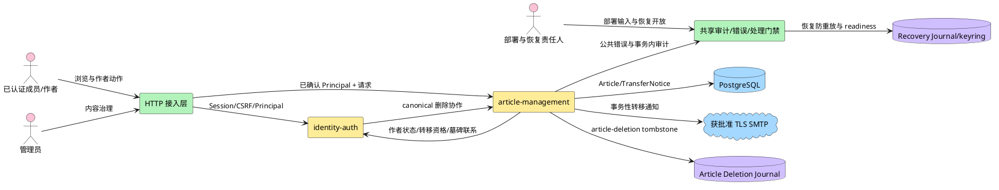

**说明**：HTTP 接入层和 identity-auth 先把 Cookie 转换成可信 Principal；article-management 不解析 Cookie、密码或 CSRF。文章模块拥有 Article、TransferNotice、DeletionOperation 和独立 `article-deletion` namespace；Recovery Journal 的 `recovery/*` namespace 仍由恢复能力拥有。两者最多复用受控持久卷底座、keyring loader 实现和文件安全原语，不共享目录、writer lock、环境变量命名空间、key material、记录链、接口或 HMAC domain。

### 2.3 特性影响分析

| 视角 | 影响 |
|---|---|
| 运行 | PostgreSQL 保存文章、通知和 DeletionOperation；外部 Article Deletion Journal 保存最小 tombstone；SMTP 只承接转移通知；恢复期间 readiness 关闭 |
| 开发 | `internal/article` 按 handler/service/repository 分层；跨模块只允许 service 端口 |
| 部署 | 数据库、canonical origin、SMTP TLS/处理方、分页与容量配置来自环境或受控登记 |
| 场景 | 普通文章路径与治理路径共享 Article，不共享授权判断或通知失败语义 |
| 数据 | 新增 Article、TransferNotice/Recipient、DeletionOperation、DeletionReplayRun/Evidence；外部 tombstone/evidence 无内容或 PII；identity 只消费 DTO |

### 2.4 特性级方案选择

#### 2.4.1 分页选择

文章列表需要在新文章持续写入时保持稳定。常见方案是 offset、页码和 keyset cursor；本设计参考 PostgreSQL keyset pagination 的“以稳定排序键继续扫描”思想，不借用任何产品整体架构。

| 方案 | 实现机制 | 优势 | 劣势 |
|---|---|---|---|
| offset/limit | 跳过 N 行 | 客户端简单；可跳页 | 深页扫描成本增长；并发新增导致重复或漏项 |
| 页码 | 页码换算 offset | 用户理解直观 | 继承 offset 缺陷；总页数需额外统计 |
| keyset cursor | 以最后一条 `(created_at,id)` 继续 | 并发新增不扰动已翻页窗口；索引可直接支持 | 不支持任意跳页；cursor 需版本化 |

本项目只要求顺序分页，不要求跳页或总页数，因此选择 keyset cursor。成员列表不用数据库长事务 read view，而采用有界 SQL 批次的持续扫描：

1. CursorCodec 集中解码并验证版本、view、RFC 3339 时间范围、UUID 格式和完整字段；cursor 不承担授权。
2. Repository 从 cursor 之后按 `(created_at DESC,id DESC)` 读取一个配置化候选批次；r29 部署基线为 200，配置值必须大于 `MaxLimit`，因此必然不小于 `limit+1`。
3. `IdentityAuthorStatusReader` 对该批候选中的非空 author_id 一次批量读取状态。
4. VisibilityPolicy 过滤候选并按原顺序追加可见项。
5. 可见项达到 `limit+1` 时停止；不足则以“最后扫描候选”作为内部扫描位置继续下一批，直到取得 `limit+1` 可见项或候选耗尽。
6. 响应只返回前 `limit` 项；`next_cursor` 基于“最后返回的可见项”。第 `limit+1` 个可见项不消费，下页会再次扫描并返回。
7. 全部候选耗尽时 `next_cursor=null`。隐藏密集区可能增加内部批次数，但不能形成空页后仍有稳定可见项被跳过的结果。

在文章集合和可见性不变的遍历中，该算法保证可见项不漏、不重复；同时间戳由 ID 打破平局。并发新增且排序键新于当前 cursor 的文章只会在重新从首页读取时出现，不插入当前遍历；内容修改不改变排序；遍历期间的违规/停用/删除变化按每次请求的当前事实计算，不提供跨请求快照保证。

#### 2.4.2 并发更新选择

| 方案 | 实现机制 | 优势 | 劣势 |
|---|---|---|---|
| 最后写入者覆盖 | 不比较版本 | 实现最少 | 作者修改、违规治理和转移可互相静默覆盖 |
| 时间戳比较 | 比较 `updated_at` | 字段直观 | 时钟精度和序列化造成歧义 |
| `version + ETag` | 每次写递增版本，`If-Match` 比较 | HTTP 标准；精确发现冲突；不依赖时钟 | 客户端写前必须读取当前 ETag |

选择 `version + ETag`。治理和永久删除属于不可逆或高影响动作，要求客户端显式确认自己看到的版本；其劣势由管理界面先读详情再操作缓解。

#### 2.4.3 永久删除选择

| 方案 | 实现机制 | 优势 | 劣势 |
|---|---|---|---|
| 软删除 | 保存正文并标记 deleted | 易恢复、易追踪 | 直接违反不可恢复；内容仍可被应用取回 |
| 归档后删除 | 正文转移到归档存储 | 可审计 | 仍保存可恢复内容；新增存储 |
| 物理删除 + 最小审计 | 只删除业务库 Article | 活跃库不可恢复 | 旧备份会复活删除前内容，已被 review r01 否决 |
| 外部 tombstone + finalizer | 先隐藏和登记操作，外部耐久 tombstone 后物理删除 | 跨业务库备份恢复可重放；不保存内容 | 引入跨介质协议、inventory 和 key 留存 |

依据 ADR-0020 选择外部 tombstone + finalizer。授权与 ETag 通过后，数据库事务把 Article 置为内部 `deletion_pending` 并创建 DeletionOperation；Article 立即对成员、作者和管理员全部不可见。`article-deletion/*` namespace 原子追加 tombstone 并 fsync 后，finalizer 在新事务物理删除 Article、追加 AuditEvent 并完成 operation。API 只有在 tombstone 与物理删除双完成后返回 204。

Journal 成功而数据库步骤失败时，Article 保持 `deletion_pending`，后台 finalizer 和授权重试继续收敛，永不恢复公开。旧备份恢复后、readiness 开放前必须重放全部有效 tombstone。tombstone 不保存标题、正文、内容摘要、邮箱或其他 PII。

#### 2.4.4 正文存储与输出安全

| 方案 | 实现机制 | 优势 | 劣势 |
|---|---|---|---|
| 原始文本 + JSON 转义 | 数据库存 text，消费者按文本渲染 | 服务端不增加脚本执行面；不绑定富文本格式 | 无富文本能力；客户端仍须安全渲染 |
| 保存原始 HTML | 直接存/渲染 HTML | 表达力强 | XSS 面最大；需成熟 sanitizer 和策略 |
| Markdown 源文 + 安全渲染 | 存源文，读取时渲染 | 可读性和表达力折中 | 需拍板方言、链接、HTML 和 sanitizer |

首期明确选择“原始纯文本 + JSON 字符串”。服务端不解析或渲染 Markdown/HTML；`<script>`、`# heading`、链接语法等标记与其他字符同等对待，按请求原值保存并按原值输出。校验可用 Unicode whitespace trim 判断是否存在至少一个非空白 code point，但不得把 trim 后的值写回，也不得自动改写内容。长度在 JSON 解码后按 Unicode code point（Go rune）计数：`title` 最大 200，`body` 最大 20000；不是按 UTF-8 byte、UTF-16 code unit 或 grapheme cluster 计数。

空字符串、全 Unicode 空白、`title` 超过 200 rune 或 `body` 超过 20000 rune 时，创建与替换都返回既有 `422 article.validation_failed`，且整个写操作不得产生持久化副作用。任一字段失败即拒绝整次写入；合法输入保留包括前后空白在内的原始字符串。

字段字符上限不能替代 HTTP 请求体总 byte 上限：JSON 转义和多字节 UTF-8 会使 wire size 与 rune 数不同。Article 创建与修改统一采用 256 KiB（`262144` bytes）上限，数值来自本轮用户采用的容量建议，不由 200/20000 rune 反推。byte 的唯一计数对象是服务器从 `http.Request.Body` 实际读取的 JSON body payload octets：不含 HTTP headers 与 transfer framing，包含字段名、引号、转义、结构字符、JSON 空白及 UTF-8 内容的每个 byte。`Content-Length` 只可用于提前拒绝，最终判定必须以对 body 的最多 `N+1` bytes 有界读取为准。

创建与修改的共享 wire decoder 必须按以下顺序执行：

1. 最多读取 `N+1` bytes，其中 `N=262144`；实际读取长度为 N 时不因大小被拒绝，可继续后续校验，读取到 N+1 时立即返回 `400 request.invalid_json`。
2. 对长度不超过 N 的原始 bytes 先验证整个 body 是合法 UTF-8；非法 UTF-8 必须在 JSON tokenization/unmarshal 或任何 replacement 前返回同一 `400 request.invalid_json`。
3. 只有通过 byte 上限和 UTF-8 检查后，才执行 JSON 结构/字段解码与 ArticleValidator 的 Unicode whitespace、rune 长度校验。

超限和非法 UTF-8 都不得调用 Article repository，也不得把非法 byte 替换为 U+FFFD 后保存。创建路径不得新增 Article；修改路径的 `title`、`body`、`version`、`updated_at` 及治理状态全部不变。

本期不引入 sanitizer、Markdown/HTML 渲染器或相关第三方依赖。若未来增加富文本能力，必须回到需求、边界和安全设计，明确方言、渲染上下文、sanitizer 与依赖治理；不能把本期正文直接当可信 HTML。

## 3 特性/功能实现原理

### 3.1 总体方案

#### 3.1.1 主轴

全文以 Article 数据流为主轴：`业务 Article → 删除 tombstone/operation → 恢复重放 → 不可变 evidence → identity DTO Gate`。每个动作只改变自己拥有的事实；永久删除和恢复证据都不复制内容。

#### 3.1.2 逻辑视图：业务能力

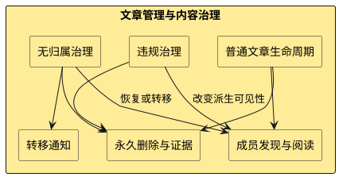

**说明**：普通生命周期、违规治理和无归属治理都作用于 Article，但分别拥有内容、违规事实和归属处置。永久删除是三个入口共享的终态；通知只跟随已提交的转移事实。

#### 3.1.3 逻辑视图：核心对象

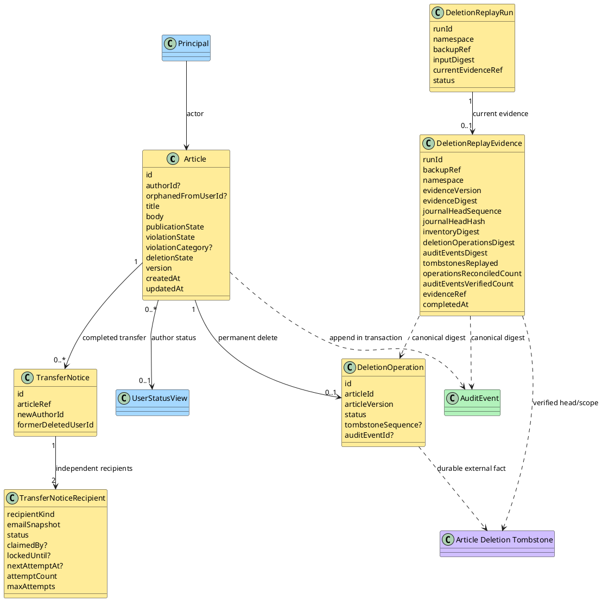

**说明**：Article 是内容、归属、发布意图和违规事实的唯一权威；`deletion_pending` 只表示删除协议正在收敛。DeletionReplayEvidence 是 article-owned 不可变恢复证据，绑定当前 run/backup/namespace，只保存删除重放摘要和计数，不保存文章内容或 PII。

#### 3.1.4 逻辑视图：代码框架

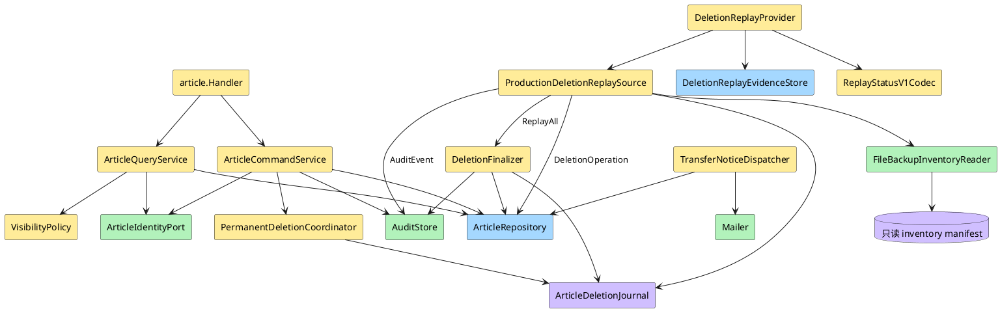

**说明**：DeletionReplayProvider 统一实现 `ReplayAndVerify/ReadStatus`，持久化不可变 evidence，并向 identity 仅返回 DTO。`ProductionDeletionReplaySource` 是 article-management 唯一 production source：它只从同一个 production Article Deletion Journal/active+retained keyring、必填 `FileBackupInventoryReader`、ReplayAll、PostgreSQL DeletionOperation 与 AuditEvent 取得真实输入；调用方不得传入合成计数、摘要或“已验证”标记。备份/灾备运行责任角色在业务 PostgreSQL 恢复域外生成并签发 manifest，部署/恢复责任角色只读挂载；article 只验证消费。identity 不获得 Journal、inventory、DeletionOperation、AuditEvent 或 evidence 表读取权。

#### 3.1.5 开发视图

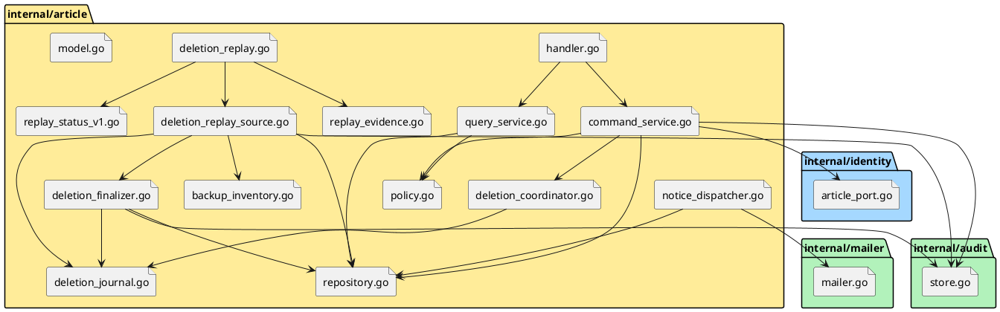

**说明**：目录按 ADR-0008 保持业务模块可见。article 不导入 identity 的 repository 或表实现；`article_port.go` 暴露最小 service 接缝。S4.2 只允许在既有 `cmd/han-server` composition root 装配唯一 `ProductionDeletionReplaySource`，不得建立第二 source、第二 Journal parser、第二 server/router/composition、隐藏 global 或 service locator。S4.6 已完成的日常删除 production composition 不重开；Task-Planner 必须把本次共享文件修改与其现役 owner 串行对账。

通知增量由 `notice_dispatcher.go -> Repository/Mailer/NoticeProcessingGate/AuditStore` 组成。Gate 适配留在 `cmd/han-server/main.go`，其事务 reader 复用 `internal/privacy/store.go`；不形成 `article -> identity/privacy SQL` 依赖。`cmd/han-server/lifecycle.go` 将通知 worker 与既有 deletion/password-reset workers 一同持有和关闭；精确影响面见 §8.5。

最小候选文件与责任如下；它们是实现影响面，不是 task 清单：

| 候选文件 | 最小责任 |
|---|---|
| `internal/article/deletion_replay.go` / `replay_evidence.go` | provider 编排、ReadCurrent、generation/token CAS、evidence/current 原子发布、commit unknown 收敛 |
| `internal/article/deletion_replay_source.go`（新增）及测试 | 唯一 production source；Snapshot 刷新只读 Facts，ReplayOldBackup 另带真实 ReplayAll 结果；复用同一 Journal/keyring/inventory/PG facts |
| `internal/article/backup_inventory.go`（新增）及测试 | concrete production `FileBackupInventoryReader`；严格解析、canonical digest、文件安全与每次调用 snapshot 验证 |
| `internal/article/replay_status_v1.go` / `model.go` | 直接消费或编译期 alias `internal/recovery` authority；不复制 version/namespace/digest/canonical 字面量 |
| `internal/article/deletion_journal.go` / `deletion_finalizer.go` / `repository.go` 及测试 | 暴露 source 所需最小真实读/ReplayAll/operation/audit 能力；不新增平行 parser 或第二数据源 |
| `cmd/han-server/main.go` / `main_test.go` | 在唯一 composition root 从 `HAN_ARTICLE_BACKUP_INVENTORY_PATH` 构造并注入 `FileBackupInventoryReader`、同一 Journal/keyring、PostgreSQL store/repository、Audit reader 与 finalizer；依赖缺失时 fail closed |
| `internal/article/deletion_replay_integration_test.go`（新增） | A-REC-04～07 的真实 PostgreSQL 多连接/多事务与时间精度/commit unknown 验证 |
| `migrations/0009_article_replay_attempt.sql`（新增） | 前向增加 attempt generation/token 及一致性约束；不修改 `0003_article.sql` 或既有 migration |

architecture r28/ADR-0020 已批准 concrete production provider：article-owned `FileBackupInventoryReader` 读取恢复域外签发、部署只读挂载的单一 strict JSON manifest。唯一路径输入是 `HAN_ARTICLE_BACKUP_INVENTORY_PATH`；不存在默认、别名、配置文件、目录扫描、远程 API、业务数据库或 fixture fallback。若未来改为签名服务、远程 API 或新信任服务，必须先回 architecture/ADR；本设计不得预留第二 provider 或 service locator。

#### 3.1.6 进程视图

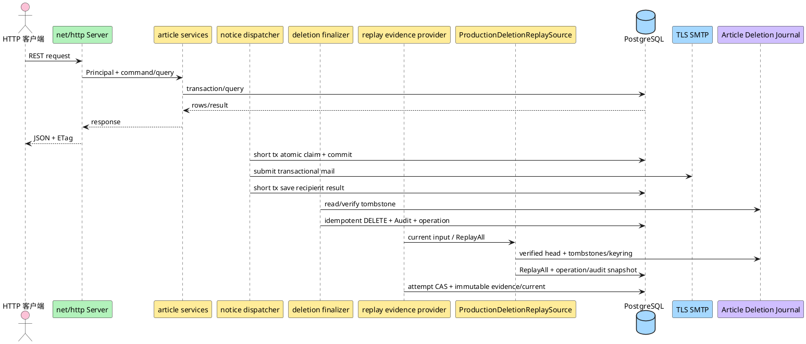

**说明**：Replay provider 在维护模式内运行，并只经唯一 `ProductionDeletionReplaySource` 取得真实 Journal/inventory/ReplayAll/operation/audit 输入；source 与 provider 都由唯一 `cmd/han-server` composition 显式构造，依赖缺失时保持停服。日常 finalizer worker 由唯一 `cmd/han-server` 启动：构造全部依赖后先同步完成一次即时调谐，再启动 HTTP Serve；随后由 ticker 和容量为 1 的合并唤醒通道驱动。唤醒仅降低延迟，正确性始终依赖 PostgreSQL discovery。worker 与两台 HTTP server 加入同一个 ADR-0022 one-shot lifecycle，不改变 signal 成功退出 0、server/shutdown/cleanup 失败非零的全局语义。

通知 worker 同属该进程与 lifecycle；同一协调器在首次 Reconcile 前即接管 signal/父取消，并在有界初次调谐期间持续监听，正常完成后才允许 Start 和 HTTP Serve。通知仍在删除及 password-reset 的既有初始化之后调谐，不改三者业务语义。停止触发即固定共享 deadline、禁止后续 claim/Send/Start/Serve、取消在途调用；仅允许当前结果在剩余共享预算内做一次 fenced 保存。初次调谐调用与运行 worker 都实际 join 后才关闭依赖；精确合同见 §3.3.8，不新增 root、状态库或独立关闭流程。

#### 3.1.7 物理视图

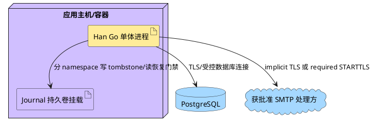

**说明**：Article、TransferNotice/Recipient、DeletionOperation 和 DeletionReplayEvidence 位于 PostgreSQL。Article Deletion Journal 使用部署提供的独立持久根目录 `<root>/article-deletion/v1/records`；根目录位于业务数据库恢复域之外。Recovery Journal 即使共享同一挂载或 loader/file-safety 实现，也必须使用不同子树、环境变量前缀、key material、writer lock、记录链与 HMAC domain。

#### 3.1.8 场景视图（+1）

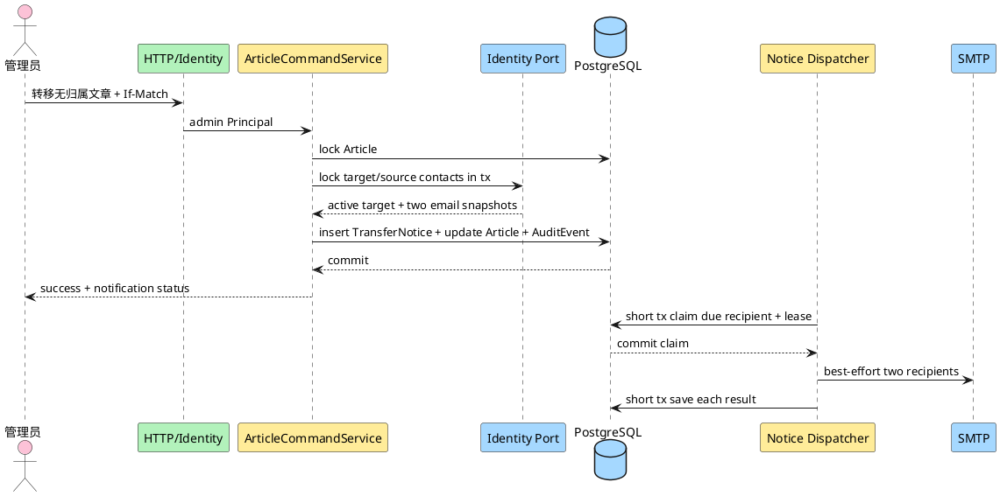

**说明**：通知地址在清除 `orphaned_from_user_id` 前进入独立 recipient。提交后 Article 已转移；两路 SMTP 状态和 lease 独立。数据库 claim 在 SMTP 前已提交，网络调用不跨数据库事务。

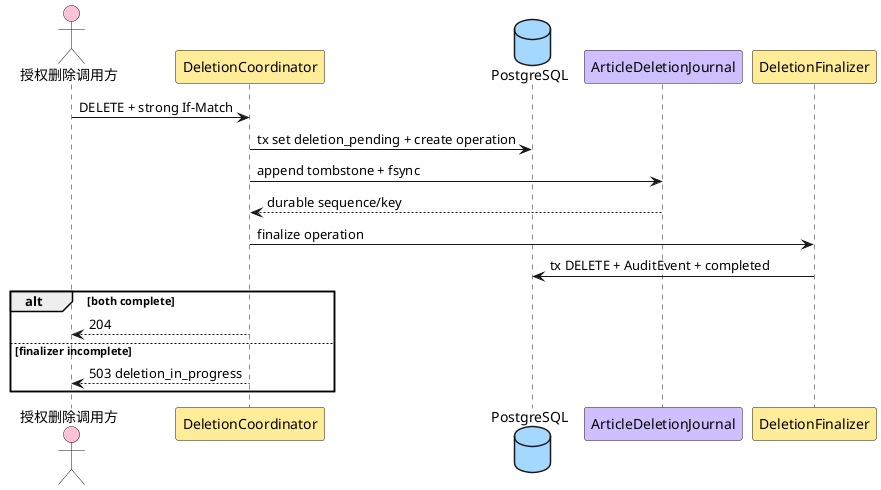

**说明**：删除请求先让 Article 对所有消费者不可见，再写业务数据库外 tombstone。204 只对应 tombstone 与物理删除双完成；Journal 成功而数据库失败时，Article 保持 pending，由 finalizer 继续收敛。

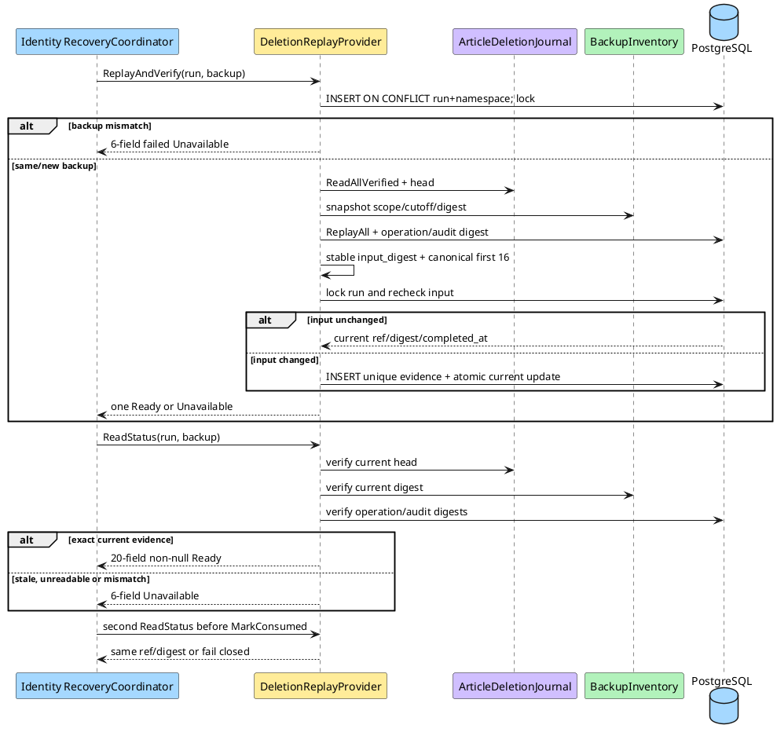

**说明**：唯一 run 行先绑定 backup；同 backup 并发由行锁和 evidence 唯一约束收敛为同一 ref/digest/time，错 backup 一方稳定失败。Identity 使用共享 fixture 重算 DTO digest，并在 MarkConsumed 前二次读取。

#### 3.1.9 Story 拼图与依赖

| 特性维度 | 01 创建 | 02 浏览 | 03 修改 | 04 作者删除 | 05 管理员删除 | 06 无归属处置 | 07 转移通知 | 08 违规治理 |
|---|---:|---:|---:|---:|---:|---:|---:|---:|
| 身份/权限 | ✓ | ✓ | ✓ | ✓ | ✓ | ✓ | ✓ | ✓ |
| 内容与版本 | ✓ | ✓ | ✓ | ✓ | ✓ | ✓ | 读 | ✓ |
| 正交状态/可见性 | 初始化 | 核心 | 保持 | 终态 | 终态 | 核心 | 保持 | 核心 |
| 审计 | 运行日志 | 不适用 | 运行日志 | ✓ | ✓ | ✓ | ✓ | ✓ |
| 邮件/隐私 | 不适用 | 不适用 | 不适用 | 不适用 | 不适用 | 快照 | 核心 | 不适用 |
| 删除/恢复 | 不适用 | 双 Journal 门禁 | 不适用 | Deletion Journal | Deletion Journal | 处置集合/Deletion Journal | 清理前置 | 违规保留/Deletion Journal |

### 3.2 用户与调用方行为

| 调用方动作 | 页面/调用状态 | 成功反馈 | 失败反馈 |
|---|---|---|---|
| 创建文章 | 标题/正文输入 | 进入详情；返回 201、Location、ETag | 字段错误；未产生文章 |
| 浏览列表/详情 | 加载、空列表、下一页 | 倒序 items；详情含标题正文 | 未登录 401；不存在/不可见/已删除统一不可用 |
| 修改自己的文章 | 普通详情或“我的文章”受控详情取得 ETag | 作者响应仅返回内容、通用受限状态和 editable；违规文章仍隐藏 | 非作者/已删/删除 pending 不可用；冲突 412 |
| 作者删除 | 删除确认交互待拍板 | tombstone 与物理删除双完成后 204 | 未双完成返回 503，文章保持不可见并收敛 |
| 管理员删除普通文章 | 管理详情后操作 | 双完成 204 + 审计 | 非普通状态使用对应治理入口 |
| 查看无归属文章 | 管理列表/详情 | 返回隐藏原因、版本和处置能力 | 非管理员 403；非待处置文章不可用 |
| 普通管理员浏览/筛选并读取治理详情 | 加载、空列表、下一页、切换 all/violating/hidden 后重新从首页读取 | 200 管理员列表或完整详情；详情 ETag 供既有治理写操作使用 | 非管理员 403；非法 view 422；错 view cursor 400；pending/不存在详情 404；身份不可靠时整请求 503，按新请求重试 |
| 恢复公开/转移/删除无归属文章 | 基于管理详情与 ETag | 新状态、通知排队或 204 | 违规恢复公开 409；目标不合格 422；冲突 412 |
| 判定/解除/删除违规文章 | 管理详情与 ETag | 隐藏原因重算或 204 | 非管理员 403；错误状态 409 |
| 恢复协调方核对文章删除重放 | 维护模式、run+backup | 返回唯一 Ready 或 Unavailable | Unavailable 立即禁止 MarkConsumed/open |

### 3.3 Story 详细设计

#### 3.3.1 共享基础

##### 实现设计

所有 HTTP 请求先经过 identity 接入层。安全方法只要求有效 Session；`POST/PUT/DELETE` 还要求 `X-CSRF-Token`。article handler 收到的 Principal 至少含 `user_id,role,is_initial_admin,status,onboarding_gate`；受限或非 active Principal 不进入文章服务。

成员可见性公式是：

```text
exists
AND deletion_state = active
AND publication_state = published
AND violation_state = clear
AND (author_id IS NULL OR author.status = active)
```

管理员可通过治理详情查看所有 `deletion_state=active` 文章的完整 `violation_category` 与 `hidden_reasons`，但不能查看 `deletion_pending` 内容。作者可通过受控“我的文章详情”读取 `author_id=Principal.user_id` 且 deletion active 的文章，包括 violating 文章，以取得内容和 ETag；作者投影只给出 `moderation_status=normal|restricted` 与 `editable=true`，不返回类别或原因。普通成员仍按成员可见性处理，受限文章统一 404。

##### 类/组件设计

| 组件 | 唯一职责 | 不变量 |
|---|---|---|
| `ArticleCommandService` | 创建、修改、治理、转移和永久删除 | 写前授权、锁行、版本比较、状态转换和事务边界集中 |
| `ArticleQueryService` | 成员与管理员查询 | 所有成员查询必须调用 VisibilityPolicy |
| `CursorCodec` | 集中编码/解码 cursor | 校验版本、view、时间/UUID 范围；不承担授权 |
| `VisibilityPolicy` | 从 Article + User.status 派生可见性和原因 | 不持久化结果，不修改状态 |
| `AuthorProjectionPolicy` | 把自有 Article 投影为 normal/restricted + editable | 只输出通用状态，不输出治理类别或原因集合 |
| `ArticleRepository` | Article/TransferNotice/Recipient/DeletionOperation/ReplayEvidence SQL 与行锁 | 不解释 Principal 或角色 |
| `ArticleIdentityPort` | 批量作者状态、转移双方资格/联系、retained_email 清理协作 | 不复制 identity 内部实现 |
| `AuditStore` | 在调用方事务追加 AuditEvent | 无更新/删除 |
| `TransferNoticeDispatcher` | claim 到期 recipient 并在事务外调用 Mailer | 不能更新 Article；每个收件人独立 lease/结果 |
| `PermanentDeletionCoordinator` | 建立 pending/operation、耐久 tombstone、同步尝试 finalizer | 204 只在双完成后 |
| `ArticleDeletionJournal` | `article-deletion/*` 最小 tombstone、验链、fsync、inventory 核对 | 不保存内容/PII；不混用 recovery namespace |
| `DeletionFinalizer` | 从 tombstone 幂等物理删除、审计、完成 operation | Journal 成功后不得恢复公开 |
| `DeletionReplayProvider` | `ReplayAndVerify/ReadStatus`、attempt 编排、证据生成和失效判断 | 每个 invocation 最多生成一个 candidate token；内部读取 attempt 后确定性 Begin；identity 只消费 DTO |
| `ProductionDeletionReplaySource` | 以同一 Journal/keyring、文件 inventory 和 operation/audit 刷新只读 Facts；ReplayOldBackup 另携真实 ReplayAll 分项 | 唯一 production source；Snapshot 不生成执行计数；不接受调用方合成计数、摘要或 verified 标记 |
| `DeletionReplayEvidenceStore` | `LoadAttempt/Begin/Publish/Fail/ReadCurrent`；选择并耐久绑定真实执行分项，追加 immutable evidence、维护 current | Facts/执行结果/公共 DTO 分离；exact generation/token CAS；evidence 无 UPDATE/DELETE；旧 Fail 不覆盖新 Ready |
| `FileBackupInventoryReader` | 从受控只读文件读取并验证当前 backup scope/cutoff、recoverable entries 和 canonical digest | article-owned concrete production provider；每次 replay/freshness 重开 snapshot，不缓存、不回退 fixture |
| `ReplayStatusV1Codec` | 消费 recovery authority 的 Ready/Unavailable 类型与 CanonicalJSON/CanonicalDigest | article 不复制 version/namespace/fixture digest/canonical 字面量 |

**ReplayStatus authority 与时间规范**：

1. 唯一 Go authority 是 `internal/recovery/replay_status_v1.go` 中的 `ReplayEvidenceVersionV1`、`ArticleDeletionNamespaceV1`、`ReadyFixtureDigestV1`、Ready/Unavailable 类型及 `CanonicalJSON/CanonicalDigest`。允许依赖方向仅为 `internal/article -> internal/recovery`；禁止 `internal/recovery -> internal/article`。Article 可直接消费或做 compile-time alias，不得复制字面量或建立第二套 canonical encoder。数据库 migration 中的 CHECK 字面量仅是持久化约束，不是 Go authority，必须由契约测试与 recovery authority 对齐。
2. replay 时间唯一规范是 `t.UTC().Truncate(time.Microsecond)`。`backup_cutoff`、参与 operation/audit source digest 的完成时间、evidence `completed_at` 以及数据库回读时间都必须先规范化，再参与 input/evidence digest、INSERT/UPDATE 或首次响应编码。禁止先以纳秒值响应、再让 PostgreSQL 截断。
3. 当前十项 Facts 未漂移时，复用 current evidence 已耐久绑定的执行分项和 `evidence_ref/evidence_digest/completed_at`；不从 Snapshot 发明分项、不取新时钟/ref。完整 canonical 仍包含全部计数；历史匹配与发布前崩溃的区别见 §3.4.7。source 时间不可解析或无法规范化时返回 Unavailable。

##### 恢复事实快照与执行结果（r22）

`DeletionReplayFacts` 是可重读的当前事实，`DeletionReplayInput` 另携一次完整成功 ReplayAll 的真实物理分项。前者不能重建过去某轮删了几条；后者不能把失败或部分执行的计数当作成功 evidence。内部类型只定义在 `internal/article`，不新增公共 DTO、状态 authority 或持久表：

```go
type DeletionReplayFacts struct {
    JournalHeadSequence               int64
    JournalHeadHash                   string
    InventoryScope                    string
    BackupCutoff                      time.Time
    InventoryDigest                   string
    DeletionOperationsDigest          string
    AuditEventsDigest                 string
    TombstonesTotal                   int64
    DeletionOperationsReconciledCount int64
    AuditEventsVerifiedCount          int64
}
type DeletionReplayInput struct {
    DeletionReplayFacts
    TombstonesReplayed int64
    AlreadyAbsent      int64
}
```

`DeletionReplaySource.Snapshot(context.Context, string) (DeletionReplayFacts, error)` 每次重新验证同一 backup 的 Journal/keyring、文件 inventory、operation/audit 并返回全部十项，零 ReplayAll、零业务写，不返回执行分项。`ReplayOldBackup(context.Context, string) (DeletionReplayInput, error)` 继续由真实 Finalizer 完整执行后返回 Facts 和实际 Deleted/AlreadyAbsent 分项，绝不将 absent 清零、改报 replayed 或按 completed operation 倒推首次物理结果。Finalizer 与 Source 构造签名、依赖实例保持。

Store 的 `Begin(context.Context, string, string, AttemptSnapshot, DeletionReplayFacts, string) (BeginResult, error)` 以 fresh Facts 代替执行前并不存在的完整 input digest；`ReplayPublishRequest.Input` 仍为 `DeletionReplayInput`，`Refresh` 及 `ReadCurrent` 的刷新回调统一为 `func(context.Context) (DeletionReplayFacts, error)`。其余 request 字段、Store/Provider 构造及公共 `ReplayAndVerify/ReadStatus(context.Context, string, string) ([]byte, error)` 不变。完整发布、复用和错误合同唯一见 §3.4.7。

##### 生产配置、Journal provider 与路由组合

所有键仅由 ADR-0008 环境变量 loader 读取，并与现有 `startupConfig` 一次性解析；缺失、空白、格式错误、超范围或交叉约束失败均在 DB parse/connect/ping/migrate 之前终止启动。允许空字符串表示“没有 retained key”的键必须用 `LookupEnv` 区分“已显式配置为空”与“缺失”；动态 HMAC 环境变量名只能由已验证的 version token 拼接。QueryConfig 错误使用下述 query configuration 最小披露合同；删除配置错误继续稳定包装为 `validate Article deletion configuration: <key-or-category>`。公共错误与结构化日志不得包含配置原值、secret、DSN、Journal 绝对路径、retained version 清单、HMAC、tombstone body、文章内容或 PII。

| 环境变量 | 来源/必填与默认 | 格式、范围与基线 | 敏感性与日志 |
|---|---|---|---|
| `HAN_ARTICLE_QUERY_DEFAULT_LIMIT` | 环境；必填、无默认；r29 生产部署基线 `20` | 无首尾空白且完整匹配 `[1-9][0-9]*`；按 signed 32-bit 解析后安全转换为 Go `int`，范围 `1..2147483647`；映射 `QueryConfig.DefaultLimit` | 仅错误键/类别；禁止回显原值 |
| `HAN_ARTICLE_QUERY_MAX_LIMIT` | 环境；必填、无默认；r29 生产部署基线 `100` | 同上；映射 `QueryConfig.MaxLimit`，且 `DefaultLimit <= MaxLimit` | 仅错误键/类别；禁止回显原值 |
| `HAN_ARTICLE_QUERY_CANDIDATE_BATCH_SIZE` | 环境；必填、无默认；r29 生产部署基线 `200` | 同上；映射 `QueryConfig.CandidateBatchSize`，且 `CandidateBatchSize > MaxLimit` | 仅错误键/类别；禁止回显原值 |
| `HAN_ARTICLE_TRANSFER_NOTICE_MAX_ATTEMPTS` | 现役 S6.2 环境；必填、无默认 | 严格正十进制 signed bigint `1..9223372036854775807`；只在创建时快照两 recipient，dispatcher 不用新配置覆盖存量 | 低敏；仅键/类别 |
| `HAN_ARTICLE_TRANSFER_NOTICE_POLL_INTERVAL` | 新增环境；必填、无默认 | Go duration，正整数微秒；驱动空轮及可恢复故障后的下一轮 | 低敏 |
| `HAN_ARTICLE_TRANSFER_NOTICE_BATCH_LIMIT` | 新增环境；必填、无默认 | 严格十进制 `1..2147483647`；一轮维护/发送各自的处理上限；逐条 claim、不预占整批、不预分配该长度数组 | 低敏 |
| `HAN_ARTICLE_TRANSFER_NOTICE_LEASE_DURATION` | 新增环境；必填、无默认 | 正整数微秒 duration；必须大于 `HAN_SMTP_OPERATION_BUDGET + 4 * DBOperationBudget`，检查加乘溢出 | 低敏 |
| `HAN_ARTICLE_TRANSFER_NOTICE_DB_OPERATION_BUDGET` | 新增环境；必填、无默认 | 正整数微秒 duration；每个短事务或一次 commit-unknown 回读的总预算，包含 pool 获取与锁等待 | 低敏 |
| `HAN_ARTICLE_TRANSFER_NOTICE_BACKOFF_INITIAL` | 新增环境；必填、无默认 | 正整数微秒 duration，且不大于 BACKOFF_MAX | 低敏 |
| `HAN_ARTICLE_TRANSFER_NOTICE_BACKOFF_MAX` | 新增环境；必填、无默认 | 正整数微秒 duration；退避上限，溢出前饱和 | 低敏 |
| `HAN_ARTICLE_BACKUP_INVENTORY_PATH` | 部署/恢复责任角色；必填、无默认、别名或配置文件回退 | 无首尾空白；必须是绝对路径且 `filepath.Clean(value)==value`；只指向一个受控只读 regular file，不接受相对路径、目录扫描或 fixture | 敏感路径；错误、日志和指标只记键/稳定类别，不回显路径 |
| `HAN_ARTICLE_DELETION_JOURNAL_ROOT` | 部署挂载；必填、无默认 | 绝对 clean path；根已存在、非 symlink、owner-controlled、owner-only；应用不从 cwd 猜测 | 敏感路径；只记错误类别 |
| `HAN_ARTICLE_DELETION_JOURNAL_FILE_MODE` | 环境；可选，默认 `0600` | 四位八进制；必须允许 owner 读写且 group/other 位为 0 | 低敏；可记规范化 mode，不记路径 |
| `HAN_ARTICLE_DELETION_KEY_CURRENT_VERSION` | 密钥部署；必填、无默认 | 1～64 字节 ASCII token；不得出现在 retained 集合；固定逻辑 `key_id=article-deletion-hmac` | 敏感标识；仅记 invalid/missing |
| `HAN_ARTICLE_DELETION_RETAINED_KEY_VERSIONS` | 密钥部署；必填；空字符串表示无 retained key | 逗号分隔唯一 token；禁止空项、重复和 current 重复 | 敏感清单；禁止记录原值 |
| `HAN_ARTICLE_DELETION_HMAC_KEY_<version>` | 每个 active/retained version 对应 secret；全部必填 | unpadded base64url；解码后 32～64 bytes | secret；禁止日志、错误回显和持久化副本 |
| `HAN_ARTICLE_FINALIZER_WORKER_ID` | 部署实例；必填、无默认 | 1～128 字节稳定实例 token | 日志仅允许 hash/截断关联值 |
| `HAN_ARTICLE_FINALIZER_POLL_INTERVAL` | 环境；必填、无代码默认；部署基线 `1s` | 现有 duration parser；`100ms..1m` | 低敏 |
| `HAN_ARTICLE_FINALIZER_BATCH_SIZE` | 环境；必填；部署基线 `50` | 十进制整数 `1..500` | 低敏 |
| `HAN_ARTICLE_FINALIZER_LEASE_DURATION` | 环境；必填；部署基线 `30s` | duration `5s..5m` | 低敏 |
| `HAN_ARTICLE_FINALIZER_OPERATION_BUDGET` | 环境；必填；部署基线 `10s` | duration `1s..1m` | 低敏 |
| `HAN_ARTICLE_FINALIZER_BACKOFF_INITIAL` | 环境；必填；部署基线 `250ms` | duration `50ms..10s` | 低敏 |
| `HAN_ARTICLE_FINALIZER_BACKOFF_MAX` | 环境；必填；部署基线 `30s` | duration `1s..5m` | 低敏 |
| `HAN_ARTICLE_FINALIZER_MAX_ATTEMPTS_PER_WAKE` | 环境；必填；部署基线 `3` | 十进制整数 `1..10` | 低敏 |
| `HAN_ARTICLE_FINALIZER_SHUTDOWN_BUDGET` | 环境；必填；部署基线 `10s` | duration `1s..60s` | 低敏 |

**Production Backup Inventory 文件合同**：

- authority 与 owner：备份/灾备运行责任角色从业务 PostgreSQL 恢复域外的备份控制面事实生成并签发 manifest；部署/恢复责任角色负责把该精确文件只读挂载到配置路径；article-management 只验证和消费，禁止写回、补全、推断或生成第二份 inventory。v1 的“签发”表示责任角色批准受控产物发布，不表示 `inventory_digest` 是密码学签名。
- 顶层字段只允许且固定顺序为 `inventory_version,inventory_scope,backup_ref,backup_cutoff,generated_at,recoverable_backups,inventory_digest`。`inventory_version` 必须等于 `article-backup-inventory/v1`；`inventory_scope` 必须等于 `recoverable-backups-before-cutoff`。
- `recoverable_backups` 是非空数组；每项只允许且固定顺序为非空 `backup_ref,backup_completed_at`。数组按 `(backup_completed_at,backup_ref)` 的 UTF-8 字节序升序，组合不得重复。顶层 `backup_ref` 必须精确出现一次且该项 `backup_completed_at == backup_cutoff`；其余项不得晚于 inclusive cutoff，`generated_at` 不得早于 cutoff。
- `backup_cutoff`、`generated_at` 和每个 `backup_completed_at` 必须是 UTC、恰好六位小数的 `YYYY-MM-DDTHH:MM:SS.ffffffZ`。非 UTC、少于或多于微秒、非法日期或需要静默舍入的值全部拒绝。
- canonical JSON 固定 UTF-8、无 BOM、无额外字段、无多余空白，按上述字段、类型和数组顺序编码。digest payload 是排除末尾 `inventory_digest` 的完整 canonical 顶层对象；`inventory_digest` 必须是 `sha256:` 加 64 位小写十六进制 SHA-256。未知版本、缺失/null/别名、重复键、类型漂移、字段或数组乱序、重复 entry、摘要不符均 fail closed。
- 调用参数、manifest 顶层、RecoveryRun、Recovery Journal 与 ReplayStatus 的 `backup_ref` 必须全等；scope/cutoff 不匹配按 wrong inventory 处理。通过验证的 `inventory_digest` 必须进入稳定 `input_digest`。
- 文件上限为 `1,048,576` bytes。配置路径和最终对象均不得是 symlink；打开后必须是 regular file、descriptor 只读且文件无任何 write mode bit，部署还必须证明服务进程看到只读挂载。POSIX 至少拒绝 group/other writable；无法证明等价 owner/ACL、只读挂载、no-follow 或原子替换语义的平台 unsupported/fail closed。
- reader 每次 `ReplayAndVerify` 和 `ReadStatus` freshness 都执行 `lstat → no-follow open → fstat → bounded read → fstat → lstat`，核对路径与 descriptor 的身份、类型、大小、权限和稳定性；不长期缓存、不使用 watcher。读取期间替换、身份/大小变化或权限漂移使本次调用失败。签发方只能以同目录临时 regular file 写完整 canonical bytes、同步文件、原子 rename 并同步目录，禁止原地改写。
- 缺失、不可读、超限、权限不安全、wrong backup/cutoff/scope、未知版本、digest mismatch 或任何不可判定结果只能返回 Unavailable/错误并保持恢复 Gate 关闭。禁止远程 API、业务 PostgreSQL authority、缓存、目录“最新文件”、调用方计数/摘要、stub 或 S4.5 fixture fallback。

QueryConfig 的词法与范围校验不做 trim：空值、任何首尾或内部空白、`+`/`-`、小数点、指数、分隔符、非 ASCII 数字、前导零、`0`、负数以及大于 `2147483647` 的值全部失败；不得用缺省值、测试值或其他键回退。字段 parser 对三个键分别独立执行相同合同，每个键都必须接受 `1` 与 `2147483647`；完整匹配十进制正整数语法但值为 `2147483648` 时归类为 `out_of_range`。三个字段全部解析成功后，必须统一校验 `DefaultLimit <= MaxLimit` 与 `CandidateBatchSize > MaxLimit`；因此字段解析合法不等于完整 QueryConfig 合法，字段关系失败统一归类为 `cross_constraint`，不得降格为 `out_of_range`。r29 确认的部署基线 20/100/200 满足 `20 <= 100` 且 `200 > 100`；这不改变“字段解析合法不等于完整配置合法”的既有语义。构造器既有不变量 `DefaultLimit > 0`、`MaxLimit >= DefaultLimit`、`CandidateBatchSize > MaxLimit` 是末端防线，不替代启动配置校验。失败只返回 `validate Article query configuration: <key-or-category>` 形式的键或类别（如 missing、empty、invalid_format、out_of_range、cross_constraint），错误、日志和指标 label 均不得包含原始配置值或其他环境内容。

交叉校验另固定为：`backoff_initial <= backoff_max`；`operation_budget < lease_duration`；`poll_interval < lease_duration`；Article worker shutdown budget 不大于全局 `HAN_SHUTDOWN_BUDGET`；active/retained version 全部唯一且每个 key 可解码。配置阶段必须在 DB 副作用前验证 Journal 根路径、根目录权限、平台能力、固定 namespace/domain、完整 keyring 和全部数值关系；缺关键 path/key 不得回退到 cwd、临时目录、空 key 或 Recovery key。固定后代目录创建、逐段重新校验和 writer lock 获取由 DB ready 后的 Journal provider 构造执行，失败时按 §3.4.5 逆序关闭已建 DB pool 并退出。

启动顺序固定如下，不能因重用现有 parser 或构造器而后移 QueryConfig 校验：

1. 读取全部必填环境变量并在单一 `startupConfig` 阶段完成逐键语法/范围校验和全部交叉约束，包括构造 production `QueryConfig` 及校验 `HAN_ARTICLE_BACKUP_INVENTORY_PATH` 的绝对、clean path 语义。
2. 任一 QueryConfig 缺失、空值、格式错误、溢出或字段关系失败，立即返回启动错误；不得调用 DB DSN parse、connect、ping、migrate，也不得创建 listener、worker、Journal provider 或业务 handler。
3. 只有完整 startup config 成功后，才依次允许 DB parse → connect → ping → migrate。
4. DB ready 后，才构造 Article query repository、Identity author reader、`ArticleQueryService`、handler/router，并按既有顺序构造 Journal provider、`FileBackupInventoryReader`、唯一 `ProductionDeletionReplaySource`、replay provider 与 worker；inventory 文件可以延迟到每次 replay/freshness 打开，但 reader/source 必须在唯一 composition 中显式存在。后续构造失败按 §3.4.5 逆序回收。

```text
<HAN_ARTICLE_DELETION_JOURNAL_ROOT>/       # 部署创建/挂载并保证持久、owner-only
  article-deletion/                        # 应用仅可创建固定后代，0700
    v1/                                    # namespace article-deletion/v1
      .writer.lock                         # 进程级排他锁，随 Journal owner 关闭
      records/                             # 0700
        00000000000000000001.json          # 0600（或更严格）
```

应用先以 `Lstat` 逐段拒绝 symlink、非目录及 group/other 权限，再创建缺失的固定后代；不得创建、替换或猜测 root。进程必须取得该 v1 子树的排他 writer lock；锁忙、平台不支持可靠 file+directory fsync/lock、任何记录验链失败均停止启动。keyring loader 将每个 version 映射为固定 `key_id=article-deletion-hmac`：只有 current key 可写新记录，current+retained key 都可验证历史记录；构造失败、正常关闭和临时 startup buffer 释放时都清零内存 key material。namespace 保持精确 `article-deletion/v1`；HMAC 输入固定为 domain `han/article-deletion/v1/tombstone\x00` 加现有 canonical tombstone payload，payload 内仍包含 namespace。Recovery Journal 的环境变量、key material、namespace 或 domain 不能被 Article 接受。

三条 Article DELETE 必须并入既有 production business router：

| 精确入口 | 正确方法的链 |
|---|---|
| `DELETE /api/v1/articles/{id}` | Origin → Session → CSRF → Principal/作者或管理员普通删除授权 → Article handler |
| `DELETE /api/v1/admin/articles/{id}` | Origin → Session → CSRF → Principal/管理员 + violating 状态授权 → Article handler |
| `DELETE /api/v1/admin/orphan-articles/{id}` | Origin → Session → CSRF → Principal/管理员 + orphan 状态授权 → Article handler |

`platform.TraceMiddleware` 继续最外层包裹唯一 router。router 先做本地 exact segment/path 与 method 匹配，再进入安全链；错误方法不得触发 Origin/Session/CSRF。已知路径错误方法返回 JSON 405 并设置精确 `Allow: DELETE`，未知路径返回 JSON 404；两者沿用公共 envelope、Content-Type、nosniff 与 trace_id。Identity 现役 routes 与 Article routes 共存于同一 router；DB pool、Session store、OriginGuard、AuditStore、logger、clock/ID provider 等有状态依赖按职责共享同一实例，不在 Article 子树重新构造。

**S4.2 production source 与 composition/wiring**：

1. `ProductionDeletionReplaySource` 的唯一 owner 是 article-management；唯一构造位置是既有 `cmd/han-server` composition root。普通 HTTP handler、identity、RecoveryCoordinator 或测试 fixture 都不得自行构造 source。
2. `cmd/han-server` 从已校验的 `HAN_ARTICLE_BACKUP_INVENTORY_PATH` 构造唯一 `FileBackupInventoryReader`，再显式构造 source。source 构造函数必须接收：S4.1/S4.6 已使用的同一 `ArticleDeletionJournal` 及 active+retained keyring 视图、该唯一 reader、执行 `ReplayAll` 的 `DeletionFinalizer`/等价既有端口、读取 PostgreSQL `DeletionOperation` 的 repository、读取 `AuditEvent` 的 audit 端口，以及同一 DB pool/clock/ID provider。不得从 global、环境变量二次读取器或 service locator 找依赖。
3. 每次 Snapshot 由 source 核 backup/inventory、完整 keyring/Journal head，并从 PostgreSQL 读取 operation/audit，按稳定顺序和 UTC 微秒生成十项 Facts；它不执行 ReplayAll、不生成执行分项。只有 ReplayOldBackup 完整执行真实 ReplayAll 后另返回实际分项；Publish 前再次刷新十项 Facts，run/backup 首绑由 Store 核。Provider 不接收调用方自报计数、digest 或“已验证”布尔值，完整绑定见 §3.4.7。
4. composition 必须把 production source 注入唯一 `DeletionReplayProvider`，再把该 provider 作为现役 RecoveryStatus article consumer seam 提供给恢复协调方；禁止第二 source、第二 Journal parser、第二 inventory reader/provider、第二 provider singleton、package global 或隐藏 fallback。Reader/source 缺失、返回不可判定、与 backup 不匹配或任一依赖构造失败时，恢复路径 fail closed，不发布 Ready。
5. S4.2 拥有 `FileBackupInventoryReader`、strict v1 parser、source 与 `cmd/han-server` wiring。S4.5 只生成 synthetic fixture 和 runbook，不能进入 production composition；S4.4 使用备份/灾备责任角色签发并由部署/恢复责任角色只读挂载的真实 inventory，与真实旧备份、Journal/keyring 联合验证。retention、备份周期、RPO、RTO 和容量数值继续 TBD。

##### r29 AM-Q2 容量参数确认

用户于 2026-11-02 明确确认首期 AM-Q2 输入。这些数值是部署基线、容量规划输入与首期验收基线；其中 P95 是首期验收基线，开发机数据只是测量参考（非目标部署环境结论），不是代码默认、测试 fixture 或目标环境实测结论。

r30 依据独立评审 DR-29-01 将该确认记录从 §3.4.6 迁入 §3.3.1 的生产配置合同；数值、约束与未确认项保持 r29 原文。

| 参数 | 确认值 | 性质与落点 |
|---|---:|---|
| `HAN_ARTICLE_QUERY_DEFAULT_LIMIT` | `20` | production 部署基线，映射 `QueryConfig.DefaultLimit`；环境必填、无默认 |
| `HAN_ARTICLE_QUERY_MAX_LIMIT` | `100` | production 部署基线，映射 `QueryConfig.MaxLimit`；环境必填、无默认 |
| `HAN_ARTICLE_QUERY_CANDIDATE_BATCH_SIZE` | `200` | production 部署基线，映射 `QueryConfig.CandidateBatchSize`；环境必填、无默认 |
| 首期文章总量 | `100000` 篇 | 容量规划与验收基线 |
| 单用户文章上限 | `10000` 篇 | 容量规划与验收基线 |
| P95 首期验收基线 | 成员文章列表≤`300ms`；文章详情≤`150ms` | 首期验收基线＋开发机测量参考；不是目标部署环境结论 |

约束校验：`DefaultLimit=20 <= MaxLimit=100`，`CandidateBatchSize=200 > MaxLimit=100`；两条均满足本节 QueryConfig 的现役交叉约束。字段解析合法仍不等于完整配置合法，严格解析、失败分类、DB 前失败顺序和无回退合同均不变。

适用边界为首期：`100000` 与 `10000` 用于容量规划和验收设计，不构成自动扩容承诺。超出该边界或改变读写分布时，必须重新做容量评估，且不得绕过 QueryConfig 校验。

P95 数值是首期验收基线与开发机测量参考（非目标部署环境结论）；测量主机不是目标部署环境。目标环境真实 P95、并发和数据分布均为 unknown / NOT RUN，需真实部署后测量，不得声称已达标。

明确未确认项：目标环境容量、吞吐、真实 P95、并发与数据分布；告警阈值；retention、RPO、RTO。retention、RPO/RTO 属 AM-Q6/AM-Q8，不属 AM-Q2 关闭范围。

本设计不因数值确认而声称容量验收已通过，也不声称已实施或已经独立评审。

##### 接口设计

**公共表示**

```json
{
  "id": "opaque-id",
  "title": "标题",
  "body": "正文",
  "author": {"kind": "user", "id": "opaque-user-id"},
  "publication_state": "published",
  "violation_state": "clear",
  "created_at": "2026-10-20T00:00:00Z",
  "updated_at": "2026-10-20T00:00:00Z"
}
```

成员响应不返回 `orphaned_from_user_id`、通知邮箱、违规类别或隐藏原因。匿名文章返回 `{"kind":"anonymous","id":null,"label":"匿名"}`。管理员治理表示在上述基础上增加 `orphaned_from_user_id`、`violation_category`、完整 `hidden_reasons` 和 `version`。

普通管理员列表每项与详情复用 `AdminArticleView` 的恰好 12 个顶层字段：`id,title,body,author,publication_state,violation_state,violation_category,hidden_reasons,orphaned_from_user_id,version,created_at,updated_at`。`author` 的嵌套字段不另计顶层字段；clear 时 `violation_category=null`，无来源时 `orphaned_from_user_id=null`，无隐藏原因时 `hidden_reasons=[]`。不返回 `User.status`、邮箱、deletion 内部字段或额外 DTO 字段。

**作者受控详情表示**

```json
{
  "title": "标题",
  "body": "正文",
  "moderation_status": "restricted",
  "editable": true
}
```

ETag 只通过响应 Header 返回，不在 body 复制 ID 或 version。对于 violating 自有文章，`moderation_status` 固定为 `restricted`；成员可见的普通自有文章为 `normal`。成功响应严格使用字段 allowlist：`title,body,moderation_status,editable`。禁止出现 `violation_state`、`violation_category`、`hidden_reasons`、`publication_state`、`orphaned_from_user_id`、作者账号状态或删除内部状态；作者 serializer 不得复用管理员治理 DTO。

**列表 envelope**

```json
{"items": [], "next_cursor": null}
```

`limit` 可省略；缺省值和最大值分别来自必填 `HAN_ARTICLE_QUERY_DEFAULT_LIMIT` 与 `HAN_ARTICLE_QUERY_MAX_LIMIT`，候选批次来自必填 `HAN_ARTICLE_QUERY_CANDIDATE_BATCH_SIZE`；r29 已确认 production 部署基线为 DefaultLimit=20、MaxLimit=100、CandidateBatchSize=200，禁止代码默认或测试 fixture 回退。cursor payload 为 `{"v":1,"created_at":"...","id":"...","view":"member|admin_all|admin_violating|admin_hidden|admin_orphan"}` 的 Base64URL 编码；CursorCodec 校验版本、字段、时间/UUID 合法范围和 view 绑定，服务核候选严格排序。r19 新增 `CursorViewAdminHidden="admin_hidden"`，五种 view 相互隔离，不能把 hidden 映射为 all 或 orphan；公开 `view=hidden` 到 cursor view 的唯一映射见 §3.3.9。成员列表按下列循环执行：

```text
scan_after = request_cursor
visible = []
repeat:
  candidates = repository.fetchBatch(scan_after, candidate_batch_size)
  if candidates empty: exhausted = true; break
  statuses = identityAuthorStatusReader.batchGet(candidates.author_ids)
  for candidate in candidates:
    scan_after = candidate.sort_key
    if VisibilityPolicy.memberVisible(candidate, statuses):
      visible.append(candidate)
      if len(visible) == limit + 1: break repeat
  if candidates shorter than candidate_batch_size: exhausted = true; break
items = visible[0:limit]
next_cursor = cursor(last(items)) only when len(visible) == limit + 1
```

内部批次以最后扫描候选推进，公共 cursor 只以最后返回可见项推进。这样长隐藏区间不会造成错误空页或跳过后续可见项；下页允许重扫上一页为探测 `limit+1` 而读过的隐藏候选，但不会重复返回可见项。

**ETag/并发**

- ETag 形式为 `"article-<id>-v<version>"`。
- 创建 201、成员详情、作者受控详情、管理员详情、修改/治理/转移 200 返回 ETag。
- `PUT`、全部治理 `POST` 与全部 `DELETE` 要求 `If-Match`。
- `If-Match` 只接受一个与当前资源完全相等的强 ETag；weak ETag、逗号多值、非法语法和 `*` 返回 400 `request.invalid_precondition`。
- 缺失返回 428 `request.precondition_required`；不匹配返回 412 `article.precondition_failed`。
- 条件请求不是 Idempotency-Key；超时后客户端必须重新读取资源确认结果。

所有成功 JSON 响应使用 `Content-Type: application/json; charset=utf-8` 与 `X-Content-Type-Options: nosniff`。前端必须把 title/body 写入文本节点或使用上下文编码，不得直接赋给 `innerHTML`。

**公共错误注册**

| HTTP | code | message 语义 | 可重试 | 责任边界 |
|---:|---|---|---|---|
| 400 | `request.invalid_json` | 请求格式不正确 | 修正后 | HTTP decoder |
| 400 | `request.invalid_cursor` | 分页游标无效 | 修正后 | cursor decoder |
| 400 | `request.invalid_precondition` | 资源版本条件格式无效 | 修正后 | conditional request parser |
| 401 | `auth.session_required` | 需要重新登录 | 是 | identity middleware |
| 403 | `auth.csrf_failed` | 请求安全校验失败 | 否 | CSRF middleware |
| 403 | `auth.forbidden` | 无权执行该操作 | 否 | ArticleAuthorization |
| 404 | `article.unavailable` | 文章不存在或不可用 | 否 | ArticleQuery/CommandService |
| 409 | `article.invalid_state` | 当前文章状态不允许该操作 | 状态变化后 | ArticleStatePolicy |
| 412 | `article.precondition_failed` | 文章已变化，请刷新后重试 | 重新读取后 | version compare |
| 422 | `article.validation_failed` | 标题或正文不符合要求 | 修正后 | ArticleValidator |
| 422 | `article.transfer_target_invalid` | 目标用户不能成为新作者 | 修正目标后 | identity target qualification |
| 428 | `request.precondition_required` | 必须提供当前资源版本 | 读取后 | HTTP conditional middleware |
| 429 | `request.rate_limited` | 请求过于频繁 | 是 | shared rate limit |
| 503 | `platform.processing_gate_closed` | 通知能力尚未开放 | 配置后 | ProcessingGate；只用于通知查询/运维边界，不回滚转移 |
| 503 | `article.deletion_in_progress` | 删除正在完成，请稍后核对 | 是 | PermanentDeletionCoordinator |
| 503 | `platform.database_unavailable` | 服务暂时不可用 | 是 | repository boundary |
| 503 | `platform.recovery_in_progress` | 服务正在恢复 | 是 | readiness/recovery gate |
| 503 | `platform.dependency_unavailable` | 依赖暂时不可用 | 是 | identity/mailer adapter |
| 500 | `platform.internal_error` | 服务内部错误 | 视情况 | top-level boundary |

错误 envelope 继承 ADR-0014：`code,message,field_errors?,trace_id`。成员访问不可见、已删除或不存在文章一律使用 `article.unavailable`，不披露隐藏原因。

Article 创建/修改请求超过 262144 bytes 或包含非法 UTF-8 时，都映射到既有 `400 request.invalid_json`；不新增错误码，也不在公共 message/field_errors 中区分超限、UTF-8 或 JSON 语法内部原因。

**接口总表**

| 方法与路径 | 消费者 | 成功 | 权限/状态 |
|---|---|---|---|
| `POST /api/v1/articles` | 已认证成员 | 201 Article + Location + ETag | active Principal |
| `GET /api/v1/articles` | 已认证成员 | 200 list envelope | 只返回成员可见 |
| `GET /api/v1/articles/{id}` | 已认证成员 | 200 Article + ETag | 只返回成员可见 |
| `GET /api/v1/users/me/articles/{id}` | 当前作者 | 200 AuthorEditView + ETag | 仍有归属且 deletion active；受限仅返回 restricted/editable |
| `PUT /api/v1/articles/{id}` | 作者 | 200 AuthorEditView + ETag | 仍有归属且 deletion active；If-Match |
| `DELETE /api/v1/articles/{id}` | 作者或管理员 | 双完成后 204 | 作者删自己的普通文章；管理员删他人普通文章；If-Match |
| `GET /api/v1/admin/articles` | 管理员 | 200 admin list | `view` 取 `all`、`violating`、`hidden`；遗漏取 all，显式空/重复/未知 422 |
| `GET /api/v1/admin/articles/{id}` | 管理员 | 200 admin detail + ETag | deletion active；pending 不可见 |
| `POST /api/v1/admin/articles/{id}/violation` | 管理员 | 200 admin detail + ETag | clear → violating；If-Match |
| `POST /api/v1/admin/articles/{id}/restore` | 管理员 | 200 admin detail + ETag | 只清除 violating；If-Match |
| `DELETE /api/v1/admin/articles/{id}` | 管理员 | 双完成后 204 | 仅违规文章；If-Match |
| `GET /api/v1/admin/orphan-articles` | 管理员 | 200 admin list | 只返回待处置无归属 |
| `GET /api/v1/admin/orphan-articles/{id}` | 管理员 | 200 admin detail + ETag | `orphaned_from_user_id` 非空 |
| `POST /api/v1/admin/orphan-articles/{id}/publish` | 管理员 | 200 admin detail + ETag | clear + held；If-Match |
| `POST /api/v1/admin/orphan-articles/{id}/transfer` | 管理员 | 200 transfer result + ETag | 目标 active；If-Match |
| `DELETE /api/v1/admin/orphan-articles/{id}` | 管理员 | 双完成后 204 | 待处置无归属；If-Match |

**请求字段**

| 入口 | 字段 | 类型 | 必填 | 校验/默认 |
|---|---|---|---:|---|
| 创建/修改 | `title` | string | 是 | 纯文本；trim 判空但保留原值；1～200 Unicode code point/Go rune |
| 创建/修改 | `body` | string | 是 | 纯文本；trim 判空但保留原值；1～20000 Unicode code point/Go rune |
| 成员/管理列表 | `cursor` | query string | 否 | 缺省从首条开始；必须匹配列表 view |
| 成员/管理列表 | `limit` | query integer | 否 | 缺省值/上限来自 production QueryConfig 必填环境变量；r29 部署基线 20/100，无代码默认 |
| 普通管理员列表 | `view` | query string enum | 否 | 精确 all/violating/hidden；遗漏取 all，显式空/重复/未知 422；typed 零值转换见 §3.3.9 |
| 违规判定 | `category` | string enum | 是 | `violence` 或 `sexual` |
| 无归属转移 | `new_author_id` | opaque string | 是 | identity 必须判定 active 且可作为作者 |

**Article 创建/修改 wire decoder 合同**

1. `POST /api/v1/articles` 与 `PUT /api/v1/articles/{id}` 共用同一命名限制 `262144` bytes；禁止两个 endpoint 各自定义或漂移。byte 计数与处理顺序以 §2.4.4 为唯一语义。
2. decoder 必须先以 N+1 有界读取判定大小，再对不超过 N 的原始 body 做 UTF-8 validity 检查，之后才允许 JSON 解码和 title/body 业务校验；`Content-Length` 不能替代实际读取判定。
3. N bytes 只表示通过大小门禁，仍须满足 UTF-8、JSON 和业务合同；N+1 bytes 或非法 UTF-8 均返回 `400 request.invalid_json`，且 Handler 不得调用 ArticleCommandService/Repository。
4. 该 wire decoder 与创建/共享 validator 的实施责任保持在 `article-management-S1.3`；`article-management-S6.1` 不接管 AM-Q1 或 decoder 职责，继续遵守 `S1.3 → S6.1` 的共享文件串行交接。

**title/body 共享校验合同**

1. 创建与修改调用同一语义的 ArticleValidator；缺失字段解码为零值时，与显式空字符串同样返回 `422 article.validation_failed`。
2. “全空白”按 Unicode whitespace 判断；trim 只用于判空。通过校验后，持久化和响应都保留请求中的原始字符串，不自动 trim、替换或渲染标记。
3. 长度在 JSON 解码后按 Unicode code point/Go rune 计数；title 的 200/201、body 的 20000/20001 是接受/拒绝边界，多字节 Unicode 与 ASCII 使用同一 rune 上限。
4. HTML/Markdown 标记是普通文本，不触发解析、sanitizer 或格式转换。
5. 任一字段失败时，创建不得新增 Article；修改不得改变 Article、`version` 或 `updated_at`。错误继续使用既有 422 envelope，不新增错误码。

**写接口事务、审计、并发与重试合同**

| 写入口 | If-Match | 单事务内容 | AuditEvent | Idempotency-Key/重试 |
|---|---:|---|---|---|
| 创建 | 否 | INSERT Article | 不要求业务审计；只做低敏运行日志 | 不接受；超时后需核对 |
| 修改 | 是 | lock + UPDATE Article | 不要求业务审计；只做低敏运行日志 | 不接受；412 后重读 |
| 作者/管理员普通删除 | 是 | T1 pending+operation；Journal fsync；T2 DELETE+Audit+completed | `article.delete` 在 finalizer 事务 | 不接受 key；pending 可继续收敛 |
| 判定/解除违规 | 是 | lock + UPDATE Article + AuditEvent | `article.violation.mark/clear` | 不接受；当前状态不作幂等成功 |
| 删除违规 | 是 | 同一永久删除协议 | `article.violation.delete` 在 finalizer 事务 | 不接受 key；pending 不再可见 |
| 无归属公开 | 是 | lock + UPDATE + AuditEvent + retained_email 条件清理 | `article.orphan.publish` | 不接受；完成后对象退出待处置集合 |
| 无归属转移 | 是 | lock parties + INSERT Notice + UPDATE Article + AuditEvent + 条件清理 | `article.orphan.transfer` | 不接受；通知在提交后 best effort |
| 无归属删除 | 是 | 同一永久删除协议；finalizer 后条件清理 | `article.orphan.delete` 在 finalizer 事务 | 不接受 key；双完成才 204 |

**S16 内部 provider 接口**

| 接口 | 调用方 | 输入 | 输出 | 失败语义 |
|---|---|---|---|---|
| `ReplayAndVerify` | RecoveryCoordinator | `run_id,backup_ref` | 恰好一个 Ready 或 Unavailable | 未完成/失败只返回 6 字段 Unavailable |
| `ReadStatus` | RecoveryCoordinator | `run_id,backup_ref` | 恰好一个 Ready 或 Unavailable | 非 ready 不得返回任何 evidence 字段 |

`ArticleDeletionReplayStatus` v1 是 strict tagged union。`ReplayAndVerify` 与 `ReadStatus` 每次必须且只能返回一个 variant，禁止合并字段或用零值伪装另一 variant。

**Ready variant：完整 20 字段，全部必填且非 null**

| 顺序 | 字段 | JSON 类型 | canonical |
|---:|---|---|---:|
| 1 | `evidence_version` | string | 是 |
| 2 | `run_id` | string | 是 |
| 3 | `backup_ref` | string | 是 |
| 4 | `namespace` | string | 是 |
| 5 | `journal_head_sequence` | integer | 是 |
| 6 | `journal_head_hash` | string | 是 |
| 7 | `inventory_scope` | string | 是 |
| 8 | `backup_cutoff` | string，UTC RFC 3339 | 是 |
| 9 | `inventory_digest` | string | 是 |
| 10 | `deletion_operations_digest` | string | 是 |
| 11 | `audit_events_digest` | string | 是 |
| 12 | `tombstones_total` | integer | 是 |
| 13 | `tombstones_replayed` | integer | 是 |
| 14 | `already_absent` | integer | 是 |
| 15 | `deletion_operations_reconciled_count` | integer | 是 |
| 16 | `audit_events_verified_count` | integer | 是 |
| 17 | `status` | string，固定 `ready` | 否 |
| 18 | `evidence_digest` | string | 否 |
| 19 | `evidence_ref` | string，opaque | 否 |
| 20 | `completed_at` | string，UTC RFC 3339 | 否 |

唯一重放计数字段名是 `tombstones_replayed`；禁止 `replayed` 等别名。`inventory_scope` 固定为 JSON string。Canonical JSON 只包含前 16 字段，按表中顺序、UTF-8、无 BOM、无多余空白输出；明确排除 `status,evidence_digest,evidence_ref,completed_at`。

共享 ready fixture：

```json
{
  "evidence_version": "article-deletion-replay/v1",
  "run_id": "run-01",
  "backup_ref": "backup-2026-10-20T00:00:00Z",
  "namespace": "article-deletion/v1",
  "journal_head_sequence": 7,
  "journal_head_hash": "sha256:aaaa",
  "inventory_scope": "recoverable-backups-before-cutoff",
  "backup_cutoff": "2026-10-20T00:00:00Z",
  "inventory_digest": "sha256:bbbb",
  "deletion_operations_digest": "sha256:cccc",
  "audit_events_digest": "sha256:dddd",
  "tombstones_total": 3,
  "tombstones_replayed": 2,
  "already_absent": 1,
  "deletion_operations_reconciled_count": 3,
  "audit_events_verified_count": 3,
  "status": "ready",
  "evidence_digest": "sha256:169e0f30407867083598ab146c950968e1b5f508ed4fd5d5198bb61e788926a7",
  "evidence_ref": "evidence-01",
  "completed_at": "2026-10-20T01:00:00Z"
}
```

对应 canonical bytes 是前 16 字段的单行 JSON，fixture digest 固定为 `sha256:169e0f30407867083598ab146c950968e1b5f508ed4fd5d5198bb61e788926a7`。Identity 只从完整 DTO 前 16 字段重算摘要，并比较 RecoveryRun.backup_ref 与两次读取的 evidence_ref/evidence_digest；不得读取 article 内部表。

```json
{"evidence_version":"article-deletion-replay/v1","run_id":"run-01","backup_ref":"backup-2026-10-20T00:00:00Z","namespace":"article-deletion/v1","journal_head_sequence":7,"journal_head_hash":"sha256:aaaa","inventory_scope":"recoverable-backups-before-cutoff","backup_cutoff":"2026-10-20T00:00:00Z","inventory_digest":"sha256:bbbb","deletion_operations_digest":"sha256:cccc","audit_events_digest":"sha256:dddd","tombstones_total":3,"tombstones_replayed":2,"already_absent":1,"deletion_operations_reconciled_count":3,"audit_events_verified_count":3}
```

**Unavailable variant：只允许 6 字段**

| 顺序 | 字段 | JSON 类型 |
|---:|---|---|
| 1 | `evidence_version` | string，固定 `article-deletion-replay/v1` |
| 2 | `run_id` | string |
| 3 | `backup_ref` | string |
| 4 | `namespace` | string，固定 `article-deletion/v1` |
| 5 | `status` | string：`pending|unknown|failed` |
| 6 | `reason_code` | string，稳定内部分类 |

```json
{
  "evidence_version": "article-deletion-replay/v1",
  "run_id": "run-01",
  "backup_ref": "backup-2026-10-20T00:00:00Z",
  "namespace": "article-deletion/v1",
  "status": "pending",
  "reason_code": "replay_in_progress"
}
```

Unavailable 禁止携带任何 ready canonical 字段、`evidence_digest`、`evidence_ref` 或 `completed_at`；也禁止用 null、空字符串或零值补成 20 字段。Identity 收到 Unavailable 后立即 fail closed，不重算 digest。

`reason_code` 稳定分类：pending 使用 `replay_in_progress`；unknown 使用 `evidence_missing|evidence_stale|unsupported_evidence_version`；failed 使用 `backup_binding_mismatch|evidence_unreadable|verification_failed|dependency_unavailable`。

##### 数据结构设计

**Article**

| 字段 | 类型/约束 | 说明 |
|---|---|---|
| `id` | UUID PK | 公共不透明 ID |
| `author_id` | UUID NULL，FK `users(id)` ON DELETE RESTRICT | 当前作者；NULL 为无归属 |
| `orphaned_from_user_id` | UUID NULL，FK `users(id)` ON DELETE RESTRICT | 删除来源；不表示作者 |
| `title` | text NOT NULL | 纯文本原值；1～200 Unicode code point/Go rune；trim 仅判空 |
| `body` | text NOT NULL | 纯文本原值；1～20000 Unicode code point/Go rune；trim 仅判空 |
| `publication_state` | `published|held` | 无 draft/offline |
| `violation_state` | `clear|violating` | 正交违规事实 |
| `violation_category` | `violence|sexual` NULL | violating 时必填；clear 时为空 |
| `deletion_state` | `active|deletion_pending` | 内部永久删除协议；pending 对所有消费者不可见 |
| `deletion_operation_id` | UUID NULL，FK DeletionOperation | pending 时必填，active 时为空 |
| `version` | bigint NOT NULL，起始 1 | 每次内容或治理写递增 |
| `created_at` | timestamptz NOT NULL | 创建顺序 |
| `updated_at` | timestamptz NOT NULL | 最后业务写时间 |

检查约束：

1. `publication_state='held'` 当且仅当 `author_id IS NULL AND orphaned_from_user_id IS NOT NULL`。
2. `orphaned_from_user_id IS NOT NULL` 时 `author_id IS NULL`。
3. `violation_state='violating'` 当且仅当 `violation_category IS NOT NULL`。
4. `deletion_state='deletion_pending'` 当且仅当 `deletion_operation_id IS NOT NULL`。
5. `version >= 1`。

索引：

- `(created_at DESC,id DESC)` 支持成员基础分页。
- `(author_id)` 支持 canonical 删除锁定与作者查询。
- `(orphaned_from_user_id,created_at DESC,id DESC)` 支持待处置集合与 retained_email 清理。
- `(violation_state,created_at DESC,id DESC)` 支持违规治理。
- `(deletion_state,created_at DESC,id DESC)` 支持所有消费者先排除 pending。
- 成员可见性还需连接 User.status；容量目标见 §3.3.1 的 `##### r29 AM-Q2 容量参数确认`，目标环境执行计划实测仍 unknown / NOT RUN，不提前复制账号状态。

**TransferNotice**

| 字段 | 类型/约束 | 说明 |
|---|---|---|
| `id` | UUID PK | 通知记录 |
| `article_ref` | UUID NOT NULL，无内容 FK 恢复语义 | 关联已转移文章 ID，文章后续删除仍可留证 |
| `new_author_id` | UUID NOT NULL | 新作者 |
| `former_deleted_user_id` | UUID NOT NULL | 已删除原作者墓碑 |
| `created_at`,`updated_at` | timestamptz | 生命周期 |

**TransferNoticeRecipient**

| 字段 | 类型/约束 | 说明 |
|---|---|---|
| `notice_id` | UUID FK TransferNotice | 与 recipient_kind 组成 PK |
| `recipient_kind` | `new_author|former_deleted_author` | 每个 notice 恰好各一行 |
| `email_snapshot` | text NOT NULL | 事务内快照，不对公共 API 输出 |
| `status` | `pending|retry_wait|processing|accepted|failed_terminal` | 每收件人独立状态机 |
| `claimed_by` | text NULL | processing 时 worker 实例标识 |
| `locked_until` | timestamptz NULL | processing lease；到期可回收 |
| `next_attempt_at` | timestamptz NULL | retry_wait 的最早 claim 时间 |
| `attempt_count` | bigint NOT NULL | 已 claim 的发送尝试次数；Gate 竞态释放也保守计入 |
| `max_attempts` | bigint NOT NULL | 创建时保存 `HAN_ARTICLE_TRANSFER_NOTICE_MAX_ATTEMPTS` 快照；正 bigint、无生产默认，dispatcher 不改写 |
| `last_attempt_at` | timestamptz NULL | 最后成功 claim 的 DB 时间；不证明已连接 SMTP |
| `accepted_at` | timestamptz NULL | 持久记录 SMTP accepted 结果的 DB 时间，不是远端投递时间 |
| `failure_bucket` | text NULL | 低敏错误分类，不保存 SMTP 原文 |
| `created_at`,`updated_at` | timestamptz | 生命周期 |

TransferNotice/Recipient 不保存标题、正文、邮件正文或营销 purpose。purpose 固定为 `orphan_article_transfer_notice`。Gate 在 claim 前关闭时不新增 processing 或 attempt；claim 后关闭的释放、最后 attempt 与已过期耗尽维护遵守 §3.4.8。两行 PK、地址及 max_attempts 快照保持不变，不删除或重建 recipient。

**DeletionOperation**

| 字段 | 类型/约束 | 说明 |
|---|---|---|
| `id` | UUID PK | tombstone 的稳定 operation ID |
| `article_id` | UUID NOT NULL UNIQUE | 一个 Article 只允许一个活动永久删除协议 |
| `article_version` | bigint NOT NULL | 授权与 If-Match 通过时的版本 |
| `delete_kind` | `ordinary|violating|orphan` | 决定审计 action 和无归属清理 |
| `actor_user_id`,`actor_role` | UUID/string | 最小责任主体，不写入外部 tombstone |
| `orphaned_from_user_id` | UUID NULL | 仅 DB 内用于 finalizer 后 retained_email 清理 |
| `status` | `pending_journal|journaled|finalizing|completed` | 不提供取消/恢复状态 |
| `tombstone_sequence` | bigint NULL | Journal 耐久后记录 |
| `journal_key_id`,`journal_key_version` | string NULL | 对账引用 |
| `claimed_by`,`locked_until` | NULLable | finalizer lease |
| `audit_event_id` | UUID NULL | completed 时必填 |
| `started_at`,`completed_at` | timestamptz | 协议时间 |

**ArticleDeletionTombstone（业务数据库外）**

| 字段 | 约束 |
|---|---|
| `namespace` | 固定 `article-deletion/v1` |
| `sequence` | namespace 内单调递增 |
| `article_id`,`article_version`,`deletion_operation_id`,`deleted_at` | ADR-0020 允许的最小删除事实 |
| `key_id`,`key_version`,`stage` | stage 固定 `tombstoned` |
| `previous_record_hash`,`record_hmac` | 独立校验链；HMAC 输入含 namespace 做域分离 |

tombstone 禁止 title、body、内容摘要、author_id、邮箱或其他 PII。Journal provider 使用独立文件/记录链，持锁校验后原子追加或同目录 copy-on-write，`fsync` 文件并 `fsync` 目录后还须依 §3.4.6 完成独立 Anchor committed及回读才返回耐久；部分写、链损坏、未知 key、权限或空间错误全部 fail closed。

**DeletionReplayRun**

| 字段 | 类型/约束 | 说明 |
|---|---|---|
| `run_id,namespace` | 复合 PK / UNIQUE | 唯一所有权键；namespace 来自 recovery authority |
| `backup_ref` | string NOT NULL | 首次插入绑定后不可修改，不属于唯一键 |
| `input_digest` | string NULL | Ready 所选 evidence 完整 first16 摘要（含已绑定真实分项）；无首份 evidence 时可 NULL，不存第二 Facts 摘要 |
| `current_evidence_ref` | string NULL | 仅指向当前 input_digest 对应 evidence；历史 evidence 不删除 |
| `status` | `running|failed|ready` | 对外再投影为 Ready/Unavailable；stale Ready 不能继续返回 |
| `attempt_generation` | bigint NOT NULL DEFAULT 0，CHECK >= 0 | generation=0 仅表示 migration 前 legacy 行；新 attempt 从 1 开始单调递增 |
| `attempt_token` | text NULL | generation>0 时必填非空；当前 generation 的 opaque owner token |
| `last_error_bucket` | text NULL | 低敏失败分类 |
| `started_at,updated_at` | timestamptz | 全部按 UTC 微秒写入/读回 |

前向 migration 固定新增 `migrations/0009_article_replay_attempt.sql`，只对现役 run 表增加上述两列和一致性约束：`(attempt_generation=0 AND attempt_token IS NULL) OR (attempt_generation>0 AND attempt_token IS NOT NULL AND btrim(attempt_token)<>'')`；保留现有 `(run_id,namespace)` 唯一、backup 不可变、current 外键和 evidence 唯一约束，不修改 `0003_article.sql` 或任何既有 migration。migration owner 属于 S4.2 实施写集。

legacy 兼容规则：有效 legacy Ready（含 generation=0、合法 2/1 分项）由 ReadCurrent 按原完整 canonical 和当前 Facts 校验复用，零回写。Facts 真漂移后的首次 Begin 才按既有行锁规则把 generation 从 0 提升为 1 并绑定 token；legacy running/failed 仍须 backup 匹配且持锁。历史 0009 发布顺序保持“停旧进程 → 执行 0009 → 启动新进程”；r22 不增 migration，只要求切换时停止旧 replay writer，禁止新旧 Snapshot/publisher 语义混跑、回填伪 token 或改写历史 evidence。

**DeletionReplayEvidence**

| 字段 | 类型/约束 | 说明 |
|---|---|---|
| `evidence_version` | string NOT NULL | 当前 canonical 版本 `article-deletion-replay/v1` |
| `run_id`,`backup_ref`,`namespace` | NOT NULL | DTO canonical 字段 |
| `journal_head_sequence`,`journal_head_hash` | NOT NULL | 已验链 Journal head |
| `inventory_scope` | string NOT NULL | 已核对 inventory scope 的稳定标识 |
| `backup_cutoff` | timestamptz NOT NULL | 当前 backup 的恢复点上界 |
| `inventory_digest` | string NOT NULL | inventory canonical snapshot 摘要 |
| `deletion_operations_digest` | string NOT NULL | 按 operation ID 排序的状态/版本/完成事实摘要 |
| `audit_events_digest` | string NOT NULL | 按 operation/事件 ID 排序的删除审计摘要 |
| `tombstones_total`,`tombstones_replayed`,`already_absent` | bigint NOT NULL | total 来自 Facts；另两项绑定该 evidence 首次发布所用真实完整成功执行，非跨轮累加；`total = replayed + already_absent` |
| `deletion_operations_reconciled_count` | bigint NOT NULL | 已核对 operation 数 |
| `audit_events_verified_count` | bigint NOT NULL | 已核对删除审计数 |
| `evidence_digest` | string NOT NULL | 前 16 canonical 字段的 SHA-256 |
| `evidence_ref` | string PK | 稳定 opaque 引用 |
| `completed_at` | timestamptz NOT NULL | 首次创建该 evidence 的元数据时间，不参与 digest |

EvidenceStore 只提供 INSERT/查询，不提供 evidence UPDATE/DELETE。唯一约束继续为 `(run_id,namespace,evidence_version,evidence_digest)`；同 run 行锁内按完整 Facts 查验历史、复用唯一合法匹配或首次 INSERT，避免并发因物理分项不同新增语义重复 evidence。旧行不可变，current 只在 Ready 事务原子安装所选 evidence；具体匹配/歧义处理见 §3.4.7。

`input_digest` 在 Ready 时等于所选 evidence 的完整 `evidence_digest`，严格调用共享 first16 canonical，含 Facts 与所绑定的两个真实分项；不另造 source-input JSON、Facts digest 或第二 encoder。`completed_at` 只在首次成功 INSERT 时绑定；Facts 未漂移或发布阶段唯一历史复用时，读取原计数/ref/digest/time，不取新时钟。Snapshot 不能单独构造这个完整 digest。

#### 3.3.2 Story：创建文章（US-ARTICLE-01.1）

##### 实现设计

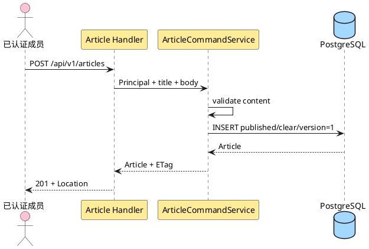

**说明**：作者来自 Principal，不接受请求体 author_id。数据库写入失败时没有 Article；创建不产生草稿或第二次发布动作。

##### 类/组件设计

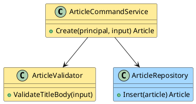

**说明**：Validator 只验证已拍板规则；Service 固定作者、`published/clear` 和版本。Repository 依赖数据库约束兜底，但不补业务默认。

##### 接口设计

请求 `{"title":"string","body":"string"}`，两字段必填并执行 §3.3.1 的共享合同。请求体上限为 262144 bytes：恰好 N bytes 且其余合同合法时可进入 JSON/业务解码，N+1 bytes 返回 `400 request.invalid_json`；非法 UTF-8 同样必须在解码/替换前返回该错误，不得保存 U+FFFD 替代值。通过 wire decoder 后，trim 后须有非空白 Unicode 字符，title≤200 rune，body≤20000 rune；服务端保留原值，HTML/Markdown 标记按普通文本处理。未知字段拒绝。成功 201 返回完整成员 Article、`Location: /api/v1/articles/{id}` 和 ETag。未登录返回 401；超限、非法 UTF-8、零值、全 Unicode 空白、超长或数据库失败均不得新增 Article。该接口不接受 `Idempotency-Key`，网络超时后客户端通过列表或业务上下文核对，不得盲目认为重试无重复。

##### 数据结构设计

新增一行 Article：`author_id=principal.user_id`、`orphaned_from_user_id=NULL`、`publication_state=published`、`violation_state=clear`、`violation_category=NULL`、`deletion_state=active`、`deletion_operation_id=NULL`、`version=1`。不创建 TransferNotice、DeletionOperation 或 AuditEvent；结构化运行日志不记录 title/body。

#### 3.3.3 Story：发现并阅读文章（US-ARTICLE-02.1）

##### 实现设计

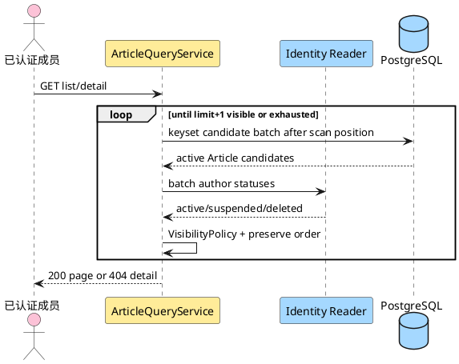

**说明**：列表按稳定 keyset 分批扫描，过滤后不足一页就继续读取下一候选批次；只有取得 `limit+1` 可见项或耗尽才返回。详情在返回正文前再次判断。成员无法从 404 区分不存在、违规、作者停用、pending 或已删除。

##### 类/组件设计

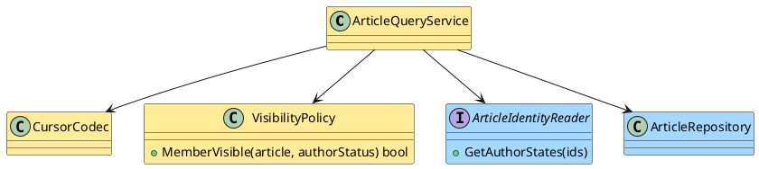

**说明**：VisibilityPolicy 是唯一成员可见性入口。CursorCodec 集中范围验证和 view 绑定。identity 缺少作者状态时 fail closed；不把缺失解释为匿名，只有 `author_id=NULL` 才是匿名。

Story8 的普通管理员读取复用本节查询底座，合同见 §3.3.9。成员仍按现役语义过滤缺失作者状态的候选并继续扫描，详情返回 404；identity 调用故障仍使整请求 503。管理员的严格身份完整性校验只在新方法中执行，不改变成员方法、作者方法或 orphan consumer。

##### 接口设计

`GET /api/v1/articles?cursor=&limit=` 返回 200 envelope；空列表是 `items=[]`。`GET /api/v1/articles/{id}` 返回 200 Article + ETag。列表不返回 body，只返回 `id,title,author,created_at,updated_at`；详情返回 body。非法 cursor 返回 400，超出配置上限的 limit 返回 422。未登录 401；隐藏/不存在/已删统一 404。

##### 数据结构设计

列表使用 `(created_at,id)` 索引，以配置化候选批次循环到 `limit+1` 可见项或耗尽。公共 cursor 基于最后返回可见项；静态集合中可见项不漏不重，同时间戳由 ID 稳定排序。查询不修改 Article、User、AuditEvent 或访问时间；浏览行为无写副作用。

#### 3.3.4 Story：修改现有文章（US-ARTICLE-03.1）

##### 实现设计

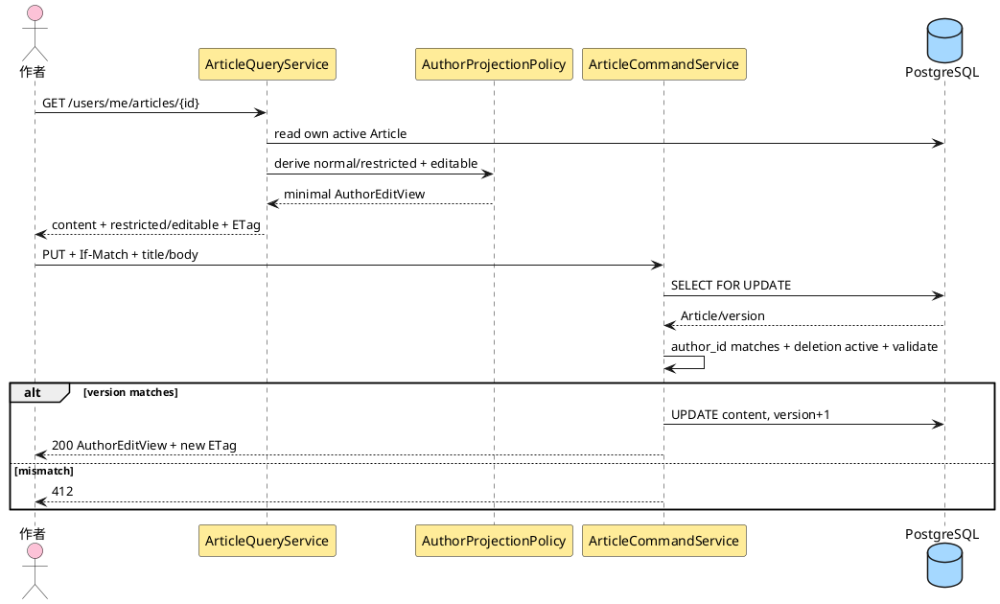

**说明**：修改是完整替换标题和正文。作者受控详情只按当前 Principal 与 `author_id` 精确匹配，不采用成员公开可见性；因此 active 作者可读取并修改自己的 violating 文章。AuthorProjectionPolicy 把全部治理原因折叠为通用 restricted，不披露类别或原因集合。修改后违规事实和所有其他治理字段原样保留，成员公开详情仍返回 404。

##### 类/组件设计

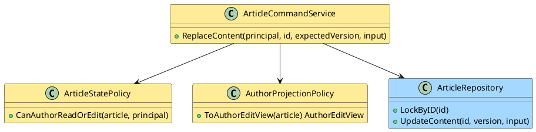

**说明**：StatePolicy 要求 Article 存在、`deletion_state=active`、`author_id=principal.user_id`。管理员角色不产生编辑权限；管理员只有同时是该文章作者时才通过。AuthorProjectionPolicy 与管理员治理 serializer 物理分离，更新不改变发布、违规、删除来源或归属字段。

##### 接口设计

`GET /api/v1/users/me/articles/{id}` 返回当前作者自己的 AuthorEditView 与 ETag。若文章受违规约束，body 只含内容、`moderation_status="restricted"`、`editable=true`；不得含 `violation_category`、`violation_state` 或 `hidden_reasons`。`PUT /api/v1/articles/{id}` 请求与创建相同，适用统一的 262144-byte wire decoder 合同：N bytes 可进入后续解码，N+1 bytes 或非法 UTF-8 返回 `400 request.invalid_json`，不得保存 U+FFFD 替代值；通过 wire decoder 后执行同一纯文本、Unicode 空白和 rune 长度合同，并独立要求强 If-Match。成功 200 返回同一最小 AuthorEditView 与新 ETag。普通非作者返回 404；管理员非作者返回 403；管理员作为作者时按作者身份处理。wire decoder 失败不得调用 repository；零值、全 Unicode 空白或超长返回 422。上述失败均保持 Article 内容、`version`、`updated_at` 与治理状态全部不变；版本冲突返回 412。

##### 数据结构设计

只更新 `title,body,updated_at,version=version+1`。`created_at,author_id,orphaned_from_user_id,publication_state,violation_state,violation_category,deletion_state` 全部保持不变。violating 文章修改后继续 violating 且成员不可见。失败事务不产生部分字段更新。

本 Story 的三视图验收以 Story8 的真实 `GET /api/v1/admin/articles/{id}` 承接管理员读取：同一修改后 Article 经成员入口仍隐藏、作者入口仅返回四字段，而管理员入口返回既有 12 字段和同一 Article version 的详情 ETag。该关联不赋予管理员修改他人文章的权限，也不把已有投影单测等同于新 GET 已验证。

#### 3.3.5 Story：作者删除现有文章（US-ARTICLE-04.1）

r23 将下图的“append＋fsync/durable”精确定义为 §3.4.6 的锚定 committed＋独立回读；文件/目录 sync 单独不确认耐久。三个删除入口与 finalizer 共用该实例；原授权、pending 隐藏、物理 DELETE/Audit 与204条件保持，unknown 未确认不得提前删除。

##### 实现设计

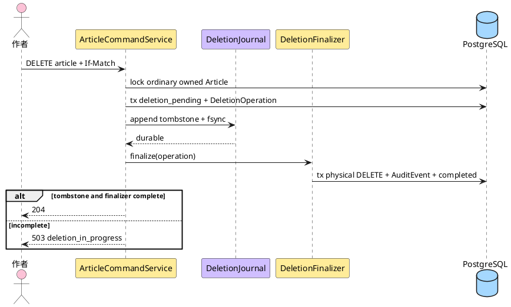

**说明**：第一事务先隐藏文章并登记 operation；Journal 使用独立 namespace 耐久化最小 tombstone；finalizer 的第二事务物理删除、审计并完成 operation。Journal 成功而第二事务失败时不恢复文章，后台继续收敛。

##### 类/组件设计

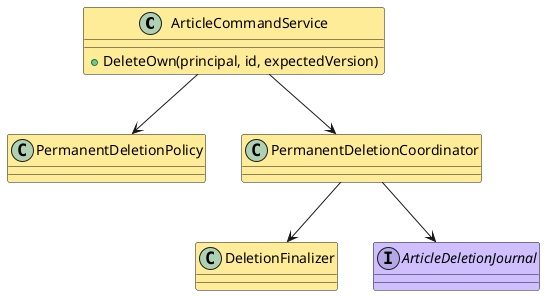

**说明**：PermanentDeletionPolicy 限制该入口只处理作者自己的普通文章。三个删除入口共享 Coordinator/Finalizer；区别只在授权、delete_kind、审计 action 和无归属清理。

##### 接口设计

`DELETE /api/v1/articles/{id}` 要求强 If-Match。作者自己的普通文章只有双完成后返回 204。Journal 或 finalizer 未完成返回 503 `article.deletion_in_progress`，但 Article 已对成员、作者和管理员全部不可见；同一授权调用可推动既有 operation 收敛。完成后的新 GET/DELETE 均 404，不提供恢复 token、撤销窗口或软删除状态。

##### 数据结构设计

T1 写 `Article.deletion_state=deletion_pending`、`deletion_operation_id` 和 DeletionOperation；tombstone fsync 后 T2 删除 Article，并写 `audit_event_id/status=completed`。若存在历史 TransferNotice，不删除通知证据，但其 `article_ref` 不能用于重建内容。AuditEvent 保存 actor、action=`article.delete`、target ID、outcome、trace_id、删除前 version，不保存标题、正文或邮箱。

#### 3.3.6 Story：管理员删除他人普通文章（US-IDENTITY-03.2）

##### 实现设计

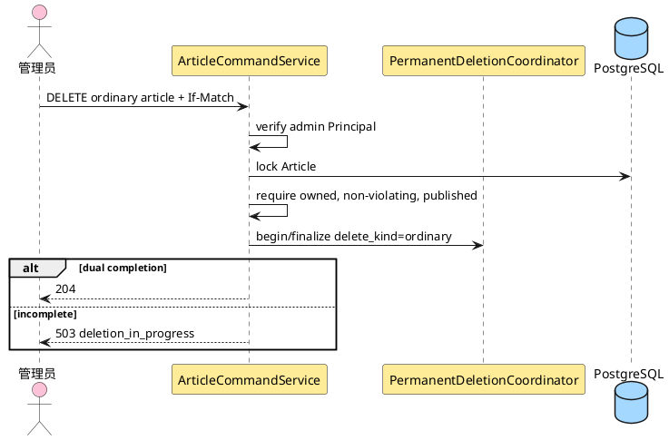

**说明**：管理员与作者复用同一路径，但授权分支明确。管理员不能借该权限调用 PUT；违规和无归属文章必须进入专用治理路径。

##### 类/组件设计

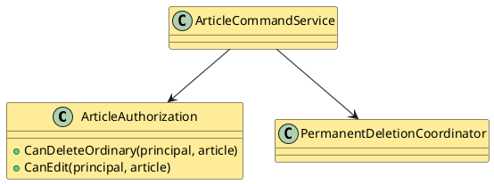

**说明**：删除权限和编辑权限是两个独立方法，防止“管理员可删除”被错误推导成“管理员可修改”。

##### 接口设计

管理员调用 `DELETE /api/v1/articles/{id}`，要求强 If-Match。普通文章定义为 `author_id IS NOT NULL`、`publication_state=published`、`violation_state=clear`、`deletion_state=active`；作者可以 active 或 suspended。双完成后 204。普通成员删除他人文章返回 404；管理员对违规或无归属文章返回 409 `article.invalid_state` 并指向相应管理流程。

##### 数据结构设计

复用作者删除的 DeletionOperation/tombstone/finalizer；metadata 增加 `authority=administrator`，不保存文章内容。Journal 前失败可回滚或保持 pending 安全重试；Journal 后失败必须保持 pending 并继续 finalizer。

#### 3.3.7 Story：处置无归属文章（US-IDENTITY-03.8）

##### 实现设计

```plantuml
@startuml
skinparam shadowing false
skinparam defaultFontName "Microsoft YaHei"
actor "管理员" as admin #fcc2d7
participant "ArticleCommandService" as s #ffec99
participant "Identity Port" as identity #a5d8ff
participant "AuditStore" as audit #b2f2bb
participant "DeletionCoordinator" as deletion #ffec99
database "PostgreSQL" as db #a5d8ff
admin -> s : publish / transfer / delete + If-Match
alt delete
  s -> deletion : begin/finalize delete_kind=orphan
else publish or transfer
  s -> db : read source for location only; begin tx
  s -> identity : lock ordered Users then Identifiers NOWAIT
  identity --> s : locked source and eligible target contacts
  s -> db : lock Article NOWAIT; recheck source, state and If-Match
  s -> s : bind verifier to tx and locked before image
  alt publish
    s -> s : require violation clear
    s -> db : published + clear source + version
  else transfer
    s -> db : Notice + two pending snapshots + new author + published + clear source
  end
  s -> audit : append disposition evidence in same tx
  s -> identity : ClearRetainedEmailIfEligible(tx, source, completion)
  identity -> s : trusted verifier re-reads facts using same tx
  s --> identity : after state, Audit, counts and Notice recipients
  identity -> db : eligible cleanup + email release Audit; otherwise retain
  s -> db : commit; any failure rolls back whole tx
end
s --> admin : committed result or existing retryable dependency error
@enduml
```

**说明**：三个动作都要求 held orphan：`author_id=NULL`、`publication_state=held` 且 source 非空；已匿名公开的 `published/source=NULL` 不可再次处置。无锁预读不证明资格，Identity 与 Article 锁内重验才决定结果；竞争时整事务回滚。delete 使用 §3.4.5 的独立 claim/finalizer，不把公开/转移事务跨接到 Journal。

##### 类/组件设计

```plantuml
@startuml
skinparam shadowing false
class OrphanDispositionService #ffec99 {
  +PublishAnonymous(...)
  +Transfer(...)
  +Delete(...)
}
interface ArticleIdentityPort #a5d8ff {
  +LockTransferParties(tx, optionalTargetId, sourceId)
  +LockDeletionCandidate(tx, candidateUserId)
  +ClearRetainedEmailIfEligible(tx, sourceId, completion)
}
class ArticleRepository #a5d8ff
class TransferNotice #ffec99
class PermanentDeletionCoordinator #ffec99
OrphanDispositionService --> ArticleIdentityPort
OrphanDispositionService --> ArticleRepository
OrphanDispositionService --> TransferNotice
OrphanDispositionService --> PermanentDeletionCoordinator
@enduml
```

**说明**：article 拥有 Article、Notice、完成事实及其 verifier；identity 拥有 User、Identifier、资格判定和清理审计。唯一 production composition 固定注入可信 article provider；它从锁内前像绑定当前 tx 的只读核验回调，identity 经回调消费事实，不反向查询 article 表。具体端口、字段及失败语义见 §3.4.4；不新增持久证明表、全局 registry 或第二 authority。

##### 接口设计

- `GET /api/v1/admin/orphan-articles` 与 `/{id}` 只接受管理员。
- `POST .../{id}/publish` 无 body；要求 `violation_state=clear`。
- `POST .../{id}/transfer` body 为 `{"new_author_id":"opaque"}`；目标必须 active、非 deleted、非 suspended。
- `DELETE .../{id}` 永久删除。

全部写接口要求强 If-Match。publish/transfer 成功 200 返回管理员 Article + ETag；delete 双完成后 204，未完成返回 deletion_in_progress 且文章不可见。转移仍违规时成功，但响应 `hidden_reasons` 继续含 `violation`。仍有归属、已恢复匿名公开、已转移或已删除的文章不再是待处置对象，返回 404/409 而不重复执行。

##### 数据结构设计

状态转换：

| 动作 | 前置 | Article 结果 | retained_email |
|---|---|---|---|
| 恢复公开 | held、clear、source 非空 | author NULL、source NULL、published、clear | 最后一篇完成后可清理 |
| 转移非违规 | held、clear、source 非空 | author=target、source NULL、published、clear | 快照持久后可清理 |
| 转移违规 | held、violating、source 非空 | author=target、source NULL、published、violating | 快照持久后可清理 |
| 永久删除 | held、source 非空 | pending 隐藏 → tombstone → 物理删除 | finalizer 删除后统计，最后一篇完成才清理 |

#### 3.3.8 Story：发送文章转移通知（US-IDENTITY-03.9）

##### 实现设计

转移成功的权威仍是已提交 Article/Notice/双地址快照；通知 dispatcher 是消费已提交快照的后台执行者，不参与转移事务，不查询当前账号邮箱或文章内容。recipient 是一条独立投递工作，租约（lease）是带截止时间的临时占用权；已有 PostgreSQL 行及条件更新提供隔离，不增加消息中间件。

现役 `command_service.go` 已原子创建两个 pending recipient 并快照 max_attempts；`model.go`/迁移 0003 已有五态、attempt 和 lease，`mailer.Mailer.Send` 已支持 `PurposeOrphanArticleTransferNotice`。当前缺少消费者及生产调度，不能以有模型或旧 identity PG PASS 证明通知已运行。按 ADR-0006/0011 的数据库先提交、SMTP 后 best effort 方向，采用下列局部方案：

| 方案 | 实现机制 | 优势 | 劣势 |
|---|---|---|---|
| 现有表轮询，逐条短事务 claim | READ COMMITTED + SKIP LOCKED，发送前提交，结果另开事务 | 复用快照/schema/pgx；无新增部署件；可隔离旧 owner | 存在轮询延迟与 SMTP/DB 非原子窗口；需租约与风险审计 |
| HTTP 提交后直接发送 | 请求线程调用 Mailer | 少一个后台循环 | 请求退出或进程崩溃丢失调度，不能单独满足持久重试 |
| 外部队列 | 发布、消费及另存投递结果 | 可独立扩缩消费 | 新增基础设施及双写协议，超出本期已确认结构 |

采用现有表轮询；逐条 claim 后立即处理，避免批量占有 recipient 在 SMTP 队列中等待直至过期。每进程一个串行发送循环；多进程竞争靠数据库，不靠 workerID 独占假设。容量、轮询延迟与吞吐目标待容量验证；本增量不引入第二服务器、scheduler、全局注册或通用队列框架。

```plantuml
@startuml
skinparam shadowing false
skinparam defaultFontName "Microsoft YaHei"
participant "ProcessingGate" as gate #b2f2bb
participant "Notice Dispatcher" as d #ffec99
database "PostgreSQL" as db #a5d8ff
participant "Mailer" as m #b2f2bb
participant "TLS SMTP" as smtp #a5d8ff
d -> db : short maintenance tx for exhausted expired claims
d -> db : begin READ COMMITTED claim tx
d -> gate : RequireOpenInTx using this tx
alt gate closed
  d -> db : rollback; no attempt increment
else gate open
  d -> db : lock one due row; fresh DB time; claim and commit
  db --> d : exact claim handle and immutable snapshot
  d -> db : new short tx check owner and remaining lease
  d -> gate : RequireOpenInTx using preflight tx
  d -> db : commit preflight or save deferred result
  alt preflight permits send
    d -> m : one Send with deadline; no DB tx or connection held
    m -> smtp : verified TLS SMTP
    smtp --> m : accepted / rejected / outcome unknown
    d -> db : new short tx save fenced result and audit
  else gate closed or ownership lost
    d -> d : no SMTP connection
  end
end
@enduml
```

**说明**：Gate 的 SQL 和判断仍由 privacy 拥有，claim/preflight 分别使用自己的事务 reader。网络发送前全部事务、rows 和 pool 连接已释放。维护事务只终结已耗尽的到期占用，不取得发送权；Gate 关闭也可记录已发生工作的终态和审计。准确时序、过期比较和失败恢复以 §3.4.8 为唯一状态机合同。

##### 类/组件设计

```plantuml
@startuml
skinparam shadowing false
class TransferNoticeDispatcher #ffec99 {
  +Reconcile(ctx)
  +Start(ctx)
  +Stop()
  +Wait(ctx)
  +Done()
  +Err()
}
class ArticleRepository #a5d8ff {
  +LockDueNoticeRecipient(ctx, tx)
  +ClaimNoticeRecipient(ctx, tx, request)
  +SaveNoticeResult(ctx, tx, claim, result)
  +LockExhaustedNoticeRecipient(ctx, tx)
  +FinishExhaustedNoticeRecipient(ctx, tx, before)
}
interface NoticeProcessingGate #b2f2bb {
  +RequireOpen(ctx)
  +RequireOpenInTx(ctx, tx)
}
interface Mailer #b2f2bb
TransferNoticeDispatcher --> ArticleRepository
TransferNoticeDispatcher --> NoticeProcessingGate
TransferNoticeDispatcher --> Mailer
@enduml
```

**说明**：`ArticleRepository` 是现役 `Repository` 的设计名称，本增量只为它新增 recipient SQL，不创建第二 Repository authority。dispatcher 拥有事务编排、状态决策与 worker 生命周期；Repository 只执行 article-owned 查询和条件更新。内部 `NoticeProcessingGate` 由 root 适配现役 privacy 对象；Mailer 继续拥有连接、TLS 和 SMTP 协议。其结构化拒绝阶段是兼容增加，凭据邮件的 sentinel 判定与失败语义不变。

| 对象/依赖 | 必须具备的输入及职责 | 失败边界 |
|---|---|---|
| `NewTransferNoticeDispatcher(deps, config)` | `Transactions.BeginTx`、`Repository`、`NoticeProcessingGate`、现役 `mailer.Mailer`、共享 `audit.Store.Append/Get`、ID/trace 生成器、低敏日志入口；所有依赖显式注入 | 缺失、typed nil、非法配置构造失败；构造时不连 SMTP、不起 goroutine |
| `NoticeClaim`（仅 article 内部） | `NoticeID string(UUID), Kind RecipientKind, ClaimedBy string, AttemptCount int64, LockedUntil time.Time` 为完整所有权；另带只读 `ArticleRef UUID, EmailSnapshot string, MaxAttempts int64, LastAttemptAt time.Time` | 禁止自行拼句柄、改地址或借用另一 recipient；DB RETURNING 的 UTC 微秒值是唯一 authority |
| `NoticeResult`（仅 article 内部） | `Disposition=accepted/retry/terminal/deferred`、稳定 `FailureBucket`（成功为空）、`DuplicateRisk bool`、`AuditEventID UUID`、`TraceID string`；计数/时间由 store 当前行及 DB 时间决定 | 不接受 Mailer 原始 error、调用方指定任意 status/attempt 或邮箱；发送失败耗尽时转 terminal，Gate deferred 保持 retry_wait 待到期维护 |
| `ClaimDue(ctx)` | dispatcher 新开短事务、Gate 检查、锁候选、校验并 claim；返回 `(NoticeClaim, claimed bool, error)` | 无到期行正常空轮；Gate closed 是正常暂停；SQL/commit unknown 无可发送 claim |
| `Preflight(ctx, claim)` | 新短事务回读完整 owner、余量及 Gate；返回 `send/deferred/lost` 与有效发送预算 | DB/Gate 错误均不发；deferred 在该 tx 保存释放与审计；lost 不写 recipient |
| `SaveResult(ctx, claim, result)` | 新短事务回读并条件更新，成功状态与审计原子提交；返回 `applied/already_applied/lost` 或 DB/commit-unknown error | 不因结果失败再调用 SMTP；readback 只核当前行和本次 AuditEventID |

`NoticeProcessingGate.RequireOpenInTx(context.Context, pgx.Tx) error` 必须使用调用者尚未结束的同一个 tx；不得内部 Begin、使用 pool reader、缓存 open、吞掉查询错误或复写 privacy 判断。root adapter 捕获相同不可变 `ProcessingGateConfig`；每次用 `privacy.NewStore(tx)` 和 `privacy.NewProcessingGate(config, store)` 调用 `RequireOpen`。已有 `RequireOpen(ctx)` 继续委托 pool-bound gate，供响应能力展示；privacy.Store/ProcessingGate 与表 SQL 均保持原样。

Repository 的锁方法返回 `(TransferNotice, TransferNoticeRecipient, found bool, error)`，Notice 只读关联 ArticleRef，绝不 JOIN articles/users 取内容或新地址；SELECT 只对 recipient 使用 `FOR UPDATE OF recipient SKIP LOCKED`。`ClaimNoticeRecipient` 的 request 含锁内 recipient 前像、workerID、LeaseDuration 与锁后 fresh db_now；返回数据库完整 recipient 和 changed bool。`SaveNoticeResult` 接受完整 claim、已分类 result 和锁后 db_now，返回回读 recipient 与 changed bool；耗尽维护另用 `FinishExhaustedNoticeRecipient(ctx, tx, before, db_now)`，以 PK/status/attempt/原 lease 或 next_attempt_at 比较前像，不冒充有效发送 claim。两者都由 dispatcher 在同 tx 追加审计并 commit，Repository 不自行提交。commit-unknown 回读按 PK 读 recipient，再用共享 AuditStore.Get 读取本次 EventID；只比较最小绑定字段，不重新消费发送权。

##### 接口设计

真实调用者是 lifecycle/后台 ticker，真实通知消费者是已提交快照中的新作者和已删除原作者；不新增页面或公开查询。转移 HTTP 仍返回下面的已排队投影：

```json
{
  "article": {"id":"...","publication_state":"published","violation_state":"clear","version":8},
  "notification": {
    "id":"...",
    "delivery_capability":"open",
    "recipients":[
      {"kind":"new_author","status":"pending"},
      {"kind":"former_deleted_author","status":"pending"}
    ]
  }
}
```

公共 API 不返回邮箱、SMTP 响应或失败原文；没有人工重发 endpoint。`recipients[].status=pending` 表示该转移事务创建的队列事实，不能解释为响应发出时的实时投递查询；并发 dispatcher 已完成也不回读改写该响应。`delivery_capability` 继续由提交后 Gate 读得的 open/closed 投影，不承诺投递成功，也不是 worker 启动证明。Gate 关闭时转移仍成功。现役启动配置自身缺失/非法仍按全局 fail-closed 启动规则处理；配置合法但登记缺失、不匹配或查询失败时，后台暂停通知，不使已提交转移失效。

邮件固定为 `mailer.Message{Purpose: mailer.PurposeOrphanArticleTransferNotice, To: claim.EmailSnapshot, Subject: "Han article transfer notice", Body: <下述纯文本>}`；`ValidateMessage` 在发送前执行，失败不连接 SMTP。Subject 采用固定 ASCII，适配现役 SMTP formatter，无需新增编码器。只用受验证 UUID 填入引用，不插入标题、文章正文、姓名、邮箱、治理类别、凭据或其他动态文本。

| recipient kind | Body 固定文案（以换行分隔） |
|---|---|
| `new_author` | `一篇文章已转移至您的名下。`；`文章引用：<ArticleRef>`；`通知引用：<NoticeID>`；`此邮件仅告知已完成的归属变化，不授予访问权限。` |
| `former_deleted_author` | `您原有文章的归属已完成转移。`；其余三行同上 |

模板不含 URL、追踪像素、HTML 或营销入口；不要求增加 URL 环境变量。`HAN_PUBLIC_ORIGIN` 的真实消费者是同源安全检查，不能据它拼出不存在的文章页面或给已删除作者构造登录/恢复入口。SMTP host/port/From/Auth/TLS 只复用现役部署注入；正文不使用这些值生成链接。将来增加链接须先由 Lead 核真实消费路由、HTTPS origin allowlist、URL 编码及登录/对象授权；URL 不可携带邮箱/凭据/可绕过权限的 token，不能让通知突破违规/删除可见性。当前无域名或深链事实可供采用，不填虚构域名。

##### 数据结构设计

只消费 §3.3.1 的 Notice/Recipient 及 0003 现有字段/索引，精确转换见 §3.4.8。不存在新迁移、attempt token 列或内容副本；`attempt_count` 是现成单调 generation，lease 与 owner 共同防止旧工作写回。dispatcher 从不更新 Article、User/Identifier、Notice 关联、EmailSnapshot、MaxAttempts 或另一 recipient；recipient 终态在应用层不可再转出。

`max_attempts` 延续 S6.2 创建时快照，后续修改环境值只作用于新 Notice。重启扫描数据库恢复 pending、到期 retry_wait、过期 processing 及耗尽行，不依赖内存 wake、历史 HTTP 请求或当前原作者 retained_email。记录与地址留存期仍为部署/隐私输入 TBD，不新增自动清理；账号清理、文章物理删除不级联删除 Notice，通知不得重建或读取文章内容。

**唯一 production composition 与运行配置**

1. `loadStartupConfig` 在 DB parse/connect/ping/migrate 之前完成 §3.3.1 六个新增通知键、现役 MAX_ATTEMPTS/SMTP budget 与全部交叉约束；只从环境读取，不设 alias、测试 fallback 或数值默认。新 `NoticeDispatcherConfig` 含 `PollInterval,BatchLimit,LeaseDuration,DBOperationBudget,BackoffInitial,BackoffMax,SMTPOperationBudget`；BatchLimit 是正 int，其他为可解析、无首尾空白、正整数微秒 duration。`LeaseDuration > SMTPOperationBudget+4*DBOperationBudget` 为保守租期余量，`SMTPOperationBudget+2*DBOperationBudget < HAN_SHUTDOWN_BUDGET` 保留取消、落库与一次 unknown 回读空间；加乘不得溢出。租期关系只约束正常预算，不能消除进程长暂停风险。错误只回显键/稳定类别，不打印注入值。
2. 唯一 `newProductionBusinessHandler`/builder 使用同一 pool、`Repository{}`、现役共享 audit.Store、prepared IDs、logger、`prepared.administratorMailer`（真实 `SMTPMailer`）构造 dispatcher；由 ID generator 为通知实例生成一次 UUID workerID，重启重新生成，不新增 workerID 环境默认。builder 缓存复用其已有 pool-bound `ProcessingGate`，transaction adapter 使用相同 config 绑定传入 tx；管理员能力及转移响应继续该原判断。新 worker 不创建第二 Mailer、pool、隐私 SQL 或 Journal。构造齐全前不启动任务或连接 SMTP。
3. `businessRuntime` 与 `lifecycleConfig` 显式增加 `noticeWorker lifecycleWorker`，`runComposed` 必须从真实 factory 取得非 nil worker，再把它交给 `runLifecycle`。production 不允许遗漏 worker 后仍返回成功，不走 legacy/test-only handler 分支；测试替身只能出现在测试注入点。通知构造失败和既有资源打开失败沿原 startup 逆序关闭，不把 FileJournal 在 Windows unsupported 改成成功。该独立 Host Gate 不妨碍使用窄测试入口验证通知组件，但窄入口通过不能宣称全量生产启动通过。
4. dispatcher 实现现役六方法 lifecycle 合同。`Reconcile` 是一次有界轮次：先耗尽维护，再逐条 claim/preflight/Send/保存；Gate closed、无到期工作与已持久化 SMTP 失败均为正常可继续结果。可恢复 DB/SMTP/安全依赖故障记录低敏告警并结束本轮，下一 PollInterval 重试，不能造成忙循环或耗尽整个队列；无错误吞掉后继续发下一条。非法构造、schema/不变量破坏等不可恢复故障返回明确 terminal error，由 `Err/Done` 进入现役 lifecycle 失败退出；不假成功。运行态 DB 不可用不发新邮件，文章请求仍由各自 DB fail-closed 合同处理。
5. `Start` 只启动一个串行循环，必须防重复 Start/Reconcile 并发；ticker 到达时若本轮未完只合并 tick，不叠加 goroutine。一次最多持有一个 recipient claim；发送期间不占 DB 连接。`Stop` 幂等、禁止新 claim、取消 ticker/在途 Send；每次 claim、preflight 后及 Send 前都检查该轮工作 context，取消不能被解释成继续下一条。通知另提供仅 lifecycle 内部使用的 `BeginShutdown(sharedCtx context.Context)`：先原子进入停止、绑定协调器已有的共享关闭 context，再取消当前首次 Reconcile 或运行循环；不新建 deadline。`Stop` 保留现役六方法合同，production 协调器总在它之前调用 BeginShutdown。当前发送已返回且尚未保存时，最多一次 fenced 保存及必要 unknown 回读，context 截止为共享 deadline 与各 DBOperationBudget 的较早者；不得以 WithoutCancel 丢弃共享截止、重启已开始的保存或再次 Send。没有可用共享关闭 context 时不另造清算预算，保留 processing 由租约恢复。`Wait(ctx)` 超时取消子操作并等待实际退出；所有 driver/Mailer I/O 必须响应 context。首次 Reconcile 即使尚未 Start 也计入活动调用；Done 只能在该调用实际返回、清算及运行 goroutine 全退出后关闭。无活动调用的启动前 Stop、重复 Stop/Wait 仍幂等收敛。
6. `runLifecycle` 是 config.signals 的唯一消费者；main 继续把现役 signal.Notify 通道交给它，不能以 main 的 Background context 会自动被 signal 取消为前提。协调器在任何初次 Reconcile 前先检查已排队 signal 和父 context，再派发一条受控初次调谐调用（按既有顺序串行执行三 worker），自己持续 select signal/父取消/调谐完成；不能同步等完整批次后才监听。它持有可取消的工作 context，传给初次 Reconcile 及后续 Start。每次推进 Reconcile、Start、Serve 前优先消费已经可读的停止事件并核工作 context；事件与调谐成功同时就绪时不得先开放下一阶段。首次观察到 signal/父取消时，立即固定 shutdownStartedAt 与唯一 deadline=shutdownStartedAt+HAN_SHUTDOWN_BUDGET，在发 Stop 或等待调谐返回之前创建 sharedCtx；进入停止、先对通知调用 BeginShutdown(sharedCtx)，再取消工作 context 并 Stop，各阶段不再启动后继 claim/Send/Start/Serve。关闭期间重复 signal 或调谐返回都不重置预算。初次调谐以一个可 join 的调用运行，其结果通道须能容纳取消后的返回；协调器不能遗弃该调用。此处仅增加内存中的调用/资源取得标记，不新增状态库或第二协调器。
7. startup 与运行态进入同一 shutdown 路径：停止新接入，实际初次调谐调用 join，通知及已开始 worker 的 Wait/Done join，最后按既有 owner 顺序关闭 listener、Journal/pool；不能在调谐仍访问 DB 时直接调用旧 startup cleanup helper。只有实际 Serve 过的 server 才参与 Shutdown/Serve-loop join，未 Serve 时直接清理已绑定 listener，不能等待不存在的 Serve 结果；未 Start 的 worker 不能跳过仍活动的初次 Reconcile。共享 deadline 到期即取消清算并记录超时，仍须确认实际退出后才关闭依赖，不延长预算或把超时降为成功。保留 business server > metrics server > password-reset worker > deletion worker > notice worker > signal/context 的错误优先序；停止引发的纯 context cancellation 是预期收敛，不覆盖同时到达的真实 fatal 调谐/worker/server 错误，结果保存、Shutdown/Close/join 超时或 cleanup 失败仍作为错误暴露。正常 signal 且全部适用清算/关闭成功退出0；父取消沿用非零语义，其余原始错误、超时或清理失败非零。现役 operationResults 容量4且先 WaitGroup.Wait 后 drain，三个 worker 加两 server 共5个结果；保持 r17 要求的容量 `2+实际非nil worker数` 或等价并发 drain，并按实际派发数收齐结果。原两 HTTP server、password-reset、删除 worker、closeArticle/closePool 的业务合同及恰一次关闭不变。

这些参数的来源是现役 worker/context/pgx/Mailer 合同和 DB/SMTP 阶段预算，不是生产调优结果。仅供测试的合法 tuple 可取 PollInterval=`1s`、BatchLimit=`2`、DB budget=`1s`、SMTP budget=`2s`、Lease=`10s`、BackoffInitial=`1s`、BackoffMax=`8s`、全局 shutdown=`5s`、新 recipient max_attempts=`3`；这些是隔离 fixture，不能成为代码或生产部署默认。吞吐、积压告警阈值、实际间隔/次数/预算、SMTP host/From/Auth、地区/控制者/依据/获准处理方及记录留存仍需真实部署输入。

#### 3.3.9 Story：隐藏、解除判定与删除违规文章（US-IDENTITY-03.12）

##### 实现设计

管理员通过既有 `GET /api/v1/admin/articles` 筛选治理对象，再通过 `GET /api/v1/admin/articles/{id}` 取得完整治理信息与 ETag，之后调用既有写入口。该读取切片承接 SR-IDENTITY-03 / US-IDENTITY-03.12 的管理员查看和保留其他隐藏约束验收，也为 US-IDENTITY-03.2 提供普通删除前的读取；不新增业务 US。Story2 提供分页底座，Story3 对照三种消费者投影。

```plantuml
@startuml
skinparam shadowing false
skinparam defaultFontName "Microsoft YaHei"
actor "有效管理员" as admin #fcc2d7
participant "Admin Query Handler" as h #ffec99
participant "ArticleQueryService" as q #ffec99
participant "ArticleIdentityReader" as i #a5d8ff
participant "VisibilityPolicy" as p #ffec99
database "同一 PostgreSQL" as db #a5d8ff
admin -> h : GET list with view or detail
h -> h : trusted Principal and HTTP parameters
h -> q : typed admin request
q -> db : existing candidate SQL or GetArticle
db --> q : Article records
q -> q : exclude pending and validate active state
q -> i : batch current non-null author IDs
i -> db : read identity-owned statuses
i --> q : status map or failure
q -> q : require complete active or suspended states
q -> p : AdminProjection with unchanged Article
p --> q : twelve-field governance view
q -> q : filter requested view and finish page or ETag
q --> h : complete result or one error
h --> admin : 200 or existing public error
@enduml
```

**说明**：同一请求调用链先授权、再读取 Article，pending 先排除，随后才读取当前作者状态并投影。列表对每个候选批次重复读取与投影，达到 `limit+1` 匹配项或耗尽才返回；任一批次失败都丢弃已累积结果。详情读到 pending 时直接 404，不调用 identity、不生成 ETag。现役成员与 orphan 的查询流程继续各自消费同一底座，不调用新的管理员严格校验。

管理员列表执行以下读取合同：

1. 服务先核可信 Principal 的 `Allows(AccessGeneral)` 与 `role=admin`，再解析 view、复用 `resolveLimit` 并按对应 cursor view 解码；参数错误时不调用 repository 或 identity。无需 `is_initial_admin=true`，不从 URL/query 接收角色或作者状态。
2. 复用 `PostgresArticleQueryRepository.ListCandidateBatch` 和原 `listArticleCandidatesSQL`，按 `CandidateBatchSize` 取候选。该 SQL 不解释角色或筛选业务 view；`after=nil` 表示首页，非 nil 时只接受 `member/admin_all/admin_violating/admin_hidden` 及合法时间/UUID，`admin_orphan` 仍只由 `ListOrphanBatch` 消费。扩展的是现役具体 repository 的 cursor view 校验，接口和构造签名不变；SQL 的时间/UUID 参数绑定、稳定倒序和有界 LIMIT 不变。不复制 orphan SQL、不直接 JOIN identity 表、不把管理员 cursor 改写为 member。
3. 每批先核返回数不超过 `CandidateBatchSize`，并复用 `validateCandidateOrder` 核 UTC、非零时间、合法 UUID、严格位于扫描边界之后及候选间严格倒序。重复、倒序错误或不前进均为 500 `platform.internal_error`，不得继续扫描形成死循环。pending 候选只推进内部扫描位置，不投影、不读取其作者；其余候选必须通过 `ValidateArticleState` 且为 deletion active，非法权威组合为同一 500，不当作普通隐藏项跳过。
4. 对该批 active 候选的非空作者 ID 去重，复用 service 已注入的 identity 函数与 `readAuthorStates`。新增私有管理员完整性检查逐个核请求 ID：必须有且仅使用明确的 `active` 或 `suspended` 状态。调用报错、nil/缺项、空/非法状态或仍有 author_id 却读到 `deleted`，均整请求 503 `platform.dependency_unavailable`。不补 active、不把缺失作者改成匿名、不跳过该行凑页，也不保留前批成功项返回；匿名候选无需 identity 查询，orphan source 不是当前作者 ID。该检查不更改 `GetAuthorStates` 的返回类型或现役 reader 允许 deleted 的通用合同。
5. 用同一 `VisibilityPolicy.AdminProjection` 得到完整 DTO，再按下表筛选；全部隐藏原因只由 Policy 生成。按原顺序积累到 `limit+1` 匹配项，返回前 `limit` 项。继续取批时内部 cursor 用最后扫描候选的 `(created_at,id)` 并保留当前管理员 view；不得复用硬编码 member view 的 cursor 构造。公共 cursor 只用最后返回项和当前 view 编码，第 `limit+1` 项留待下页重扫。耗尽时 `next_cursor=null`，空结果必须 `items=[]`；不能因单批无匹配项而提前返回空页。

| typed view | 合法 deletion-active 集合中的筛选 | 对应 CursorView |
|---|---|---|
| `all` | 全部，包含有作者普通文章、作者 suspended、匿名 published、held orphan 及 violating；不是成员可见列表 | `CursorViewAdminAll = "admin_all"` |
| `violating` | `AdminArticleView.violation_state == violating`，不排除同时 suspended 或 held 的文章 | `CursorViewAdminViolating = "admin_violating"` |
| `hidden` | `len(AdminArticleView.hidden_reasons) > 0`，不包含 pending | 新增 `CursorViewAdminHidden = "admin_hidden"` |

现役 `hiddenReasons` 将有作者但非 active 的值归为 `author_suspended`；ADR-0010 的该原因指 suspended。新 GET 在投影前要求作者状态明确为 active/suspended，从而不把缺项、非法或 deleted 解释成停用事实。Policy 原有原因顺序 `author_suspended,violation,orphan_hold` 及叠加机制不变；published/clear 的匿名文章在 all 中，hidden 中无此项。成员仍采用自己的可见性过滤，orphan 仍采用自己的待处置集合，不扩大二者职责。

详情复用同一 repository 的 `GetArticle`：授权后，非法 ID 或 `pgx.ErrNoRows` 返回 404 `article.unavailable`；读到 `deletion_pending` 也优先返回同一 404，即使 identity 同时不可用也不调用它。其他 Article 非法权威状态为 500 `platform.internal_error`。合法 active 记录执行上述管理员身份完整性检查、`AdminProjection`，再对同一 Article 调用 `StrongETag`，返回 DTO 和 Header ETag；不从两次 Article 读取拼接 body/version，ETag 构造失败为内部 500。

读取沿用现役按批次当前事实的语义，不引入跨页或单请求长事务快照、行锁、内部自动重试。canonical 删除可能发生在 Article 和身份两次读取之间，形成旧 author_id 与新 deleted 的组合；整请求 503，客户端重新发起读取，不伪造 suspended 或成功半页。不同批次间发生停用/恢复/治理变化时按各批实际读到的事实派生，不承诺全页处于同一数据库快照；已读 active 后的并发变化也不承诺线性一致。静态集合才保证匹配项不漏不重；后续写操作仍在锁内以 If-Match 检测版本。

这些 GET 不写 Article/User/AuditEvent/Notice 或访问时间，不调用 Journal、Mailer、ProcessingGate 或治理命令。单请求同步执行并逐批关闭 rows；同一配置限制每批候选与返回项内存，耗时随扫描批次数增长，容量与 P95 首期验收基线见 §3.3.1 的 AM-Q2 确认记录，目标环境实测仍 unknown / NOT RUN。每次 SQL/identity 调用传递请求 context，取消后不再取下一批，不新增 worker、连接池、缓存、生产数值默认或状态 authority。

```plantuml
@startuml
skinparam shadowing false
skinparam defaultFontName "Microsoft YaHei"
actor "管理员" as admin #fcc2d7
participant "ArticleCommandService" as s #ffec99
participant "VisibilityPolicy" as p #ffec99
participant "AuditStore" as audit #b2f2bb
participant "DeletionCoordinator" as deletion #ffec99
database "PostgreSQL" as db #a5d8ff
admin -> s : violation / restore / delete + If-Match
s -> db : lock Article
alt mark violation
  s -> db : violating + category + version
  s -> audit : mark evidence
else restore
  s -> db : clear + category null + version
  s -> p : rederive other hidden reasons
  s -> audit : restore evidence
else delete
  s -> deletion : begin/finalize delete_kind=violating
end
s --> admin : result
@enduml
```

**说明**：解除违规只删除 violation 约束。作者停用或 orphan hold 仍成立时，文章继续隐藏；删除直接进入终态。

##### 类/组件设计

```plantuml
@startuml
skinparam shadowing false
class ModerationService #ffec99 {
  +MarkViolation(category)
  +ClearViolation()
  +DeleteViolating()
}
class VisibilityPolicy #ffec99
class ArticleRepository #a5d8ff
interface AuditStore #b2f2bb
class PermanentDeletionCoordinator #ffec99
class ArticleQueryService #ffec99 {
  +ListAdminArticles(ctx, principal, request)
  +GetAdminArticle(ctx, principal, id)
}
interface AdminArticleQuerier #ffec99
interface ArticleAuthorStateReader #a5d8ff
AdminArticleQuerier <|.. ArticleQueryService
ArticleQueryService --> ArticleRepository
ArticleQueryService --> ArticleAuthorStateReader
ArticleQueryService --> VisibilityPolicy
ModerationService --> VisibilityPolicy
ModerationService --> ArticleRepository
ModerationService --> AuditStore
ModerationService --> PermanentDeletionCoordinator
@enduml
```

**说明**：ModerationService 只拥有违规事实，不改变作者状态或来源。VisibilityPolicy 在写后给出当前隐藏原因，供管理员响应。

新增 `AdminArticleQuerier` 仅暴露下列两个读取方法，`ArticleQueryService` 同时实现既有成员/作者读取与该接口。`NewArticleQueryService[Status ~string](ArticleQueryRepository, ArticleAuthorStateReader[Status], QueryConfig)`、`NewPostgresArticleQueryRepository(ArticleQueryDatabase)` 和 `ArticleQueryRepository` 的两个既有方法签名全部不变。图中 ArticleRepository 的读取落点是现役 `PostgresArticleQueryRepository`；`repository.go` 的事务写 Repository 不增加管理员读取职责。`NewAdminQueryHandler` 只接收该最小读取接口，不要求命令依赖；原 `NewQueryHandler`、`NewAuthorDetailHandler`、`NewOrphanQueryService` 和 `NewOrphanQueryHandler` 保持兼容。

##### 接口设计

```go
type AdminArticleListView string

const (
    AdminListViewAll       AdminArticleListView = "all"
    AdminListViewViolating AdminArticleListView = "violating"
    AdminListViewHidden    AdminArticleListView = "hidden"
)

type ListAdminArticlesRequest struct {
    View   AdminArticleListView
    Cursor string
    Limit  *int
}

type AdminArticlesPage struct {
    Items      []AdminArticleView `json:"items"`
    NextCursor *string            `json:"next_cursor"`
}

type AdminArticleQuerier interface {
    ListAdminArticles(context.Context, session.Principal, ListAdminArticlesRequest) (AdminArticlesPage, error)
    GetAdminArticle(context.Context, session.Principal, string) (AdminArticleView, string, error)
}

func NewAdminQueryHandler(AdminArticleQuerier) (*Handler, error)
func (*Handler) ListAdminArticles(http.ResponseWriter, *http.Request)
func (*Handler) GetAdminArticle(http.ResponseWriter, *http.Request)
```

`ArticleQueryService` 的两个新增方法与 `AdminArticleQuerier` 同签名，详情第二个返回值为强 ETag。构造 Handler 时 nil 依赖失败，运行时缺服务依赖返回内部 500，不能返回空的成功页。

HTTP 与 typed 请求的转换只在新 `Handler.ListAdminArticles` 中增加完整解码前置：在现役可信管理员授权通过之后、构造 typed 请求或调用 service 之前，以标准库 `url.ParseQuery(request.URL.RawQuery)` 一次性解析完整 query。任意解析错误都丢弃其可能返回的部分 `url.Values`，用既有 `422 article.validation_failed` 拒绝，service/repository/identity 均零调用；即使错误落在未消费的键中也不得忽略，不先过滤键、不使用 `URL.Query()` 的部分结果、不回退默认、不修复或 trim 原始 query。公共错误/日志不回显 RawQuery 或原始解码错误内容。

整体 URL query 解码失败属于新列表 Handler 的输入校验，不具备可靠的 view/cursor/limit 归属；因此沿现有 view/limit 的 422 码处理，优先于字段规则，不将含 `cursor=%ZZ` 的整体解码失败改判为 cursor 400。只有 ParseQuery 无错误后，才从同一完整 `url.Values` map 按键是否存在、值切片长度和具体值执行下表，最后构造 typed 请求。局部私有转换可复用原语义，但不得调用会重新用 `URL.Query()` 丢错的 `singleArticleQueryParameter(request, ...)` 或 `articleQueryLimit(request)`；旧 member/orphan 助手及其消费语义不改，不新增公开解析接口、错误码或依赖。

| 输入 | Handler 转换或错误 | Service 合同 |
|---|---|---|
| 完整 RawQuery 解析报错，包括非法 percent escape 或未转义分号 | 优先整体 422 `article.validation_failed`，丢弃部分 map；不判断遗漏/重复/default | 零 service/repository/identity 调用 |
| HTTP 未出现 `view` | 完整解析成功后的 map 中无 view 键，才显式构造 `View=AdminListViewAll` | 请求 all |
| HTTP `view=`、重复 `view`、未知值、空白或大小写变体 | 完整 map 内按存在性/值切片判定；既有 422，不 trim、不折叠、不构造 typed 请求 | 零 service/repository/identity 调用 |
| HTTP 单个精确 `all/violating/hidden` | 转为对应 typed 枚举 | 绑定对应 cursor view |
| 内部调用 `ListAdminArticlesRequest{}` 或 `View=""` | 不承载 HTTP presence 信息 | service 将 typed 零值规范为 all；其他非空未知值 422。显式 HTTP 空值必须在进入 service 前拒绝，不能借零值规则变成 all |
| HTTP 完整解析后无 cursor 键 / typed `Cursor=""` | 首页 | 无扫描边界 |
| HTTP 完整解析后 cursor 显式空或值切片重复 | 400 `request.invalid_cursor` | 零 service/repository/identity 调用 |
| HTTP 完整解析后无 limit 键 / typed `Limit=nil` | 使用同一 QueryConfig.DefaultLimit | 不添加数字默认 |
| HTTP 完整解析后 limit 空/重复/非整数，或整数非正/超过 MaxLimit | 从完整 map 局部执行原单值/空值/`strconv.Atoi` 语义，再复用 service 的 `resolveLimit`；原 422 `article.validation_failed` | 不新增更严格词法规则或另一组配置 |

`view=%ZZ`、`view=hidden&view=%ZZ`、`view=all&cursor=%ZZ`、`view=hidden&limit=%ZZ` 和 `view=hidden;view=violating` 均在整体解码处 422，不能分别成为默认 all、单值 hidden、首页或默认 limit。相反，RawQuery 正常遗漏字段才用原默认；成功解码后的显式空/重复/未知 view 仍为 view 422，成功解码但内容/view 绑定无效的 cursor 才为原 cursor 400，成功解码后的非法 limit 为原 limit 422。typed 零值合同不承载或消除 HTTP 解析失败。

cursor 仍使用现役 v1 strict 四字段、无 padding 的 Base64URL 编码、1024 字符上限、UTC canonical RFC3339Nano 与规范 UUID 校验；缺/多/重复字段、未知版本、尾随数据或 view 不匹配均为既有 400。切换筛选应去掉旧 cursor；同一排序位置也不能跨 view 使用。cursor 不承担授权，不新增 HMAC/密钥或版本默认。

`GET /api/v1/admin/articles` 返回 200 `AdminArticlesPage`；每项与详情均为 §3.3.1 的完整 12 字段 AdminArticleView，包括 body，不复用成员摘要或作者编辑 DTO。`GET /api/v1/admin/articles/{id}` 返回 200 同一 DTO 与 `"article-<id>-v<version>"` Header ETag；GET 不要求 If-Match，列表不新增整体 ETag。成功及失败复用 `WriteArticleJSON/WriteArticleError`、既有 Content-Type/nosniff/trace 和最小披露 envelope，不新增错误码或暴露原始 cause。

两个 GET 应在唯一 root 注册，复用的实际请求链为 `TraceMiddleware → exact method/path → HTTPAuthorizer → SessionStore.ResolvePrincipal → Principal.Allows(AccessGeneral) → Article Handler`。SessionStore 在同一事务内锁请求者 User、检查每用户 PasswordReset Gate 及 Session/User 有效性（含 recovery_required/auth generation），必要时撤销无效 Session；它不检查全局恢复 run、Journal 或 article replay evidence。GET 沿现役安全方法合同不要求 CSRF。Handler 在调用 service 前检查可信管理员 Principal，service 再复用同一管理员断言，非管理员 403 `auth.forbidden`；缺会话 401，onboarding、非 active 及账号级恢复限制沿原身份错误合同，不改判成全局恢复 503。新增查询层保持零业务写，不将其扩称整条认证链绝对零数据库写。真实 Article SQL 的 Query/Scan/Rows 错误为 503 `platform.database_unavailable`，identity 故障/缺项/非法/deleted 为 503 dependency；不得用这些故障伪造 404、空页或半页。pending/不存在详情的 404 优先级如上；排序与非法 Article 状态为内部 500。

系统恢复期间仍必须关闭业务流量，完整恢复及 S16 对账/MarkConsumed 成功后才能开放，失败或不可判定时继续隔离。当前 root 没有承载通用 readiness/recovery HTTP 请求 Guard；startup/lifecycle 或上述账号 Gate 不能代替它。原恢复中 `503 platform.recovery_in_progress` 与零文章下游的验收义务保留，生产承载、上游责任和 Case18/S8.2 阻塞见 §8.6；本设计不为 Admin2 新建全局 Guard、恢复状态或第二 authority。

N001 实施注意（非独立 finding）：`MapArticleError` 优先按 `errors.Is(ErrArticleInvalidState)` 映射旧治理 409，外包 internal PublicError 不能保证 500。新读取检测到非法 Article 状态时，须在其局部边界转换为不包装/不连接该 sentinel 的独立低敏 internal cause，再经现役 `WriteArticleError` 实际输出 500；不改共用映射优先级或旧治理 409，HTTP 单元须核真实输出而非只核 service PublicCode。

以下三个既有治理写入口保持原合同：

- `POST /api/v1/admin/articles/{id}/violation` body 为 `{"category":"violence|sexual"}`。
- `POST /api/v1/admin/articles/{id}/restore` 无 body，只表示解除违规判定，不表示恢复已删除文章。
- `DELETE /api/v1/admin/articles/{id}` 只删除当前 violating 文章。

这三个写入口全部要求管理员、CSRF 与强 If-Match。重复判定、对 clear 状态 restore、用违规删除入口删除 clear 文章均返回 409；冲突返回 412。成员详情在 violating 后立即变为 404；删除入口只有 tombstone/物理删除双完成后返回 204。

##### 数据结构设计

判定写 `violation_state=violating,violation_category=<category>,version+1`；解除写 clear/null/version+1；不改变 `publication_state,author_id,orphaned_from_user_id`。删除进入共享 DeletionOperation 协议，finalizer 物理移除 Article，AuditEvent 不保存正文。

两个新读取方法仅消费既有行与 identity 状态，不新增表、列、索引、迁移、持久化 hidden 标记或 User.status 副本。AdminArticlesPage 只是既有 envelope 的 typed 承载，不扩充 AdminArticleView；`hidden` 是请求筛选与 cursor 绑定，不是 Article 新权威状态。

### 3.4 跨模块、状态、事务与恢复合同

#### 3.4.1 正交状态与有效可见性

| publication | violation | author | author status | 成员结果 | 管理员结果 |
|---|---|---|---|---|---|
| published | clear | active user | active | 可见 | 可见 |
| published | clear | user | suspended | 隐藏 `author_suspended` | 可治理 |
| published | clear | NULL | 不适用 | 匿名可见 | 可治理 |
| published | violating | 任意 | 任意 | 隐藏 `violation` | 可治理 |
| held | clear/violating | NULL + source | 不适用 | 隐藏 `orphan_hold`，违规可叠加 | 可处置 |

`deletion_state=deletion_pending` 覆盖上表：成员、作者受控详情和管理员均不得读取正文或治理，只有 deletion coordinator/finalizer 可访问最小删除字段。`held + author_id 非空`、`held + source 为空` 和 `source 非空 + published` 均非法。永久删除完成后 Article 行不存在。

同一权威状态投影为三个互不复用的消费者视图：

| 消费者 | 投影 |
|---|---|
| 普通成员 | 只返回成员可见文章；受限、pending、已删或不存在统一 404 |
| 当前作者 | 精确匹配 author_id；返回内容、ETag、`moderation_status=normal|restricted`、`editable=true`；不返回类别或原因集合 |
| 管理员治理 | 返回完整 `violation_state/category`、`hidden_reasons`、归属和版本，用于治理 |

`moderation_status` 和 `editable` 是消费者投影，不是 Article 持久化权威字段。restricted 只说明当前文章受治理约束，不说明是哪一种约束。

#### 3.4.2 S1–S16 设计映射

| 接缝 | article-management 落点 |
|---|---|
| S1 同源与身份 | 只接收 Principal；写请求继承 Session/CSRF；不解析 Cookie |
| S2 作者状态与可见性 | VisibilityPolicy + `GetAuthorStates`；不复制 User.status |
| S3 停用/恢复 | 文章零写入，读取时派生；违规事实不变 |
| S4 canonical 删除 | `OrphanArticlesCanonical(tx,user_id)` 重建 NULL/held/source/违规保留与审计 |
| S5 无归属处置/清理 | 三种处置退出待处置集合；快照后调用 `ClearRetainedEmailIfEligible` |
| S6 邮件/TLS | TransferNotice + ProcessingGate + Mailer；best effort，不营销 |
| S7 分级治理 | Principal role；管理员可删/治理但不可改他人内容 |
| S8 公共错误 | 继承 envelope；article 只注册自身稳定 code |
| S9 幂等 | 不接受 Idempotency-Key；If-Match 只防并发覆盖 |
| S10 审计 | 治理/转移与审计同事务；永久删除审计与 finalizer 物理 DELETE 同事务 |
| S11 Article Deletion Journal | pending + DeletionOperation + 独立 tombstone + finalizer；双完成才 204 |
| S12 隐私/部署门禁 | 邮件只用两路快照；Gate 缺失不连接 SMTP |
| S13 恢复信任根 | readiness 关闭时所有文章 API 503；article 不改身份状态 |
| S14 kept_deleted/RPO | 幂等重放 canonical 删除；不提供文章恢复 |
| S15 Journal/keyring | 只消费恢复开放结果；缺 key/不一致时不接业务流量 |
| S16 replay evidence Gate | recovery 包是 v1 version/namespace/digest/canonical 唯一 authority；Ready 20 字段全非 null，Unavailable 仅 6 字段；production source 只取真实 Journal/inventory/ReplayAll/operation/audit；generation/token CAS 保证旧 Fail 不覆盖新 Ready；run/input/ref/digest/UTC 微秒 completed_at 幂等 |

#### 3.4.3 canonical 删除端口

```text
OrphanArticlesCanonical(tx, deletedUserID) ->
  {newly_orphaned_count, already_orphaned_count, pending_orphan_count}
```

算法合同：

1. identity 在同一事务锁定目标 User 墓碑和标识生命周期。
2. article 锁定 deletion active 且 `author_id=deletedUserID` 或 `orphaned_from_user_id=deletedUserID` 的 Article；deletion pending 由 finalizer 独立收敛，不回退。
3. 对仍由该用户拥有的每篇 active Article 写 `author_id=NULL, publication_state=held, orphaned_from_user_id=deletedUserID, version+1`；`violation_state/category` 不变。
4. 已经 `NULL/held/source=deletedUserID` 的行视为幂等完成，不再递增版本。
5. 已恢复匿名公开、已转移或已永久删除的文章不回退到 held；它们已退出待处置集合。
6. 每个新无归属化结果与最小 AuditEvent 同事务；任一失败回滚 User 删除和文章变化。
7. 返回当前 `pending_orphan_count`。为 0 时 identity 可在同事务清理 retained_email；大于 0 时必须保留。

| 场景 | canonical 结果 | retained_email |
|---|---|---|
| 零文章 | 无 Article 写入，pending=0 | 同事务清理 |
| 一篇/多篇普通文章 | 全部置 NULL/held/source，pending>0 | 保留 |
| 含违规文章 | 同样无归属化，violating/category 原样保留 | 保留 |
| kept_deleted 重放且已无归属化 | no-op，返回实际 pending | 按实际 pending 决定 |
| 文章已恢复/转移/删除或 deletion pending | 不回退、不重建；pending 交 finalizer | 若无其他待处置 active/pending orphan，由对应 finalizer/事务决定清理 |

#### 3.4.4 转移与通知地址清除顺序

**生产锁边界与算法**

公开/转移采用 Identity→Article；finalizer 保留 operation-first，但其后只尝试取锁，竞争即退让。NOWAIT 是 PostgreSQL 的“不能立即取得行锁便报错”机制；只对本节指定行锁使用，不要求统一重排全部 canonical 代码。

1. 无锁预读 Article 的 ID/source/version，仅用于定位；不存在或 source 为空不产生完成事实。开始一个 READ COMMITTED 事务，后续锁、查询、写入和清理使用同一 tx/连接。
2. 调用 identity 的 `LockTransferParties(ctx,tx,optionalTargetID,SourceID)`。publish 只需来源，transfer 还需目标；将所需 User ID 去重后按 UUID 字节序逐行 `FOR UPDATE NOWAIT`，取得全部 User 后，再按 `(user_id,kind)` 顺序锁其全部 Identifier，亦为 NOWAIT。
3. identity 校验来源为 deleted 墓碑、标识满足既有删除生命周期；transfer 目标必须 active、非 deleted、非 suspended 且具有效邮箱。仅 transfer 要求新作者邮箱和来源 retained_email 非空且与各自 email Identifier 绑定；publish 不需要目标邮箱或通知快照，仍校验既有来源标识一致性及后述成对空值幂等规则。缺失必要绑定或漂移均整事务回滚。
4. article 按 ID `FOR UPDATE NOWAIT` 锁 Article，重新校验 source 与定位值相同、author=NULL、held、deletion active，以及当前 version 满足原强 If-Match。变化时按既有 404/409/412 语义终止，不能在持锁事务内换 source 或刷新版本后继续；publish 另要求 violation clear。
5. 在锁内捕获不可变前像并绑定 verifier。transfer 先用 `Repository.InsertTransferNotice` 写 Notice 和两个有效、不同 kind 的 pending recipient，再写 author=target、published、source=NULL、version+1；violation/category 原样保留。publish 写 author=NULL、published、source=NULL、version+1。
6. article 同事务追加对应处置 AuditEvent，再调用 `ClearRetainedEmailIfEligible`；不能只凭 UPDATE 成功或传入“可清理=true”。identity 经可信 callback 重新核事实后执行条件清理，最后由事务 owner commit。
7. 任一 SQL、核验或审计失败整事务回滚，Notice、recipient、文章、User 与 Identifier 不得部分提交。commit outcome unknown 不能返回成功或沿用旧完成事实；重试重新读取权威状态，沿用原 ETag/已处置响应和 finalizer 幂等规则。
8. ProcessingGate 关闭不阻断 transfer 提交；两个 recipient 保持 pending，响应能力为 closed。SMTP、claim 与投递由后续 S7.1/§3.4.8 在事务外处理，不能作为邮箱清理的先决条件。

现役锁链依据为 `internal/identity/deletion.go` 的 actor User→target User→Identifiers→article canonical，以及 `internal/article/deletion_coordinator.go` 的 Article→既有 operation。对应兼容边界：

| 路径 | 实际或本次要求的锁顺序 | 等待约束 |
|---|---|---|
| canonical 日常/kept_deleted | 保留 actor→target→Identifiers→关联 Article（Article 按 ID） | 不借本修订重排身份侧算法 |
| publish/transfer | 排序的 User→Identifier→目标 Article | 全部新取行锁 NOWAIT；不获取 deletion operation |
| coordinator T1/重试 | 保留 Article→既有 operation；新 operation 按原协议插入 | 不追加 Identity 清理锁；事务结束后才 Append/Finalize |
| finalizer claim/绑定 | operation-only 短事务，随后提交 | 不携带 claim 行锁进入 T2，不跨 Journal I/O 持锁 |
| finalizer T2：orphan | operation→来源 User/Identifier→Article | 后续行锁全部 NOWAIT；来源取原 operation.source |
| finalizer T2：ordinary/violating pending | operation→Article 锁内前像→候选 User/Identifier | 后续行锁全部 NOWAIT；仅候选 User 已 deleted 时绑定清理来源 |

稳定排序仅约束新路径，不能证明现役 actor→target 与之全局同序。新路径取得后续 User/Identifier 失败就回滚，避免与 canonical 组成等待环；finalizer 持 operation 时不会等待 Article，因此 coordinator 持 Article 等 operation 时，finalizer 退让并释放 operation。完成事实统计不再锁其他 Article/operation，避免为计数引入新的反序等待。该结论仅覆盖上述调用链，不声称全库无死锁。

SQLSTATE `55P03 lock_not_available` 作为既有可重试依赖错误处理；公开/转移使用现有 `platform.database_unavailable`，删除沿用 `article.deletion_in_progress`/依赖错误。HTTP 不自动循环。NOWAIT 失败必须退出并 rollback 整个事务，不在已失败事务或保留前半段锁的 savepoint 中继续；worker 沿用现有 lease/退避，不新增重试框架、参数或公共错误。NOWAIT 只约束行锁，表级 DDL 竞争仍受现有 deadline 限制。语义依据：[PostgreSQL 18 行锁](https://www.postgresql.org/docs/18/sql-select.html#SQL-FOR-UPDATE-SHARE)。

**当前事务完成事实与校验责任**

语言中性的最小内部签名如下；这是原 `fact` 参数的具体化，不改变业务 API：

```text
LockTransferParties(ctx, tx, optionalTargetID, SourceID) -> LockedParties | error
LockDeletionCandidate(ctx, tx, CandidateUserID) -> lockedIdentity(deleted | not_deleted) | error
ClearRetainedEmailIfEligible(ctx, tx, SourceID, CompletionRef) -> cleared | unchanged | error
VerifyCompletion(ctx, tx, CompletionRef) -> VerifiedCompletionFacts | error
```

`CompletionRef` 是一次调用内的引用：包含下表的定位字段，绑定创建它的精确 tx 实例和锁内前像。唯一 production composition 将可信 article provider 固定注入协作端口；provider 在锁内捕获前像后绑定 verifier callback，identity 只能调用这一固定来源。不得从 HTTP/JSON 接收布尔、完成事实或任意 callback/impl，也不得由调用者替换 production verifier。绑定仅存活于当前事务，不持久化、不签发新 token、不建全局映射；异 tx、事务结束或前像不符即拒绝，重试重新绑定。

| 字段 | 类型与校验 |
|---|---|
| `ExpectedArticleID, SourceID` | 必填 ID；Article ID 与锁内前像全等。orphan 绑定 Article/operation.source；ordinary/violating pending 只允许绑定本 tx 锁内 author_id，且 identity 锁定确认该 User 已 deleted；清理目标必须为同一 SourceID |
| `BeforeVersion, Action` | BeforeVersion 为正整数；Action 仅 publish、transfer、delete_complete。publish/transfer 绑定锁内 active 前像；delete_complete 绑定 operation.article_version，现存 pending 前像 version=BeforeVersion+1；来源按上一字段两分支核验，不强制非 orphan operation.source 非空 |
| `NoticeID, NewAuthorID` | 仅 transfer 必填；其余必须 absent；NewAuthorID 与锁定目标一致 |
| `OperationID` | 仅 delete_complete 必填；其余 absent；与已验 tombstone、锁定 operation 和 pending Article 的绑定一致 |
| `AuditEventID` | 必填；由 article 生成并已在该 tx 插入，匹配 Article、动作、成功结果及当前 trace；不是客户端断言 |
| `AfterArticle` | verifier 通过当前 tx 回读的最小状态：存在性、ID/version、author/source、publication、violation/category、deletion 状态 |
| `RemainingActiveCount, RemainingPendingCount` | 非负整数；article 在动作写入后、同 tx 新语句查询真实表，不消费缓存或预读计数 |
| `Notice, Recipients` | transfer 回读 Notice 的 id/article_ref/new_author_id/former_deleted_user_id 及两行 kind/email_snapshot/status；其他动作 absent |
| `CompletedOperation` | delete_complete 回读 id/article_id/article_version/delete_kind/source/status/audit_event_id；其他动作 absent；ordinary/violating 保持原 kind、source=NULL，不补来源或改写历史 |

article verifier 对前像和回读结果负唯一校验责任；identity 必须实际调用它，并逐项校验返回的身份绑定、动作所需字段和计数门禁，不能只消费一个 verified 布尔：

- publish 后像必须为 active、author=NULL、source=NULL、published、clear，version=BeforeVersion+1；transfer 同样退出 held/source 集合且 author=NewAuthorID，version+1，violation/category 与前像全等，仍 violating 时继续隐藏。
- transfer 的 Notice 四个关联字段必须与 CompletionRef 全等；恰有 new_author/former_deleted_author 各一行，均 pending、邮箱非空且分别等于本 tx 锁定 identity 联系值。identity 核这些地址绑定；任一插入零行、回读缺失、重复 kind 或地址不符整事务失败。现有双 recipient 约束作为补充，不能替代地址和值级核验。
- delete_complete 后 Article 必须 absent，operation 必须 completed，article/version/operation ID 与绑定一致，audit_event_id 指向本 tx 已追加的删除完成审计。orphan 要求 operation.source=SourceID；ordinary/violating 保留 source=NULL，SourceID 由已核 deleted User 与锁内 author 前像共同证明。DELETE 零行仅在回读确认 absent 时幂等接受；没有前像且 operation 无来源时不生成清理事实，present mismatch 必须失败。
- 统计谓词为 `author_id=SourceID OR orphaned_from_user_id=SourceID`，分别计 deletion active 与 deletion_pending；合法 active 集合为 held orphan，异常关联行不得过滤掉后误报为零。普通匿名 published/source=NULL 及已转移文章退出来源集合。pending 必须计入，不能因业务查询隐藏它而漏计；用同 tx 同一条普通查询、同一统计快照同时计算两项，不对其他文章或 operation 加锁。
- 来源 User 锁持有到 commit，串行化该来源的 canonical、公开、转移及各类 finalizer 条件清理；所有清理消费者遵守本边界。READ COMMITTED 下统计语句在锁取得及本动作写入后执行，看到此前提交和本事务的变化；不能使用事务外或旧快照计数。历史转移依赖各自原子 Notice+双快照不变量，本次只核当前 transfer，不新建转移账本。
- identity 通过固定 callback 获取上述 article-owned 数据，不直接查询 article/notice/operation 表；article 不写 users/identity_identifiers。任一方不得在回调内开第二事务、使用 pool 查询代替 tx、跨事务缓存事实或绕过 verifier 调用清理。

仅在核验成功且两个计数均为 0 时，identity 才清自己的专用 retained_email，并仅删除 `user_id=SourceID AND kind=email` 的 Identifier；username 与 phone 墓碑不动。实际释放同事务追加既有 `identity.identifier.email.release` 最小审计，不含邮箱；审计失败回滚整个处置/finalizer 事务。仍有其他 active/pending 关联文章时返回 unchanged，保留邮箱及 Identifier，处置本身可提交。

identity 先核已锁定 User/Identifier：User 缺失或非 deleted 是错误；retained_email 非空时，必须恰有值绑定正确的 reserved email Identifier，清理/删除各影响一行，否则失败。retained_email 已 NULL 且 email Identifier 已不存在时返回 unchanged，不重复释放审计；仅一侧缺失是漂移，不能靠零行 UPDATE/DELETE 静默修复。相同清理在同 tx 重入也为 unchanged；已完成操作的新 HTTP 请求仍遵守原 404/409/ETag 合同，不为重试新建 Notice。canonical 零文章分支保留原身份侧编排，本节不改其 API。

**本卡回归与实现边界**

必要回归限定为真实 PG 多连接下：canonical 与 transfer 争同一身份；coordinator 持 Article/finalizer 持 operation 的反序退让；同来源两篇并发处置与 pending 保留；快照/核验/释放审计失败全回滚；零行、重复清理、旧 tx 引用拒绝。另覆盖 ordinary/violating T1 pending→canonical 删除作者→最后 T2 自动清邮箱（不靠再次人工 canonical）、作者仍 active、尚有另一 pending、T2 持 Article/canonical 持 User 的 NOWAIT 退让及重复释放审计。验证实际 production provider/tx 复用，不能只用 stub 证明 SQL/锁语义。环境由 Lead 已核有 DSN、5433 与 psql；本修订未连接数据库或运行用例。

现役 identity reader 仅有 GetAuthorStates，Repository 已有 InsertTransferNotice；处置更新、可信 verifier/Identity lifecycle 端口、finalizer 条件清理与 production 路由仍需实施。Lead 须先复核原三文件写集；本设计不扩任务、不改代码，不把声明端口当作生产接线完成。

#### 3.4.5 永久删除协议与 finalizer

**开始删除 T1**

1. 解析单个强 If-Match，服务端校验 Principal、删除入口和当前 Article version。
2. 锁定 `deletion_state=active` Article，创建 DeletionOperation `pending_journal`；记录 article ID/version、delete_kind、最小 actor 和 orphan source。
3. Article 写 `deletion_state=deletion_pending,deletion_operation_id=<op>,version+1` 并提交。提交后所有业务查询立即排除该行。
4. 若发现相同 Article 已有未完成 operation，授权调用只继续该 operation，不创建第二个 operation；这不是 Idempotency-Key 扩展。

**耐久 tombstone**

5. Coordinator 调用 `ArticleDeletionJournal.Append`。Journal 在 `article-deletion/v1` 独立链校验后追加 tombstone，fsync 文件与目录。
6. append 成功后把 operation 标为 `journaled` 并记录 sequence/key 引用；若这次 DB 更新失败，tombstone 仍是权威删除事实，finalizer 可通过 operation ID 对账。
7. append 失败时 API 不成功；Article 保持不可见 pending，由后台 writer 重试。禁止把它恢复为 active。

**幂等 finalizer T2**

8. Finalizer 先验证 tombstone，再以 operation-only 短事务 claim `journaled` 或 lease 到期的 `finalizing` operation；提交 claim 后才开 T2。T2 保留 `completeWithResult` 的 `LoadDeletionOperationForUpdate` 首锁，重验 status、claimed_by、locked_until 与本次 claim 一致且 lease 仍有效，以及 tombstone 的 article/version/operation/sequence/key 绑定；completed 直接幂等返回，不重复清理或审计，claim 丢失则退出。claim 比较使用数据库实际保存/返回的权威 UTC 微秒 locked_until，T2 在取得 operation 锁后取新鲜时钟核有效期，禁止将未规范的 Go 纳秒候选直接与数据库微秒值比较。
9. orphan 路径保留 operation→来源 User/Identifier NOWAIT→Article NOWAIT；要求 author=NULL、held、source 与 operation 一致。ordinary/violating 路径先在 operation 锁下 NOWAIT 锁 Article，author_id=NULL 时无候选、不清理并照旧删除；其余只以当前 tx 锁内前像 author_id 为候选，再调用 identity `LockDeletionCandidate` NOWAIT 锁候选 User/Identifier；确认已 deleted 才绑定 SourceID，非 deleted（包括 active）不清理但照旧删除，身份锁持有到 commit，使后续 canonical 能观察文章已删、集合为零。User 缺失或必要标识漂移为错误；不能持 Article 阻塞等 User，也不能从事务外预读、actor 或 tombstone 取候选。
   两路径均重验 pending version=operation.article_version+1、deletion_operation_id 相同，绑定可信前像后执行原 `DeletePendingArticle`；present mismatch 失败，确认 absent 才允许零行幂等。随后追加删除完成 AuditEvent，并写 operation=completed/audit_event_id；ordinary/violating 的 kind/source 原样保留。
10. 旧备份中 operation 缺失时按 tombstone 重建最小 journaled operation；Article active 且 `version <= tombstone.article_version` 时执行恢复重放删除。active Article version 大于 tombstone version 视为 ID 复用/数据不一致，保持停服。
11. Article 已不存在时幂等完成 operation；若原审计不在恢复点，追加 `article.deletion.replay` 系统审计，不重建内容。
12. orphan 已有可信来源，或 ordinary/violating 已按第 9 步确认锁内 author 对应 deleted User 时，在完成审计及 operation.completed 写入之后、T2 commit 之前，调用 §3.4.4 的 `ClearRetainedEmailIfEligible`。可信 verifier 回读 Article absent、原 kind/source 的 completed operation/审计及同一 SourceID 的 active/pending 计数；identity 核验后条件清理并追加释放审计。任一失败回滚 DELETE、完成审计、completed、邮箱和 Identifier 的整个 T2；T1 与 Journal 不撤销，文章保持 pending 隐藏。
13. API 只在 Journal tombstone 可验证且 operation completed 后返回 204；否则返回 `article.deletion_in_progress` 或依赖错误。

finalizer 不跨 Journal fsync 或 SMTP 持有数据库事务。AuditEvent 不保存 title/body/内容摘要/邮箱。任何步骤都没有恢复公开、撤销删除或从 tombstone 重建 Article 的分支。

**operation/Article 反序退让与 replay 边界**

- 现役 `Repository.LockArticleForDeletion` 在 coordinator 重试中先锁 Article 再 `LoadDeletionOperationForUpdate`；T2 保留 operation→Article，因此必须在 DELETE 前显式 NOWAIT 锁 Article，不能让 DELETE 隐式阻塞。coordinator 持 Article 等 operation 时，T2 的 NOWAIT 失败立即 rollback，释放 operation；不靠 PostgreSQL 死锁检测作为正常调度。
- T2 的所有后续 User/Identifier/Article 锁均 NOWAIT，在 DELETE 前完成所需身份核验；ordinary/violating 虽为 Article→User，canonical 持 User 等 Article 时，本路径无法立即取 User 就整事务 rollback，释放 Article/operation，不能反向等待。竞争返回可识别的 `55P03` 可重试依赖错误；内部 worker 按 transient 处理，不能只包成 `ErrDeletionInProgress` 后误归 no-op。HTTP 沿用既有响应，不循环。
- T2 回滚保留先前已提交的 finalizing/claimed_by/locked_until；本轮退出，不在失败事务重试、不提前释放/改写他人 lease。既有 discovery 在 lease 到期后重领，沿原 worker 退避和 operation budget 调度；不新增 generation、重试参数或 scheduler。
- ReplayAll 仍先在独立短事务加载/必要时重建 operation，再走既有 finalizer claim/T2，不携带 canonical 的 User/Identifier 或 recovery run 行锁调用它；在线 T2 的 NOWAIT 规则同样适用。恢复维护/readiness 关闭不代替锁规则，竞争或不一致仍 fail closed，不发布 Ready。
- 现役 `rebuildOperationFromTombstone` 只重建最小 ordinary operation，tombstone 没有 orphan source。Article 已不存在且 operation 无来源时，不构造 delete_complete 清理资格、不清 retained_email；仍存在的 pending Article 仅可按第 9 步锁内 author+已核 deleted User 证明来源。不从 actor、邮箱或猜测历史推断，不改 operation kind/历史或 tombstone/schema。无来源场景保留受控 canonical 重核残余边界；该保守分支不能替代在线 pending 消失时第 12 步自动清理。本修订不证明该重核或第 10 步 active 旧备份删除已实现；恢复对账不完整时交 Lead 处理，保持恢复 Gate 关闭。

本节仅细化既有两权威和 ADR-0020 的本地取锁、回滚及清理时点；若后续需要变更 tombstone、业务 API、所有权或恢复协议，应停止该方向并交架构决策，不以本节默认授权。

**后台 finalizer worker**

1. PostgreSQL `DeletionOperation` 是唯一权威队列。新增最小端口 `DiscoverDeletionOperations(ctx, now, limit)`，只返回稳定排序的 operation ID：`pending_journal`、`journaled`，以及 `finalizing AND locked_until <= now`；按 `started_at,id` 升序、最多 batch size。端口不暴露 scheduler/MQ 抽象。
2. worker 并发固定为 1。listeners 与 servers 构造成功后、开放 HTTP Serve 前，同步执行一次有界即时调谐；terminal security/invariant 错误使启动失败，瞬时 item 错误记录低敏 bucket 并进入后续退避，不把文章恢复公开。随后启动 worker goroutine，由 poll ticker 或容量 1 的合并 wake 驱动；请求路径在 T1 或 Journal 成功后可 non-blocking wake，但丢失 wake 不影响收敛。
3. 每个发现项每轮只执行一次内部 `ConvergeDeletionOperation(operationID, traceID)`。它读取 DeletionOperation 已持久化的 article ID/version、operation ID 与 `started_at`：`pending_journal` 时用这些不可变事实调用 Journal `Append`，依赖 operation ID 幂等返回既有记录或耐久发布新 tombstone，再以短事务绑定 exact sequence/key；`journaled` 或绑定完成后调用既有 `Finalize`；lease 到期的 `finalizing` 由 `Finalize` 重领。该路径不重新执行 HTTP 授权，不从 Article 正文或调用方输入拼装事实，也不伪造 tombstone；operation/tombstone/Article 任一绑定不一致即 terminal fail closed。这样覆盖 T1 提交后、首次 Append 前崩溃且再无 HTTP 重试的自动收敛。
4. 同一 wake 最多执行 `MAX_ATTEMPTS_PER_WAKE` 个 discovery 批次；“attempt”只计有界批次，不表示同一 operation 的紧循环重试。每批不超过 batch size，每个 operation 在该批最多一次；仍有工作或出现 transient 时使用 full-jitter 指数退避，从 initial 增长到 max，新的 ticker/wake 只合并为一次后续轮次。禁止无 sleep 的循环、单 operation 无限重试或绕过 lease。
5. 错误分类：DB/Journal 暂时不可用、lease 竞争、operation budget deadline 为 transient，记录低敏 bucket 后退避；completed/not-claimed 为 no-op；缺 key、Journal 损坏、namespace/domain/tombstone/Article/operation 不一致为 terminal security/invariant，worker 标记 unhealthy、停止新 claim 并把失败送入同一进程 lifecycle 触发全局关闭。任何失败都不得把 Article 恢复公开。
6. 每个 operation 使用独立 operation budget，且必须小于 lease。调度取消立即停止 ticker、wake、discovery 和新 claim；已经开始的 Converge/Finalize 进入 drain，只允许在 worker shutdown budget 与 ADR-0022 全局 shared deadline 的较早者内完成，deadline 到期即取消其 context。worker result、两条 Serve result 和信号共同竞争一次性 lifecycle 触发源。
7. 关闭超时、terminal 错误或 goroutine 未退出都作为 lifecycle failure 返回，不能伪装为正常完成。worker 的容量、吞吐和告警阈值仍为 TBD（QueryConfig 分页基线与首期规模目标见 §3.3.1 的 `##### r29 AM-Q2 容量参数确认`），但上述调度数字不是 TBD；不引入 MQ、外部 scheduler 或第二个进程入口。

**生产所有权、正常关闭与构造失败**

配置解析、key 解码、root 权限/platform preflight 是 DB 前的临时阶段：任一失败都清零临时 key buffer，且没有长期资源。长期资源按获得顺序固定为：共享 DB pool → Article keyring/Journal/writer lock → business/metrics listeners 与 servers → Article worker。路由和 service 只引用这些 owner，不各自 Close；worker 依赖 Journal 与 DB，因此正常关闭顺序固定为：

1. 关闭 worker wake 接收并取消 scheduler context，停止 ticker、discovery 和新 claim；不得用该取消信号直接中断已进入 drain 的 operation context；
2. 在 ADR-0022 同一全局 deadline 下并行触发既有 business/metrics HTTP `Shutdown`；
3. 等待已开始 worker Converge/Finalize 和两条 Serve loop；Article worker 只可使用其更小 shutdown budget，HTTP shutdown 失败仍按 ADR-0022 对两个 server 执行 Close fallback；
4. 关闭 business/metrics listeners，并汇总 Serve/Shutdown/Close/listener 错误；
5. worker 已 join 后关闭 Journal writer lock/provider并清除 owner 持有的内存 key material；
6. 最后关闭共享 DB pool。

任一构造步骤失败时，只回收已经成功获得的长期资源，并按严格 reverse order 执行：若 worker 已启动则 cancel/join；再关闭已构造的 server/listener；再关闭 Journal/writer lock 并清零 Article key material；最后关闭 DB pool。worker 未启动不得等待，listener 未获得不得关闭。保留首个构造/运行根因，以 `errors.Join` 或同等方式附加 cleanup error；任何 cleanup 失败导致非零退出。不得 double-close、泄漏 listener/goroutine，也不得改变 ADR-0022 的 signal 成功退出 0、server/worker/shutdown/cleanup 失败非零语义。

#### 3.4.6 Article Deletion Journal 合同

**r23 锚定写者的最终耐久合同**：下表原 Append 的 file/directory fsync 是必要条件；本次后继还必须完成独立 CAS committed＋重读确认，才能向 finalizer 确认。只读 Find/ReadAll 不再调用 syncDirectory 或现有可初始化构造；新 root 所有删除、finalizer、replay、快照和历史 port 共享同一个锚定实例，没有未锚定旁路。

| 方法 | 输入 | 成功保证 | 失败语义 |
|---|---|---|---|
| `Append` | article ID/version、operation ID、deleted_at、完整 keyring | 独立 namespace 原子追加并完成 file+directory fsync | 不可写、空间不足、链/key 错误均 fail closed |
| `ReadAllVerified` | 完整 retained keyring | 返回按 sequence 验链的全部有效 tombstone | 部分写、重复 sequence、未知/缺 key 拒绝 |
| `FindByOperation` | operation ID | 返回唯一 tombstone 或 absent | 多条冲突记录视为损坏 |
| `ReplayAll` | 恢复数据库事务入口、备份标识 | 每个 tombstone 幂等完成 finalizer/对账 | 任一失败保持 readiness 关闭 |
| `VerifyInventory` | backup inventory、tombstone/key inventory | 证明仍可恢复的旧备份都有可验证 tombstone/key 覆盖 | 证据缺失不得退役记录/key或开放演练结论 |

`recovery/*` 与 `article-deletion/*` 最多共享受控持久卷底座、keyring loader 实现与文件安全原语；不得共享环境变量前缀、key material、writer lock、目录、记录链、接口或 HMAC domain。Article provider 的固定目录、active+retained loader、`article-deletion/v1` namespace 与 `han/article-deletion/v1/tombstone\x00` domain 以 §3.3.1 为准。任何混用、缺 key、权限不可验证或 DB/Journal 绑定不一致都视为损坏并 fail closed。

tombstone 与对应 key 的退役仍要求备份/灾备责任方给出受控运行证据，至少证明所有早于删除事实且仍可恢复的备份已不再可恢复；具体 retention、备份周期、退出阈值和授权流程均为 TBD。`article-backup-inventory/v1` 只按 §3.3.1 表示某个 cutoff 下当前可恢复备份集合，entry 只有 `backup_ref,backup_completed_at`，不发明 per-entry 可恢复/退役状态、退役时间或责任证据字段，也不得仅凭某个 backup 从新 manifest 消失就自动删除 tombstone/key。删除 tombstone、key 或 inventory 产物属于另行批准的运行授权，不由业务清理任务或 S4.2 自动执行。

本节只定义 Article Deletion Journal 合同；AM-Q2 的容量与查询参数确认不属于删除 Journal 或恢复门禁，其确认值、约束校验、适用边界与未确认项见 §3.3.1 的 `##### r29 AM-Q2 容量参数确认`（r30 迁入）。

##### r23 锚定实例、许可和接口

r32 F001 已在设计层确认：现有 `deletion_journal.go` 的 Options 只有 Directory/FileMode，Append/persist/readVerified 无独立 Anchor；合法旧前缀仍可验 HMAC。后继采用 article-owned 锚定写者，复用 recovery 定义的 provider-neutral CAS 类型，保留 tombstone 和 operation 模型。对照只补历史 reader 的方案：无法维护正常追加后的独立可信 head，故不采用。新增 CAS/短暂暂停成本由故障即关闭和受控协调承担，不降级回原仅 fsync 成功路径。

```go
// Target contracts in internal/article; recovery never imports article.
type AnchoredDeletionJournal interface {
    ArticleDeletionJournal
    VerifiedDeletionJournal
    ReadVerifiedSnapshot(context.Context, string) (recovery.VerifiedJournalSnapshot, error)
    CoordinateAnchor(context.Context, recovery.PhasePermit) error
    Close() error
}
type AnchoredJournalOptions struct {
    Directory string
    FileMode fs.FileMode
    InstallationID string
    JournalID string
    Epoch uint64
    Anchor recovery.JournalHeadAnchor
    Runtime ArticleAppendRuntime
    ReadMaxBytes, ReadMaxRecords int64
}
type ArticleAppendRuntime interface {
    CheckJournalUse(context.Context, string, string) error
    CheckArticleCoordination(context.Context, recovery.PhasePermit, string, string, uint64) (recovery.AnchorSnapshot, string, error)
    PauseArticleAppend(context.Context, string) (recovery.AppendBarrier, error)
    CompleteArticleAppend(context.Context, recovery.AppendBarrier, recovery.VerifiedHeadAdvance) error
    FaultArticleAppend(context.Context, recovery.AppendBarrier, error) error
}
func OpenAnchoredDeletionJournal(context.Context, AnchoredJournalOptions, DeletionJournalKeyring) (AnchoredDeletionJournal, error)
func OpenAnchoredDeletionJournalForCoordinate(context.Context, recovery.PhasePermit, AnchoredJournalOptions, DeletionJournalKeyring) (AnchoredDeletionJournal, error)
```

上述是待实施接口，不声称现有符号已存在。`CheckJournalUse(ctx,operationID,use)` 由同一 runtime 检查 ctx 中封闭许可，use 固定 `committed_read/new_append/coordinate`；不是 caller 声明已 committed。writer 先核 Anchor/全链/精确记录，再对实际分支请求相应 use；Runtime 不接受外部传入的 committed bool。普通 WorkLease.Context 或 runtime 校验过的 PhaseContext 才携许可，typed 私有 context key 和不导出字段防调用方伪造；请求 trace 仍沿原 ctx，不用授权上下文重建 trace。

| 调用者 | committed 精确命中 | 新记录 |
|---|---|---|
| 正常请求/ordinary worker 的有效 lease | 校验 request/operation/id/namespace/epoch、可信前缀后只读返回原记录 | 允许本文固定追加协议，pending 前暂停新普通工作 |
| startup_reconcile 内部许可 | 允许；HTTP 仍关闭 | 允许合法 pending_journal 的正常收敛追加，健康屏障解除不能开放 HTTP |
| recovery_replay 内部许可 | 仅精确已 committed 幂等读取；零 stage/publish/CAS/sync 修复 | 拒绝；不得因公共关闭授任意 append |
| coordinate | 只能执行下文精确 pending/安装协调 | 不能借协调生成新的业务 tombstone |
| 缺失/过期/错代际/错实例或任意 caller ctx | 拒绝 | 拒绝 |

OpenAnchoredDeletionJournal 和 normal reader 只核已安装目录/既存锁入口/受保护 keyring/Anchor，不沿旧 ensure-directory 创建目录或补 Anchor。production root 改为只构造该一个实例，并给三个删除入口、finalizer、replay source、snapshot/history 注入同一引用；旧未锚定构造器只保留旧测试/旧版本历史，不进新 production registry。缺 Runtime/Anchor/绑定/ctx 或生产平台不支持在副作用前拒绝。namespace 固定 `article-deletion/v1`；Anchor 的 journal_id/epoch 与原记录链关联的受控安装元数据匹配，不能用目录 hash 合成 CAS revision。recovery/v1 与 article 键各自 Load/CAS，key material、目录、锁和记录不混用。

**r25 受控 cold open（修正 r24 供证前置）**：新增 Options.InstallationID 为非空、与同 Store 安装绑定相同的既有安装标识，JournalID/Epoch 复用原字段及校验，不扩 manifest/wire。新增 checker 的两个 string 依次为 installationID、journalID，uint64 为 epoch；Runtime 固定 namespace=article-deletion/v1。原四个方法/normal Open 保留，只有独立显式 OpenAnchoredDeletionJournalForCoordinate 能为本次协调接受合法 pending/stage；它不调用 normal 构造并吞错。先调用同一实际 Runtime.CheckArticleCoordination(ctx,permit,Options.InstallationID,Options.JournalID,Options.Epoch)，再仅打开既存受保护目录/key/锁入口、取得 namespace OS 锁，独立 Anchor.Load 的完整 snapshot/revision 必须等于 grant 封存起点。缺任何绑定/权限/来源、ctx无预算/取消、错误平台或锁失败均拒绝，open 零 mkdir/chmod/sync/CAS/repair。返回控制 handle 本身不表示已协调或可开放。article 按原状态表完成本地精确协调，并在同 handle、原 namespace 锁及有效 grant/ctx 下完整纯读核验 committed 链与本地 Anchor 的绑定/head/revision、pending=nil 后，即可向 Runtime 的 ReadVerifiedSnapshot 调用提供观测值；该供证不等待 Runtime 独立后证先成立。pending H0→H1 完成、撤回 H0 且 revision 换新、起点 committed 精确只读三条正向均先本地核验→接入同一 handle→供 snapshot，再由 Runtime 按下文独立核 Anchor/snapshot/原批准前缀及未变 Store/recovery/commitment，才接受本次 Install。供证本身不授普通工作或放宽任何失败/漂移关闭条件。

checker 与 CheckPhase/PhaseContext 共用 Runtime 私有当前 grant 检查；成功只返回深拷贝的起始 AnchorSnapshot（含 Pending）和原 revision，无新 authority/可重放许可。正常 lease、startup/replay、零值/错实例/过期/错安装/id/epoch许可均不能取得协调权；后续 CoordinateAnchor 仍对同一起点/当前 grant 检查，不能因 CAS 已前进而换一个 caller 声称的 scope。Options.Anchor 与 Runtime.ArticleAnchorReader 必须是同一实际 backend/key 的读写面，禁止两套“都自洽”来源。

同一控制 handle 保留其 open 已取得的 namespace 排他资源，CoordinateAnchor 与该 handle 的纯 snapshot 读取在同进程 mutex 下复用/检查该已持锁资源，不嵌套重取同一 OS 锁；写前重核 permit/ctx/实际 deployment exclusive，所有 I/O 仍真 join。Close 沿原资源关闭语义，在所有使用者结束后释放同 handle 的锁/文件/key 副本，幂等关闭，不修介质、不确认 pending；并发关闭先拒新调用并等待已开始调用真实退出，禁止超时释放在途锁。ctx 取消/Stop 撤销许可后不得启动下一次写，已开始的 CAS/发布按 unknown/只读回核处理，未结束不冒停止成功。

所有 mutex/OS 锁等待、读文件、CAS 和通知沿 ctx/显式预算；取消不保证已开始写未发生。已发起的操作必须真实 join，未知后只读核验，不用 detached goroutine 返回“超时已停止”。历史/Find/ReadAll/ReadVerifiedSnapshot 在持锁的无副作用 parser 下核完整链和当前 committed；normal 不做 fsync、写 alias、初始化、清 pending 或补链。读预算超限/Rows 或文件身份漂移/缺 key/权限不明都关闭，不裁剪历史。固定 snapshot 字段与 recovery 中性类型一致。

##### r23 staged → pending → published → committed

`staged` 是尚未确认的完整候选文件，`published` 是序列最终路径已可见，二者均不等于耐久成功；只有独立 Anchor committed H1 回读确认后才向 finalizer 返回。源 tombstone/HMAC 字节、最终序列文件名、operation 请求的 article ID/version/deleted_at 均沿既有格式。

1. 持 namespace 写者锁和进程 mutex，校验有效许可、Anchor `(journal_id,namespace,epoch,H0,r0,pending=nil)`、完整链 head=H0。先查同 operation：只有字段与请求逐项一致且所在记录已属于精确 committed 链才能返回；该分支不 sync/再写，不把仅 HMAC 可验记录当 committed。
2. 新追加生成随机 UUID `append_id`；唯一操作标识固定 `article-append/v1:<append_id>:<record-sha256-lowerhex>`，record hash 对完整待发布字节计算。暂存文件固定同目录 `.article-deletion.stage-<append_id>`，O_EXCL/no-follow/owner-only。metadata 中的标识精确绑定 H0/H1/operation/候选字节，不写进原 HMAC payload。先由 Runtime 暂停新 request/全部 worker claim，再写完整 H1、sync 文件和暂存目录入口；提前暂停也避免新 reader 看到未确认 stage。
3. 以 r0 CAS pending，固定旧 H0、新 H1、上述唯一标识；回读确认精确 pending 与新 revision。ACK loss/冲突/超时不能按“未写”继续；未确认 pending 不发布最终记录。
4. 用原不覆盖 Link 协议把该暂存 inode 发布到唯一序列路径；已存在只允许字节、operation、H1 完全相同的同一次发布。sync 最终目录；清除本次已核 stage alias 并再次 sync 目录；重新校验最终链=H1。任何阶段失败保留实际状态，不能在错误 defer 中盲删尚供协调使用的 stage。
5. 以 pending revision CAS committed H1、pending=nil，再独立 Load 验同 id/namespace/epoch/H1 与新不复用 revision。ACK 丢失/回读未知仍返回 unknown 并故障关闭；只读确认不能推测成功。已发布/committed 不回滚删除。
6. **r24 / C2 最终完成边界**：仍持同一进程内 journal mutex，先完成步骤1～5的全部文件/CAS/回读及真实 join，再完成 media/namespace lease 的最后检查、显式归还本次操作的 namespace OS 锁/文件句柄并取得 Close 的真实结果。随后作最后 ctx/本实例有效性检查；任何 I/O、检查、Close 或取消错误均在 Complete 前汇总，用仍有效的原 barrier 调 FaultArticleAppend 升级关闭，保留 H1/实际 stage/原 cause，不能确认删除。不得把可能失败的 lock.Close、media/lease 检查或取消检查留在 Complete 之后的 wrapper/defer。
7. 将 `VerifiedHeadAdvance{JournalID,Namespace string; Epoch uint64; OldHead,NewHead JournalHead; OldRevision,PendingRevision,CommittedRevision,OperationID string}` 交同一 Runtime.CompleteArticleAppend。该同步内存核对以接受当前有效 ctx/barrier/代际及精确连续后继为成功线性化点，只解除本次 token、不清其他 cause、不等待自身或回调 Journal/外部 I/O；此时部署独占及进程内 mutex 仍保持，本次 namespace 锁已真实归还。Complete 拒绝则沿原 Fault/unknown 规则保持关闭。Complete 返回 nil 后只能固定成功、释放不失败的内存 mutex 并返回原 tombstone；不再调用可能失败的端口/Close/ctx 检查，也不对已完成 token 补 Fault 或改报 unknown。后到取消/其他关闭原因不能倒改这份耐久成功；不授已取消 WorkLease 任何后续业务权，原 finalizer 仍按自身 ctx/事务执行 DELETE＋Audit＋operation，双完成才204。

同一 journal mutex 串行步骤与同步通知，readers 不会读到本进程未提交中间态；进程外仍靠部署独占＋namespace OS 锁和独立 CAS。若维护/其他故障同时关闭，健康 append 的耐久事实可被保留，但通知不得清他人的原因或开放普通面。unknown 必须在返回前升级同一 Runtime，撤销新许可并调度三 worker/请求真实排空；迟到成功也只作受控核对材料，不能自动 ready。未确认 append 不触发物理删除/204。

C2 不新增 Runtime 方法/authority，也不允许对已完成 token 重新 Fault。namespace Close 出错/结果未知即不能调用健康 Complete；必须先升级原屏障并真实等待所有已开始 I/O 结束，未能证明归还则保持故障关闭/独占并交受控处置，不用忽略 Close 或后台 goroutine 冒成功。Complete 内接受前的取消仍拒绝；若取消与其接受竞争，以同一 Runtime 的接受线性化为界，成功后的取消不是新 unknown。该顺序由 article 原八源调整 Append/锁包装/完成收口；C1 控制 handle 的长期锁与普通 Append 的本次操作锁分别按各自资源范围归还，不能嵌套重取同一 OS 锁造成自等待。

C2 取证来源为 Noether 冻结的 [partial core receipt](../../../../../.spec/wip/recovery-runtime/evidence-b13c-r01/a47-core-partial-r01/receipt.md) 与 [最终状态](../../../../../.spec/wip/recovery-runtime/evidence-b13c-r01/a47-core-partial-r01/c2-status-final.json)：普通/race 各有取消/namespace Close 两个失败叶，C2 仍 OPEN，C1 正向及 PG 未交付。Main 已核原八路径/七 present；本设计不将其 partial core、作者测试或本次排序合同认作独立 Review/实现关闭，也不释放 Article/Runtime 源码写窗。

##### r26 namespace 所有权终结与原调用 join

Close 调用已返回不等于 namespace 资源已归还。后继 [冻结 C2/P 阶段](../../../../../.spec/wip/recovery-runtime/evidence-b13c-r01/a47-c2-pg-partial-r02/receipt.md) 已修原两线性化失败，但 [ownership 复现](../../../../../.spec/wip/recovery-runtime/evidence-b13c-r01/c2-ownership-main-observation-r01/author-gap.json) 证明：Close unknown、实际文件仍 held，若 Append 返回并归还 WorkLease，现有 Runtime drain 就可能先归还 deployment。采用原生命期方案：未知资源期间不提前返回调用，不新增 Runtime hold/debt/Resolve 或第二 authority。

```go
// Private to internal/article; recovery.ExclusiveLease stays unchanged.
type deletionNamespaceLease interface {
    recovery.ExclusiveLease
    WaitReleased(context.Context) error
}
```

既有私有 `deletionAnchorMedia.lock` 的目标签名为 `func(context.Context, bool) (deletionNamespaceLease, error)`；第二参数沿原读/写锁语义，namespace/目录/id/epoch/Runtime 检查不变。实际平台 lease 与 explicit fixtures 必须实现同一资源终结合同，不以 production no-op/fallback 或 generic Closer 包装猜测释放；若获取失败时已经产生 owned handle，仍返回该 lease＋原 error 交包围 owner 收口。只有确实没有资源或其获取路径已真 join，才可 nil lease＋error；不得在内部错误 defer Close unknown 后丢掉 handle。

| 私有 owner 状态 | 精确语义 |
|---|---|
| attempted | 同一资源的唯一物理 Close 已发起；不是 terminal/closed |
| terminal | 对应 I/O 实际结束，且该 owner 的全部 namespace 锁/句柄已由真实终结来源证明不再 owned |
| closed | 本 owner 已在 terminal 后完成收口并缓存原结果；journal 可先禁新调用，但该内存开关不能替代物理 terminal |

Close 的 nil 不得表示异步排队或未知释放：同步终结已可证时 WaitReleased 可直接完成；尚未可证必须返回 error/unknown 并保留 owner，使 armed Append 先 Fault 再进入终结等待。无新错误的成功路径不能在后台遗留 namespace 清算工作。

owner 强持原 lease、原 Close attempt、结果及终结同步状态，直至 terminal；Close 重入只观察同一次 attempt/结果，不能再次 Close 原 FD/handle。`WaitReleased(ctx)` 是纯资源 join：**任何返回（含 error）都保证真实 I/O 和全部 namespace 所有权已终结**，非 nil 仍可保留原 Close/cancel/deadline cause。它不做 Journal repair/新业务写、CAS、重新取锁或任意 callback 执行。取消/共享截止到期只记录失败和禁止业务，不能以 ctx.Err、timeout 或 panic 提前离开未终结 owner；不承诺硬返回时限。无法履约的 adapter 不作受支持实现，不用伪 nil 冒已 join。

实际终结事件只能由同一资源 owner 在确切释放并 join 后产生。平台适配须保留原资源身份与 Close 各阶段实际结果：例如解锁报错但同一独占 FD 已确证关闭时，保留解锁 error 仍可证明 terminal；若 Close 结果自身未知，不能因清 pointer、Fd 无效、Stat/Check 结果、错误分类、caller bool 或超时判 terminal，也不盲重试 raw Close/复用 FD。可控 fixture 的后续终结须真实一次关闭其仍持 synthetic 文件并 join，然后才发布终结事件；不得直接翻布尔或手工释放 Runtime 计数。平台无法给出确切终结来源时，明确 retained pending、继续持 owner/原工作/部署独占，不声称 closed/native proof 或自动恢复成功。

终结 driver/事件必须独立于 Append 返回、Runtime.Stop/Lifecycle 完成以及再次取得 journal mutex；等待可持原 journal mutex，但 driver 不能反向等待它。Runtime mutex 不跨资源 I/O/join。未知资源不移交 detached goroutine后令 caller返回，不永久遗忘 owner，也不以新后台 ready/debt authority 代替原生命期。

本段细化前述步骤6与所有 namespace finalization，不改变步骤7：

1. 原 Append/reader/包围 startup/action 保持在途；原 WorkLease 不先 Release。持原进程内 mutex 结束文件/CAS/回读/检查，对同 namespace lease 发起一次 Close。
2. armed Append 在 error/unknown/取消或 panic 路径先以原 barrier 同步尝试 Fault/撤权，保留 H1/实际介质、原 cause；**先 Fault，再 WaitReleased**。与 Stop 撤代际竞争导致 Fault 拒绝时保留 binding/context cause，Runtime 已关闭不因此复权。无 barrier 的获取失败/纯 reader 不借本资源协议伪造 Fault 权限。
3. 对同 owner 调 WaitReleased；原 Close 返回未知也必须等真正 terminal。获取失败但返回 owned handle、错误 defer、panic 收口与纯 reader 同样不先退原包围 call/action。panic 先保留原值、Fault并真 join，终结后才重抛原 panic；cleanup error不覆盖根因，不让 panic 提前释放原工作计数。
4. 失败路径在 terminal 后才返回原 unknown/Close/context error（保留 errors.Is）或原 panic，caller才结束原 WorkLease/action；零 healthy Complete。正常路径在全部 fallible cleanup/join 及最后取消检查后调用最终 Complete，接受后只作不失败的内存解锁并返回原记录，后到取消不倒改 unknown。

所以仍 owned 时，现有 Runtime 的 work/operations/normalDone 计数仍挡住同一 drain，Stop 不算完成、deployment Close必须为0。重复/并发 Stop 只等同一 drainDone，不重置共享截止/重复 Close/新建 owner；实际终结后原调用结束、原工作释放，同一 drain 才在其他 cleanup 条件均满足时归还 deployment一次。原 fault在调用结果/诊断中保留，其他 cause、lifecycle/observation cleanup 失败不清除；不把 append error 写成 observationCleanupErr 或新持久状态。

实现落在 article S4.7 原八源：`deletion_journal_anchor.go` 的私有 lease/owner/finalization；`deletion_filelock_flock.go/deletion_filelock_unsupported.go` 的原平台适配；anchor/snapshot 测试及原 PG integration 中必要 fixtures。其余原文件不凭本段扩大改动；若终结合同必须第九源，停具体受影响部分回 Main。C1 Runtime两源、公开 ports/manifest/Store/canonical 和 r25 首次 snapshot 供证保持不变；本资源差量不倒挂独立 S4.18/完整 S4.13/root。S4.16 root仍须持有原请求/长期 control handle owner并实际 Close/join，含并发 Stop，最后关 pool；本段不会把已返回 Install 的长期 handle自动注册为普通 work。Planner/TE 后续按稳定差量精确同步原任务/验收，当前设计不授 Article源码或测试执行窗口。

##### r23 受控协调与存量链绑定

`CoordinateAnchor` 仅在 Runtime 校验 global closed、所有普通/维护在途排空（当前协调调用除外）、部署独占及 article namespace 写锁后运行；许可绑定同一安装、namespace/id/epoch 和本次协调目的。只修改 article 文件/Anchor，不更新 RecoveryRun，不扩大 ready_to_consume＋consumed 唯一补写窗口。

**r24 唯一 producer 与 bound 重入**：公开 Runtime.Install 按 [identity design](../identity-auth/design.md) §3.3.1/4.2 完成独立批准、原安装 commitment=bound、同 manifest/Store 安装、完整 Store/recovery namespace/当前 article Anchor 及前后不复用 revision 核证后，才经 PhaseContext 调固定 InstallationExecutor.Install 授 install permit；CheckArticleCoordination 是同一 grant 的精确消费检查，不另 mint coordinate。closed 与 drain 覆盖三 worker（含 Article notice）、普通请求及维护 HTTP/强改密/settlement/Tx/子工作；本次控制流程须由 root 在当前 handler 返回后执行，不用 caller bool/RecoveryExit 或私有 phase 正控替代。前证不先调用会拒 pending 的 normal reader；绑定来源缺失、failed/unfinished 未解释或漂移不当开放证明。本次仅协调同安装的现存 namespace，不改 bound→prepared/初始 Anchor/epoch/Store/run，不增加 manifest kind 或批准主体。

下表动作后，executor 先实际结束 I/O，再由 Runtime 独立 Load Anchor 并读该同一 handle 的纯 snapshot；必须 pending=nil、head/revision/绑定 exact 且完整链保留原批准前缀，Store/recovery namespace/安装 commitment 未变。起点 committed 不换 head/token；起点 pending 只接受原 OldHead/NewHead 的 committed，回 OldHead 也换新 revision。未知/第三头/伪成功继续关闭，不盲重放。成功撤销 grant、不启 worker/普通面或清他人 cause；未来 normal 从 closed 完整重建证明，不凭这次 nil 开流。具体 fresh/prepared 安装仍归 S4.13，不能拿 bound 协调组件正控代完整 Install。

| 独立回读状态 | 允许的受控动作；normal 一律零修复 |
|---|---|
| committed H0、文件 H0、孤立 stage | 不认作删除证明；核独立来源/操作标识后才可按明确处置授权保留或移出候选集合。无法核实保持关闭，不自动提升为 H1 |
| pending H0→H1、文件 H0 | 只有唯一标识对应的完整可验 stage 才完成同次发布；无可验候选只能撤销未确认 pending 回 H0，CAS 必须新 revision，且不确认删除；来源不明/多个冲突候选关闭 |
| pending H0→H1、文件 H1 | 核完整链、候选/operation 绑定与目录耐久，清精确已核 alias、sync 后终结同一 pending；不 append 第二 tombstone |
| CAS unknown | 同锁 Load 独立 revision/验文件，只有上述精确 H0/pending/H1 状态可分类；不确定继续关闭，不盲 CAS 重放 |
| committed H1、文件 H1 | 已完成；只可精确 operation 幂等重读，不重复 append |
| committed H1 配旧 H0/缺失，或 H0 无 pending 却多 H1，第三状态/错绑 | 回退/协议违例拒绝；不 reset epoch/Anchor、不裁尾或认可未授权 tail |

撤销 pending 回 H0 也必须换不复用 revision，head 相等不代表状态未变。可信迁移使用 identity design §4.2 的安装命令/manifest：停旧写者/所有 worker、排空、独占，验独立完整旧链检查点或批准副本和期望 head、全 retained keys、部署/目录/id/epoch，CAS 以 Anchor 不存在为前置发布初始承诺。中断仅续同一 manifest_digest/安装标识，不覆盖已有 Anchor；当前目录自己可验不能批准完整性。首装空链同样需 genesis，不能沿 normal 自动创建。实际来源/主体/介质/ACL unknown 则真实迁移不执行。

后继生产候选落点为 `internal/article/deletion_journal.go`、新增 `deletion_journal_anchor.go/deletion_journal_snapshot.go`、既有平台锁适配文件及其直接测试；root 配置/注入与恢复机制由独立 runtime 实施责任串接。r23 不重开 S4.2、不扩 S10.5 或自动更改 S4.5；Planner 再核精确文件/串行 owner。原 worker 只增加许可依赖适配，不修改其 discovery/lease/退避/notification 算法。

r24 装配闭环：root/组件 C 使用无 I/O 的私有单次绑定转发；ArticleAppendRuntime 只绑定 NewRuntime 返回的同一实例，ArticleSnapshots 只绑定 executor 控制 open 得到的同一 handle，未绑定读为 ErrAdmissionClosed。Install 前证不调用尚未绑定的 snapshot，executor 返回前绑定，Runtime 后证才读；normal 仍须普通 Open 成功后绑定，不用转发造许可/绕 pending。唯一生产 root/实际维护 drain 仍 S4.16，完整 InstallationExecutor 仍 S4.13；组件 C 不以这两个未交付者作为 article S4.7 反向前置。先行 recovery producer/checker 补丁仅原 S4.7 的 runtime.go/runtime_test.go 两源，由 Main 另授原 owner；本文 article C1 接续保持原八源：anchor/snapshot 两新源及其 test、deletion_anchor_finalizer_integration_test.go、原 deletion_journal.go 和两平台锁源。原 Planner 后续显式同步差量/port 映射，本设计不改 Task/Plan/filelist/requires，不给任何源码 START。

##### r28 canonical orphaning 生产落点

`ArticleAccountPort` 的 canonical orphaning 语义 owner 固定在 article 侧：`internal/article` 的 `CommandService.OrphanArticlesCanonical`（`internal/article/command_service.go:342`）连同 `OrphanArticlesCanonicalRepository`／`CanonicalOrphanRepository`（`internal/article/article_port.go:29-41`）与 `OrphanArticlesCanonicalAuditor`（`internal/article/article_port.go:171`）。语义保持既有：使用调用方同一事务、幂等置空作者、写 `held` 与来源关联、保留违规、返回 newly/already/pending；trace 只以 ctx 为唯一权威，不从调用方参数、日志或跨进程缓存补造。

生产装配点唯一是 production root：`cmd/han-server` 以 `identity.ArticleAccountPortFunc`（`internal/identity/article_port.go:16-39`）桥接上述 article 实现，注入 `recovery_runtime.go:444` 的 `articleAccount` 依赖；当前 `recovery_runtime.go:610` 与 `recovery_sources.go:641-662` 仍是 closed 占位（`recoveryClosedArticleAccount`）。identity 侧不得复制、改写该 SQL，也不得以第二仓储或第二事务实现替代，且不得新增第二个 `ArticleAccountPort` 生产实现。

本节是**待实施合同**：未装配前账号删除保持 closed；本增量不声称符号已接线、root 装配已完成或任何测试／演练已通过。生产 `enter`／`install` 与 `enter`／`resume` 的 DB 替换路径分别按 ADR-0030 与 ADR-0031 保持 closed。

#### 3.4.7 DeletionReplayEvidence 与恢复开放门禁

##### r23 精确历史关闭与当前新鲜度的分工

`ReadStatus/ReadCurrent` 继续执行 r22 fresh Facts/完整 first16 校验，stale 必须拒绝。新增 `ReadPublishedClosure` 只供 identity 恢复 consumer 经统一机制证明正常重启：按 Store 精确引用读取确曾原子发布的不可变 evidence/来源，不按 current 指针换证据、不刷新 Facts、不 Replay/修 pending。日常删除推进 Facts/current 不撤销历史闭包，但历史 head 必须是当前独立锚定链的可信前缀。详细类型/版本化来源在本节末尾；旧 private findReplayHistory 按 fresh Facts 筛选，不能冒此 port。

##### 调用顺序与 attempt owner

公共 `internal/recovery.ReplayStatusV1` 仍为 strict Ready20/Unavailable6；内部 Facts/Input 以 §3.3.1 为唯一类型定义，generation/token/current 不跨模块。`AttemptSnapshot{exists,status,generation,attempt_token,backup_ref,input_digest,current_evidence_ref,last_error_bucket}` 由只读 `LoadAttempt(run,backup)` 返回；`BeginResult{attempt,disposition}` 的 disposition 仍限 `created|resumed_candidate|joined_current|advanced_from_failed|advanced_from_stale|already_ready|superseded`。只有 Begin 返回的 exact authoritative handle 授权 Ready/Fail；自己生成的 candidate、观察到的 handle 或公共 DTO 都不授写权。attempt_token 仅在 article 进程内短暂持有，不记日志/指标，不跨模块返回。

`ReplayAndVerify(run_id,backup_ref)` 固定顺序：

1. 先 ReadCurrent；有效 current Ready 则直接复用其持久化计数/ref/digest/time，零 ReplayAll/Begin/新 ref/新时钟。
2. 无可复用 Ready 时，LoadAttempt 并取得一次生产 Snapshot 的规范化 fresh Facts；结构/绑定或 source 不可判定即 Unavailable。确需 Begin 才生成一个非空 candidate，本 invocation 全部 Begin 重试始终用同一个 candidate；不得给执行前 Facts 填入 total/0 等假分项以求完整 digest。
3. `Begin(run,backup,expectedSnapshot,freshFacts,candidateToken)` 确定 authoritative handle；joined_current 丢弃 candidate 的写权并采用 Begin 返回 handle；already_ready 回 ReadCurrent；superseded 重新观察/刷新，不盲增 generation、不以观察代授权。
4. 唯一 Source 在 run 事务外验证 Journal/keyring/inventory、完整执行真实 ReplayAll、读取 operation/audit，返回执行后 Facts + 实际分项；部分失败/结果未知不能作为 Ready。所有参与摘要的时间先 UTC 微秒规范化。保留本轮实际结果，不把重试 absent 清零/改报或跨轮累加。
5. Publish 在 run 事务外重新刷新全部十项 Facts，再按下述同 handle 胜出/候选/历史选择顺序发布。成功只从所选数据库 evidence 编码；提交未知先 ReadCurrent，不先 Fail 或重复 ReplayAll。普通已确定失败也只有 exact Begin handle 可 Fail；CAS 未命中零写，回 LoadAttempt/ReadCurrent。

##### Store 状态机与 SQL 合同

| 操作 | 锁/事务 | 允许转换与校验 | 幂等与 CAS 结果 |
|---|---|---|---|
| `LoadAttempt(run,backup)` | 单次只读，无 source I/O | absent 或完整内部 AttemptSnapshot | 无写入/ReplayAll/公共 DTO，观察不授写权 |
| `Begin(run,backup,expectedSnapshot,freshFacts,candidateToken)` | 短事务，原子 insert 后按 run+namespace 行锁；先查 token=candidate，只复用 owner、不换 token；Ready 仍须完整校验 | 无行且 expected absent→generation1/candidate；legacy running 持锁取得 generation1/token；同 candidate 原样 resumed；其他 running join；failed 且 expected 精确匹配→generation+1；Ready 必须先合法校验 current evidence，再以其已绑定分项+freshFacts 重算完整 digest，匹配则 already_ready，真 drift 且 expected 精确匹配→generation+1 | backup mismatch、坏 evidence 或无法证明 stale 均零写 fail closed；无首份 Ready 不造完整 input digest；其他状态/expected 过时 superseded，token/generation/首绑规则不变 |
| `Publish(authoritativeAttempt,input,Refresh)` | Refresh 在 run 事务外；短事务内持 run 行锁 | 先验证 backup/exact generation+token，再先查同 handle 是否已有合法且适配新鲜 Facts 的 Ready；否则仅 running/failed exact handle 可按候选/历史规则晋升 | 胜出 Ready 复用其持久分项，不先用落后执行分项作摘要比较；owner 不匹配零写，禁止旧 handle 覆盖较新 current |
| `Fail(attempt,bucket)` | 短事务条件 UPDATE 或行锁 CAS | 仅 exact generation/token 的 running→failed | Ready 后 no-op；旧 token/generation 永不覆盖新状态 |
| `ReadCurrent(run,backup,Refresh)` | 只读 current/evidence，Fresh Facts 在 run 事务外；外部 I/O 后复核 run/current | 只核当前指针所指 evidence、完整 canonical 与当前 Facts；缺失/running/failed/错 backup/坏 evidence/source 不可用/drift 返回原 Unavailable | 零 ReplayAll/历史替换/修补/写入；完整合法匹配才 Ready |

持久化不变量不变：`(run_id,namespace)` 唯一，backup 首绑不可变；evidence append-only，唯一 `(run_id,namespace,evidence_version,evidence_digest)`；所选 evidence 与 current/input_digest/status 在一个 Ready 事务原子提交。generation 只在首建或原 failed/已证明 stale Ready 且 expected 精确匹配时依原规则推进；running、Ready-same-Facts、超时、响应丢失、提交未知和不可判定都不构成推进理由。`Ready` 允许 exact current handle 从 failed 晋升以收敛同 generation，但不复活旧 owner；Fail 永不从 Ready 降级。

##### 首次发布、canonical 与历史复用

Ready 的 `tombstones_replayed/already_absent` 描述所引用 evidence 最初发布所采用的完整成功执行，不描述本次 ReadStatus 或每次 ReplayAndVerify 的动作数。计数在既有 immutable evidence 首次成功 INSERT 与 current 原子提交时耐久绑定，不增回执表/列，不从当前 completed operation 倒推历史 Deleted/Absent。

Publish 顺序必须可区分两种真实执行：

1. 同 handle 已 Ready 时，严格验证胜出 evidence 原始字段/绑定/UTC 微秒时间/完整 first16 digest，再以其分项和 fresh Facts 重组全量 canonical，与 evidence_digest 及 run.input_digest 同时比较。匹配直接复用原计数/ref/digest/completed_at；即使落后 ReplayAll 实际变为 0/N，也不能制造 stale、改写胜出分项或新建 evidence。若该 Ready 真漂移/损坏，不用落后结果覆盖它，回公共读取/原 Begin 路径；旧 generation/token 仍零写。
2. current 尚未 Ready 且 exact handle 有权发布时，验证候选是完整成功真实结果，两个分项非负且和等于 Facts.total；fresh Facts 全部十项必须与执行后候选 Facts 相等。以候选实际分项分别组合候选 Facts/fresh Facts，仍用唯一 authority 比较完整 first16 摘要；任一事实漂移丢弃候选并返回 `unknown/evidence_stale`，不删除计数字段或忽略 operation/audit drift。
3. 仅此发布阶段，在同 run 行锁下按 run/backup/namespace/version 与全部十项 Facts 查询既有 immutable evidence；无需第二摘要/键/索引或 schema，使用现有 run 索引筛选并逐行完整校验。唯一合法匹配则选择该旧行；无匹配才以本轮真实分项首次 INSERT。相同 Facts 有多个不同 outcome/digest、匹配行损坏或不能确定唯一性，不能任选/跳过坏行/改历史，按既有 `failed/evidence_unreadable` fail closed；不明版本仍用原 unsupported 分类。历史唯一约束冲突须读取并校验胜出行。
4. 历史选择可以保留旧 2/1，而本轮物理执行结果仍真实为 0/3：前者是 chosen evidence 记录，后者是当前执行结果，不能将后者改报成前者。历史复用原计数/ref/digest/time，再原子安装 current；仅无匹配才绑定本轮分项为新 evidence，禁止因事实漂移又回归而复制语义证据。

`input_digest` 在 Ready 时继续等于完整 first16 evidence_digest，包含 version/namespace、run/backup、全部 Facts 和所选真实分项；不含 status、generation/token、ref 或当前时间。只调用 `internal/recovery` canonical/decoder，不复制 authority，不把 Facts 匹配当作省略两分项的摘要校验。cutoff、operation/audit 时间和 completed_at 全部先 UTC 微秒规范化；复用分支不取新时钟/ref。

##### 事务外 Refresh 的复核边界

Journal/keyring、文件 inventory、ReplayAll 和 operation/audit 刷新都在 run 事务/行锁外；不持 run 事务连接执行外部 I/O。Begin 使用本轮新读 Facts，持锁后重读权威 current/evidence，不相信过时 expected 或调用方 stale 布尔值。Publish 每次尝试先完整 Refresh，再进短事务重读 backup/generation/token/status/current：同 handle 胜出按上述先行校验；owner 已变则零写并重新 LoadAttempt/ReadCurrent，不沿用旧 handle 强行提交。

ReadCurrent 先读 run/current/evidence，事务外刷新全部十项，再只读复核 run 的 backup、generation/token、status、input_digest/current_ref 仍与刚才一致；变化则丢弃本次组合，返回 `unknown/evidence_stale`，调用方可在既有 context/预算内重新读取，不自增 token、不写库或后台重放。source 不可读、绑定不明、校验/重读失败都 fail closed；不增加生产重试数字、默认或无限循环。

这些检查证明本次已观察 Facts 与候选/持久执行记录及 run 指针一致，不能证明 Journal、文件、PG 之间瞬时原子或刷新后外界永不变化。恢复维护/独占与完整恢复前不开流义务仍由原上游承载；该隔离不能证明时不签系统恢复完成，不以本修复增加 Guard、放宽旧消费者或开放流量。source 真漂移必须重新取得事实/原 attempt 决定，不能借缓存/Source.lastResult/调用方计数或 proof 布尔值绕过。

##### ReadCurrent、input drift 与 fail-closed

1. backup 不匹配 `failed/backup_binding_mismatch` 且零写；无 run/current `unknown/evidence_missing`；running `pending/replay_in_progress`；failed 原失败 bucket。
2. 只校验 current 所指 evidence：原始绑定、版本、全部字段/digest、UTC 微秒和严格 decoder；坏证据不修补，不搜索历史替换 current。以其持久化真实分项+新读十项 Facts 重算完整 digest，同时匹配 evidence_digest/run.input_digest，复核指针未变才返回原 Ready。
3. Journal head、inventory、operation/audit 摘要或任一事实计数漂移，旧 Ready 当次 `unknown/evidence_stale`。只读事实不含过去执行分项，不能用 total/0 代替；损坏/不明版本/依赖不可用按既有失败分类保持 Unavailable。
4. 再次 Replay 经 Begin、完整真实执行与发布前刷新后，按唯一历史匹配/首次发布原子切换 current；覆盖 drift→stale→Replay→新/复用 evidence→ReadCurrent Ready，不能只测 stale。
5. 任一 source/inventory/keyring/Journal/ReplayAll/operation/audit 缺失、损坏或不可判定保持恢复关闭，无 memory/stub/调用方计数/旧 Ready fallback。有效 legacy Ready（含 generation0/合法2/1）照上述读路径复用、零回写；历史来源/真实性不能仅凭摘要宣称已审计。

##### commit outcome unknown 与崩溃点

- Begin 新行、failed/stale 推进或 join 响应未知：先 ReadCurrent，若合法 Ready 则复用；否则 LoadAttempt 仅观察，用原 expected snapshot/同 candidate 重试 Begin，才能确定 authoritative handle。若 token=candidate 已提交可确定性收敛；其他 running 由 Begin 返回 joined_current；更高且不可 join 则 superseded。不得先 Fail、盲进 generation 或凭观察自授写权。
- ReplayAll 部分失败、Finalizer 提交未知或执行完成/Refresh 后但 Ready 前崩溃：没有已提交 evidence 就没有已承诺分项。依原 attempt/CAS 规则完整重跑，采用这一次完整成功的真实结果；先删2条后崩溃、重试已全 absent 时可为0/3，不伪称2/1、不跨轮相加。幂等保护最终删除/对账和首份已提交 evidence 稳定，不要求每轮未提交输出相等。
- Ready 事务回滚：evidence/current 均不可见。Publish 提交未知或实际提交后 ack 丢失，必须先 ReadCurrent；合法 Ready 返回数据库同一计数/ref/digest/time，零 Fail/ReplayAll。若无合法 Ready，先 LoadAttempt/以原 candidate 重试 Begin；仍 running 且取得 authoritative handle 后，存活进程可在 Facts 未漂移时重试 Publish 原真实候选；候选丢失或不再适用时才完整重放。source/提交状态不可判定继续 Unavailable，不能靠重放或 Fail 掩盖未知。
- Fail 提交未知：先 ReadCurrent 防止覆盖已胜出 Ready，再 LoadAttempt；exact handle 已 failed 则收敛，仍 running 可用已取得的 authoritative handle 幂等重试 Fail；generation/token 变化则旧失败 no-op。进程在响应编码前崩溃，恢复响应只来自已提交 current，不用未提交候选或内存纳秒值。

##### 恢复顺序

维护模式 → Recovery Journal Begin → 恢复 DB/RecoveryRun → 身份终结与 canonical 删除 → article `ReplayAndVerify(run,backup)` → identity 用 recovery authority 重算 Ready digest → 两个 namespace 分别通过 → identity 第二次 `ReadStatus(run,backup)` 并确认 ref/digest/time 未变 → Recovery Journal MarkConsumed → 开放 readiness。

恢复协调方不获得原始 article Journal/inventory/operation/audit 读取能力，只经显式 verified snapshot/closure ports 消费验证投影，也不能调用文章恢复端口以外的内部对象。Identity 收到任何 Unavailable、额外/缺失/null/错类型字段、digest 不匹配或第二次 ref/digest/time 漂移，立即停止并保持 readiness 关闭。旧版本、错 backup、缺 key、inventory 未决、source 未装配或真实 PostgreSQL状态不可证明时，所有文章 REST 返回 `platform.recovery_in_progress`。

##### r23 不可变 publication 来源与历史只读 port

`Publication` 是 evidence 与 current 指针在一个已提交事务中联合发布的来源凭据，不是新的 replay 状态或另一个 current。现有 `replay_evidence.go` 的 findReplayHistory 按 fresh Facts 过滤，ReadCurrent 又刷新 Facts；均不能实现 normal 的精确历史闭包。新增接口仍由 article 实现，identity 不查私表：

```go
type PublishedReplayReader interface {
    ReadPublishedClosure(context.Context, recovery.ClosureRequest) (recovery.PublishedClosure, error)
}
type CurrentPublicationReader interface {
    ReadCurrentPublication(context.Context, string, string, string, string) (recovery.PublicationBinding, error)
}
// Internal consumer order: runID, backupRef, evidenceRef, evidenceDigest.
type PublicationPublisher interface {
    EnsureCurrentPublication(context.Context, recovery.PhasePermit, string, string, string, string) (recovery.PublicationBinding, error)
    ImportLegacyPublication(context.Context, recovery.PhasePermit, LegacyPublicationProof) (recovery.PublicationBinding, error)
}
```

`PublicationBinding` 由 recovery 定义：`Ref,Digest,Version,RunID,BackupRef,EvidenceRef,EvidenceDigest,JournalID string; Epoch uint64; Head JournalHead; EvidenceCompletedAt,PublishedAt time.Time`，Version 固定 `article-replay-publication/v1`。CurrentPublicationReader 是 fresh Consume 的只读接缝，必须当前仍为精确 ready/ref/digest；历史 port 不调用它。EnsureCurrentPublication 只由受控 replay 阶段调用：先在短事务外核 fresh Facts、锚定 head/前缀，短事务锁 run、核精确 current/evidence/attempt 后，与 current 安装在同事务保存 publication；不存在的候选不能发布，不能由 DTO 单独授写权。

原 Publish 正常写入分支同时写 publication；同 exact current 已有 receipt 则复用，不生成新 ref/time。合法 legacy Ready 若尚无 receipt，ReadStatus/ReadCurrent 继续原 fresh 读取且零回写；只有受控 EnsureCurrentPublication 才可在重新核完整 current＋fresh Facts 后原子重申“现在已发布”并新增来源，保留原 evidence 分项/ref/digest/completed_at。这不是证明它过去已发布，不能替旧 succeeded run 补造历史身份；该旧 Store 缺 publication 绑定仍关闭，需独立可信原发布证明或返回架构处置。

前向 `migrations/0011_article_replay_publication.sql` 只新增下表、约束/索引/不可变触发器，不改 0003/0009、evidence 字节或 S16 schema：

| `article_replay_publications` 列 | 类型/约束 |
|---|---|
| `publication_ref` | text PRIMARY KEY，Store 内生成非空 UUID 引用 |
| `publication_version,source_kind` | text NOT NULL，version固定 `article-replay-publication/v1`，source_kind CHECK IN (`atomic_current_v1`,`verified_legacy_import_v1`)；可信旧来源导入用独立 `verified_legacy_import_v1`，不得普通 publisher 自选 |
| `run_id,namespace,backup_ref,evidence_ref,evidence_digest` | text NOT NULL；namespace=article-deletion/v1；组合 FK 精确引用既有 evidence 的相同字段，evidence_ref 单列 FK 不足以证明 backup/namespace 相同；为现有 evidence 增加相同组合的 UNIQUE 支撑 FK，不改原语义唯一约束 |
| `attempt_generation,attempt_token` | bigint NOT NULL CHECK>=0、text NULL；generation0仅受控 legacy current 重申/可信导入，其他须精确非空 token；只写实际已锁 run 的值，不把 token 跨模块输出 |
| `journal_id,journal_epoch,journal_head_sequence,journal_head_hash` | text/bigint/bigint/text NOT NULL；epoch>0、sequence>=0；与本次已核 Anchor 和 evidence head 精确绑定/可信前缀关系核验 |
| `evidence_completed_at,published_at` | timestamptz NOT NULL，UTC 微秒；前者原 evidence 时间，后者本次真实原子发布时间，不改 evidence 首份时间 |
| `publication_digest,source_ref,source_digest` | text NOT NULL；digest 固定 SHA256，source 是当前原子发布的唯一引用及摘要或受控旧来源批准引用/摘要；不保存 secret/正文 |

主键外增加 UNIQUE `(run_id,namespace,attempt_generation,evidence_ref,source_kind)` 及查询索引 `(run_id,namespace,evidence_ref)`。generation/token 来自同一 locked run，合法同代迟到 Publish 复用胜出 receipt；历史 evidence 再被后续 generation 合法复用可有新的 publication，旧 receipt 永不改写。数据库 trigger 拒 UPDATE/DELETE，应用只提供追加/查询，插入在 Ready/current 的同一 PG 事务，回滚三者不可部分可见；commit unknown 先回读 exact current/evidence/publication，不重复 Replay 或先 Fail。复用合法 evidence 不改变 r22“同 Facts 唯一语义 evidence”的约束，增加的只是实际发生的发布来源。

publication_digest 的 UTF-8 canonical JSON 字段顺序固定为 `publication_version,publication_ref,source_kind,run_id,backup_ref,namespace,evidence_ref,evidence_digest,evidence_completed_at,journal_id,journal_epoch,journal_head_sequence,journal_head_hash,attempt_generation,source_ref,source_digest,published_at`；字符串 JSON 标准转义、无 BOM/空白、整数十进制、时间 UTC 六位微秒，不含 attempt_token 或自身摘要。source_kind=atomic_current_v1 时 source_ref=publication_ref，source_digest 对 `[run_id,backup_ref,namespace,attempt_generation,evidence_ref,evidence_digest]` 同样紧凑 UTF-8 JSON 计算；导入则为独立批准来源摘要，不能自签当前行。该内部编码不是 S16 canonical，也不替代其 first16 authority。

ReadPublishedClosure 在一个短只读 repeatable-read 事务按 Store 的六项精确引用读 publication＋evidence，校验版本、全部字段/原 completed_at、来源摘要、组合 FK 和完整 Ready20/first16；关闭事务后，用同一锚定 Journal 的纯读快照核 journal_id/epoch 和历史 head 的可信前缀，前后核 namespace revision 未变。不得查“最新”、按新 current 改选 ref、刷新 Facts、改 publication 或触发 ReplayAll/Fail/Publish。Store 同时保存 publication_ref/digest，缺任一、候选无 receipt、错 ref/time、来源不明、未知版本、非可信前缀均 closed；并由外层 runtime 再核 Store 与两个 namespace revision。

返回的 PublishedClosure 必须填 VerifiedArticleRevision、CurrentHead、HistoricalHead，对应本次两次相等的 article revision/当前 head/evidence head；Prefixes 按已验完整链验证，不根据调用方传入 hash 自认前缀。epoch/sequence 存 PG bigint 时拒绝 uint64 越界。article 发布事务内组合 FK 的实际目标是 `deletion_replay_evidence`，不另造同义 evidence 表。

旧行即使 canonical digest 完整也不自动获得已发布身份。受控导入仅接受独立既存的原子发布检查点，逐字段绑定原 run/backup/ref/digest/completed_at、journal 初始承诺和原发布来源，持全局关闭/排空/独占/namespace 锁后以 INSERT-if-absent 安装 `verified_legacy_import_v1`；实际来源/主体 unknown 就不导入。无法为历史 succeeded 找到可信来源不改该 run 或伪造新 publication，继续关闭并交 Main/架构判断覆盖关系；不借 fresh 复用绕过历史约束。

LegacyPublicationProof 的字段为 `SourceRef,SourceDigest,RunID,BackupRef,EvidenceRef,EvidenceDigest,JournalID string; Epoch uint64; Head recovery.JournalHead; EvidenceCompletedAt,OriginalPublishedAt time.Time`；必须由安装来源 verifier 对独立既存检查点验证，caller自报不授导入权。原出版时间保留在批准来源，publication.published_at记录实际导入时刻，不冒充原事务时间。成功后仅由 identity Store 按其 §4.2 的 BindLegacyPublication 一次绑定原 NULL 来源引用，article不写RecoveryRun；无此精确绑定则normal仍关闭。

##### r27 旧来源 verifier 与同 Store 固定装配

前文“安装来源 verifier”在旧 publication 导入处精确指下列只读 verifier；仅验证 InstallationManifest 的恢复安装 verifier 不能替代它。原 LegacyPublicationProof 字段/17字段编码/DDL均保持，以下为待实施消费者合同，不声称符号已交付：

```go
type LegacyPublicationVerifier interface {
    VerifyLegacyPublication(context.Context, LegacyPublicationProof) error
}

type ReplayPublicationDependencies struct {
    Source *ProductionDeletionReplaySource
    Runtime recovery.Runtime
    InstallationID string
    PublicationIDs ReplayEvidenceIDGenerator
    Clock ReplayEvidenceClock
    LegacySources LegacyPublicationVerifier
}

func NewReplayPublicationPorts(
    store *PostgresReplayEvidenceStore,
    dependencies ReplayPublicationDependencies,
) (*PostgresReplayEvidenceStore, error)
```

**构造对象与依赖**：NewReplayPublicationPorts 必须返回输入的同一 store 指针，pool不变；原 NewPostgresReplayEvidenceStore(pool) 形状和 base ReplayEvidenceStore 接口不扩。store/pool、Source、Runtime、非空InstallationID、PublicationIDs/Clock（含interface typed-nil）缺失则构造失败；只从同一 Source.journal 引用取得 ReadVerifiedSnapshot 能力，不另收可错配的 Journal/head 参数，非锚定旧fake不能冒snapshot。LegacySources是Import专用依赖：未注入/typed-nil即固定禁用Import，该动作在副作用前closed；normal Publish/Ensure/历史读取不消费它，也不为未用的旧迁移来源读取秘密或装配nil-success/默认批准。所有构造校验仅检查引用/类型/输入，不调用Runtime/Journal/DB/verifier/IDs/Clock或读取ENV；构造成功不是阶段许可或checkpoint批准。

**first-use前封存**：Store私有构造状态以同一mutex串行一次配置与所有原Store/新publication方法的首次入口，首次使用包含纯读、参数/ctx失败或I/O失败。仅unused且未配置时可复制固定依赖；第二次装配即使同参数、first-use后绑定均拒绝，配置不被失败/取消/unknown清除或替换。该mutex只保护配置/used状态，不跨DB、Journal、Runtime、verifier或Close/Stop I/O。PublicationIDs/Clock只用于真正新增receipt，合法复用不取新ref/time，原evidence首份计数/时钟oracle不变。

未装配Store的合法legacy ReadCurrent/ReadStatus仍走原fresh纯读且零回写；需要publication的端口/新写入缺配置则closed，不回退旧二表Publish。冷装配可先构造同Store→将同Store closure端口交只构造closed且零I/O的NewRuntime→构造同source并在任何Store使用前封存，再RunNormal/受控动作。控制handle的延后绑定沿§3.4.6原单次转发规则，不能为通过构造先造Ready或运行中换Source/journal；本地先供snapshot→Runtime独立后证的顺序不变。fixture若已先用Store则拒重绑，重建其未使用装配图；生产不并存第二Store/pool/authority。

**Import先核权，再核旧来源**：唯一 verifier consumer 是 ImportLegacyPublication。它先按原真实Runtime/PhasePermit/PhaseContext核当前install目的、实例/代际/InstallationID/ctx/实际部署独占，并持同namespace控制handle/资源，核固定 article-deletion/v1、proof的JournalID/Epoch及原锚定前缀绑定；配置或观察DTO不能授权。只有这些成立且LegacySources可用，才在短run事务/行锁外同步调用VerifyLegacyPublication(ctx,proof)。正常Publish/Ensure/ReadPublishedClosure不以此取得新权限，普通ctx历史只读也不新增install前提。

verifier的nil只证明：从**独立既存、已经批准的原子发布checkpoint**读取并核其来源真实性/固定安装与namespace范围，SourceRef/SourceDigest、RunID/BackupRef、EvidenceRef/EvidenceDigest、EvidenceCompletedAt、JournalID/Epoch/Head及OriginalPublishedAt与proof逐项exact。时间/整数/head合法性沿原UTC微秒/编码/范围合同。proof不新增installation/namespace字段；二者由固定InstallationID/article-deletion/v1、实际安装许可和verifier既有来源scope交叉绑定，verifier实例的期望scope须由同一安装owner固定装配，不接受caller临时ctx标记自证。不能以当前current/evidence/publication行、它们的自洽digest/自签、caller bool、“已存在”或Manifest核验结果替代旧checkpoint；实际来源/主体/范围未知即error。

verifier只读、同步且不授grant、不写Store/RecoveryRun、不Replay/repair/INSERT、不创建来源或新签名系统。返回（含error）前必须真实join所有已开始的文件/DB/子任务I/O；取消/deadline按原共享预算停止新动作、保留context/底层cause的errors.Is及原错误分类，不以后台goroutine或超时冒完成，错误不泄露秘密/旧正文。Import在返回后重核当前grant/ctx/独占/同namespace资源，失权或任一未知零新publication INSERT/零RecoveryRun写；只有核证仍有效，才执行原短事务INSERT-if-absent/冲突精确重读协议。已有合法receipt只复用，不改source_kind/17canonical/attempt规则或新取ref/time。OriginalPublishedAt仍留在批准来源，published_at只记实际导入；仅identity原BindLegacyPublication能绑定原NULL来源，article仍不代写run。

sameStore构造/私有seal、verifier适配与消费及其正负验证均归S4.8原十源内后继实施；root最终固定来源实例仍其原owner责任，不让未交付root/完整S4.13反向阻塞合法组件fixture。本设计不应用Noether Temp代码/SQL草稿、不改变0011/批准介质/平台门槛；实际provider/主体/ACL未知仍阻对应真实Import，不把合成checkpoint称真实批准。若确需超原十源/既有内部依赖，停具体部分交Main，不默加base接口/新authority或任务。原十仍closed，SOURCE/LOCAL/PG另授，TE/Planner在稳定设计后精确同步适用映射。

实现影响限新增 `internal/article/replay_publication.go` 与现有 `replay_evidence.go/deletion_replay.go/deletion_replay_source.go` 的相关适配、0011 及其直接测试；同一 source/provider/decoder，不能新增替代 S16 authority、第二 pool 或 run 状态。正常 Anchor/受控协调与 publication 的验证责任纳入全局 runtime 新实施单元，测试卡不获生产写权。

#### 3.4.8 TransferNotice recipient 状态机

recipient 的唯一标识是 `(notice_id,recipient_kind)`；五态及 `attempt_count <= max_attempts` 不变。以下所有更新都只作用于一行，失败时回滚同事务审计；两种 kind 即使邮箱相同也独立，不按地址合并。

##### 时间、Gate 与 claim 原子性

1. 所有短事务显式 READ COMMITTED、受 `DBOperationBudget` 约束。候选按 `(created_at,notice_id,recipient_kind)` 升序，用 `FOR UPDATE SKIP LOCKED LIMIT 1`；只锁 recipient，不锁 Article、User、Identifier 或 privacy 表。现有 claim 索引可复用，是否增加性能索引留容量证据与 Lead 判断，本设计不要求 schema 变化。
2. DB 时间是到期判断 authority。锁到当前行后再执行 `SELECT clock_timestamp()` 取得 fresh time，规范为 UTC 微秒；写入/RETURNING 的 last_attempt_at、locked_until、next_attempt_at、accepted_at、updated_at 与审计时间使用同一规范。不得用选候选前的时刻、事务起点 `now()` 或 Go 纳秒内存值决定锁后 lease 有效性；`locked_until > db_now` 才有效，相等即到期。duration 必须是正整数微秒，时间加法及退避计算检查溢出。
3. claim 事务先调用 `RequireOpenInTx(ctx, tx)`。privacy 现役 SQL `effective_at <= now()` 中的 `now()` 是本事务起点；READ COMMITTED 每条语句取得自己的已提交快照，按 `effective_at DESC,id DESC` 选择最新已生效登记。该检查不锁住未来登记，也不是 SMTP 全程许可。Gate config 校验、登记缺失/无效/不匹配或查询错误一律视为 closed，回滚且不改 attempt、不接 SMTP；不把 DB 查询故障伪装成 open。
4. Gate 开放后锁定候选，并在 fresh DB time 下再次核状态到期条件：`pending`，或 `retry_wait AND next_attempt_at <= db_now`，或 `processing AND locked_until <= db_now`；全部还要求 `attempt_count < max_attempts`。更新为 processing、attempt_count+1、claimed_by=本实例、last_attempt_at=db_now、locked_until=db_now+LeaseDuration；清空 next_attempt_at/failure_bucket，accepted_at 保持 NULL。UPDATE 再带原 PK/status/attempt/lease 前置，恰一行 RETURNING 才有效，0 行作为竞争空结果，不作为成功 claim。
5. 旧状态为过期 processing 时，在同 claim tx 追加 `duplicate_risk` 审计（关联旧 attempt/owner/lease 与新 attempt）。它表示旧发送结果未知，不证明重复已经发生；审计失败则回滚整个回收。只有 claim commit 明确成功才允许 preflight；commit 返回 unknown 或失败均不得发送，也不得在本调用盲目重做 claim。后续轮次按数据库当前状态/lease 恢复；已实际提交的未知 claim 可能耗掉一次尝试，仍遵守上限。

##### 发送前检查与一次发送

`Preflight` 在 claim commit 后立即开启一个新短事务，锁回该 PK 并验证完整 `(status=processing,claimed_by,attempt_count,locked_until)` 与句柄全等。fresh DB time 下必须仍有 `locked_until > db_now`，且剩余租期大于 `SMTPOperationBudget + DBOperationBudget`。不足则不发送，按 `lease_insufficient` 释放（余量有效时）或作为 lost 留给过期维护。没有续租、后台无限延长或同 claim 再发分支。

preflight 在同一新 tx 调用 `RequireOpenInTx`，因事务起点比 claim 晚，会核最新已生效登记；Gate closed 时不连接 SMTP，始终将当前有效 processing 释放为 retry_wait，bucket=`processing_gate_closed`、next_attempt_at=DB 时间+退避，attempt 不减，释放审计与状态原子提交。此规则包括最后一次 attempt，维持既有 Gate 竞态释放合同。Gate 查询导致事务 aborted 时不能在坏 tx 继续写，先回滚，再以新短事务做相同 fenced deferred 保存；保存失败保留 processing，等待 lease 恢复。Gate 重开后有剩余次数的 pending/到期 retry_wait 自动继续；耗尽 retry_wait 由到期维护终结，不再 claim。

preflight 必须 commit 成功并释放所有 DB 资源后才能调用一次 `Mailer.Send`。预算取 `SMTPOperationBudget`、调用 context 剩余预算、租约剩余预算扣除一个 DBOperationBudget 的最小值；自 fresh DB sample 起经过的本地 monotonic 时间也须扣减，发送前 context 已取消/预算不足则不得连接。Gate 检查后、连接前或 DATA 期间的新关闭无法靠短事务阻止；这是已通过检查的在途窗口，不能声称零窗口。关闭后新的 claim/preflight 会被拒绝；在途结果仍可保存，不以长锁跨 SMTP 消除窗口。若要求关闭瞬间撤回在途外部投递，需 Lead 返回协议/边界判断，本实现不作该承诺。

| Mailer 结果（按此顺序判定） | recipient 决策与 bucket | 风险/隔离 |
|---|---|---|
| `Send == nil` | accepted；无 failure_bucket | 现役 SMTP 在 DATA 最终受理后返回 nil，后续 QUIT 错误被忽略；不得把 QUIT 另判重试。仅表示受理，不表示送达 |
| `ErrInvalidMessage` / `ErrUnsupportedPurpose` | failed_terminal，`invalid_message` / `unsupported_purpose` | 本地校验错误，零连接；固定模板/purpose 错误另报低敏告警 |
| `ErrMessageRejected`、结构化 Stage=`mail_from`，且一致的 code 400..599 | 有余次 retry，否则 terminal；`smtp_sender_or_policy` | MAIL FROM 可能是全局发件人/处理方配置拒绝，告警并结束本轮，不能把它当该 recipient 永久无效 |
| `ErrMessageRejected`、Stage=`rcpt_to/data_command/data_final`，且一致的 code 400..499 | 有余次 retry，否则 terminal；`smtp_transient_rejection` | 含 421；sentinel 同时包装 4xx/5xx，不能单凭它判永久 |
| `ErrMessageRejected`、Stage=`rcpt_to/data_command/data_final`，且一致的 code 500..599 | failed_terminal，`smtp_permanent_rejection` | 只限该收件人/消息的明确拒绝；Auth/greeting 的裸 5xx 与 MAIL FROM 不在此分支 |
| `ErrTLSRequired` / `ErrInvalidSMTPConfig` / `ErrDeadlineRequired`，或无拒绝 sentinel 的 4xx/5xx 协议错误（含 Auth/greeting） | 有余次 retry，否则 terminal；`smtp_security_or_config` | 接口不再细分 Auth/greeting；告警并结束本轮发送，后续轮重新核 Gate/安全依赖；不修改隐私登记，不降级 TLS，不把 Auth 535 当邮箱永久错误 |
| context 取消/超时、连接重置、I/O 错误、无可验证 code 的拒绝或其余未识别错误 | 有余次 retry，否则 terminal；`smtp_outcome_unknown` | 保守记 duplicate_risk；现役接口不暴露可靠提交阶段，不能推断未投递。进程主动退出也不重发当前 claim |

分类只使用 `errors.Is/As`、结构化阶段及数字码，不匹配含 PII 的 error 文本。SMTPMailer 原始 error、SMTP 响应行、证书内容、地址、邮件及 Auth 值不得进入 FailureBucket、审计、logger 参数或上层 error 的可输出字符串；对外输出仅固定 bucket/阶段。分类失败按 unknown，不提升为 accepted。`ValidateMessage`、verified implicit TLS/required STARTTLS、caller deadline 和 DATA accepted/QUIT 语义继续复用现役 Mailer。

现役 `classifySMTPMessageError` 只有 action 字符串且 MAIL/RCPT/DATA 共用 sentinel，不能可靠支持上述配置/收件人分流。按本轮建议授权在 `internal/mailer/smtp.go` 增加 `SMTPMessageRejection` 错误类型及 `SMTPMessageStage` 枚举 `mail_from/rcpt_to/data_command/data_final`：`errors.As(err, *SMTPMessageRejection)` 可读 Stage 与数字 Code；其错误链继续同时满足 `errors.Is(err, ErrMessageRejected)` 和 `errors.As(err, *textproto.Error)`，保留原 cause。只在适配器四个已明确的拒绝调用点附加该信号，不能从字符串反推阶段；Error 的可打印表示只含固定阶段/码，不含 cause 的 Msg。Auth/greeting/TLS 不附加该拒绝类型，`Message`/`Mailer.Send` 签名和现有错误 sentinel 不变。

阶段、code 或链不一致时按 `smtp_outcome_unknown`，不能宣称已知未投递；旧测试 Mailer 只返回 sentinel 或裸协议错误也走保守分支。身份侧 password-reset 现役消费者只用 `errors.Is(ErrMessageRejected)` 判断显式拒绝，因此可兼容该附加类型；需回归真实 Mailer 及身份消费者，而非改其业务代码。新增信号属于现役适配器内部错误的可兼容扩展，不改变 HTTP/schema/模块所有权；若实现必须改变既有 sentinel/error chain，则停止并交 Lead。

##### 结果提交、租约隔离与耗尽收敛

结果 tx 先锁同一 recipient，再取 fresh DB time；UPDATE 的条件必须同时匹配 PK、`status=processing`、`claimed_by`、`attempt_count`、精确 `locked_until`，并要求 `locked_until > db_now`。同一 workerID 的旧 attempt 也无权覆盖新 attempt；租约刚过期但未被别人领取仍视为 lost。owner lost 时不改 recipient，记录低敏竞争告警/受控独立审计，不能写一个“补偿失败”覆盖新状态。隔离只保证 DB 写入，不能撤销旧 worker 已发出的邮件。

| 当前事实/结果 | 新状态 | 必须写入/清空 |
|---|---|---|
| 有效 processing + accepted | accepted（终态） | accepted_at=结果 DB 时间；清 claimed_by/locked_until/next_attempt_at/failure_bucket |
| 有效 processing + Gate closed deferred（包括 attempt_count == max_attempts） | retry_wait | next_attempt_at=db_now+退避，bucket=processing_gate_closed；清 owner/lease/accepted_at；不连 SMTP |
| 有效 processing + retry/非 Gate deferred 且 attempt_count < max_attempts | retry_wait | next_attempt_at=db_now+退避；设置 bucket；清 owner/lease/accepted_at |
| 有效 processing + permanent，或 retry/非 Gate deferred 且 attempt_count == max_attempts | failed_terminal（终态） | bucket 为原失败分类；清 owner/lease/next_attempt_at/accepted_at；覆盖最后一次瞬时/unknown/安全配置失败 |
| 过期 processing 且 attempt_count < max_attempts | Gate 开放才可新 claim | attempt_count+1；先记上一 attempt 的未知/重复风险 |
| 过期 processing 且 attempt_count == max_attempts | failed_terminal | `attempts_exhausted_unknown`；不加 attempt、不连接 SMTP，清 owner/lease/next_attempt_at/accepted_at，追加终态及 duplicate_risk 审计 |
| retry_wait 且 attempt_count == max_attempts 且 next_attempt_at <= db_now | failed_terminal | bucket=`attempts_exhausted`；保留原 reason 的审计关联，清 owner/lease/next_attempt_at/accepted_at；不 claim/发送；未到期保持 retry_wait |
| pending 且 attempt_count == max_attempts | failed_terminal | 兼容旧/异常行的防卡死分支，bucket=`attempts_exhausted`；不 claim/发送 |
| accepted/failed_terminal | 保持原终态 | 不改任何 recipient 字段、不重复终态审计、不人工重置计数 |

每轮先在独立短维护事务中，以 SKIP LOCKED 逐条处理上表三类耗尽行，最多 BatchLimit 条；然后最多处理 BatchLimit 个发送 claim。维护锁后以 fresh DB time 复核 status/attempt/lease 或 next_attempt_at，按读取前像条件更新并同 tx 追加终态审计。它不授予发送权，不需要 Gate open，不改 attempt 或转移事实；未到期 processing/retry_wait 都不能提前耗尽。

`max_attempts=1` 的组合结果为 `pending(0) -> processing(1) -> Gate closed -> retry_wait(1) -> 到期维护 -> failed_terminal(1)`；即使 Gate 始终关闭，最后一步也执行且零 SMTP，不能等待普通 claim 或无限悬挂。原 Gate deferred reason 由 retry_scheduled 审计及维护 metadata 的 prior_reason_bucket 关联，已知未发送不额外宣称 duplicate_risk。旧耗尽 retry_wait 的 bucket 若为 smtp_outcome_unknown 或无法证明未发送，维护同时追加 duplicate_risk；已知明确拒绝的耗尽行只需终态审计。最后一次 attempt 在发送前、DATA 中、accepted 后或结果提交前崩溃，则由过期 processing 终结并保守记风险；`failed_terminal/attempts_exhausted_unknown` 不能解释为 SMTP 从未受理。

退避按 `min(BackoffMax, BackoffInitial * 2^(attempt_count-1))`，以安全饱和算法计算，不计算可溢出的幂、不按巨大 bigint 次数循环；Gate deferred 使用相同退避。最后一次可用 claim 仍可发送成功并 accepted；有效 processing 不能仅因 attempt_count 等于 max_attempts 就判失败。Gate deferred 的耗尽只在 retry_wait 到期后终结；其余最后 attempt 的发送失败直接终结，状态/审计保存失败时按租约恢复。

##### 审计与 DB 故障恢复

每次状态更新的 `updated_at` 使用 fresh DB 时间；last_attempt_at 保留成功 claim 时刻，attempt/max 始终保留。终态写入和审计须同 tx 成功；重试/延后也记录 `article.transfer_notice.retry_scheduled`，终态动作固定 `article.transfer_notice.accepted` / `article.transfer_notice.failed_terminal`。风险动作固定 `article.transfer_notice.duplicate_risk`，与该次 fenced 状态变更同 tx 追加；过期回收的旧 attempt 风险与新 claim 同 tx 追加。正常 claim 无需新建状态/快照表。

所有事件使用现役 `audit.Event`：ActorKind=system、ActorSystem=`article-notice-dispatcher`，ActorUserID/ActorRole/SourceFingerprint 为空；TargetType=`article_transfer_notice`、TargetID=NoticeID。生成 UUID EventID 与本轮有效 trace_id；OccurredAt=规范 DB 时间。Metadata 仅允许 recipient_kind、attempt_count、max_attempts、claimed_by 的 SHA-256 关联值、locked_until、稳定 reason_bucket，以及回收时的 prior_attempt/prior_owner_hash、耗尽维护时的 prior_reason_bucket；Outcome 使用 accepted/retry_wait/failed_terminal/risk。不把 ID/hash 放入 metrics 标签，不存两方邮箱或邮件、标题正文、SMTP 原文。告警按 bucket/state 聚合，恢复条件为依赖恢复且后续轮成功或积压消退，阈值仍 TBD。

| 故障点 | 已发生事实 | 恢复合同 |
|---|---|---|
| claim commit ack 丢失 | 可能已生成 processing，也可能回滚 | 本调用不发；后续按持久状态/lease 恢复。回收 unknown 时审计风险 |
| SMTP 超时/accepted ack 丢失 | 外部可能受理，返回结果不能确认 | 当前 claim 仅一次 Send；保存 unknown+风险及 retry/terminal，不立即重发 |
| SMTP accepted 后结果 UPDATE/审计失败 | 邮件不可回滚，结果 tx 整体回滚 | 返回低敏 `result_persistence_failed` 告警，停止本轮；保留 processing，lease 后恢复并记风险；不将数据库失败改为 SMTP 拒绝 |
| 结果 commit outcome unknown | 终态/审计可能已提交 | 有界新读事务按 PK 和本次 EventID 核状态/attempt/审计绑定；均匹配才 already_applied。读失败或不匹配不报持久成功、不再 Send、不盲目写第二审计；后续持久队列收敛 |
| 进程崩溃，没有保存任何错误/风险 | DB 仅保留 processing | 下次过期回收或耗尽维护保守追加 duplicate_risk，覆盖“崩溃时无法记录”的窗口 |
| 旧 owner 的结果到达 | 可能已有新 owner/新结果 | 条件失败不覆盖；独立风险审计若 DB 不可用只留低敏告警，不声称审计已耐久 |

结果保存不再检查 Gate，关闭门禁不能阻止记录已经发生的受理或失败。DB 不可用时不得发起新发送；未保存的风险先进入低敏运维告警，DB 恢复后由过期处理补耐久风险。日志不替代审计、不虚构跨 DB/SMTP 原子性。best effort 的有界重试可能重复，也可能因耗尽而未送达；不承诺 exactly-once 或无限重试最终送达。

#### 3.4.9 数据库身份分离与 append-only 审计 ACL 启动门禁

`HAN_DATABASE_DSN` 固定为应用身份，业务、恢复与维护命令共用；`HAN_MIGRATION_DATABASE_DSN` 固定为迁移身份，只由启动迁移步骤使用。迁移步骤建立独立连接池，执行既有 `internal/migration` runner，迁移完成后立即关闭该池，不将迁移连接留给业务复用；应用池不执行 DDL。两个身份、两个连接池及其使用阶段必须分离。

启动顺序固定为：配置校验 → 建立迁移池并执行 migrate → 关闭迁移池 → 在应用池执行 ACL 自检 → `bootstrapInitialAdmin` → 业务与恢复装配 → 建立 listener。`HAN_MIGRATION_DATABASE_DSN` 缺失或与应用 DSN 相同，配置校验阶段即 fail closed；任一步失败均在 listener 建立前以非零状态退出，不进入业务装配。ADR-0021 的“启动自动迁移”按此收窄为“启动时以迁移身份自动迁移”，不新增 out-of-band 迁移命令。

ACL 自检只针对 `audit_events` 与 `processing_gate_records`：两张表必须存在；应用身份必须有 `INSERT` 正控；必须无 `UPDATE`、`DELETE`、`TRUNCATE` 负控。判定直接查询数据库权限目录 `has_table_privilege`，任一查询失败或断言不满足即 fail closed。trigger 返回 `55000` 只证明触发器拒绝，不得作为 ACL 通过证据；superuser/owner 连接同样不能作为应用身份权限证明。

权限资产分两阶段：迁移前执行 `deploy/db/provision.sql`，创建或更新两个 `LOGIN` 角色、把 schema 归属迁移身份、设置默认权限并撤销 `PUBLIC` 与应用身份的 `CREATE`；迁移后执行 `deploy/db/grant-application.sql`，对现有表和序列授权，并对两张 append-only 表显式 `REVOKE UPDATE, DELETE, TRUNCATE`。密码明文只经 psql 变量注入，不写入仓库、项目文件或数据库明文。

启动错误只输出稳定类别，不含 DSN、密码或角色名以外的部署细节，沿用现有最小披露合同。残余风险明确：迁移凭据仍在同进程环境变量中，进程被攻破后可读取迁移身份并提权；本设计不声称应用与迁移完整隔离。彻底隔离需要 out-of-band 迁移或独立迁移作业，未纳入本版。

### 3.5 UX/API 联合走查

| UX 承诺 | API 支撑 | 失败语义 |
|---|---|---|
| 创建后直接可读 | POST 201 + GET detail | 创建失败无 Article |
| 倒序分页 | keyset 分批扫描至 limit+1 visible/耗尽 | invalid_cursor；静态集合不漏不重 |
| 修改普通/违规自有文章 | AuthorEditView 取得内容、restricted/editable 和 ETag；PUT 只改内容 | 不披露类别/原因；违规仍隐藏；非作者拒绝；412 刷新 |
| 删除不可恢复 | pending + tombstone + finalizer 双完成 | 未完成 503 且持续隐藏；完成后 404 |
| 管理员不能改他人 | PUT 仅作者 | 管理员非作者拒绝 |
| 违规只移除一个约束 | restore 只清 violation | 其他 hidden_reasons 保留 |
| 转移通知失败不回滚 | transfer 先提交 Notice/Article | 状态在 notification 中独立表达 |
| 门禁缺失不发邮件 | claim 前关闭不 claim；claim 后释放 retry_wait，耗尽到期维护按 §3.4.8 终结且零 SMTP | 不把转移伪装失败；不让耗尽 retry_wait 悬挂 |
| 当前备份重放证据 | 每次只返回 Ready 或 Unavailable | Unavailable 立即 fail closed；Ready 严格 20 字段后才可继续 |

## 4 可靠性/可用性/Function Safety 设计

### 4.1 软件功能流 FMEA

| 失效模式 | 影响 | 检测 | 规避/恢复 | 验证 |
|---|---|---|---|---|
| 成员查询漏掉可见性条件 | 泄露违规/停用/无归属内容 | 集成测试、查询评审 | 所有成员读取只经 QueryService/VisibilityPolicy | 组合状态矩阵 |
| 版本检查缺失 | 修改或治理静默覆盖 | 428/412 指标 | 所有高影响写统一条件中间件 + 行锁 | 并发双写 |
| 审计插入失败 | 无删除/治理证据 | 事务错误 | 高风险写 fail closed | 故障注入 |
| Deletion Journal append/fsync 失败 | 删除事实未脱离备份域 | Journal 错误/告警 | 不返回 204；Article 保持 pending 并重试 | 文件/目录 fsync 故障 |
| Journal 成功但 DB finalizer 失败 | Article 尚未物理删除 | operation/journal 对账 | 保持不可见；幂等 finalizer 继续 | 崩溃点故障注入 |
| 旧备份恢复含已删 Article | 永久删除内容复活 | tombstone replay 对账 | readiness 前 ReplayAll 幂等删除 | 普通/违规/无归属三类演练 |
| backup A 的 ready 被 backup B 复用 | 错误开放未重放备份 | run/backup 绑定比较 | 同 run 错 backup 直接 failed | 错 backup 负向测试 |
| 同 run 双 backup 并发各自插入 | 一个 run 出现两个真相 | `(run_id,namespace)` 唯一冲突 | 原子 insert + 行锁；失败方不改 run | 双事务并发压测 |
| 输入未变但 completed_at 更新 | 重复 evidence/ref/digest 漂移 | input_digest/current ref 比较 | completed_at 仅首份元数据，canonical 排除 | 连续/并发重试 |
| DTO 字段缺失、改名或类型漂移 | consumer 无法重算或错误开放 | 共享 20 字段 fixture | schema/canonical 契约 fail closed | producer/consumer 双向契约 |
| Ready/Unavailable 字段混合 | consumer 误把失败当证据 | 独立 serializer 与严格额外字段拒绝 | 每次只构造一个 variant | 混合/null/额外字段负向测试 |
| Journal/inventory/operation/audit 变化后复用旧 ready | stale 证据绕过重放 | ReadStatus 重算当前摘要 | 任一输入漂移返回 unknown；再 Replay 生成/复用新 evidence/current | 四类输入逐项变更并完成新 Ready |
| 旧 attempt 的 Fail 晚于新 Ready 到达 | 已成功恢复被降级为 failed | generation/token CAS 命中率与状态日志 | Fail 仅允许当前 owner 的 running→failed；Ready 后 no-op | PostgreSQL 双事务“新 Ready 先提交、旧 Fail 后到达” |
| cutoff/completed 时间带亚微秒 | 首次响应与数据库回读不等、digest 损坏 | 严格二次读取、digest 校验 | digest/写库/首次响应前统一 UTC 微秒；同 input 只读数据库值 | 亚微秒 clock/cutoff PostgreSQL 回归 |
| production source 未装配或接受合成输入 | 未执行真实 ReplayAll 却发布 Ready | composition 构造检查、source 类型断言 | 唯一 ProductionDeletionReplaySource + 必填真实依赖；缺失 fail closed | production wiring 与 stub 拒绝测试 |
| evidence 持久化中途崩溃 | 续跑重复或错误 ready | run 状态/current pointer/唯一摘要 | 同 run+backup/token 幂等找回或重算 | Begin/Ready/Fail commit unknown 与事务回滚点 |
| evidence 旧版本/不可读/摘要损坏 | 无法证明当前 ready | version/digest/行读取校验 | unknown/failed，保持停服 | 版本和损坏注入 |
| SMTP 瞬时/永久失败 | 通知未受理 | recipient 状态/告警 | retry_wait 或 failed_terminal；不回滚转移 | 两收件人独立失败 |
| SMTP accepted 后进程崩溃 | 可能重复投递或在最后 attempt 耗尽 | lease/attempt/审计 | 余次才重试；用尽则 failed_terminal/unknown + duplicate_risk；不承诺送达 | accepted 崩溃/最后 attempt 注入 |
| 双 worker 同时发送 | 重复投递 | claim owner/lease | 原子 claim；短事务 | 竞争测试 |
| Gate 缺失仍发信 | 隐私/部署违规 | startup/gate 指标 | dispatcher 先评估 Gate | 缺每一输入 |
| canonical 删除部分成功 | User 已删但文章仍有归属 | 事务回滚、恢复 Gate | 单库同事务 + 幂等重放 | 零/多/违规矩阵 |
| Journal/tombstone 含内容或 PII | 扩大隐私和恢复面 | schema/序列化审查 | 固定 allowlist 字段 | 负向序列化测试 |

### 4.2 冗余与恢复

业务内容不做应用层冗余副本。Article Deletion Journal 只保存最小删除事实，DeletionReplayEvidence 只保存恢复摘要，两者都不是内容备份或 Article 真相源。PostgreSQL 恢复后先执行 canonical 删除、ReplayAll 和 evidence 验证；不允许从 AuditEvent、Notice、DeletionOperation、tombstone 或 evidence 重建正文。

### 4.3 故障管理

- 检测：HTTP 状态、稳定错误 code、trace_id、审计结果、DeletionOperation/Journal/evidence 对账、recipient 状态/lease、dispatcher 队列深度和恢复 readiness。
- 隔离：SMTP 故障只影响通知；数据库故障使文章读写 fail closed。
- 定位：日志记录 article ID、actor ID、operation、version、trace_id 和低敏 failure bucket，不记录正文或邮箱。
- 恢复：普通冲突由重新读取 ETag 解决；通知由 lease 重试；永久删除由 tombstone finalizer；数据库恢复要求 evidence 与两个 namespace 分别通过。

### 4.4 过载控制

入口限流、数据库连接池、列表 limit/候选批次、finalizer 并发、lease、SMTP 超时与重试上限按各自配置合同处理；列表 limit/候选批次已由 r29 确认为 20/100/200，入口限流、连接池、finalizer 并发等容量目标数字仍为 TBD。通知 dispatcher 每实例固定一个串行循环，批次/轮询/退避/预算显式注入，单轮有界且 SMTP 期间释放 DB 资源；需要更多消费能力时由多实例原子 claim 竞争。成员列表不返回总数；隐藏密集时允许多批扫描并记录 scanned/visible 比率。过载时延后工作而不恢复公开或丢失转移事实。指标标签禁止 article_id/user_id/trace_id 等高基数值。

### 4.5 升级与前向兼容

通知增量不迁移 schema；部署先注入并校验新增必填参数，再启动新 worker。滚动更新的多个新实例遵守同一 claim/时间/阶段错误合同；停止实例先 Stop/Wait，再关闭依赖，不主动重置 processing。退回未带 dispatcher 的旧版本会暂停自动投递并保留队列，不能撤回已发邮件、清空终态或重置 attempt 伪装安全回退。SMTP 结构化阶段只兼容增加，旧 sentinel/textproto consumer 的判断必须回归；真实生产 rollout 及部署资料由后续 owner 接收。

数据库迁移与代码同批发布。上线 deletion_state/operation 前，所有读查询必须先兼容并排除 pending，再开放删除入口。S4.2 必须以前向 `0009_article_replay_attempt.sql` 增加 `attempt_generation/attempt_token` 与一致性 CHECK；发布顺序固定为停止全部旧 writer → 执行 migration → 启动 generation-aware 新进程，禁止旧新 writer 混跑。legacy generation=0 行按 §3.3.1/§3.4.7 持锁升级；回滚代码前不得继续运行会忽略新 owner 字段的旧 writer。Evidence reader 只识别批准版本；未知版本返回 unknown，不做降级。cursor 带版本，无法识别的版本返回 invalid_cursor。增加响应字段保持旧客户端可忽略；改变既有字段语义或 endpoint 需要兼容性评审。

### 4.6 人因差错

永久删除、转移和违规治理要求管理员先读取当前 ETag，降低操作陈旧对象的风险。UI 二次确认待拍板，但 API 永不依赖前端确认。管理响应显示目标 ID、当前状态和隐藏原因，不显示通知邮箱。

### 4.7 故障预测预防

建议指标维度：请求延迟/结果、412 冲突率、候选扫描/可见比、recipient 状态、deletion_pending 年龄、tombstone append/fsync、finalizer 重试、replay 数、evidence unknown/failed/stale/重算、错 backup 拒绝、canonical 删除失败、审计失败和联合 readiness。阈值全部 TBD。

### 4.8 公共系统依赖

| 依赖 | 失败策略 |
|---|---|
| identity Principal/作者状态 | 认证或状态缺失 fail closed |
| PostgreSQL | 读写失败 503；高风险事务全回滚 |
| AuditStore | 高风险写 fail closed |
| ProcessingGate | 不 claim recipient，不发送邮件 |
| Mailer/SMTP | recipient retry_wait/failed_terminal，不回滚转移 |
| Article Deletion Journal/keyring | 日常删除 fail closed；恢复保持停服 |
| Backup inventory | 无法证明 tombstone/key 可退役时继续保留 |
| DeletionReplayEvidenceStore | 不可读、旧版本、摘要不匹配时 unknown/failed |
| Recovery Gate | 两个 namespace 未分别通过时不接受文章业务 |

## 5 安全/隐私/韧性设计

### 5.1 二层数据流图

```plantuml
@startuml
skinparam shadowing false
skinparam defaultFontName "Microsoft YaHei"
actor "成员/管理员" as actor #fcc2d7
component "Identity RecoveryCoordinator" as recovery #a5d8ff
rectangle "同源 HTTP 信任边界" #e9ecef {
  component "Session/CSRF/Principal" as auth #b2f2bb
  component "Article Handler/Service" as article #ffec99
}
rectangle "持久化信任边界" #e9ecef {
  database "Article/Notice/DeletionOperation/Evidence" as data #a5d8ff
  database "AuditEvent/User/Gate" as shared #a5d8ff
}
cloud "TLS SMTP 处理方" as smtp #a5d8ff
database "Article Deletion Journal" as deletionJournal #d0bfff
actor --> auth : Cookie + CSRF + JSON
auth --> article : trusted Principal
article --> data : content/state/notice
article --> shared : status/contact/audit/gate
article --> smtp : transaction notice
article --> deletionJournal : minimal tombstone + fsync
recovery --> article : ReplayAndVerify / ReadStatus
article --> recovery : replay status DTO only
@enduml
```

**说明**：DeletionReplayEvidence 保留在 article 数据边界内；跨模块只输出只读 DTO。identity 不获得 evidence 表、Journal、inventory、operation 或 audit 的读取能力。

### 5.2 STRIDE 分析

| 类别 | 威胁场景 | 控制 | 残余风险/验证 |
|---|---|---|---|
| S 冒充 | 伪造作者/admin | 服务端 Session Principal；author_id 不取请求体 | 会话测试 |
| T 篡改 | 篡改 cursor/ETag/状态字段或 tombstone 链 | CursorCodec；强 If-Match；namespace HMAC/previous hash/fsync | 模糊、链损坏和 key 缺失测试 |
| T 篡改证据 | 替换 backup、digest 或旧 ready | run+backup 复合键、canonical digest、当前输入重核 | 错 backup/摘要/旧版本测试 |
| R 抵赖 | 否认删除/治理/转移 | AuditEvent、DeletionOperation、外部 tombstone 与 trace_id 对账 | DB/主机高权限仍依赖权限与备份治理 |
| I 泄露 | 通过 404、错误、日志泄露正文/邮箱 | 成员统一 unavailable；最小错误；PII 不日志 | 日志扫描 |
| D 拒绝服务 | 大正文/请求体、隐藏密集分页、通知/删除积压 | title 200/body 20000 rune 上限；创建/修改共享 262144-byte N+1 前置门禁；非法 UTF-8 前置拒绝；limit/批次、连接池、dispatcher/finalizer 并发 | 分页取值已由 r29 确认为 20/100/200，P95 已有首期验收基线（开发机测量参考）；连接、容量与 P95 实测、并发和数据分布仍为 TBD；需做协议边界与容量测试 |
| E 提权 | 普通用户调用管理接口；管理员修改他人 | 每请求角色/目标检查；删除权与编辑权分离 | 授权矩阵测试 |

### 5.3 产品安全红线对照

| 红线 | 本设计满足方式 |
|---|---|
| A1 后门/隐藏接口/营销 | 只存在本文 REST；无隐藏治理入口；Mailer purpose allowlist 无营销 |
| A1 隐私违规 | 地址只为转移通知；ProcessingGate；清理前先快照；不宣称法律合规 |
| A2 管理接口隔离 | 所有管理接口要求 Session、CSRF、管理员角色、目标状态与 ETag |
| A2 禁硬编码密钥/私有算法 | SMTP/配置来自环境；不新增加密算法 |
| A2 凭据/敏感数据 | article 不接触密码；通知邮箱不进公共响应、日志或审计 |
| A2 治理信息最小披露 | 作者 serializer 使用字段 allowlist，只给 restricted/editable；完整类别和原因仅管理员治理 DTO |
| A2 namespace/密钥 | `recovery/*` 与 `article-deletion/*` 独立链和 HMAC domain；key 来自完整受控 keyring |
| A2 跨模块最小权限 | identity 只消费 ReplayStatus DTO，不读 article 内部证据和删除表 |
| A2 variant fail closed | 只有完整非 null Ready 可重算；Unavailable 只含 6 字段并立即关闭 Gate |
| A2 审计不可删改 | 只追加 AuditEvent；应用无 UPDATE/DELETE |
| A2 审计 append-only 权限证明 | 应用身份对 `audit_events`/`processing_gate_records` 必须有 `INSERT`，并以 `has_table_privilege` 断言无 `UPDATE`/`DELETE`/`TRUNCATE`；门禁失败 fail closed；trigger `55000` 或 superuser/owner 连接不作为 ACL 通过证据 |
| B 每请求授权 | Handler 建 Principal，Service 再检查对象与动作 |
| B 服务端认证 | author/admin/target 资格全部服务端判定 |
| B 最小权限 | 作者只读写仍归属自己的文章；管理员治理但不能修改他人；finalizer 只做删除收敛 |
| B 安全传输 | HTTP 部署 TLS；SMTP 仅隐式 TLS/强制 STARTTLS 并验证链/主机名 |

### 5.4 隐私风险分析

| 数据 | 目的 | 处理 | 保护 | 留存 |
|---|---|---|---|---|
| 标题/正文 | 发布与阅读 | PostgreSQL text、JSON 输出 | 授权过滤、无日志/审计正文 | Article 生命周期；永久删除物理移除 |
| author_id | 归属与授权 | 连接 User | 不透明 ID | Article 生命周期 |
| orphaned_from_user_id | 待处置与清理 | 连接 deleted 墓碑 | 仅管理员/内部 | 处置完成即清除 |
| 两路邮箱快照 | 转移通知 | TransferNotice | 不公共输出、不日志、受限查询 | TBD；不得早于通知/核对需要 |
| violation category | 治理事实 | Article + Audit 最小元数据 | 管理员可见 | Article 生命周期；删除后只留审计类别 |
| AuditEvent | 追责 | 只追加 | 最小字段 | TBD |
| DeletionOperation | 协调永久删除 | ID/version/actor/状态，不保存内容 | 内部受限；完成后留存 TBD | TBD |
| Article tombstone | 跨备份重放删除 | 外部最小 allowlist | HMAC 链、namespace 隔离、无 PII | 直到旧备份 inventory 退役，周期 TBD |
| DeletionReplayEvidence | 证明当前 run/backup 重放完成 | Journal/inventory/operation/audit 摘要与计数 | 不含内容/PII；不可变；DTO 最小输出 | 保留/归档策略 AM-Q13 |
| 作者治理投影 | 支持作者修订受限自有文章 | 只派生 normal/restricted 与 editable | 不返回类别、完整原因或账号治理状态 | 不持久化 |

邮件快照不是登录、恢复账号或营销资料。retained_email 清理后只能使用 TransferNotice 内已独立留存的快照完成既定通知，不能扩展用途。

通知只从 recipient 地址快照构造单收件人纯文本，不读取当前邮箱或文章内容；模板没有链接，不暴露已删除账号的恢复路径。SMTP 错误链可能携带邮箱，即使传输安全也不能输出原始 error；§3.4.8 的 allowlist bucket/阶段、系统审计与脱敏告警是唯一诊断出口。部署处理输入仍须真实登记，代码中没有地区/控制者/处理依据/处理方默认值。

### 5.5 韧性设计

r23 新增的恢复影响仅为独立 CAS/安装来源、publication真实性、阶段能力和关闭通知。权限不明/错namespace/未committed/源摘要漂移/版本未知一律拒绝，不向finalizer供候选；未知写保留实际介质并升级屏障，真实join后才协调。publication/迁移只存最小引用/摘要/时间与head，不扩tombstone PII或S16 wire；source批准不由当前文件/自洽hash自证。原Session/Origin/CSRF/Article所有权、HMAC、Audit及通知安全合同保持；真实ACL/介质/provider/签发者unknown仍阻对应真实层。

- 异常输入：严格 JSON、字段错误、枚举和 DB CHECK 双层校验。
- wire 输入：创建/修改在 JSON 解码前执行共享 262144-byte N+1 有界读取与 UTF-8 validity 检查；超限或非法 UTF-8 返回 400，禁止 replacement 和 repository 调用。
- 内容输入：title/body 共享 Unicode 空白与 rune 长度校验；失败统一 422 且无持久化副作用；合法原值不被 trim/改写。
- 输出隔离：成员、作者和管理员使用独立响应类型；作者字段 allowlist 防止治理 DTO 字段串入。
- 依赖不可用：identity/DB/Audit 高风险写 fail closed；Deletion Journal 故障保持 pending/停服；SMTP 收敛为 recipient 状态。
- 配置错误：分页/长度/连接/SMTP 配置非法时启动失败或能力关闭，不使用弱回退。
- 进程崩溃：Article pending 不恢复公开；finalizer/recipient processing 通过 lease 恢复；accepted 后崩溃可能重复投递并审计。
- 恢复证据崩溃：evidence INSERT、current pointer 和响应三个阶段均可按同一 canonical digest 幂等续跑。
- 升级回退：cursor/version/枚举前向兼容；DeletionOperation/tombstone 不可被旧版本忽略，迁移失败不开放 readiness。
- 资源不足：title/body 分别限制为 200/20000 rune；Article 创建/修改请求体统一限制为 262144 bytes；分页参数已由 r29 确认为 20/100/200，连接和 dispatcher 并发数值仍为 TBD。

## 6 特性非功能性质量属性相关设计

### 6.1 可测试性

r27 S4.8最低增量验证建议（全部Go/SQL/PG/编译NOT RUN）：sameStore返回/同pool、同Source.journal snapshot，构造零I/O/IDs/Clock/verifier；缺动作依赖、第二次同/异参数、first-use纯读/失败后绑定、构造与first-call竞争拒绝，legacy fresh读仍零回写、新写无二表fallback。实际公开Runtime install＋同控制handle下Import消费独立checkpoint正控，逐字段及固定安装/namespace错绑、缺来源/verifier、self-sign/current/仅Manifest通过、错/过期permit、取消/失锁均零INSERT/RecoveryRun写，verifier与端口started I/O必须真join；返回nil不代当前grant复核。normal/Ensure/history对verifier调用0；原17canonical/golden/组合FK/三表atomic/真实postcommit ACK回读/历史与fresh分流/计数Trace/C2回归不减，普通ctx历史仍纯读且无install前提。沿原S4.8五组及TE/Planner稳定差量映射，不新增Case/TP/任务/PG迁移授权；Temp Python oracle不充Go/PG或旧批准PASS。

r24 C1 最低组件证据（全部 NOT RUN）：真实 NewRuntime→公开 Install→独立批准/关闭 drain/exclusive→真实控制 opener/CoordinateAnchor→独立 Anchor 与纯 snapshot，不能用 fake Runtime/private phase/可重放绑定代正控。核原表 pending+旧头/新头、撤回新 revision、committed 幂等及冷 normal 零写拒绝→控制协调→下次 normal 纯读；负向核 grant/安装/id/epoch/用途错绑、Pending 深拷贝、来源/ABA、未 join/失锁、第三头/多 stage/ACK unknown、伪 nil 与 Stop/在途 CAS 真 join。外部设施/批准与未交付完整安装 executor 可用 explicit fixture，协调 writer/Runtime 必须真实；不宣称 S4.13/root/真实批准/provider/PG 或 POSIX 耐久交付。原 own-cause、Append/204、Finalizer/SQL 验收复用；详细 TP 由 TE 后续窗口承接，不在此新增 Case/Story。

r24 C2 追加最低验证建议（本轮均 NOT RUN）：保留真实 NewRuntime/RunNormal/WorkLease→Append 正向，包裹实际 Complete 成功返回瞬间取消时，必须 H1 committed、Append 返回原记录/nil，不能 unknown 却 Acquire 成功；同一取消安排在 Complete 接受前则零健康 Complete、原屏障升级且新 Acquire 拒绝。注入 namespace Close/check 错误，必须实际先 Close/join→Fault、Complete 调用0、新 Acquire拒绝，原 H1不回滚；阻塞 Close 时证明 Complete尚未发生、取消/Stop不提前归还资源。独立其他 cause 保留与过期/跨代际完成拒绝不放松。这是完成边界两侧的正负验收，不删除原 late-cancel/late-close 失败证据或只弱化断言；详细用例由原 TE/作者窗口承接，非本作者运行或独立 Review 结果。

r26 对上述错误收口的顺序精确为：Close error/unknown 后先 Fault，再真 join namespace；只有真实 terminal 才退原调用，不能把旧建议的“Close/join→Fault”实施为等待未知资源结束才撤权。新增最低资源验证（全部 NOT RUN）用真实 Runtime/WorkLease：实际 synthetic 文件在 Close error后仍 held，原 Append/lease与重复 Stop未完成、deployment Close0、H1保留、Complete0、新Acquire拒绝；同 owner真实一次终结并join后才原 error返回/lease释放/同一Stop结束/deployment Close1。覆盖所有 WaitReleased error返回也已terminal、取消/超时/错代际Fault race、获取失败带ownedhandle、纯reader/startup、panic原值与真实join、不重试rawClose/FD重用、不依赖journalmutex或Stop完成。保留两条原失败及 Main 一叶 raw，改为终结前后双侧断言，不删除/弱化；旧线性化、own-cause、组件/PG13及old39按原范围回归，详细TP后继承接。portable终结事件不冒nativePOSIX/provider/完整root证明。

r23 全局 runtime 增量最低验证为：正常锚定 append/204 的“不早于”顺序；§3.4.6 每个 stage/pending/publish/commit/ack/目录同步边界的独立状态与 unknown 分类；normal 构造/Find/ReadAll/snapshot/history 零修复；首装→一次真实软件删除→重建仍核连续 head；旧合法前缀拒绝；迁移/协调缺任一许可/排空/独占/锁即零写；健康只解除自有屏障、故障升级/迟到成功不开流；publication 与 current/evidence 同事务全有全无、旧候选不得当已发布；normal 精确历史与 fresh ReadStatus 分流；startup Reconcile 可用内部许可、controlled Replay 仅精确 committed 幂等读。完整16维度及原验收接收映射集中在 identity design §6.1，具体用例待 TE 原 TP 窗口，不复制咨询。

Jason 架构覆盖咨询 SHA256 `7492951773C8815ADCD99846F13402A47BD4452DC9CB0C00EA6F3C6394094388` 仅作一致性输入，未读本版设计/源码，不计非作者设计评审。软件 adapter 只隔离外部文件/CAS/恢复工具，保留真实 article source/Finalizer/PG Store/共享 decoder/root；sync调用不能冒真耐久，fake/受控adapter不注册生产。真实 S4.5 CAS、S4.6 retirement、POSIX/ACL/批准备份/inventory与部署 E2E 分别未验；本轮新增全部 NOT RUN，不关闭 Case18/S1.5/S4.4/S8.2。

- 单元：VisibilityPolicy、AuthorProjectionPolicy、作者受控读取策略、状态转换、validator、集中 CursorCodec、强 ETag parser、授权矩阵、recipient 错误分类。Validator 覆盖零值、全 Unicode 空白、title 200/201、body 20000/20001、ASCII/多字节 Unicode、原始前后空白保留和 HTML/Markdown 字面量。
- REST/decoder 契约：创建与修改都应覆盖总 body 恰好 262144/262145 bytes；N 只断言不被大小门禁拒绝并可继续解码，N+1 断言 `400 request.invalid_json` 与零 repository 调用。另以 JSON 字符串中的非法 UTF-8 bytes 断言解码前返回同一 400，且数据库不存在 U+FFFD 替代值；修改快照中的 title/body/version/updated_at/治理状态全部不变。
- 分页集成：可见/违规/停用/held/deletion_pending 交错、同时间戳、连续隐藏区、空结果、多个候选批次；静态集合断言可见项不漏不重。并发新增只在重开首页出现，内容更新不改顺序。
- 删除集成：普通/违规/无归属三类删除均验证 pending 隐藏、tombstone fsync、finalizer/Audit 同事务、204 双完成；Journal 成功 DB 失败后继续收敛。
- QueryConfig 字段 parser：对三个精确键分别覆盖 missing、显式 empty、仅空白、首尾空白、正负号、小数、指数、分隔符、非 ASCII 数字、前导零、`0`、负数、非数字与 `2147483648`。每个键独立断言 `1` 和 `2147483647` 解析成功，`2147483648` 才以 `out_of_range` 失败；该层不要求另外两个字段组成合法 tuple。
- QueryConfig 完整成功：使用满足全部字段关系的独立 tuple；下界 fixture 为 `DefaultLimit/MaxLimit/CandidateBatchSize = 1/1/2`，上界 fixture 为 `1/2147483646/2147483647`。两者均断言完整配置成功；这些数字只用于测试，不是代码默认、生产默认或 AM-Q2 参数决定。
- QueryConfig 交叉约束：至少覆盖 `DefaultLimit == MaxLimit` 成功、`DefaultLimit > MaxLimit` 失败、`CandidateBatchSize == MaxLimit` 失败和 `CandidateBatchSize > MaxLimit` 成功。另以 `2147483647/2147483647/2147483647` 证明 DefaultLimit 取最大值、以 `1/2147483647/2147483647` 证明 MaxLimit 取最大值：三个字段 parser 均先成功，完整配置随后必须以 `cross_constraint` 失败，禁止归类为 `out_of_range`。
- QueryConfig 启动顺序与披露：对上述每个失败断言 DB parse/connect/ping/migrate 均未调用，query repository、Identity reader、service、router 与 worker 均未构造；错误只包含相关配置键或稳定类别，不包含原始值、其他环境内容或敏感信息。测试可选择任意满足关系的合法值；现有 `2/2/3` 只能作为测试 fixture，不能断言或形成生产默认。
- 其余生产配置：逐键覆盖 missing/empty/format/range/cross-validation；断言全部在 DB connect/ping/migrate 前失败，稳定错误只含键或类别，日志不含 path/key/version list/DSN。
- 数据库身份与 ACL 启动门禁（真实 PostgreSQL 角色/权限与失败矩阵）：覆盖迁移 DSN 缺失/与应用 DSN 相同、迁移池独立且迁移结束即关闭、应用池不执行 DDL；`audit_events`/`processing_gate_records` 分别覆盖表存在/缺失、`INSERT` 有/无、`UPDATE`/`DELETE`/`TRUNCATE` 有/无，以及 `has_table_privilege` 查询失败；所有失败必须在 listener 建立前 fail closed、非零退出，错误不含 DSN/密码，且不以 trigger `55000` 或 superuser/owner 连接作为 ACL 通过证据。详细用例交 test-engineer 接力，本轮不执行。
- Journal provider：覆盖目录创建/权限/symlink/排他锁、固定 Article key ID、active+retained key、显式空 retained 与缺失键的区分、未知/缺 key、Article HMAC domain 与 Recovery domain 互斥、关闭释放锁和清零 key material。
- Production router：在唯一 `cmd/han-server` 中验证三条 exact DELETE；Trace 最外层，正确方法严格按 Origin→Session→CSRF→Principal/授权→Handler；未知路径 JSON 404，错误方法 JSON 405 + `Allow: DELETE`，且不调用安全链；Identity routes 继续可用并共享有状态实例。
- Worker/lifecycle：覆盖 T1 后/Append 前崩溃且无 HTTP 重试、已有 tombstone 未绑定、journaled、lease 到期 finalizing、启动即时调谐、ticker/合并 wake、稳定 discovery 顺序和 batch、单并发 lease 竞争、瞬时退避、terminal fail closed、context cancel、drain/shutdown deadline、worker 失败触发全局关闭、构造失败逐步注入与 reverse unwind；断言无无界重试、goroutine/listener 泄漏或 DB pool 提前关闭。
- 恢复演练：备份 → 三类永久删除 → 恢复旧备份 → 验证 `article-deletion/*` 全 tombstone 重放后所有成员/作者/admin 入口均不可读；namespace 混用、缺 key、链损坏、inventory 缺失均保持停服。
- Ready fixture：producer/consumer 逐字段断言 20 个名称、固定顺序、JSON 类型、全部必填非 null和 `inventory_scope` string；canonical digest 必须为 `169e0f30407867083598ab146c950968e1b5f508ed4fd5d5198bb61e788926a7`。
- Canonical 排除：分别改变 status、evidence_digest、evidence_ref、completed_at 不改变重算 digest；任一前 16 字段变化必须改变 digest。
- Unavailable fixture：只允许 6 字段，状态覆盖 pending/unknown/failed；添加任一 canonical/digest/ref/time 字段、null、额外字段或 status=ready 均拒绝。Ready 添加 reason_code 或使用非 ready status 同样拒绝。
- A-REC-04（真实 PostgreSQL 幂等/时间）：至少使用两个独立连接，覆盖同 run+backup 连续、并发、响应丢失、Ready commit unknown 与亚微秒 clock/backup cutoff；断言首次响应、数据库回读和重复调用的 ref/digest/completed_at 完全相同，时间均为 UTC 微秒，Evidence 行数不增加。memory store 只保留单元反馈，不能关闭该验收。
- A-REC-05（真实 PostgreSQL input drift）：分别改变 Journal head、inventory、operation、audit，先断言旧 Ready 当次 ReadCurrent 返回 `unknown/evidence_stale`，再执行 Replay 并断言新增或复用唯一语义 evidence、current 原子切换、最终 ReadCurrent 返回新 Ready；只断言 stale 不算完成。
- A-REC-06（真实 PostgreSQL 并发 owner）：以多连接/多事务覆盖 run+namespace 唯一、backupA/backupB 首绑竞争、相同 backup 加入同 attempt、generation 递增、Ready 唯一冲突，以及“较新 Ready 先提交、旧 generation/token Fail 后到达”；最终 Ready/ref/digest/time 不被旧失败覆盖。
- A-REC-07（真实 PostgreSQL 崩溃/commit unknown）：覆盖 Begin 三类提交未知、ReplayAll 后/Ready 前、evidence/current 回滚及 Ready/Fail 响应未知。先 ReadCurrent 防重放/错误 Fail，再以内部 LoadAttempt + 原 candidate 的 Begin 重试取得 authoritative handle；断言无第二 run/语义重复 evidence/部分 current/盲换 token，公共 DTO 无 generation/token。真实 Publish ack loss 必须先由实际 PG Store.Publish 完成提交再丢响应，不能预置 Ready 冒充。
- ISSUE-article-management-0001 计数接缝：真实 Source/Finalizer 覆盖 N/0、0/N、混合2/1；首份 evidence 绑定真实计数，重复及重建 Provider 后读取零 ReplayAll。验证发布前崩溃后可诚实0/N、同 handle 落后0/N复用胜出2/1、操作/审计真实 drift 后重发布、事实回归唯一历史复用、legacy2/1不回写及历史歧义拒绝；每个 Ready 都走共享 first16/decoder 并核 PG current/evidence/Article/operation/audit。事务外 Refresh 用 barrier 核 run/CAS 变化时丢弃过时组合，不能据此声称外部原子快照。详细用例交测试规划，原 S4.2 fixedSource/driftReplayer1/0 的六子例及授权作者自审只保留原范围，不能冒充本缺陷新回归或非作者 Review PASS。
- Production inventory reader：正向测试使用受控临时 regular file 验证 strict `article-backup-inventory/v1` 字段/顺序、UTC 六位微秒、数组排序、canonical digest、1 MiB 边界与每次 freshness 重读；负向覆盖缺失/超限、BOM/额外或重复字段、乱序/重复 entry、错 backup/cutoff/scope、digest mismatch、symlink/目录/可写文件、读取期间替换或身份/大小/权限漂移，全部 fail closed 且无 fixture fallback。
- Production source/wiring：组件测试必须实例化 `FileBackupInventoryReader` 与 `ProductionDeletionReplaySource`，证明 source 复用 production Journal/keyring、调用 ReplayAll、读取 inventory/DeletionOperation/AuditEvent，并由唯一 `cmd/han-server` composition 从必填 `HAN_ARTICLE_BACKUP_INVENTORY_PATH` 注入 provider；缺任一依赖、传入 stub/合成计数、第二 reader/source/global/service locator 均构造失败或测试失败。
- Authority/variant：搜索与编译期测试证明 article 只消费 `internal/recovery` version/namespace/fixture digest/CanonicalJSON/CanonicalDigest；ReplayAndVerify/ReadStatus 每次恰好一个 variant，错 backup、旧版本、摘要损坏或二次 Ready ref/digest/time 变化 fail closed。数据库 CHECK 与 recovery authority 另做一致性契约测试。
- 通知分层：单元验证 §3.4.8 五态/安全饱和退避、带阶段 SMTP 分类、模板校验、零原始错误输出和单 claim 一次 Send；组件验证 production config/Gate 事务适配/真实 factory 与三个 worker lifecycle。真实 PostgreSQL 多连接验证锁、原子 claim、owner/attempt/UTC 微秒 lease、终态审计回滚与 commit unknown；memory/stub 不能替代。local TLS SMTP 和崩溃注入另由通知专项验证 owner 承接，详细用例交 test-engineer，不在 design 复制测试计划。
- 通知验证重点：Gate claim 前/后关闭及 `now()` 事务起点与新 preflight 边界、max_attempts=1 的 Gate deferred 保守计数/未到期等待/到期耗尽维护且零 SMTP、有效最后 attempt 成功与最后 attempt 崩溃后的耗尽、最后一次瞬时/unknown/安全错误终结、accepted ack 丢失/结果保存失败、旧 worker 晚到、MAIL FROM/Auth 与 RCPT/DATA 5xx 区分、DATA accepted 后 QUIT 失败、SMTP 期间零 DB 事务/连接、三 worker 关闭通道容量和真实启动缺 worker 拒绝。既有 S6.2 PostgreSQL 证明双 pending 快照，不证明这些新增通知能力。
- F001 启动取消验证建议：以 channel/barrier 驱动同一 lifecycle，在首次调谐前已有 signal、首个 Send 阻塞、SMTP accepted 但尚未保存、下一 recipient 尚未 claim 四处注入 signal/父取消；核共享截止从触发起不重置、零后继 claim/Send/Start/Serve、当前结果最多一次有界 fenced 保存、初次调用与 worker 实际 join 后才关依赖，并回归原错误优先序和退出码。此为后续验证建议，本轮仅静态走查，不执行测试。
- 契约：16 个 REST endpoint 的字段、错误、Content-Type、nosniff、强 If-Match、权限和兼容性。
- r19 管理员读取按服务/HTTP 单元、CursorCodec、真实 PostgreSQL→HTTP、唯一 production root 四层验证 §3.3.9；精确候选文件与证据边界见 §8.6。必须同时证明三个 view 的完整分页、严格身份失败无半页、pending 优先 404、12 字段与详情 ETag，以及旧 member/orphan 兼容；详细用例由 test-engineer 接力，不把已有 SQL/投影或 S2.2 结果当作新 GET 已通过。
- F002/N001 回归：active 作者读取/修改普通与 violating 自有文章；restricted 响应只允许 `title,body,moderation_status,editable`，ETag 在 Header；断言序列化 JSON 不含 ID/version、`violation_state`、`violation_category`、`hidden_reasons`、账号状态或内部删除字段。修改后服务端 violation/category 不变且成员仍 404；管理员治理详情仍含完整类别/原因；普通非作者和管理员非作者拒绝。

详细测试场景和覆盖率清单仍由后续 `test-plan.md` 承载；本轮不修改 test-plan 或任务。分工固定为：S4.2 原交付范围是 producer/store/source/composition、0009 migration、authority、UTC 微秒及 A-REC-04～07 的真实 PostgreSQL SQL/锁/唯一性/回滚/commit unknown，已关闭历史保留，本次计数缺陷修复沿 Issue 不重开旧卡；S4.4 承接真实旧备份、真实 Journal/keyring/inventory、普通/违规/无归属三类 tombstone、A-REC-08、identity 两次 ReadStatus 与联合开放；S4.5 只准备合成 inventory/删除样本与 runbook，显式记录未知项，不实现 production provider，也不能替代 S4.2 PostgreSQL 并发或 S4.4 真实恢复。三者均不得填写无来源 retention、RPO、RTO、容量或生产数据。

### 6.2 可服务性

结构化日志字段增加 run_id 摘要、backup_ref 摘要、input_digest、evidence_version/ref 摘要、status 和 failure_bucket；不得记录 evidence canonical 明文中的外部敏感引用。AuditEvent 用于业务追责，Journal/operation/evidence 用于删除恢复对账，日志用于诊断。

### 6.3 可演进性

变化点包括内容格式、可见性原因、通知渠道、治理类别和 evidence canonical version。v1 的 20 字段、前 16 顺序、类型和排除字段不可原位修改；任何字段新增/改名/改型必须发布新版本并提供共享 fixture。未知版本 fail closed。

### 6.4 开放性

公开接口只有 REST + JSON。没有 Webhook、事件总线、插件 API 或第三方写入接口。内部端口是模块化单体接缝，不承诺跨进程协议。

### 6.5 兼容性

API 前缀固定 `/api/v1`。REST 新增字段按既有兼容策略；ArticleDeletionReplayStatus v1 是封闭 schema，不适用“客户端忽略新字段”，字段集合必须精确匹配 fixture。证据演进发布 v2，不能扩展 v1。r22 仅区分内部 Facts 与实际执行结果，不改 v1 字段/类型/canonical；有效 legacy evidence 原计数/ref/digest/time 保留，详情见 §3.4.7。

### 6.6 可伸缩性/可扩展性

keyset 分批扫描和组合索引支持数据增长；候选扫描/可见比用于识别隐藏密集成本。production QueryConfig 的三个值必须由部署显式提供且满足 §3.3.1；r29 首期部署基线为 DefaultLimit=20、MaxLimit=100、CandidateBatchSize=200。首期规划文章总量为 100000 篇、单用户上限为 10000 篇；P95 首期验收基线（开发机测量参考，非目标部署环境结论）为成员文章列表≤300ms、文章详情≤150ms；测量主机不是目标部署环境；目标环境真实 P95、并发、数据分布、QPS、连接池、finalizer 并发与 SMTP 吞吐均为 unknown / NOT RUN，需真实部署后测量。通知单实例串行与多实例 claim 机制已固定，轮询/批次/租期/预算的生产数值显式注入后经容量评估，不把测试 tuple 当默认。未有容量证据前不增加缓存、搜索引擎或消息队列。

### 6.7 可用性

数据库不可用时文章能力不可用；Deletion Journal/evidence/inventory 不可用时恢复不开放；SMTP 不可用时转移仍可完成并保留 recipient。SLA、RPO、RTO 均 TBD。恢复 Gate 优先保证当前 run+backup evidence 精确匹配，而非追求快速开放。

### 6.8 DFx 与资料

| 维度 | 设计措施 | 验证 |
|---|---|---|
| 可部署 | 唯一 `cmd/han-server` 环境配置一次性校验；QueryConfig 三个必填键无默认；Article Journal 目录/key/domain 独立 | QueryConfig 缺失/空值/格式/溢出/字段关系失败均在 DB parse 前退出；其余缺配置、越界、权限/key/domain 错误在 DB 副作用前启动失败 |
| 可运维 | recipient lease、DeletionOperation、inventory、evidence、审计、trace、readiness | 故障演练 |
| 可诊断 | 稳定错误 + 低敏日志 | 错误映射审查 |
| 可恢复 | canonical 删除、tombstone replay、evidence 重算、worker discovery/lease/finalizer 幂等；无文章恢复 API | 即时调谐、轮询/退避、关闭超时、kept_deleted + 错 backup/崩溃续跑演练 |
| 可移植 | net/http + PostgreSQL + SMTP 标准协议 | 目标环境验证 |
| 可文档化 | REST 表、状态矩阵、运行输入 TBD 清单 | Reviewer 检查 |

### 6.9 License 与供应链

本特性不新增第三方依赖。Go 标准库、PostgreSQL 驱动和已批准项目依赖由项目级供应链管理；首期明确不引入 Markdown/HTML 渲染器或 sanitizer。未来若引入，必须先回到需求/设计并做依赖、安全与 License 评审。

## 7 词汇表

| 术语 | 定义 |
|---|---|
| 正交状态 | 各自拥有独立事实、互不覆盖；对标状态组合而非单一原因枚举 |
| 派生可见性 | 从发布意图、违规事实、作者归属和账号状态实时计算的结果，不持久化第二份权威 |
| 无归属文章 | `author_id=NULL`；只有 `orphaned_from_user_id` 非空时仍属于待处置集合 |
| canonical 删除 | 日常删除和恢复 `kept_deleted` 都复用的完整账号删除协作 |
| 永久删除 | 活跃业务库物理删除 Article，应用无恢复动作或内容副本 |
| accepted 邮件 | SMTP 已受理提交，不等于最终送达 |
| deletion_pending | Article 永久删除协议的内部不可见中间态；不是软删除或可恢复状态 |
| DeletionOperation | 连接 pending、外部 tombstone、finalizer、AuditEvent 与完成结果的协调记录 |
| Article Deletion Journal | 业务数据库外、独立 namespace 的最小文章删除事实链 |
| DeletionReplayEvidence | 绑定 run、backup、namespace 和已验证输入快照的 article-owned 不可变恢复证据 |
| ArticleDeletionReplayStatus | 供 identity 只读消费的版本化 DTO；ready 仅表示当前输入精确匹配 evidence |

## 8 其它说明

### 8.1 本次修订边界

- 2026-10-31 本轮依据用户“S1.5 卡点走路径 B”及 ADR-0028 项目级授权，承接 [ADR-0029](../../decisions/framework.md#adr-0029) 增补 §3.4.9、§5.3、§6.1；输入为 design r23，引用已核实事实（`migrations/0001_shared.sql:42-60`、应用与迁移共用 DSN、`cmd/han-server/main.go:3945` 与启动顺序）。只写设计，不改 tasks/stories/test-plan、不写代码、不运行测试/PG、不做 Git；不宣称实现、真实 ACL 验证、独立评审或人的签收，增量仍待独立评审。
- 实现与真实 PostgreSQL 证据见 [ADR-0029 引用记录](../../decisions/framework.md#adr-0029)；该证据不改变本节“设计增量不宣称实现”的历史口径。

- r22 只为 ISSUE-article-management-0001 澄清同模块 Facts/执行结果和 evidence 发布绑定；唯一写本 design.md，Story r10/公共协议/schema/恢复 authority/identity/root 不变，不重开历史 S4.2。Lead 采用方案与人的成果 accepted 分开记录；源码、测试、Issue 关闭与独立评审均未由本设计写窗授予。

- r18 仅修 `AM-DES-R17-NOTICE-R01-F001` 的首次调谐取消与直接关联描述/追溯；保留 r17 其他通知、Gate、五态、SMTP、配置和九文件范围。未写代码/任务/测试规划/评审/ADR/checkpoint，未执行测试或 SMTP；修订仍待原独立 Reviewer 复审。

- r17 只细化 Story7/US-IDENTITY-03.9；唯一写入本 design.md。沿用已确认 boundary/ADR，不重跑 boundary、不新增 Story 或 ADR、不改 schema/HTTP/Article 生命周期/S6.2 已审正文；通知阶段错误信号是兼容的内部扩展。实施、test-plan、任务登记、共享文件认领及非作者 Review 均交 Lead/专业 owner 接力，未在本轮执行。
- r14 只响应 design r13 独立评审 R01 的 F001～F003：消费 architecture r28/ADR-0020 已批准的 concrete inventory 文件 provider，补足内部 attempt/Begin commit-unknown 合同并同步现役 architecture/两份 boundary 基线；不修改 test-plan、stories、Tasks、Plan、Review、代码、migration、ADR、architecture 或 boundary，也不表示独立复审或原 Code Review Gate 已通过。
- 本设计采用现有 modular monolith、唯一 `cmd/han-server`、PostgreSQL、Article Deletion Journal、architecture r28 的只读单文件 inventory provider 与 recovery DTO authority，不改变公共 REST、跨服务协议或 ADR 方向。需要改为远程 API、业务数据库 authority、第二 provider/composition root 或反向 `recovery -> article` 依赖时必须停止并回 architecture/ADR。
- 本轮不读取/使用 `HAN_TEST_POSTGRES_DSN`，不运行真实 PostgreSQL、Host、部署或 E2E；实现阶段必须另取获准环境并按 §6.1 形成证据。

### 8.2 当前五文件候选处置

| 当前固定对象 | SHA-256 | 处置 | r14 后续最小修改责任 |
|---|---|---|---|
| `internal/article/deletion_replay.go` | `7B19CB5A08D9A7770CA1294E6FD18821D62D74865D99076AD7A37FA80FC33549` | 保留并修改 | ReadCurrent Ready 复用、LoadAttempt、单 candidate、authoritative BeginResult、Ready/Fail CAS、refresh/drift/commit unknown |
| `internal/article/replay_evidence.go` | `698E6B18D482E8BFE59D6791774542475A6EB1C2CBDF42541102FA774405C6E8` | 保留并修改 | PostgreSQL AttemptSnapshot/BeginResult、generation/token store、UTC 微秒、事务/锁/唯一性、legacy 兼容 |
| `internal/article/replay_status_v1.go` | `3E14EB098E29664463A895A05280DB4E941DDBC16B76C44A73D97EC709E010F7` | 保留并修改 | 直接消费 recovery authority；删除本地 canonical/version/namespace/digest authority |
| `internal/article/deletion_replay_test.go` | `60CCA8C40F910231D0F220A440394DBC5DCF84255401005E6CC0B3823FA0A206` | 保留并修改 | memory 单元反馈补 attempt/drift/commit unknown；不得宣称替代 PostgreSQL |
| `internal/article/replay_status_v1_test.go` | `DFAFB02787B895BE0F5E50B018ECD57075D038649BADCD3954B4AE98B241BCBD` | 保留并修改 | authority alias、strict variant、UTC 微秒与共享 fixture 一致性 |

### 8.3 供 Task-Planner R 对账的建议精确写集

以下 19 个文件是基于当前候选、Code Review R01 与 design r13 Review R01 的最小推荐写集；本设计不直接修改任务。Task-Planner 应核真实所有权、共享文件串行关系与现状后登记，不得把表中“建议”视为已授权实施：

| 动作 | 文件 | 责任 |
|---|---|---|
| 修改 | `internal/article/deletion_replay.go` | provider、LoadAttempt/BeginResult 与 commit-unknown 编排 |
| 修改 | `internal/article/replay_evidence.go` | PostgreSQL internal attempt store/CAS/time |
| 修改 | `internal/article/replay_status_v1.go` | recovery authority 消费 |
| 修改 | `internal/article/deletion_replay_test.go` | 单元状态机回归 |
| 修改 | `internal/article/replay_status_v1_test.go` | authority/variant 回归 |
| 修改 | `internal/article/model.go` | 移除/alias 本地 version、namespace、fixture digest 字面量 |
| 新增 | `internal/article/deletion_replay_source.go` | 唯一 `ProductionDeletionReplaySource` |
| 新增 | `internal/article/deletion_replay_source_test.go` | source 真实依赖、禁止合成输入/第二 source 测试 |
| 新增 | `internal/article/backup_inventory.go` | concrete `FileBackupInventoryReader`、strict v1、文件安全与 freshness 重读 |
| 新增 | `internal/article/backup_inventory_test.go` | manifest canonical/安全读取/漂移/fail-closed 边界 |
| 新增 | `internal/article/deletion_replay_integration_test.go` | A-REC-04～07 真实 PostgreSQL 多连接/多事务 |
| 新增 | `migrations/0009_article_replay_attempt.sql` | generation/token 前向 schema 与 CHECK |
| 修改 | `internal/article/deletion_journal.go` | source 复用现役 verified Journal/keyring/ReplayAll 接缝 |
| 修改 | `internal/article/deletion_finalizer.go` | source 调用既有幂等 ReplayAll/对账能力 |
| 修改 | `internal/article/deletion_test.go` | Journal/finalizer source 回归 |
| 修改 | `internal/article/repository.go` | DeletionOperation snapshot 与 attempt SQL |
| 修改 | `internal/article/repository_integration_test.go` | PostgreSQL operation/audit/current 原子性回归 |
| 修改 | `cmd/han-server/main.go` | 读取必填 inventory path，唯一 composition 显式装配 reader/source/provider；缺 inventory fail closed |
| 修改 | `cmd/han-server/main_test.go` | production reader/source/wiring、禁止 fallback/global/locator/第二 provider 回归 |

只读 authority/consumer：`internal/recovery/replay_status_v1.go` 与 identity ReplayStatus consumer；不得在 article 复制其字面量。禁止修改 `migrations/0001`～`0008`、stories/test-plan/Tasks/Plan/Review/ADR/architecture/boundary，禁止新增第二 source、第二 Journal parser、global、service locator、新第三方依赖或未批准 provider。S4.6 的 production composition owner 已关闭但共享 `cmd/han-server` 文件会受本次 wiring 影响，Task-Planner 必须串行对账，不得重建第二 root。

### 8.4 后续责任边界

- S4.2：实现本节写集、0009、真实 source/wiring、authority/UTC 微秒、A-REC-04～07 PostgreSQL证据与独立代码复审。
- S4.4：真实旧备份 + 真实 Journal/keyring/inventory + 三类 tombstone + A-REC-08 + identity 双次 ReadStatus/MarkConsumed 联合门禁。
- S4.5：合成 inventory/删除样本和 runbook；记录 unknown，不实现 production provider，不代替 PostgreSQL/真实恢复。
- [stories.md](stories.md) 仍只作为任务拆解输入，不是设计论据。

### 8.5 通知实施影响面与接收边界（r18，F001局部修订）

原 S7.1 三文件只覆盖库，无法完成唯一 production composition；以下九文件是按当前代码得到的最小实施建议，须由 Planner 在原卡 R 对账、Lead 串行分配共享 owner 后才能实施，本表不登记或启动任务。既有文件只添加通知接缝及必要测试，不重写 S6.2 finalizer/Identity/HTTP 行为。

| 动作 | 精确文件 | 必要责任 |
|---|---|---|
| 新增 | `internal/article/notice_dispatcher.go` | 内部 claim/result/Gate 契约、dispatcher 编排、分类/模板/退避、六方法 worker 生命周期；复用 model 类型 |
| 修改 | `internal/article/repository.go` | article-owned recipient 锁/claim/结果/耗尽 SQL、RETURNING/UTC 微秒及精确行数；保留 S6.2 全部既有 SQL/语义 |
| 新增 | `internal/article/notice_dispatcher_test.go` | 单元五态/失败边界/安全分类、模板、预算、一次 Send、故障与并发控制反馈 |
| 修改 | `internal/mailer/smtp.go` | 兼容附加 SMTPMessageRejection/Stage；四个明确拒绝点标阶段，保留 sentinel/textproto cause、TLS/deadline/DATA/QUIT 语义 |
| 修改 | `internal/mailer/smtp_test.go` | MAIL/RCPT/DATA 四阶段、4xx/5xx、Auth/greeting 无拒绝类型、旧错误链与安全传输回归 |
| 修改 | `cmd/han-server/main.go` | 六必填键/交叉预算、相同 config 的 Gate 事务适配、同一 Mailer/Audit/pool、真实 dispatcher factory、runtime 非 nil 与 lifecycle 注入 |
| 修改 | `cmd/han-server/main_test.go` | DB 前配置失败、真实生产 factory/依赖身份与缺 worker 拒绝、Gate 使用 caller tx、不通过 stub-only 装配假成功 |
| 修改 | `cmd/han-server/lifecycle.go` | 首次 Reconcile 前同一 signal/父取消协调器、受控调谐调用、共享截止与 BeginShutdown/Stop/Wait/Done；禁止停止后的阶段推进，join 后关闭依赖；保持结果容量和原错误/清理合同 |
| 修改 | `cmd/han-server/lifecycle_test.go` | 补首次调谐前/Send阻塞/accepted未保存/下一条未claim的取消时序、同一截止、实际join与零后继启动；回归原错误/资源关闭语义 |

只读复用：`internal/article/model.go`、`command_service.go`、`handler.go`、`internal/privacy/store.go`、`internal/mailer/mailer.go`、`internal/audit/store.go`、identity consumers、0001～0009、S6.2 source/reports。本设计不要求新增列、修改触发器、扩大人工重发或重开账号清理；若九文件仍不足，先向 Lead 给出具体消费者/最小扩展，不自行扩写集。

S7.2 既有三文件 `test/integration/article/notice_dispatcher_test.go`、`notice_smtp_test.go`、`notice_crash_test.go` 可分别内承真实 PG harness、loopback TLS/多会话 SMTP 与子进程崩溃场景；按 Ohm 本轮只读准备，无第四 fixture 文件硬依赖。测试须覆盖 A-NOT-01～09 及上述新增风险细化，在独立 schema 中证明数据库状态、发送记录与审计一致；loopback 服务器不转发、不使用外部 SMTP。新测试才是新增消费者的证据，tasks 原卡引用的 identity PG/Manifest 历史 PASS 不适用于通知关闭；本轮没有运行这些测试或声称通过。

交接建议顺序为 Lead 现场审读 fixed r18 → 原独立 Reviewer 复审 F001 → test-engineer 承接 fixed design → Planner 对原卡 R 对账及共享所有权 → 开发/测试 owner 接收。r18 仍是原九文件，无新增实施路径；通知内部 BeginShutdown 及活动调谐跟踪落在已有 notice_dispatcher.go，main/lifecycle 在原文件内接收并传递共享关闭 context。Ohm `01a17c83-60f4-7803-b0cc-9b19c0b81fa3` 当前只读准备由 Lead 告知，不视为本作者再委派、test-plan 已写或接收签字。S6.2 最终报告、测试及 40/57 进度保持原 SSOT，本设计不改任务完成率。

已采用建议包括同 tx 复用 privacy、既有字段隔离 claim、耗尽维护、固定无链接模板、显式参数、真实单 root 和兼容 SMTP 阶段错误；不存在必须新增 ADR/Story/schema 才能继续的设计依赖。仍 unknown 的是实际部署数值/SMTP 与处理登记、容量/留存、支持 Host 上全量生产启动、独立评审结论和实际接收人的决定；Windows FileJournal unsupported 按既有独立 Gate 保留。若要求门禁关闭零在途窗口、SMTP exactly-once、人工重发、第二队列或新增公开链接契约，须交 Lead 判断；当前兼容方案可继续无这些要求的实施。

### 8.6 普通管理员读取影响面与接收边界（r21，恢复请求门禁前提澄清）

r23 已在本设计 §3.4.6/7 与 identity design §3.3.1/4.2 固定 r32 上游的可实施软件合同；以下 r21 记录的“尚未有生产承载”继续是历史/实现缺口说明，不能因本次设计补齐改称接线已交付。唯一 router 在已识别路径/方法和 Trace 后、Session/Article下游前消费同一 runtime；恢复/unknown 时 `GET /api/v1/admin/articles` 与 `GET /api/v1/admin/articles/{id}` 必须真实503 `platform.recovery_in_progress`，service/repository/author-reader均零调用，未知路径404/错方法405/精确Allow不退化。完整开流后仍走原 Auth/Session/AccessGeneral，查询/DTO/ETag/SQL不改。root/lifecycle未来集成包含 notice 在内三 worker、维护面/请求排空和 requeue互斥，不扩大 Admin2 原写集或已闭S10.5。

Case18两项全局分项及整卡仍待实际新实现、真实root链证据、非作者Review与Main同版核收；本设计只解除“中央合同未固定”的设计缺口，不释放执行/关闭门槛，不用拒启或手造503代替真实HTTP。

r19 取证时，`query_service.go` 已有 `ArticleQueryRepository.ListCandidateBatch/GetArticle`、`NewArticleQueryService`、分页/身份读取与 orphan service；`policy.go` 已有 AdminProjection，`model.go` 与 Policy 单测一致为 12 个顶层键；`buildArticleQueryHandlers` 已在同一 pool 上构造 repository、identity reader、成员 service 和 orphan service。当时普通管理员两个 GET 尚无服务/Handler/root 落点，不能由“已有 DTO”推断已实现。r19 选择在原 service 新增两个方法、复用原候选 SQL，而不增加另一套 AdminService/SQL 或借用只查 held orphan 的 SQL；保留逐批扫描开销，容量/P95 仍待评估。该段记录方案来源，不代替并行实施的当前状态。

r19 原增量沿用固定工作区 `Han/main`、委派 HEAD `6da8abbceb0fa197364810a92a8fa2d97b38ddca`，未运行 Git 另验。输入 design r18 SHA-256 `CAC652FE545576AF6F93443681A62FB2362855474AFD86BF4CAE20F9077E0ED3`、stories r07 SHA-256 `D5D933E244D3D5E1D5869F19AAFAA8FB67C78BF62882C0883A2C2BDCA50D9B05`。现状取证见 [Explorer r01](../../../../../.spec/wip/article-management/research-s1.5-readiness-r01.md)（SHA-256 `77C32EC9ED2AAA14C2D1D6DBD48E7584715B9976B5C2D66D1339F8F9186B509A`）及保留原文的 [计数更正 r02](../../../../../.spec/wip/article-management/research-s1.5-readiness-r02.md)（SHA-256 `C6B333DDD649D224EA8DCCAE02BFAFC05D0B00F15ECAE4E0D49D8C329EC9177A`）；12 字段和实现合同已直接定义于本设计，不依赖报告才能理解。Lead 当时明确采用核心方案并释放 S2.2 冻结、发出 WRITE START；只授权该次设计/Story 增量，不是人的成果 accepted 或新代码实施授权。

r20 输入为固定 r19（SHA-256 `19A06AE6FB78DB1C4F0F31A34FCFF789936AE467004CA660C2F211D14688C3CA`）与 stories r08（SHA-256 `9AAD29B0075C387195B99AC4F35D8AF8B5A5C1253D57E4D4FBF6CC85F3C3F361`），修复依据为 [Pauli 独立 R01](../../../../../.spec/wip/article-management/review-design-r19-admin-query-r01.md)（SHA-256 `5BBD0D2341B1A54A2324220627FB2F1DCEBC6C72F074BBA32516FC04B0A20EC4`）唯一 MEDIUM F001，原 Gate 为 CHANGES REQUIRED。Lead 明确采用本轮修复，不接受风险跳过；只在新列表入口补 RawQuery 前置和相关验收，N001 只作为兑现已有 500 的实施注意，不另造 finding 或扩大五生产/四测试范围。本修订仍待原 Reviewer R02，不自记 CLOSED/PASS。

建议生产修改固定为以下五文件，由 TaskPlanner 核对真实任务、依赖与所有权后登记，本轮未写代码：

| 文件 | 必要增量与复用 |
|---|---|
| `internal/article/query_service.go` | 新增 typed 管理员请求/envelope、两个 ArticleQueryService 方法与私有严格身份检查；复用 QueryConfig、resolveLimit、readAuthorStates、候选顺序校验、GetArticle 与原 SQL；仅扩展具体 repository 的候选 cursor view 校验，不改任何既有接口/构造签名 |
| `internal/article/handler.go` | 增加 AdminArticleQuerier、私有 admin query 依赖、NewAdminQueryHandler 及两个 HTTP 方法；新列表先用标准库 ParseQuery 完整解析 RawQuery，报错整体 422，成功后从同一完整 map 局部读取参数；复用可信 Principal、管理员断言及现役 JSON/错误输出，不改旧 member/orphan query 助手或旧 Handler 能力要求 |
| `internal/article/model.go` | 仅新增 CursorViewAdminHidden 常量；AdminArticleView 12 字段、Article/Notice/删除模型保持原样 |
| `internal/article/policy.go` | 把 admin_hidden 加入 CursorCodec view allowlist；复用原 AdminProjection/hiddenReasons/StrongETag，不新增状态解释或改旧投影 |
| `cmd/han-server/main.go` | 在现役 buildArticleQueryHandlers 中给同一个 ArticleQueryService 构造 AdminHandler，复用同一 repository/identity reader/config/pool；protectArticleQueryHandlers 接入同一 Session/AccessGeneral，向唯一 router 增加两个 exact GET，detail 与原 DELETE 共存 |

root 接线保留原 slot 的消费者对应关系并只扩展必要传递位置；`/api/v1/admin/articles` 仅新增 GET，`/api/v1/admin/articles/{id}` 成为 GET/DELETE 共存并正确返回 Allow。匹配详情不能吞掉 violation/restore 子路径；缺 Handler 不得伪装成功或注入生产 fake/no-op。原 private production factory、dependency observer/test seam 继续由 `package main` 测试使用，不为 contract 包导出 cmd 程序，不建第二 router/pool/reader，也不改变现役 lifecycle。

`internal/article/repository.go`、`internal/identity/article_reader.go`、迁移、治理命令、member/author/orphan 方法与 S2.2 成果均只读复用；不修改身份文档/ADR-0025，也不继承其验证豁免。既有 Create POST、作者详情 GET、Update PUT 三项 root 接线由 Planner 另行处理 S1.6 候选，不纳入本增量重新设计或实施；其 `main.go/main_test.go` 与上述 admin 接线必须由 Lead 排定同一文件串行 owner，不能并行覆盖。

| 最低足够验证层 | 建议精确文件 | 验收与证据边界 |
|---|---|---|
| 服务/HTTP 单元 | 新增 `internal/article/admin_query_test.go` | 经实际 Admin 列表 Handler 覆盖非法 percent escape、合法值混合非法重复项、cursor/limit 编码错误和未转义分号，整体 422 且 service/repository/identity 零调用；对照正常遗漏默认、单值合法 view、解析成功后的空/重复/未知 view 422、cursor 400、limit 422。保留 typed 零值、三 view/分页、身份/pending/DTO/ETag；N001 经真实 WriteArticleError 核新增内部 500 与旧治理 409，不能仅断言 service PublicCode。替身只证明组件合同 |
| CursorCodec | 修改 `internal/article/policy_test.go` | hidden v1 round-trip、五 view 隔离及旧 cursor/投影回归；不改 Policy 业务语义 |
| 真实 PostgreSQL→HTTP | 新增 `test/integration/article/admin_query_test.go` | 真实候选 SQL/identity reader/service/AdminHandler 串联，核混合状态筛选/多批排序、12 字段值与 Header ETag/version、并发状态变化和零业务写；不能用手造 router 声称 production root 已注册 |
| 唯一 production root | 修改 `cmd/han-server/main_test.go` | 真实私有 production factory、exact method/path、Trace/HTTPAuthorizer/Session/AccessGeneral 接入、相同依赖实例、GET/DELETE 共存及旧消费者回归；恢复请求隔离子断言仍保留且受下述上游门禁阻塞。resolver/路由 spy 不证明真实 SessionStore SQL、全局恢复隔离或真实 Article SQL |

**恢复义务、现状与责任边界（r21）**

本次对 r20/r09、test-plan r16（SHA-256 `6941C1D7B96F78B341CBB7B88AE74D548CF860CFEAD37D3D92E208548D896E38`）、[Harvey 接线证据](../../../../../.spec/wip/article-management/research-admin2-guard-r01.md)（SHA-256 `213653A8A07EEDFFC65F07B834D5F78E6E66EB27C8FCE7C5EA2D2CB774FC2E4A`）、Dalton prep §8 及现役源码作有界核对。`main.go` SHA-256 `2B75C96E61F5BF758F68935F4656238CD8D891D6DC646C32B55EFD0C1A5A6A14` 中 `newProductionBusinessHandler/protectArticleQueryHandlers/newLoginBusinessRouterWithTrace/newServer` 只承载上述请求链；`lifecycle.go` 的 Reconcile→Start→Serve 和运行失败 Shutdown 是进程协调，不是逐请求恢复拒绝。`HAN_RECOVERY_MODE` 的 Login 配置、每用户 PasswordReset Gate、ProcessingGate 都不能证明通用恢复隔离。`identity/deletion.go` 的 `CheckRecoveryOpenGate` 仅供 canonical 恢复删除消费，nil 意为 maintenance 且公共 readiness **关闭**，不能倒置为普通 GET 的放行证明。`recovery.Coordinator.Consume` 组件推进 Store/Journal/evidence，但其成功返回与 HTTP 开流没有生产连接；root 构造 article replay provider 也不等于已把它接给 Coordinator/请求保护。外部流量设施的存在与效果仍 unknown。

ADR-0018“恢复完成前不得接收业务流量、失败保持停服”、ADR-0020“旧备份 tombstone 重放并与账号/Recovery Journal 门禁共同完成后才开放”，以及 article boundary S13/S16 与本设计 §3.4.2/§3.4.7 的时序，均为继续有效的上游义务；本修订不改变这些原文、恢复状态 owner 或公开错误。恢复 run/Journal/article evidence 未完成、失败、失效或不可判定时，不能让普通请求进入 Article 下游。是否采取进程/监听隔离、基于既有权威的共享 HTTP 请求保护或两者组合，须由恢复主线/架构 owner 明确生产承载和唯一 root 接入；单独“未 Serve/已 Shutdown”不能证明现有 HTTP 503 子断言。该系统设计、精确写集、执行 owner 与开流证据缺口不由 Admin2 九文件暗中承接，不能因 main.go 已在写集便顺手改变全部旧消费者。

已核责任线索只到以下边界：`identity-auth-S4.2` 交付恢复组件且原授权禁止 cmd/配置改动，不重开或外推其关闭；`identity-auth-S4.4` 的 joint_readiness 与 `article-management-S4.4` 承接联合恢复/replay 验证，`identity-auth-S9.2` 验 canonical 跨模块事务，均不自动授权生产请求隔离实施；`identity-auth-S10.5` 的现有候选限 password-reset dead-letter 互斥维护入口，不能凭 OpenGate 注释将其扩大成通用恢复开流 owner。在上述已核卡中，未有可直接执行的“恢复权威→系统请求隔离→完成后开流”精确生产装配合同。交恢复主线/架构 owner 固定该接缝的承载、失败行为和根装配责任，再由 Planner 核原卡能否承接及缺失责任；本设计不新建 task/requires、指派实际人或新增 ADR/authority。

**七文件边界 ACK**：四个 `internal/article/{query_service,handler,model,policy}.go` 与 U/C/P 三测试文件（路径见上表，合计七个）不拥有全局开流权威，其原 API/构造、SQL/分页、局部授权、身份故障、12 字段、ETag/错误及组件验收合同不因本次前提纠正改变。U/C/P 的正常合成数据与直接 Handler 调用只证明内层；R 可另取真实 factory、共享依赖、Trace/Session 接缝和 exact routes 的局部证据。此 ACK 不是代码/G0/运行签字，P 文件实施不等于获准 PG 运行；CODE/LOCAL/LOCALPG 均以 Lead 对对应窗口的实际授权为准，不处理或开放未经完整恢复的真实业务流量。

**Case18 与关闭门禁**：r16 `A-ADM2-18 / R:ProductionSharedChain` 的 readiness/recovery 子断言保留，当前因上游生产承载缺失而阻塞，不能删除、跳过后计成功，或用 startup、Session 403、虚构 Guard、手造 router/fake 503 代替。可分项保留其他共享依赖/真实链子断言的实际结果，但 Case18 整体不得 PASS；依赖其满足的 `article-management-S8.2` 整卡接收/关闭继续阻塞，不因七文件组件完成而关闭。恢复条件是上游交付可核对的权威/隔离/开流生产接缝与真实根拒绝/零下游证据，独立评审后由 Ohm 对齐 Case18、Planner 对账依赖和范围、Lead 核精确同版证据再决定窗口与关闭；完整恢复安全义务不因本次澄清豁免。本轮只写本设计和必要 Story，不改 test-plan/Task/Plan，也不宣称其已同步或测试通过。

原 [Design R01](../../../../../.spec/wip/article-management/review-design-r19-admin-query-r01.md) CHANGES REQUIRED 与 [r20 Design R02](../../../../../.spec/wip/article-management/review-design-r20-admin-query-r02.md)（SHA-256 `5B2E39D0A491B173BB651AA20E966BE40A0E03DFC1645E8D3CFFB0594B9E62B0`）有界 PASS/F001 设计层关闭保持原记录；R02 未核并行 root，本次新现状证据不由该 PASS 覆盖，r21 须独立评审。

以上四层均为新增范围的待验证合同，没有本轮执行结果。原 `article-management-S1.5` 四个 contract 文件和全部 16 endpoint、S1–S16/审计/producer 条件完整保留，不以本表替换或缩减；既有 S2.2 的 SQL/投影/分页证据只按其原范围引用，不替代新管理员 GET、admin_hidden 或 root 的验证。原有效关闭任务不因补此缺口重开，新增读取/接线/验证责任由 TaskPlanner R 对账落实；本设计不登记 task、认领或完成状态。

本修订交 Lead 现场核 r21/必要 Story 并作非作者设计 Review；七文件的准备及获准实施可与恢复主线/架构 owner 的上游承接并行，按 Lead 对应窗口实际授权继续，main 两文件及 PG 运行仍分别核定。Ohm/Planner 按上述边界对齐；上游未交付时 Case18 恢复子断言及整卡关闭门禁不释放。若增加 DTO 字段、放开 pending、改变隐藏原因/身份端口、缩减 16 endpoint，须停止受影响部分并回原需求/边界/ADR owner；若源码、采用方案或共享文件 owner 漂移，先核精确影响，不自行扩写集。本轮没有人的角色签名、accepted、checkpoint、实现或验证 PASS。

### 8.7 恢复计数缺陷的实施影响与接收边界（r22）

r23 新 publication 来源只属于全局 runtime 后继，原 r22 Issue 修复的四生产/五测试与计数/Trace/PG有界证据不外推为新写者/历史port/真实恢复PASS；下文原“不增schema/迁移”的范围限定继续约束该旧修复，不阻止 r23 明确的0011元数据后继。原分项、首份已提交 evidence、current freshness、历史唯一复用与未提交重跑语义逐字保留。

[ISSUE-article-management-0001](../../../../../.spec/issues/ISSUE-article-management-0001.md) 已有组件诊断：固定事实下 ReplayOldBackup0/1、Snapshot1/0，原 Provider/既有 memory helper 返回 stale/evidence0 后 pending；真实 PG guard 仅静态核，未在该诊断执行。r22 仅落实 Lead 已采用的发布时绑定语义，不把诊断或历史 S4.2 作者自审改称独立评审，不声称修复、回归或 Issue CLOSED。

| 后续候选范围 | 精确文件与责任 |
|---|---|
| 生产4文件 | `internal/article/deletion_replay_source.go` 分离 Facts/实际结果；`internal/article/replay_evidence.go` 内部 port、完整摘要/历史查询/原子绑定/事务外 Refresh；`internal/article/deletion_replay.go` typed 编排、提交未知先读 current；`internal/article/replay_status_v1.go` 仅适配 Input 嵌入 Facts 的映射，沿用唯一 authority |
| 既有测试5文件 | `internal/article/deletion_replay_source_test.go`、`deletion_replay_test.go`、`deletion_replay_integration_test.go`、`replay_status_v1_test.go`；`test/contract/article/replay_status_producer_test.go` 的 Source/Store mocks/回调签名须联动。复用既有测试 helper，不复制 DTO/canonical 或生产状态 authority |
| S4.4 原新增候选 | `test/integration/recovery/article_replay_test.go` / `TestArticleReplayPostgres`：真实 Finalizer→PG facts→Store→Provider/共享 decoder，Journal 只受控 seam；候选测试路径不授生产修复或 PG 运行权 |

构造签名和唯一 source/reader/实例、Finalizer/Repository 物理结果、model.go 持久模型、0003/0009/schema、public Ready20/Unavailable6/fixture、`internal/recovery` authority、identity 与 main 均保持。仅内部 Facts/Source/Store 接缝及上述直接测试适配；G0 若发现额外 consumer/文件、迁移、新 authority 或跨模块协议变化，先报 Lead 停相应部分，不自动扩写或新增 ADR。

本修订不承诺发布前第一次物理分项可在崩溃后还原；若新增该要求，须另明确耐久回执与真实删除事务绑定及兼容义务，不能用 cache/布尔 proof 补出。当前只有有效既有 evidence 可作历史执行记录；DB 是否存在同 Facts 多 outcome/坏来源本轮 unknown，不离线回填或改旧行。上线新绑定逻辑须停止旧 replay writer，禁止新旧语义混跑，不需新 migration。

当前最小 S4.4 组合只可另行计划 Journal controlled seam + 真实 Finalizer/PG/fileinventory/Store/decoder；真实旧备份、生产 Journal/keyring、POSIX 耐久、双 namespace/MarkConsumed 和完整恢复后全局开流仍待原专项/上游义务，ADR-0024 的 S4.3 范围决定不豁免 S4.4。Admin2/Case18 及整卡门禁保持 §8.6。Story r10 用户验收不变，本修复沿 Issue；本轮不改 test-plan/Task/Plan，后续设计非作者评审、规划、生产/测试写窗与运行授权分别核定。

## 9 需求分解分配表

| US | UX/调用方 | API | 组件 | 数据/状态 | 验证入口 |
|---|---|---|---|---|---|
| US-ARTICLE-01.1 | 创建表单 | POST articles | Command/Validator | Article 初始状态 | 创建失败无行 |
| US-ARTICLE-02.1 | 列表/详情 | GET list/detail | Query/Visibility/CursorCodec | 分批扫描 cursor/派生可见性 | 隐藏密集且不漏不重 |
| US-ARTICLE-03.1 | 编辑 | AuthorEditView + PUT | Command/StatePolicy/AuthorProjection | version+内容，治理字段不变 | restricted 最小披露与管理员完整视图 |
| US-ARTICLE-04.1 | 作者删除 | DELETE article | DeletionCoordinator/Finalizer | pending+operation+tombstone | 旧备份不可复活 |
| US-IDENTITY-03.2 | 管理删除 | 管理详情 GET 取得 ETag + 原 DELETE article | Query/Authorization/DeletionCoordinator | 读取不变更状态；同一删除协议 | 管理员不能 PUT；读取合同归 Story8 |
| US-IDENTITY-03.8 | 无归属治理 | admin orphan endpoints | OrphanDisposition/DeletionFinalizer | held/source/transfer/delete | 零/多/违规/删除矩阵 |
| US-IDENTITY-03.9 | 通知状态 | transfer response | Dispatcher/Mailer/Gate | Notice + 2 Recipient leases | 竞争/崩溃/错误分类 |
| US-IDENTITY-03.12 | 治理列表筛选/详情与违规治理 | admin 两个 GET + violation/restore/delete | Query/Moderation/Visibility/CursorCodec/DeletionCoordinator | all/violating/hidden 派生读取；既有治理状态 | 12 字段/ETag、严格身份失败、hidden cursor；解除不清其他原因 |

S16 是上述永久删除 Story 的共享恢复提供能力，不新增用户故事：DeletionReplayProvider 负责 ReplayAndVerify、ReadStatus 和不可变 evidence。

## 10 信息需求

r23 新增实际 article journal_id/epoch、独立 CAS 键与真实 provider、旧链完整检查点/批准副本、旧 publication 来源、安装/目录/权限及签发主体仍 unknown，恢复执行输入统一沿 identity §4.2 的受控配置/manifest。软件接口/拒绝行为不依赖实际产品已选；真迁移、GRANT、key/tombstone退役、部署与恢复均须另具真实输入和授权，不以本设计执行。ADR-0027引用登记交Arch，测试规划交TE，任务/实施归属由Planner对账，本轮不写这些载体。

| 信息 | 状态 | 责任方向 |
|---|---|---|
| Article HTTP 请求体总 byte 上限 | 已关闭：创建/修改统一 256 KiB（262144 bytes），按 §2.4.4 的 wire octets 与 N/N+1 合同执行 | 本轮用户采用容量建议 |
| production QueryConfig 来源、键名与结构校验 | 已关闭：三个必填环境变量、无默认、signed 32-bit 严格十进制、两条字段关系及 DB parse 前失败顺序按 §3.3.1 | 2026-10-25 用户批准；Article design owner |
| production QueryConfig 具体数值、文章规模与 P95 首期验收基线 | 已关闭（r29）：DefaultLimit=20、MaxLimit=100、CandidateBatchSize=200；首期文章总量 100000 篇、单用户上限 10000 篇；P95 首期验收基线（开发机测量参考，非目标环境结论）为成员文章列表≤300ms、文章详情≤150ms。目标环境容量、并发、数据分布与 P95 实测仍 unknown / NOT RUN；不得用测试 fixture 或代码默认代填 | 用户 2026-11-02 明确确认；Article design owner |
| 删除二次确认与隐藏原因文案 | TBD | 需求提出人/UX |
| 通知人工重发 | 当前排除 | 新需求时回边界 |
| SMTP 处理输入 Q9 | 部署前必填 | 部署责任人 |
| RPO/RTO/Journal/留存参数 | 灾备前必填 | 运行/安全责任人 |
| tombstone 保留、backup inventory、finalizer 容量与 key 退役 | 上线/灾备前必填 | 项目/运行/安全/文章设计责任人 |
| concrete production `BackupInventoryReader` provider、数据格式与装配输入 | 已关闭：按 architecture r28/ADR-0020 使用 article-owned `FileBackupInventoryReader`、必填 `HAN_ARTICLE_BACKUP_INVENTORY_PATH`、strict `article-backup-inventory/v1` 与唯一 `cmd/han-server` wiring；无默认、别名、远程 API、业务 DB authority 或 fixture fallback | S4.2 实施 owner；备份/灾备签发，部署/恢复只读挂载 |
| production worker 容量、吞吐和告警阈值 | TBD；不影响 §3.3.1/§3.4.5 的可实施调度基线 | 运行/性能责任人 |
| evidence v1 退役、归档、保留与后续版本演进 | 灾备前必填；v1 不原位变更 | 项目/运行/文章设计责任人 |

## 11 参考资料清单

- r17 现状证据为固定 HEAD `6da8abbceb0fa197364810a92a8fa2d97b38ddca` 上的实际未提交工作树，不以 HEAD 单独代表这些源码内容：[通知模型](../../../../../internal/article/model.go)、[转移创建者](../../../../../internal/article/command_service.go)、[持久化约束](../../../../../migrations/0003_article.sql)、[privacy reader/Gate](../../../../../internal/privacy/store.go)、[Mailer 契约](../../../../../internal/mailer/mailer.go)、[SMTP 适配器](../../../../../internal/mailer/smtp.go)、[系统审计](../../../../../internal/audit/store.go)、[production root](../../../../../cmd/han-server/main.go)、[lifecycle](../../../../../cmd/han-server/lifecycle.go)。S6.2 关闭范围与通知尚未实现的区分经其 verification/joint R02 核对；这些报告的 PASS 不扩用为本增量的执行证据。
- [requirements r16](../../requirements/requirements.md)
- [architecture r28](../../design/architecture.md)，SHA-256 `554686B77D0557F16A735F49F63626D922F41DAE8A8574B17980B7CB55CF1BCC`
- [article-management boundary r13](../../design/article-management/boundary.md)
- [identity-auth boundary r13](../../design/identity-auth/boundary.md)，SHA-256 `0217349BEAF9C529D0EB01F4451F34E930E5A9682F23326661BEA93CE7119BF3`
- [identity-auth design r06](../identity-auth/design.md)
- [article-management review r01](../../../../../.spec/wip/article-management/review-design-r01.md)
- [article-management review r02](../../../../../.spec/wip/article-management/review-design-r02.md)
- [article-management review r03](../../../../../.spec/wip/article-management/review-design-r03.md)
- [article-management review r04](../../../../../.spec/wip/article-management/review-design-r04.md)
- [article-management review r05](../../../../../.spec/wip/article-management/review-design-r05.md)
- [AM-Q1 r07 增量评审 r01](../../../../../.spec/wip/article-management/review-design-r07-am-q1-r01.md)
- [B6A 整体评审 r01](../../../../../.spec/wip/review-b6a-g4-r01.md)
- [S2.1 代码 Review R01](../../../../../.spec/wip/article-management/review-code-s2.1-r01.md)
- [S2.1 Planning Review R01](../../../../../.spec/wip/article-management/review-tasks-plan-s2.1-r01.md)
- [QueryConfig Design Review R01](../../../../../.spec/wip/article-management/review-design-r11-query-config-r01.md)
- [S4.2 Code Review R01](../../../../../.spec/wip/article-management/review-code-s4.2-r01.md)，SHA-256 `777CF2B5029049F86E8B2484DC69C28C11A068A9252F65AB17E8EC97647165C1`
- [design r13 / S4.2 Design Review R01](../../../../../.spec/wip/article-management/review-design-r13-s4.2-r01.md)，SHA-256 `7FD43B16368F19A0C0F055AE0E9267CC16311FD3E05448A87829961EB1E1C0FC`
- [identity-auth review r06](../../../../../.spec/wip/identity-auth/review-design-r06.md)
- [ADR 索引](../../decisions/README.md)
- [内容 ADR](../../decisions/content.md)
- [框架 ADR](../../decisions/framework.md)
- [身份 ADR](../../decisions/identity.md)

## 附录 A：颜色 legend

| 颜色 | 含义 |
|---|---|
| `#ffec99` 黄 | 本特性主体 |
| `#a5d8ff` 蓝 | 数据源/协议依赖 |
| `#b2f2bb` 绿 | 运行时执行依赖 |
| `#d0bfff` 紫 | 基础设施/部署底座 |
| `#fcc2d7` 粉 | 用户角色/业务特性 |
| `#e9ecef` 灰 | 独立路径/信任边界 |

## 附录 B：完整性自检

r23 仅核恢复新增影响：§3.4.6 独立锚定写者/纯读/故障协调/可信迁移，§3.4.7 publication/history，§5.5/6.1 安全与最低验证，§8.6/8.7 接收边界及§10 unknown；原Story4/Story8与identity S04/公共恢复验收对账，其余旧Story不重做。下表及其27图/历史PASS属于原修订时点，不外推r23；新设计待非作者Review/人的接纳，原确认记录逐字节保留。

| 自检项 | 结果 |
|---|---|
| 8 条 US | 通过：各有固定四块详细设计及分配表 |
| S1–S16 | 通过：§3.4.2 逐条映射；S16 提供不可变 replay evidence Gate |
| REST 精确性 | 通过：16 个 endpoint、字段、权限、错误、强 ETag、事务和审计已定义 |
| 正交状态 | 通过：公式、矩阵、DB CHECK 和转换一致 |
| canonical 删除 | 通过：零/多/违规/kept_deleted 矩阵与 retained_email 顺序齐全 |
| F001 | 通过：pending、DeletionOperation、独立 tombstone/fsync、finalizer、204 双完成、旧备份 ReplayAll、inventory/key 留存齐全 |
| F002 | 通过：作者受控读取/修改 violating 自有文章；治理约束不变；非作者拒绝 |
| F003 | 通过：候选分批扫描到 limit+1 visible/耗尽，cursor 与并发语义固定 |
| F004 | 通过：每收件人五态、claim/lease/退避/最大尝试、错误分类与重复风险齐全 |
| N001 | 通过：AuthorEditView 字段 allowlist；restricted/editable 最小披露；管理员完整、成员 404 |
| 通知 | 设计覆盖：双快照、五态/耗尽、tx-bound Gate、新 preflight、事务外 SMTP、兼容阶段信号、租约隔离/风险审计、最小模板、真实 production wiring/lifecycle；本增量独立评审及通知执行证据仍待接力 |
| R04-N001 | 通过：唯一 20 字段 DTO、前 16 canonical、完整 counts/ref 与共享 fixture |
| R04-N002 | 通过：stable input_digest；输入不变复用同 ref/digest/completed_at |
| R04-N003 | 通过：run+namespace 唯一、backup 首绑不可变、原子 insert/lock、错 backup failed |
| R05-N001 | 通过：Ready 20 字段非 null、Unavailable 6 字段、接口单 variant 与负向测试 |
| AM-Q1-R01-F002（设计侧） | 通过：wire byte 唯一计数对象、262144/262145 边界、UTF-8 解码前拒绝、400 映射与零持久化责任已定义；test-plan/实现/执行仍待后续 |
| B6A-G4-R01-F001（设计侧） | 通过：配置、Journal/keyring/domain、三条 DELETE production router、worker discovery/lifecycle、资源所有权与 reverse unwind 均有可实施合同；实现与 test-plan 同步仍待后续 |
| ARTICLE-S2.1-REV-R01-F001（QueryConfig 设计输入） | 通过：来源、三个精确键、无默认、严格解析、signed 32-bit/int 范围、交叉约束、DB 前失败和最小披露均已定义；只解除设计输入阻塞，不表示代码 finding 已关闭 |
| AM-DES-R11-QC-R01-F001 | 通过：三个字段 parser 各自接受 `1`/`2147483647`；Default/Max 最大值 tuple 在解析后以 `cross_constraint` 失败；完整成功 tuple 独立且仅作 fixture |
| S4.2-R01-F001 production source | 通过：唯一 `ProductionDeletionReplaySource` owner、真实 Journal/keyring/inventory/ReplayAll/operation/audit 输入、唯一 composition 与禁止第二 source/global/locator 已固定；concrete `FileBackupInventoryReader`、strict v1 与配置/wiring 已固定 |
| S4.2-R01-F002 attempt owner | 通过：generation/token、Begin/Ready/Fail/ReadCurrent、事务/锁/唯一性/幂等/commit unknown 与旧 Fail 不覆盖新 Ready 已固定；需要 0009 migration |
| S4.2-R01-F003 UTC 微秒 | 通过：cutoff/operation/audit/completed/database read 在 digest/持久化/首次响应前统一；同 input 只复用数据库 ref/digest/time |
| S4.2-R01-F004 authority | 通过：`internal/recovery` 是 version/namespace/fixture digest/canonical 唯一 Go authority；依赖方向只允许 article→recovery |
| S4.2-R01-F005 PostgreSQL证据 | 通过（设计侧）：A-REC-04～07 必须真实 PostgreSQL 多连接/多事务；memory 不得关闭；S4.2/S4.4/S4.5 分工已固定，执行仍待后续 |
| ARTICLE-DES-R13-S42-R01-F001 | 通过（设计修订侧）：消费 architecture r28/ADR-0020 的恢复域外签发、只读单文件挂载、必填路径、strict v1、1 MiB/TOCTOU 安全读取、每次 freshness 重读及 S4.2 owner；仍待独立复审与实现验证 |
| ARTICLE-DES-R13-S42-R01-F002 | 通过（设计修订侧）：内部 `LoadAttempt/AttemptSnapshot/BeginResult` 与 expected-snapshot CAS 区分 candidate/authoritative token，覆盖新行、failed/stale 推进、join running 三类 commit unknown；公共 DTO 不增加 generation/token |
| ARTICLE-DES-R13-S42-R01-F003 | 通过（设计修订侧）：architecture r28、article boundary r13、identity boundary r13 revision/SHA 已固定，并核对 Ready20/Unavailable6、DTO-only、article→recovery 与恢复顺序无漂移 |
| S16 provider | 通过：strict tagged union、input 变化追加、DTO-only 与二次 Ready 读取 |
| 恢复 | 通过：evidence ready 后才双 namespace/MarkConsumed；无文章恢复 |
| 4+1 | 通过：逻辑三层、开发、进程、物理、场景均有图和说明 |
| FMEA/STRIDE/红线/隐私/DFx | 通过 |
| 数字 | 通过：title/body、请求体与 worker interval/batch/lease/budget/backoff/shutdown 来自既有批准；r29 已确认 QueryConfig 部署基线 20/100/200、首期文章总量 100000、单用户上限 10000 与 P95 首期验收基线（开发机测量参考，非目标环境结论；成员列表≤300ms、详情≤150ms）；目标环境实测、容量/吞吐、告警与留存仍 unknown / TBD；`2/2/3` 仅可作 fixture |
| PlantUML 静态规则 | 通过：27 个 `plantuml` 围栏均各含一组 `@startuml/@enduml`；本轮不安装渲染器、不做渲染 |
| 实现声明 | 通过：本修订不声明实现、测试或 E2E 已完成 |

## 确认记录

本段为 r22 时点的历史确认记录（当时版本 `article-management-design-ir01-r22` draft）；本文件现行版本以 front matter 的 r30 revision 为准，下列历史事实与责任状态不追溯改写。原作者 Hubble/Feature-Designer 依据 Lead 按用户一般授权明确采用的发布时绑定方案及本轮单文件 WRITE START，为 ISSUE-article-management-0001 澄清 Facts/真实执行结果、首份已提交 evidence、并发/刷新/历史/崩溃兼容合同。Story r10 和 Admin2/恢复隔离义务不变；原失败报告、r20 R02 有界 PASS 与后续实际记录保留，均不扩作 r22 Review 或缺陷修复证明。本修订待非作者独立评审、Lead 现场复核及实际人的成果接收；一般授权和 Lead 采用方案不代替人的 accepted。未生成签名、decisionId/checkpoint，未声明实现、测试、Issue关闭、部署/E2E 或 production readiness；下方历史 checkpoint 原样保留。

| 本修订确认责任 | 实际确认人 | 当前状态 | 时间/来源 |
|---|---|---|---|
| 当前设计负责人对成果、需求覆盖与提交依据的确认 | pending，未确定实际人 | pending | 未形成精确成果决定，不预填时间 |
| 下一任务规划/开发责任人或指定技术代表对承接条件的确认 | pending，未确定实际人 | pending | 本次 r22 澄清按 Lead 采用/写窗推进；精确成果接收 pending，系统门禁上游义务不变 |

<!-- ADD:CHECKPOINT decision-e8846ab96c02af777ea9e8b24847c465e9a6e64118b0a3305ba982de29e0b5a5 -->
- ADD-CHECKPOINT {"conclusion":"deferred:hold","confirmations":[{"decidedAt":"2026-10-20T09:02:23.150Z","decisionState":"accepted","remark":"接受 article-management-design-ir01-r03 作为通过独立评审的详细设计基线。","role":"当前设计负责人","scope":["设计成果","需求覆盖","提交依据"],"stableId":"current-user"},{"decidedAt":"2026-10-20T09:02:23.150Z","decisionState":"deferred","remark":"实施 Gate 暂缓；待产品、容量与运行输入补齐后再承接任务规划。","role":"下一任务规划 / 开发责任人或指定技术代表","scope":["方案","契约","实现及验证条件能否承接"],"stableId":"current-user"}],"decidedAt":"2026-10-20T09:02:23.150Z","decisionId":"decision-e8846ab96c02af777ea9e8b24847c465e9a6e64118b0a3305ba982de29e0b5a5","deliveryUnit":"ir-01-content-community","objectVersion":{"digest":"sha256:d96c748b175f1bdf395c35c1bf27836806813f2e0745b265e2ec6c8fe0547ac6"},"producer":"current-user","receiver":"current-user","recordedAt":"2026-10-20T09:02:23.708Z","schemaVersion":1,"stage":"design"}

| 角色 | 实际人 | 确认内容 | 结论 | 时间 | 备注 |
| --- | --- | --- | --- | --- | --- |
| 当前设计负责人 | current-user | 设计成果<br>需求覆盖<br>提交依据 | accepted | 2026-10-20T09:02:23.150Z | 接受 article-management-design-ir01-r03 作为通过独立评审的详细设计基线。 |
| 下一任务规划 / 开发责任人或指定技术代表 | current-user | 方案<br>契约<br>实现及验证条件能否承接 | deferred | 2026-10-20T09:02:23.150Z | 实施 Gate 暂缓；待产品、容量与运行输入补齐后再承接任务规划。 |

<!-- /ADD:CHECKPOINT decision-e8846ab96c02af777ea9e8b24847c465e9a6e64118b0a3305ba982de29e0b5a5 -->
<!-- ADD:CHECKPOINT decision-b1f45c78289c05b46e3304495e6a5f5112bf47357615df6fce5650f63cf869f8 -->
- ADD-CHECKPOINT {"conclusion":"deferred:reorder","confirmations":[{"decidedAt":"2026-10-20T12:17:09.249Z","decisionState":"accepted","remark":"接受 article-management-design-ir01-r06 作为通过独立评审的最终设计基线。","role":"当前设计负责人","scope":["设计成果","需求覆盖","提交依据"],"stableId":"current-user"},{"decidedAt":"2026-10-20T12:17:09.249Z","decisionState":"deferred","remark":"实施 Gate 暂缓；先进入 test-plan，待未决输入补齐后再承接任务规划。","role":"下一任务规划 / 开发责任人或指定技术代表","scope":["方案","契约","实现及验证条件能否承接"],"stableId":"current-user"}],"decidedAt":"2026-10-20T12:17:09.249Z","decisionId":"decision-b1f45c78289c05b46e3304495e6a5f5112bf47357615df6fce5650f63cf869f8","deliveryUnit":"ir-01-content-community","objectVersion":{"digest":"sha256:ed1a13b7f3d2e9f2c63b47d66d26469ea19315c42ace9cbe49db9f206880e4e0"},"producer":"current-user","receiver":"current-user","recordedAt":"2026-10-20T12:17:10.367Z","schemaVersion":1,"stage":"design"}

| 角色 | 实际人 | 确认内容 | 结论 | 时间 | 备注 |
| --- | --- | --- | --- | --- | --- |
| 当前设计负责人 | current-user | 设计成果<br>需求覆盖<br>提交依据 | accepted | 2026-10-20T12:17:09.249Z | 接受 article-management-design-ir01-r06 作为通过独立评审的最终设计基线。 |
| 下一任务规划 / 开发责任人或指定技术代表 | current-user | 方案<br>契约<br>实现及验证条件能否承接 | deferred | 2026-10-20T12:17:09.249Z | 实施 Gate 暂缓；先进入 test-plan，待未决输入补齐后再承接任务规划。 |

<!-- /ADD:CHECKPOINT decision-b1f45c78289c05b46e3304495e6a5f5112bf47357615df6fce5650f63cf869f8 -->
