**产品名称**：Han 内容发布社区  
**密级**：内部公开  
**设计版本**：`identity-auth-design-ir01-r09`  
**拟制**：Feature-Designer  
**日期**：2026-10-20  
**评审**：待独立 Reviewer  
**批准**：未批准

# Han 身份认证与账号治理详细设计

**Keywords 关键词**：身份认证 Identity Authentication；服务端会话 Server-side Session；账号治理 Account Governance；临时凭据 Temporary Credential；幂等 Idempotency；审计 Audit

**Abstract 摘要**：本设计覆盖 identity-auth 主责的 11 条用户故事及 S1–S16 接缝。identity 仅消费 article-owned、绑定当前 `run_id + backup_ref + namespace` 的版本化 DeletionReplayEvidence DTO；缺失、旧版本、摘要不匹配、输入变化或不可读均阻止 Recovery Journal MarkConsumed 和 readiness。当前为绿地 `draft`。  
This design validates immutable article deletion replay evidence bound to the current recovery run and backup without reading article internals.

## §决策追溯

### §status 流转

| 日期 | 状态 | 拍板人 | 关联事件 |
|---|---|---|---|
| 2026-10-20 | draft | Feature-Designer | 基于 requirements r15、architecture r04、两份 boundary r03 与 ADR-0001～0016 初始化草稿 |
| 2026-10-20 | draft | Feature-Designer | 依据独立报告 `review-design-r01.md`、requirements r16、architecture r05、两份 boundary r04 与 ADR-0017/0018 修订为 r02，保持待复审 |
| 2026-10-20 | draft | Feature-Designer | 依据 `review-design-r02.md`、architecture r06、两份 boundary r05 定点修复 F003/F008 与 N001～N003，形成 r03 |
| 2026-10-20 | draft | Feature-Designer | 依据 `review-design-r03.md`、architecture r07、两份 boundary r06 与 ADR-0019 修复 N001/N002，形成 r04 |
| 2026-10-20 | draft | Feature-Designer | 依据 `review-design-r04.md`、architecture r08、两份 boundary r07 修复 Recovery Journal 跨 key-version 判重，形成 r05 |
| 2026-10-20 | draft | Feature-Designer | r05 基线已接受且独立评审 PASS；实施 Gate deferred 后，依据 architecture r09、boundary r08/r09、article design r03 与 ADR-0020 最小同步 S16，形成 r06 |
| 2026-10-20 | draft | Feature-Designer | 依据 identity review r06、architecture r10、boundary r09/r10 定点补齐 ArticleDeletionReplayStatus 的 run+backup+不可变 evidence 绑定，形成 r07 |
| 2026-10-20 | draft | Feature-Designer | 依据 identity review r07、architecture r11、boundary r10/r11，将 S16 收敛为 ADR-0020 唯一 v1 schema，形成 r08 |
| 2026-10-20 | draft | Feature-Designer | 依据 identity review r08、architecture r12、boundary r11/r12，同步最终 ready/unavailable tagged union 与共享 fixture，形成 r09 |

### §评审整改记录

| Finding | 整改结论 | 主要落点 |
|---|---|---|
| IA-DES-R01-F001 | 加入版本化隐私声明/确认、管理员信息提供声明、新管理员改密+隐私双 Gate、事务性邮件、部署处理门禁与撤回复用删除 | §3.2、§3.3.1、§3.3.2、§3.3.6、§3.4.1、§5.5 |
| IA-DES-R01-F002 | 用 `credential_mode` 和 TemporaryCredential 状态机禁止过期后回退永久密码；bootstrap 独立 | §3.3.4、§3.4.4 |
| IA-DES-R01-F003 | 按 r06 固定维护模式、全部永久/临时凭据与 Session 失效、非初始账号 recovery Gate、独立 recovery secret、逐账号核对和默认不授权 | §3.3.5、§3.4.1/2/4/7、§4.2/3、§6.1/8 |
| IA-DES-R01-F004 | 固定隐式 TLS/强制 STARTTLS、证书链/主机名校验和启动 fail closed | §3.3.1、§4.1、§5.4、§6.1 |
| IA-DES-R01-F005 | `OrphanArticles` 返回待处置事实；零文章时在删除事务内立即清理专用邮箱 | §3.3.10、§3.4.8 |
| IA-DES-R01-F006 | 固定 same-origin、拒绝 credentialed CORS、Origin/Fetch Metadata 与再次登录撤销旧会话 | §3.3.1、§3.3.4、§5.3 |
| IA-DES-R01-F007 | 定义持久化防暴力维度、窗口、退避、代理信任、审计与指标，阈值保持 TBD | §3.3.1、§3.3.4、§4.4 |
| IA-DES-R01-F008 | 每个公开 code 固定 HTTP/message/retry/责任边界/日志/cause；启动、重试和中间过程使用独立内部 event name | §3.3.1 |
| IA-DES-R01-F009 | 固定治理列表 envelope、游标、过滤绑定、非法游标和 null/省略语义 | §3.3.8 |
| IA-DES-R01-F010 | stories 采用共享内核前置并统一 DAG 与正文依赖 | [stories.md](stories.md) |
| IA-DES-R02-N001 | 保存 onboarding 确认版本，最终开放时与 current notice 版本原子比较；只重锁未完成 onboarding 账号 | §3.3.6、§3.4.1/5 |
| IA-DES-R02-N002 | LoginAttemptBucket 改为 `bucket_kind + bucket_key_digest`，规范编码、NOT NULL、原子 upsert/锁 | §3.3.1/4、§3.4.1 |
| IA-DES-R02-N003 | IdempotencyRecord 正式加入 `recovery_review_required` 状态和受控恢复转换；普通同键重试不自动抢占 | §3.3.1、§3.4.2、§4.2、§6.1 |
| IA-DES-R03-N001 | kept_deleted 幂等调用 canonical 删除协调，重建身份、标识、文章、通知邮箱和审计不变量 | §3.3.10、§3.4.8、§4.1/2、§6.1 |
| IA-DES-R03-N002 | 定义 RecoveryJournal 接口和持久卷追加文件提供方，run/指纹消费、Journal/DB 对账与损坏 fail closed | §3.1.3～3.1.7、§3.4.2/8、§4.1～4.3、§5、§6 |
| IA-DES-R04-N002 | RecoveryJournal 记录 key_id/version；一个 active + verify-only keyring；Begin 使用全部 retained key 判重并整体迁移 | §3.3.1、§3.4.2/8、§4.2、§5、§6 |
| 基线接受后 S16 同步 | identity 等待 article-owned tombstone 重放、DeletionOperation/Audit 对账和独立 namespace 验证，再 MarkConsumed/开放 | §3.1.3～3.1.8、§3.4.2/7/8、§3.5、§4～6、附录 C |
| IA-DES-R06-N001 | ReplayStatus 绑定 run/backup/namespace 和版本化 canonical evidence；重启重读、输入变化失效、错 backup/旧 ready fail closed | §3.3.1、§3.4.2/8、§4.2、§6.1、附录 C |
| IA-DES-R07-N001 | identity/article 共用唯一 20 字段 v1 DTO；canonical 固定前 16 字段，删除近似字段和别名 | §3.4.2/8、§4.2、§6.1、附录 C |
| IA-DES-R08-N001 | ready 20 字段、unavailable 6 字段；`inventory_scope` string；共享 fixture/digest 完全一致 | §3.4.2/8、§4.2、§6.1、附录 C |

### §默认假设

| ID | 假设内容 | 依据 | 影响章节 | 状态 |
|---|---|---|---|---|
| A1 | Session Cookie 名称使用 `__Host-han_session`，`Path=/`、不设置 `Domain`、`Secure`、`HttpOnly`、`SameSite=Lax`；在会话期限拍板前不设置持久化 `Max-Age` | ADR-0005 允许详细设计确定名称；`__Host-` 约束降低域与路径误配风险 | §3.2、§3.3.1、§5 | 默认采用 |
| A2 | CSRF Header 名称使用 `X-CSRF-Token`；登录与 `GET /api/v1/users/me` 返回当前会话的 CSRF 明文，服务端只保存摘要 | ADR-0005 要求会话绑定 Header；该交付方式支持浏览器刷新后恢复写请求能力 | §3.2、§3.3.1、§5 | 默认采用 |
| A3 | JSON 使用 UTF-8、拒绝未知字段和重复字段；时间采用 UTC RFC 3339；外部 ID 为不透明字符串，数据库使用 UUID | 绿地 REST 合同需要确定、可测试且不泄露顺序的表示 | §3.3.1、§6.5 | 默认采用 |
| A4 | 用户名、邮箱在唯一性键中做首尾空白去除和小写归一；手机号去除首尾空白但不擅自改变国家码或号码主体 | r16 要求唯一但未要求国际号码格式；避免把未确认格式规则写成业务事实 | §3.3.2、§3.3.5、§3.3.10 | 默认采用 |
| A5 | 用户治理列表采用不透明游标，稳定排序键为 `created_at,id`；单页默认值和上限由配置提供并保持 TBD | 容量数值无来源，但分页形态需固定 | §3.2、§3.3.7、§6.6 | 默认采用 |
| A6 | 初始 `admin` 只要求固定用户名和受控注入密码；邮箱、手机号可空且不为本期补造资料编辑能力 | r16 未要求初始管理员提供邮箱或手机号；新增必填会扩大业务要求 | §3.3.4、§3.4 | 默认采用 |
| A7 | 强制改密会话只允许访问当前身份和修改密码接口；修改成功后撤销该用户其他会话并轮换当前会话 | ADR-0005 要求安全上下文变化时轮换；需求要求改密前阻止其他业务能力 | §3.3.1、§3.3.3、§3.3.4 | 默认采用 |
| A8 | 普通用户列表只返回最小治理摘要；详情才返回邮箱和手机号。删除墓碑、`retained_email` 和凭据字段从不进入公共响应 | Manifest 的最小必要原则与 ADR-0014 最小披露 | §3.2、§3.3.7、§5.2 | 默认采用 |
| A9 | `Idempotency-Key` 为 16～128 个可打印 ASCII 字符；服务端只保存摘要，响应快照不得包含 Cookie、CSRF 或凭据 | ADR-0015 把具体字符规则交详细设计；限制便于代理与数据库安全处理 | §3.3.1、§3.3.5、§3.3.10、§3.3.11 | 默认采用 |
| A10 | Session、CSRF、临时密码与幂等 HMAC 密钥的最低熵不在文档硬编数值；实现必须从获批准安全基线读取并在启动时校验 | 评审非阻断建议；数值仍受容量/安全基准控制 | §3.3.1、§3.4.2、§5.4 | 默认采用 |
| A11 | AuditEvent 用 `actor_kind=anonymous/user/system` 区分匿名访问、已认证用户和 bootstrap/recovery 系统主体，不伪造用户 ID | 评审非阻断建议；满足审计主体可解释性 | §3.4.2、§4.3 | 默认采用 |

### §待澄清

| ID | 问题 | 影响章节 | 当前处理 | 状态 |
|---|---|---|---|---|
| Q1 | 初始管理员凭据后续如何轮换，初次及后续改密采用哪套具体密码规则？ | §3.3.4、§3.3.3、§5 | 保留配置和接口落点；初始管理员首次改密的校验策略不得实施固化 | 待拍板 |
| Q2 | 已删除账号除专用通知邮箱外的手机号等保留标识何时清理？ | §3.3.9、§3.4、§5.2 | 用户名永久保留；专用邮箱按已确认条件清理；手机号清理入口与期限保持 TBD | 待拍板 |
| Q3 | 会话绝对期限、空闲期限以及清理周期是什么？ | §3.3.1、§4、§6 | 字段和配置项保留，数值均为 TBD | 待拍板 |
| Q4 | 用户/会话规模、响应时间、限流、连接池、SMTP 超时、幂等和审计保留期是多少？ | §2.3、§4、§6 | 保留测量点和配置维度，不编造数值 | 待拍板 |
| Q5 | 管理员停用、删除、撤权、重置等高危操作是否需要 UI 二次确认？ | §3.2、§4.6 | API 始终独立鉴权和审计，不依赖 UI 确认；交互提示待产品决定 | 待拍板 |
| Q6 | 退出登录、普通用户自助找回、普通用户资料与搜索是否纳入首期？ | §1.3、§8 | 当前无 endpoint、对象或 Story；新增时回需求与边界 | 待拍板 |
| Q7 | 邮件正文、发件人名称、数据库版本和部署操作系统是什么？ | §3.4、§6.8 | 作为部署/资料输入保持 TBD，不阻塞结构评审 | 待拍板 |
| Q8 | 上线时适用地区、数据控制者、个人数据处理依据和获批准 SMTP 数据处理方的实际值是什么？ | §3.3.1、§5.5、§6.8 | 只定义门禁和证据结构；任一值缺失时对应能力不得开放，不推断合规 | 部署前必填 |
| Q9 | RPO、RTO、恢复批量容量、逐账号核对责任和恢复记录保留期是什么？ | §3.4.2、§4.2、§6.1/8 | fail-closed 信任合同已固定；数值或证据缺失时无法重建的账号默认不授权 | 灾备演练前必填 |
| Q10 | Recovery Journal 持久卷周期、retained key 数量上限、active/verify-only 轮换与退役条件是什么？ | §3.3.1、§3.4.2、§4.2、§6.3/8 | 全 keyring 判重与整体迁移已固定；具体介质、数量和周期不编造 | 灾备演练前必填 |
| Q11 | Article tombstone/inventory 保留、evidence 版本兼容窗口、DeletionOperation/finalizer 容量和 key 退役条件是什么？ | §3.4.2/8、§4.2、§6.1/8 | identity 只验证登记 evidence 版本；具体周期/容量归 article/运行责任人 | 上线与灾备演练前必填 |

### §improvements 引用

当前没有经用户确认进入 improvements 的项目。

## List of abbreviations 缩略语清单

| 缩略语 | 英文全名 | 中文解释 |
|---|---|---|
| CSRF | Cross-Site Request Forgery | 跨站请求伪造；浏览器自动携带 Cookie 时，攻击站点诱导用户发起写请求的风险 |
| Argon2id | Argon2 hybrid mode | 内存硬化密码哈希；本项目经 `golang.org/x/crypto/argon2` 使用 |
| FMEA | Failure Mode and Effects Analysis | 失效模式与影响分析 |
| STRIDE | Spoofing, Tampering, Repudiation, Information Disclosure, Denial of Service, Elevation of Privilege | 六类威胁分析方法 |
| PII | Personally Identifiable Information | 可识别个人的数据 |

## 1 特性需求概述（IR/SR）

身份认证的业务主轴是“身份资料 → 账号 → 会话 → 治理终态”。边界正文见 [身份认证与账号治理边界](../../design/identity-auth/boundary.md)，本文只内化实现所需的对象、接口和不变量。

| 类型 | 父需求编号 | 需求编号 | 名称 |
|---|---|---|---|
| SR | IR-01 | SR-IDENTITY-01 | 用户注册 |
| US | SR-IDENTITY-01 | US-IDENTITY-01.1 | 建立用户身份 |
| US | SR-IDENTITY-01 | US-IDENTITY-01.2 | 设置注册密码 |
| SR | IR-01 | SR-IDENTITY-02 | 用户登录 |
| US | SR-IDENTITY-02 | US-IDENTITY-02.1 | 登录社区 |
| SR | IR-01 | SR-IDENTITY-03 | 管理员角色 |
| US | SR-IDENTITY-03 | US-IDENTITY-03.1 | 建立初始管理员账号 |
| US | SR-IDENTITY-03 | US-IDENTITY-03.3 | 创建其他管理员账号 |
| US | SR-IDENTITY-03 | US-IDENTITY-03.4 | 管理其他管理员账号 |
| US | SR-IDENTITY-03 | US-IDENTITY-03.5 | 查看用户 |
| US | SR-IDENTITY-03 | US-IDENTITY-03.6 | 停用与恢复用户 |
| US | SR-IDENTITY-03 | US-IDENTITY-03.7 | 删除用户 |
| US | SR-IDENTITY-03 | US-IDENTITY-03.10 | 重置用户密码 |
| US | SR-IDENTITY-03 | US-IDENTITY-03.11 | 重发临时密码邮件 |

### 1.1 关键需求元数据

| 需求 | 业务来源 | 优先级 | 提出人 | 责任人 | 工作量 |
|---|---|---|---|---|---|
| 注册、登录与统一失败 | 客户痛点 | 高 | current-user | 待任务拆解阶段分配 | 待评估 |
| 会话即时撤销与强制改密 | 客户痛点 / 安全要求 | 高 | current-user | 待任务拆解阶段分配 | 待评估 |
| 分级管理员治理 | 客户痛点 | 高 | current-user | 待任务拆解阶段分配 | 待评估 |
| 临时凭据交付与重发 | 客户痛点 | 高 | current-user | 待任务拆解阶段分配 | 待评估 |
| 删除墓碑与标识生命周期 | 客户痛点 / 隐私最小化 | 高 | current-user | 待任务拆解阶段分配 | 待评估 |
| 幂等、审计与最小错误披露 | 安全设计 | 高 | current-user | 待任务拆解阶段分配 | 待评估 |
| 隐私证据、部署门禁与事务性邮件 | 客户痛点 / 安全红线 | 高 | current-user | 待任务拆解阶段分配 | 待评估 |
| 恢复后身份状态统一失效 | 安全恢复 | 高 | current-user | 待任务拆解阶段分配 | 待评估 |

### 1.2 已确认验收主线

1. 注册展示当前隐私声明，确认后在同一事务记录版本/时间并创建普通成员账号；部署处理输入缺失时注册能力保持关闭。
2. 登录成功建立不透明 Cookie 会话；所有登录失败返回同一种公共结果。
3. 强制改密账号只能读取当前身份和提交改密；成功后会话轮换。
4. 初始 `admin` 永久受保护；创建管理员前必须作信息提供声明，新管理员完成改密和当前隐私确认双 Gate 后才能使用其他管理员能力。
5. 普通管理员只能治理普通用户，不能治理自己或任何管理员。
6. 停用立即撤销会话；恢复只恢复账号状态，不批量改文章。
7. 删除写不可恢复墓碑，与文章无归属化处于同一业务事务。
8. 创建管理员、密码重置和重发使用幂等键、强制 TLS 的事务性 SMTP、最新临时凭据与追加式审计。
9. 数据库恢复完成但开放流量前统一失效 Session、活动临时凭据和不确定幂等记录，恢复失败保持停服。
10. 个人数据处理撤回请求由运营转交有既有删除权限的管理员，复用删除流程而不新增系统权限。

### 1.3 范围

纳入：11 条主责 US、S1–S16 中身份侧合同、版本化隐私确认、管理员信息提供声明、新管理员双 Gate、部署处理门禁、事务性邮件、公共 REST 错误、会话 Cookie/CSRF、Argon2id、幂等、审计、canonical 删除重放、Recovery Journal、Article Deletion Gate 消费和删除标识生命周期。

不纳入：文章内容与文章状态写入、评论/收藏/关注/标签、退出、自助找回、普通用户资料编辑、第三方登录、多因素认证、邮箱/手机号验证、搜索、营销邮件、用户自助撤回/注销、法律合规结论和前端页面视觉设计。没有前端 profile，因此 §3.2 只定义调用方可观察行为，不虚构路由或页面布局。

## 2 需求场景分析

### 2.1 特性来源与用户价值

没有 identity-auth，用户无法获得可靠登录态，article-management 也无法判断操作者、作者状态和管理员权限。该特性给普通用户提供可撤销身份，给管理员提供分级治理，并让删除账号后的文章归属和隐私数据仍有唯一、可审计的处理路径。

### 2.2 系统上下文

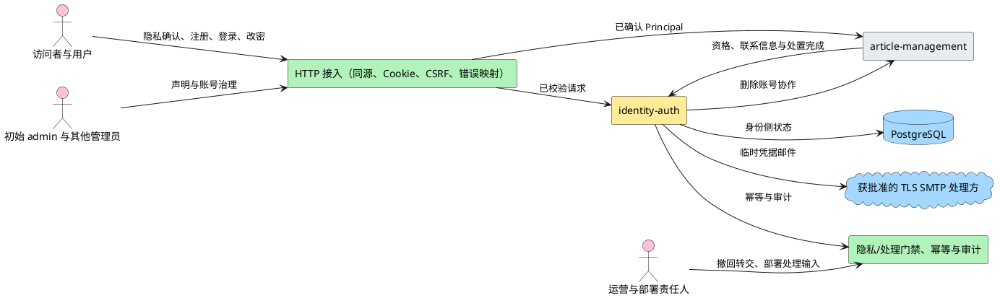

**说明**：identity-auth 是账号、凭据、角色、状态、隐私确认与会话的唯一写入者。接入层拥有 same-origin/login CSRF 和浏览器传输防护；运营只转交撤回请求，部署责任人只登记处理输入，两者不获得治理权限。article-management 只消费 Principal 和最小只读身份合同。

### 2.3 特性影响分析

| 影响项 | 结论与依据 | 设计措施 | 验证建议 | 未决 |
|---|---|---|---|---|
| 功能模块重构 | 绿地，无既有业务代码可重构 | 新建 `internal/identity` 及已批准共享包 | 目录依赖评审 | 无 |
| 关键资源 | Argon2id 消耗 CPU/内存；会话、幂等、审计占 PostgreSQL | 参数、连接池和保留期配置化 | 目标环境基准与容量测试 | 数值 TBD |
| License | 新增已批准 `golang.org/x/crypto` | 实施锁版本并做许可证/漏洞审查 | 依赖清单与构建复核 | 版本待实施 |
| 性能 | 登录哈希、每请求会话查询、治理事务和 SMTP 为关键路径 | 索引、连接池、超时、限流测量点 | P95、并发会话、SMTP 时延压测 | 全部数值 TBD |
| 可靠性 | SMTP 与数据库有已接受残余窗口 | 幂等状态、最新凭据、告警、trace 和审计 | 故障注入覆盖各提交阶段 | SMTP 超时 TBD |
| 安全/隐私 | 处理密码、会话、邮箱、手机号、隐私证据和治理权限 | 隐私声明/确认、部署门禁、Argon2id、同源/Cookie/CSRF、最小错误、追加审计、数据生命周期 | STRIDE、安全红线、门禁与隐私契约测试 | 实际处理输入 TBD |
| 可用性 | PostgreSQL 不可用时所有身份请求 fail closed；SMTP/TLS/处理方门禁不满足时邮件能力失败；恢复未完成时停服 | 唯一 503 映射，不降级为无鉴权、明文邮件或未交付凭据 | 依赖、TLS、门禁和恢复集成测试 | SLA TBD |
| 可服务性 | SMTP 残余窗口、幂等冲突和审计失败需定位 | 结构化日志、指标、审计和 trace 关联 | 按 trace 从错误追到审计/日志 | 告警阈值 TBD |
| 兼容性 | 绿地 `/api/v1`，无既有消费者 | 新字段默认可忽略；错误 code 保持稳定 | 契约测试 | 无 |
| 特性交互 | 删除用户、作者状态、转移联系、专用邮箱清理、两个 Journal namespace 与联合 readiness 跨 identity/article | 严格按 S1–S16 显式接口协作 | canonical 删除、双 namespace、DeletionOperation/Audit 与跨模块恢复测试 | tombstone inventory/周期 TBD |

### 2.4 已确认方案与对标

会话、强制 TLS SMTP、哈希、错误、幂等、审计、隐私门禁与恢复的真实方案比较已由 ADR-0005、ADR-0006、ADR-0012、ADR-0014～ADR-0018 完成。本文不复制候选论证，只把已接受结论落成可实现合同。没有新增需要 ADR 的方案分歧。

## 3 特性/功能实现原理

### 3.1 总体方案

#### 3.1.1 总体设计思路

HTTP handler 只负责协议适配；IdentityService 组织业务动作；User、Session 和 TemporaryCredential 持有状态与不变量；Repository 只持久化 identity-owned 数据；跨模块写入只经 service 端口和同一 UnitOfWork。凭据、会话令牌和 CSRF 明文只存在于瞬时内存。

#### 3.1.2 逻辑视图：业务能力

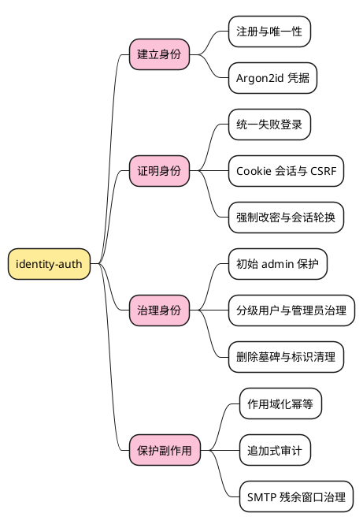

**说明**：四个能力分支从建立账号逐步走到治理和副作用保护。幂等与审计服务于真实写操作，不被建模成新的业务模块。

#### 3.1.3 逻辑视图：核心对象

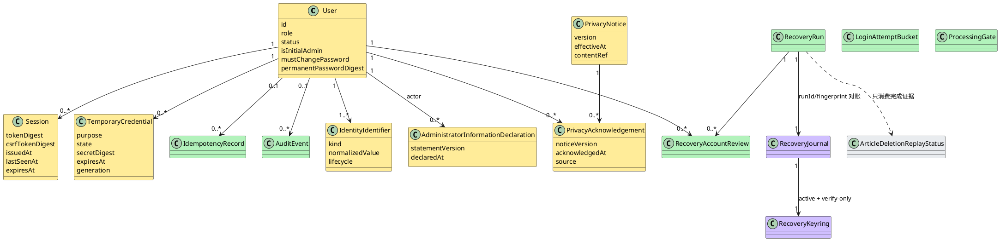

**说明**：IdentityIdentifier 独立承载用户名永久保留、邮箱/手机号条件释放。PrivacyNotice 和 Acknowledgement 保存版本化证据，管理员信息提供声明独立于角色授权。LoginAttemptBucket、ProcessingGate、IdempotencyRecord 和 AuditEvent 由共享安全能力拥有，不是账号业务真相源。

#### 3.1.4 逻辑视图：代码框架

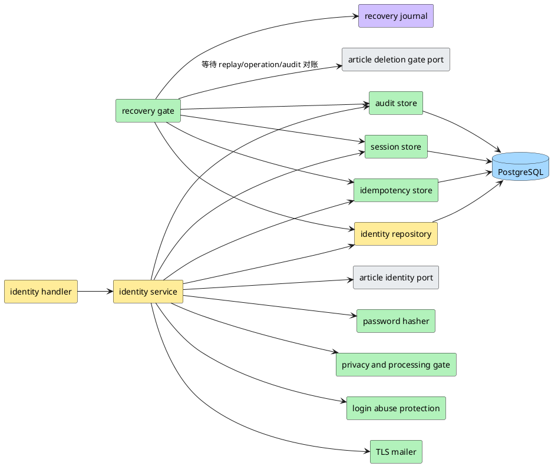

**说明**：RecoveryGate 对账 `recovery/*` 后，通过 ArticleDeletionGate 只读消费 `article-deletion/*` 的完成状态；不直接读取 Journal、DeletionOperation 或 Article 表。两个 namespace 的接口、记录和校验链保持独立。

#### 3.1.5 开发视图

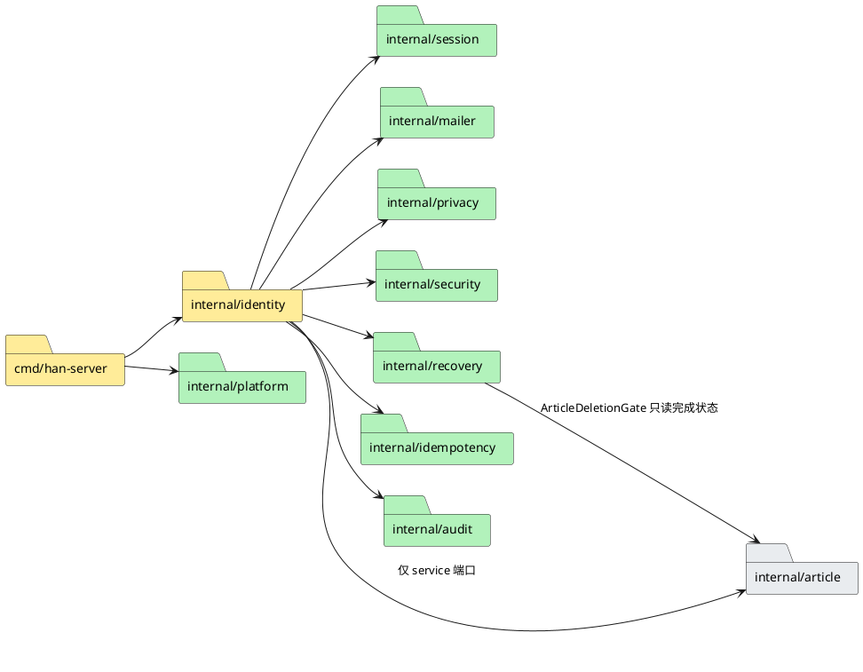

**说明**：`internal/recovery` 定义 RecoveryJournal 和 RecoveryCoordinator，并依赖 article-management 提供的 ArticleDeletionGate 接口；该接口只返回 replay 状态，不泄露 DeletionOperation 或 Article 数据结构。禁止 identity repository 直接读取文章删除表或 namespace。

#### 3.1.6 进程视图

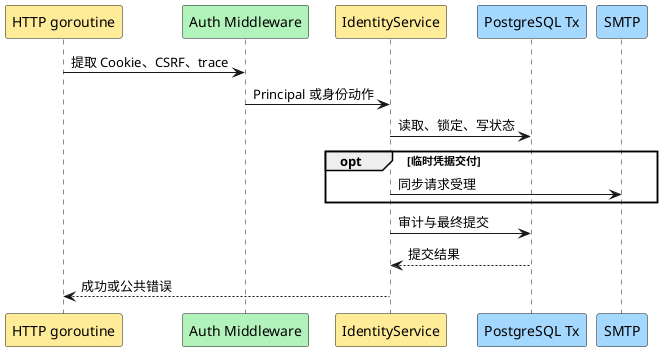

**说明**：每请求独立 goroutine，共享状态只在 PostgreSQL。临时凭据路径跨越 SMTP 调用，因此必须受超时、幂等和残余窗口治理；普通注册、查询和状态动作不依赖 SMTP。

#### 3.1.7 部署视图

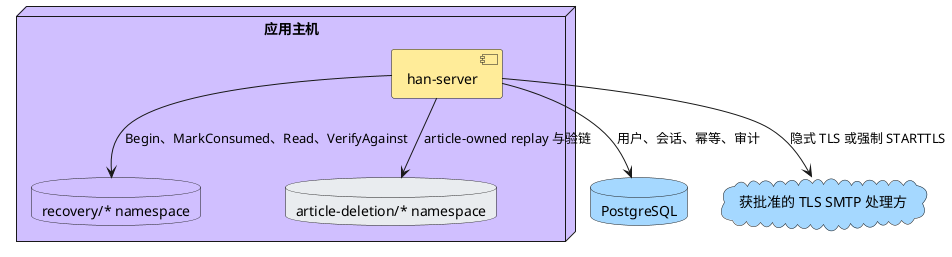

**说明**：两个 namespace 可共享持久卷、原子写和完整 keyring，但文件/记录链、HMAC domain、接口和语义独立。identity 只直接操作 `recovery/*`；`article-deletion/*` 由 article-management 操作，并通过状态端口参与联合 readiness。

#### 3.1.8 场景视图（+1）

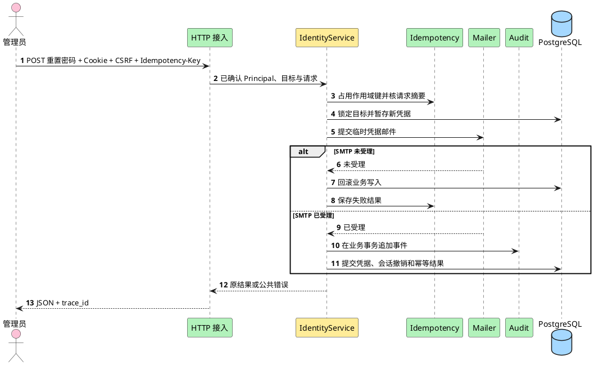

**说明**：该场景贯穿接入、权限、幂等、SMTP、凭据、会话和审计。SMTP 受理后数据库提交仍可能失败；此时返回 `identity.operation_uncertain`，邮件中的凭据不可用，并由相同幂等键的恢复流程治理。

#### 3.1.9 可行性验证记录

| 技术点 | 当前证据 | 结论 |
|---|---|---|
| Go 1.27 `net/http` | ADR-0002、ADR-0009 | 可行；绿地无框架迁移 |
| PostgreSQL 本地事务 | ADR-0001、ADR-0003 | 可覆盖用户删除与文章无归属化 |
| Argon2id | ADR-0012，依赖已批准 | 结构可定；参数待目标环境基准 |
| Cookie/CSRF | ADR-0005 | 合同已定；名称与 SameSite 取 A1/A2 |
| 幂等与审计 | ADR-0015、ADR-0016 | 数据对象和事务可定；保留期 TBD |
| PlantUML | 文档静态语法约束 | 本机是否有渲染器待收尾检查；不安装或联网 |

#### 3.1.10 Story 拼图与依赖

| 能力维度 | 01.1 | 01.2 | 02.1 | 03.1 | 03.3 | 03.4 | 03.5 | 03.6 | 03.7 | 03.10 | 03.11 |
|---|---:|---:|---:|---:|---:|---:|---:|---:|---:|---:|---:|
| 标识与账号 | ● |  | ● | ● | ● | ● | ● | ● | ● | ● | ● |
| 永久/临时凭据 |  | ● | ● | ● | ● |  |  |  |  | ● | ● |
| 会话与 CSRF |  |  | ● | ● | ● | ● | ● | ● | ● | ● | ● |
| 分级权限 |  |  |  | ● | ● | ● | ● | ● | ● | ● | ● |
| 幂等/SMTP |  |  |  |  | ● |  |  |  |  | ● | ● |
| 审计 | ● | ● | ● | ● | ● | ● |  | ● | ● | ● | ● |
| article 接缝 |  |  | ● |  |  | ● |  | ● | ● |  |  |

详细 Story 切片见 [stories.md](stories.md)。

### 3.2 用户与调用方行为

| 场景 | 调用方动作 | 成功可观察结果 | 失败/权限反馈 | API |
|---|---|---|---|---|
| 读取隐私声明 | 访问者或受限用户读取当前声明 | 获得版本、内容和生效时间 | 门禁/存储故障按唯一错误表 | `GET /api/v1/privacy-notices/current` |
| 注册 | 提交用户名、邮箱、手机号、密码和当前隐私确认 | 同事务写确认与新成员，不自动登录 | 未确认、版本过期、字段或标识冲突；不产生账号 | `POST /api/v1/users` |
| 登录 | same-origin 提交用户名、密码 | 设置新 Session Cookie，撤销已有旧会话，返回身份和 CSRF Token | Origin/Fetch Metadata 拒绝；认证失败统一 | `POST /api/v1/sessions` |
| 恢复会话 | 浏览器带 Cookie 读取当前身份 | 返回身份、强制改密标志和当前 CSRF Token | 无效/过期会话统一未认证 | `GET /api/v1/users/me` |
| 强制/初始管理员改密 | 提交当前受限会话实际凭据和新密码 | 更新凭据、完成改密 Gate、轮换当前会话 | 凭据类型/ID 不匹配或策略不符；Q1 影响 bootstrap | `PUT /api/v1/users/me/password` |
| 确认隐私 | 受限新管理员确认当前声明 | 追加确认、完成隐私 Gate、轮换会话 | 未确认或版本过期 | `POST /api/v1/users/me/privacy-acknowledgements` |
| 创建管理员 | 初始 admin 提交三标识、临时密码、信息提供声明及幂等键 | 强制 TLS SMTP 受理且 DB 提交后返回管理员摘要 | 门禁、声明、TLS、邮件、幂等或残余窗口错误 | `POST /api/v1/admin/administrators` |
| 查看治理对象 | 管理员读取列表或详情 | 仅返回其可治理范围 | 非管理员 403；不可见目标按 404 最小披露 | `GET /api/v1/admin/users...`、`administrators...` |
| 停用/恢复 | 管理员提交目标状态动作 | 返回账号摘要与 `changed`；重复请求稳定成功 | 每次重放仍重新鉴权 | `POST .../suspend`、`POST .../restore` |
| 删除用户 | 管理员删除可治理目标 | 204；账号成为墓碑、会话撤销、文章无归属 | 目标不存在或不可治理；事务全回滚 | `DELETE /api/v1/admin/users/{id}` 等 |
| 重置/重发 | 获授权管理员携带幂等键 | SMTP 受理且提交后返回有效期和投递受理状态 | 邮件/幂等/残余窗口公共错误 | `POST .../password-reset...` |
| 撤回处理 | 运营转交请求，由有删除权限的管理员调用既有删除 API | 与治理删除相同，不新增权限 | 仍执行目标资格和角色校验 | `DELETE /api/v1/admin/users/{id}` |

加载态和重复提交由客户端控制，但服务端正确性不依赖前端禁用按钮。Q5 未决定前，高危动作是否二次确认不写入 API 前置条件。

### 3.3 Story 详细设计

#### 3.3.1 共享基础

##### 实现设计

浏览器 API 默认 same-origin，不配置 `Access-Control-Allow-Credentials: true`，也不对任意 Origin 回显 CORS。登录请求必须携带与部署登记的 canonical origin 精确匹配的 `Origin`，并在浏览器提供 Fetch Metadata 时要求 `Sec-Fetch-Site: same-origin`；缺失或不可信信号 fail closed。所有受保护请求再校验 Session Cookie，非安全方法校验 `X-CSRF-Token`。受限 Principal 只能访问当前身份、改密、当前隐私声明与隐私确认接口。

注册、管理员创建和事务性邮件在进入业务规则前检查 ProcessingGate。该门禁只验证地区、数据控制者、处理依据和获批准 SMTP 处理方的登记是否完整，不把登记表述为法律结论。

##### 类/组件设计

| 组件 | 唯一职责 | 关键合同 |
|---|---|---|
| `IdentityService` | 编排注册、登录、改密和账号治理 | 不直接构造 HTTP 或 SMTP |
| `CredentialHasher` | Argon2id 编码和验证 | 编码含版本、参数、盐、摘要；参数 TBD |
| `SessionStore` | 创建、查验、轮换和撤销会话 | Cookie 只含原始随机 token；数据库只存摘要 |
| `AuthorizationPolicy` | 判定操作者和目标是否允许 | 默认拒绝；初始 admin 保护集中执行 |
| `IdentityRepository` | 读写 User、Identifier、TemporaryCredential | 不读写 article-owned 表 |
| `PrivacyStore` | 读取当前 PrivacyNotice、追加 Acknowledgement 与管理员声明 | 版本、时间、主体和来源可核对；无 UPDATE 覆盖历史 |
| `ProcessingGate` | 校验部署处理输入和获批准 SMTP 处理方 | 输入缺失时相关能力 fail closed；不判断法律合规 |
| `LoginAbuseProtector` | 持久化账号摘要/可信来源维度的失败窗口与退避 | 阈值和时长 TBD；统一失败不泄露账号 |
| `IdempotencyStore` | 作用域占位、摘要冲突和结果重放 | 不保存明文凭据；保留期 TBD |
| `AuditStore` | 在调用方事务追加 AuditEvent | 无 UPDATE/DELETE API |
| `Mailer` | 经隐式 TLS/强制 STARTTLS 请求获批准 SMTP 处理方受理 | 验证证书链与主机名；禁止降级和 `InsecureSkipVerify` |
| `RecoveryGate` | 停服恢复后批量失效身份与幂等状态 | 任一步失败保持停服并追加恢复审计 |
| `RecoveryJournal` | 在业务数据库恢复域外记录 run/secret 防重放状态 | `Begin/MarkConsumed/Read/VerifyAgainst`；默认持久卷追加文件提供方 |
| `RecoveryKeyringLoader` | 加载并验证唯一 active key 与 verify-only retained keys | 全部 Journal key 引用必须可解析；不完整时停服 |
| `ArticleAccountPort` | 删除账号时无归属化文章 | 使用同一事务；article 写自己的表 |
| `ArticleIdentityReader` | 给 article 提供作者状态、目标资格和联系信息 | 最小字段、只读 |

##### 接口设计

**公共错误**

```json
{
  "code": "identity.validation_failed",
  "message": "请求字段不符合要求",
  "field_errors": [{"field": "password", "code": "password_policy"}],
  "trace_id": "01H..."
}
```

`field_errors` 可省略；公共响应不含内部 cause。下表是本特性的唯一公共错误注册表，正文不得使用表外 code。

| HTTP | code | 公开 message 语义 | 可重试 | 唯一责任边界 | 最终日志级别 | 内部 cause 唯一映射 |
|---:|---|---|---|---|---|---|
| 400 | `request.invalid_json` | 请求格式不正确 | 修正后 | HTTP Decoder | NONE | JSON、Content-Type、未知/重复字段 |
| 400 | `request.invalid_cursor` | 分页游标无效 | 修正后 | Pagination Decoder | NONE | 解码、版本、过滤绑定或签名失败 |
| 400 | `identity.idempotency_key_required` | 缺少幂等键 | 修正后 | Idempotency Middleware | NONE | Header 缺失/格式错误 |
| 401 | `auth.login_failed` | 登录失败 | 是 | IdentityService | NONE | 凭据错、账号缺失/停用/删除/recovery Gate、临时凭据失效或账号维度退避 |
| 401 | `auth.session_required` | 需要重新登录 | 是 | Session Middleware | NONE | Cookie 缺失、Session 不存在/过期/恢复后失效 |
| 403 | `auth.origin_rejected` | 请求来源不受信任 | 否 | Origin Middleware | WARN | Origin、Fetch Metadata、代理信任失败 |
| 403 | `auth.csrf_failed` | 请求安全校验失败 | 否 | CSRF Middleware | WARN | CSRF 缺失或摘要不匹配 |
| 403 | `auth.must_complete_onboarding` | 请先完成必要的账号确认 | 是 | Onboarding Guard | NONE | 改密 Gate、隐私 Gate 或 recovery Gate 未完成 |
| 403 | `auth.forbidden` | 无权执行该操作 | 否 | AuthorizationPolicy | WARN | 普通权限或目标资格失败 |
| 403 | `identity.initial_admin_protected` | 初始管理员账号受保护 | 否 | AuthorizationPolicy | WARN | 停用、删除、撤权、他人重置 initial admin |
| 403 | `privacy.acknowledgement_required` | 必须确认当前隐私声明 | 是 | PrivacyService | NONE | 确认缺失或 false |
| 403 | `privacy.information_declaration_required` | 必须确认有权提供目标管理员信息 | 修正后 | PrivacyService | NONE | 管理员创建声明缺失或 false |
| 404 | `identity.user_not_found` | 用户不存在 | 否 | IdentityQueryService | NONE | 目标缺失或对当前操作者不可见 |
| 409 | `identity.identifier_conflict` | 身份标识已被使用 | 修正后 | IdentityRepository | NONE | 唯一约束冲突 |
| 409 | `identity.invalid_state` | 当前状态不允许该操作 | 状态变化后 | IdentityService | NONE | 账号、凭据、onboarding 或 recovery 状态机错误 |
| 409 | `privacy.notice_outdated` | 隐私声明已更新，请重新确认 | 是 | PrivacyService | NONE | 请求/已确认版本不是当前版本 |
| 409 | `identity.idempotency_conflict` | 幂等键与原请求不一致 | 使用新键 | IdempotencyStore | NONE | 同作用域同键不同摘要 |
| 409 | `identity.idempotency_in_progress` | 原请求仍在处理中 | 是 | IdempotencyStore | NONE | processing 且租约有效 |
| 422 | `identity.validation_failed` | 请求字段不符合要求 | 修正后 | Request Validator | NONE | 字段、密码、声明值校验 |
| 429 | `request.rate_limited` | 请求过于频繁，请稍后重试 | 是，带 `Retry-After` | RateLimitResponseBoundary | NONE | 可信来源或全局容量保护；不用于账号存在性区分 |
| 503 | `platform.processing_gate_closed` | 该能力尚未开放 | 配置后 | ProcessingGate | NONE | 地区、控制者、处理依据或 SMTP 处理方登记缺失 |
| 503 | `platform.database_unavailable` | 服务暂时不可用 | 是 | PersistenceBoundary | ERROR | PostgreSQL 连接、事务或锁不可用 |
| 503 | `identity.email_delivery_failed` | 邮件暂未受理 | 是 | Mailer 最终尝试 | ERROR | SMTP 连接、TLS、证书、主机名、认证、超时或拒绝 |
| 503 | `identity.operation_uncertain` | 操作结果未确认，请等待受控核对 | 是 | IdentityOperationCoordinator | ERROR | SMTP 残余窗口、uncertain 或 recovery_review_required |
| 503 | `platform.recovery_in_progress` | 服务正在恢复，暂不可用 | 是 | RecoveryGate | NONE | 维护模式、恢复未终结或 readiness 关闭 |
| 503 | `platform.dependency_unavailable` | 依赖服务暂时不可用 | 是 | 对应 Adapter 最终边界 | ERROR | 其他已分类依赖故障 |
| 500 | `platform.internal_error` | 服务内部错误 | 视情况 | Top-level Error Boundary | ERROR | 未分类服务端 cause |

同一 code 只允许表中一个 HTTP、message、重试性、责任边界、最终日志级别与 cause 映射。`NONE` 表示公共响应边界不重复写普通日志，必要证据由审计、指标或下表内部事件承担。429 必须返回 `Retry-After`；503 只有具备可信恢复估计时才返回该 Header。

启动、重试与中间过程使用独立内部事件名，不复用公共 code：

| internal event | 唯一发出边界 | 级别 |
|---|---|---|
| `processing_gate.startup_blocked` | ProcessingGate 启动校验 | ERROR |
| `smtp.delivery_retry` | Mailer 中间重试 | WARN |
| `smtp.delivery_final_failed` | Mailer 最终失败；随后映射公共 503 | ERROR |
| `login.throttle_applied` | LoginAbuseProtector | INFO |
| `recovery.maintenance_entered` | RecoveryGate | INFO |
| `recovery.step_failed` | RecoveryGate 失败步骤 | ERROR |
| `recovery.review_transition` | RecoveryCoordinator | INFO |
| `recovery.journal_unavailable` | FileRecoveryJournal | ERROR |
| `recovery.journal_mismatch` | RecoveryGate 对账 | ERROR |
| `recovery.canonical_delete_failed` | CanonicalDeleteCoordinator | ERROR |
| `recovery.article_deletion_gate_failed` | RecoveryCoordinator 等待 article-owned Gate | ERROR |
| `recovery.article_evidence_invalid` | RecoveryCoordinator 校验 run/backup/version/digest | ERROR |

**会话与 CSRF**

- 成功登录和成功改密通过 `Set-Cookie` 写 `__Host-han_session=<opaque>`；轮换时旧 token 立即失效。
- `GET /api/v1/users/me` 可在浏览器刷新后重新取得 `csrf_token`。
- 使用 Cookie 会话的 `POST`、`PUT`、`PATCH`、`DELETE` 必须携带 `X-CSRF-Token`。注册不使用会话；登录不要求 CSRF Header，但必须通过 same-origin `Origin`/Fetch Metadata 校验。
- 已有 Session Cookie 再次登录时，成功创建新会话后在同一事务撤销旧会话；认证失败保持旧会话不变。
- Session Cookie、CSRF、密码和临时凭据不得进入错误、日志、审计和幂等响应快照。

`GET /api/v1/users/me` 成功 `200`：

```json
{
  "user":{"id":"<opaque>","username":"alice","role":"member","status":"active","is_initial_admin":false,"must_change_password":true,"must_acknowledge_privacy":false},
  "csrf_token":"<opaque>"
}
```

`PUT /api/v1/users/me/password` 请求：

| 字段 | 类型 | 必填 | 校验 |
|---|---|---:|---|
| `current_password` | string | 是 | 只验证当前受限 Session 记录的 `authenticated_credential_kind/id`，不得切换或回退其他凭据 |
| `new_password` | string | 是 | 非 bootstrap 强制改密采用至少 8 位且含字母和数字；initial admin 首次改密具体规则受 Q1 阻塞 |

成功 `200` 返回更新后的 `user`、新 `csrf_token` 并轮换 Set-Cookie；旧 Cookie 和其他会话全部失效。新管理员即使完成改密，只要当前隐私确认仍缺失，`must_acknowledge_privacy` 继续为 true。普通成员非强制状态下的自助改密不在本期承诺，返回 `auth.forbidden`；初始 admin 的正常自改密保留同一入口但受 Q1 规则约束。

**幂等**

- 作用域：`actor_user_id + operation + target_locator + key_digest`。
- 创建管理员的 `target_locator` 是归一化用户名；重置/重发是目标 User ID。
- 请求摘要覆盖所有影响结果的字段。秘密字段使用受环境变量保护的 HMAC-SHA-256 进入摘要，不保存明文。
- 正式状态：`processing`、`succeeded`、`failed`、`uncertain`、`recovery_review_required`；数据库检查约束只允许这些值。
- 同键同摘要：succeeded/failed 返回原快照；processing 返回 `identity.idempotency_in_progress`；uncertain/recovery_review_required 返回 `identity.operation_uncertain`，普通请求不得自动抢占租约或重放副作用。
- 同键不同摘要在所有状态下都返回 `identity.idempotency_conflict`。
- 只有 RecoveryCoordinator 的受控核对动作可在行锁、租约检查和 AuditEvent 下把 recovery_review_required 转为 failed，或以 `execution_generation+1` 转为新的 processing。任何普通 HTTP 重试都无此转换权。
- `processing` 的租约和记录保留期均为 TBD；租约过期可进入 uncertain，但不能直接进入新的 processing。
- 每条记录保存 `digest_key_version`。新记录使用当前 HMAC 密钥版本；旧版本密钥必须备份并保留到对应幂等记录全部过期，轮换期间按记录版本验证。缺少仍被引用的旧密钥时幂等端点 fail closed。

**隐私与处理门禁**

- `GET /api/v1/privacy-notices/current` 返回当前 `version,effective_at,content,content_hash`；不填地区、控制者或法律依据的具体值。
- `POST /api/v1/users/me/privacy-acknowledgements` 要求 Session、CSRF，body 为 `{"privacy_notice_version":"...","acknowledged":true}`。成功追加证据、轮换会话并重新计算 Gate。
- `GET /api/v1/admin/administrator-information-provision-notices/current` 仅初始 admin 可读取当前声明文本和版本。
- 注册、管理员创建和事务性邮件在 ProcessingGate 关闭时返回 `platform.processing_gate_closed`，且不得先写业务状态或发邮件。

**防暴力机制**

- 三类桶分别编码为 `subject`、`source`、`subject_source`，统一生成 `bucket_key_digest`；不存在账号也生成 subject 桶。
- 计数、窗口起点、退避截止时间持久化在 PostgreSQL，进程重启不清空。
- 失败增加计数并按配置化阶梯延迟/阻断；成功按策略清理或衰减。阈值、窗口和退避时长均为 TBD。
- 仅当直接对等地址属于配置的可信代理集合时读取标准转发地址；否则忽略转发 Header，防止来源伪造。
- 账号维度阻断仍返回 `auth.login_failed`；来源/全局容量保护可返回 429，不携带账号存在性信号。
- 审计保存 actor_kind=anonymous、登录标识摘要和来源摘要；指标只用 outcome/reason_bucket 等低基数标签。

**Recovery Journal 合同**

| 方法 | 输入 | 成功保证 | 失败语义 |
|---|---|---|---|
| `Begin` | recovery_run_id、候选 recovery secret、started_at | 使用 active 与全部 verify-only retained key 计算候选指纹；任一历史命中即拒绝；新 begun 记录只使用 active key | 重复 run、任一 key 历史命中、缺 key、无法计算、不可写或校验失败均 fail closed |
| `MarkConsumed` | recovery_run_id、active key 的 secret_fingerprint、consumed_at | 仅 begun 且未消费的同一 run/key/指纹可追加 consumed 记录 | 已消费、key/指纹不匹配、无 Begin 或落盘失败均拒绝 |
| `Read` | recovery_run_id | 返回经校验链验证的最新阶段、key_id 与 key_version | 部分写、损坏、未知/缺失 key 或重复阶段拒绝 |
| `VerifyAgainst` | 数据库 RecoveryRun | run ID、指纹、阶段、计数/时间关系与业务库一致 | 任一不一致保持停服 |

默认 `FileRecoveryJournal` 位于应用主机受控持久卷，不纳入业务 PostgreSQL 备份恢复。每个逻辑记录包含单调 sequence、run ID、稳定 `key_id`、`key_version`、secret fingerprint、stage、timestamp、previous_record_hash 和 record HMAC；secret 明文从不写入 Journal、数据库、日志或审计。

文件提供方采用同目录 copy-on-write：取得独占文件锁并验证完整校验链，写入包含旧记录和新记录的临时文件，`fsync` 临时文件，原子替换主文件，再 `fsync` 目录。进程崩溃留下临时文件时，只有主文件校验完整才可继续；临时文件进入告警和人工核对，不自动合并。主文件部分写、HMAC/链损坏、符号链接、非普通文件、权限不符合 owner-only 基线、只读文件系统或空间不足均保持停服。

Recovery keyring 恰有一个 `active` 写入 key，并可包含零个或多个 `verify_only` retained key。每个 key 都有稳定 `key_id/key_version/state`：

1. `Begin` 对候选 secret 使用 keyring 中每个 retained key 分别计算 `HMAC-SHA-256(key, recovery_secret)`。
2. 每个候选只与 Journal 中相同 `key_id/key_version` 的历史 fingerprint 比较；任一 begun/consumed 历史命中都拒绝本次恢复。
3. 所有候选均未命中时，仅用 active key 的 `key_id/key_version/fingerprint` 写新记录；verify-only key 永不写新记录。
4. Journal 中仍存在需承担防重放责任的记录时，其 key 不得退役或删除。退役必须满足批准的记录退出/保留条件，并完成整体备份、迁移和 VerifyAgainst。
5. 任一 Journal key 引用在 keyring 中缺失、未知、不可加载或候选计算失败时保持停服。只迁移 Journal、只迁移 active key、只迁移部分 verify-only key 或 keyring/Journal 版本不完整均视为不一致。

Journal 与完整 keyring 必须作为不可拆分制品整体备份、迁移和恢复。全 retained key 判重成本随 key 数量线性增长；数量上限与性能目标保持 TBD，不得为性能删除仍承担历史判重的 key。

**SMTP 传输合同**

- 生产 `SMTP_TLS_MODE` 只允许 `implicit_tls` 或 `starttls_required`。
- `starttls_required` 必须在服务器能力响应中确认 STARTTLS，再升级连接；未提供、协商失败或升级后校验失败均返回 `identity.email_delivery_failed`，不得继续明文。
- TLS 使用系统信任根或受控 CA bundle，必须验证完整证书链、有效期和 `SMTP_SERVER_NAME` 主机名；代码和配置均禁止 `InsecureSkipVerify` 或等价选项。
- TLS 最低协议和密码套件策略来自获批准安全基线；基线缺失或配置低于基线时启动失败，不在本文硬编未经批准数值。
- `SMTP_HOST`、端口、ServerName、TLS mode、认证凭据、处理方引用和安全基线缺任一生产必需值时服务启动失败；获批准处理方登记缺失时 ProcessingGate 保持邮件能力关闭。
- Mail command 的 purpose 只允许 `new_administrator_credential`、`password_reset_credential`、`temporary_credential_resend` 和 article-owned `orphan_article_transfer_notice`；其他用途拒绝，营销内容无入口。
- SMTP 用户名/密码只从环境变量读取；日志、审计和错误不得包含邮件正文、认证凭据或临时密码。

SMTP 安全测试矩阵：

| 场景 | 预期 |
|---|---|
| 隐式 TLS、有效链与正确主机名 | 允许进入 SMTP 认证/受理 |
| 强制 STARTTLS、能力存在且验证成功 | 允许 |
| 无 TLS 或机会式 STARTTLS | 启动或发送 fail closed |
| 服务不提供 STARTTLS | 失败，不降级 |
| 证书过期、不受信任、链不完整 | 失败 |
| 证书主机名不匹配 | 失败 |
| 配置试图启用 `InsecureSkipVerify` | 配置校验失败 |
| SMTP 处理方未登记或与配置不匹配 | 门禁关闭，不建立连接 |
| 日志/审计检查 | 不含正文、邮箱全文、凭据或临时密码 |

##### 数据结构设计

身份侧和共享侧表详见 §3.4。共享基础不使用缓存、文件或对象存储。配置只来自环境变量或受控部署登记，至少包括 canonical origin、可信代理、数据库、强制 TLS SMTP、获批准处理方引用、初始管理员密码、幂等 HMAC 密钥版本集、安全随机最低基线、Argon2id 参数、会话期限、限流、连接池与超时；没有依据的数值保持 TBD。

#### 3.3.2 Story：建立用户身份（US-IDENTITY-01.1）

##### 实现设计

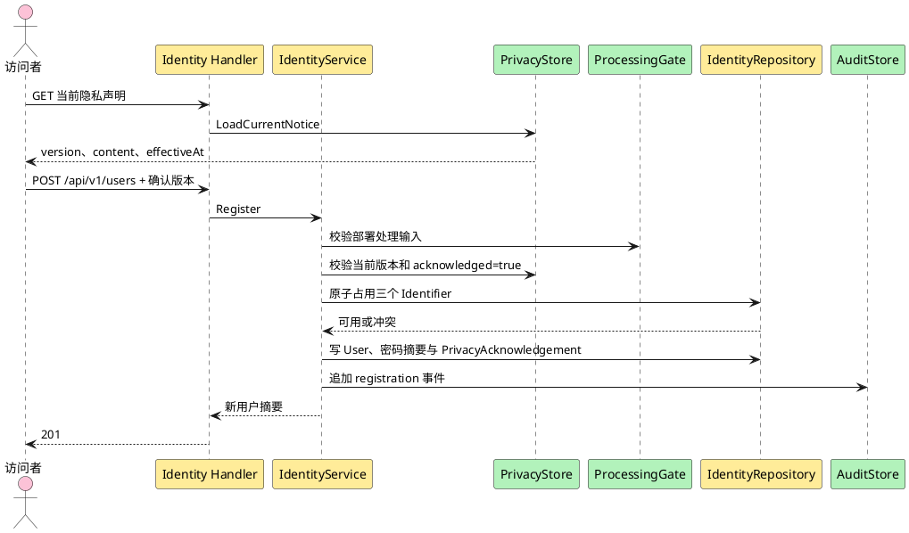

**说明**：注册前先展示当前声明。确认版本、User、三个标识、PrivacyAcknowledgement 与成功审计在同一事务提交；未确认、版本过期、部署处理输入缺失或任一写入失败都不留下账号。

##### 类/组件设计

`RegisterUser` 负责归一化、密码策略、ProcessingGate、当前声明版本和事务协调。`PrivacyNotice` 是发布声明版本的权威对象，`PrivacyAcknowledgement` 是主体确认事实。`IdentityIdentifier` 是唯一性真相源。普通注册 User 初始为 `role=member`、`status=active`、`credential_mode=permanent`，并在同一事务把 `onboarding_completed_at` 记为注册时间。

##### 接口设计

`GET /api/v1/privacy-notices/current` 无需认证，成功：

```json
{"version":"<opaque-version>","effective_at":"<rfc3339>","content":"<current notice>","content_hash":"<digest>"}
```

`POST /api/v1/users` 无需认证，但要求 ProcessingGate 已开放。

请求：

| 字段 | 类型 | 必填 | 校验 |
|---|---|---:|---|
| `username` | string | 是 | 去首尾空白后非空；禁止控制字符；格式和最大长度 TBD |
| `email` | string | 是 | 去空白、小写唯一键；须为可解析邮箱；最大长度 TBD |
| `phone` | string | 是 | 去空白后非空；不擅自改国家码；格式/长度 TBD |
| `password` | string | 是 | 至少 8 位且同时含字母和数字 |
| `privacy_notice_version` | string | 是 | 必须等于当前已发布版本 |
| `privacy_acknowledged` | boolean | 是 | 必须为 true |

成功 `201`：

```json
{"id":"<opaque>","username":"alice","role":"member","status":"active","must_change_password":false,"created_at":"2026-10-20T00:00:00Z"}
```

错误：`request.invalid_json`、`privacy.acknowledgement_required`、`privacy.notice_outdated`、`identity.validation_failed`、`identity.identifier_conflict`、`platform.processing_gate_closed`、`platform.database_unavailable`、`platform.internal_error`。标识冲突可通过 `field_errors` 指明字段；该信息只在注册/管理员创建场景披露，不改变登录统一失败。

##### 数据结构设计

事务新增 `users`、三条 `identity_identifiers`、一条 `privacy_acknowledgements` 和一条成功审计事件。Acknowledgement 保存 `user_id,notice_version,acknowledged_at,source_kind,source_fingerprint`，不保存多余 PII。失败审计不得保存完整邮箱、手机号或密码。

#### 3.3.3 Story：设置注册密码（US-IDENTITY-01.2）

##### 实现设计

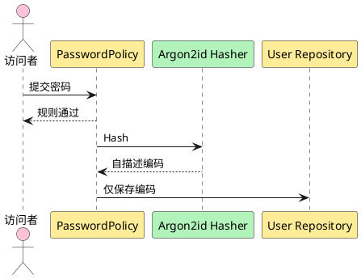

**说明**：密码策略先于昂贵哈希，减少无效输入的资源消耗。Argon2id 编码包含算法版本、实际参数、盐和摘要；明文在请求结束前从可控变量中释放，不进入持久化和可观测数据。

##### 类/组件设计

`PasswordPolicy` 只表达已确认业务规则；`CredentialHasher` 表达算法变化。验证成功发现旧参数时可返回 `needs_rehash`，由成功认证事务升级编码，不降低参数。

##### 接口设计

复用 `POST /api/v1/users` 的 `password` 字段。字段错误统一 `identity.validation_failed`，`field_errors.code` 可取 `password_too_short`、`password_requires_letter`、`password_requires_digit`。响应永不回显密码或摘要。

##### 数据结构设计

`users.permanent_password_digest` 保存 Argon2id 自描述字符串。盐由密码学安全随机源逐条生成。内存、迭代、并行参数和哈希基准通过配置注入，当前全部 TBD；配置缺失时服务启动 fail closed。

#### 3.3.4 Story：登录社区（US-IDENTITY-02.1）

##### 实现设计

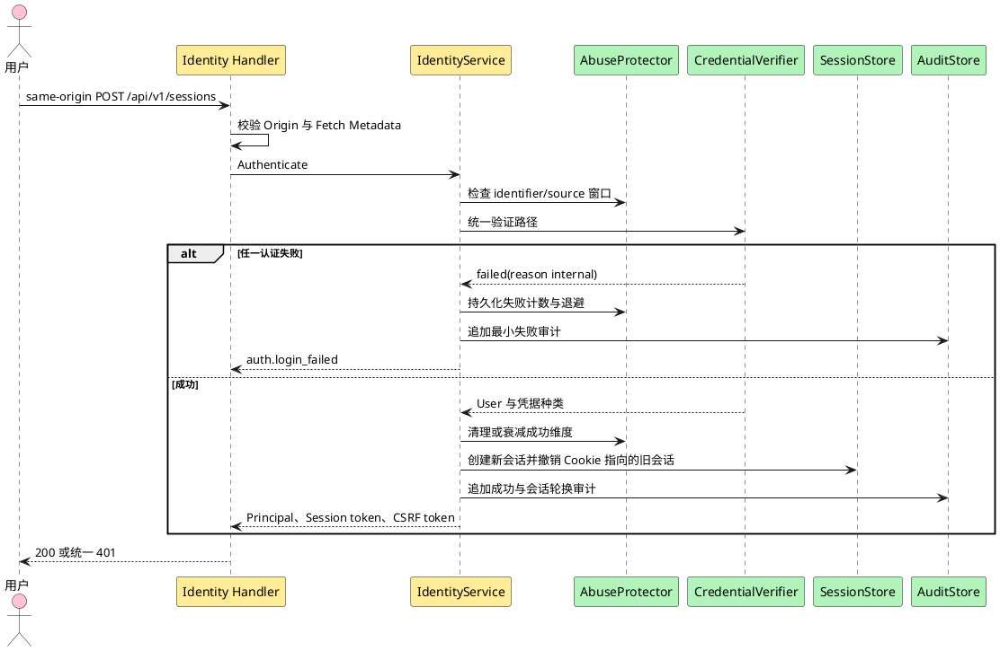

**说明**：不可信 Origin/Fetch Metadata 在凭据校验前拒绝。用户名不存在、密码错误、账号停用、账号删除、临时凭据过期/失效和账号维度退避都映射成统一登录失败。已有会话再次登录成功时新建会话并撤销旧会话；失败时旧会话保持。

##### 类/组件设计

`CredentialVerifier` 先检查维护模式与 `recovery_required`。普通流量在维护模式统一 503；非初始账号 `recovery_required=true` 时统一登录失败，不读取任何凭据。随后只按 `users.credential_mode` 选择一种凭据路径：

1. `permanent`：只验证 `permanent_password_digest`。
2. `bootstrap`：仅初始 admin，验证 bootstrap 永久摘要，成功会话记录 `authenticated_credential_kind=bootstrap`。
3. `temporary`：读取最新未 consumed、未 superseded 的 TemporaryCredential；无论其为 active、expired 或 recovery_invalidated，都绝不回退永久密码。只有 active 且未过期的最新行可以成功，会话记录该 credential ID。
4. `recovery_locked`：永不接受登录。
5. `recovery_bootstrap`：仅维护模式中的既有 initial admin 可验证 recovery secret 摘要，并创建只允许改密的受限会话。

账号不存在仍执行等价成本伪摘要验证。`LoginAbuseProtector` 使用登录标识摘要、可信来源摘要及组合维度，不把计数写进 User 状态。

##### 接口设计

`POST /api/v1/sessions`，请求：

| 字段 | 类型 | 必填 | 校验 |
|---|---|---:|---|
| `username` | string | 是 | 与注册相同归一化 |
| `password` | string | 是 | 非空；不在公共错误中区分规则 |

请求 Header 必须包含与 canonical origin 精确匹配的 `Origin`；浏览器发送 Fetch Metadata 时 `Sec-Fetch-Site` 必须为 `same-origin`。服务默认不返回 credentialed CORS Header。

成功 `200`，设置 A1 Cookie：

```json
{
  "user":{"id":"<opaque>","username":"alice","role":"member","status":"active","must_change_password":false},
  "csrf_token":"<opaque>"
}
```

凭据/账号/临时状态失败始终 `401 auth.login_failed`。来源或全局容量保护可返回 `429 request.rate_limited`，但不得携带账号存在性信号。Origin/Fetch Metadata 失败为 `403 auth.origin_rejected`。成功和失败都审计；失败审计 actor_kind 为 anonymous，目标账号 ID 可空。

##### 数据结构设计

`sessions` 新增内部 ID、`token_digest`、`csrf_token_digest`、`user_id`、`authenticated_credential_kind`、`authenticated_credential_id`、`issued_at`、`last_seen_at`、`absolute_expires_at`、`idle_expires_at`、`rotated_from_id`。`login_attempt_buckets` 以 kind+digest 表达三类桶，保存窗口、计数和退避截止时间。期限、阈值和退避数值保持 TBD。

#### 3.3.5 Story：建立初始管理员账号（US-IDENTITY-03.1）

##### 实现设计

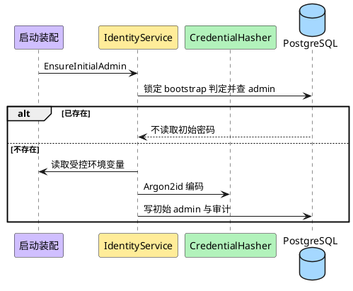

**说明**：唯一约束与事务锁处理重复启动。账号一旦存在，后续启动不得读取、比较或覆盖环境变量密码。初始管理员登录后进入强制改密会话。

##### 类/组件设计

`InitialAdminTrustManager` 隔离两个入口：bootstrap 仅首次建库；recovery 仅在维护模式为既有初始 admin 重建信任根。`AuthorizationPolicy` 对 `is_initial_admin=true` 的停用、删除、撤权和他人重置一律拒绝。bootstrap 与 recovery secret 使用不同配置键、不同门禁和不同审计事件，不允许复用。

##### 接口设计

没有公共创建 endpoint。运行配置默认名：

| 配置 | 语义 |
|---|---|
| `HAN_INITIAL_ADMIN_PASSWORD` | 仅首次不存在 `admin` 时读取；具体值禁止日志 |
| `HAN_INITIAL_ADMIN_USERNAME` | 不提供覆盖，业务值固定为 `admin` |
| `HAN_RECOVERY_INITIAL_ADMIN_SECRET` | 仅 RecoveryGate 持有独占锁且存在既有 initial admin 时读取；一次性使用、不进入普通启动 |

日常首次登录和恢复首次登录均复用 `POST /api/v1/sessions` 与 `PUT /api/v1/users/me/password`，但恢复期间只允许维护网络访问且公共 readiness 关闭。recovery secret 缺失、错误、与 bootstrap 值复用或流程门禁不成立时返回内部恢复失败并保持停服。Q1 仍只影响日常轮换/密码规则，不改变已接受恢复合同。

##### 数据结构设计

首次建库新增 User、永久 username Identifier 和 bootstrap 审计事件；按 A6 不建立 email/phone Identifier。恢复终结先清空初始 admin 永久摘要并置 `recovery_locked`；受控 recovery secret 以 Argon2id 摘要写入后改为 `recovery_bootstrap`，首次改密后回到 permanent。数据库约束保证只有一个 initial admin。

#### 3.3.6 Story：创建其他管理员账号（US-IDENTITY-03.3）

##### 实现设计

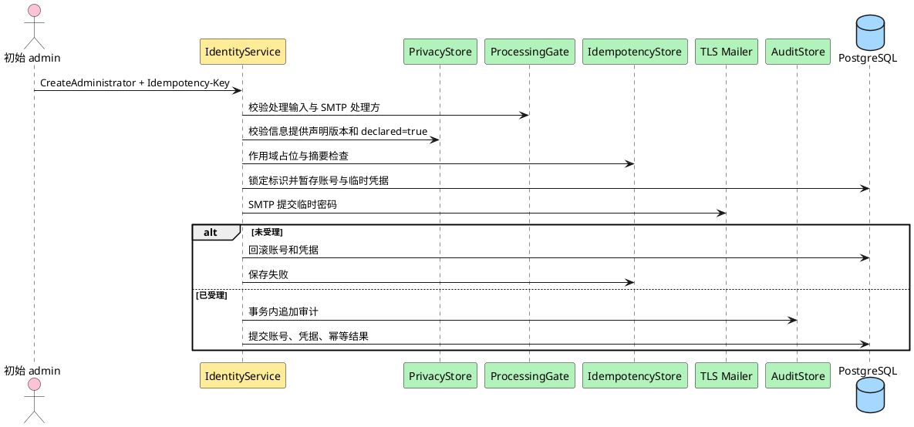

**说明**：只有初始 admin 可进入该流程。缺少当前信息提供声明、部署处理输入或强制 TLS 配置时，不占用标识、不发邮件。SMTP 已受理但最终提交失败时返回不确定错误，邮件凭据不可用。

##### 类/组件设计

`CreateAdministrator` 复用注册的 Identifier 与 PasswordPolicy，但角色固定为 admin、`credential_mode=temporary`、`onboarding_completed_at=NULL`、`onboarding_privacy_acknowledged_version=NULL`。`AdministratorInformationDeclaration` 保存初始 admin、目标定位摘要、声明版本、时间和事务性用途；它不扩大操作者权限。

##### 接口设计

`GET /api/v1/admin/administrator-information-provision-notices/current` 仅初始 admin 可调用，返回：

```json
{"version":"<opaque-version>","effective_at":"<rfc3339>","content":"<current statement>","content_hash":"<digest>"}
```

`POST /api/v1/admin/administrators` 要求有效初始 admin 会话、CSRF、`Idempotency-Key`，且 ProcessingGate 已开放。

请求：

```json
{"username":"ops","email":"ops@example.test","phone":"+10000000000","temporary_password":"<secret>","information_provision_notice_version":"<version>","information_provision_declared":true}
```

成功 `201`：

```json
{"id":"<opaque>","username":"ops","role":"admin","status":"active","must_change_password":true,"must_acknowledge_privacy":true,"temporary_credential_expires_at":"<rfc3339>","delivery_status":"accepted"}
```

声明缺失或 false 使用 `privacy.information_declaration_required`；版本过期使用 `privacy.notice_outdated`。其他错误包括 `auth.forbidden`、`identity.idempotency_key_required`、`identity.idempotency_conflict`、`platform.processing_gate_closed`、`identity.email_delivery_failed`、`identity.operation_uncertain`。邮件 command 的 purpose 固定为 `new_administrator_credential`，Mailer 拒绝表外用途。

新管理员首次登录后可调用：

`POST /api/v1/users/me/privacy-acknowledgements`

```json
{"privacy_notice_version":"<current-version>","acknowledged":true}
```

成功 `200` 追加 Acknowledgement，并把 `onboarding_privacy_acknowledged_version` 更新为当时 current 版本，返回更新后的 `user`、`csrf_token` 并轮换 Session。若改密 Gate 尚未完成，账号仍处于 onboarding 限制。最终开放事务必须再次锁定 current PrivacyNotice：仅当 `credential_mode=permanent` 且 acknowledged version 等于 current version 时写 `onboarding_completed_at`；若两 Gate 之间声明换版，账号继续受限并要求确认新版本。

##### 数据结构设计

在成功业务事务中新增 User、三条 Identifier、TemporaryCredential、AdministratorInformationDeclaration、AuditEvent，并把 IdempotencyRecord 更新为 succeeded。新管理员后续可按任意顺序完成改密与 `POST /users/me/privacy-acknowledgements`；Gate 状态由 credential_mode 与当前 PrivacyAcknowledgement 共同派生。

#### 3.3.7 Story：管理其他管理员账号（US-IDENTITY-03.4）

##### 实现设计

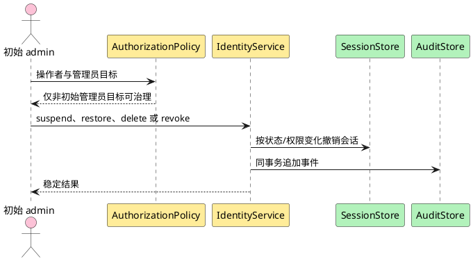

**说明**：初始 admin 保护在统一 Policy 中执行，不依赖路由名称。撤权把其他管理员角色改为 member；停用、删除或撤权后旧会话不得继续持有旧权限。

##### 类/组件设计

`GovernAdministrator` 支持目标状态动作和不可恢复删除。`revoke` 是角色转换 `admin → member`，不是删除账号。权限或强制改密上下文变化通过撤销全部目标会话实现；目标下次登录取得新 Principal。

##### 接口设计

| 方法与路径 | 结果 | 幂等 |
|---|---|---|
| `GET /api/v1/admin/administrators` | 管理员摘要分页 | 只读 |
| `GET /api/v1/admin/administrators/{id}` | 管理员详情 | 只读 |
| `POST .../{id}/suspend` | `200 {user,changed}` | 目标状态幂等 |
| `POST .../{id}/restore` | `200 {user,changed}` | 目标状态幂等 |
| `POST .../{id}/revoke` | `200 {user}` | 重复撤权返回 `identity.invalid_state` |
| `DELETE .../{id}` | `204` | 重复删除按 404 |

全部只允许初始 admin，写请求要求 CSRF。初始 admin 作为目标时只返回 `identity.initial_admin_protected`；其他越权返回 `auth.forbidden`，不得为同一原因并列两个公共 code。

##### 数据结构设计

修改 `users.role/status`，按需要删除 Sessions，追加 AuditEvent。删除管理员也进入与普通用户相同的墓碑和标识生命周期，但只能由初始 admin 发起；如其拥有文章，复用 §3.3.10 的删除协作事务。

#### 3.3.8 Story：查看用户（US-IDENTITY-03.5）

##### 实现设计

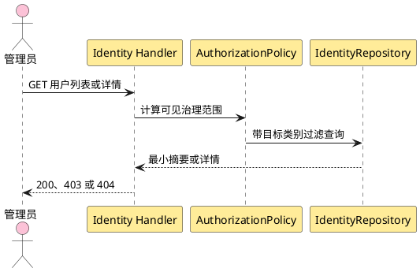

**说明**：普通管理员的查询从数据库层限定为普通用户且排除自己；初始 admin 可查询其他管理员。密码摘要、临时凭据、Session、删除保留字段和审计 metadata 不在返回模型。

##### 类/组件设计

`UserGovernanceView` 分为 Summary 与 Detail，避免列表过度披露。查询 Policy 与写入 Policy 使用同一目标资格规则，防止“能看不能管”范围漂移。

##### 接口设计

普通用户：

- `GET /api/v1/admin/users?cursor=<opaque>&limit=<integer>`
- `GET /api/v1/admin/users/{id}`

管理员目标：

- `GET /api/v1/admin/administrators?cursor=<opaque>&limit=<integer>`
- `GET /api/v1/admin/administrators/{id}`

列表成功 envelope 固定为：

```json
{
  "items":[
    {"id":"<opaque>","username":"alice","role":"member","status":"active","is_initial_admin":false,"must_change_password":false,"must_acknowledge_privacy":false,"created_at":"<rfc3339>"}
  ],
  "next_cursor":"<opaque-or-null>",
  "has_more":true
}
```

分页合同：

1. 排序固定为 `created_at DESC, id DESC`；同时间戳由 ID 严格排序。
2. 游标是版本化、经 HMAC 认证的 base64url 不透明值，包含版本、最后一项的 `created_at/id`、目标类别、操作者可见范围和请求过滤摘要。
3. 继续页必须使用与游标相同的 endpoint、过滤、角色范围和 limit；不匹配、解码失败、签名失败或未知版本返回 `400 request.invalid_cursor`。
4. `limit` 省略时使用部署配置默认值，超过配置上限时按上限裁剪；默认值和上限数值保持 TBD。`limit<=0` 返回 `identity.validation_failed`。
5. 最后一页和空列表都返回 `next_cursor:null`、`has_more:false`；字段始终存在，不省略。
6. 新插入且排序位于当前游标之前的用户不会出现在后续页；keyset 分页不承诺跨请求快照。

Summary 字段始终存在，布尔值不省略。Detail 额外返回 `email`,`phone`,`updated_at`；初始 admin 或无对应当前值时 `email`、`phone` 明确为 `null`，而不是省略。删除墓碑不通过公共治理接口列出。

##### 数据结构设计

使用 `(role,status,created_at,id)` 和 `(created_at,id)` 索引支持过滤分页。纯读不写 AuditEvent；越权探测可写安全日志，但不得把每次正常读取膨胀成审计事件。

#### 3.3.9 Story：停用与恢复用户（US-IDENTITY-03.6）

##### 实现设计

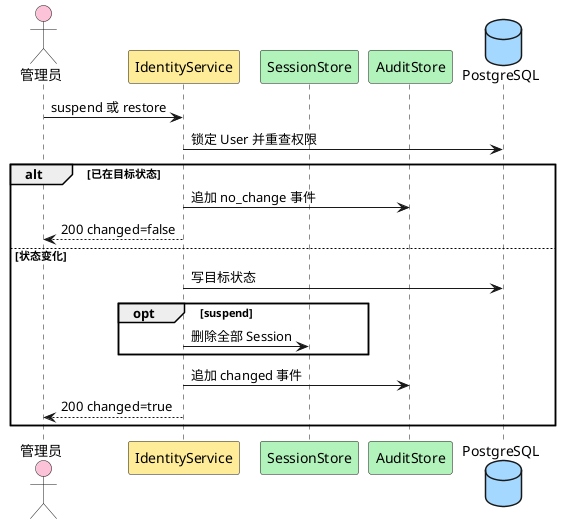

**说明**：目标状态幂等不等于跳过权限检查。停用与会话撤销、审计处于同一事务；文章表不改写，article-management 下一次读取作者状态后派生隐藏。

##### 类/组件设计

`SetAccountStatus` 只允许 `active ↔ suspended`；`deleted` 是终态。普通管理员只能作用于其他普通用户，初始 admin 才能作用于其他管理员；任何管理员都不能用普通用户接口治理自己。

##### 接口设计

- `POST /api/v1/admin/users/{id}/suspend`
- `POST /api/v1/admin/users/{id}/restore`
- 管理员目标对应 `/api/v1/admin/administrators/{id}/...`

无请求体；要求 Cookie、CSRF。成功 `200`：

```json
{"user":{"id":"<opaque>","status":"suspended"},"changed":true}
```

错误：`auth.forbidden`、`identity.user_not_found`、`identity.invalid_state`、`platform.internal_error`。不要求 `Idempotency-Key`。

##### 数据结构设计

事务更新 `users.status/updated_at`、删除 Sessions（停用）并追加 AuditEvent。User 行使用 `FOR UPDATE` 避免停用、恢复、删除并发覆盖。

#### 3.3.10 Story：删除用户（US-IDENTITY-03.7）

##### 实现设计

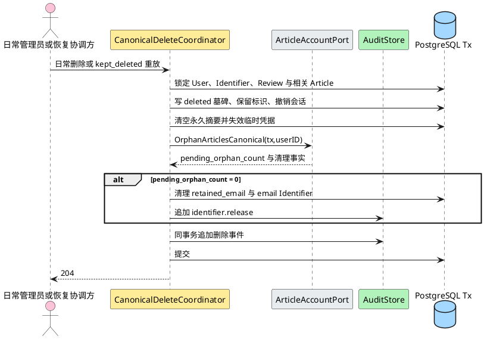

**说明**：日常删除与恢复 `kept_deleted` 使用同一协调器和同一跨模块事务。重放是幂等的：已经满足某项删除不变量时保持原值；缺失项必须补齐。任一身份、标识、文章、通知邮箱、review 或审计步骤失败都回滚并保持 recovery Gate/readiness=false。

##### 类/组件设计

`CanonicalDeleteCoordinator` 接收 mode=`daily_governance/recovery_kept_deleted`。日常模式执行现有权限检查；恢复模式要求维护锁、RecoveryRun、RecoveryAccountReview decision 和 initial admin 恢复身份。两种模式都执行：

1. 写不可恢复 User 墓碑和 deleted_at，永久保留 username Identifier；
2. 把活动邮箱复制到 retained_email（已有相同 retained 值则不重复），清空公开 email/phone，按既有生命周期保留 Identifier；
3. 删除全部 Session、清空永久密码摘要、把 TemporaryCredential 全部置为失效；
4. 调用 article-owned `OrphanArticlesCanonical`：`author_id=NULL`、`publication_state=held`、`orphaned_from_user_id=user_id`，`violation_state` 原值不变；
5. 零待处置文章时同事务清理 retained_email/email Identifier；有文章时保留到最后处置事实；
6. 追加 canonical delete、article orphan 和必要 identifier.release AuditEvent；恢复模式同事务把 RecoveryAccountReview 写为 kept_deleted completed。

##### 接口设计

- `DELETE /api/v1/admin/users/{id}`
- `DELETE /api/v1/admin/administrators/{id}`（仅初始 admin）

要求 Cookie、CSRF；成功 `204`。可选 Header `X-Account-Deletion-Reason` 只允许 `governance` 或 `privacy_withdrawal`，省略视为 governance；该值只进入审计 metadata，不改变权限、目标资格、事务或删除后果。运营撤回请求必须由具备既有删除权限的管理员调用同一 API，首期无自助入口。

内部端口：

| 调用 | 输入 | 输出/保证 |
|---|---|---|
| `ArticleAccountPort.OrphanArticlesCanonical` | tx、deleted user ID、mode | 幂等置空作者、写 `held` 和来源关联、保留违规；返回计数与清理事实 |
| `IdentityLifecyclePort.ClearRetainedEmailIfEligible` | tx、deleted user ID、article 完成事实 | 清理专用邮箱和 email Identifier；追加审计 |

恢复 `kept_deleted` 矩阵：

| 恢复点场景 | canonical 删除结果 | retained_email | Audit/开放条件 |
|---|---|---|---|
| 有普通文章 | 全部 `author_id=NULL`、`held`、`orphaned_from=user` | 保留到文章全部处置 | 身份/文章/审计同事务成功后 review 完成 |
| 零现存文章 | 无 Article 写入，pending=0 | 同事务清理并释放 email Identifier | delete + identifier.release 审计成功 |
| 含违规文章 | 同样无归属化和 `held`，`violation_state=violating` 保留 | 按待处置文章保留 | 普通用户不可见；不得把违规清除 |
| 已部分满足删除后果 | 缺失字段幂等补齐，不覆盖已有相同来源/违规事实 | 按最终 pending 计数 | 任一冲突或无法证明来源时停服待核 |

##### 数据结构设计

User 保留 `id,username,status=deleted,is_initial_admin,deleted_at` 和必要墓碑字段；username Identifier 永久保留。恢复模式不能只写 User：RecoveryAccountReview、Identifier、Session、永久/临时凭据、article 协作、retained_email 和 AuditEvent 必须形成同一提交结论。phone Identifier 的清理条件仍为 Q2。

#### 3.3.11 Story：重置用户密码（US-IDENTITY-03.10）

##### 实现设计

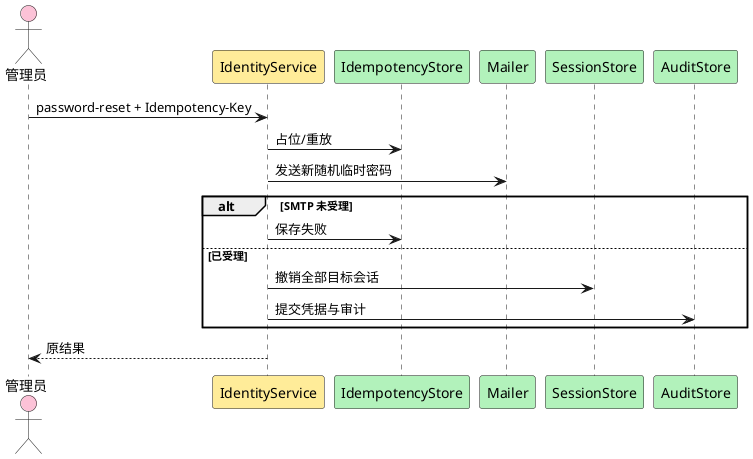

**说明**：服务端生成密码学随机临时密码。成功提交才把新行置为 active、旧当前行置为 superseded 并把 User `credential_mode` 改为 temporary；SMTP 未受理时旧凭据状态保持。受理后提交失败按 residual window 返回不确定。

##### 类/组件设计

`ResetPassword` 根据目标角色选择权限：任一有效管理员可重置普通用户，只有初始 admin 可重置其他管理员，任何人不能重置初始 admin。服务端生成满足至少 8 位、含字母和数字且达到获批准安全基线的随机临时密码；具体熵数值保持 TBD。成功后 `credential_mode=temporary`，创建 purpose=`password_reset` 的 active TemporaryCredential，撤销所有 Session。

##### 接口设计

- `POST /api/v1/admin/users/{id}/password-reset`
- `POST /api/v1/admin/administrators/{id}/password-reset`

无请求体；要求 Cookie、CSRF、`Idempotency-Key`。成功 `200`：

```json
{"user_id":"<opaque>","temporary_credential_expires_at":"<rfc3339>","delivery_status":"accepted"}
```

不返回临时密码。错误同创建管理员，并增加目标资格错误。

##### 数据结构设计

成功事务把旧当前 TemporaryCredential 标为 superseded，插入 active 新行，更新 credential_mode=temporary，删除 Sessions，写 AuditEvent 与 IdempotencyRecord 结果。即使新行过期，credential_mode 仍为 temporary，旧永久密码绝不重新启用。

#### 3.3.12 Story：重发临时密码邮件（US-IDENTITY-03.11）

##### 实现设计

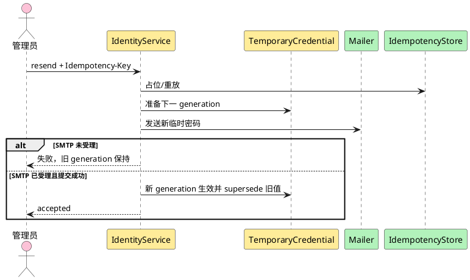

**说明**：重发不是重复发送旧秘密，而是生成新秘密。只有成功提交后新 generation 进入 active、旧值进入 superseded；失败不得使旧凭据失效。SMTP 残余窗口中的邮件凭据不可用，后续成功 generation 始终获胜。

##### 类/组件设计

`ResendTemporaryCredential` 按 purpose 判权：`new_administrator` 仅初始 admin；`password_reset` 可由任一能重置该目标的管理员。没有可重发上下文时返回 invalid state，不创建新凭据。

##### 接口设计

- `POST /api/v1/admin/users/{id}/password-reset/resend`
- `POST /api/v1/admin/administrators/{id}/temporary-password/resend`

无请求体；要求 Cookie、CSRF、`Idempotency-Key`。成功响应与密码重置相同。普通管理员重发新管理员凭据返回 403；同键同摘要返回原结果；同键不同摘要返回 409。

##### 数据结构设计

TemporaryCredential 的 `generation` 对同一用户单调增加；数据库约束保证最多一条 current 行。过期把 current 行置为 expired，但仍阻断永久密码回退；成功改密把当前行置为 consumed 并把 credential_mode 改为 permanent。记录清理周期 TBD。

### 3.4 数据、状态与权限合同

#### 3.4.1 身份侧表

`User`、`Session`、`TemporaryCredential` 和 `IdentityIdentifier` 由 identity-auth 写入；`IdempotencyRecord`、`AuditEvent` 由共享能力拥有。本文不定义或重复 article-owned 表。

| 表 | 字段 | 类型与约束 |
|---|---|---|
| `users` | `id` | UUID PK |
|  | `username` | text not null；展示值；删除后永久保留 |
|  | `email`,`phone` | text nullable；active/suspended 普通账号与其他管理员必填；删除时置空 |
|  | `permanent_password_digest` | text nullable；Argon2id 自描述编码；删除时清空 |
|  | `role` | text check `member/admin` |
|  | `is_initial_admin` | boolean；仅一行 true |
|  | `status` | text check `active/suspended/deleted` |
|  | `credential_mode` | text check `permanent/bootstrap/temporary/recovery_locked/recovery_bootstrap`；决定唯一认证路径 |
|  | `recovery_required` | boolean；非初始账号恢复终结后为 true，核对与凭据重置完成前不得登录 |
|  | `onboarding_privacy_acknowledged_version` | text nullable；保存 onboarding 最近确认版本 |
|  | `onboarding_completed_at` | timestamptz nullable；写入后后续声明换版不重新锁定该用户 |
|  | `retained_email` | text nullable；仅 deleted 墓碑可有；只供转移通知 |
|  | `created_at`,`updated_at`,`deleted_at` | timestamptz |
| `identity_identifiers` | `user_id`,`kind`,`normalized_value` | PK/唯一 `(kind,normalized_value)`；kind=`username/email/phone` |
|  | `lifecycle` | `active/reserved`；存在即参与唯一性；username 永不删除 |
|  | `created_at`,`released_at` | timestamptz；释放时删除或留审计后物理删除 |
| `sessions` | `id`,`user_id` | UUID PK、FK；按 user 索引 |
|  | `token_digest`,`csrf_token_digest` | bytea unique / bytea；不存原值 |
|  | `issued_at`,`last_seen_at`,`absolute_expires_at`,`idle_expires_at` | timestamptz；期限配置 TBD |
|  | `rotated_from_id`,`revoked_at`,`revoke_reason` | 可空；支持轮换追踪，不能用于恢复旧 token |
| `temporary_credentials` | `id`,`user_id`,`purpose`,`generation`,`state` | purpose=`new_administrator/password_reset`；state=`pending_delivery/active/expired/superseded/consumed/recovery_invalidated` |
|  | `secret_digest` | Argon2id 自描述编码 |
|  | `delivered_to_email` | text；交付地址快照；公共接口不返回 |
|  | `issued_at`,`expires_at`,`superseded_at`,`consumed_at`,`invalidated_at` | timestamptz |
| `privacy_notices` | `version,content,content_hash,effective_at,status` | 版本不可变；同一时间仅一个 current |
| `privacy_acknowledgements` | `id,user_id,notice_version,acknowledged_at,source_kind,source_fingerprint` | 只追加；注册与新管理员 Gate 证据 |
| `administrator_information_declarations` | `id,actor_user_id,target_locator_digest,statement_version,declared_at,purpose` | 只追加；purpose 固定账号创建与事务性邮件 |
| `login_attempt_buckets` | `bucket_kind,bucket_key_digest,digest_key_version,window_started_at,failure_count,blocked_until,updated_at` | 全字段 NOT NULL；kind=`subject/source/subject_source`；阈值/窗口/退避 TBD |
| `recovery_account_reviews` | `recovery_run_id,user_id,backup_role,backup_status,backup_deleted_at,decision,evidence_ref,reviewed_by,reviewed_at,credential_reset_at` | decision=`pending/restored/kept_deleted/denied`；备份事实只供核对，不授权 |

公共字段 `must_change_password` 由 `credential_mode IN (bootstrap,temporary,recovery_bootstrap,recovery_locked)` 派生。对 `onboarding_completed_at IS NULL` 的新管理员，`must_acknowledge_privacy` 由 `onboarding_privacy_acknowledged_version != current PrivacyNotice.version` 派生；已完成 onboarding 的用户固定为 false。调用方不能提交或直接修改两个派生字段。

索引与约束：

1. `identity_identifiers(kind,normalized_value)` 唯一，处理活动账号与墓碑保留的统一冲突。
2. `users(username)` 不作为唯一真相源；username Identifier 永久存在。
3. `users` 上部分唯一索引保证只有一个 `is_initial_admin=true`。
4. `sessions(token_digest)` 唯一；`sessions(user_id)` 支持即时撤销。
5. `temporary_credentials(user_id)` 的当前行部分唯一条件为 state 属于 `pending_delivery/active/expired`；过期状态仍阻断永久密码回退。
6. `privacy_acknowledgements(user_id,notice_version)` 唯一；历史版本不更新覆盖。
7. `login_attempt_buckets(bucket_kind,bucket_key_digest)` 唯一，两个键均 NOT NULL，并按 `blocked_until` 建清理/查询索引。
8. 所有状态枚举用数据库检查约束；应用层仍执行语义校验。

LoginAttemptBucket 规范编码和并发合同：

1. 先构造长度前缀二进制 `kind || len(part1) || part1 || len(part2) || part2`。
2. subject 的 part1 是归一化登录标识；source 的 part1 是可信代理规则得到的 canonical source；subject_source 同时包含两者。
3. `bucket_key_digest = HMAC-SHA-256(versioned_key, canonical_bytes)`；数据库不保存原标识或原来源。
4. 失败通过 `INSERT ... ON CONFLICT(bucket_kind,bucket_key_digest) DO UPDATE` 原子增加计数并推进窗口/退避；成功衰减、清理和恢复操作使用同一唯一键与行锁，禁止读后写竞态。

#### 3.4.2 共享表消费合同

| 表 | 关键字段 | identity-auth 使用规则 |
|---|---|---|
| `idempotency_records` | `scope_hash,key_digest,request_digest,digest_key_version,status,execution_generation,result_code,response_snapshot,locked_until,reviewed_by,reviewed_at,expires_at` | status 检查约束含 `recovery_review_required`；按 key version 验证；受控恢复转换必须行锁和审计 |
| `audit_events` | `id,occurred_at,actor_kind,actor_user_id,actor_system,actor_role,action,target_type,target_id,outcome,error_code,trace_id,source_fingerprint,metadata` | actor_kind=`anonymous/user/system`；成功同事务 INSERT；无 UPDATE/DELETE |
| `processing_gate_records` | `region_ref,controller_ref,legal_basis_ref,smtp_processor_ref,effective_at,recorded_by` | 值由实际责任人登记；缺任一对应输入时相关 capability closed |
| `recovery_runs` | `run_id,backup_ref,journal_key_id,journal_key_version,journal_secret_fingerprint,journal_stage,journal_consumed_at,article_evidence_version,article_evidence_digest,article_evidence_ref,article_evidence_completed_at,article_namespace,article_replay_verified_at,started_at,completed_at,outcome,account_count,permanent_credential_count,session_count,temporary_credential_count,idempotency_count,pending_review_count,audit_event_id` | outcome=`running/failed/identity_ready/article_deletion_ready/ready_to_consume/succeeded`；只保存已验证 DTO 的绑定字段/引用 |

`response_snapshot` 只保存安全 JSON 响应，不保存 Header、Set-Cookie、CSRF、密码、临时密码、完整邮箱/手机号。`source_fingerprint` 保存请求来源的受控标识或摘要，不保存不必要的原始网络数据。

RecoveryJournalEntry 位于业务数据库外的固定 `recovery/v1` namespace，字段为 `namespace,sequence,run_id,key_id,key_version,secret_fingerprint,stage,recorded_at,previous_record_hash,record_hmac`；stage 只允许 `begun/consumed`。同 run ID 或任一 retained key 计算出的同版本历史 fingerprint 已存在时，新的 Begin 拒绝；同 run/key/指纹已 consumed 时，MarkConsumed 和新的恢复均拒绝。

`ArticleDeletionReplayStatus` v1 是 strict tagged union。`status=ready` 时只允许 ADR-0020 的以下 20 字段，全部必填且非 null：

| 顺序 | 字段 | JSON 类型/约束 | canonical v1 |
|---:|---|---|---|
| 1 | `evidence_version` | string，固定 `article-deletion-replay/v1` | 是 |
| 2 | `run_id` | string，非空 | 是 |
| 3 | `backup_ref` | string，非空 | 是 |
| 4 | `namespace` | string，固定 `article-deletion/v1` | 是 |
| 5 | `journal_head_sequence` | integer，非负 | 是 |
| 6 | `journal_head_hash` | string，`sha256:<lower-hex>` | 是 |
| 7 | `inventory_scope` | string，固定 fixture/producer 定义的 scope 值 | 是 |
| 8 | `backup_cutoff` | string，UTC RFC 3339 | 是 |
| 9 | `inventory_digest` | string，`sha256:<lower-hex>` | 是 |
| 10 | `deletion_operations_digest` | string，`sha256:<lower-hex>` | 是 |
| 11 | `audit_events_digest` | string，`sha256:<lower-hex>` | 是 |
| 12 | `tombstones_total` | integer，非负 | 是 |
| 13 | `tombstones_replayed` | integer，非负；唯一重放计数字段名 | 是 |
| 14 | `already_absent` | integer，非负 | 是 |
| 15 | `deletion_operations_reconciled_count` | integer，非负 | 是 |
| 16 | `audit_events_verified_count` | integer，非负 | 是 |
| 17 | `status` | string，固定 `ready` | 否 |
| 18 | `evidence_digest` | string，`sha256:<lower-hex>` | 否 |
| 19 | `evidence_ref` | string，非空、不透明 | 否 |
| 20 | `completed_at` | string，UTC RFC 3339；首份 evidence 元数据时间 | 否 |

ready canonical v1 仅包含前 16 字段，严格按表中顺序编码为 UTF-8、无 BOM、无多余空白的单行 JSON；`status/evidence_digest/evidence_ref/completed_at` 明确排除。所有整数用 JSON integer，其他 canonical 字段均为 JSON string。`evidence_digest = SHA-256(canonical_json_bytes)`。计数满足 `tombstones_total = tombstones_replayed + already_absent`。

共享 ready fixture（producer/consumer 必须嵌入相同内容或使用同一生成源）：

```json
{
  "evidence_version": "article-deletion-replay/v1",
  "run_id": "run-01",
  "backup_ref": "backup-2026-10-20T00:00:00Z",
  "namespace": "article-deletion/v1",
  "journal_head_sequence": 7,
  "journal_head_hash": "sha256:aaaa",
  "inventory_scope": "recoverable-backups-before-cutoff",
  "backup_cutoff": "2026-10-20T00:00:00Z",
  "inventory_digest": "sha256:bbbb",
  "deletion_operations_digest": "sha256:cccc",
  "audit_events_digest": "sha256:dddd",
  "tombstones_total": 3,
  "tombstones_replayed": 2,
  "already_absent": 1,
  "deletion_operations_reconciled_count": 3,
  "audit_events_verified_count": 3,
  "status": "ready",
  "evidence_digest": "sha256:169e0f30407867083598ab146c950968e1b5f508ed4fd5d5198bb61e788926a7",
  "evidence_ref": "evidence-01",
  "completed_at": "2026-10-20T01:00:00Z"
}
```

对应 canonical bytes 固定为：

```json
{"evidence_version":"article-deletion-replay/v1","run_id":"run-01","backup_ref":"backup-2026-10-20T00:00:00Z","namespace":"article-deletion/v1","journal_head_sequence":7,"journal_head_hash":"sha256:aaaa","inventory_scope":"recoverable-backups-before-cutoff","backup_cutoff":"2026-10-20T00:00:00Z","inventory_digest":"sha256:bbbb","deletion_operations_digest":"sha256:cccc","audit_events_digest":"sha256:dddd","tombstones_total":3,"tombstones_replayed":2,"already_absent":1,"deletion_operations_reconciled_count":3,"audit_events_verified_count":3}
```

固定摘要为 `sha256:169e0f30407867083598ab146c950968e1b5f508ed4fd5d5198bb61e788926a7`。

unavailable variant 只允许以下 6 个字段：

| 顺序 | 字段 | JSON 类型/约束 |
|---:|---|---|
| 1 | `evidence_version` | string，固定 `article-deletion-replay/v1` |
| 2 | `run_id` | string，非空 |
| 3 | `backup_ref` | string，非空 |
| 4 | `namespace` | string，固定 `article-deletion/v1` |
| 5 | `status` | string：`pending/unknown/failed` |
| 6 | `reason_code` | string，非空稳定分类 |

```json
{
  "evidence_version": "article-deletion-replay/v1",
  "run_id": "run-01",
  "backup_ref": "backup-2026-10-20T00:00:00Z",
  "namespace": "article-deletion/v1",
  "status": "pending",
  "reason_code": "replay_in_progress"
}
```

unavailable 字段集合必须精确为上述六项，禁止携带任何 canonical 字段、`evidence_digest`、`evidence_ref` 或 `completed_at`。

article-management 持久化 `DeletionReplayRun` 和不可变 `DeletionReplayEvidence`。同一 run+backup 的 covered input 不变时，ready variant 必须复用首份 `evidence_ref/evidence_digest/completed_at`；covered input 变化才追加 evidence 并原子更新 current 指针。unavailable 不是 Evidence，不持久化伪 canonical 字段。

identity 先以严格对象解析读取 `status` 并选择 variant。`pending/unknown/failed` 必须精确匹配六字段 schema，随后立即 fail closed，不执行 canonical 重算。

`ready` 必须精确匹配二十字段 schema，identity 才使用前十六字段重算摘要，并在锁定 RecoveryRun 的事务中比较 run/backup/namespace/version/digest 和计数。未知 status、混合 variant、缺失/额外/null/错误类型、替代命名、错 backup、不可读或摘要/ref 不匹配均保持停服。identity 不读取 article 内部表，也不自行生成 evidence_ref 或 completed_at。

| 恢复对象 | 所有者 | identity-auth 权限 |
|---|---|---|
| `recovery/*` Journal、RecoveryRun、RecoveryAccountReview | 恢复/identity 共享能力 | 按本文读写 |
| `article-deletion/*` Journal、DeletionOperation、Article 删除状态 | article-management | 无直接读写 |
| DeletionReplayEvidence / ArticleDeletionReplayStatus | article-management 持久化、失效与幂等重算 | 只读消费 DTO，并保存已验证 version/digest/ref；不读内部表 |
| Article 删除 AuditEvent | 共享审计，由 article 追加 | 只核 DTO 的 `audit_events_digest/audit_events_verified_count`，不读取文章内容 |

IdempotencyRecord 状态机：

| 当前状态 | 事件 | 下一状态/响应 |
|---|---|---|
| 不存在 | 首次合法请求占位 | processing，generation=1 |
| processing | 业务成功/确定失败 | succeeded / failed，并保存安全响应快照 |
| processing | 租约过期、SMTP 受理后提交未知 | uncertain |
| succeeded/failed | 同键同摘要 | 返回原结果，不执行副作用 |
| processing | 同键同摘要 | `identity.idempotency_in_progress` |
| uncertain | 同键同摘要 | `identity.operation_uncertain`，不自动执行 |
| processing/uncertain | ADR-0018 恢复终结 | recovery_review_required |
| recovery_review_required | 普通同键同摘要 | `identity.operation_uncertain`，不抢占 |
| recovery_review_required | 受控核对确认放弃/已无安全重试条件 | failed，写核对审计 |
| recovery_review_required | 受控核对批准重新执行 | processing，generation+1，新租约并写核对审计 |
| 任意已存在状态 | 同键不同摘要 | `identity.idempotency_conflict` |

数据库约束：

- `CHECK (status IN ('processing','succeeded','failed','uncertain','recovery_review_required'))`。
- `CHECK (execution_generation >= 1)`。
- succeeded/failed 必须有 `result_code` 和安全 `response_snapshot`；processing 必须有 `locked_until`。
- recovery_review_required 必须清空可自动抢占租约；只有受控恢复事务可写 `reviewed_by/reviewed_at` 并转换状态。
- 状态转换使用 `SELECT ... FOR UPDATE` 或带旧状态条件的原子 UPDATE；受影响行数不为 1 时失败，不允许最后写入者覆盖。

安全与部署配置维度：

| 配置 | 约束 |
|---|---|
| `HAN_PUBLIC_ORIGIN` | canonical same-origin；缺失时浏览器登录能力 fail closed |
| `HAN_TRUSTED_PROXY_CIDRS` | 只有匹配的直接对等端可提供转发来源；具体列表由部署登记 |
| `HAN_SMTP_TLS_MODE` | 仅 `implicit_tls` / `starttls_required` |
| `HAN_SMTP_HOST`、`HAN_SMTP_SERVER_NAME`、`HAN_SMTP_CA_BUNDLE` | 主机、证书主机名和可选受控 CA；生产必需项缺失启动失败 |
| `HAN_SMTP_PROCESSOR_REF` | 必须匹配 ProcessingGate 中获批准处理方 |
| `HAN_PROCESSING_REGION_REF`、`HAN_PROCESSING_CONTROLLER_REF`、`HAN_PROCESSING_LEGAL_BASIS_REF` | 只保存实际责任人登记的引用；不提供默认值 |
| `HAN_INITIAL_ADMIN_PASSWORD`、`HAN_RECOVERY_INITIAL_ADMIN_SECRET` | 独立配置键与运行门禁；不得相同、不得日志，recovery secret 只在维护模式读取 |
| `HAN_RECOVERY_RUN_ID` | 每次恢复唯一，由恢复责任人生成；重复 run 被 Journal 拒绝 |
| `HAN_RECOVERY_JOURNAL_PATH` | 指向独立受控持久卷；不得位于业务数据库备份恢复目录 |
| `HAN_RECOVERY_JOURNAL_KEY_<key_id>_<version>`、`HAN_RECOVERY_JOURNAL_ACTIVE_KEY`、`HAN_RECOVERY_JOURNAL_VERIFY_ONLY_KEYS` | 恰有一个 active key；verify-only retained key只查重/验链；Journal 有效记录仍引用时不得退役 |
| `HAN_IDEMPOTENCY_HMAC_KEY_<version>`、`HAN_IDEMPOTENCY_CURRENT_KEY_VERSION` | 当前和保留旧版本密钥；缺少被记录引用的版本时幂等端点关闭 |
| `HAN_LOGIN_BUCKET_HMAC_KEY_<version>`、`HAN_LOGIN_BUCKET_CURRENT_KEY_VERSION` | 防暴力桶摘要版本集；旧版本保留到对应桶清理完成 |
| `HAN_SESSION_TOKEN_ENTROPY`、`HAN_CSRF_TOKEN_ENTROPY`、`HAN_TEMP_CREDENTIAL_ENTROPY` | 值必须满足获批准安全基线；具体数值 TBD，缺失或低于基线启动失败 |
| 登录窗口/阈值/退避、会话期限、连接池、SMTP 超时 | 配置维度必须存在；数值全部 TBD |

审计动作使用稳定标识；下列 `action` 不是公共错误 code，不进入错误响应：

| action | 触发 |
|---|---|
| `identity.register` | 注册成功或持久化失败 |
| `identity.login` | 登录成功与所有统一失败 |
| `identity.session.rotate` | 登录、改密或权限上下文变化 |
| `identity.password.change` | 强制改密或初始 admin 正常改密 |
| `identity.administrator.create` | 创建其他管理员 |
| `identity.role.revoke` | 撤销其他管理员权限 |
| `identity.account.suspend` / `restore` / `delete` | 账号治理 |
| `identity.password.reset` / `temporary_credential.resend` | 临时凭据操作 |
| `identity.identifier.release` | 专用邮箱或后续标识清理 |
| `identity.idempotency.conflict` | 同键不同摘要 |
| `identity.smtp.residual_window` | SMTP 已受理后数据库提交失败或未知 |
| `identity.privacy.acknowledge` | 用户确认某一版本隐私声明 |
| `identity.administrator.information_declare` | 初始 admin 作信息提供声明 |
| `identity.processing_gate.evaluate` | 部署处理门禁开启或拒绝 |
| `identity.recovery.invalidate` | 恢复后批量失效及结果 |

#### 3.4.3 User 状态机

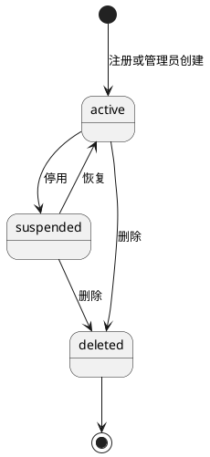

**说明**：`deleted` 是不可恢复终态。角色与状态正交：其他管理员可以在 suspended 时被撤权为 member；恢复后只能获得当前持久化角色。初始 admin 不允许进入 suspended/deleted，也不允许撤权。

#### 3.4.4 凭据与会话状态

| 动作 | `credential_mode` | TemporaryCredential | 可接受凭据 | 会话 |
|---|---|---|---|---|
| 普通注册 | permanent | 无 | 永久密码 | 不自动创建 |
| 初始 admin bootstrap | bootstrap | 无 | bootstrap 永久摘要；独立例外 | 首次登录创建受限会话并记录 bootstrap |
| 创建其他管理员 | temporary | new_administrator active | 仅该最新临时值 | 无 |
| 管理员重置 | temporary | password_reset active | 仅该最新临时值；旧永久密码暂停 | 全部撤销 |
| 临时凭据过期 | temporary | state=expired | 无；统一登录失败，不回退 | 无 |
| 临时凭据 superseded/恢复失效 | temporary | state=superseded/recovery_invalidated | 无；等待最新成功重置/重发 | 全部撤销 |
| 临时凭据登录 | temporary | active 且未过期 | 仅该 credential ID | 创建受限会话并记录 type/id |
| 成功改密 | permanent | 当前值 consumed | 新永久密码 | 其他会话撤销，当前会话轮换 |
| 恢复终结：非初始账号 | recovery_locked | current 临时凭据 recovery_invalidated，永久摘要清空 | 无；`recovery_required=true` | 全部删除 |
| 恢复终结：初始 admin | recovery_locked | 全部失效，永久摘要清空 | 无，等待独立 recovery secret | 全部删除 |
| recovery secret 重建初始 admin | recovery_bootstrap | 无 | 仅 recovery secret 的 Argon2id 摘要 | 首次恢复登录创建受限会话 |
| 逐账号核对并重置凭据 | temporary | 新 password_reset active | 仅新临时凭据；同事务清除 recovery_required | 原 Session 已不存在 |
| 删除账号 | permanent（不可用） | 全部 invalidated | 无 | 全部撤销 |

凭据选择只读取 `credential_mode`，不存在“最新有效临时凭据，否则永久密码”的回退分支。`recovery_locked` 永不接受登录；`recovery_bootstrap` 只允许既有初始 admin 使用当前 RecoveryRun 的一次性 recovery secret。改密只接受当前受限 Session 中记录的 credential kind/id；临时凭据在登录后被重发、supersede、过期或恢复失效时，改密必须失败并要求重新登录。

#### 3.4.5 新管理员双 Gate

| Gate | 完成证据 | 未完成时允许 |
|---|---|---|
| 改密 Gate | `credential_mode=permanent` 且当前临时凭据 consumed | `GET /users/me`、改密、读取/确认隐私声明 |
| 隐私 Gate | `onboarding_privacy_acknowledged_version = current PrivacyNotice.version` | `GET /users/me`、改密、读取/确认隐私声明 |

其他管理员能力只在两个 Gate 同时完成时开放。最终开放事务锁定 User 与 current PrivacyNotice，并写 `onboarding_completed_at`。若 PrivacyNotice 在两个 Gate 之间换版，只有仍未完成 onboarding 的账号重新变为 privacy pending；`onboarding_completed_at` 已存在的用户不重新锁定，因为 r16 未授权持续重确认 Gate。

#### 3.4.6 权限矩阵

| 动作与目标 | 初始 admin | 其他有效管理员 | 普通用户 |
|---|---|---|---|
| 注册、登录 | 作为用户调用 | 作为用户调用 | 允许 |
| 读取自己的身份 | 允许 | 允许 | 允许 |
| 强制改密 | 允许 | 允许 | 允许 |
| 初始 admin 正常自改密 | 允许，规则 Q1 待定 | 不在本期承诺普通自助改密 | 不在本期承诺普通自助改密 |
| 创建其他管理员 | 允许 | 拒绝 | 拒绝 |
| 查看/停用/恢复/删除普通用户 | 允许 | 允许，不能是自己 | 拒绝 |
| 重置/重发普通用户临时凭据 | 允许 | 允许，不能是自己 | 拒绝 |
| 查看/治理其他管理员 | 允许 | 拒绝 | 拒绝 |
| 停用、删除、撤权或重置初始 admin | 拒绝；仅正常自改密 | 拒绝 | 拒绝 |
| 提供 article Principal/作者状态 | 系统内部 | 系统内部 | 系统内部 |
| `recovery_required=true` 账号使用日常能力 | 初始 admin 不使用该标志，走 recovery_bootstrap | 拒绝登录与授权 | 拒绝登录与授权 |
| 维护模式逐账号核对与解除 recovery Gate | 仅恢复后的初始 admin | 拒绝 | 拒绝 |

#### 3.4.7 S1–S16 实现映射

| 接缝 | identity-auth 实现落点 |
|---|---|
| S1 同源接入与身份 | canonical Origin、Fetch Metadata、默认拒绝 credentialed CORS、SessionStore、CSRF、已有会话重新登录撤销 |
| S2 作者状态 | `ArticleIdentityReader.GetAuthorStates` 批量只读返回 id/status |
| S3 停用/恢复 | `SetAccountStatus`、Session 撤销、AuditEvent；不写 Article |
| S4 canonical 删除与无归属化 | 日常/kept_deleted 共用 CanonicalDeleteCoordinator + OrphanArticlesCanonical 同事务 |
| S5 处置与清理 | 提供转移目标/墓碑联系；消费 article 完成事实清理 retained_email |
| S6 事务性邮件/TLS/残余窗口 | purpose allowlist、隐式 TLS/强制 STARTTLS、证书/主机名、处理方门禁、幂等 uncertain 与告警 |
| S7 分级治理 | AuthorizationPolicy 与 Principal role/initial 标识 |
| S8 公共错误 | 业务错误映射 ADR-0014 envelope |
| S9 幂等 | 仅创建管理员、重置、重发使用键；停用/恢复目标状态幂等 |
| S10 审计与删除证据 | actor_kind 模型；隐私、声明、治理、恢复与删除证据只追加 |
| S11 永久删除 | identity 只提供 Principal/角色，不保存可恢复文章数据 |
| S12 隐私证据与部署门禁 | PrivacyNotice/Acknowledgement、管理员声明、ProcessingGate、双 Gate Guard；缺实际输入关闭能力 |
| S13 维护模式与恢复信任根 | RecoveryGate 终结事务、全部永久/临时凭据和 Session 失效、非初始账号 recovery Gate、独立 recovery secret |
| S14 逐账号核对/canonical 删除/RPO | RecoveryAccountReview；kept_deleted 重放 S4；无法重建 denied；article 不新增恢复能力 |
| S15 Recovery Journal 防重放 | FileRecoveryJournal Begin/Consumed/验链、RecoveryRun 双向对账、run/指纹复用拒绝和开放门禁 |
| S16 deletion replay evidence Gate | ReplayAndVerify/ReadStatus 均以 run+backup；identity 按唯一 20 字段 v1 fixture 解析，仅用 canonical 前 16 字段重算 SHA-256，二次 ref/digest 一致后才 MarkConsumed |

#### 3.4.8 内部只读与协作接口

| 接口 | 消费者 | 输入 | 输出 | 失败语义 |
|---|---|---|---|---|
| `ResolvePrincipal` | HTTP 接入 | session token、可选 CSRF | Principal | 无效统一未认证；CSRF 单独拒绝 |
| `GetAuthorStates` | article 列表/详情 | User ID 集合 | `id,status` 映射 | 缺失按不可用，fail closed |
| `GetTransferTarget` | article 转移 | 目标 User ID | active 资格、邮箱 | suspended/deleted/缺失为不合格 |
| `GetDeletedTransferContact` | article 转移 | tombstone User ID | retained_email | 非 deleted 或已清理为不可用 |
| `OrphanArticles` | identity 删除事务 | tx、User ID | `orphaned_count,pending_orphan_count,retained_email_can_clear` | 任一失败回滚删除事务 |
| `ClearRetainedEmailIfEligible` | article 处置事务 | tx、User ID、完成事实 | cleared/unchanged | 条件不足保持；审计失败回滚 |
| `FinalizeDatabaseRecovery` | RecoveryGate | backup ref、独占锁、recovery run | 终结计数与 review 集合 | 失败保持维护模式 |
| `RebuildInitialAdminTrust` | RecoveryGate | 一次性 recovery secret | initial admin recovery_bootstrap | 缺失/错误/复用保持停服 |
| `ReviewRecoveredAccount` | 恢复后的 initial admin | run、User、evidence、decision | kept_deleted/denied 或新临时凭据并清 Gate | 无法重建默认 denied |
| `ReviewRecoveredIdempotency` | RecoveryCoordinator | record、review decision | failed 或 generation+1 processing | 普通请求不得调用 |
| `RecoveryJournal.Begin` | RecoveryCoordinator | run ID、候选 secret、完整 retained keyring | 全 keyring 判重后仅 active key 写耐久 begun 记录 | 任一历史命中、缺 key、无法计算、损坏或不可写时停服 |
| `RecoveryJournal.MarkConsumed` | RecoveryCoordinator | run ID、key ID/version、fingerprint、time | 耐久 consumed 记录 | 重复消费、key/阶段不符或落盘失败时停服 |
| `RecoveryJournal.Read` | RecoveryGate | run ID、完整 keyring | 已验链的最新 JournalEntry | 部分写、损坏、未知/缺失 key 时停服 |
| `RecoveryJournal.VerifyAgainst` | RecoveryGate | RecoveryRun、完整 keyring | Journal/DB key ID/version、指纹和阶段一致 | 任一字段/阶段/key 不一致时停服 |
| `ArticleDeletionGate.ReplayAndVerify` | RecoveryCoordinator | run ID、backup ref | 恰好一个 variant：成功为 ready 20 字段，否则 unavailable 6 字段 | replay/input/operation/audit 任一未 ready 返回 unavailable 或公共错误 |
| `ArticleDeletionGate.ReadStatus` | RecoveryCoordinator | run ID、backup ref | 恰好一个当前 variant | backup/run 不匹配、运行中、旧版/不可读或输入漂移返回 unavailable |

### 3.5 UX/API 联合走查

| 用户承诺 | 支撑接口 | 状态/失败支撑 | 结论 |
|---|---|---|---|
| 注册前告知、确认与部署门禁 | `GET /privacy-notices/current`、`POST /users` | 未确认、旧版本或处理输入缺失均不建账号 | 对齐 |
| 登录失败不泄露且防 login CSRF | `POST /sessions` | same-origin Origin/Fetch Metadata；认证失败单一 `auth.login_failed` | 对齐 |
| 已认证状态可观察 | 登录响应、`GET /users/me` | Cookie、Principal、CSRF | 对齐 |
| 已有会话再次登录 | `POST /sessions` | 成功创建新会话并撤销旧会话；失败保持旧会话 | 对齐 |
| 临时凭据 fail closed | 登录、改密、重置、重发 | credential_mode 唯一路径；过期/恢复失效不回退永久密码 | 对齐 |
| 新管理员双 Gate | 改密、`POST /users/me/privacy-acknowledgements`、Guard | 两项顺序不限，未全部完成返回 `auth.must_complete_onboarding` | 对齐 |
| 初始 admin 永久保护 | 所有治理 API | Policy 统一拒绝 | 对齐 |
| 管理员信息提供声明 | 声明 notice GET、创建管理员 POST | 缺失或旧版本时不创建账号 | 对齐 |
| SMTP 事务用途与 TLS | 创建/重置/重发 API | purpose allowlist、处理方门禁、TLS/证书/主机名、failed/uncertain 503 | 对齐 |
| 重试不重复副作用 | 三类 Idempotency-Key API | 原结果、冲突、处理中 | 对齐 |
| 防暴力与过载 | 登录及入口保护 | 持久账号/可信来源窗口、统一失败、429 仅来源/容量维度 | 对齐 |
| 治理列表分页 | 两类治理列表 | `items,next_cursor,has_more`、签名游标、过滤绑定、null 结束 | 对齐 |
| 停用/删除立即结束登录 | 状态/删除 API | Sessions 同事务撤销 | 对齐 |
| 删除后文章无归属且保留违规 | 删除内部端口 | 同事务 OrphanArticles | 对齐 |
| 专用邮箱用后清理 | OrphanArticles、内部 lifecycle port | 零文章同删除事务清理；多文章最后处置清理 | 对齐 |
| 用户撤回个人数据处理 | 运营转交 + 原删除 API | 不新增权限/自助入口，删除原因进入审计 | 对齐 |
| 数据库恢复、防重放与删除证据 | RecoveryJournal、RecoveryRun、CanonicalDeleteCoordinator、ArticleDeletionGate | identity 原子比较 run+backup+版本化 evidence；旧 ready/输入变化/不可读返回 unknown/failed；重读一致后才 MarkConsumed | 对齐 |
| 公共错误稳定 | 唯一错误注册表 | 每个公开 code 只有一个 HTTP/message/retry/log/cause 映射 | 对齐 |

所有新增公共 API 都有 requirements r16 中的访问者、用户、管理员或隐私/onboarding 消费者；内部接口都有 article-management、HTTP 接入、部署门禁或恢复过程消费者。没有为未来 CLI、外部身份提供方或消息队列预造入口。

## 4 可靠性/可用性/Function Safety 设计

本特性不控制人身、设备或物理安全过程，Function Safety 不适用；账号、权限与数据完整性风险按可靠性、安全和隐私处理。

### 4.1 软件功能流 FMEA

| 流程 | 故障模式 | 用户/系统影响 | 检测 | 规避与恢复 | 残余风险 |
|---|---|---|---|---|---|
| 注册 | 并发占用同一标识 | 可能重复账号 | 唯一约束冲突 | 整体回滚，返回 409 | 无重复；用户需换标识 |
| 登录 | DB/哈希资源不足 | 无法登录 | 错误率、延迟、资源指标 | fail closed、限流、告警 | 可用性目标 TBD |
| 会话 | token 泄露或固定 | 身份仿冒 | 异常访问、审计 | 高熵 token、只存摘要、登录/改密轮换 | XSS/终端泄露仍需部署防护 |
| CSRF | Header 缺失或伪造 | 跨站写入 | 中间件拒绝计数 | 会话绑定 token、SameSite | 同源 XSS 可绕过 |
| 停用/删除 | 会话撤销失败 | 被治理用户继续操作 | 事务失败 | 状态与撤销同事务，失败回滚 | DB 故障期间治理不可用 |
| 用户删除 | article 无归属化失败 | 账号/文章不一致 | 事务错误 | 同 UnitOfWork 全回滚 | 长事务容量待测 |
| 审计 | INSERT 失败 | 高危状态无证据 | 事务错误 | 高危写入 fail closed | 审计 DB 与业务同故障域 |
| SMTP 未受理 | 无法交付凭据 | 创建/重置/重发失败 | Mailer 结果 | 业务不提交，返回 503 | 管理员需重试 |
| SMTP 已受理后 DB 失败 | 用户收到不可用凭据 | 认知混乱 | uncertain、trace、告警 | 幂等恢复、最新凭据、邮件提示只使用最新值 | 残余窗口已接受 |
| 幂等记录卡在 processing | 同键请求无法完成 | 暂时 409 | 租约超时扫描/请求恢复 | 过租约转 uncertain 后可重试 | 租约数值 TBD |
| Argon2id 参数过高 | 登录资源耗尽 | DoS 风险 | 基准、延迟和内存 | 目标环境定参、入口限流 | 参数与阈值 TBD |
| 标识清理误判 | 过早释放邮箱/手机号 | 复用或通知失败 | 审计、跨模块集成测试 | article 完成事实、同事务清理 | 其他标识条件 Q2 未决 |
| 数据库从旧备份恢复 | 永久密码、旧角色/状态/删除事实、Session、临时凭据或幂等状态复活 | 旧账号或权限重新获得访问 | RecoveryRun、RecoveryAccountReview、恢复审计和 readiness | 永久/运行凭据全失效、账号 recovery Gate、独立信任根、逐账号核对；失败停服 | RPO/RTO/核对容量 TBD |
| kept_deleted 只改 User 或部分失败 | 文章仍有作者/公开、标识或通知邮箱不一致 | 删除合同被破坏 | canonical 删除计数、事务、AuditEvent | 日常/恢复共用 CanonicalDeleteCoordinator；任一子步骤回滚并停服 | 跨模块事务容量 TBD |
| Recovery Journal/keyring 重放或迁移不完整 | secret 跨 key-version 复用、消费状态未知 | 恢复信任根被重复建立 | 全 retained key 候选判重、key_id/version、校验链、Journal/DB 对账 | 一个 active+verify-only keyring 整体迁移；缺 key/未知 key/计算失败停服 | retained key 数量与迁移 RTO TBD |
| Article tombstone 未重放或对账失败 | 旧备份中的永久删除 Article 重新出现 | 已删除内容在列表/详情/治理入口复现 | ArticleDeletionReplayStatus、DeletionOperation/Audit 对账、独立 namespace 验链 | Recovery Journal 消费前等待 article Gate；任一失败停服 | tombstone/inventory 保留期 TBD |
| stale/错 backup replay ready | 旧证据被用于当前恢复批次 | 当前备份未完整重放却开放 | run+backup 键、evidence version/digest、双次 ReadStatus 与 RecoveryRun 原子比较 | 输入变化使旧 ready unknown/failed；不 MarkConsumed | evidence 版本演进需兼容管理 |

### 4.2 冗余设计

首期不设计进程级或数据库级冗余。PostgreSQL 恢复采用 r08、ADR-0018/0019 的 recovery Gate：

1. 进入 maintenance/recovery 模式并关闭公共 readiness；验证 Recovery Journal、完整 keyring、owner-only 权限、可读写性和校验链。keyring 必须恰有一个 active key，且 Journal 中每个 key_id/version 都能由 active 或 verify-only key解析。
2. 恢复责任人提供唯一 `recovery_run_id` 与独立 recovery secret。`Journal.Begin` 使用所有 retained key 计算候选 fingerprint，任一对应历史记录命中即拒绝；全部未命中时只用 active key 写 begun 记录。secret 明文不持久化。
3. 恢复已校验业务数据库备份、取得全局独占锁，并创建与 Journal begun 记录的 run ID、active key_id/version 和 fingerprint 完全匹配的 RecoveryRun；任一侧缺失或不一致停服。
4. 单一恢复终结事务先把恢复点中的账号 `role/status/deleted_at` 快照写入 `RecoveryAccountReview`，随后：
   - 所有非初始账号统一 `status=suspended`、`recovery_required=true`、`credential_mode=recovery_locked`，清空永久密码摘要；
   - 初始 admin 清空永久密码摘要并进入 `recovery_locked`；
   - 删除全部 Session；
   - 把所有 pending_delivery/active/expired TemporaryCredential 标为 `recovery_invalidated`；
   - 把 processing/uncertain IdempotencyRecord 转为 `recovery_review_required`；
   - 追加恢复终结 AuditEvent 和影响计数。
5. 终结事务成功后才用 recovery secret 为既有 initial admin 写 recovery_bootstrap 摘要；初始 admin 在维护访问面首次登录并强制改密，成功后成为唯一恢复授权根。
6. 初始 admin 逐账号核对 `RecoveryAccountReview`：
   - 可证明应保持 deleted：调用 `CanonicalDeleteCoordinator(mode=recovery_kept_deleted)` 幂等重放完整身份/文章删除事务；全部成功后才写 decision=kept_deleted；
   - 可证明角色/状态：先重置新临时凭据，再在同一事务写核对后的 role/status、清除 recovery_required 和追加审计；
   - 无法按 RPO 重建：decision=denied，保持 suspended+recovery_required，不授予运行权限。
7. recovery_review_required 幂等记录逐条受控核对，只能转 failed 或按 N003 合同进入新 generation 的 processing；普通同键请求不能触发转换。
8. 全部身份账号 review、canonical 账号删除和幂等核对完成后，把 RecoveryRun 写为 `identity_ready`，执行 `RecoveryJournal.VerifyAgainst`，但此时不得 MarkConsumed 或开放 readiness。
9. 调用 article-owned `ArticleDeletionGate.ReplayAndVerify(run_id,backup_ref)`，等待独立 namespace 重放 tombstone、核 inventory、DeletionOperation 和 AuditEvent，并持久化不可变 DeletionReplayEvidence。
10. 调用 `ReadStatus(run_id,backup_ref)` 后先判 variant：若 status 为 pending/unknown/failed，要求对象恰好 6 字段并立即 fail closed，不重算 digest；只有 status=ready 才要求完整 20 字段、`inventory_scope` string，并用前 16 字段重算固定 SHA-256 canonical JSON。
11. ready 验证在同一事务锁定 RecoveryRun，比较 DTO.run_id/backup_ref/namespace、fixture version、digest 和计数；通过后保存 version/digest/ref/completed_at 并写 `article_deletion_ready`。转 `ready_to_consume` 前再次 ReadStatus，必须仍为 ready 且 evidence_ref/evidence_digest 完全相同；任何 unavailable、混合 variant 或 input 变化都清除 ready 结论并停止。
12. 分别验证 `recovery/*` 与 `article-deletion/*` 后，最后执行 `RecoveryJournal.MarkConsumed` 并确认原子落盘，再写 `journal_stage=consumed`。最终双向对账成功后 RecoveryRun 才可 succeeded 并开放 readiness。任一证据缺失、旧版、不可读或不匹配均保持停服。

恢复运行手册必须包含 Recovery Journal+完整 keyring、Article Deletion Journal/inventory、维护模式、身份终结、canonical 账号删除、article tombstone ReplayAll、DeletionOperation/Audit 对账、两个 namespace 独立验链、Recovery Journal MarkConsumed 和开放签核。任一 namespace 缺失、混用、损坏或迁移不完整都保持停服。RPO、RTO、批量容量、retained key 数量和 tombstone 保留期均为 TBD。

```plantuml
@startuml
skinparam shadowing false
skinparam defaultFontName "Microsoft YaHei"
autonumber

actor "恢复责任人" as O #fcc2d7
participant "RecoveryGate" as R #b2f2bb
database "Recovery Journal" as J #d0bfff
database "PostgreSQL" as DB #a5d8ff
actor "初始 admin" as A #fcc2d7
participant "ArticleDeletionGate" as D #e9ecef
participant "Readiness" as H #b2f2bb

O -> H : 关闭业务 readiness
O -> R : run ID + recovery secret
R -> R : 加载 active + verify-only keyring
R -> J : Begin 使用全部 retained key 判重
O -> DB : 恢复已校验备份
O -> R : 执行 recovery run
R -> DB : 创建匹配 Journal 的 RecoveryRun
R -> DB : 终结事务：账号 suspended+recovery_required、永久密码失效
R -> DB : 删除 Session、临时凭据 recovery_invalidated
R -> DB : processing/uncertain -> recovery_review_required
R -> DB : 追加恢复审计与账号 review 行
R -> R : 读取独立一次性 recovery secret
R -> DB : initial admin -> recovery_bootstrap
A -> R : 维护登录并强制改密
A -> DB : 逐账号核对；kept_deleted 调 canonical 删除
A -> DB : 受控核对幂等记录
R -> DB : RecoveryRun -> identity_ready
R -> J : VerifyAgainst recovery namespace
R -> D : ReplayAndVerify(run, backup)
D --> R : 持久化 evidence
R -> D : ReadStatus(run, backup)
D --> R : 版本化 ArticleDeletionReplayStatus
R -> DB : 锁 RecoveryRun，比较 backup/version/digest 并保存证据
R -> D : MarkConsumed 前再次 ReadStatus
R -> R : 证据相同且两个 namespace 独立验证
R -> DB : RecoveryRun -> ready_to_consume
R -> J : MarkConsumed
R -> DB : 记录 Journal consumed
alt 再次对账一致且全部完成
  R -> H : RecoveryRun succeeded，开放 readiness
else 任一步失败
  R -> H : 保持关闭并告警
end
@enduml
```

**说明**：ready 不是可跨备份复用的布尔值。identity 只比较当前 RecoveryRun 与 article DTO；崩溃续跑或输入变化后必须按 run+backup 重读证据，旧 ready、错 backup、旧版本或 digest 不匹配都不能进入 MarkConsumed。

### 4.3 故障管理

- `identity.operation_uncertain`、审计失败、幂等 processing 超租约、SMTP 连续未受理、Argon2id 验证异常产生结构化 ERROR 和告警。
- RecoveryRun failed、失效计数不一致或恢复审计缺失产生阻断开放的 ERROR/告警。
- 用户输入、登录失败、权限拒绝不是 ERROR；通过指标和 AuditEvent 统计。
- 同一 cause 只在责任边界记录一次，公共响应只含 `trace_id`。
- 恢复动作不得手工改 AuditEvent；通过新审计事件记录处置。

### 4.4 过载控制

登录防暴力和系统过载分层处理：

| 层 | 键/状态 | 处理 | 对外结果 |
|---|---|---|---|
| 登录账号维度 | 登录标识 HMAC 摘要 | 持久窗口、失败计数、配置化阶梯退避 | 始终 `auth.login_failed` |
| 可信来源维度 | 受信代理解析后的来源摘要 | 持久窗口和退避，防单源多账号攻击 | 可返回 `request.rate_limited` |
| 账号+来源组合 | 两摘要组合 | 收敛定向暴力尝试 | 统一登录失败 |
| Argon2id 并发 | 进程级信号量 + 全局配置 | 入队或尽早拒绝 | 429/503，阈值 TBD |
| 注册/SMTP/治理 | endpoint、来源、全局容量 | 入口限流、连接池和 SMTP 并发上限 | 429/503 |

只信任配置列表中的直接代理；来自其他对等端的 `Forwarded`、`X-Forwarded-For` 等 Header 一律忽略。计数保存在 PostgreSQL，重启不清空。登录成功按配置清理/衰减对应桶，失败和阻断都追加最小审计；指标只用 endpoint、outcome、reason_bucket，不使用账号或来源摘要作为标签。阈值、窗口、退避、并发和告警数值保持 TBD。

### 4.5 升级与前向兼容

迁移采用可前向兼容顺序：先增加表/列/索引，再部署读写兼容代码，最后收紧约束。Argon2id 编码自描述，旧参数可在成功认证后重哈希。公共错误 code 不改语义；新增字段客户端可忽略。回退不得把已经写入的新状态解释成另一含义，涉及枚举或约束收紧时先验证旧版本可读。

### 4.6 人因差错

删除、撤权、重置和创建管理员都需要客户端清晰展示目标用户名/角色；是否二次确认见 Q5。服务端每次仍独立鉴权。幂等键防止重复点击；目标状态幂等防止重复停用/恢复；所有高危动作记录操作者、目标、结果和 trace。

### 4.7 故障预测预防

采集但不硬编阈值：登录失败率、Argon2id 延迟/内存、活跃 Session 数、撤销数量、幂等冲突/processing/uncertain/recovery_review_required 数、恢复待核账号数、审计失败数、SMTP 未受理与 residual window 数、墓碑和保留标识数量。趋势阈值待容量阶段确定。

### 4.8 公共系统依赖

| 公共模块 | 依赖 |
|---|---|
| 权限 | Principal 与 AuthorizationPolicy；每请求重查会话和 User 当前状态 |
| 公共错误 | ADR-0014 结构与稳定映射 |
| 审计 | ADR-0016 PostgreSQL 追加式事件 |
| 日志/追踪 | 结构化日志与 `trace_id`，敏感字段禁止 |
| 邮件 | SMTP 适配器，只返回受理结果 |
| 备份恢复 | PostgreSQL 一致备份；RPO/RTO TBD |
| 升级 | 数据库迁移与代码同批交付 |

## 5 安全/隐私/韧性设计

### 5.1 二层数据流图

```plantuml
@startuml
skinparam shadowing false
skinparam componentStyle rectangle
skinparam defaultFontName "Microsoft YaHei"
left to right direction

actor "浏览器/HTTP 客户端" as Client #fcc2d7
actor "管理员" as Admin #fcc2d7
actor "运营/部署责任人" as Ops #fcc2d7
component "HTTP 同源接入与防护" as Access #b2f2bb
component "Identity 业务处理" as Identity #ffec99
component "隐私与处理门禁" as Privacy #b2f2bb
component "Argon2id" as Hash #b2f2bb
component "强制 TLS SMTP 适配器" as Mail #b2f2bb
database "身份/会话/幂等/审计数据" as Store #a5d8ff
database "Recovery Journal 持久卷" as Journal #d0bfff
cloud "SMTP 服务" as SMTP #a5d8ff

Client --> Access : JSON、Cookie、CSRF
Admin --> Access : 治理请求
Ops --> Privacy : 撤回转交、处理输入
Access --> Identity : Principal、命令、trace
Identity --> Privacy : 声明、确认与能力门禁
Identity --> Hash : 密码或临时凭据
Identity --> Store : 状态、摘要、审计
Identity --> Journal : run/指纹 Begin 与 Consumed
Identity --> Mail : 收件地址与瞬时临时密码
Mail --> SMTP : 受保护 SMTP 通道
@enduml
```

**说明**：信任边界位于客户端到 HTTP 接入、应用到 PostgreSQL、应用到 SMTP。凭据明文只沿客户端→接入→Argon2id 或 Identity→Mailer 的瞬时路径移动；持久化只有摘要和最小业务数据。

### 5.2 数据流元素

| 元素 | 类型 | 个人/敏感数据 | 主要控制 |
|---|---|---|---|
| 浏览器/管理员 | 外部交互方 | 用户名、密码、邮箱、手机号、隐私确认 | TLS、same-origin、Cookie、CSRF、统一失败 |
| 运营/部署责任人 | 外部交互方 | 撤回请求转交、地区/控制者/处理依据/SMTP 处理方引用 | 不授予治理权限；受控登记与审计 |
| HTTP 接入 | 处理过程 | Origin、Fetch Metadata、Cookie、CSRF、JSON | 默认拒绝 credentialed CORS、严格 JSON、trace、限流 |
| IdentityService | 处理过程 | 账号、角色、状态、凭据明文瞬时值 | 最小职责、权限策略、事务 |
| 隐私/处理门禁 | 处理过程/存储 | 声明版本、确认时间、处理输入引用 | 版本不可变、输入缺失 fail closed |
| PostgreSQL | 数据存储 | PII、摘要、会话摘要、审计 | DB 权限、约束、备份、应用无审计更新删除 |
| Recovery Journal | 独立数据存储 | run ID、版本化 HMAC 指纹、阶段、校验链 | owner-only 权限、原子替换、fsync、HMAC/链验证；无 secret 明文 |
| SMTP | 外部依赖 | 收件邮箱、临时密码明文 | 获批准处理方、强制 TLS、证书链/主机名校验、不得日志 |

### 5.3 STRIDE 分析

| 类别 | 威胁场景 | 已确认/设计控制 | 残余风险 | 验证 |
|---|---|---|---|---|
| S 仿冒 | 猜测/窃取会话、login CSRF 或暴力登录 | same-origin Origin/Fetch Metadata、高熵 token、持久防暴力、统一失败、轮换 | 终端/XSS 泄露 | 跨站登录、轮换、代理伪造与暴力测试 |
| T 篡改 | 修改角色、状态、幂等结果或审计 | DB 约束、事务、最小 DB 权限、审计无更新删除接口 | 高权限 DBA 仍可改 | 权限检查与数据库集成测试 |
| T/R/D 恢复日志 | 篡改、删除、跨 key-version secret 重放或阻断 Journal | 业务库外持久卷、active+verify-only 全 keyring 判重、HMAC 链、原子写/fsync、DB 双向对账 | 主机高权限主体仍可破坏介质 | v1/v2/v3 重放、缺 key、损坏/只读/迁移演练 |
| T/R/D 删除 namespace/evidence | 混用 namespace、篡改 tombstone 或复用 stale ready | 独立链/HMAC domain；run+backup evidence、canonical digest、Journal/inventory/operation/audit 摘要与双次重读 | 共享持久卷高权限风险 | 错 backup、旧 ready、digest/input 变化与 namespace 混淆测试 |
| R 抵赖 | 管理员否认删除/重置 | AuditEvent 同事务、trace、操作者与目标 | DB 管理员篡改风险 | 审计一致性、备份和权限复核 |
| I 泄露 | 登录枚举、日志泄密、墓碑邮箱或 SMTP 明文泄露 | 统一失败、最小披露、强制 TLS、处理方门禁、敏感字段禁止日志 | 获批准 SMTP 系统仍处理邮件 | 契约、TLS 和日志扫描 |
| D 拒绝服务 | Argon2id、登录、SMTP 长事务耗尽资源 | 独立限流/并发上限/超时、连接池 | 阈值未定 | 基准和压测 |
| E 权限提升 | 普通管理员治理管理员或旧会话保留权限 | 单一 Policy、每请求取当前状态、权限变化撤销/轮换会话 | 代码旁路 | 权限矩阵和依赖方向评审 |
| P 隐私 | 未告知收集、无授权外部处理、撤回绕权或数据无限保留 | 版本化确认、管理员声明、部署门禁、事务性用途、撤回复用删除、分类生命周期 | 实际地区/依据/处理方 Q8 | 隐私契约与生命周期测试 |

### 5.4 产品安全红线对照

| 红线 | 本设计满足方式 |
|---|---|
| A1 后门/隐藏接口/硬编码凭据 | 只存在本文公开 REST 与启动环境变量入口；无隐藏账号、端口、命令；秘密不入代码、示例或日志 |
| A1 隐私违规 | 收集前展示当前声明并记录版本/时间；管理员信息提供声明；事务性邮件；部署处理输入门禁；撤回复用删除；不声称自动合规 |
| A2 管理接口认证 | 所有管理 API 要求有效会话、CSRF、角色和目标资格 |
| A2 禁私有算法/硬编码密钥 | 使用批准的 Argon2id 与标准 HMAC；密钥来自环境变量 |
| A2 凭据不可明文存储 | 永久/临时凭据仅存 Argon2id；Session/CSRF 仅存摘要 |
| A2 恢复凭据不可复用/落盘 | recovery secret 明文不持久；Journal 只存版本化 HMAC 指纹和 consumed 状态，重复 run/指纹拒绝 |
| A2 namespace 隔离 | identity 不读写 Article Deletion Journal；两个 namespace 仅共享受控持久卷/keyring 基础设施 |
| A2 审计不可由应用删改 | AuditEvent 只提供 INSERT/查询，应用无 UPDATE/DELETE |
| B 每请求授权 | Middleware 建 Principal，Service Policy 再核操作者与目标 |
| B 服务端认证 | 最终凭据校验、状态和会话均在服务端 |
| B 会话随机与认证后轮换 | 密码学随机 token；登录、改密、权限变化轮换或撤销 |
| B First login | 初始 admin 完成改密；新管理员必须完成改密与当前隐私确认双 Gate；重置用户完成改密 |
| B 最小权限 | 普通用户无管理权限，普通管理员只治理普通用户，初始 admin 保护 |
| B 防暴力破解 | 统一失败、Argon2id、入口限流；阈值 TBD |
| B 安全传输 | Cookie `Secure`；HTTP 使用 TLS；SMTP 仅隐式 TLS/强制 STARTTLS并校验证书链与主机名，禁止降级和跳过验证 |

### 5.5 隐私风险分析

隐私预分析结论：本特性收集并处理用户名、邮箱、手机号、请求来源标识和审计主体，必须执行隐私设计。r16 已确定“版本化声明和证据结构”，但实际适用地区、数据控制者、个人数据处理依据和 SMTP 处理方仍未知；这些值只由部署责任人登记，本文不代填，也不据此声明法律合规。

| 数据 | 目的 | 处理 | 保护 | 留存 |
|---|---|---|---|---|
| 用户名 | 登录与显示 | 归一化键、永久墓碑 | 权限、最小响应 | 删除后永久保留，已确认 |
| 邮箱 | 注册唯一性、临时凭据、转移通知 | active 值；删除后 retained_email | 非列表披露、专用用途、审计不存全文 | 专用邮箱按处置完成条件清理 |
| 手机号 | 注册唯一性 | active 或墓碑保留 Identifier | 非列表披露 | 删除后清理条件 Q2 |
| 密码/临时密码 | 认证 | 瞬时明文、Argon2id 摘要 | 不日志、不审计、不响应 | 摘要随账号/凭据生命周期 |
| Session/CSRF | 已认证状态与写请求防护 | 原值客户端、摘要服务端 | Secure/HttpOnly、轮换、撤销 | 期限与清理周期 TBD |
| AuditEvent | 追责与故障恢复 | 最小主体/目标/结果 | 追加式、查询权限 | 保留/归档 TBD |
| IdempotencyRecord | 安全重放 | 请求/键摘要、响应快照 | 无秘密、作用域隔离 | 保留期 TBD |
| PrivacyNotice | 收集前告知 | 版本化不可变内容与 hash | 只发布 current；历史可核对 | 版本留存期 TBD |
| PrivacyAcknowledgement | 证明普通用户/新管理员确认 | user、version、time、source | 只追加、审计最小化 | 留存期与账号/合规要求 TBD |
| 管理员信息提供声明 | 证明初始 admin 作出声明 | actor、目标摘要、版本、时间、用途 | 不保存多余目标 PII | 留存期 TBD |
| ProcessingGate 输入 | 上线能力启用前置 | 地区、控制者、依据、处理方的引用 | 受控访问；不写成法律结论 | 由实际责任人维护 |

隐私调用合同：

1. 普通注册必须提交 current notice version 和 `acknowledged=true`，确认与账号同事务。
2. 初始 admin 创建管理员必须提交 current information-provision statement version 和 `declared=true`。
3. 新管理员的 PrivacyAcknowledgement 可以在改密前或后完成；两项完成前 Guard 只允许 onboarding 接口。
4. 邮件 command 必须携带已确认事务性 purpose；没有营销 purpose。
5. 用户撤回请求由运营转交现有管理员，管理员调用原删除 API 并可标记审计 reason；不新增自助入口或运营权限。
6. ProcessingGate 缺任一实际输入时，注册、管理员创建和邮件能力 fail closed；门禁错误不得暗示某法域判断。

### 5.6 韧性设计

- 异常输入：严格 JSON、字段级错误、数据库约束二次兜底。
- 依赖不可用：PostgreSQL 故障全部 fail closed；SMTP 故障只阻断三类临时凭据动作。
- 配置错误：必需安全参数缺失时拒绝启动；不得使用弱回退值。
- 进程崩溃：IdempotencyRecord processing/uncertain 进入 uncertain；普通请求不能自动抢占或重放副作用。
- 数据库灾备恢复：维护模式终结事务失效全部永久/临时凭据与 Session，非初始账号进入 recovery Gate；初始 admin 以独立 recovery secret 重建信任根并逐账号核对。无法重建默认不授权。
- 恢复凭据防重放：Journal 在业务库恢复域外先 Begin、后 MarkConsumed；不可读写、损坏、部分写、重复 run/指纹或 DB 不一致时保持停服。
- kept_deleted：幂等重放 canonical 删除，身份/标识/文章/通知邮箱/审计任一失败均不允许局部开放。
- 升级回退：自描述哈希、兼容迁移、稳定错误 code。
- 资源不足：Argon2id 并发隔离、入口限流、连接池和 SMTP 超时，数值 TBD。

## 6 特性非功能性质量属性相关设计

### 6.1 可测试性

单元测试覆盖归一化、密码策略、TemporaryCredential/credential_mode 状态机、双 Gate、权限矩阵、游标编解码、请求摘要和公共错误唯一映射；PostgreSQL 集成测试覆盖隐私证据同事务、唯一性、行锁、LoginAttemptBucket、幂等并发、审计同事务、零/多文章删除清理与跨模块原子性。

HTTP/安全集成测试至少覆盖：

- same-origin 成功，恶意/缺失 Origin、cross-site Fetch Metadata、credentialed CORS 配置均拒绝；
- 已有会话再次登录成功后旧 Cookie 失效，登录失败时旧会话保持；
- 临时凭据 active/expired/superseded/consumed/recovery_invalidated 和旧永久密码均按状态机 fail closed；
- 注册隐私版本/时间、过期版本、未确认；管理员信息提供声明；新管理员双 Gate 任意顺序；
- “隐私先完成→声明换版→改密”保持受限并要求新版本；“改密先完成→换版→确认”完成后开放；已完成 onboarding 用户换版不重锁；
- 防暴力三类 bucket 规范编码、NOT NULL 唯一键、并发原子 upsert、单账号多来源、多账号单来源、代理伪造、进程重启、衰减和清理；
- SMTP 隐式 TLS/强制 STARTTLS 成功，以及无 TLS、降级、过期/错主机证书、跳过验证和处理方门禁缺失失败；
- 分页空/单/多页、同时间戳、并发插入、过滤绑定、非法/未知版本游标和 null/省略规则；
- 真实备份恢复演练：全部永久密码/Session/current TemporaryCredential 不可用；非初始账号 suspended+recovery_required；旧 deleted/role/status 不直接授权；recovery secret 缺失/错误/复用保持停服；initial admin 强制改密；逐账号核对与默认 denied；任一步失败 readiness=false；
- 幂等恢复回归：processing/uncertain→recovery_review_required；同键同摘要默认 operation_uncertain、不抢占；同键异摘要冲突；只有受控核对可在行锁/租约/审计下转 failed 或 generation+1 processing；并发和 SMTP residual window 不重复发送。
- kept_deleted 恢复矩阵：有普通文章、零文章、含违规文章及部分已满足删除结果，逐项断言 User/Identifier/Session/永久与临时凭据、Article author/held/orphaned_from/violation、retained_email 和 AuditEvent 与日常删除一致；任一故障保持 Gate/readiness。
- RecoveryJournal：secret 以 v1 consumed 后，在 active v2、active v3 下再次 Begin 都必须被对应 verify-only key命中并拒绝；不同 secret 用 active key 正常开始。缺 v1/v2 key、未知 key ID/version、候选计算失败、只迁 Journal、只迁 active key、verify-only 集合不完整、Begin/Consumed 重复、部分写/HMAC/链损坏、只读/空间不足或 Journal/RecoveryRun 不一致均停服。正常路径验证原子写、fsync、完整 keyring 整体备份/迁移和 key 轮换后旧记录仍可验证。
- Article Deletion Gate 真实恢复：先备份，再永久删除普通/违规/无归属文章，随后恢复旧备份；在 Recovery Journal MarkConsumed 前等待 `article-deletion/*` 全 tombstone 重放，断言成员、原作者和管理员列表/详情均不能看到被删文章，违规事实不被恢复。Deletion Journal 不可用/损坏/缺 key、namespace 混淆、重复 tombstone、finalizer 崩溃、DeletionOperation 或 Audit 对账失败均保持 readiness=false；identity 不读取 tombstone 内容。
- Replay evidence ready fixture：producer/consumer 使用完全相同的 20 字段 JSON；`inventory_scope` 必须为 string，canonical bytes 必须独立复算为 `sha256:169e0f30407867083598ab146c950968e1b5f508ed4fd5d5198bb61e788926a7`。object scope、字段换序、缺失/额外/null、类型错误或替代命名全部拒绝。
- Replay evidence unavailable fixture：只允许六字段和 `pending/unknown/failed`；携带任一 canonical 字段、digest/ref/time 即拒绝。identity 收到该 variant 后必须证明未调用 canonical digest 计算器。
- Canonical 排除：分别改变 status、evidence_digest、evidence_ref、completed_at 不改变前 16 字段重算结果；任一前 16 字段变化必须改变 digest。
- Replay evidence 绑定：backup A 的 ready 不能用于 backup B；同 run+backup 在输入不变时复用相同 ref/digest/completed_at；Journal head、inventory、operation/audit digest 或计数变化才追加新 evidence 并使旧 ready 失效。identity 仅凭 DTO 重算相同 SHA-256，二次读取 ref/digest 不变后才可 MarkConsumed/open。

详细用例与覆盖目标由 test-engineer 在 test-plan 产出。

### 6.2 可服务性

每个响应携带 `trace_id`；恢复诊断必须能用 run ID、backup ref 摘要、evidence version/digest/ref 关联 RecoveryRun 与 ArticleDeletionReplayStatus，但 identity 日志不得复制 tombstone、inventory、DeletionOperation、AuditEvent 明细或文章内容。旧 ready 失效记录使用低敏内部事件，项目尚未登记检查命令。

### 6.3 可演进性

PasswordHasher、Mailer 与 RecoveryJournalProvider 是已存在真实变化点。Article replay v1 是封闭 tagged union：ready/unavailable 的字段集合和 JSON 类型都不可原位扩展；演进必须发布新 evidence_version 和新共享 fixture。identity 不把未知版本降级解释为任一 v1 variant。

### 6.4 开放性

只开放 REST + JSON 与内部 Go service 端口。没有 OAuth/OIDC、外部身份提供方、CLI 或消息订阅。SMTP 是唯一出站集成。

### 6.5 兼容性

`/api/v1` 为首版。普通 REST 客户端可忽略兼容新增字段，但 ArticleDeletionReplayStatus v1 是封闭内部 schema，必须拒绝额外字段、缺失字段和类型漂移。证据演进发布 v2，不在 v1 原位修改。

### 6.6 可伸缩性/可扩展性

服务无进程本地会话状态，可在未来增加实例，但首期无多实例目标。瓶颈维度为 Argon2id、Session 查询、AuditEvent 增长、幂等记录和 SMTP；容量数值全部 TBD。不得在无证据时新增 Redis、消息队列或审计服务。

### 6.7 可用性

安全优先于降级：数据库、会话、审计、RecoveryJournal 或 ArticleDeletionGate 无法确认时拒绝请求。ReplayStatus 缺失、unknown/failed、旧版、错 backup/namespace、digest 不匹配或不可读均视为 Gate 未完成；不得用缓存的旧 ready 降级开放。SLA、RTO、RPO 待确认。

### 6.8 资料

交付前至少需要：REST/安全接入说明、RecoveryJournal/keyring 手册、ADR-0018 恢复运行手册、ArticleDeletionReplayStatus v1 tagged-union schema、共享 ready/unavailable fixture、固定 canonical bytes/digest、run+backup 接口契约、article tombstone inventory/key 留存输入和安全加固资料。

### 6.9 License 与供应链

Go 标准库和 `golang.org/x/crypto` 是运行依赖范围。实现批次锁定版本、生成依赖清单并检查许可证与已知漏洞。不得因为 profile 示例自动引入 testify、gopter 或其他生产依赖。

## 7 词汇表

| 名称 | 描述 |
|---|---|
| Principal（已确认操作者） | 接入层从有效 Session 与当前 User 状态构造的最小身份上下文 |
| 不透明 Session Cookie | 客户端只看到随机标识，业务声明全部保留在服务端 |
| 会话轮换 | 安全上下文变化后签发新 token 并使旧 token 失效 |
| 临时凭据 | 7 天有效、成功改密前替代永久密码的最新一次性密码 |
| 目标状态幂等 | 请求表达“使目标进入某状态”；已处于该状态时稳定成功且不重复副作用 |
| SMTP 残余窗口 | SMTP 已受理但数据库提交失败，导致邮件可能到达而凭据不可用的已接受窗口 |
| 删除墓碑 | 保存不可恢复删除事实及必要标识生命周期的 User 终态 |
| canonical 删除 | 日常删除与恢复 kept_deleted 共同调用的唯一跨模块删除协调，产生相同身份、文章、通知邮箱和审计后果 |
| Recovery Journal | 位于业务数据库恢复域外的追加式防重放记录，保存 run ID、HMAC 指纹、阶段和校验链，不保存 secret 明文 |

## 8 其它说明

当前没有业务代码、数据库迁移、API schema 或项目检查命令。本设计中的目录、接口和表都是期望状态，不是实现事实。初始管理员首次改密规则 Q1 未确认，相关实现切片不得在任务规划中伪装为可直接实施；其他不依赖部分可以进入任务拆解准备，但整个 design 仍保持 `draft`。

## 9 需求分解分配表

| US | 设计 Story | API/内部合同 | 核心状态 | 验证层 |
|---|---|---|---|---|
| US-IDENTITY-01.1 | §3.3.2 | Privacy notice GET、`POST /users`、ProcessingGate | User、Identifier、PrivacyAcknowledgement | 单元+DB+隐私契约+HTTP |
| US-IDENTITY-01.2 | §3.3.3 | 注册密码字段 | permanent digest | 单元+基准+DB |
| US-IDENTITY-02.1 | §3.3.4 | same-origin `POST /sessions`、`GET /users/me` | Session、credential_mode、recovery_required、LoginAttemptBucket | HTTP+代理/暴力+恢复 Gate+DB |
| US-IDENTITY-03.1 | §3.3.5 | bootstrap/recovery secret、RecoveryJournal、强制改密 | initial admin、recovery_bootstrap、run/指纹 consumed | 启动+Journal 重放+维护恢复+权限 |
| US-IDENTITY-03.3 | §3.3.6 | 信息声明 GET、创建 POST、隐私确认 POST | acknowledged version、双 Gate、TemporaryCredential、Idempotency | 换版并发+隐私+DB+TLS SMTP |
| US-IDENTITY-03.4 | §3.3.7 | 日常治理、维护模式逐账号核对 | role/status/recovery_required/session | 权限矩阵+恢复核对+DB |
| US-IDENTITY-03.5 | §3.3.8 | 精确分页 envelope、详情 | 最小治理视图、签名游标 | HTTP 分页契约+隐私 |
| US-IDENTITY-03.6 | §3.3.9 | suspend/restore | status/session | 并发+跨模块读取 |
| US-IDENTITY-03.7 | §3.3.10 | 日常 DELETE、kept_deleted canonical 删除、OrphanArticlesCanonical | tombstone、文章 held/source/violation、retained_email、零文章清理 | 日常/恢复矩阵+跨模块事务 |
| US-IDENTITY-03.10 | §3.3.11 | password-reset | credential_mode、TemporaryCredential、Session、Idempotency 正式状态机 | TLS SMTP+状态机+并发+恢复回归 |
| US-IDENTITY-03.11 | §3.3.12 | resend | generation、state、recovery_review_required | TLS SMTP+幂等核对+状态机 |

### 9.1 S16 共享恢复合同分配

| 接缝 | identity-auth 责任 | article-management 责任 | 验证 |
|---|---|---|---|
| S16 删除 tombstone 重放与 namespace 隔离 | 严格消费唯一 v1 20 字段 DTO；原子核 backup、前 16 字段 digest、二次 ref/digest；不读 article 内部表 | 持久化/幂等重算 DeletionReplayEvidence；输入不变复用 ref/digest/time，变化才追加 | 共享 fixture 逐字段/类型测试；backup A 不可用于 B；任一证据失败停服 |

## 10 信息需求

| 信息 | 责任方 | 需要时间 | 缺失影响 |
|---|---|---|---|
| 初始 admin 轮换与首次改密规则 | 项目负责人 | design Gate 前 | 阻塞 §3.3.5 对应实施切片 |
| 会话期限、限流、容量与连接池 | 项目负责人/技术代表 | 性能与部署设计前 | 数值保持 TBD |
| SMTP 超时与邮件文案 | 技术代表/业务责任人 | SMTP 实施前 | 超时与用户说明不可定稿 |
| 其他删除标识清理条件 | 需求提出人/项目负责人 | 数据清理实施前 | phone 等 Identifier 不可释放 |
| 实际地区、数据控制者、处理依据、获批准 SMTP 处理方 | 项目负责人指定责任人 | 相关能力上线前 | ProcessingGate 关闭；注册、管理员创建和邮件能力不得开放 |
| 数据库版本、部署 OS、canonical origin、可信代理与 TLS/SMTP 实际配置 | 部署责任人 | 集成环境前 | 启动/同源/TLS 验收不可完成 |
| 隐私声明与信息提供声明的实际内容、版本和生效时间 | 业务/隐私责任人 | 注册与管理员创建上线前 | current notice 不可发布，对应能力保持关闭 |
| HMAC 密钥版本轮换/备份和值守流程 | 安全/部署责任人 | 幂等能力上线前 | 无法保证旧记录在保留期内可验证 |
| Session、CSRF 与随机临时密码的获批准最低熵基线 | 安全责任人 | 实施安全基线前 | 配置校验无法完成，服务启动失败 |
| 恢复运行手册的备份引用、执行命令与签核责任 | 部署/运维责任人 | 首次备份恢复演练前 | ADR-0018 恢复 Gate 不可验收 |
| RPO、RTO、恢复终结批量容量和运行记录保留期 | 项目负责人/运行责任人/技术代表 | 灾备演练前 | 无法评估核对范围、时长和记录生命周期；不改变默认不授权 |
| 逐账号角色/状态/删除事实的核对责任与证据来源 | 项目负责人指定 initial admin/运行责任人 | 灾备演练前 | RecoveryAccountReview 只能保持 pending/denied，账号不得恢复 |
| Recovery Journal 持久卷位置、owner-only 权限基线、备份/迁移窗口和损坏处置 | 部署/运行责任人 | 首次恢复演练前 | Journal provider 启动失败并保持停服 |
| Journal active key、verify-only retained key 数量上限、保留/退役条件与轮换责任 | 安全/部署责任人 | 首次恢复及每次 key 轮换前 | 跨版本判重或历史记录验证无法完成，服务不得开放 |
| Article tombstone/inventory 保留、DeletionOperation/finalizer 容量、key 留存和 evidence version/canonical schema | article 设计/运行/项目负责人 | 上线、证据版本升级与每次恢复演练前 | ArticleDeletionGate 不能提供可验证 ready，Recovery Journal 不得 MarkConsumed |
| recovery_run_id 生成、审批和双人注入责任 | 项目负责人指定恢复责任人 | 每次恢复前 | Begin 不得执行 |
| 项目检查命令 | 项目负责人/开发责任人 | 实施批次前 | 无法定义完整 CI Gate |

## 11 参考资料清单

1. [当前需求规格 requirements r16](../../requirements/requirements.md)
2. [系统架构 architecture r12](../../design/architecture.md)
3. [identity-auth boundary r11](../../design/identity-auth/boundary.md)
4. [article-management boundary r12](../../design/article-management/boundary.md)
5. [架构决策索引与 ADR-0001～0020](../../decisions/README.md)
6. [项目采用清单](../../../../../add.manifest.yaml)
7. [go-service profile](../../../profiles/go-service/README.md)
8. [identity-auth 详细设计独立审查报告 r01](../../../../../.spec/wip/identity-auth/review-design-r01.md)
9. [identity-auth 详细设计独立复审报告 r02](../../../../../.spec/wip/identity-auth/review-design-r02.md)
10. [identity-auth 详细设计第三轮独立复审报告](../../../../../.spec/wip/identity-auth/review-design-r03.md)
11. [identity-auth 详细设计第四轮独立复审报告](../../../../../.spec/wip/identity-auth/review-design-r04.md)
12. [identity-auth 详细设计第五轮独立复审报告](../../../../../.spec/wip/identity-auth/review-design-r05.md)
13. [article-management design（provider 并行同步；schema 权威为 ADR-0020/boundary）](../article-management/design.md)
14. [identity-auth r06 独立回归复审报告](../../../../../.spec/wip/identity-auth/review-design-r06.md)
15. [identity-auth r07 独立回归复审报告](../../../../../.spec/wip/identity-auth/review-design-r07.md)
16. [identity-auth r08 独立回归复审报告](../../../../../.spec/wip/identity-auth/review-design-r08.md)

## 附录 A：颜色 legend

| 颜色 | 含义 |
|---|---|
| 黄 `#ffec99` | identity-auth 主体 |
| 蓝 `#a5d8ff` | 数据源 / 协议依赖 |
| 绿 `#b2f2bb` | 运行时执行依赖与共享能力 |
| 紫 `#d0bfff` | 基础设施 / 部署底座 |
| 粉 `#fcc2d7` | 用户角色 / 业务参与者 |
| 灰 `#e9ecef` | article-management 等独立所有权路径 |

## 附录 B：完整性自检

| 自检项 | 结果 |
|---|---|
| 11 条 identity-owned US | 全部映射到 §3.3.2～§3.3.12 与 §9 |
| 公共基础 + 每 Story 四块 | 已覆盖实现、组件、接口、数据 |
| UX → API → 组件/数据 | §3.2、§3.3、§3.5 双向走查完成 |
| S1–S16 | §3.4.7 逐条落点，与 identity boundary r11、article boundary r12 同语义 |
| S16 唯一 v1 schema | ready 20 字段、unavailable 6 字段；`inventory_scope` string；canonical 前 16；固定 fixture digest |
| 新 API 消费者 | 隐私声明、注册、登录、双 Gate、治理和内部恢复/部署消费者均明确 |
| 错误/状态/失败 | 公共错误、canonical 删除、credential/幂等状态机、RecoveryJournal/RecoveryRun 和恢复 Gate 一致 |
| 数据所有权 | 未定义 article-owned 表；跨模块仅 service 端口 |
| 容量数值 | 无来源数值全部为 TBD |
| 安全红线/STRIDE/隐私 | §5 已覆盖 |
| R03 N001/N002 | 顶部响应表与附录 C 给出 canonical 删除和 Recovery Journal 修复位置 |
| 基线接受后同步 | r05 PASS/accepted checkpoint 历史保留；r06 仅同步 S16 联合 readiness |
| S16 evidence Gate | run+backup+namespace/version/digest 原子比较；旧 ready/输入变化 fail closed |
| 独立评审准备 | r09 可进入独立复审；status 仍为 draft |

## 附录 C：评审整改响应

| Finding | 修复位置 | 验证入口 |
|---|---|---|
| F001 | §3.2、§3.3.1/2/6、§3.4.1/2、§5.5 | 隐私版本/时间、声明、双 Gate、ProcessingGate、撤回与事务性 purpose 契约 |
| F002 | §3.3.1/4/11/12、§3.4.1/4 | credential_mode 与 TemporaryCredential 全状态矩阵，无永久密码回退 |
| F003 | §3.3.5、§3.4.1/2/4/6/7/8、§4.1/2/3、§5.6、§6.1/8 | 永久/临时凭据与 Session 全失效、recovery Gate、独立信任根、逐账号核对、默认不授权、失败停服 |
| F004 | §3.3.1/6/11/12、§5.1～5.4、§6.1/8 | SMTP TLS 合同和无 TLS/降级/错证书测试矩阵 |
| F005 | §3.3.10、§3.4.8、§4.1 | OrphanArticles 完成事实，零文章同事务清理，多文章后续触发 |
| F006 | §3.2、§3.3.1/4、§5.3、§6.1 | same-origin、CORS 拒绝、Origin/Fetch Metadata、旧会话撤销 |
| F007 | §3.3.1/4、§3.4.1、§4.4、§6.1 | 持久账号/来源/组合桶、代理信任、退避、审计和低基数指标 |
| F008 | §3.3.1 唯一公共错误注册表与 internal event 表 | 每个公开 code 单一责任/日志/cause；启动/重试/中间事件不复用公共 code |
| F009 | §3.3.8 | envelope、next_cursor/has_more、排序、过滤绑定、非法游标和 null 语义 |
| F010 | [stories.md](stories.md) 依赖总览与各 Story `依赖` | K1/K2/K3 显式共享前置、DAG 无环和正文逐项一致 |
| N001 | §3.3.6、§3.4.1/5、§6.1 | acknowledged version 与 current 原子比较；只重锁未完成 onboarding 账号 |
| N002 | §3.3.1/4、§3.4.1、§6.1 | bucket_kind+digest、规范 HMAC 编码、NOT NULL 唯一键、原子 upsert/锁和并发/衰减测试 |
| N003 | §3.3.1、§3.4.2、§4.2、§6.1 | recovery_review_required 正式状态/CHECK、默认 uncertain、受控转换和并发/SMTP 回归 |
| R03-N001 | §3.3.10、§3.4.7/8、§4.1/2、§6.1 | kept_deleted 幂等重放 canonical 删除；有文章/零文章/违规文章矩阵和失败停服 |
| R03-N002 | §3.1.3～3.1.7、§3.3.1、§3.4.2/8、§4.1～4.3、§5、§6 | RecoveryJournal 接口、持久卷文件、run/指纹消费、fsync/校验链、Journal/DB 对账与迁移测试 |
| R04-N002 | §3.3.1、§3.4.2/8、§4.1/2、§5、§6.1/3/8 | key_id/version、一个 active+verify-only keyring、全 retained key判重、退役前置、整体迁移和 v1/v2/v3 测试 |
| 基线后 S16 | §3.1.3～3.1.8、§3.4.2/7/8、§3.5、§4～6 | identity 等待 article tombstone 重放/DeletionOperation/Audit 对账；双 namespace 独立验证后才 MarkConsumed/open |
| IA-DES-R06-N001 | §3.3.1、§3.4.2/8、§4.2、§4.1/§5/§6.1 | DTO 绑定 run+backup+namespace；版本化 canonical digest 覆盖 head/inventory/operation/audit/count/time；重读失效与错 backup fail closed |
| r08 schema 收口 | §3.4.2/8、§4.2、§6.1 | producer/consumer 共用 ADR-0020 v1 fixture；identity 仅凭 DTO 前 16 字段重算 SHA-256；拒绝近似字段与类型漂移 |
| r09 variant 收口 | §3.4.2/8、§4.2、§6.1 | ready 20 字段与 unavailable 6 字段严格分流；string scope；固定 canonical bytes/digest；非 ready 不重算 |

<!-- ADD:CHECKPOINTS -->
## 确认记录

> 本区由 `add checkpoint` 在真实设计决定后写入。当前草稿尚未取得 design 软确认，不手填 decisionId。

| 责任角色 | 实际确认人 | 确认内容 | 结论 | 时间 | 备注 |
|---|---|---|---|---|---|
| 当前设计负责人 | 待指定 | 设计成果、需求覆盖与提交依据 | pending | — | 待独立评审后交接 |
| 下一任务规划/开发责任人或技术代表 | 待指定 | 方案、契约、实现和验证条件能否承接 | pending | — | Q1 受影响切片需保持阻塞 |
<!-- ADD:CHECKPOINT decision-76f8d41e4014dca6a8b7e25877da430cd671b51e6d7fc199d1d2157c52d09563 -->
- ADD-CHECKPOINT {"conclusion":"deferred:reorder","confirmations":[{"decidedAt":"2026-10-20T07:35:17.420Z","decisionState":"accepted","remark":"接受 identity-auth-design-ir01-r05 作为通过独立评审的详细设计基线。","role":"当前设计负责人","scope":["设计成果","需求覆盖","提交依据"],"stableId":"current-user"},{"decidedAt":"2026-10-20T07:35:17.420Z","decisionState":"deferred","remark":"实施 Gate 暂缓，先改序进入 article-management 详细设计。","role":"下一任务规划 / 开发责任人或指定技术代表","scope":["方案","契约","实现及验证条件能否承接"],"stableId":"current-user"}],"decidedAt":"2026-10-20T07:35:17.420Z","decisionId":"decision-76f8d41e4014dca6a8b7e25877da430cd671b51e6d7fc199d1d2157c52d09563","deliveryUnit":"ir-01-content-community","objectVersion":{"digest":"sha256:cd2e1eccc87330ca4f7f027f6a7d86f4ea724bcaea44eb4ee5840de17d2741bc"},"producer":"current-user","receiver":"current-user","recordedAt":"2026-10-20T07:35:17.970Z","schemaVersion":1,"stage":"design"}

| 角色 | 实际人 | 确认内容 | 结论 | 时间 | 备注 |
| --- | --- | --- | --- | --- | --- |
| 当前设计负责人 | current-user | 设计成果<br>需求覆盖<br>提交依据 | accepted | 2026-10-20T07:35:17.420Z | 接受 identity-auth-design-ir01-r05 作为通过独立评审的详细设计基线。 |
| 下一任务规划 / 开发责任人或指定技术代表 | current-user | 方案<br>契约<br>实现及验证条件能否承接 | deferred | 2026-10-20T07:35:17.420Z | 实施 Gate 暂缓，先改序进入 article-management 详细设计。 |

<!-- /ADD:CHECKPOINT decision-76f8d41e4014dca6a8b7e25877da430cd671b51e6d7fc199d1d2157c52d09563 -->
<!-- ADD:CHECKPOINT decision-094b56eaec9148d2f91829ae0c3beb9820ce8ec27a347d9af0cc339caa073e02 -->
- ADD-CHECKPOINT {"conclusion":"deferred:reorder","confirmations":[{"decidedAt":"2026-10-20T12:17:09.249Z","decisionState":"accepted","remark":"接受 identity-auth-design-ir01-r09 作为通过独立评审的最终设计基线。","role":"当前设计负责人","scope":["设计成果","需求覆盖","提交依据"],"stableId":"current-user"},{"decidedAt":"2026-10-20T12:17:09.249Z","decisionState":"deferred","remark":"实施 Gate 暂缓；先进入 test-plan，待未决输入补齐后再承接任务规划。","role":"下一任务规划 / 开发责任人或指定技术代表","scope":["方案","契约","实现及验证条件能否承接"],"stableId":"current-user"}],"decidedAt":"2026-10-20T12:17:09.249Z","decisionId":"decision-094b56eaec9148d2f91829ae0c3beb9820ce8ec27a347d9af0cc339caa073e02","deliveryUnit":"ir-01-content-community","objectVersion":{"digest":"sha256:df484400154f7b64c00c40842e02eb254408bdb1c764768c51bf9672dbd09c61"},"producer":"current-user","receiver":"current-user","recordedAt":"2026-10-20T12:17:09.930Z","schemaVersion":1,"stage":"design"}

| 角色 | 实际人 | 确认内容 | 结论 | 时间 | 备注 |
| --- | --- | --- | --- | --- | --- |
| 当前设计负责人 | current-user | 设计成果<br>需求覆盖<br>提交依据 | accepted | 2026-10-20T12:17:09.249Z | 接受 identity-auth-design-ir01-r09 作为通过独立评审的最终设计基线。 |
| 下一任务规划 / 开发责任人或指定技术代表 | current-user | 方案<br>契约<br>实现及验证条件能否承接 | deferred | 2026-10-20T12:17:09.249Z | 实施 Gate 暂缓；先进入 test-plan，待未决输入补齐后再承接任务规划。 |

<!-- /ADD:CHECKPOINT decision-094b56eaec9148d2f91829ae0c3beb9820ce8ec27a347d9af0cc339caa073e02 -->
