**产品名称**：Han 内容发布社区  
**密级**：内部公开  
**设计版本**：`identity-auth-design-ir01-r72`
**拟制**：Feature-Designer（r45 增量因委派不可用由 Lead 接管，无 Feature-Designer Role 产出）
**r46～r49 拟制**：Feature-Designer Ohm（`add-feature-designer`，Agent ID `01a180f6-2c3a-77e3-a286-d9bb373a62b7`），由Lead委派。
**日期**：2026-10-30
**评审**：作者自审 PASS（r45 由 Lead 接管产出；当前会话用户于 2026-10-26 明确认可作者自审构成有效 Design Review），报告 `.spec/wip/identity-auth/review-design-r45-s9.1-r01.md`；人的结果确认仍 pending
**本轮评审**：r48冻结六对象曾获[Design R02 PASS](../../../../../.spec/wip/identity-auth/review-design-s10.5-r02.md)，仅是当时设计/规划层结论；随后[CODE cleanup R01](../../../../../.spec/wip/identity-auth/review-code-s10.5-cleanup-r01.md)提出两项HIGH；[CODE cleanup R02](../../../../../.spec/wip/identity-auth/review-code-s10.5-cleanup-r02.md)仅关闭F002固定代码修订，F001仍OPEN。r49待新独立复审，方案采用不构成F001代码关闭或人的accepted/checkpoint。r45作者自审来源保持原样。
**批准**：未批准

# Han 身份认证与账号治理详细设计

**Keywords 关键词**：身份认证 Identity Authentication；服务端会话 Server-side Session；账号治理 Account Governance；临时凭据 Temporary Credential；幂等 Idempotency；审计 Audit

**Abstract 摘要**：本设计覆盖 identity-auth 主责的 11 条用户故事及 S1–S16 接缝。登录 AuditEvent 继续遵守 ADR-0016：登录 HTTP 编排边界在取得任何来源证据前生成唯一 `audit_event_id`；原事务 commit 结果不确定时，受控入口只能先按该 ID 查询并逐项核对原事务准备的完整不可变 AuditEvent，只有完全一致才确认 `audit_persisted=yes`，不得盲写成功事件、改写失败事件或把未读到记录解释为 `no`。rollback unknown 时，只有 Audit Append 已实际尝试并存在完整 prepared event 才可只读核对；Append 尚未尝试则不得构造伪事件、查询或 INSERT，直接记录 `audit_persisted=unknown` 与一次非 DB 证据。只有 Begin 未建立或 rollback 已确认等“原事务未提交”事实已证明时，才允许一次失败 AuditEvent INSERT 与冲突核对。来源证据取得失败由 Handler-owned 登录尝试协调器唯一调用同一 `LoginFailureAuditor`；进入 Service 后才由 Service 负责，两个互斥阶段共享同一 ID 和一次性 guard，保证每请求最多一次独立失败审计调用。登录 HTTP 最终 observation 仍在唯一响应写入尝试之后发生，保留 `response_write` 与禁止二次写响应合同。`han_identity_login_attempts_total` 仍只统计通过 OriginGuard 后进入认证 Handler 的五类尝试。Origin 403 不计 attempts；platform-owned `OriginRejectionObserver` 只在唯一 403 写入尝试返回后同步调用一次，安全计数标签唯一为 `reason,response_write`。登录 outcome 与 Origin rejection 两类 observer 及其 logger/metrics adapter 必须遵从传入 context 的 cancellation/deadline；production composition 的部署基线为 Login/Origin/failure auditor `250ms/250ms/2s`，parser 合法范围分别为 `1ms..5s`、`1ms..5s`、`10ms..30s`；均无代码默认值，缺失、解析失败、非有限或超范围即启动失败，合法非基线值允许，observer 的 logger/metrics fan-out 共享同一剩余 deadline。取消或超时后一次失败即返回，不重试、不切换 sink、不留下 goroutine/临时资源，且不改变原公共响应、主事务或审计结果。生产日志固定为 `slog.JSONHandler` 向 stdout 输出 JSON Lines，由部署平台提供至少 30 天可查询留存；生产指标固定为项目内标准库并发安全 registry/exposition，经 `HAN_METRICS_ADDR` 独立 listener 的 `/metrics` 输出 Prometheus text exposition format `0.0.4`，忽略 `Accept` 且不做内容协商；encoder 先完整内存编码和验证，失败须在提交 200 前返回固定去敏 500。`HAN_SHUTDOWN_BUDGET` 必填，部署基线 `10s`、合法范围 `1s..60s`；server error 与 `SIGTERM`/`SIGINT` 共用 shared-deadline coordinator，失败/超时后双 Close，等待 Serve loops 后关 pool，只有信号路径全部成功退出 0。duration buckets、四类告警、Grafana `Han / Identity Auth`、Alertmanager warning/paging 路由、角色升级链与 `docs/runbooks/identity-observability.md` 均按 ADR-0022 形成实现基线；实际 provider/receiver 账号、自然人排班、付费方案和容量目标仍由部署与容量阶段提供，不再阻塞 F005 设计决策。identity-owned RecoveryRunStore 是 RecoveryRun 状态/事务的唯一 owner；Recovery Journal 目标生产形态以独立故障域 CAS 头锚点证明连续性，并在 Begin 时不可变绑定 `backup_ref` 与 key。Store、Journal 与 article evidence 必须从独立来源精确对账 `run_id + backup_ref`；key 轮换不得阻断既有 run 以 Begin key 完成唯一 consumed。S4.2 十三文件只交付 provider-neutral `JournalHeadAnchor` port/协议、opaque `KeyRetirementCapability` 验证协议/能力边界、调用边界和确定性测试替身；生产无 capability mint、生产 verifier/config/wiring，key retirement 默认且持续 fail closed。S4.5 仍只负责生产 Anchor provider 与真实独立故障域验证；retention/archive exit evidence 核验、capability 签发/单次消费/防复制重放/审计及真实环境验证由另一个非 S4.5 独立任务交付。两个后续 Gate 完成前不得声明对应生产能力就绪。平台、权限、UTC 微秒和 OS 锁合同继续 fail closed。当前 `newProductionBusinessHandler` 已装配登录与改密，局部 router 只注册 `POST /api/v1/sessions` 和 `PUT /api/v1/users/me/password`；管理员信息提供声明读取、管理员创建和隐私确认仍未进入 production composition，不能据孤立 Handler/Service 或测试 fake 宣称生产可达。r26 保持 r25 已固定的 recovery-bootstrap 四项合取、RemoteAddr/XFF 唯一算法和 JSON 404/405；进一步把 `64MiB/t=3/p=4/salt=16/key=32` 限定为目标环境 benchmark 候选起点，要求显式 Argon2 参数、可追溯 profile ID 与 `1..4` 的进程级共享并发 Gate 同时存在。Hash/Verify（含真实、fake 与 rehash）共用 `internal/security` 的单一 non-blocking permit set，饱和立即返回由 Gate typed capacity error 唯一拥有并携带的严格正 `1s` duration；运行期由 Service 沿现有错误承载交给 Handler，稳定输出 `429 request.rate_limited` 与 `Retry-After: 1`，启动期则在开放 listener 前 fail closed且不产生 HTTP 响应。该提示不估算 permit 释放时间，abuse bucket 429 继续使用自身动态 duration；目标环境 profile 报告、内存/延迟预算和采用记录仍是 production readiness Gate，任意合法字符串不构成批准证据。`ConfiguredLoginRecoveryMode` 只服务 recovery-bootstrap 合取；普通流量的全局维护 503 继续由独立 RecoveryGate/readiness 负责。r29 已固定管理员创建的 active initial-admin 授权优先、授权后的稳定终态重放优先于动态 Gate/notice/密码策略、必填无默认的 `HAN_SMTP_OPERATION_BUDGET`（部署基线 `10s`、合法闭区间 `1s..60s`）、较早 deadline、及时 cancel、三条生产路由和 S5.2/S5.3 验证分界。r30 进一步新增前向 `migrations/0007_idempotency_response_snapshot_v1.sql`，在不修改 `0004`、不改列且不重写旧行的前提下让数据库 CHECK 精确双读 legacy 与封闭 `identity-administrator-create-response/v1`；固定外层四字段、成功八字段、稳定失败三字段及拒绝 extra/missing/type drift 的合同；并把 `trace_id` 排除出稳定业务快照，由 Handler 以本次请求 context 物化失败 envelope，使 header/body/context/log 全部使用当前请求 trace。S5.2 影响面因此包含 migration、共享幂等 reader/writer 和 Handler 响应物化，但不新增 ADR、boundary、architecture 或依赖。该修订不把设计、实现、部署或 E2E 说成已完成，当前仍为 `draft`。
**r32 增量摘要**：依据已 PASS 的 r31 Design Review、S5.2 code review F003、test-plan r12、现役生产 composition 消费者与用户“待确认或决策项采用建议值并继续”的授权，补齐管理员信息提供声明、幂等 keyring/lock/TTL、SMTP endpoint/from/auth/CA/TLS 的唯一生产配置合同；固定 `startupConfig → prepared production dependencies → businessComposition → newProductionBusinessHandler` 的秘密/资源生命周期、构造顺序、三条生产路由与中间件顺序、启动失败 unwind、共享实例断言和 S5.2/S5.3 验证分界。全部新增键必填且无代码默认；现有可选 `HAN_SMTP_CA_BUNDLE` 仅在显式非空时读取并追加到系统根。r31 的 D001、strict legacy/v1、当前 trace、`0007` 与 identifier-conflict 空数组合同不变；不新增或修改公共 API、boundary、architecture、ADR、schema 列或依赖。
**r33 增量摘要**：依据 `review-design-r32-s5.2-r04.md` 的 `IDENTITY-DESIGN-R32-S5.2-R04-F001` 及用户采用建议方向的授权，将管理员信息提供声明 `effective_at` 收口为规范 UTC 整秒 RFC3339：配置必须与 `parsed.UTC().Format(time.RFC3339)` 逐字节一致，任何小数秒在启动解析阶段拒绝。`StaticAdministratorInformationNoticeReader` 保留该整秒时刻，现役 Handler 继续使用 `time.RFC3339` 输出，不截断、不修正，也不引入 `time.RFC3339Nano` 公共行为。r32 的其余配置、构造/清理、三路由、D001、strict legacy/v1、当前 trace、`0007` 与 S5.2/S5.3 分界不变；本修订不修改代码、公共 API、boundary、architecture、ADR、schema/migration、依赖或 checkpoint。
**r34 增量摘要**：依据 `review-code-s10.1-r02.md` 唯一开放 Major `IDENTITY-S10.1-REV-R01-F002`，为 password-reset 增加持久 `PasswordResetOperation` 权威记录、同事务 recovery/outbox 任务、受控租约 worker 与 Login/PasswordChange/Session resolve fail-closed Gate。请求线程的有限 cleanup 不再承担安全证明；任何非终态、未知或不可读 operation 均阻止目标账号认证能力，worker 按固定锁顺序原子核对并收敛精确临时凭据、其派生 Session、已 consumed 后永久密码能力及幂等快照。新增前向 migration、索引/约束、唯一 production composition/lifecycle、升级与不可安全回退合同，并固定 commit-ack-loss、cleanup 双失败、登录/consumed 竞态、`MarkUncertain` 与 succeeded 冲突及同键重试验证矩阵。该方案构成架构取舍，现已由 accepted ADR-0023 采用方案 A；B6C/S10.1 保持 `[-] blocked-for-design-revision`，B6D 不得启动。本修订仍为 `draft`，不表示 finding 已关闭、设计已批准、可实施或生产就绪。
**r35 增量摘要**：依据当前用户于 2026-10-24 的明确授权、accepted ADR-0023 与 architecture r25，仅把 r34 的 ADR 候选同步为已接受架构决定并补齐引用追溯。r34 已固定的 operation/job/worker/Gate、migration、composition、生命周期、升级/回退和故障矩阵均不改变；F002 继续 Major OPEN，B6C/S10.1 继续 `[-] blocked-for-design-revision`，B6D 不得启动。本修订不修改代码、测试、test-plan、tasks/batch plan、review、boundary、manifest 或 checkpoint，也不声明 approved、implementable、production-ready、实现、测试或部署完成。
**r36 增量摘要**：依据 `review-design-r35-s10.1-r01.md`（SHA256 `02729A1559CF8EAB7FBF6DFB4560DEBBF4ED00C19C9CC0E0F285467F6F96E6D`）定点修复 F001～F005：首次 IdempotencyRecord claim、PasswordResetOperation、exact pending credential 与 initial recovery job 改为 User-first 单一事务原子创建并绑定真实 `(scope_hash,key_locator)` 及六字段 identity；所有 writer/consumer/worker/受控命令统一 `User → Operation → Credential → Sessions → Idempotency/Audit`，Session resolve 在 caller-owned transaction commit 后才返回 Principal；新增单调 `auth_generation`、lineage、settlement 与 integrity hold；唯一 production root 同时保留 Article deletion 与 PasswordReset 两个 worker owner并固定共同 lifecycle；dead-letter 仅允许受控审计命令；stories 同步 Q1 已接受且实现/验证未完成。ADR-0023 核心方案和公共 REST/错误/边界不变；当时 architecture r25 尚待 Arch-Designer 后续同步。`IDENTITY-S10.1-REV-R01-F002` 仍 Major OPEN，B6C/S10.1 仍 `[-] blocked-for-design-revision`，B6D 不启动；r36 仅为待原 Reviewer 复审的 `draft` 候选，不表示 finding 已关闭、approved、implementable、production-ready 或实现/验证完成。
**r37 增量摘要**：仅同步 `architecture-ir01-r26` 对 r36 已有合同的系统级引用与追溯：User-first/no-operation-row barrier、Session resolve caller-owned transaction commit 后 Principal、单调 auth generation 与 capability lineage/settlement/integrity hold，以及 Article deletion + PasswordReset 双 worker coordinator 的 shared deadline、错误优先级和资源关闭顺序。r36 的特性机制、公共 REST/错误、boundary/requirements、验证矩阵和 ADR-0023 核心均不改变；本修订不关闭 F001～F005 或代码 F002，不解除 B6C/S10.1，不启动 B6D，也不表示 approved、implementable、production-ready 或实现/测试/部署完成。
**r38 增量摘要**：依据 `review-design-r37-s10.1-r02.md` 的 `IDENTITY-DESIGN-R37-S10.1-R02-F006`、identity boundary r13 与用户已采用的固定值，按 purpose 拆分临时凭据重发：`new_administrator` 继续 ADR-0011 残余窗口；普通用户 `password_reset` 的每次新候选使用新的 durable operation/execution generation，并在 User-first 单事务原子创建 claim、operation、exact pending credential 与 initial job。existing unresolved operation 或 integrity hold 拒绝新候选；旧凭据在新候选安全 settlement 前不永久失效，但 unresolved Gate 期间不可认证；SMTP 明确未受理或 stale pre-acceptance 候选只失效新值，accepted/commit-unknown 由 worker 收敛，worker 永不重发邮件。公共 REST、错误、权限、requirements 与 ADR-0011/0023 核心不变。当时 architecture r26 尚未同步此 purpose 分流与 resend generation；本候选保持 `draft`，F006 与代码 F002 均不声称关闭，B6C/S10.1 保持 `[-] blocked-for-design-revision`，B6D 不启动。
**r39 增量摘要**：仅回引 `architecture-ir01-r27`（SHA256 `A153AC6DEA7BD725EA9470D2D2933396EE9A2F12399CC11FDEC2CB97B4E443CB`）对 r38 F006 的系统级同步：purpose 分流、successor operation/execution generation、predecessor/replaced lineage、User-first counter/claim/operation/credential/job 原子事务、dispatch ownership、stale candidate、old active/new pending Gate、succeeded settlement、migration/混跑/回退及双 worker composition。r38 特性机制、公共 REST/错误/权限、requirements、boundary 与 ADR 核心不变；design 继续 `draft`，F006 仍待原 Reviewer，代码 F002 仍 OPEN，B6C/S10.1 仍 `[-] blocked-for-design-revision`，B6D 不启动，不表示 approved、implementable、production-ready 或实现/验证完成。
**r40 增量摘要**：依据 `review-code-s10.2-r04.md` 对 `IDENTITY-S10.2-REV-R01-F003` 的复审证据与用户采用建议方向的授权，澄清 password-reset durable lineage 的两类权威：`current capability root` 只证明当前可认证能力，`immutable legal history` 由历史 operation、exact credential、generation、delivery、settlement、幂等 identity 及 predecessor/replaced 关系共同证明。旧 reset A 在后续合法 reset B 替换当前永久 root 后，或 B 后又有当前 temporary C 时，只要 A 自身历史证据完整、同 User 且关系合法，A 对新候选分类为普通 `stale/ineligible`，same-key retry 仍重放 A 的原终态；不得仅因 current root 不等于 A 写 `integrity_hold`。只有持久证据缺失、跨 User、generation/operation/credential 不一致、非法 delivery/settlement/lineage 或当前能力投影本身不可合法解释时才属于 `integrity_drift`。本修订不改 schema/migration、公共 REST/错误/权限、boundary、architecture 或 ADR-0023；F006 保持 CLOSED，r39 Design Review Gate 保持 PASS，r40 新增设计增量仍待独立 Review Gate。F003 与代码 F002 仍 OPEN，S10.1 为 implementation stopped；S10.2 保持 active，但受 r40 增量影响暂停实现且不得关闭；S10.3 与 B6D 不启动。
**r41 增量摘要**：依据 identity-auth-S10.3 启动后的 Backend-Dev G0 证据与用户已采用方向，补齐三消费者 fail-closed Gate 的可实施合同：消费者侧中性接口固定在 `internal/session`，最小签名为 `CheckLockedUser(context.Context, pgx.Tx, string) error`；`identity.PasswordResetStore` 是 durable lineage/current-capability 分类、Gate SQL 与判断的唯一实现 owner，Login、PasswordChange、Session 均不得复制 SQL/classifier。Login/PasswordChange 在既有 caller-owned transaction 锁定 User 后调用 Gate；Session 以 token 预读只定位候选 User，再在 caller-owned transaction 内按 User→Gate→Session/credential 的顺序复核，只有 commit 成功后才物化并返回 Principal。S10.3 只交付中性接口、唯一 Store 实现、三消费者适配与局部测试；`cmd/han-server` production composition、共享实例注入及缺 Gate 启动失败仍唯一归 S10.4。精确影响面为现有七文件加 `internal/identity/password_reset_store.go` / `_test.go` 共至少九文件，Tasks/Plan 写集须由 Task-Planner 后续对账，本设计不直接修改。S10.2 已关闭，S10.3 当前 active；S10.1 保持 implementation stopped，S10.4 与 S11.1 不启动。本修订不新增 migration/schema/依赖、公共 REST、公共错误码、boundary 或 ADR，也不表示实现、测试或独立评审完成。
**r42 增量摘要**：依据独立评审 `review-design-r41-s10.3-r01.md` 的 `IDENTITY-DESIGN-R41-S10.3-R01-F001` 及用户已采用的修复值，纠正 S10.3/S10.4 阶段与文件所有权：S10.3 必须在同一卡内完成唯一 Gate constructor 合同、`identity.PasswordResetStore` 唯一实例的 production construction/wiring，以及 Login、PasswordChange、Session 三消费者对该同一非 nil 实例的强制注入；缺 Gate 或 Session transaction boundary 时构造/启动立即失败，旧 constructor、optional Gate、allow-all/no-op、deny-all 过渡旁路和第二授权入口均不存在。S10.4 不再拥有 Gate 注入，只复用 S10.3 已接线 Store/Gate并增加 PasswordReset worker/operator、受控命令、双 worker lifecycle、运行配置及其测试。S10.3 精确完整写集为 13 个既有文件，含 `cmd/han-server/main.go` / `_test.go` 及三个包的全部真实直接 constructor call-site；task-level 关闭时 production root 已强制消费 Gate且项目 Manifest 全量通过，不存在仅靠文档禁令维持的不可部署中间 revision。该修订只在 accepted ADR-0023 既有方向内调整阶段/写集，不改 r40 lineage 分类、`identity → session` 单向依赖、Session caller-owned transaction/commit barrier、公共 REST/错误、boundary、schema/migration或依赖；stories 契约不变。本设计不直接修改 test-plan、Tasks/Plan 或代码，也不表示 r42 已实现、测试或通过独立复审。
**r43 增量摘要**：依据 r42 Design Review R02（SHA256 `94E8C180D4961C6EB141806DFA9662566C8BEC07CB968D3ACCD8F6EAE7D868A2`）PASS、S10.3 task-level CLOSED 与现役 `cmd/han-server` 代码证据，定点修订 S10.4 的 production worker/config/lifecycle 接缝：S10.4 顺序接管 `cmd/han-server/main.go` / `_test.go`，把原六文件精确写集扩为八文件；唯一 production composition root 必须复用 S10.3 已构造并注入 Login、PasswordChange、Session 的同一 `*identity.PasswordResetStore`/Gate，构造 PasswordReset worker/operator，读取并验证五项无默认运行配置，再把 Article deletion 与 PasswordReset 两个 worker 传给统一 lifecycle。禁止第二 Store/Gate、第二 composition root、隐藏全局或由 `lifecycle.go` 读取配置/构造 production dependency。五项实际生产值继续为 `TBD（待容量验证阶段确定）`；缺失、解析、范围或交叉校验失败均在 listener 开放前启动失败。S10.4 仍为 todo/not started；S10.1 继续 implementation stopped且 `IDENTITY-S10.1-REV-R01-F002` OPEN，B6D/S11.1 不启动。本修订不修改 test-plan、Tasks/Plan、代码、公共 REST/错误、schema/migration、依赖、boundary、architecture 或 ADR-0023 核心，也不声明实现、测试、独立评审、部署、E2E 或 production readiness 完成。
**r44 增量摘要**：依据独立评审 `review-design-r43-s10.4-r01.md`（SHA256 `DE750BE1CC2B2B493E4376512ADACF54255AC901EDCDD83829879FDA42E9D7D8`）的 `IDENTITY-DESIGN-R43-S10.4-R01-F001`～`F003` 及用户固定修复方向，收窄 S10.4 为八文件内的 internal `PasswordResetOperator` port/实现、自动 worker、五项显式配置与双 worker production wiring，不再宣称 `retry`、`settle-failed-or-invalidated`、`confirm-succeeded` 已有 production 可执行入口或 runbook 命令。真实维护入口作为稳定候选 `identity-auth-S10.5`，须由 Task-Planner 后续登记，并顺序接管 `cmd/han-server/main.go` / `_test.go` 实现与 server 模式互斥的 maintenance mode；该候选完成前 dead-letter 持续 Gate/hold 且不可运维恢复。S10.4 八文件不扩张，main 两文件只负责 config/operator/worker/runtime wiring。进程内唯一 connection-permit owner 的单位、候选扫描/租约取得与续约/每个 settlement job/operator direct path 的恰好一次 acquire、完整持有与 defer 归还已固定；server 内 worker/operator 共用 owner，未来 maintenance 进程使用自身 pool/owner。五项配置的 missing/blank/parse/overflow/zero/negative/内在范围错误统一在 DSN parse 前零调用失败，只有已解析正数 budget `> pgxpool.Config.MaxConns` 允许 DSN parse=1、connect 及以后=0。Article 与 PasswordReset 的 `Start(context.Context)` 均无同步 error，运行错误只经 `Done/Err` 上报；同步阻止 Serve 只来自 Reconcile 或启动前构造/配置失败。S10.3 保持 task-level CLOSED；S10.4 仍为 `[ ]`、todo/not started；S10.1 继续 implementation stopped且代码 F002 OPEN，B6D/S11.1 不启动。本修订不修改代码、Tasks/Plan、test-plan、公共 REST/错误、schema/migration、依赖、boundary、architecture 或 ADR-0023 核心，也不声明实现、测试、复审、部署、E2E 或 production readiness 完成。
**r45 增量摘要**：依据 `identity-auth-S9.1` 的上游 Code Review R01 `.spec/wip/identity-auth/review-code-s9.1-r01.md`（SHA256 `813B8B947935101CA5C313DB77432B984994B3F71FED21360C9B3A67D325167B`，`CHANGES REQUIRED`，3 MAJOR + 1 MINOR OPEN）及用户“待确认或决策项采用建议值并继续”的授权，只把 `§3.3.10` 的 canonical 删除与 `§4.2` 的恢复入口补齐到可实施合同：①删除前必须锁定 User 及该 User 的全部 `identity_identifiers` 行（含零行情形），并按 User `status` 分两条路径前置校验：**路径 A（首次删除与正常 `kept_deleted` 重放，`status <> 'deleted'`）**用 `users.email/phone` 做值级绑定并拒绝孤儿行；**路径 B（仅当恢复点本身已记录 `deleted`，`status = 'deleted'`）**改用 `users.retained_email` 对 email 做值级绑定、phone 只做「存在且未释放」校验，并如实披露该路径无法完成 phone 值级绑定的残余限制；lifecycle 允许前置集合固定为 `active|reserved`、目标 `reserved`、`released_at` 保持 NULL，落在集合外即视为漂移。任何缺失、错绑或漂移都在**任何写入前**整事务 fail closed；phone 在其清理条件（Q2）未确认期间按保守建议值**永久保持 `reserved` 墓碑、不清理、不释放**，与 `§3.3.10`、boundary 的既有“保留数据存续期间阻止复用”一致。②`recovery_kept_deleted` 的唯一授权不再信任请求中的 run ID 或孤立 review 行：由受控 recovery consumer 持有 transaction-scoped、不可由 HTTP/普通内部调用构造的恢复授权能力；Gate 的最小只读合同与归属已固定，其生产实现不在本卡交付，未交付前必须 fail closed，其真实性必须经**同一 identity-owned `RecoveryRunStore`**——只读/锁定扩展的精确定义已固定，`outcome` 允许集合固定为 `running`，因为重放位于 §4.2 第 6 步、此时 run 尚未推进到 `identity_ready`——与 maintenance/readiness Gate 的当前状态证明**二者缺一即 fail closed**；不新增第二 RecoveryRun authority、第二 Gate、包级 global 或可伪造 capability，ADR-0018 的 owner/状态机不变。③trace 收敛为 `context.Context` 单一权威：`CanonicalDeleteRequest.TraceID` 若保留则降级为与 ctx 的一致性断言，ctx trace 缺失/空/非规范或与显式字段不一致时在任何写入前失败且明确禁止回落取值、协调器须独立校验，且同一 ctx 必须传递给 article port；identity 与 article 同事务审计因此共享单一关联链。④F004 只做同一事务 owner 内的行为保持拆分，不改变调用顺序与回滚语义。本修订不修改 ADR、boundary、architecture、schema/migration、公共 REST 或公共错误码，不修改英文摘要提及的 recovery journal 机制，也不表示 S9.1 已实施、测试、复审或关闭；`identity-auth-S9.1` 继续 active / `blocked-for-design-revision`，本 r45 增量已由作者自审 PASS（报告 `.spec/wip/identity-auth/review-design-r45-s9.1-r01.md`，依据当前会话用户 2026-10-26 明确认可作者自审构成有效 Design Review），仍待 Task-Planner 写集对账与实施授权。
This design owns RecoveryRun transactions in identity and requires an independently anchored, fail-closed recovery journal.

**r49 / S10.5 合同修订摘要**：Lead依据用户采用建议继续授权，已实际采纳合作deadline＋mandatory join＋维护数值端点整包；采用记录[lead-adoption.json](../../../../../.spec/wip/identity-auth/evidence-s10.5/cleanup-contract-adoption-r01/lead-adoption.json) SHA256 `3ED915618A722E910835FB39D990DAF932786A4131EE6E87B131F8238ED5B84A`。原D/K和配置值不增大，但明确撤回r48“所有SDK阶段/进程在K前完成返回”的承诺；不可取消阶段实际join，越期粘性失败、unknown优先、真实提交事实不改。primary/全部fallback仅数值IPv4/IPv6，hostname/隐式localhost在parse后/connect前拒绝，普通server和TLS验证/SNI不变。Go API/wire/七ENV名称/七路径不变；预算语义与维护DSN支持面明确改变。此为设计修订，不是原合同下修复PASS或新的运行证据。

**r46 / S10.5 增量摘要（历史，五文件充分性已由r47纠正）**：依据用户采用建议继续授权及Lead对Arch最终推荐的正式采纳，采用ADR-0026的Windows实际process owner SID＋单审批Ed25519签名，将同一binary的单一retry映射为审计化ready/requeue；完整signed before仅由stdin输入，root零领域SQL/零servereffects，原worker持真实lease收敛。本节软件选择已闭合，五文件可承接；永久协议归ADR-0026，§3.3.11/§9.4.3只保存Go/CLI、状态与验证落点。其他历史修订保持其原来源，本轮不把r45作者自审或旧Review外推为本切片独立PASS。仍为draft，人的精确accepted/checkpoint、独立Review/测试规划/Planner R对账/实施START与真实部署签发均未由本轮代办；不声明命令已实现或可直接生产运维。

r50 在原 S04/恢复共享基础内承接 [architecture r32](../../design/architecture.md) §6.2.4/6.2.5/9.1.1 与 [ADR-0027 r02](../../decisions/framework.md#adr-0027)。输入 r49 SHA256 `E884C84F4AABCA7ED321B9E4410EBAAFA0ED39CE6458986F92EA7C07D9BE4C43`；architecture SHA256 `89605FAF5D0C7C663791086112E6BD1A33FC5C309A01E6DBCAA2C91795B0A27E`，framework SHA256 `329631B71E692E96D8B8FA918686E7942AE549B492E1B3A4B69F03C889F81F5C`。原作者 Pascal 与 Reviewer Kuhn 已结束写窗；本轮由当前 Feature-Designer 按 Main 明确四文件 WRITE START 产出，不冒用旧 Agent 身份。R02 消费者解释已全文核对，F001 仅在架构设计层关闭；本增量待 Main 实核、非作者评审及人的精确成果接纳，继续 draft/unknown。

本次恢复仍复用 identity 已接收 r11 的 S13–S16 业务语义、当前 accepted article boundary r13 的对应合同及 ADR-0027；identity 当前 r13 仍是 F006 草案，不提升整份 accepted。identity 保留恢复 consumer、唯一 RecoveryRunStore 与联合开放业务结果责任，框架只实现机制。r50 下列恢复增量优先于旧文中尚未接线的“后续 Gate/S10.5 候选”说明；S10.5 原七文件、审批/epoch 与已关闭软件合同不扩不重开。其余历史评审、确认记录、password-reset 设计与旧 Story 未作全量重新对账。

**r50 同版返工来源**：RECOVERY-DES-R01 为 CHANGES REQUIRED；Main 接受 F001/F002 两项 HIGH 后授权原作者仅修恢复接缝，本次不升 revision、不改原确认记录。§4.2 的 R01-F001/F002 分别固定维护 Session/原子强改密和 restored 专用资格/结算，优先于旧文中“复用普通改密/日常 reset”可能产生的歧义；普通认证与日常 reset 拒绝条件、unknown/hold 保护不放松。精确报告/receipt SHA 见该节，两项仍 OPEN、待原 Reviewer 复审；metadata 独立 PASS 不外推为技术 PASS。

**本轮恢复增量现行元数据（2026-10-29）**：初稿/返工说明中的“待独立评审／两项 OPEN”保留为各自提交时的历史；RECOVERY-DES-R01 CHANGES REQUIRED → Kuhn [R02报告](../../../../../.spec/wip/recovery-runtime/evidence-design-r01/review-r02/review-report.md)／[receipt](../../../../../.spec/wip/recovery-runtime/evidence-design-r01/review-r02/receipt.md) 有界设计复审 PASS，F001/F002 均 CLOSED（仅设计层），OPEN/LIMITED/NEW=0；Main 已全文核报告、receipt、修复 diff 并技术接收。R02 结论仅适用报告列明的受审 SHA，不倒签原 R01，也不预签本次最终元数据核验。

**本轮实际产出者**：Banach／add-feature-designer／runtimeID `01a18389-57ab-7b70-8c86-82a61e7729f1`（Agent 来源，非人的签字）；版本仍 r50、status 仍 draft、人的精确接纳 unknown，不代 implementable/checkpoint/Code/Case/test PASS。ADR/index 的最终 SHA 刷新由 Arch 另串行处理。

## §决策追溯

**r57 / B13G S4.15 独立评审返工**：输入 r56 SHA256 `75AA4C5D449E2CABEF6C1F66D731CB98BF679693B6AE4CD0E6D8BA0494B200BF`。依据 [S4.15 独立报告](../../../../../.spec/wip/recovery-runtime/evidence-b13g-r01/s415-independent-review-r01/report.md) 的 `S415-CR-F001/F002` 与 Main [精确 metadata START](../../../../../.spec/wip/recovery-runtime/evidence-b13g-r01/s415-findings-scope-sync-metadata-start-r01.json)，按用户 standing 授权采用原作者精准建议：补内部 `Runtime.ShutdownContext()` 只读发布及 ordinary Acquire 健康竞争回原等待。实际产出者 Linnaeus／add-feature-designer／Agent ID `01a18be5-1d5a-7c13-89e6-bc2173e19f22`（来自 Main 授权，非人的签字）。本版仅同步同一设计；S4.15 原 SOURCE10 加 Runtime 两源后的总范围为12，本次修复预计4文件，原7前置/5风险不变，不新建 Story/Task或重开已闭前置。仍 draft、人的精确接纳 unknown；两 HIGH 待代码修复及原 Reviewer 复审，不预签 PASS、关闭、checkpoint 或源码窗口。 **r58 / B13J-D02 生产 CAS Anchor provider 选型边界（ADR-0030）**：输入 r57 SHA256 `504966EADBB3D74C9D3BAD83FBA500624C8273A6462CCDD5987420EBE3B5307C`。依据 accepted ADR-0030，首期不提供生产 CAS Anchor provider，S4.5 维持未交付、生产 enter/install 保持 closed；仅保留 provider-neutral `JournalHeadAnchor` port 与确定性测试替身，`HAN_RECOVERY_ANCHOR_ADAPTER` 生产必须显式指定且无隐式默认，未配置即不启动 anchor 能力并保持 closed；同步开发视图与配置表。实际产出者 Arch-Designer（Agent，非人的签字）；仍 draft、人的精确接纳 unknown，不声明实现、独立故障域验证或生产可用。 **r59 / B13J-D03 restore 工具、批准主体与宿主隔离（ADR-0031）**：输入 r58 SHA256 `30B122A08CA127D39FFF4F4331713F83E189630B8D739106DB24CF32B17D47BC`。依据 accepted ADR-0031，首期不提供生产 restore 工具与生产批准主体，生产 enter/resume 的 DB 替换在 Begin 前保持 closed；仅保留既有 `restore-v1`/`verify-v1` 软件合同、确定性测试替身与 `restore_unknown`；同步 restore driver 段的批准记录、专用执行身份、root 权限边界、进程树/no-follow/ENV allowlist 隔离、原生耐久回执来源与 POSIX/Windows 矩阵。实际产出者 Arch-Designer（Agent，非人的签字）；仍 draft、人的精确接纳 unknown，不声明实现、工具/备份/演练验证或生产可用。 **r60 / B13J D04 生产 root 装配合同与三个悬空设施（ADR-0032）**：输入 r59 SHA256 `B07BAFC7CE1265A42B4F9A79C0F1489D3FCAAB50F47F1C02F0A1FCDA3C23AF99`。依据 accepted ADR-0032 与 gap-map U5/U6/U7，固定唯一 production root 的 11 端口装配清单、部署独占锁的 POSIX 独占文件锁／Windows 生产 unsupported 平台矩阵、`ArticleAccountPort` 由 article 侧 canonical orphaning 提供并由 root 以 `identity.ArticleAccountPortFunc` 同一事务桥接、recovery secret candidate 仅由 `HAN_RECOVERY_INITIAL_ADMIN_SECRET` 惰性只读并经 `Journal.VerifyBeginSecret` 验密。实际产出者 Arch-Designer（Agent，非人的签字）；仍 draft、人的精确接纳 unknown，不声明实现、root 装配完成、平台／ACL 实测或生产可用。 **r61 / B13J S4.24a 生产 restore 接线的实现形态（ADR-0031 r07 判据）**：输入 r60 SHA256 `FED48FA9908F9EADD970A3E57B0B448181C51030A4460B437852009722F34D8D`。依据 [S4.24a 阻断报告](../../../../../.spec/wip/recovery-runtime/evidence-b13j-s424a/report.md) 的 B1–B6 与 Lead 裁定 D1/D2/D3，只补五项可实施合同：独立批准文件及其字段映射（r61.2／B1）、新增 `recovery.RestoreSourceVerifier` 并只经唯一 production root 装配（r61.3／B2）、独立目标凭据且禁止回退业务库 DSN（r61.4／B3）、Linux 与非 Linux 双 build-tag 平台文件边界与固定 fd-exec（r61.5／B5）、负向 (a)–(f) 的可达层与未跑标注（r61.6／B6）。不改变 ADR-0031 的结论、不变量与解除条件，不新增 authority／fallback，`recoveryClosedRestoreDriver` 仍为默认。实际产出者 add-feature-designer（Agent，非人的签字）；仍 draft、人的精确接纳 unknown，不声明实现、隔离实测、原生回执或生产可用。

**r56 / B13D S4.10 幂等失败来源增量**：输入 r55 SHA256 `419B800DE82405CE0D24ED0E9FCE3788D112E298F14C89220F49C4D313029DE2`。Main 已全文核原作者 [完整候选的输入缺口](../../../../../.spec/wip/recovery-runtime/evidence-b13d-r01/s410-fullcandidate-r01/idempotency-evidence-gap.md) 与本设计 owner 的只读 G0，按用户 standing 授权采用唯一最小建议：仅补 identity-owned ReadFailed 与既有 Recovery 的来源包装、原域结果核验、原子 resolution/Audit、完整 cohort/ACK/Complete。实际作者 Banach／add-feature-designer／runtimeID `01a18389-57ab-7b70-8c86-82a61e7729f1`（非人的签字）；本版正式依据为[唯一 identity design 写窗](../../../../../.spec/wip/recovery-runtime/evidence-b13d-r01/s410-design-r56-source-start-r01.json)，仍待 Main 实核与非作者独立设计评审。status 仍 draft、人的精确接纳 unknown；不改已有 DTO/DDL/Runtime/wire/authority，不新增第四源码、Task 或批准系统，不预签 Design/Code/test PASS、implementable/checkpoint。原历史与确认记录保持各自时点。

**r55 / B13D S4.10 已删墓碑终结增量**：输入 r54 SHA256 `E823D25D9CDDFD4F2D7E3A869FBB6B15EAF5275E55147A21546D4C2836472522`。Main 全文核原 owner [G0建议](../../../../../.spec/wip/recovery-runtime/evidence-b13d-r01/s410-design-g0-r01/consult.md)，并直接核 `0002_identity.sql:32–46` 与 `deletion.go:649–745` 消费者后，按用户 standing 授权采用唯一最小方案，正式依据为 [单文档 WRITE START](../../../../../.spec/wip/recovery-runtime/evidence-b13d-r01/s410-design-write-start-r01.json)。本版仅补原状态 D0/ND0 的 freeze/denied/Complete 与 restored 无 undelete，消除统一 suspended 与合法墓碑约束冲突；不新增 API/DDL/phone事实/authority/任务/第四源码，不更改原 canonical A/B validator 或旧 F001/C2/root/native 合同。实际作者 Banach／add-feature-designer／runtimeID `01a18389-57ab-7b70-8c86-82a61e7729f1`（非人的签字）。仍 draft、人的精确接纳 unknown；待 Main 实核、非作者独立设计评审及后继 TE/Planner 适用同步，不预签 Review/测试 PASS、implementable/checkpoint 或代码窗口。旧版本状态/确认记录按原时点保留。

**r54 / C2 namespace 原生命期 join 增量**：输入 r53 SHA256 `DD61F4B89C94CE91F1E1317056ACAC1D7F8F464B2963DFDC59FF9C358590A6F0`、article r25 SHA256 `1D1CEE350E4FD93B3B8700FD2D48F00BA2E70561FDCD8D0630B2741CF7A45F31`。Main 按用户 standing 推荐值授权采用原 owner [C2 咨询](../../../../../.spec/wip/recovery-runtime/evidence-b13c-r01/c2-ownership-consult-r01/consult.md) 的最小原生命周期方案，仅给两 design 写窗；本版明确 namespace 真实终结前原 WorkLease/action 不先退，不增加 Runtime 债/hold/Resolve API。r53/r25 的 F001 [Dirac R02](../../../../../.spec/wip/recovery-runtime/evidence-b13c-r01/c1-design-review-r02/review-report.md) 已由 Main 接收为设计层 CLOSED，保留原失败链；本新 C2 资源增量待非作者评审，代码仍 OPEN。实际作者 Banach／add-feature-designer／runtimeID `01a18389-57ab-7b70-8c86-82a61e7729f1`（非人的签字）；仍 draft、人的精确接纳 unknown，不预签 Review PASS/implementable/checkpoint/源码窗口。原 C1 ports/manifest/Store/canonical、S13–S16 与其他合同不变，旧版本“本轮”记录按原时点保留。

**r53 / B13C Article C1 增量**：输入 r52 SHA256 `5173FF8830142CA7E699AEB7A49945E8D6694C67372A1F3F2D557FF3B119ACAB`，配套 [article design](../article-management/design.md) 输入 r23 SHA256 `2223BE4D005753FBF8D8AE0116F6926A7E8C044482BCBB0FADAB811677066350`。Main 已按用户持续推荐值授权采用既承诺 Install 的窄 producer、bound 同 manifest 协调重入及受控冷打开，正式授权仅两 design 增量。r52 的 Install 目标签名已有承诺，B13C 定点源码核查发现返回接口/生产 producer 尚缺；本版补消费者可实施合同，不将旧组件评审外推为完整 Install 已交付，也不重开已闭三 HIGH。实际产出者 Banach／add-feature-designer／runtimeID `01a18389-57ab-7b70-8c86-82a61e7729f1`（非人的签字）；仍 draft，人的精确接纳 unknown，本增量待 Main 实核及非作者独立评审。S49 Store/canonical/metadata、F001/F002、S13–S16、wire、批准来源及旧安全合同不变；旧版本“本轮”与确认原文按历史时点保留。

**r51 有界增量及当前状态**：输入 r50 SHA256 `6634BED32EDE264F6DA6F47C9A7E8152ADD0B19C2DDCBCF3ED4708AE4BA4109D`。针对 [B13A Code Review R01](../../../../../.spec/wip/recovery-runtime/evidence-b13a-r01/review-r01/review-report.md) F001 的公开恢复产证缺口，Main 按用户 standing 授权采用原设计 owner 的解释、作者 STOP 候选（SHA256 `37485B042A1DF54897ACB98223B0C140A2B2736B1B44D433716696F3F4C82B48`）及精确补件（SHA256 `B7D0E2A3353C6FACB83B41187687E44B0B929A99ADB756A132776905D62CC219`），仅授本 design 写窗。r51 固定 recovery_restore/recovery_bind、独立当前绑定、RecoveryConsumer、root RecoveryExit 及同 identity executor 的撤会话方法，补动作依赖和既有任务责任映射；不改 S16/业务 run 状态/schema/authority。实际产出者 Banach／add-feature-designer／runtimeID `01a18389-57ab-7b70-8c86-82a61e7729f1`（非人的签字）。上文 r50 的“本轮”元数据、旧输入与 Review 结论按原时点保留，不覆盖 r51；本增量继续 draft、人的精确接纳 unknown、待 Main 实核与 Kuhn 有界独立设计评审，不预标 implementable/checkpoint，不关闭代码 F001，也不评 F002–4 或授权源码 START。

> **2026-10-27 生效范围（[ADR-0025](../../decisions/framework.md#adr-0025)）**：按用户最终多选答复，Han 仅为测试项目；仅 S3.3 豁免真实浏览器环境准备、连接与执行，明确未执行真实浏览器验证，不据此宣称 HTTP/Go 等替代测试全部完成；仅 S3.5 免除 promtool/platform validator、Grafana 导入/查询、Alertmanager 配置/路由等真实平台和工具校验作为关闭前提，既有五文件材料静态 Review PASS 仅指原固定对象，本段未经新的独立范围评审，未运行的平台检查不记为 PASS。本段仅覆盖全文中上述 S3.3/S3.5 的环境前提或阻塞表述，同条要求用于 S3.6 时继续有效：S3.6 的原依赖、真实部署/采集/查询/scrape/告警/Dashboard/receiver 送达与升级/runbook 演练、适用平台校验、评审、三层证据和结果确认条件全部保留；外部配置/账号/secret/角色排班/网络/命令/候选版本/窗口等缺口仍为其未满足前置。不改变历史修订、已确认产品安全合同或其他任务范围，不构成全项目免测、任务关闭、production readiness 或整体完成结论；tasks 由 Lead 另行维护。

### §status 流转

**r52 定点返工来源/当前状态**：输入 r51 SHA256 `F87E1EB9073F4B2A723A098776762F759332B8086384BC0ED3C79DC49F624564`。[Kuhn r51 R01](../../../../../.spec/wip/recovery-runtime/evidence-b13a-r01/design-review-r01/review-report.md) SHA256 `75CFAB7348814ED749FAA9CA2C5F1CD6D489DB5AE8AB26DEBA2ECCA47774D2A2`／[receipt](../../../../../.spec/wip/recovery-runtime/evidence-b13a-r01/design-review-r01/receipt.md)（原receipt.json SHA256 `015764873CF564E9617E9FF9F5348AFBDF64579EFC5701EACBA72E464339462F`）为 CHANGES REQUIRED，唯一 HIGH RECOVERY-DES-R51-R01-F001 已由 Main 接收且不豁免。Main 按用户 standing 授权采用 Journal-owned 纯读 verifier，r52 仅固定 retained Begin key 验候选 secret 的中性端口、成功合同与 Resume/owner 接线；其余 r51 已审合同及旧输入/失败链/确认原文保留。实际作者仍为上述 Banach/Role/runtimeID；draft、人的精确接纳 unknown，待 Main 实核及同 Kuhn R02。作者不标该 finding CLOSED/PASS，不预标 implementable/checkpoint，不关闭 Code F001，不授源码 START。

| 日期 | 状态 | 拍板人 | 关联事件 |
|---|---|---|---|
| 2026-10-29 | draft | Banach（Agent；技术采用来源为 Main） | r56 候选补 S4.10 幂等失败的独立批准来源与原域快照、cohort和完整resolution证明；待Main实核/非作者评审，人的接纳unknown，未授源码/Go/PG |
| 2026-10-29 | draft | Banach（Agent；技术采用来源为 Main） | r55 单文档补 S4.10 D0/ND0 合法终结/denied/Complete、restored不复活及原验收映射；原API/DDL/canonical/旧Gate不变，人的精确接纳unknown，待非作者设计评审，未授源码/Go/PG |
| 2026-10-29 | draft | Banach（Agent；技术采用来源为 Main） | r54 仅补 C2 资源真实终结前保留原 WorkLease/action、同一 drain/重复 Stop 与 S4.16 长期 handle owner 的既有真 join 责任；C1 公开合同不改，待非作者设计评审，人的精确接纳 unknown |
| 2026-10-29 | draft | Banach（Agent；技术采用来源为 Main） | r53 补 C1 既承诺 Install 的窄 producer/独立来源、bound 协调重入与 article cold open，按追加授权同步 C2 健康通知最终边界；保留历史确认，人的精确接纳 unknown，待非作者设计评审，不授源码 START |
| 2026-10-20 | draft | Feature-Designer | 基于 requirements r15、architecture r04、两份 boundary r03 与 ADR-0001～0016 初始化草稿 |
| 2026-10-20 | draft | Feature-Designer | 依据独立报告 `review-design-r01.md`、requirements r16、architecture r05、两份 boundary r04 与 ADR-0017/0018 修订为 r02，保持待复审 |
| 2026-10-20 | draft | Feature-Designer | 依据 `review-design-r02.md`、architecture r06、两份 boundary r05 定点修复 F003/F008 与 N001～N003，形成 r03 |
| 2026-10-20 | draft | Feature-Designer | 依据 `review-design-r03.md`、architecture r07、两份 boundary r06 与 ADR-0019 修复 N001/N002，形成 r04 |
| 2026-10-20 | draft | Feature-Designer | 依据 `review-design-r04.md`、architecture r08、两份 boundary r07 修复 Recovery Journal 跨 key-version 判重，形成 r05 |
| 2026-10-20 | draft | Feature-Designer | r05 基线已接受且独立评审 PASS；实施 Gate deferred 后，依据 architecture r09、boundary r08/r09、article design r03 与 ADR-0020 最小同步 S16，形成 r06 |
| 2026-10-20 | draft | Feature-Designer | 依据 identity review r06、architecture r10、boundary r09/r10 定点补齐 ArticleDeletionReplayStatus 的 run+backup+不可变 evidence 绑定，形成 r07 |
| 2026-10-20 | draft | Feature-Designer | 依据 identity review r07、architecture r11、boundary r10/r11，将 S16 收敛为 ADR-0020 唯一 v1 schema，形成 r08 |
| 2026-10-20 | draft | Feature-Designer | 依据 identity review r08、architecture r12、boundary r11/r12，同步最终 ready/unavailable tagged union 与共享 fixture，形成 r09 |
| 2026-10-22 | draft | Arch-Designer | 依据用户明确确认的 S4.2 六点组合与 architecture r16，原位补齐 RecoveryRun owner/状态机、CAS 头锚点、平台/权限、UTC 微秒与 OS 锁，形成 r10；不改变 r09 已接受的 evidence schema |
| 2026-10-22 | draft | Arch-Designer | 依据用户明确确认的 IA-S4.2-DR-F003/F004 与 architecture r17，补齐不可变 backup 三方绑定、独立来源验证、Begin-key 固定终结及 key 退役前置，形成 r11；保持待独立复审 |
| 2026-10-22 | draft | Arch-Designer | 依据用户明确确认的 IA-S4.2-DR-F005 方案 A 与 architecture r18，固定 S4.2 十三文件只交付 Anchor port/协议/确定性替身，生产 provider/config/wiring/独立故障域验证移交后续独立任务，形成 r12；保持待独立复审 |
| 2026-10-22 | draft | Arch-Designer | 依据用户明确确认的 IA-S4.2-CR-002 方案 A-补充与 architecture r19，固定 S4.2 十三文件只负责 opaque retirement capability 验证边界、生产无 mint 且持续 fail closed，完整生产闭环移交非 S4.5 独立任务，形成 r13；保持待独立复审 |
| 2026-10-22 | draft | Feature-Designer | 依据 `identity-auth-S3.2` Reviewer finding `IDENTITY-S3.2-REV-F005`，补齐登录内部故障的唯一记录、非 DB 证据、敏感字段、指标、observer 失效与生产装配合同，形成 r14；不改变公共 REST/错误/认证行为，不新增 ADR |
| 2026-10-22 | draft | Feature-Designer | 依据 Kant 对 r14 的 F001～F003，补齐 ADR-0016 受控独立失败审计、响应写入后最终观测和 Handler-scope 登录尝试指标，形成固定 r15；不改 ADR、边界、公共 REST 行为或现役 test-plan |
| 2026-10-22 | draft | Feature-Designer | 依据 Kant 对 r15 的三个 MEDIUM，收紧 commit unknown 为只读完整事件核对、把审计 ID/来源证据前置失败纳入 Handler-owned 一次性协调，并补齐 platform-owned Origin 拒绝观测，形成 r16；保持 r15 的写后 observation 与 Handler-scope login attempts 合同 |
| 2026-10-22 | draft | Feature-Designer | 依据 Kant 对 r16 的 N001/N002，将 Origin 拒绝观测固定在唯一 403 写入尝试返回后，并按 Audit Append 是否已尝试拆分 rollback unknown，形成 r17；保持 commit unknown、登录写后 observation 与 Handler-scope login attempts 合同 |
| 2026-10-22 | draft | Feature-Designer | 依据 `review-design-r17.md` 的 F001～F003，统一 Origin 指标为写后采样及 `reason,response_write` 标签，补齐同步 observer 的取消、deadline、有限预算和资源释放合同，并同步 Manifest 七项项目检查事实，形成 r18；不改变 F005 核心方案、公共行为、事务/审计合同或 Q13 边界 |
| 2026-10-23 | draft | Feature-Designer | 依据用户“对待确认或决策项采用建议值”的明确授权、accepted ADR-0022、architecture r20 与 F005 code review r03，关闭 Q13 的实现决策 TBD，固定生产日志/指标、预算、告警、Dashboard、路由、runbook 与 composition/部署 Gate，形成 r19；不改变公共 REST/错误、登录事务、审计、Origin 403、指标语义或 r18 取消合同 |
| 2026-10-23 | draft | Feature-Designer | 依据 accepted ADR-0022 最新修订、architecture r22 与 `review-observability-decision-r01.md`，关闭 OBS-R01-F001～F003：固定 Prometheus text exposition 0.0.4、配置合法范围、`HAN_SHUTDOWN_BUDGET`、双 server 共享 deadline 关闭、错误优先级与退出码，形成 r20；保持公共 REST/错误、登录事务、审计、Origin 403、指标语义和 r18 取消合同不变 |
| 2026-10-23 | draft | Feature-Designer | 依据 architecture r23（SHA256 `3AF59EB6C71473E78806A7DD00CDFEE024B735BD3F5CA93FDCB2EBF0D3A072D9`）、accepted ADR-0022 最新引用记录（framework SHA256 `8D381C9D753242B47E1B6CF0C269228AD4ED591A4605CA4F119CAF03DB4E0AC7`；决策索引 SHA256 `4B8D4D259BE7656AE8B90DCAA4498ABF770A140127F8DD0CCDDC58725E5ACC88`）与 `review-observability-decision-r02.md`（SHA256 `2608C6BD1B350A21505D9703668A579F27D5DB0B21DF37A5F83EDD9294B61350`），仅同步 OBS-R02-F001/F002 的现役来源追溯及 Manifest 七项检查“已登记、本轮未执行”状态，形成 r21；不改变 r20 已通过的 OBS-R01-F001～F003、Q13、接口、数值、生命周期或测试合同 |
| 2026-10-23 | draft | Feature-Designer | 依据 `review-tasks-plan-s3.2-f005-r04.md` 的 TP-S03-R04-F001 与用户采用 Reviewer 建议方向的明确决定，将外部部署材料和真实演练收窄为 production observability readiness Gate；S3.2/B4 按自身开发、Review 与批次 Gate 关闭，保留 `S3.2 → S3.5 → S3.6`，形成 r22；不表示任一任务、部署、采集、告警演练或需求整体已经完成 |
| 2026-10-23 | draft | Feature-Designer | 依据 Backend-Dev 现场发现的 production `composeBusiness` 固定失败缺口及用户“待确认或决策项采用建议值并继续”的授权，在 r22 上补齐唯一生产登录 business-route factory、显式配置、缺失 adapter、构造/路由/资源/失败与验证合同，形成 r23；保持公共 REST/错误、登录事务、ADR-0016/0022、Origin 403、metrics 标签及 `S3.2 → S3.5 → S3.6` 不变 |
| 2026-10-23 | draft | Feature-Designer | 依据 `review-design-r23-production-composition-r01.md`（SHA256 `C98188DA1741949A08912D45B13392FAAA67F202ED64DCA824019CE188F623D5`）及用户采用建议值的授权，关闭 IA-R23-PC-R01-F001～F004：固定配置 executable floor/ceiling、recovery 合取、来源算法、JSON route fallback 与十六文件实施边界，形成 r24；不新增 ADR、不写 checkpoint、不声明实施或部署完成 |
| 2026-10-23 | draft | Feature-Designer | 依据 `review-design-r24-production-composition-r02.md`（SHA256 `FD3132103B97B958CAA0DECBC4AB18E9DE3ED985ED661FA2DEF3399918D87895`）及用户采用建议值的授权，关闭 IA-R24-PC-R02-F001/F002：将 Argon2 tuple 降为 benchmark 候选起点，加入 profile 证据分层与共享进程资源 Gate，并收窄 login recovery adapter 的 maintenance 职责，形成 r25；保持 accepted ADR-0012，不改 ADR/architecture/boundary，不写 checkpoint，不声明 production readiness |
| 2026-10-23 | draft | Feature-Designer | 依据 `review-design-r25-production-composition-r03.md`（SHA256 `02F701228B8C5AC4109049EE7A4842E8E8647DC437A43C26374B8CC5EC05DF33`）唯一残留 IA-R24-PC-R02-F001 及用户采用建议值的授权，固定 Argon2 capacity typed error 为 `Retry-After` duration 的唯一 owner并携带 `1s`，由既有 Service→RateLimitResponseBoundary/Handler 链输出 `Retry-After: 1`，形成 r26；保持 abuse bucket 动态退避及十八文件边界，不改 ADR/architecture/boundary，不写 checkpoint，不声明实施或 production readiness |
| 2026-10-23 | draft | Feature-Designer | 依据用户“待确认或决策项采用建议值并继续”的明确授权关闭 Q1，形成 r27：初始 admin 首次与后续改密统一复用至少 8 位且同时含字母和数字的既有规则及 `PUT /api/v1/users/me/password`；首次/恢复初始化后继续受强制改密 Gate；成功改密撤销其他会话并轮换当前会话；不增加周期性轮换、定期过期、密码历史或新复杂度要求。仅修订设计与测试合同，不声明独立评审、实施、测试执行、部署或 E2E 完成 |
| 2026-10-23 | draft | Feature-Designer | 依据 `review-design-r27-q1-r01.md` 定点修复 IA-R27-Q1-R01-F001/F002，形成 r28：允许任何强制改密状态的有效账号及非强制状态的初始 admin 调用同一改密入口；统一按当前 Session 的 credential kind/id 证明当前密码；为越权、当前密码错误、新密码策略失败及陈旧/失效凭据绑定固定唯一公共错误、字段错误与 Session 后置。保持 planned-not-executed，不修改 test-plan、上游制品、任务、代码或 checkpoint |
| 2026-10-23 | draft | Feature-Designer | 依据 `review-code-s5.2-r01.md` 的 F001～F003、D001 及用户已采用的建议值，形成 r29：固定 active initial admin 授权优先、稳定幂等终态重放优先于动态 ProcessingGate/current notice/声明版本/密码策略；固定版本化安全公共响应快照；新增必填 `HAN_SMTP_OPERATION_BUDGET`（部署基线 `10s`、合法闭区间 `1s..60s`）及 production composition/deadline/cancel/零副作用合同，并补齐三条 S5.2 生产路由和 S5.2/S5.3 验证分界。保持 `draft`，不修改 Story、test-plan、task/plan、代码、ADR、boundary、architecture 或 checkpoint，不声明 implementation/production readiness |
| 2026-10-23 | draft | Feature-Designer | 依据 `review-design-r29-s5.2-r01.md` 的 F001～F003 及用户已采用值形成 r30：新增前向 `0007` 扩宽 `response_snapshot` CHECK 并固定 legacy/v1 双读、升级/回退/owner/PG18 验证；把 `trace_id` 排除出稳定快照并固定当前请求 trace 物化；将 v1 收口为外层四字段、成功八字段、失败三字段的封闭 schema 与 canonical fixtures。保持 r29 的 D001、SMTP budget、production composition 和 S5.2/S5.3 边界；保持 `draft`，不修改 Story、test-plan、tasks/plan、代码、ADR、boundary、architecture 或 checkpoint，不声明 implementation/production readiness |
| 2026-10-23 | draft | Feature-Designer | 依据 `review-design-r30-s5.2-r02.md` 唯一 finding `IDENTITY-DESIGN-R30-S5.2-R02-F001` 及用户采用的最小方案形成 r31：为 `identity.identifier_conflict` 增加完整 canonical failed fixture，并固定 `field_errors` 只能且必须为 `[]`，统一 `0007`、Go strict codec/fixtures 与 PostgreSQL 18 验证规则。保持 r29/r30 已关闭合同、公共 409/code/message、当前 trace 物化、SMTP、production routes 与 S5.2/S5.3 边界；保持 `draft`，不修改 test-plan、tasks/plan、代码、migration、ADR、boundary、architecture 或 checkpoint |
| 2026-10-23 | draft | Feature-Designer | 依据 `review-design-r31-s5.2-r03.md` PASS、`review-code-s5.2-r01.md` F003、test-plan r12、现役 `cmd/han-server`/SMTP/idempotency/identity/session/privacy 消费者及用户采用建议值的授权形成 r32：固定信息提供声明、幂等 retained key 发现/lock/TTL、SMTP port/from/auth/CA/TLS 全配置与秘密生命周期，补齐 production factory 构造、三路由/middleware、启动 unwind、测试矩阵和 S5.2/S5.3 分界。保持公共 REST/错误、D001、`0007`、strict snapshot、当前 trace、boundary/architecture/ADR 不变；保持 `draft`，只修订本 design，不声明实施、部署或 E2E 完成 |
| 2026-10-24 | draft | Feature-Designer | 依据 `review-design-r32-s5.2-r04.md` 唯一 finding `IDENTITY-DESIGN-R32-S5.2-R04-F001` 及用户采用建议方向的授权形成 r33：管理员声明 `effective_at` 只接受规范 UTC 整秒 `time.RFC3339`，拒绝任何小数秒；配置、静态 reader 与现役 HTTP `time.RFC3339` 输出逐值一致。保持 r32 其余合同不变；不修改 Handler、代码、test-plan、tasks/plan、ADR、boundary、architecture、migration 或 checkpoint，不声明评审 PASS、实施、部署、E2E 或 production readiness 完成 |
| 2026-10-24 | draft | Feature-Designer | 依据 `review-code-s10.1-r02.md` 唯一开放 Major `IDENTITY-S10.1-REV-R01-F002` 形成 r34：采用持久 password-reset operation/recovery/outbox、受控 worker 与三消费者 fail-closed Gate，固定能力收敛、幂等一致性、migration/composition/lifecycle 及竞态验证合同；提出 ADR 候选但不写入。B6C/S10.1 继续 `[-] blocked-for-design-revision`，B6D 不得启动；不修改代码、测试、test-plan、tasks/plan、ADR、architecture、boundary、manifest 或 checkpoint，不声明 finding 关闭、批准、implementable 或 production readiness |
| 2026-10-24 | draft | Arch-Designer | 依据用户明确授权、accepted ADR-0023 与 architecture r25 形成 r35：只把 r34 候选同步为已接受架构决定并补齐引用，不改变机制、公共契约或验证矩阵。F002 仍 OPEN，B6C/S10.1 仍 blocked-for-design-revision，B6D 不得启动；不声明设计批准、implementable、production-ready、实现、测试或部署完成 |
| 2026-10-24 | draft | Feature-Designer | 依据 `review-design-r35-s10.1-r01.md` 的 F001～F005 形成 r36：原子创建真实幂等 identity + operation/credential/job；统一 User-first 线性化与 Session resolve caller-owned transaction；新增 auth generation/lineage/settlement/integrity hold；补齐 Article deletion + PasswordReset 双 worker coordinator、dead-letter 受控命令与 Q1 状态同步。ADR-0023 核心方案、公共 REST/错误与 boundary/requirements 不变；当时 architecture r25 待 Arch-Designer 后续同步。F002 仍 OPEN，B6C/S10.1 仍 blocked-for-design-revision，B6D 不启动；保持 draft 待原 Reviewer 复审 |
| 2026-10-24 | draft | Arch-Designer | 形成 r37：只把 architecture r26 的系统级同步结果回引到 r36 合同与追溯，不改变特性机制、公共契约、边界或验证矩阵。F001～F005待原Reviewer复审，代码F002仍OPEN，B6C/S10.1仍blocked-for-design-revision，B6D不启动；不声明批准、可实施、实现、测试或部署完成 |
| 2026-10-24 | draft | Feature-Designer | 依据 `review-design-r37-s10.1-r02.md` F006 与 boundary r13 形成 r38：`new_administrator` 重发保持 ADR-0011；普通用户 `password_reset` 重发纳入 ADR-0023 durable operation/job/Gate/worker，每次新候选分配新的 operation/execution generation，同键 replay 不分配新 generation，unresolved/hold 时零写入拒绝。补齐旧值时点、dispatch/stale prepared、commit-ack-loss、worker settlement、migration 与验证矩阵；公共 REST/错误/权限/requirements/ADR 核心不变。当时 architecture r26 待 Arch-Designer 同步；F006 与代码F002仍OPEN，B6C/S10.1仍blocked-for-design-revision，B6D不启动 |
| 2026-10-24 | draft | Arch-Designer | 形成 r39：仅回引 architecture r27 对 r38 F006 的系统级同步与精确 SHA256，不改变特性机制、公共契约、requirements、boundary、ADR 或验证矩阵。F006 仍待原 Reviewer，代码F002仍OPEN，B6C/S10.1仍blocked-for-design-revision，B6D不启动；不声明批准、可实施、生产就绪、实现、测试或部署完成 |
| 2026-10-24 | draft | Feature-Designer | 依据 `review-code-s10.2-r04.md` 的开放 `IDENTITY-S10.2-REV-R01-F003` 与用户采用建议方向的授权形成 r40：分离 current capability root 与 immutable legal history，明确 A→B、A→B→temporary C 的普通 stale/ineligible、same-key replay 与 integrity drift/hold 判定顺序。仅修订设计与 Story；不改公共合同、boundary、architecture、ADR、migration、代码、test-plan、tasks/plan 或 review。F006 保持 CLOSED，r39 Design Review Gate 保持 PASS；r40 新增设计增量仍待独立 Review Gate。F003 与代码 F002 仍 OPEN，S10.1 为 implementation stopped；S10.2 保持 active，但受 r40 增量影响暂停实现且不得关闭；S10.3 不启动，不声明 r40 已批准或可实施 |
| 2026-10-24 | draft | Feature-Designer | 依据 identity-auth-S10.3 Backend-Dev G0 暴露的接口与写集缺口形成 r41：固定 `session.PasswordResetGate` 最小签名、`identity.PasswordResetStore` 唯一 durable 分类责任、三消费者单向依赖注入、Session caller-owned transaction/commit barrier、S10.3 与 S10.4 分界及至少九文件影响面。只修改本 design；stories 契约不变，不修改 boundary、ADR、test-plan、tasks/plan 或代码，不声明实现、测试或独立评审完成 |
| 2026-10-24 | draft | Feature-Designer | 依据 `review-design-r41-s10.3-r01.md` 的唯一 finding `IDENTITY-DESIGN-R41-S10.3-R01-F001` 及用户固定修复值形成 r42：将唯一 PasswordReset Gate production construction/wiring 和三消费者共享实例注入前移并唯一归 S10.3；所有可授权 constructor 强制非 nil Gate，删除 legacy/optional/no-op/allow-all/deny-all 过渡旁路；S10.4 只复用已接线 Gate 并增加 worker/operator/受控命令/双 worker lifecycle/运行配置。写集精确为 13 个既有文件；不修改 stories、test-plan、Tasks/Plan、代码、ADR、boundary、schema/migration、依赖或公共合同，不声明实现、测试或独立复审完成 |
| 2026-10-24 | draft | Feature-Designer | 依据 r42 Design Review R02 PASS、S10.3 task-level CLOSED 与 production 代码现场形成 r43：S10.4 顺序接管 `main.go/_test.go`，六文件修订为精确八文件；唯一 root 复用同一 `PasswordResetStore`/Gate 构造 worker/operator，显式校验五项无默认运行配置并传入双 worker lifecycle。实际容量值保持 TBD；S10.4 仍未启动，不修改公共契约、schema、依赖、architecture/boundary/ADR 或代码，不声明实现、测试、评审、部署、E2E 或 production readiness 完成 |
| 2026-10-24 | draft | Feature-Designer | 依据 `review-design-r43-s10.4-r01.md`（SHA256 `DE750BE1CC2B2B493E4376512ADACF54255AC901EDCDD83829879FDA42E9D7D8`）F001～F003 与用户固定方向形成 r44：S10.4 只交付 internal operator/自动 worker，production maintenance mode 延后为待 Task-Planner 登记的 `identity-auth-S10.5`；固定单一进程内 connection-permit owner、五项配置统一 fail-fast 时序及 Article/PasswordReset 无同步 Start error。八文件不扩张，S10.4 仍未启动；不修改公共契约、schema、依赖、architecture/boundary/ADR、Tasks/Plan、test-plan 或代码，不声明实现、测试、复审、部署、E2E 或 production readiness 完成 |
| 2026-10-26 | draft | Lead（接管，无 Feature-Designer Role 产出） | 依据 `identity-auth-S9.1` Code Review R01（SHA256 `813B8B947935101CA5C313DB77432B984994B3F71FED21360C9B3A67D325167B`，3 MAJOR + 1 MINOR OPEN）与用户“待确认或决策项采用建议值并继续”的授权形成 r45：把 §3.3.10 冻结为可实施合同（User+Identifier 全行加锁、逐 kind 存在性/kind/normalized_value 逐字节一致性/lifecycle 校验、失败前置于任何写入；phone 在 Q2 未决期间保守永久 reserved、不清理），把 §4.2 恢复入口冻结为受控 transaction-scoped 能力 + 同一 identity-owned RecoveryRunStore + maintenance/readiness Gate 的双重证明（无第二 authority/Gate/global/可伪造 capability），并把 trace 收敛为 ctx 单一权威、显式字段降级为一致性断言。F004 仅作行为保持拆分。不修改 ADR/boundary/architecture/schema/migration/公共合同/代码，不关闭任何 finding，不声明实施、测试或复审完成；S9.1 维持 active / `blocked-for-design-revision`，r45 增量已由作者自审 PASS（报告 `.spec/wip/identity-auth/review-design-r45-s9.1-r01.md`），仍待 Task-Planner 写集对账与实施授权 |
| 2026-10-29 | draft | Feature-Designer（Banach，Agent） | r51 按 Main 精确单文件授权补全已定 Enter/Resume 的前置目的、动作依赖、窄 Consumer 与真实维护退出/同 Store 撤会话合同；r50 输入 6634BED3…，来源及采用范围见本节 r51 增量。源码/Task/Story/ADR不写，原失败链和历史确认保留；待独立设计评审，代码 finding 不关闭，人的接纳 unknown |
| 2026-10-29 | draft | Feature-Designer（Banach，Agent） | r52 定点承接 RECOVERY-DES-R51-R01-F001：Journal持钥纯读VerifyBeginSecret、Resume验证后才PrepareRecoveryTrust、S4.8原文件范围实现及Planner后续映射；r51失败与精确前像保留，仍待原Reviewer复审，不修改其他共享成果或源码 |

### §评审整改记录

| Finding | 整改结论 | 主要落点 |
|---|---|---|
| IA-DES-R01-F001 | 加入版本化隐私声明/确认、管理员信息提供声明、新管理员改密+隐私双 Gate、事务性邮件、部署处理门禁与撤回复用删除 | §3.2、§3.3.1、§3.3.2、§3.3.6、§3.4.1、§5.5 |
| IA-DES-R01-F002 | 用 `credential_mode` 和 TemporaryCredential 状态机禁止过期后回退永久密码；bootstrap 独立 | §3.3.4、§3.4.4 |
| IA-DES-R01-F003 | 按 r06 固定维护模式、全部永久/临时凭据与 Session 失效、非初始账号 recovery Gate、独立 recovery secret、逐账号核对和默认不授权 | §3.3.5、§3.4.1/2/4/7、§4.2/3、§6.1/8 |
| IA-DES-R01-F004 | 固定隐式 TLS/强制 STARTTLS、证书链/主机名校验和启动 fail closed | §3.3.1、§4.1、§5.4、§6.1 |
| IA-DES-R01-F005 | `OrphanArticles` 返回待处置事实；零文章时在删除事务内立即清理专用邮箱 | §3.3.10、§3.4.8 |
| IA-DES-R01-F006 | 固定 same-origin、拒绝 credentialed CORS、Origin/Fetch Metadata 与再次登录撤销旧会话 | §3.3.1、§3.3.4、§5.3 |
| IA-DES-R01-F007 | 定义持久化防暴力维度、窗口、退避、代理信任、审计与指标，阈值保持 TBD | §3.3.1、§3.3.4、§4.4 |
| IA-DES-R01-F008 | 每个公开 code 固定 HTTP/message/retry/责任边界/日志/cause；启动、重试和中间过程使用独立内部 event name | §3.3.1 |
| IA-DES-R01-F009 | 固定治理列表 envelope、游标、过滤绑定、非法游标和 null/省略语义 | §3.3.8 |
| IA-DES-R01-F010 | stories 采用共享内核前置并统一 DAG 与正文依赖 | [stories.md](stories.md) |
| IA-DES-R02-N001 | 保存 onboarding 确认版本，最终开放时与 current notice 版本原子比较；只重锁未完成 onboarding 账号 | §3.3.6、§3.4.1/5 |
| IA-DES-R02-N002 | LoginAttemptBucket 改为 `bucket_kind + bucket_key_digest`，规范编码、NOT NULL、原子 upsert/锁 | §3.3.1/4、§3.4.1 |
| IA-DES-R02-N003 | IdempotencyRecord 正式加入 `recovery_review_required` 状态和受控恢复转换；普通同键重试不自动抢占 | §3.3.1、§3.4.2、§4.2、§6.1 |
| IA-DES-R03-N001 | kept_deleted 幂等调用 canonical 删除协调，重建身份、标识、文章、通知邮箱和审计不变量 | §3.3.10、§3.4.8、§4.1/2、§6.1 |
| IA-DES-R03-N002 | 定义 RecoveryJournal 接口和持久卷追加文件提供方，run/指纹消费、Journal/DB 对账与损坏 fail closed | §3.1.3～3.1.7、§3.4.2/8、§4.1～4.3、§5、§6 |
| IA-DES-R04-N002 | RecoveryJournal 记录 key_id/version；一个 active + verify-only keyring；Begin 使用全部 retained key 判重并整体迁移 | §3.3.1、§3.4.2/8、§4.2、§5、§6 |
| 基线接受后 S16 同步 | identity 等待 article-owned tombstone 重放、DeletionOperation/Audit 对账和独立 namespace 验证，再 MarkConsumed/开放 | §3.1.3～3.1.8、§3.4.2/7/8、§3.5、§4～6、附录 C |
| IA-DES-R06-N001 | ReplayStatus 绑定 run/backup/namespace 和版本化 canonical evidence；重启重读、输入变化失效、错 backup/旧 ready fail closed | §3.3.1、§3.4.2/8、§4.2、§6.1、附录 C |
| IA-DES-R07-N001 | identity/article 共用唯一 20 字段 v1 DTO；canonical 固定前 16 字段，删除近似字段和别名 | §3.4.2/8、§4.2、§6.1、附录 C |
| IA-DES-R08-N001 | ready 20 字段、unavailable 6 字段；`inventory_scope` string；共享 fixture/digest 完全一致 | §3.4.2/8、§4.2、§6.1、附录 C |
| S4.2 Review F001～F006 | 独立 CAS 头锚点防删除/截断/旧快照回退；identity-owned RecoveryRunStore 与崩溃收敛；Windows 生产禁用/DACL fail closed；UTC 微秒；进程退出自动释放 OS 文件锁 | §3.1.3～3.1.7、§3.3.1、§3.4.2/8、§4.1～4.3、§5、§6、附录 C |
| IA-S4.2-DR-F003 | `Begin` 不可变绑定 `backup_ref`；JournalEntry/disk record/MAC payload 保存该值；Store、Journal、Article evidence 三方独立核对 `run_id + backup_ref`，wrong backup fail closed | §3.1.3～3.1.7、§3.3.1、§3.4.2/8、§4.1/2、§6.1、附录 C |
| IA-S4.2-DR-F004 | `MarkConsumed` 固定沿用 Begin key；verify-only 只禁止开启新 run，允许终结既有 run；未消费 begun run 或保留/归档记录存在时禁止 key 退役/删除 | §3.1.3～3.1.7、§3.3.1、§3.4.2、§4.1/2、§6.1/3、附录 C |
| IA-S4.2-DR-F005 | S4.2 十三文件只交付 provider-neutral `JournalHeadAnchor` port/协议、调用边界和确定性测试替身；生产 CAS provider、配置、启动装配和真实独立故障域验证由 S4.5 负责，完成前禁止生产可用声明 | §3.1.4/5/7、§3.3.1、§3.4.2、§4.1/2、§5.2/3、§6.1/3/7/8、§10、附录 C |
| IA-S4.2-CR-002 | S4.2 十三文件只负责 opaque `KeyRetirementCapability` 验证协议/能力边界；生产无 mint/verifier wiring 且 retirement 持续 fail closed；真实 exit evidence、签发、单次消费、防复制/重放、审计与环境验证由非 S4.5 独立任务负责 | §3.1.3～3.1.7、§3.3.1、§3.4.2、§4.1/2、§5.2/3/4、§6.1/3/7/8、§10、附录 C |
| IDENTITY-S3.2-REV-F005 | 登录内部故障由 `POST /api/v1/sessions` HTTP 最终结果边界唯一观察；定义稳定事件/字段/指标、DB/Audit/observer 故障语义、敏感边界、生产 fail-closed 装配与测试替换点 | §3.1.4/5、§3.3.1/4、§3.4.8、§4.1/3/7/8、§5.5、§6.1/2/3/7、§8～10、附录 B/C |
| KANT-R14-F001 | 保持 ADR-0016；登录事务外新增受控独立失败审计入口，按 Begin/rollback/commit/audit sink 结果固定尝试、去重、唯一性、非递归与 `audit_persisted` 语义 | §3.1.4～3.1.6、§3.3.1/4、§3.4.8、§4.1/3/8、§6.1/2/3/7、§8～10、附录 B/C |
| KANT-R14-F002 | 最终 observation 移到唯一响应写入尝试之后；新增 `response_write` stage，捕获 body Write error，提交成功后写失败固定 `state_changed=session_committed`、`audit_persisted=yes`，禁止二次写响应 | §3.1.4～3.1.6、§3.3.1/4、§3.4.8、§4.1/3/7、§6.1/2、§8～10、附录 B/C |
| KANT-R14-F003 | 请求指标收窄并重命名为 OriginGuard 通过后进入认证 Handler 的 `login_attempts`；加入 `invalid_request`，Origin 403 不计 attempts；r16 明确现役代码尚无 Origin 拒绝观测并补齐平台端口 | §3.3.1/4、§3.4.8、§4.4/7/8、§5.5、§6.1/2/3、§8～10、附录 B/C |
| KANT-R15-F001 | commit unknown 禁止独立入口盲写：只读按 ID 查询原事务准备的完整 AuditEvent 并核对全部不可变字段；全等才为 yes，未读到或不可判定均为 unknown；仅已证明原事务未提交时允许失败事件 INSERT+冲突核对 | §3.1.4～3.1.6、§3.3.1/4、§3.4.2/8、§4.1/3/8、§6.1/2/3/7、§8～10、附录 B/C |
| KANT-R15-F002 | `audit_event_id` 在任何来源证据获取前由登录 HTTP 编排边界生成；Handler-owned coordinator 与 Service 按互斥阶段共享同 ID 和一次性 guard，来源证据失败与 Service 内失败每请求最多一次调用同一 `LoginFailureAuditor` | §3.1.4～3.1.6、§3.3.1/4、§3.4.2/8、§4.1/3、§6.1/2/3、§8～10、附录 B/C |
| KANT-R15-F003 | 删除“既有观测”误述；新增 platform-owned `OriginRejectionObserver`，OriginGuard 拒绝时恰好一次 WARN/安全计数尝试，固定低基数 reason，生产缺装配 fail closed，runtime sink fail open且保持原 403 | §3.1.4～3.1.7、§3.3.1/4、§3.4.8、§4.1/3/7/8、§5.5、§6.1/2/3/7、§8～10、附录 B/C |
| KANT-R16-N001 | OriginGuard 先完成唯一 `403 auth.origin_rejected` 写入尝试并捕获结果，再恰好一次同步调用 `OriginRejectionObserver`；观测携带低基数 `response_write=ok/failed`，阻塞/错误不二次写响应且不进入 login attempts | §3.1.4～3.1.7、§3.3.1/4、§3.4.8、§4.1/3/7/8、§6.1/2/3/7、§8～10、附录 B/C |
| KANT-R16-N002 | rollback unknown 按 Audit Append 是否已尝试拆分：未尝试时无 prepared event、零查询/零 INSERT并直接 unknown；已尝试时才允许 `verify_prepared` 只读完整核对，仍为零 INSERT | §3.1.4～3.1.6、§3.3.1/4、§3.4.2/8、§4.1/3、§6.1/2/3/7、§8～10、附录 B/C |
| review-design-r17 F001 | 将 `han_platform_origin_rejections_total` 的唯一采样点固定为 403 写入尝试返回后，标签 allowlist 唯一为 `reason,response_write` | §3.3.1/4、§3.4.8、§4.1/3/7、§6.1/2/7、附录 B/C |
| review-design-r17 F002 | 两类同步 observer 及 logger/metrics adapter 遵从传入 context；production composition 注入正数有限预算，缺失时 fail closed；取消/超时后一次失败返回并释放 timer、连接与临时资源，不遗留 goroutine | §3.3.1/4、§3.4.8、§4.1/3/7、§5.6、§6.1/3/7、§8～10、附录 B/C |
| review-design-r17 F003 | 当前项目检查同步为 Manifest 七项；PostgreSQL 18 专用 integration 环境保持独立 `blocked-for-execution` | §6.1/2、§8、附录 B/C |
| ADR-0022 / architecture r22 / OBS-R01-F001～F003 | 在 r19 基线上固定 Prometheus text exposition 0.0.4 线协议与编码失败 500、预算/buckets/shutdown 合法范围、必填 `HAN_SHUTDOWN_BUDGET`、双 server 共享 deadline Shutdown/Close/等待 Serve loops/关闭 pool 的顺序、错误优先级和进程退出码；容量调优和实际外部账号仍分离治理 | §3.1.4～3.1.7、§3.3.1/4、§3.4.8、§4.1/3/7/8、§5.6、§6.1～3/7/8、§8～11、附录 B/C |
| architecture r23 / OBS-R02-F001～F002 | 现役来源更新为 architecture r23 与 ADR-0022 最新引用记录；确认 Manifest 七项检查已登记但本轮未执行。r23/r21 只修正追溯和验证状态，不改 r20 技术合同 | §status 流转、§6.1/2、§8、§11、附录 B/C、确认记录 |
| TP-S03-R04-F001 | 将 S3.2 的 application composition、S3.5 的 provider-neutral 部署材料与 S3.6 的真实部署/采集/告警演练分为三个串行且各自闭环的 Gate；S3.2/B4 不等待 S3.5/S3.6，S3.6 通过前仍禁止生产可观测性就绪和需求整体完成声明 | §6.8、§8、§9、确认记录 |
| Backend-Dev production composition gap | 保留 `cmd/han-server` 唯一 composition root；将 production `composeBusiness` 从固定失败替换为内部登录 factory，并补齐 Session issuer、来源证据、RecoveryMode、Argon2id、abuse、Session/CSRF、路由/middleware、资源所有权和全配置 fail-closed 合同 | §3.1.4～3.1.7、§3.3.1/4、§3.4.2/8、§4.1/3/7/8、§5.5/6、§6.1～3/7、§8～10、附录 B/C |
| IA-R23-PC-R01-F001 | 将安全配置的建议部署基线与 parser 可执行包络分列；固定 body、Argon2id、HMAC、Session/CSRF、abuse 与 TTL 的上下限和交叉约束，非法值在任何外部副作用前失败 | §3.1.7、§3.3.1、§4.3/4、§5.6、§6.1/7、§8～10、附录 B/C |
| IA-R23-PC-R01-F002 | recovery-bootstrap 固定为 `IsInitialAdmin && RecoveryRequired && CredentialModeRecoveryBootstrap && RecoveryMode==maintenance`；Service 在调用 RecoveryMode 前检查前三项，完整矩阵 fail closed，当前最小方案不改 schema/migration | §3.3.1/4、§3.4.8、§4.3、§6.1、§8～10、附录 B/C |
| IA-R23-PC-R01-F003 | 固定 `SplitHostPort`、`netip`、mapped IPv6 Unmap、zone 拒绝、XFF wire-order 合并、16-hop 上限、右向可信代理剥离、trust-all/等价前缀拒绝与原始地址不外泄 | §3.3.1/4、§3.4.8、§4.4/8、§5.6、§6.1/2、§8～10、附录 B/C |
| IA-R23-PC-R01-F004 | Trace 保持最外层；局部 router 先判 exact path/method，匹配登录后才进入 OriginGuard；新增稳定 JSON 404/405 code、`Allow: POST` 与完整调用计数合同，禁止 raw ServeMux text fallback | §3.1.4～3.1.7、§3.3.1/4、§3.4.7/8、§4.3/7/8、§6.1/2/3、§8～10、附录 B/C |
| IA-R24-PC-R02-F001 | r25 已固定 benchmark/profile/readiness 分层与单一 process Gate；r26 针对 r25 独立复审唯一残留，固定 Gate typed capacity error 是 `Retry-After` duration 的唯一 owner并携带严格正 `1s`，Service 仅承载该值，既有 Handler 转为正整数秒并输出 `Retry-After: 1`；abuse bucket 429 仍使用自身动态 duration。**状态：r26 待非作者 Reviewer 复审关闭，不声称 PASS/已确认** | §3.1.4/5/7、§3.3.1/3/4、§4.3/4、§5.6、§6.1/3、§8～10、附录 B/C |
| IA-R24-PC-R02-F002 | `ConfiguredLoginRecoveryMode` 只服务 recovery-bootstrap 四项合取；其他 credential mode 调用数为 0。普通流量全局维护 503 继续由独立 RecoveryGate/readiness（S4.x）负责，两者不是同一开关、接口或 owner | §3.3.1/4/5、§3.4.8、§4.3、§6.1、§8～10、附录 B/C |
| IA-R27-Q1-R01-F001 | 改密主体统一为“任何处于强制改密状态的有效账号，或非强制状态的初始 admin”；两类主体均验证当前 Session 记录的 credential kind/id，不再要求 Session 必须受限；其他非强制账号固定拒绝 | §3.2、§3.3.1/5、§3.4.4/6、附录 B/C |
| IA-R27-Q1-R01-F002 | 为错误当前密码、新密码策略失败、credential kind/id 失配或凭据 superseded/expired/recovery_invalidated/consumed、非强制普通账号越权固定唯一 HTTP/code/field_errors，并明确凭据、Gate、当前及其他 Session 后置 | §3.3.1/5、§3.4.4/6、附录 B/C |
| IDENTITY-S5.2-R01-F001 / D001 | 创建管理员先重新确认当前主体仍为 active initial admin；授权通过后，先只读分类同作用域/同键记录。相同摘要的 succeeded/稳定 failed 直接返回不可变、安全、版本化稳定业务响应投影，优先于 ProcessingGate、current notice/声明版本和密码策略；不同摘要仍冲突。重放不查询可变业务表，不产生邮件、用户、临时凭据、幂等占位或审计副作用 | §3.1.6/8、§3.3.1/6、§3.4.2/8、§3.5、§4.1/3/5、§5.6、§6.1/5/7、§8～10、附录 B/C |
| IDENTITY-S5.2-R01-F002 | 固定 `HAN_SMTP_OPERATION_BUDGET` 为生产必填、无默认，部署基线 `10s`、合法闭区间 `1s..60s`；非法配置在 DB/connect/listen/route 前失败。production composition 注入 `AdministratorCreateCoordinator`，发送取请求 deadline 与预算较早者并及时 cancel；S5.2 仅证明配置/接线/deadline/取消/零副作用，真实 SMTP/TLS 留给 S5.3 | §3.1.4～3.1.8、§3.3.1/6、§3.4.2/8、§4.1/3/5/8、§5.6、§6.1/5/7/8、§8～11、附录 B/C |
| IDENTITY-S5.2-R01-F003 | 唯一 `cmd/han-server` production composition 构造并注入管理员创建、信息提供声明读取和隐私确认协调器，注册三条既有公共路由；路由 method、Session/CSRF、授权、动态 Gate 与幂等顺序按本设计验证，禁止仅有孤立 Handler/Service 构造而 production 仍返回 404 | §3.1.4～3.1.7、§3.3.1/6、§3.4.8、§3.5、§4.1/3/8、§6.1/7、§8～9、附录 B/C |
| IDENTITY-DESIGN-R29-S5.2-R01-F001 | 新增前向 `migrations/0007_idempotency_response_snapshot_v1.sql`，仅替换/扩宽 `response_snapshot` CHECK；精确允许 legacy 三字段家族或封闭管理员 v1，固定双读、新写 v1、升级顺序、旧记录读取、回退限制、owner 与 PostgreSQL 18 验证 | §3.1.4/7/8、§3.3.1/6、§3.4.2/8、§4.1/3/5、§6.1/3/5/7、§8～11、附录 B/C |
| IDENTITY-DESIGN-R29-S5.2-R01-F002 | `trace_id` 只属于当前请求元数据，不进入稳定业务快照；首次与重放均由 Handler 以当前 context 物化，header/body/context/log 使用同一当前 trace，且不得通过当前 error registry 改写快照中的稳定 message | §3.1.6/8、§3.3.1/6、§3.4.2/8、§3.5、§4.1/3、§6.1/2/5/7、附录 B/C |
| IDENTITY-DESIGN-R29-S5.2-R01-F003 | v1 外层精确四字段；成功 body 精确八字段；失败 body 精确 `code,message,field_errors`，明确禁止 `trace_id`；固定 canonical success/failed fixtures 和 extra/missing/type drift 拒绝合同 | §3.3.1/6、§3.4.2/8、§4.1/3/5、§6.1/5、附录 B/C |
| IDENTITY-DESIGN-R30-S5.2-R02-F001 | 管理员创建 `identity.identifier_conflict` 的 canonical failed snapshot 固定 `field_errors: []`；禁止披露 username/email/phone 或其他冲突字段，非空、缺失、null、类型漂移全部拒绝；`0007`、Go strict codec/fixtures 与 PostgreSQL 18 fixtures/test matrix 共用同一规则 | §3.3.1/6、§3.4.2、§6.1/5、§9.3、附录 B/C |
| S5.2/F003 production composition 配置与接线补全 | 固定信息提供声明四键、幂等 current/retained 动态 keyring 与 lock/TTL、SMTP port/from/auth/TLS/CA 的生产合同；明确 owner、秘密与资源生命周期、构造/路由/middleware 顺序、startup unwind、测试矩阵和 S5.2/S5.3 分界，禁止 hardcode/fake/no-op | §3.1.4～3.1.8、§3.3.1/6、§4.3/5/8、§5.6、§6.1/8、§9.3、§10、附录 B/C |
| IDENTITY-DESIGN-R32-S5.2-R04-F001 | 管理员声明 `effective_at` 固定为规范 UTC 整秒 `time.RFC3339`；配置与 canonical formatter 逐字节一致，任何小数秒启动失败；reader 保留值，现役 Handler 继续按 `time.RFC3339` 原样输出，不做截断修正 | §3.1.4/7、§3.3.1/6、§6.1、§9.3、附录 B/C |
| IDENTITY-S10.1-REV-R01-F002 | password-reset 不再以有限同步 cleanup 证明安全；新增持久 operation/recovery/outbox 权威状态、租约 worker、Login/PasswordChange/Session resolve Gate，以及临时凭据、派生 Session、永久密码能力和幂等结果的原子收敛；补齐 migration、production composition、升级/回退和并发故障矩阵 | §2.3/2.4、§3.1.3～3.1.8、§3.3.1/4/11、§3.4.1/2/4/8、§4.1/3/5/8、§5.6、§6.1～3/5～8、§9.4、§10、附录 B/C |
| IDENTITY-DESIGN-R35-S10.1-R01-F001 | password-reset 专用原子事务端口让首次 claim、operation、exact pending credential、initial job 全有或全无；operation 绑定真实六字段 identity，复合 FK/唯一约束和 preflight 阻断脱钩 | §3.3.11、§3.4.1/2/8、§6.1、§9.4、附录 C |
| IDENTITY-DESIGN-R35-S10.1-R01-F002 | 统一稳定 User 锚点与 `User → Operation → Credential → Sessions → Idempotency/Audit`；无 operation 行仍由 User 锁阻止插入；Session resolve caller-owned tx commit 后才返回 Principal | §3.1.4、§3.3.4/11、§3.4.4/8、§4.3、§6.1、§9.4、附录 C |
| IDENTITY-DESIGN-R35-S10.1-R01-F003 | 新增 auth generation、operation/credential/session lineage、settlement 与 integrity hold，固定合法 successor、非法竞态、历史 replay、后续 reset 和受控清除 | §3.3.5/11、§3.4.1/2/4、§4.1/3、§5.6、§6.1/2、§9.4、附录 C |
| IDENTITY-DESIGN-R35-S10.1-R01-F004 | 唯一 production root 保留 Article deletion 与 PasswordReset 两个 worker owner，固定 Reconcile/Start、失败触发、Stop/Wait、共享 deadline、错误聚合与资源关闭；纳入 Article lifecycle 回归 | §3.1.4/6/7、§3.3.11、§3.4.8、§4.3、§6.1/7/8、§9.4、附录 C |
| IDENTITY-DESIGN-R35-S10.1-R01-F005 | stories 只同步 Q1 已接受规则与实现/验证未完成，删除未拍板/阻塞过时文本，不增加周期轮换或密码历史 | [stories.md](stories.md)、§3.3.5、§3.4.4/6 |
| IDENTITY-DESIGN-R37-S10.1-R02-F006 | 按 purpose 分流重发；普通用户 resend 使用新的 operation/execution generation，并复用四记录原子事务、User-first Gate、lineage/settlement、worker 与 dead-letter 合同；固定旧值保持/失效、dispatch/stale prepared、replay、迁移与验证矩阵 | §3.1.3/4、§3.3.1/11/12、§3.4.1/2/4/8、§4.1/3/5/8、§5.6、§6.1～3/5～8、§9/10、附录 B/C |
| IDENTITY-S10.2-REV-R01-F003 | 将历史 operation 合法性与当前能力投影分离：合法 A→B 或 A→B→temporary C 不因 current root 已替换而漂移；旧 A 对新候选为普通 stale/ineligible、same-key retry 重放原终态，只有证据缺失、跨 User 或 generation/operation/credential/delivery/settlement/lineage 非法才进入 hold。**状态仍 OPEN，待代码按 r40 实施并由原 Reviewer 复审** | §3.3.11/12、§3.4.1/2、§4.1/3、§6.1、§9.4、附录 B/C、[stories.md](stories.md) |
| IDENTITY-DESIGN-R41-S10.3-R01-F001 | S10.3 的唯一 constructor 合同、production root 共享 Store/Gate 注入、13 文件完整写集、Manifest 全量关闭条件及 S10.3→S10.4 精确交接；禁止任何缺 Gate 可授权入口或不可部署中间 revision | §3.4.8、§6.8、§9.4.1、§10、附录 B/C |
| IDENTITY-S9.1-REV-R01-F001 / F002 / F003 / F004（r45 设计侧整改；**实现仍未修复**） | ①F001：把删除前 `identity_identifiers` 全行加锁与逐 `kind` 存在性/kind/`normalized_value` 逐字节一致性/lifecycle 校验固定为前置不变量，并按 kind 固定允许前置 lifecycle 集合与目标 lifecycle、明确 email 行零待处置时同事务删除不违反本不变量，任何缺失、错绑或孤儿行在任何写入前整事务 fail closed；phone 在 Q2 未决期间按保守建议值永久 `reserved`、`released_at` 保持 NULL、不提供释放路径，`users.phone=NULL` 不解除唯一性占用。②F002：`recovery_kept_deleted` 只能由受控 recovery consumer 持有的 transaction-scoped 不可伪造能力驱动，并须经同一 identity-owned `RecoveryRunStore` 权威状态与 maintenance/readiness Gate 双重证明；Store 只读/锁定扩展已精确定义，`outcome` 允许集合固定为 `running`（重放位于 §4.2 第 6 步，此时 run 尚未推进到 `identity_ready`）；Gate 最小只读合同（`CheckRecoveryOpenGate`）与归属已固定，其生产实现不在本卡交付，未交付前必须 fail closed。禁止第二 authority/Gate/global/可伪造 capability，且不得依赖不存在的 `recovery_account_reviews → recovery_runs` 外键。③F003：`context.Context` 为 trace 唯一权威，`CanonicalDeleteRequest.TraceID` 降级为一致性断言；ctx trace 缺失/空/非规范或与显式字段不一致时在任何写入前失败、明确禁止回落取值且协调器须独立校验，同一 ctx 必须传给 `ArticleAccountPort.OrphanArticlesCanonical`。④F004：`canonicalDeleteInTransaction` 拆至 50 行内，仅做行为保持提取。**状态：设计侧 r45 增量已由作者自审 PASS（`.spec/wip/identity-auth/review-design-r45-s9.1-r01.md`）；实现 finding 仍 OPEN，S9.1 待 Task-Planner 写集对账与实施授权，不得据本行声称已修复、已测试或可关闭** | §3.3.10、§4.2（新增 3.1） |

### §默认假设

| ID | 假设内容 | 依据 | 影响章节 | 状态 |
|---|---|---|---|---|
| A1 | Session Cookie 名称使用 `__Host-han_session`，`Path=/`、不设置 `Domain`、`Secure`、`HttpOnly`、`SameSite=Lax`；在会话期限拍板前不设置持久化 `Max-Age` | ADR-0005 允许详细设计确定名称；`__Host-` 约束降低域与路径误配风险 | §3.2、§3.3.1、§5 | 默认采用 |
| A2 | CSRF Header 名称使用 `X-CSRF-Token`；登录与 `GET /api/v1/users/me` 返回当前会话的 CSRF 明文，服务端只保存摘要 | ADR-0005 要求会话绑定 Header；该交付方式支持浏览器刷新后恢复写请求能力 | §3.2、§3.3.1、§5 | 默认采用 |
| A3 | JSON 使用 UTF-8、拒绝未知字段和重复字段；时间采用 UTC RFC 3339；外部 ID 为不透明字符串，数据库使用 UUID | 绿地 REST 合同需要确定、可测试且不泄露顺序的表示 | §3.3.1、§6.5 | 默认采用 |
| A4 | 用户名、邮箱在唯一性键中做首尾空白去除和小写归一；手机号去除首尾空白但不擅自改变国家码或号码主体 | r16 要求唯一但未要求国际号码格式；避免把未确认格式规则写成业务事实 | §3.3.2、§3.3.5、§3.3.10 | 默认采用 |
| A5 | 用户治理列表采用不透明游标，稳定排序键为 `created_at,id`；单页默认值和上限由配置提供并保持 TBD | 容量数值无来源，但分页形态需固定 | §3.2、§3.3.7、§6.6 | 默认采用 |
| A6 | 初始 `admin` 只要求固定用户名和受控注入密码；邮箱、手机号可空且不为本期补造资料编辑能力 | r16 未要求初始管理员提供邮箱或手机号；新增必填会扩大业务要求 | §3.3.4、§3.4 | 默认采用 |
| A7 | 强制改密会话只允许访问当前身份和修改密码接口；修改成功后撤销该用户其他会话并轮换当前会话 | ADR-0005 要求安全上下文变化时轮换；需求要求改密前阻止其他业务能力 | §3.3.1、§3.3.3、§3.3.4 | 默认采用 |
| A8 | 普通用户列表只返回最小治理摘要；详情才返回邮箱和手机号。删除墓碑、`retained_email` 和凭据字段从不进入公共响应 | Manifest 的最小必要原则与 ADR-0014 最小披露 | §3.2、§3.3.7、§5.2 | 默认采用 |
| A9 | `Idempotency-Key` 为 16～128 个可打印 ASCII 字符；服务端只保存摘要，响应快照不得包含 Cookie、CSRF 或凭据 | ADR-0015 把具体字符规则交详细设计；限制便于代理与数据库安全处理 | §3.3.1、§3.3.5、§3.3.10、§3.3.11 | 默认采用 |
| A10 | 登录 Session/CSRF 随机字节建议值均为 32、合法包络均为 32～64；登录 bucket/source 两个 HMAC-SHA-256 key 建议值均为 32 raw bytes、合法包络均为 32～64 raw bytes。生产只使用 `crypto/rand`，全部值显式注入且无代码默认 | 用户采用 r24 建议值；32-byte HMAC key 与 256-bit token material 满足当前安全 floor，同时保留 64-byte 上限防资源误配 | §3.3.1、§3.4.2、§5.4 | 已确认 |
| A11 | AuditEvent 用 `actor_kind=anonymous/user/system` 区分匿名访问、已认证用户和 bootstrap/recovery 系统主体，不伪造用户 ID | 评审非阻断建议；满足审计主体可解释性 | §3.4.2、§4.3 | 默认采用 |
| A12 | Recovery Journal、JournalHeadAnchor 与 RecoveryRun 的跨边界持久时间统一为 `UTC().Truncate(time.Microsecond)`；同一事件值只生成一次并写入两侧 | 用户于 2026-10-22 明确确认；消除 Go 纳秒与 PostgreSQL 微秒比较漂移 | §3.3.1、§3.4.2、§4.2、§6.1 | 已确认 |
| A13 | SMTP 单次操作预算使用 `HAN_SMTP_OPERATION_BUDGET`，必填且无默认；部署基线 `10s`，parser 合法闭区间 `1s..60s`。业务发送取请求 deadline 与该预算较早者，调用返回后立即 cancel | 用户已明确采用建议键、基线和范围；满足 ADR-0011 明确超时且避免环境数值硬编码 | §3.1.4～3.1.8、§3.3.1/6、§3.4.2/8、§4～6、§8～10 | 已确认；真实环境验证待 S5.3 |
| A14 | 管理员创建稳定快照通过前向 `0007` 与 legacy 共存；`trace_id` 不持久化，v1 外层/成功/失败字段集全部封闭 | 用户已明确采用 r29 Design Review 的建议值；在不修改 `0004` 的前提下同时满足数据库真实性、每请求追踪和唯一 schema | §3.1.4～3.1.8、§3.3.1/6、§3.4.2/8、§4～6、§8～11、附录 B/C | 已确认；实现与 PostgreSQL 18 验证待完成 |
| A15 | 管理员创建 `identity.identifier_conflict` 的 v1 快照与首次/重放公共响应都使用空 `field_errors`，不披露发生冲突的标识种类或字段 | 用户明确采用 r30 Design Review 的最小建议值；与现役统一 unique-violation 映射及最小披露原则一致 | §3.3.1/6、§3.4.2、§6.1/5、§9.3、附录 B/C | 已确认；实现与 PostgreSQL 18 验证待完成 |
| A16 | S5.2 production composition 的新增配置全部必填、无代码默认并在数据库与 listener 副作用前验证；管理员声明 hash 必须与原始正文精确匹配；幂等 lock 建议 `2m`、合法 `1s..5m` 且 `lock > SMTP budget`，record TTL 建议 `24h`、合法 `1h..30d` 且 `TTL > lock`；SMTP endpoint/from/auth 显式配置，TLS 最低 1.2且认证只在已验证 TLS 后执行 | 用户明确授权采用建议值；现役构造器已经要求真实 notice/keyring/lock/TTL/mailer，现役 SMTP adapter 已要求完整 `SMTPConfig` 与 caller deadline；该组合以最小新增配置消除 hardcode/fake/no-op | §3.1.4～3.1.8、§3.3.1/6、§4.3/5/8、§5.6、§6.1/8、§9.3、§10、附录 B/C | 已确认；真实部署值与 S5.3 证据待提供 |
| A17 | 管理员信息提供声明 `effective_at` 只接受规范 UTC 整秒 `time.RFC3339`；任何小数秒拒绝，配置值经 `StaticAdministratorInformationNoticeReader` 到 current notice HTTP 响应逐值保持，Handler 不做截断或格式升级 | 用户采用 r32 独立评审 F001 的整秒建议；现役 Handler 已使用 `notice.EffectiveAt.UTC().Format(time.RFC3339)`，该方案保持公共 HTTP 契约并最小化改动 | §3.1.4/7、§3.3.1/6、§6.1、§9.3、附录 B/C | 已确认；实施与复审待完成 |

### §待澄清

| ID | 问题 | 影响章节 | 当前处理 | 状态 |
|---|---|---|---|---|
| Q1 | 初始管理员凭据后续如何轮换，初次及后续改密采用哪套具体密码规则？ | §3.3.3～3.3.5、§3.4.6、§5～6 | 首次与后续改密统一复用至少 8 位且同时含字母和数字的既有规则及正常改密接口；首次/恢复初始化后保持强制改密 Gate；成功后撤销其他会话并轮换当前会话；不增加周期性轮换、定期过期、密码历史或新复杂度要求 | 已拍板；实施与验证待完成 |
| Q2 | 已删除账号除专用通知邮箱外的手机号等保留标识何时清理？ | §3.3.9、§3.4、§5.2 | 用户名永久保留；专用邮箱按已确认条件清理；手机号清理入口与期限保持 TBD | 待拍板 |
| Q3 | 会话期限后续是否需要在合法包络内调优，清理周期是什么？ | §3.3.1、§4、§6 | 首期建议部署值固定为 absolute `24h`、idle `30m`；parser 包络为 absolute `15m..30d`、idle `5m..24h` 且 `idle <= absolute`。清理周期继续保持 TBD | 期限基线已确认；清理周期待拍板 |
| Q4 | 用户/会话规模、响应时间、限流、连接池、幂等和审计保留期是多少？ | §2.3、§4、§6 | 保留测量点和配置维度，不编造容量数值。管理员创建幂等 record TTL 已按 A16 固定为必填显式配置、建议 `24h`、合法 `1h..30d`；SMTP 单次操作预算已按 A13 固定，不再属于本问题。S5.3 可依据真实 SMTP/TLS 证据在 `1s..60s` 内调整部署基线 | 其余容量、清理周期与审计保留期待拍板 |
| Q5 | 管理员停用、删除、撤权、重置等高危操作是否需要 UI 二次确认？ | §3.2、§4.6 | API 始终独立鉴权和审计，不依赖 UI 确认；交互提示待产品决定 | 待拍板 |
| Q6 | 退出登录、普通用户自助找回、普通用户资料与搜索是否纳入首期？ | §1.3、§8 | 当前无 endpoint、对象或 Story；新增时回需求与边界 | 待拍板 |
| Q7 | 邮件正文、发件人名称，以及生产目标 OS/本地文件系统是什么？ | §3.4、§6.8 | PostgreSQL 已固定；FileRecoveryJournal 仅支持经验证的本地 POSIX 语义，Windows/共享 FS 不得作为生产该 provider | 部署前必填 |
| Q8 | 上线时适用地区、数据控制者、个人数据处理依据和获批准 SMTP 数据处理方的实际值是什么？ | §3.3.1、§5.5、§6.8 | 只定义门禁和证据结构；任一值缺失时对应能力不得开放，不推断合规 | 部署前必填 |
| Q9 | RPO、RTO、恢复批量容量、逐账号核对责任和恢复记录保留期是什么？ | §3.4.2、§4.2、§6.1/8 | fail-closed 信任合同已固定；数值或证据缺失时无法重建的账号默认不授权 | 灾备演练前必填 |
| Q10 | Recovery Journal 持久卷、生产 CAS Anchor provider/config/wiring/独立故障域验证、目标 POSIX 文件系统证明、周期、未来 Windows 允许 SID 清单及历史非规范时间迁移方案是什么？ | §3.3.1、§3.4.2、§4.2、§6.3/8 | S4.2 只交付 Anchor port/协议/fake；生产 provider、配置、装配与独立故障域验证由 S4.5 承担；其余介质、周期、批准主体与历史迁移保持 unknown | 灾备演练前必填 |
| Q11 | Article tombstone/inventory 保留、evidence 版本兼容窗口、DeletionOperation/finalizer 容量和 key 退役条件是什么？ | §3.4.2/8、§4.2、§6.1/8 | identity 只验证登记 evidence 版本；具体周期/容量归 article/运行责任人 | 上线与灾备演练前必填 |
| Q12 | Journal retained key 数量上限、保留/归档退出 evidence、`KeyRetirementCapability` 签发/生产验证与消费闭环是什么？ | §3.1.3～3.1.7、§3.3.1、§3.4.2、§4～6、§10 | S4.2 只交付 opaque capability 验证边界/fake；Task-Planner 后续登记非 S4.5 独立任务前不选择来源、mint、provider 或配置，生产 retirement 持续禁用 | 首次生产 key retirement 前必填 |
| Q13 | 生产结构化日志、metrics exposition、observer/auditor/shutdown 预算、告警、Dashboard、paging 与 runbook 入口采用什么合同？ | §3.1.4～3.1.7、§3.3.1/4、§4.3/7/8、§6.1～3/7/8、§10 | **已由 ADR-0022 最新修订拍板**：stdout JSON Lines + 30 天可查询部署 Gate；标准库 registry/exposition + `HAN_METRICS_ADDR` `/metrics` 固定 text format 0.0.4、无内容协商及编码失败前置 500；部署基线 `250ms/250ms/2s/10s`，parser 合法范围和 buckets 结构约束见 §3.3.1；双 server 共享 deadline shutdown 与退出码见 §3.1.7；四类告警、`Han / Identity Auth`、warning/paging 角色链与 `docs/runbooks/identity-observability.md` 不变。r26 的登录 factory、配置输入对象、Argon2 Gate、capacity Retry-After 承载与内部 adapter 只是该已拍板 composition root 的实现细化，不重开 Q13。实际 provider/receiver 账号、自然人排班、付费方案和容量目标不是当前实现决策 | 已拍板；实现与部署 Gate 待落地 |

### §improvements 引用

当前没有经用户确认进入 improvements 的项目。

## List of abbreviations 缩略语清单

| 缩略语 | 英文全名 | 中文解释 |
|---|---|---|
| CSRF | Cross-Site Request Forgery | 跨站请求伪造；浏览器自动携带 Cookie 时，攻击站点诱导用户发起写请求的风险 |
| Argon2id | Argon2 hybrid mode | 内存硬化密码哈希；本项目经 `golang.org/x/crypto/argon2` 使用 |
| FMEA | Failure Mode and Effects Analysis | 失效模式与影响分析 |
| STRIDE | Spoofing, Tampering, Repudiation, Information Disclosure, Denial of Service, Elevation of Privilege | 六类威胁分析方法 |
| PII | Personally Identifiable Information | 可识别个人的数据 |

## 1 特性需求概述（IR/SR）

身份认证的业务主轴是“身份资料 → 账号 → 会话 → 治理终态”。边界正文见 [身份认证与账号治理边界](../../design/identity-auth/boundary.md)，本文只内化实现所需的对象、接口和不变量。

| 类型 | 父需求编号 | 需求编号 | 名称 |
|---|---|---|---|
| SR | IR-01 | SR-IDENTITY-01 | 用户注册 |
| US | SR-IDENTITY-01 | US-IDENTITY-01.1 | 建立用户身份 |
| US | SR-IDENTITY-01 | US-IDENTITY-01.2 | 设置注册密码 |
| SR | IR-01 | SR-IDENTITY-02 | 用户登录 |
| US | SR-IDENTITY-02 | US-IDENTITY-02.1 | 登录社区 |
| SR | IR-01 | SR-IDENTITY-03 | 管理员角色 |
| US | SR-IDENTITY-03 | US-IDENTITY-03.1 | 建立初始管理员账号 |
| US | SR-IDENTITY-03 | US-IDENTITY-03.3 | 创建其他管理员账号 |
| US | SR-IDENTITY-03 | US-IDENTITY-03.4 | 管理其他管理员账号 |
| US | SR-IDENTITY-03 | US-IDENTITY-03.5 | 查看用户 |
| US | SR-IDENTITY-03 | US-IDENTITY-03.6 | 停用与恢复用户 |
| US | SR-IDENTITY-03 | US-IDENTITY-03.7 | 删除用户 |
| US | SR-IDENTITY-03 | US-IDENTITY-03.10 | 重置用户密码 |
| US | SR-IDENTITY-03 | US-IDENTITY-03.11 | 重发临时密码邮件 |

### 1.1 关键需求元数据

| 需求 | 业务来源 | 优先级 | 提出人 | 责任人 | 工作量 |
|---|---|---|---|---|---|
| 注册、登录与统一失败 | 客户痛点 | 高 | current-user | 待任务拆解阶段分配 | 待评估 |
| 会话即时撤销与强制改密 | 客户痛点 / 安全要求 | 高 | current-user | 待任务拆解阶段分配 | 待评估 |
| 分级管理员治理 | 客户痛点 | 高 | current-user | 待任务拆解阶段分配 | 待评估 |
| 临时凭据交付与重发 | 客户痛点 | 高 | current-user | 待任务拆解阶段分配 | 待评估 |
| 删除墓碑与标识生命周期 | 客户痛点 / 隐私最小化 | 高 | current-user | 待任务拆解阶段分配 | 待评估 |
| 幂等、审计与最小错误披露 | 安全设计 | 高 | current-user | 待任务拆解阶段分配 | 待评估 |
| 隐私证据、部署门禁与事务性邮件 | 客户痛点 / 安全红线 | 高 | current-user | 待任务拆解阶段分配 | 待评估 |
| 恢复后身份状态统一失效 | 安全恢复 | 高 | current-user | 待任务拆解阶段分配 | 待评估 |

### 1.2 已确认验收主线

1. 注册展示当前隐私声明，确认后在同一事务记录版本/时间并创建普通成员账号；部署处理输入缺失时注册能力保持关闭。
2. 登录成功建立不透明 Cookie 会话；所有登录失败返回同一种公共结果。
3. 强制改密账号只能读取当前身份和提交改密；成功后会话轮换。
4. 初始 `admin` 永久受保护；创建管理员前必须作信息提供声明，新管理员完成改密和当前隐私确认双 Gate 后才能使用其他管理员能力。
5. 普通管理员只能治理普通用户，不能治理自己或任何管理员。
6. 停用立即撤销会话；恢复只恢复账号状态，不批量改文章。
7. 删除写不可恢复墓碑，与文章无归属化处于同一业务事务。
8. 创建管理员、密码重置和重发使用幂等键、强制 TLS 的事务性 SMTP、最新临时凭据与追加式审计。
9. 数据库恢复完成但开放流量前统一失效 Session、活动临时凭据和不确定幂等记录，恢复失败保持停服。
10. 个人数据处理撤回请求由运营转交有既有删除权限的管理员，复用删除流程而不新增系统权限。

### 1.3 范围

纳入：11 条主责 US、S1–S16 中身份侧合同、版本化隐私确认、管理员信息提供声明、新管理员双 Gate、部署处理门禁、事务性邮件、公共 REST 错误、会话 Cookie/CSRF、Argon2id、幂等、审计、canonical 删除重放、Recovery Journal、Article Deletion Gate 消费和删除标识生命周期。

不纳入：文章内容与文章状态写入、评论/收藏/关注/标签、退出、自助找回、普通用户资料编辑、第三方登录、多因素认证、邮箱/手机号验证、搜索、营销邮件、用户自助撤回/注销、法律合规结论和前端页面视觉设计。没有前端 profile，因此 §3.2 只定义调用方可观察行为，不虚构路由或页面布局。

## 2 需求场景分析

### 2.1 特性来源与用户价值

没有 identity-auth，用户无法获得可靠登录态，article-management 也无法判断操作者、作者状态和管理员权限。该特性给普通用户提供可撤销身份，给管理员提供分级治理，并让删除账号后的文章归属和隐私数据仍有唯一、可审计的处理路径。

### 2.2 系统上下文

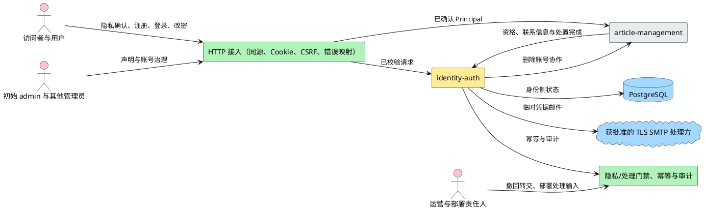

**说明**：identity-auth 是账号、凭据、角色、状态、隐私确认与会话的唯一写入者。接入层拥有 same-origin/login CSRF 和浏览器传输防护；运营只转交撤回请求，部署责任人只登记处理输入，两者不获得治理权限。article-management 只消费 Principal 和最小只读身份合同。

### 2.3 特性影响分析

| 影响项 | 结论与依据 | 设计措施 | 验证建议 | 未决 |
|---|---|---|---|---|
| 功能模块重构 | 绿地，无既有业务代码可重构 | 新建 `internal/identity` 及已批准共享包 | 目录依赖评审 | 无 |
| 关键资源 | Argon2id 消耗 CPU/内存；会话、幂等、审计占 PostgreSQL | 参数、连接池和保留期配置化 | 目标环境基准与容量测试 | 管理员创建幂等 record TTL 已固定为显式 `1h..30d` 配置；连接池、会话清理、审计保留与容量数值仍 TBD |
| License | 新增已批准 `golang.org/x/crypto` | 实施锁版本并做许可证/漏洞审查 | 依赖清单与构建复核 | 版本待实施 |
| 性能 | 登录哈希、每请求会话查询、治理事务和 SMTP 为关键路径 | 索引、连接池、超时、限流测量点 | P95、并发会话、SMTP 时延压测 | SMTP operation budget 已固定；实际时延与容量数值待 S5.3/容量验证 |
| 可靠性 | SMTP 与数据库有已接受残余窗口；password-reset commit-ack-loss 不能靠有限同步 cleanup 证明认证能力已失效 | 幂等状态、最新凭据、告警、trace、审计和有界 SMTP 操作；password-reset 另以持久 operation/recovery/outbox、三消费者 Gate 与租约 worker 建立 durable fail-closed 不变量 | 故障注入覆盖各提交阶段、cleanup 双失败、登录/consumed 竞态、租约接管及 deadline/cancel | `HAN_SMTP_OPERATION_BUDGET` 必填、无默认，部署基线 `10s`、合法闭区间 `1s..60s`；worker 退避/租约/自动重试上限须显式配置，实际数值待容量输入，不得硬编码 |
| 安全/隐私 | 处理密码、会话、邮箱、手机号、隐私证据和治理权限 | 隐私声明/确认、部署门禁、Argon2id、同源/Cookie/CSRF、最小错误、追加审计、数据生命周期 | STRIDE、安全红线、门禁与隐私契约测试 | 实际处理输入 TBD |
| 可用性 | PostgreSQL 不可用时所有身份请求 fail closed；SMTP/TLS/处理方门禁不满足时邮件能力失败；恢复未完成时停服 | 唯一 503 映射，不降级为无鉴权、明文邮件或未交付凭据 | 依赖、TLS、门禁和恢复集成测试 | SLA TBD |
| 可服务性 | SMTP 残余窗口、幂等冲突和审计失败需定位 | 结构化日志、指标、审计和 trace 关联 | 按 trace 从错误追到审计/日志；identity observability 按 ADR-0022 验证 | 首期告警采用 ADR-0022 基线；容量实测后调优 |
| 兼容性 | 绿地 `/api/v1`，无既有消费者 | 新字段默认可忽略；错误 code 保持稳定 | 契约测试 | 无 |
| 特性交互 | 删除用户、作者状态、转移联系、专用邮箱清理、两个 Journal namespace 与联合 readiness 跨 identity/article | 严格按 S1–S16 显式接口协作 | canonical 删除、双 namespace、DeletionOperation/Audit 与跨模块恢复测试 | tombstone inventory/周期 TBD |

### 2.4 已确认方案与对标

会话、强制 TLS SMTP、哈希、错误、幂等、审计、隐私门禁与数据库恢复继续遵守 ADR-0005、ADR-0006、ADR-0012、ADR-0014～ADR-0018。password-reset commit-ack-loss 暴露了新的跨请求认证安全基线；accepted ADR-0023 已比较并采用以下方案 A：

| 方案 | 核心做法 | 优点 | 代价/风险 | 结论 |
|---|---|---|---|---|
| A：持久 operation + recovery/outbox + 三消费者 Gate | 为每次 password-reset 建立独立权威 operation；非终态时 Login、PasswordChange、Session resolve 全部 fail closed；持久 job 由租约 worker 原子收敛凭据、Session、永久密码能力和幂等状态 | 跨请求、崩溃、重启和多实例仍可证明；有限 cleanup 全失败后仍有 durable invariant；可验证同键 replay 与能力状态一致 | 新增表、索引、Gate 查询、后台 worker、production composition 和升级/回退约束 | **已接受（ADR-0023）**。安全优先，结构清晰，可前向迁移并能独立故障注入 |
| B：延长同步 cleanup 并继续用幂等状态推断 | 增加 cleanup 次数/超时，遇到冲突后读取 IdempotencyRecord 决定返回 | 改动文件较少，请求内路径直观 | 数据库/网络不可用、commit-ack-loss 或双 cleanup 失败时仍无持久屏障；`consumed`、派生 Session 和永久密码能力不能仅由 IdempotencyRecord 证明；重试次数再多仍是有限尝试 | 拒绝。不能把有限同步 cleanup 冒充 durable invariant |
| C：用户级全局维护锁直到人工处理 | 对目标账号设置长期认证锁，人工核对后解除 | 安全语义简单 | 可用性差；跨事务锁不能可靠长期持有，仍需持久状态、恢复流程和审计，最终退化为方案 A 的不完整版本 | 不采用 |

方案 A 改变核心持久模型、认证消费者基线、后台运行单元及部署/回退规则，构成架构取舍。accepted ADR-0023“Password reset 采用持久操作屏障、恢复 worker 与认证消费者 fail-closed Gate”已记录问题、A/B/C 选项、采用 A、schema/查询/worker/部署影响及与 ADR-0011、ADR-0015、ADR-0018 的关系。本设计引用该决定，但仍保持 `draft`；ADR 已接受不等于设计、实现或 F002 已获批准/关闭。

## 3 特性/功能实现原理

### 3.1 总体方案

#### 3.1.1 总体设计思路

HTTP handler 只负责协议适配；IdentityService 组织业务动作；User、Session 和 TemporaryCredential 持有状态与不变量；Repository 只持久化 identity-owned 数据；跨模块写入只经 service 端口和同一 UnitOfWork。凭据、会话令牌和 CSRF 明文只存在于瞬时内存。

#### 3.1.2 逻辑视图：业务能力

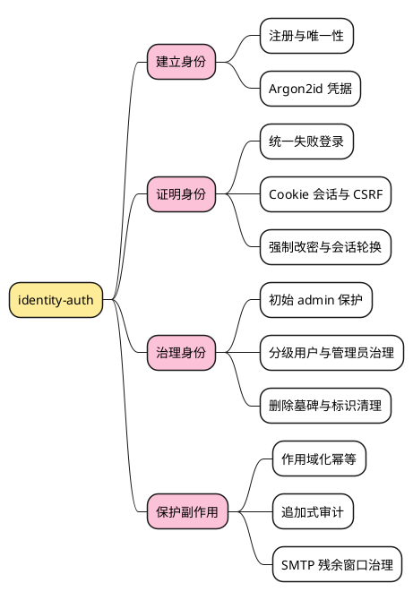

**说明**：四个能力分支从建立账号逐步走到治理和副作用保护。幂等与审计服务于真实写操作，不被建模成新的业务模块。

#### 3.1.3 逻辑视图：核心对象

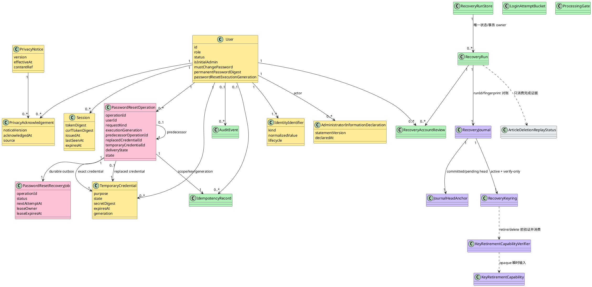

**说明**：IdentityIdentifier 独立承载用户名永久保留、邮箱/手机号条件释放。PrivacyNotice 和 Acknowledgement 保存版本化证据，管理员信息提供声明独立于角色授权。LoginAttemptBucket、ProcessingGate、IdempotencyRecord 和 AuditEvent 由共享安全能力拥有，不是账号业务真相源。`PasswordResetOperation` 是首次 reset 与普通用户 resend 的共同安全结果/Gate 权威；resend operation 以 predecessor 与 replaced credential 明确指向旧能力，但只拥有本次 exact pending credential 的 settlement。`User.passwordResetExecutionGeneration` 在 User 锁内为每个新候选单调分配，auth generation 只在认证能力安全替换时推进，两者不得混用。`IdempotencyRecord` 只能保存请求分类/稳定响应，不能覆盖 operation 对认证能力的判断；`PasswordResetRecoveryJob` 是同一 PostgreSQL 故障域内的 durable outbox，不是第二真相源。

#### 3.1.4 逻辑视图：代码框架

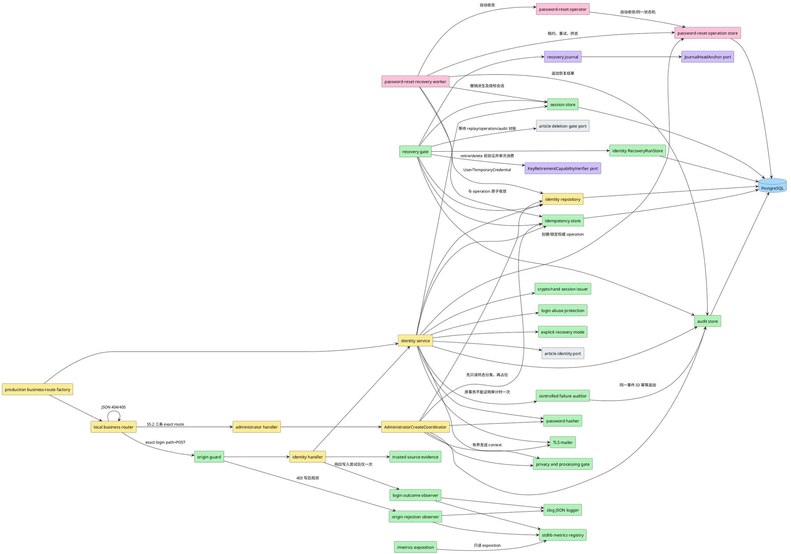

**说明**：TraceMiddleware 最外层建立可信 trace，随后由局部 business router 先做 exact path/method 判定：未知 path 直接用 `platform.WriteError` 返回 JSON 404；`/api/v1/sessions` 的非 POST 方法直接返回 JSON 405 与 `Allow: POST`；只有 exact login path+POST 才进入 `OriginGuard`。因此 404/405 不触发 Origin 判定、Origin observer、Identity Handler/Service、attempt coordinator 或登录指标，也不能落入 raw `http.ServeMux` 的 text fallback。进入登录 Handler 后，HTTP 编排边界才创建 request-scoped `LoginAttemptCoordinator`，在调用来源证据提供方前生成唯一 `audit_event_id`。Coordinator 把同一 ID、事件时间和一次性 failure-audit guard 传给 Handler 前置失败路径与 Service；来源证据失败只能由 Handler 认领 guard，进入 Service 后只能由 Service 认领，两个阶段互斥且每请求最多一次调用 `LoginFailureAuditor`。登录 outcome observer 仍在 Handler 完成唯一响应写入尝试后消费最终结果和稳定故障分类；Handler 是登录内部故障普通日志和指标的唯一调用方，下层只分类上抛。commit unknown 时失败审计入口只读核对原事务准备的完整 AuditEvent，不执行 INSERT；rollback unknown 只有在 Audit Append 已实际尝试时才可执行同样的只读核对，Append 尚未尝试时不调用 auditor、直接 unknown；只有原事务未提交已被证明时才可独立插入失败事件。平台 `OriginGuard` 在 Handler 外持有 `OriginRejectionObserver`，拒绝时先完成唯一 403 写入尝试并捕获结果，再同步尝试一次 WARN 与安全计数；该安全观测不进入 login attempts。

ADR-0022 将生产 adapter 固定为两种项目内实现：日志经 `slog.JSONHandler` 与 `platform.LoggerWithTrace` 输出 stdout JSON Lines；指标经标准库并发安全 registry 记录固定 Counter/classic Histogram，并由独立 exposition handler 读取快照。`/metrics` 固定 Prometheus text exposition `0.0.4` 且无内容协商，encoder 必须完整内存编码和验证后才提交 200。两类 observer 的 logger/metrics fan-out 使用调用方传入的同一剩余 deadline；Login、Origin、failure auditor、shutdown 的部署基线为 `250ms/250ms/2s/10s`，均从生产环境显式注入且无默认值，parser 接受 ADR-0022 固定合法范围内的非基线值。`cmd/han-server` 是唯一生产 composition root，除既有登录链外还必须构造 S5.2 的 AdministratorCreate/Privacy coordinators、注入 `HAN_SMTP_OPERATION_BUDGET`，并注册信息提供声明读取、创建管理员、隐私确认三条路由。当前 metrics/lifecycle/composition 骨架已经存在，但 production `composeBusiness` 仍未证明这些 S5.2 路由和真实 SMTP budget wiring；不得据孤立 Handler/Service 或 fake factory 声明管理员创建 production 可达。

生产 business-route factory 的内部合同固定为：

```go
type productionBusinessConfig struct {
    LoginMaxBodyBytes int64
    Argon2id          security.Argon2idConfig
    Argon2ProfileID   string
    Argon2MaxConcurrency uint8
    Session           sessionIssuePolicy
    Abuse             identity.LoginAbuseConfig
    LoginBucketKeyVersion       string
    LoginBucketHMACKey          []byte
    SourceFingerprintKeyVersion string
    SourceFingerprintHMACKey    []byte
    RecoveryMode                recoveryMode
    TrustedProxyCIDRs           []netip.Prefix
    AdministratorNotice        identity.AdministratorInformationNotice
    IdempotencyKeys             idempotency.DigestKeyring
    IdempotencyLock             time.Duration
    IdempotencyTTL              time.Duration
    SMTP                        mailer.SMTPConfig
    ProcessingGate              platform.ProcessingGateConfig
}

type preparedLoginDependencies struct {
    Passwords            identity.LoginPasswordHasher
    Abuse                identity.LoginAbuseProtector
    SessionIssuer        identity.LoginSessionIssuer
    SourceProvider       identity.RegistrationSourceProvider
    RecoveryMode         identity.LoginRecoveryMode
    IDs                  identity.LoginIDGenerator
    Clock                identity.LoginClock
    FakeCredentialDigest string
    FakeCredentialProbe  string
}

type preparedProductionDependencies struct {
    Login                  *preparedLoginDependencies
    AdministratorNotices   identity.AdministratorInformationNoticeReader
    IdempotencyKeys        idempotency.DigestKeyring
    IdempotencyLock        time.Duration
    IdempotencyTTL         time.Duration
    Mailer                 mailer.Mailer
}

type businessComposition struct {
    logger            *slog.Logger
    metrics           *platform.MetricsRegistry
    loginObserver     identity.LoginOutcomeObserver
    originGuard       *platform.OriginGuard
    failureAuditor    identity.LoginFailureAuditor
    failureAuditFor   time.Duration
    smtpOperationBudget time.Duration
    loginMaxBodyBytes int64
    processingGate    platform.ProcessingGateConfig
    prepared          *preparedProductionDependencies
}

func prepareProductionDependencies(
    config productionBusinessConfig,
    random io.Reader,
) (*preparedProductionDependencies, error)

func newProductionBusinessHandler(
    pool *pgxpool.Pool,
    composition businessComposition,
) (http.Handler, error)
```

`smtpOperationBudget` 只接受 `loadStartupConfig` 已按 `HAN_SMTP_OPERATION_BUDGET` 校验后的值，并由 production factory 注入唯一 `AdministratorCreateCoordinator`。Coordinator 构造必须拒绝缺失或非正预算；`1s..60s` 的环境合法范围只由启动配置层拥有，业务代码不得复制部署基线 `10s` 或用硬编码回退。发送前从请求 context 派生有界 context；已有请求 deadline 更早时保留更早者，发送返回后立即调用 cancel，不把 timer 延长到后续数据库提交。production router 必须复用同一 Session/CSRF/Principal、ProcessingGate、notice、idempotency、mailer、audit、session 与 repository adapter，不新建第二 composition root 或仅测试可见的 service locator。管理员创建与隐私确认的 JSON body limit 明确复用已校验的 `HAN_LOGIN_MAX_BODY_BYTES`；本轮不再增加两个语义重复的 body-limit 键，也不得在 Handler 构造处硬编码常量。

`migrations/0007_idempotency_response_snapshot_v1.sql` 是 S5.2 的前向数据库接缝，由共享 idempotency persistence / migration owner 负责；Task-Planner 后续必须显式登记该 owner 与 write set。本设计不创建 migration 文件，也不修改既有 `migrations/0004_idempotency.sql`。`0007` 只替换/扩宽 `idempotency_records.response_snapshot` 的 CHECK，使 legacy 与封闭管理员 v1 两个互斥分支可共存；不增加/删除/改名列，不重写旧行，不改变状态枚举、索引或其他消费者写入形态。应用侧 reader 同步成为 strict 双读，管理员创建 writer 只写 v1。

Password-reset recovery 仍位于 `internal/identity` 的业务边界内：operation store 负责首次 reset 与普通用户 resend 的权威行/条件转换，worker 负责租约、重试和原子收敛；`internal/session`、`internal/idempotency` 和 `internal/audit` 只提供既有持久化能力，不拥有 operation 状态机。S10.4 的所有 password-reset create/claim/resend、Login、PasswordChange、Session resolve 与 RecoveryWorker 自动路径都先锁稳定 User 行，再按 `PasswordResetOperation/recovery job → old/new exact TemporaryCredential → derived/target Sessions → IdempotencyRecord/AuditEvent` 的统一子顺序访问；禁止任何路径先 Operation 后 User。无 operation 行时 User 锁仍是阻止并发插入 unresolved operation 的 per-user 线性化屏障。不能取得任一锁、读到未知状态或无法证明关联关系时保持 Gate，不做“最佳猜测”。`new_administrator` resend 不创建 PasswordResetOperation，继续由 ADR-0011 路径拥有。未来 `identity-auth-S10.5` maintenance mode 仍须复用同一锁序和状态机，但在其登记、设计与实现完成前不存在 production 维护调用方。

`productionBusinessConfig` 只承载 `loadStartupConfig` 已完成解析、范围/交叉校验后的值；它不直接进入 route factory。`prepareProductionDependencies` 的 production 调用固定传 `crypto/rand.Reader`，测试才可传 deterministic reader；返回对象同时承载登录 prepared dependency、不可变 `StaticAdministratorInformationNoticeReader`、完整幂等 `DigestKeyring`、lock/TTL 与真实 `SMTPMailer`。该阶段允许读取显式 CA bundle 文件并构造 TLS/auth，但不连接数据库、DNS、SMTP，不 bind、不启动 goroutine。composition root 每进程只创建一个 `internal/security` Argon2 permit set，并把同一个 gate-backed hasher 注入真实 credential Verify、未知用户 fake Hash/Verify、成功认证后的 rehash Hash及管理员临时凭据 Hash；不得为每个 hasher、Service 或 credential kind 各建 limiter。Session issuer、Login Service、AdministratorPrivacyCoordinator 与 attempt coordinator 必须复用 prepared 对象中的同一 `IDs`/`Clock`；factory 不得重新构造 `RandomUUIDGenerator`、`SystemClock`、Session issuer、source provider、notice reader、keyring 或 mailer。

`startupConfig` 是原始已解析值和启动期秘密副本的 owner；转移到 prepared adapter 后必须清空其 idempotency HMAC `[]byte` 和其他临时 secret buffer并置空引用。prepared keyring 中为运行时验证保留的唯一进程副本在 startup unwind 或两个 Serve loop 结束后的统一 cleanup 中逐项 `clear`；不得在请求级复制完整 keyring。`businessComposition` 只携带已验证的不可变非秘密 config 和 prepared adapter，不携带环境 lookup、raw SMTP password 或第二份 raw HMAC key。SMTP password/username 因 `net/smtp` API 以不可变 Go string 承载，只承诺最少读取、最少复制、不日志、不格式化进 error并在构造 auth 后尽快释放启动层引用，不声称物理清零；prepared `SMTPMailer` 内的 `smtp.Auth` 是 Serve 生命周期内唯一运行副本 owner，统一 cleanup 只丢弃引用而不伪称清零。任何额外物化的临时 `[]byte` 仍须在成功/失败路径及时 `clear`。fake probe string 同样只保留到 `NewLoginService` 自检完成并立即释放引用。

`startupDependencies.composeBusiness` 保留现有 `func(*pgxpool.Pool, businessComposition) (http.Handler, error)` 测试替换点，productionDependencies 只把它指向 `newProductionBusinessHandler`，不新建第二个进程入口、第二套路由 root 或包级 service locator。production factory 不读环境、不读取 CA 文件、不 bind、不启动 goroutine、不关闭 pool；任一构造失败返回 `nil` handler与去敏 error，由 `runComposed` 关闭已经拥有的 pool和 prepared secret资源，且 listener/route 可达计数为 0。

S10.4 在该唯一 production root 内顺序扩展、而不是另建 composition seam。`loadStartupConfig` 读取并做单值解析/内在范围校验；DSN 解析后、connect 前再完成连接池交叉校验；`newProductionBusinessBuilder` 复用 S10.3 已持有的同一 `b.passwordResetGate` 指针作为 operation/job Store、三消费者 Gate 与 worker/operator 的共同 durable authority，构造一个 `PasswordResetOperator` 和一个 `PasswordResetRecoveryWorker`。`businessRuntime` 由单一 `worker` 扩成命名的 `articleWorker`、`passwordResetWorker` 与既有 `closeArticle`；factory 只把已构造实例写入 runtime，`lifecycle.go` 只消费这些输入，不得读取环境、解析配置、构造 pool-backed Store/Gate/operator/worker，或通过包级全局查找依赖。任何 worker/operator/config 构造失败均发生在 listener bind 与 Serve 前，并由现有 startup owner 清理已取得资源。S10.4 的 `PasswordResetOperator` production 消费者只有自动 worker；三个维护动作名不构成 production 命令或可执行入口。
connection budget 由唯一进程内 connection-permit owner 实施。一个 permit 表示“一次可能同时占用最多一个 `pgxpool` connection 的顶层数据库操作/事务槽”：顶层动作在首个 pool-backed query 或 `BeginTx` 前恰好 acquire 一次，持有到全部 `Rows`、`Tx` 与显式/隐式 connection 均关闭或归还，并以 `defer` 保证 success、error、cancel 与 panic 都恰好 release 一次。候选扫描在打开首个查询前 acquire，扫描 rows 完全关闭后 release；每次租约取得在对应领取 query/transaction 前 acquire，完成 commit/rollback 后 release；每次租约续约是独立顶层动作并按同一规则 acquire/release；每个 settlement job 在首个数据库动作前 acquire，并持有到该 job 的全部数据库资源归还。若一个顶层动作串行执行多个事务，同一 permit 覆盖整个顶层动作，事务之间不释放重取，且该动作不得并发占用多个 connection。worker 自动路径把“permit 已持有”责任传给 operator 的 Store/settlement helper，内部 helper 禁止嵌套 acquire；operator 的 direct execution 边界若被直接调用，则由该顶层边界自行 acquire 一次，不能与 caller 重复取得。S10.4 server 进程的 worker 与 operator port 共用同一 owner；未来互斥 maintenance 进程使用其自身 pool 与 owner，不与 server 进程共享内存 semaphore。permit 数值仍为 `TBD（待容量验证阶段确定）`，不据此编造连接保留量或容量阈值。

Argon2 资源 owner 的最小方案比较如下：

| 方案 | 结论 |
|---|---|
| `internal/security` 共享 limiter，包装现有 `Argon2idHasher` 的 Hash/Verify | **采用**。同一 permit set 可覆盖登录真实验证、fake 验证、rehash，并作为未来注册/临时凭据的单一进程 owner；不引入后台 goroutine或隐藏全局 singleton |
| identity/cmd 局部 wrapper | 拒绝。容易遗漏 fake verify、rehash 或未来消费者，并诱发每个 hasher 各建 limiter 的多 owner 状态 |

RecoveryGate/Coordinator 只按 `run_id` 调用 identity-owned RecoveryRunStore；Store 是 RecoveryRun 状态、行锁和短事务转换的唯一 owner。Coordinator 对账 `recovery/*` 后，通过 ArticleDeletionGate 只读消费 `article-deletion/*` 的完成状态；不直接读取 DeletionOperation 或 Article 表。两个 namespace 的接口、记录、CAS anchor 和校验链保持独立。图中的 Anchor 与 `KeyRetirementCapabilityVerifier` 均为 provider-neutral port；S4.2 只交付接缝、opaque capability 边界及确定性测试替身，不在当前十三文件选择或装配生产 provider/verifier，也不提供 mint。S4.5 只承接 Anchor；retirement 生产闭环必须另立任务。

#### 3.1.5 开发视图

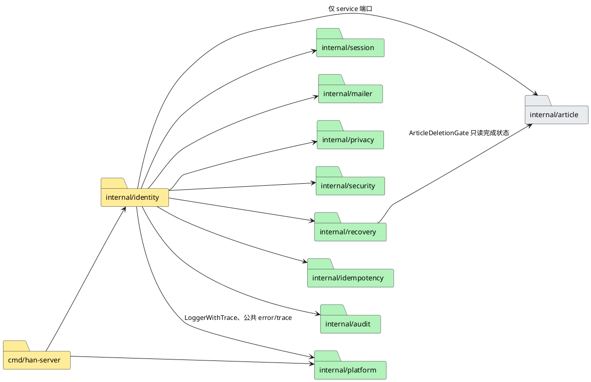

**说明**：`internal/identity` 定义登录结果/故障分类、Handler-owned `LoginAttemptCoordinator`、`LoginFailureAuditor` 与 `LoginOutcomeObserver` 测试替换点，并拥有 `AdministratorCreateCoordinator` 的授权、幂等、SMTP 与双 Gate 编排。`internal/idempotency` 必须把版本化公共响应快照作为唯一重放来源，不允许 identity 从当前 User/TemporaryCredential 重建“原结果”。登录 HTTP 边界在来源证据前创建 attempt context；Handler 与 Service 共享一次性 failure-audit guard，而不是各自维护计数。`internal/platform` 拥有 Handler 外层的 `OriginGuard`、`OriginRejectionObserver`、`slog` logger、稳定公共 error registry 与标准库 metrics registry/exposition；r24 为 ADR-0014 的既有 JSON envelope 合同最小增加 route 404/405 两个稳定 code，不改变 ADR。`internal/security` 在 r25 成为 Argon2 Hash/Verify 共享 process permit set 的唯一 owner；r26 进一步固定其 capacity typed error 为容量路径 `Retry-After` duration 的唯一 owner并携带 `1s`。identity 只消费 gate-backed hasher，Service 识别该错误并沿现有 rate-limit carrier 原样承载 duration，Handler 只负责正整数秒表示与公共 429 写出。`cmd/han-server` 是唯一生产 composition root，负责前置解析全部生产配置、构造唯一 Argon2 Gate 与依赖、把 SMTP operation budget 注入管理员创建协调器、复用 S10.3 的同一 `*identity.PasswordResetStore`/Gate 构造 PasswordReset operator/worker、注册业务路由、绑定业务与 metrics listener、运行两个 Serve loop和两个 worker，并以同一 coordinator 完成 shared-deadline Shutdown/Wait、必要时 Close、资源清理和退出结果归类。S10.4 只在 `internal/identity/password_reset_worker.go` / `_test.go`、`internal/identity/password_reset_operator.go` / `_test.go`、`cmd/han-server/main.go` / `_test.go`、`cmd/han-server/lifecycle.go` / `_test.go` 八文件内完成该增量；不得增加第二 root、第二 Store/Gate、隐藏全局或让 lifecycle 层构造 production dependency。S3.2 最终预计实施边界为 §9.2 的十八个既有文件；S5.2 返工影响面另见 §9.3，不能借 S3.2 文件上限排除真实管理员 production consumer。`internal/recovery` 定义 RecoveryJournal、RecoveryCoordinator、provider-neutral `JournalHeadAnchor` port 与 `KeyRetirementCapabilityVerifier` port；identity 模块拥有 RecoveryRunStore 接口与 PostgreSQL 实现，Coordinator 只传 `run_id` 和转换命令，不接受调用方自造完整 RecoveryRun。S4.2 十三文件只允许加入 Anchor 协议、opaque capability 类型/验证调用边界和确定性测试替身，不得要求第十四文件、`cmd/config` 接线、生产 provider/verifier、mint 路径或新依赖。RecoveryCoordinator 依赖 article-management 提供的 ArticleDeletionGate 接口；该接口只返回 replay 状态，不泄露 DeletionOperation 或 Article 数据结构。禁止 identity repository 直接读取文章删除表或 namespace。

#### 3.1.6 进程视图

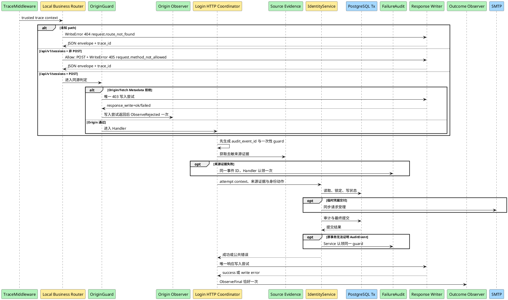

**说明**：在进入本图的请求流程前，production factory 已按 §3.1.7 顺序完成全部配置校验和 adapter 构造。业务 Handler 顺序固定为 `platform.TraceMiddleware(localBusinessRouter)`；router 对未知 path 与错误 method 直接使用 `platform.WriteError` 生成 ADR-0014 JSON envelope，只有 exact `POST /api/v1/sessions` 才调用 `originGuard.Protect(loginHandler)`。因此未知 path 不会被 Origin 改写成 403，404/405 也不经过 Session/CSRF middleware、Origin observer、Identity Handler/Service 或登录指标。OriginGuard 拒绝发生在认证 Handler 外，因此先完成唯一 403 写入尝试，再调用平台安全 observer，不进入 login attempts。Guard 通过后，登录 HTTP coordinator 必须先生成事件 ID，再获取来源证据；前置失败由 Handler 调用 failure auditor，进入 Service 后才转移调用责任。request-scoped guard 使两条调用路径互斥。Service 面对 rollback/commit unknown 时不得盲写：rollback unknown 在 Audit Append 前不调用 auditor，Append 后及 commit unknown 才只读核对；已证明原事务未提交的路径才允许失败事件 INSERT。Handler 仍先完成唯一响应写入尝试，再调用 outcome observer，因此 body Write error 可进入最终 observation，observer 失败也不能触发第二次响应写入。管理员创建在传输层 decode、Session/CSRF 完成后，首个业务决定必须重新确认 Principal 对应当前 User 仍为 active initial admin；授权通过后才只读分类幂等记录。相同摘要稳定终态直接返回快照，跳过动态 Gate/notice/密码策略和全部副作用；只有无既有记录才进入动态前置条件和首次占位。临时凭据发送使用请求 deadline 与 `HAN_SMTP_OPERATION_BUDGET` 的较早者并及时 cancel。

#### 3.1.7 部署视图

```plantuml
@startuml
skinparam shadowing false
skinparam defaultFontName "Microsoft YaHei"

node "应用主机" as Host #d0bfff {
  component "cmd/han-server<br/>composition root" as App #ffec99
  component "业务 HTTP listener" as BusinessHTTP #b2f2bb
  component "metrics listener<br/>/metrics only" as MetricsHTTP #b2f2bb
  database "recovery/* namespace" as Journal #d0bfff
  database "article-deletion/* namespace" as DeletionJournal #e9ecef
}
database "PostgreSQL" as DB #a5d8ff
cloud "部署日志采集与查询<br/>至少 30 天" as LogPlatform #a5d8ff
cloud "Prometheus pull backend<br/>text format 0.0.4" as MetricsBackend #a5d8ff
cloud "Grafana / Alertmanager" as OpsPlatform #a5d8ff
cloud "目标态：独立故障域 CAS anchors" as Anchor #d0bfff
cloud "获批准的 TLS SMTP 处理方" as SMTP #a5d8ff

App --> BusinessHTTP : 业务路由
App --> MetricsHTTP : 独立 listener
App --> LogPlatform : stdout JSON Lines
MetricsBackend --> MetricsHTTP : pull /metrics
MetricsBackend --> OpsPlatform : query / alerts
App --> DB : 用户、会话、幂等、审计
App --> SMTP : 隐式 TLS 或强制 STARTTLS
App --> Journal : Begin、MarkConsumed、Read、VerifyAgainst
App --> DeletionJournal : article-owned replay 与验链
App --> Anchor : compare-and-swap head
@enduml
```

**说明**：日志采集、Prometheus pull backend、Grafana 和 Alertmanager 表示部署角色，不声明任何具体 provider、账号、付费方案或已部署事实。应用侧 `/metrics` 的线协议固定为 Prometheus text exposition `0.0.4`；真实 backend scrape 仍由部署 Gate 验证。stdout/stderr 采集与至少 30 天可查询留存、`Han / Identity Auth` Dashboard、warning/paging receiver、角色升级链和 `docs/runbooks/identity-observability.md` 由部署 Gate 验证，不是应用启动时对外部平台发起的健康探测。两个 namespace 可复用经验证的文件、完整 keyring 与 OS 锁基础能力，但文件/记录链、HMAC domain、CAS anchor、接口和语义独立。图中的 Anchor 是目标生产部署：不得与 Journal 文件/持久卷或业务 PostgreSQL 同故障域。S4.2 仅交付 provider-neutral port/协议与确定性测试替身；生产 provider、配置、启动装配及真实独立故障域验证由后续独立任务交付，完成前不得把该图解释为已部署事实。identity 只直接操作 `recovery/*`；`article-deletion/*` 由 article-management 操作，并通过状态端口参与联合 readiness。

`cmd/han-server` 的生产启动与清理顺序是可实施合同：

1. `loadStartupConfig` 是唯一环境读取边界。在任何数据库 DSN parse/connect/Ping/migration、`composeBusiness` 调用、listener 绑定、业务路由注册或可达之前，一次性读取并校验既有 deployment/observability/lifecycle 配置、r26 登录配置、管理员信息提供声明四键、幂等 current/retained/keyring/lock/TTL、完整 SMTP endpoint/from/auth 输入，以及 S10.4 的五个 password-reset worker 键；逐键 parser 与交叉约束均以 §3.3.1 为可执行合同。管理员声明 `effective_at` 必须通过 RFC3339 解析且是以 `Z` 结尾、offset=0、非零的规范 UTC 整秒值；输入与 `parsed.UTC().Format(time.RFC3339)` 不逐字节一致或含任何小数秒时即失败。缺失、空白、重复/歧义、解析失败、越界、枚举非法、声明正文/hash 不匹配、keyring 不闭合、`lock <= SMTP budget`、`TTL <= lock`、SMTP auth 组合非法、trust-all/等价代理前缀、秘密长度不合格、profile ID 语法非法或 Argon2 memory×concurrency 越界均非零退出。error 只允许包含配置键和稳定原因，不得包含配置值、notice content、username/password或密钥。password-reset 五项任一缺失、空白、解析失败、目标类型溢出、零值、负值或其他内在范围错误，同样使 DSN parse/connect/Ping/migrate/prepare/factory/listen/route/Serve/worker Start 调用数全部为 0；只有 connection budget 已成功解析且为正、但大于 `pgxpool.Config.MaxConns` 的交叉错误允许 DSN parse=1，并仍要求 connect 及以后调用数为 0。
2. 四项观测/审计/生命周期必填预算的部署基线分别为 Login observer `250ms`、Origin observer `250ms`、failure auditor `2s`、shutdown `10s`；parser 合法范围分别为 `1ms..5s`、`1ms..5s`、`10ms..30s`、`1s..60s`，端点包含。SMTP operation budget 另以 `HAN_SMTP_OPERATION_BUDGET` 必填注入，部署基线 `10s`、parser 合法闭区间 `1s..60s`。duration buckets 基线为 `0.005,0.01,0.025,0.05,0.1,0.25,0.5,1,2.5,5` 秒；parser 接受 `1..32` 项正数、有限、严格递增、无重复且最大值 `<=60s` 的合法非基线列表。所有值无代码默认；缺失、空白、解析失败、非有限或超范围均启动失败。
3. 配置全部合法后，调用 `prepareProductionDependencies` 构造不产生外部网络/数据库副作用的 logger、metrics registry/exposition、两类 observer、OriginGuard、唯一 IDs/Clock、一个 `internal/security` Argon2 process permit set、共享 gate-backed hasher、登录 HMAC digester、`crypto/rand` Session issuer、可信来源 provider、显式 RecoveryMode、不可变管理员信息声明 reader、完整 `DigestKeyring` 与真实 `SMTPMailer`。声明 reader 接收的 `EffectiveAt` 必须已经由 loader 证明为规范 UTC 整秒；本阶段只保留该值，不截断、不舍入、不重新格式化修正。CA bundle 非空时在本步读取；先取得系统根并追加该文件证书，读取失败、PEM 无证书或解析失败即启动失败。`SMTPMailer` 仅构造 `net.Dialer`、`tls.Config` 与可选 auth，不进行 DNS、dial、TLS 或 AUTH。此阶段随机源只允许为 fake credential 生成一次进程内 probe并立即通过同一 gate-backed hasher生成 digest；临时 `[]byte` 在成功/失败路径清空。任一 CA/随机读取、Gate/hasher/keyring/notice/mailer构造或自检失败均在数据库副作用前非零退出；测试轨迹允许 `prepare=1`，但 DSN parse/connect/Ping/migrate/factory/listen/route 必须全为 0，并由启动 owner 清理本步已取得的临时资源。
4. 只有前三步成功才 parse DSN；此时先校验 password-reset connection budget 不超过 `pgxpool.Config.MaxConns`，失败则不得 connect。随后建立 pool、Ping 并执行既有 migration。migration 后以同一 pool 构造一个 `session.Store`、`identity.PostgresLoginRepository{}`、`identity.PostgresLoginAbuseBucketStore{}`、`identity.PostgresAdministratorRepository{}`、`idempotency.Store{}`、`audit.Store{}`、`privacy.Store` 与 `privacy.ProcessingGate`。S10.3 已在同一 `productionBusinessBuilder` 构造唯一 `*identity.PasswordResetStore` 并注入 Session/Login/PasswordChange；S10.4 必须复用该同一指针构造唯一 PasswordReset operator 与 worker，不得再次实例化 Store/Gate。再按登录 Service/attempt coordinator/Handler、PasswordChange Service/Handler、`AdministratorCreateCoordinator`、`AdministratorPrivacyCoordinator`、单一 `identity.NewAdministratorHandler` 的顺序构造。创建管理员精确注入 prepared notice、ProcessingGate、共享 gate-backed hasher/PasswordPolicy、真实 mailer、完整 keyring、lock/TTL、SMTP budget、audit及同一 IDs/Clock；隐私 coordinator 精确注入现役 `CurrentNoticeReader`、同一 Session store/issuer、repository、audit及同一 IDs/Clock。任何构造失败由 `runComposed` 清空 prepared keyring副本、关闭已建 pool并返回；不得注册路由、bind listener或留下 goroutine。
5. `newProductionBusinessHandler` 最后构造局部 router：先 exact path，再 exact method；未知 path 用 `platform.WriteError` 返回 `404 request.route_not_found`，已知 path 的错误 method返回 `405 request.method_not_allowed` 与 route-specific `Allow`。匹配后的登录、改密与三条 S5.2 路由都先进入同一个 `OriginGuard`。信息提供声明 GET 的内部顺序为 `Origin → Session/Principal（安全方法无 CSRF）→ Handler → coordinator 当前 active initial-admin 授权`；创建 POST 为 `Origin → Session → CSRF → Principal/AccessGeneral → Handler → coordinator`；隐私确认 POST 为 `Origin → Session → CSRF → Principal/AccessAcknowledgePrivacy → Handler → coordinator`。`ProcessingGate` 只在首次管理员创建 coordinator 的动态业务前置中运行，不得实现为通用 HTTP middleware；授权后的稳定终态重放继续先于 Gate。三路由复用步骤 4 的相同 Session store/issuer、source provider、notice、Gate、idempotency、mailer、audit与repository实例。最外层只包一次 `platform.TraceMiddleware`；禁止 raw `http.ServeMux` fallback、第二 composition root、fake/no-op adapter或只在测试直接构造。factory 必须把 Article deletion worker 与 PasswordReset worker分别写入同一 `businessRuntime` 的命名字段；任一启用能力缺 worker、operator 或 runtime 接缝即构造失败。factory 成功后才分别绑定业务与 metrics listener；任一 bind 失败清理 listener、prepared secret与pool并非零退出。
6. 两个 listener 已绑定但尚未进入 Serve 时，统一 lifecycle 依次执行 `ArticleDeletion.Reconcile → PasswordReset.Reconcile`；任一 Reconcile 同步失败均不调用任何 Start、不开放 Serve，并按已取得资源做反向清理。两个 Reconcile 均成功后，再依次调用 `ArticleDeletion.Start(context.Context)` 与 `PasswordReset.Start(context.Context)`；两者都采用现役 `lifecycleWorker` 的无同步 error 签名，Start 调用本身没有“返回错误并阻止 Serve”的 production 分支。Start 后的 worker 运行错误统一经 `Done()/Err()` 上报并进入 coordinator。lifecycle fake 只能模拟 Reconcile 同步失败和 Start 后 Done/Err 运行失败，不得伪称 Article production Start 可同步失败。`lifecycle.go` 不自行读取五项配置，也不构造任何 production dependency。
7. 业务 server、metrics server、PasswordReset worker、Article deletion worker任一运行 error 或 `SIGTERM`/`SIGINT` 进入同一个 coordinator。若同一轮可观察到多个触发，主错误稳定优先级为 business server → metrics server → PasswordReset worker → Article worker → context/signal 异常；协调关闭导致的 `http.ErrServerClosed` 不算原始错误。
8. 协调器先停止新接入和新领取，对两个 worker 各调用 `Stop` 恰好一次；以唯一 `HAN_SHUTDOWN_BUDGET` shared deadline 并发执行两个 server `Shutdown` 和两个 worker `Wait`，不得为任一组件重置预算。任一 server Shutdown 失败或超时时，对两个 server 都调用 `Close`；fallback 成功不得抹去先前失败。两个 worker 全部停止后才关闭 Article 专属资源，随后等待两个 Serve loop、关闭 listener，最后关闭数据库池；任一 worker 仍可能提交时不得先关 pool。Stop/Wait/Shutdown/Close/listener/Article/pool error以稳定组件名附加，不覆盖主错误。
9. `SIGTERM`/`SIGINT` 路径只有在两个 worker、两个 Shutdown、两个 Serve loop、listener、Article资源与数据库池 cleanup 全成功时退出 `0`。任一原始 server/worker error、Shutdown/Wait 超时或失败、任一 Close/资源 cleanup 失败均非零；`dead_letter` 是业务恢复状态而非 worker loop error，不得通过退出重启循环伪装成自动修复。

S10.4 的五项 production runtime config 固定如下。键名和“必填、无代码默认、listener 前失败”是本设计合同；**所有实际生产值均为 `TBD（待容量验证阶段确定）`**，本修订不提供推荐值或新造数值包络。

| 环境键 | 类型与内在校验 | 运行责任 | 交叉校验 |
|---|---|---|---|
| `HAN_PASSWORD_RESET_WORKER_LEASE_DURATION` | 必填 Go duration；必须为正、可表示的有限时长 | 传给 Store/operator 的数据库租约期限 | 容量阶段确定实际值；不得由 worker 写死或回退 |
| `HAN_PASSWORD_RESET_WORKER_RETRY_BACKOFF` | 必填 Go duration；必须为正、可表示的有限时长 | 可重试故障写入 `next_attempt_at` 的基础退避输入 | 容量阶段确定实际值；不得用 `sleep` 常量替代 |
| `HAN_PASSWORD_RESET_WORKER_MAX_RETRIES` | 必填十进制正整数；目标类型溢出即失败 | 自动重试上限，达到后进入 `dead_letter` 且 Gate 保持 | 不把 `dead_letter` 解释为成功或解锁 |
| `HAN_PASSWORD_RESET_WORKER_CLAIM_BATCH_LIMIT` | 必填十进制正整数；目标类型溢出即失败 | 每轮候选扫描/领取上限 | 只限制候选量，不授权且不改变 User-first 领取事务 |
| `HAN_PASSWORD_RESET_WORKER_CONNECTION_BUDGET` | 必填十进制正整数；目标类型溢出即失败 | server 进程唯一 connection-permit owner 的并发顶层数据库操作/事务槽上限；worker/operator 共用 | DSN parse 后、connect 前必须 `<= pgxpool.Config.MaxConns`；每 permit 最多同时占用一个 connection，不编造保留量 |

除上表已固定的正值/类型/连接池关系外，lease、backoff、retry、batch 与 pool budget 的容量上限和相互调优关系没有权威数值来源，继续保持 TBD；实现不得擅自补充隐藏上限、建议值、别名或默认值。未来容量验证若要增加具体 parser ceiling 或新的数值交叉约束，须以证据修订配置合同后再实施。

#### 3.1.8 场景视图（+1）

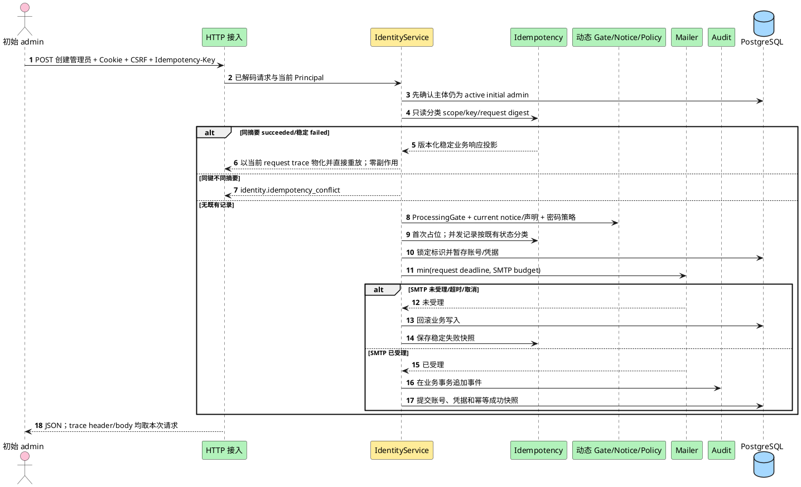

**说明**：该场景固定 D001 的线性化顺序。传输层 decode、Session/CSRF 后，授权是第一个业务决定；已不再是 active initial admin 的主体不得观察历史快照。授权通过后，稳定终态重放优先于会随时间变化的 ProcessingGate、current notice/声明版本和密码策略，并且只读取幂等快照，不读取当前 User/TemporaryCredential。只有无既有记录才执行动态前置条件并占位。快照保存的是不可变稳定业务响应投影，不保存 `trace_id`；首次响应和重放均由 Handler 使用本次 request context 的 trace 物化，因此 `X-Trace-ID`、失败 body `trace_id`、context 与日志始终属于本次请求。SMTP 发送 context 的 deadline 是请求 deadline 与配置预算的较早者，Send 返回后立即 cancel；SMTP 受理后数据库提交仍可能失败并进入 `identity.operation_uncertain`。

#### 3.1.9 可行性验证记录

| 技术点 | 当前证据 | 结论 |
|---|---|---|
| Go 1.27 `net/http` | ADR-0002、ADR-0009 | 可行；绿地无框架迁移 |
| PostgreSQL 本地事务 | ADR-0001、ADR-0003 | 可覆盖用户删除与文章无归属化 |
| Argon2id | ADR-0012，依赖已批准 | 结构可定；参数待目标环境基准 |
| Cookie/CSRF | ADR-0005 | 合同已定；名称与 SameSite 取 A1/A2 |
| 幂等与审计 | ADR-0015、ADR-0016 | 管理员创建幂等 record TTL 已固定为显式 `1h..30d`（建议 `24h`）；其他幂等用途与审计保留期仍待容量/治理输入 |
| PlantUML | 文档静态语法约束 | 本机是否有渲染器待收尾检查；不安装或联网 |

#### 3.1.10 Story 拼图与依赖

| 能力维度 | 01.1 | 01.2 | 02.1 | 03.1 | 03.3 | 03.4 | 03.5 | 03.6 | 03.7 | 03.10 | 03.11 |
|---|---:|---:|---:|---:|---:|---:|---:|---:|---:|---:|---:|
| 标识与账号 | ● |  | ● | ● | ● | ● | ● | ● | ● | ● | ● |
| 永久/临时凭据 |  | ● | ● | ● | ● |  |  |  |  | ● | ● |
| 会话与 CSRF |  |  | ● | ● | ● | ● | ● | ● | ● | ● | ● |
| 分级权限 |  |  |  | ● | ● | ● | ● | ● | ● | ● | ● |
| 幂等/SMTP |  |  |  |  | ● |  |  |  |  | ● | ● |
| 审计 | ● | ● | ● | ● | ● | ● |  | ● | ● | ● | ● |
| article 接缝 |  |  | ● |  |  | ● |  | ● | ● |  |  |

详细 Story 切片见 [stories.md](stories.md)。

### 3.2 用户与调用方行为

| 场景 | 调用方动作 | 成功可观察结果 | 失败/权限反馈 | API |
|---|---|---|---|---|
| 读取隐私声明 | 访问者或受限用户读取当前声明 | 获得版本、内容和生效时间 | 门禁/存储故障按唯一错误表 | `GET /api/v1/privacy-notices/current` |
| 注册 | 提交用户名、邮箱、手机号、密码和当前隐私确认 | 同事务写确认与新成员，不自动登录 | 未确认、版本过期、字段或标识冲突；不产生账号 | `POST /api/v1/users` |
| 登录 | same-origin 提交用户名、密码 | 设置新 Session Cookie，撤销已有旧会话，返回身份和 CSRF Token | Origin/Fetch Metadata 拒绝；认证失败统一 | `POST /api/v1/sessions` |
| 恢复会话 | 浏览器带 Cookie 读取当前身份 | 返回身份、强制改密标志和当前 CSRF Token | 无效/过期会话统一未认证 | `GET /api/v1/users/me` |
| 强制/初始管理员改密 | 强制改密状态的有效账号或非强制状态的初始 admin 提交当前 Session 实际凭据和新密码 | 更新凭据、完成改密 Gate、撤销其他会话并轮换当前会话 | 越权 403；当前密码或新密码字段错误 422；凭据绑定陈旧/失效则撤销当前 Session 并返回 401 | `PUT /api/v1/users/me/password` |
| 确认隐私 | 受限新管理员确认当前声明 | 追加确认、完成隐私 Gate、轮换会话 | 未确认或版本过期 | `POST /api/v1/users/me/privacy-acknowledgements` |
| 创建管理员 | 初始 admin 提交三标识、临时密码、信息提供声明及幂等键 | 强制 TLS SMTP 受理且 DB 提交后返回管理员摘要 | 门禁、声明、TLS、邮件、幂等或残余窗口错误 | `POST /api/v1/admin/administrators` |
| 查看治理对象 | 管理员读取列表或详情 | 仅返回其可治理范围 | 非管理员 403；不可见目标按 404 最小披露 | `GET /api/v1/admin/users...`、`administrators...` |
| 停用/恢复 | 管理员提交目标状态动作 | 返回账号摘要与 `changed`；重复请求稳定成功 | 每次重放仍重新鉴权 | `POST .../suspend`、`POST .../restore` |
| 删除用户 | 管理员删除可治理目标 | 204；账号成为墓碑、会话撤销、文章无归属 | 目标不存在或不可治理；事务全回滚 | `DELETE /api/v1/admin/users/{id}` 等 |
| 重置/普通用户 password-reset 重发 | 获授权管理员携带幂等键 | durable operation 在 SMTP 前建立；accepted settlement 后返回有效期和投递受理状态 | 邮件/幂等/operation uncertain 公共错误；unresolved/hold fail closed | `POST .../password-reset...` |
| 新管理员临时凭据重发 | 初始管理员携带幂等键 | ADR-0011 SMTP 受理与数据库提交后返回 | 邮件/幂等/残余窗口公共错误 | `POST .../administrators/.../temporary-password/resend` |
| 撤回处理 | 运营转交请求，由有删除权限的管理员调用既有删除 API | 与治理删除相同，不新增权限 | 仍执行目标资格和角色校验 | `DELETE /api/v1/admin/users/{id}` |
| 首装/normal 重启 | 运行责任方显式安装来源，或启动同一 binary | 正向证明后先内部调谐、再公共开放；重启不 Consume | 缺证明/failed/缺行/漂移拒启；无空库自证 | §4.2 的 `recovery enter/verify` 与普通启动 |
| 受控恢复/续接 | 运维先进入关闭/独占流程，initial admin 在维护面核对 | Begin 后替换 DB、running 身份执行、fresh Consume、三 worker 就绪后开放 | 未完成业务实际 503；受控动作仍鉴权；未知保持关闭 | §4.2 的 `enter/resume`、精确维护 allowlist |

加载态和重复提交由客户端控制，但服务端正确性不依赖前端禁用按钮。Q5 未决定前，高危动作是否二次确认不写入 API 前置条件。

### 3.3 Story 详细设计

#### 3.3.1 共享基础

##### 实现设计

浏览器 API 默认 same-origin，不配置 `Access-Control-Allow-Credentials: true`，也不对任意 Origin 回显 CORS。登录请求必须携带与部署登记的 canonical origin 精确匹配的 `Origin`，并在浏览器提供 Fetch Metadata 时要求 `Sec-Fetch-Site: same-origin`；缺失或不可信信号 fail closed。所有受保护请求再校验 Session Cookie，非安全方法校验 `X-CSRF-Token`。受限 Principal 只能访问当前身份、改密、当前隐私声明与隐私确认接口。

注册和首次执行的管理员创建/事务性邮件在进入可变业务规则前检查 ProcessingGate。创建管理员的稳定幂等重放是例外：传输层校验与“当前主体仍为 active initial admin”授权通过后，先只读分类已有幂等记录；相同摘要的 succeeded/稳定 failed 直接重放，不重复检查 ProcessingGate、current notice/声明版本或密码策略。该门禁只验证地区、数据控制者、处理依据和获批准 SMTP 处理方的登记是否完整，不把登记表述为法律结论。

##### 类/组件设计

| 组件 | 唯一职责 | 关键合同 |
|---|---|---|
| `IdentityService` | 编排注册、登录、改密和账号治理 | 不直接构造 HTTP 或 SMTP |
| `CredentialHasher` | Argon2id 编码和验证 | 编码含版本、参数、盐、摘要；生产参数来自五个必填 `HAN_ARGON2_*` 键并复用 `security.NewArgon2idHasher` 合法性校验，无代码默认 |
| `SessionStore` | 创建、查验、轮换和撤销会话 | Cookie 只含原始随机 token；数据库只存摘要 |
| `LoginSessionIssuer` | 为登录创建 Session ID、token、CSRF token 和明确期限 | 项目内 `crypto/rand` + base64url(no padding)；ID/Clock 复用 prepared dependency 的唯一 owner；无静态 session/CSRF secret；随机失败即本次登录/启动 probe fail closed |
| `TrustedSourceEvidenceProvider` | 在受信 HTTP 边界从直接 peer/受控代理链派生去敏来源 fingerprint | `SplitHostPort` + `netip` + mapped IPv6 `Unmap`；zone 拒绝；XFF 全实例按 wire order 合并且最多 16 hops；右向跳过 trusted proxies；原始地址只在请求内存中存在，以版本化 HMAC-SHA-256 输出，不进入日志/指标/审计 metadata |
| `ConfiguredLoginRecoveryMode` | 为既有 recovery-bootstrap 登录门禁提供显式运行模式 | 只接受 `normal/maintenance`；构造后只读，无外部调用；缺失/非法启动失败，不新增恢复流程 |
| `LocalBusinessRouter` | 在 OriginGuard 前完成业务 path/method 分派 | Trace 最外层；未知 path 用 `platform.WriteError` 返回 JSON 404；登录 path 错误 method 返回 JSON 405 + `Allow: POST`；只有 exact POST 进入 OriginGuard/Handler；禁止 raw ServeMux fallback |
| `AuthorizationPolicy` | 判定操作者和目标是否允许 | 默认拒绝；初始 admin 保护集中执行 |
| `IdentityRepository` | 读写 User、Identifier、TemporaryCredential | 不读写 article-owned 表 |
| `PrivacyStore` | 读取当前 PrivacyNotice、追加 Acknowledgement 与管理员声明 | 版本、时间、主体和来源可核对；无 UPDATE 覆盖历史 |
| `ProcessingGate` | 校验部署处理输入和获批准 SMTP 处理方 | 输入缺失时相关能力 fail closed；不判断法律合规 |
| `LoginAbuseProtector` | 持久化账号摘要/可信来源维度的失败窗口与退避 | 复用 `LoginAbuseConfig`；window/threshold/block/success action/decay 全部显式注入、无默认并由现有构造器校验；统一失败不泄露账号 |
| `LoginAttemptCoordinator` | 在登录 HTTP 编排边界创建一次 attempt context，并仲裁独立失败审计调用权 | 任何 source evidence 前生成 `audit_event_id`；持有 request-scoped 一次性 guard；Handler 前置阶段与 Service 阶段互斥认领 |
| `LoginFailureAuditor` | 对已证明原事务未提交的路径插入一次失败事件，或对 Append 已尝试且事务结果未知的路径只读核对原事务准备事件 | Handler/Service 调用同一端口并共享同 ID/guard；使用显式 `HAN_LOGIN_FAILURE_AUDIT_BUDGET=2s` 与请求更早 deadline 的较早者；Append 未尝试的 rollback unknown 不调用；失败不递归 |
| `LoginOutcomeObserver` | 在登录 HTTP 唯一响应写入尝试后接收一次稳定、去敏的结果快照 | Handler 唯一调用；使用显式 `HAN_LOGIN_OBSERVATION_BUDGET=250ms` 与请求更早 deadline 的较早者；logger/metrics 共享同一剩余 deadline；不改变或二次写公共响应 |
| `LoginMetrics` | 记录 OriginGuard 通过后进入认证 Handler 的登录尝试、内部故障与耗时 | 项目内标准库并发安全 registry adapter；只接受固定 allowlist 标签；duration 使用经 ADR-0022 约束校验的 classic Histogram buckets；禁止 `trace_id`、账号、来源或任何 digest；Origin 403 不计 attempts |
| `OriginRejectionObserver` | 在 OriginGuard 的唯一 403 写入尝试返回后尝试一次 WARN 与安全计数 | platform-owned；使用显式 `HAN_ORIGIN_OBSERVATION_BUDGET=250ms` 与请求更早 deadline 的较早者；logger/metrics 共享同一剩余 deadline；运行失败不二次写响应、不重试 |
| `OriginSecurityMetrics` | 聚合 Handler 外 Origin 拒绝 | 复用标准库并发安全 registry；`han_platform_origin_rejections_total` 只允许 `reason,response_write` 标签；禁止 Origin/Header/IP/trace 等动态标签 |
| `MetricsRegistry/Exposition` | 并发安全维护固定 Counter/classic Histogram 并生成 Prometheus text exposition 0.0.4 | 只用 Go 标准库与项目内代码；忽略 `Accept` 且无内容协商；`HAN_METRICS_ADDR` 独立 listener 只注册 `/metrics`；完整内存编码验证后才提交 200，编码失败返回固定去敏 500 |
| `PreparedProductionDependencies` | 在数据库副作用前持有可安全构造的登录依赖、不可变管理员声明、完整幂等 keyring/期限与真实 SMTP adapter | 不读取环境；可读取/解析显式 CA 文件但不 DNS/dial/TLS/AUTH；只保留一份运行时 HMAC key副本；startup unwind/正常 shutdown 清空；禁止 fake/no-op进入 production |
| `ProductionBusinessRouteFactory` | 把 prepared production dependencies、已验证 immutable config 与 pool-backed adapters 组合为唯一业务 Handler | 仅为 `cmd/han-server` 内部函数；factory 不读环境/CA 文件、不 bind、不启动 goroutine、不关闭 pool；失败返回 nil handler+去敏 error |
| `ProductionComposition` | 唯一解析生产配置、准备依赖、注册路由、构造两个 worker、绑定/运行/清理两个 server并决定进程结果 | 仅位于 `cmd/han-server`；全部配置/notice hash/keyring/SMTP TLS-auth 与 password-reset 五项 worker config 在 listener 前闭合；pool-backed adapter 在 migration 后构造；复用同一 PasswordReset Store/Gate 构造 operator/worker；两个 worker和两个 listener 均就绪才开放；任一失败按 owner 清理 |
| `AdministratorCreateCoordinator` | 编排 current active initial-admin 授权、稳定重放、动态 Gate、首次占位、SMTP、提交与双 Gate 初态 | 授权永远先行；稳定终态重放优先于动态 Gate；构造精确要求 notice/Gate/PasswordPolicy+Hasher/mailer/idempotency/keyring/lock/TTL/SMTP budget/audit/IDs/Clock，无 fake/no-op |
| `AdministratorPrivacyCoordinator` | 编排新管理员当前隐私确认并轮换当前 Session | 精确复用现役 `CurrentNoticeReader`、同一 pool/repository、Session store/issuer、audit、IDs/Clock；不另建 Session 或 notice owner |
| `AdministratorCreateResponseMaterializer` | 在首次响应和重放时把稳定业务快照物化为当前 HTTP 响应 | status 与稳定业务字段只取 strict snapshot；`X-Trace-ID`、失败 body `trace_id`、context/log 只取本次 request context；不得调用当前 error registry 重新解析或改写快照 message |
| `IdempotencyStore` | 只读分类已有记录、作用域占位、摘要冲突和不可变结果重放 | `response_snapshot` 是版本化稳定业务响应唯一真相源；strict 双读 legacy/v1，新管理员写入只写 v1；管理员创建 lock/TTL 分别来自显式 `1s..5m`/`1h..30d` 配置且满足 `SMTP budget < lock < TTL`；不保存明文凭据或 `trace_id` |
| `AuditStore` | 在调用方事务追加 AuditEvent | 无 UPDATE/DELETE API |
| `PasswordResetOperationStore` | 创建、锁定、分类和条件转换 password-reset operation，并提供三消费者 Gate 查询 | operation 是认证安全结果权威；同键/同 generation 不得创建第二 operation；未知/非法/不可读状态一律按 unresolved |
| `PasswordResetResendCoordinator` | 按 purpose 分流临时凭据重发，并只把普通用户 password_reset 分支交给 durable candidate 协议 | `new_administrator` 继续 ADR-0011；password_reset 在 User 锁内先分类同键，只对新 key 检查 unresolved/hold 并原子分配新 operation/execution generation；同键 replay 不生成新秘密或第二封邮件 |
| `PasswordResetOperator` | 以同一 Store/Gate 状态机执行自动 settlement 的 internal port/实现 | production root 只构造一个并注入 worker；S10.4 无 production maintenance caller。worker 已持 permit 时内部 helper 不嵌套 acquire；direct execution 顶层边界若被调用则自行恰好 acquire 一次。禁止通用 UPDATE、第二 Store 或绕过 Gate；未来命令入口归待登记 `identity-auth-S10.5` |
| `PasswordResetRecoveryWorker` | 领取 durable recovery job，调用同一 operator 核对并原子收敛凭据、Session、永久密码能力、幂等状态和 AuditEvent | 数据库租约、多实例互斥、过期接管；lease/backoff/retry/batch/connection budget 全部显式注入且无默认；候选扫描、租约取得/续约与每个 settlement job 按唯一 permit owner 合同执行；`dead_letter` 不解除 operation Gate；请求内 cleanup 只能 enqueue/提前 `next_attempt_at` |
| `PasswordResetRuntimeConfig` | 承载 loader 已验证的五项 worker 运行输入 | 仅由 `main.go` 读取环境并验证；production 值均 TBD；`lifecycle.go` 与 identity worker/operator 不读环境，不补默认或隐藏上限 |
| `Mailer` | 经隐式 TLS/强制 STARTTLS 请求获批准 SMTP 处理方受理 | Address/Host/From/Mode/TLS/Auth 全部显式；TLS 最低 1.2、验证系统根+可选追加 CA及主机名；禁止降级/`InsecureSkipVerify`；AUTH 仅在 TLS 后；调用必须带 deadline且服从 cancel |
| `RecoveryGate` | 停服恢复后批量失效身份与幂等状态 | 任一步失败保持停服并追加恢复审计 |
| `RecoveryRunStore` | identity-owned RecoveryRun 权威状态、行锁和短事务转换 | 按 `run_id` 创建/加载；持久化不可变 `backup_ref` 与 Begin key 绑定；条件转换；保存已验证 evidence/Journal 绑定；其他模块不得直接写表 |
| `RecoveryJournal` | 在业务数据库恢复域外记录 run/backup/secret 防重放状态 | `Begin(runID,backupRef,recoverySecret)/MarkConsumed/Read/VerifyAgainst`；文件连续性由独立 CAS JournalHeadAnchor 证明 |
| `JournalHeadAnchor` | provider-neutral port，读取 namespace snapshot/revision 并按 expected revision CAS pending/committed head | S4.2 只交付协议与确定性测试替身；conflict、stale revision、missing/rollback、不可判定均可区分并 fail closed；生产 provider 由 S4.5 交付 |
| `KeyRetirementCapabilityVerifier` | 对精确 `key_id/key_version` retire/delete 请求验证并单次消费 opaque capability | S4.2 只定义 port、opaque 类型、fail-closed 结果与 fake；不得解析、mint、日志或持久化 capability；无生产 verifier wiring 时 retirement 持续禁用 |
| `RecoveryKeyringLoader` | 加载并验证唯一 active key 与 verify-only retained keys | 全部 Journal key 引用必须可解析；不完整时停服 |
| `ArticleAccountPort` | 删除账号时无归属化文章 | 生产唯一实现 = `internal/article` 的 `CommandService.OrphanArticlesCanonical`（仓储 `CanonicalOrphanRepository`）；由 production root 在 `cmd/han-server` 以 `identity.ArticleAccountPortFunc` 注入，使用调用方同一事务；identity 不得实现、复制或改写 article 表 SQL，也不得另建第二实现；未装配前为 closed 占位（`recovery_sources.go:641-662`），账号删除保持关闭 |
| `ArticleIdentityReader` | 给 article 提供作者状态、目标资格和联系信息 | 最小字段、只读 |

##### 接口设计

**公共错误**

```json
{
  "code": "identity.validation_failed",
  "message": "请求字段不符合要求",
  "field_errors": [{"field": "password", "code": "password_policy"}],
  "trace_id": "01H..."
}
```

`field_errors` 可省略；公共响应不含内部 cause。下表是本特性的唯一公共错误注册表，正文不得使用表外 code。

| HTTP | code | 公开 message 语义 | 可重试 | 唯一责任边界 | 最终日志级别 | 内部 cause 唯一映射 |
|---:|---|---|---|---|---|---|
| 400 | `request.invalid_json` | 请求格式不正确 | 修正后 | HTTP Decoder | NONE | JSON、Content-Type、未知/重复字段 |
| 400 | `request.invalid_cursor` | 分页游标无效 | 修正后 | Pagination Decoder | NONE | 解码、版本、过滤绑定或签名失败 |
| 400 | `identity.idempotency_key_required` | 缺少幂等键 | 修正后 | Idempotency Middleware | NONE | Header 缺失/格式错误 |
| 401 | `auth.login_failed` | 登录失败 | 是 | IdentityService | NONE | 凭据错、账号缺失/停用/删除/recovery Gate、临时凭据失效或账号维度退避 |
| 401 | `auth.session_required` | 需要重新登录 | 是 | Session Middleware | NONE | Cookie 缺失、Session 不存在/过期/恢复后失效；改密时 Session credential kind/id 与权威凭据失配，或所绑定临时凭据已 superseded/expired/recovery_invalidated/consumed |
| 403 | `auth.origin_rejected` | 请求来源不受信任 | 否 | Origin Middleware | WARN | Origin、Fetch Metadata、代理信任失败 |
| 403 | `auth.csrf_failed` | 请求安全校验失败 | 否 | CSRF Middleware | WARN | CSRF 缺失或摘要不匹配 |
| 403 | `auth.must_complete_onboarding` | 请先完成必要的账号确认 | 是 | Onboarding Guard | NONE | 改密 Gate、隐私 Gate 或 recovery Gate 未完成 |
| 403 | `auth.forbidden` | 无权执行该操作 | 否 | AuthorizationPolicy | WARN | 普通权限或目标资格失败；非强制状态的普通成员或非初始管理员自助改密 |
| 403 | `identity.initial_admin_protected` | 初始管理员账号受保护 | 否 | AuthorizationPolicy | WARN | 停用、删除、撤权、他人重置 initial admin |
| 403 | `privacy.acknowledgement_required` | 必须确认当前隐私声明 | 是 | PrivacyService | NONE | 确认缺失或 false |
| 403 | `privacy.information_declaration_required` | 必须确认有权提供目标管理员信息 | 修正后 | PrivacyService | NONE | 管理员创建声明缺失或 false |
| 404 | `request.route_not_found` | 请求的资源不存在 | 否（RetryNever） | HTTP Router | NONE | path 未匹配任何公共路由 |
| 404 | `identity.user_not_found` | 用户不存在 | 否 | IdentityQueryService | NONE | 目标缺失或对当前操作者不可见 |
| 405 | `request.method_not_allowed` | 请求方法不受支持 | 修正后（RetryAfterCorrection） | HTTP Router | NONE | 已知 path 的 HTTP method 不在 allowlist |
| 409 | `identity.identifier_conflict` | 身份标识已被使用 | 修正后 | IdentityRepository | NONE | 唯一约束冲突 |
| 409 | `identity.invalid_state` | 当前状态不允许该操作 | 状态变化后 | IdentityService | NONE | 账号、凭据、onboarding 或 recovery 状态机错误 |
| 409 | `privacy.notice_outdated` | 隐私声明已更新，请重新确认 | 是 | PrivacyService | NONE | 请求/已确认版本不是当前版本 |
| 409 | `identity.idempotency_conflict` | 幂等键与原请求不一致 | 使用新键 | IdempotencyStore | NONE | 同作用域同键不同摘要 |
| 409 | `identity.idempotency_in_progress` | 原请求仍在处理中 | 是 | IdempotencyStore | NONE | processing 且租约有效 |
| 422 | `identity.validation_failed` | 请求字段不符合要求 | 修正后 | Request Validator | NONE | 字段、密码、声明值校验；改密当前密码不匹配或新密码违反既有策略 |
| 429 | `request.rate_limited` | 请求过于频繁，请稍后重试 | 是，带 `Retry-After` | RateLimitResponseBoundary | NONE | 可信来源 abuse bucket 使用动态 duration；Argon2 capacity 使用 Gate typed error 唯一携带的固定 `1s`；不用于账号存在性区分 |
| 503 | `platform.processing_gate_closed` | 该能力尚未开放 | 配置后 | ProcessingGate | NONE | 地区、控制者、处理依据或 SMTP 处理方登记缺失 |
| 503 | `platform.database_unavailable` | 服务暂时不可用 | 是 | PersistenceBoundary | ERROR | PostgreSQL 连接、事务或锁不可用 |
| 503 | `identity.email_delivery_failed` | 邮件暂未受理 | 是 | Mailer 最终尝试 | ERROR | SMTP 连接、TLS、证书、主机名、认证、超时或拒绝 |
| 503 | `identity.operation_uncertain` | 操作结果未确认，请等待受控核对 | 是 | IdentityOperationCoordinator | ERROR | SMTP 残余窗口、uncertain 或 recovery_review_required |
| 503 | `platform.recovery_in_progress` | 服务正在恢复，暂不可用 | 是 | RecoveryGate | NONE | 维护模式、恢复未终结或 readiness 关闭 |
| 503 | `platform.dependency_unavailable` | 依赖服务暂时不可用 | 是 | 对应 Adapter 最终边界 | ERROR | 其他已分类依赖故障 |
| 500 | `platform.internal_error` | 服务内部错误 | 视情况 | Top-level Error Boundary | ERROR | 未分类服务端 cause |

同一 code 只允许表中一个 HTTP、message、重试性、责任边界、最终日志级别与 cause 映射。`NONE` 表示公共响应边界不重复写普通日志，必要证据由审计、指标或下表内部事件承担。429 必须返回 `Retry-After`；503 只有具备可信恢复估计时才返回该 Header。可信来源 abuse bucket 继续由其 decision 动态提供严格正 duration；Argon2 process Gate 的 capacity typed error 是容量路径 duration 的唯一 owner，固定携带 `1s`。Service 只识别并沿现有 `loginRateLimitError`/`LoginRateLimitRetryAfter` 承载该值，既有 Handler 统一向上取整为 RFC/HTTP 正整数秒，因此容量路径精确输出 `Retry-After: 1`。Handler、Service 或 composition 不得另造/改写该值；`1s` 只是客户端最小退避提示，不估算队列或 permit 释放时间，也不得进入公共错误 body、日志或 metric label。

`request.route_not_found` 与 `request.method_not_allowed` 是 ADR-0014 既有稳定 JSON envelope 合同对 HTTP Router 的最小落地，不新增或修改 ADR。局部 router 必须在 OriginGuard 前完成判定并复用 `platform.WriteError`：未知 path 返回 404；`/api/v1/sessions` 的错误 method 返回 405 且 `Allow: POST`；两者的 body 都包含非空可信 `trace_id`，响应 trace header 与 body `trace_id` 完全一致。不得复用 `identity.user_not_found`、`identity.invalid_state`，也不得落入 raw `http.ServeMux` 的 `text/plain` 404/405。

对 `POST /api/v1/sessions`，表中 Persistence/Adapter/Top-level 等责任边界负责**分类和公共 code 映射**，不在下层写普通日志；最终 `ERROR` 证据统一由登录 HTTP 最终结果边界通过 `LoginOutcomeObserver` 发出。该细化不改变任何 HTTP status/code/message/retry 语义，也不允许公共错误边界和下层 adapter 再记录同一 cause。

启动、重试与中间过程使用独立内部事件名，不复用公共 code：

| internal event | 唯一发出边界 | 级别 |
|---|---|---|
| `processing_gate.startup_blocked` | ProcessingGate 启动校验 | ERROR |
| `smtp.delivery_retry` | Mailer 中间重试 | WARN |
| `smtp.delivery_final_failed` | Mailer 最终失败；随后映射公共 503 | ERROR |
| `login.throttle_applied` | LoginAbuseProtector | INFO |
| `identity.login.internal_failure` | `POST /api/v1/sessions` HTTP 最终结果边界 | ERROR |
| `recovery.maintenance_entered` | RecoveryGate | INFO |
| `recovery.step_failed` | RecoveryGate 失败步骤 | ERROR |
| `recovery.review_transition` | RecoveryCoordinator | INFO |
| `recovery.journal_unavailable` | FileRecoveryJournal | ERROR |
| `recovery.journal_mismatch` | RecoveryGate 对账 | ERROR |
| `recovery.canonical_delete_failed` | CanonicalDeleteCoordinator | ERROR |
| `recovery.article_deletion_gate_failed` | RecoveryCoordinator 等待 article-owned Gate | ERROR |
| `recovery.article_evidence_invalid` | RecoveryCoordinator 校验 run/backup/version/digest | ERROR |

**登录结果观测合同**

`LoginFailureAuditor` 的本质是 ADR-0016“纯失败尝试无法进入原业务事务时仍经受控审计入口记录”的登录实现接缝，不是独立审计系统或普通日志。登录 HTTP 编排边界必须在调用 `RegistrationSourceProvider.Evidence` 或任何等价 source evidence provider **之前**生成不可变 `audit_event_id`、`occurred_at` 和 request-scoped 一次性 guard，并形成 `LoginAttemptContext`。来源证据失败由 Handler-owned coordinator 负责；只有 evidence 成功且调用 Service 后，独立审计责任才转移给 Service。两者调用同一 `LoginFailureAuditor.RecordOnce`，复用同一 ID，并通过 `pre_service/service_entered` 互斥阶段与 guard 的 compare-and-set 证明每请求最多一次独立调用。

`RecordOnce` 接受两种封闭模式：

1. `insert_failure`：只允许用于 Begin 未建立、原事务 rollback 已确认等“原事务未提交”已被证明的路径。入口以完整失败 AuditEvent 执行一次 INSERT；主键冲突时只读核对全部不可变字段，完全一致才为 `yes`，不一致为完整性故障。来源证据失败事件固定 `source_fingerprint=nil`，不得把原始 Origin、Fetch Metadata、代理 Header、IP 或 provider error 放入事件/metadata。
2. `verify_prepared`：只用于 `AuditStore.Append` 已被实际调用、完整 AuditEvent 已提交给该调用，而 rollback 或 commit 结果未知的路径。入口必须先按 `audit_event_id` 只读查询，并把数据库行与该次 Append 实际接收的完整 AuditEvent 比较；本模式禁止 INSERT、UPDATE、DELETE，也不得把待核的成功事件替换为失败事件。读到完全一致行才为 `yes`；未读到、查询失败、字段不一致或结果不可判定一律为 `unknown`。若 rollback unknown 发生在 Append 调用前，则不存在 prepared event：不得构造伪事件、不得调用 `verify_prepared`、不得查询或 INSERT，直接以 `audit_persisted=unknown` 进入一次非 DB 最终 observation。

“全部不可变字段”是现役 `audit.Event`/`audit_events` 的完整形态：`id`、`occurred_at`、`actor_kind`、`actor_user_id`、`actor_system`、`actor_role`、`action`、`target_type`、`target_id`、`outcome`、`error_code`、`trace_id`、`source_fingerprint` 与 canonical JSON `metadata`。比较必须保持 nil/空值区别和规范时间语义；只核 `action/outcome/trace_id` 不足以证明是同一事实。应用仍无 AuditEvent UPDATE/DELETE 能力。

| 原事务结果 | `RecordOnce` 模式与责任方 | 唯一性与禁止项 | 最终 `audit_persisted` | 非数据库兜底 |
|---|---|---|---|---|
| 登录成功、认证失败或限流事务 commit 已确认 | 不调用；原事务已提交 AuditEvent | 原事务使用本次 `audit_event_id` | `yes` | 正常结果不发内部故障事件 |
| source evidence 取得失败 | Handler 认领 guard，`insert_failure` 一次；原事务尚未开始 | 失败事件使用预生成 ID；`source_fingerprint=nil`；禁止敏感 source 原值 | 独立 commit 或冲突后完整全等为 `yes`；独立 rollback 已确认可为 `no`；否则 `unknown` | `no/unknown` 时由最终 observer 发出一次事件 |
| Begin 失败 | Service 认领 guard，`insert_failure` 一次；原事务不存在 | 独立入口以同一 ID 插入失败事件或在冲突后完整核对 | 独立 commit/既有全等事件为 `yes`；独立 append 前失败且 rollback 已确认是 `no`；独立 commit/rollback 不可证明是 `unknown` | `no/unknown` 时由最终 observer 发出一次事件 |
| 内部失败且原事务 rollback 已确认 | Service 认领 guard，`insert_failure` 一次；原事务内任何 AuditEvent 均已回滚 | 同一 ID；冲突时只接受全部不可变字段完全一致 | 独立 commit/既有全等事件为 `yes`；独立 rollback 已确认可为 `no`；否则 `unknown` | `no/unknown` 时发出一次事件 |
| 原事务 rollback 失败或结果不可证明，且 Audit Append 尚未尝试 | 不调用 `RecordOnce`；无 prepared event | 不构造伪事件；零查询、零 INSERT、零 UPDATE/DELETE | `unknown` | 最终 observer 发出一次非 DB 事件 |
| 原事务 rollback 失败或结果不可证明，且 Audit Append 已尝试 | Service 认领 guard，`verify_prepared` 一次 | 只读核对该次 Append 实际接收的完整事件；禁止 INSERT 或改写 outcome | 读到全部不可变字段完全一致为 `yes`；未读到或不可判定只能为 `unknown` | `unknown` 时发出一次事件 |
| 原事务 commit 返回失败但实际已提交 | Service 认领 guard，`verify_prepared` 一次 | 先按 ID只读；完整全等即证明原成功/失败事件，不写第二事件 | `yes` | 内部 commit unknown 事件仍发出一次，供核对客户端结果 |
| 原事务 commit 返回失败且实际未提交 | Service 认领 guard，`verify_prepared` 一次 | 查询未读到记录；禁止盲写成功事件或改写为失败事件 | `unknown`，不得声称 `no` | `unknown` 时发出一次事件 |
| 原事务 Audit Append 失败 | 先结束原事务；rollback 已确认按 rollback success 行，rollback 不可证明按 rollback unknown 行 | 不换事件 ID，不把 audit sink 错误审计到同一 sink | 依对应 rollback 行确定 | `no/unknown` 时发出一次事件 |
| 独立失败审计 sink 自身失败 | 不重试，不递归调用 `LoginFailureAuditor`，不改走第二数据库审计入口 | 保留同一 ID供人工/受控恢复核对，不在请求内循环 | 原事务确定未提交且独立 rollback 已确认可为 `no`；其余为 `unknown` | 最终 observer 是唯一兜底发出边界 |

该矩阵把“审计尝试唯一”限定为每次登录最多一次原事务 append 和、仅在存在合法模式时、一次独立 `RecordOnce` 调用。Handler 与 Service 的两个调用点共享同一 guard，不是各有一次额度；数据库唯一性由同一 `audit_event_id` 收敛。Append 前 rollback unknown 明确没有独立调用额度的使用场景，guard 不得被伪造事件认领。`no` 只在原事务未提交已证明、且独立失败审计也已证明未提交时使用；任何 unknown transaction 上下文中的空查询都只能是 `unknown`。普通日志不替代 AuditEvent：`audit_persisted=no/unknown` 明确表示 ADR-0016 事实没有或无法证明持久化，非 DB 事件只提供故障定位与后续核对入口。

`LoginOutcomeObserver` 的本质是 identity 内部的最终结果观测端口，对应业界的 request outcome observer；它不是审计存储、错误响应器或新的遥测 SDK。OriginGuard 通过并进入登录 Handler 后，Handler 先确定待写公共结果，再调用 `WriteJSON` 或 `WriteError` **恰好一次**，最后调用 `ObserveFinal` **恰好一次**：

1. Service、Repository、`LoginPasswordHasher`、`LoginSessionIssuer`、`LoginSessionStore`、`LoginAuditAppender`、`LoginFailureAuditor`、事务和 Cookie 适配器不得记录同一 cause，只返回保留 `%w` cause 的内部分类与审计持久化结论。
2. Handler 捕获唯一响应写入尝试的返回错误。body/header 写失败时最终 `failure_stage=response_write`；如果业务事务已提交成功，则固定 `transaction_outcome=committed`、`state_changed=session_committed`、`audit_persisted=yes`。Handler 不补写第二个 envelope，也不撤销已提交 Session/Audit。
3. Handler 选择一个 primary failure。若 rollback 或独立失败审计同时失败，不产生第二条日志，而在同一 observation 中表达 `rollback_outcome` 与 `audit_persisted`；禁止按 error chain 每层逐条记录。
4. observer 不重试日志写入，不在失败后改走第二 logger，也不调用自己记录自身失败；因此语义是“每个 Handler 尝试一次观测调用、每个内部失败最多一次日志发出尝试”。sink 自身失效时无法承诺持久证据，列为 §4.3 残余风险，不以可能重复的 fallback 伪装 exactly-once。
5. Handler 必须从请求 context 派生 observation context。部署基线为 `HAN_LOGIN_OBSERVATION_BUDGET=250ms`、`HAN_ORIGIN_OBSERVATION_BUDGET=250ms`、`HAN_LOGIN_FAILURE_AUDIT_BUDGET=2s`，parser 合法范围分别为 `1ms..5s`、`1ms..5s`、`10ms..30s`；均与请求更早 cancellation/deadline 取较早者。无默认，缺失、解析失败、非有限或超范围均在数据库副作用、listener 与路由前启动失败；合法非基线值不得被 parser 拒绝。
6. observer 及其 logger/metrics adapter 必须直接遵从传入 context 的 cancellation/deadline，不得用 `context.Background/TODO` 脱离请求边界。logger 与 metrics 是固定 fan-out并共享调用方传入的同一剩余 deadline，禁止为第二个 sink 重新获得完整预算；cancel/timeout 后一次失败返回，不重试、不切换备用 sink，也不再启动尚未调用的 adapter。
7. caller/adapter 分别释放自己拥有的 timer、连接、响应体和临时缓冲等资源；不得为绕过阻塞启动无法 join 的 goroutine，不得在 Handler 返回后遗留后台写日志/指标、重复主事务或审计。
8. observer 的返回错误只供装配检查、测试替身和外部健康机制消费；Handler 不以该错误覆盖原 cause、改变 status/code/message、撤销已提交状态、递归记录或再次写响应。

内部故障日志事件固定为：

| 字段 | 值/语义 | 基数与约束 |
|---|---|---|
| `event` | 固定 `identity.login.internal_failure` | 单值 |
| `level` | 固定 `ERROR` | 由项目结构化 logger 输出 |
| `service` | 生产装配登记的服务名，当前推荐 `han-server` | 低基数；最终值随生产装配验收 |
| `module` | 固定 `identity` | 单值 |
| `endpoint` | 固定路由模板 `POST /api/v1/sessions` | 不记录原始 URL、query |
| `outcome` | 固定 `internal_failure` | 单值 |
| `reason_bucket` | `persistence`、`credential_processing`、`session`、`audit`、`response`、`request_context`、`unknown` | 封闭低基数 allowlist |
| `error_code` | 最终公共 code：`platform.database_unavailable`、`platform.dependency_unavailable` 或 `platform.internal_error` | 使用注册表稳定值；不得写 error message |
| `failure_stage` | `source_evidence`、`transaction_begin`、`abuse_check`、`user_query`、`temporary_credential_query`、`credential_verify`、`credential_rehash`、`recovery_mode`、`abuse_record`、`session_issue`、`session_persist`、`audit_append`、`failure_audit`、`transaction_commit`、`cookie_output`、`response_write`、`unknown` | 封闭低基数 allowlist；`response_write` 表示唯一公共响应写入尝试失败；实现不得以函数名/SQL 动态生成 |
| `transaction_outcome` | `not_started`、`rolled_back`、`committed`、`unknown` | commit/rollback 不可证明时为 unknown |
| `state_changed` | `none`、`rolled_back`、`session_committed`、`unknown` | Cookie 输出失败为 `session_committed`；commit/rollback 不确定为 unknown |
| `audit_persisted` | `no`、`yes`、`unknown` | 只表达本次登录 AuditEvent；`yes` 必须由原事务 commit 或独立入口插入/读回同一事件证明，不能由“已调用 append”推断 |
| `rollback_outcome` | `not_attempted`、`succeeded`、`failed`、`unknown` | primary cause 之外的 rollback 结果仍在同一事件 |
| `trace_id` | 从请求 context 取得并经 `platform.LoggerWithTrace` 注入 | 只用于日志/响应关联；**禁止作为 metric label** |

下列值在任何日志、指标、observer 错误、测试失败输出或告警注释中都禁止出现：密码或 fake credential probe、Argon2 编码/digest/盐、Session Cookie/token、CSRF 原值或摘要、原始用户名、User ID、原始来源/IP/Header、subject/source/bucket digest、完整 SQL/参数、AuditEvent metadata 及原始 error 文本。需要定位时只使用 `trace_id + failure_stage + reason_bucket + error_code`；更深 cause 只在进程内 error chain 保留，不序列化到可观测事件。

生产装配与测试替换责任如下：

| 边界 | 注入责任 | 生产验收 | 测试替换 |
|---|---|---|---|
| 登录 attempt coordinator | composition root 显式传入 ID 生成器、时钟与非空 `LoginFailureAuditor`；Handler 在任何 source evidence 前创建 context | ID 先于 evidence；Handler/Service 共享同 ID 和一次性 guard；source failure 与 Service failure 两路径互斥；guard 重复认领为内部完整性故障 | deterministic fake 记录 ID 生成、阶段转移、guard 认领者和 `RecordOnce` 总次数 |
| 登录 Service | 接收 Handler 创建的 `LoginAttemptContext`，不得自行生成第二 ID 或第二 guard | Begin/rollback/commit/audit sink 矩阵逐项故障注入；同一事件 ID最多一行；Append 前 rollback unknown 零 auditor/查询/INSERT，Append 后 unknown 才只读核对；入口失败不递归审计自身 | fake auditor 区分 `insert_failure/verify_prepared`；PostgreSQL 集成验证 rollback unknown 的 Append 前/后分支、完整字段冲突、commit 实际提交/未提交 |
| 登录 Handler | composition root 显式传入非空 `LoginOutcomeObserver` 与正数有限调用预算；不得使用包级全局或隐式 no-op | 任一缺失时构造/路由注册失败；所有 ID/source/service/cookie/response-write 内部失败都在唯一写入尝试后经过同一 finalizer；请求更早 deadline 优先 | deterministic fake 记录次数和完整去敏 observation，可阻塞至 context cancel 或编排返回错误 |
| 结构化日志 | production observer 显式接收使用 `slog.JSONHandler` 的 base `*slog.Logger`，每次 observation 用请求 `trace_id` 调 `platform.LoggerWithTrace` | 一行一个 JSON 对象写 stdout；部署 Gate 证明至少 30 天可查询；不得直接 `fmt/log`、写本地文件或新增日志 SDK | capture `slog.Handler`；断言恰好一条、级别/字段、敏感 denylist、取消返回和资源回收 |
| 指标 | production observer 显式接收标准库并发安全 registry adapter | 名称、类型、单位、采样点和标签与 §4.7 一致；duration buckets 由合法配置提供；`HAN_METRICS_ADDR` 独立 listener 只暴露固定 text format 0.0.4 的 `/metrics`；OriginGuard 403 不进入 attempts | in-memory registry/fake 检查并发、一次采样、基线与合法非基线 buckets、0.0.4 conformance、无高基数标签和取消收敛 |
| OriginGuard 安全观测 | platform composition 显式传入非空 `OriginRejectionObserver`、base logger、`OriginSecurityMetrics` 与正数有限调用预算 | 缺任一依赖或预算时受保护路由注册失败；每个 Guard 拒绝先完成唯一 403 写入尝试并捕获结果，再用有界 context 同步调用 observer 一次；sink 阻塞/失败不二次写响应 | deterministic observer/metrics fake 记录调用次数、reason、`response_write`、顺序和返回错误；cancel-driven 阻塞 fake 证明 403 写入先发生且调用有界收敛，不进入 identity Handler |
| composition root | `cmd/han-server` 是唯一生产组装入口，拥有全部配置解析、logger/registry/exposition/observer/auditor 构造、登录及管理员路由、两个 listener、关闭协调与退出结果 | metrics/lifecycle/composition 及登录/改密 factory 已存在；仍须在 DSN parse/connect/Ping/migrate/listener/route 前完成 r32 全配置与 prepared adapter 校验，并把三条 S5.2 路由及其真实 coordinators接入同一 factory；两个 listener 都绑定后才开放；server error/信号共用 coordinator，按 shared deadline 并发 Shutdown、必要时双 Close、等待 loops 后关 pool | composition test 验证非法配置零副作用、production/fake factory 分离、五条已知业务路由、共享实例、双 bind Gate、server 异常清理、首触发源、关闭顺序、错误优先级和退出码，不连接真实外部 backend |

production composition 是四项预算、duration buckets、logger、metrics registry/exposition、两个 listener 与关闭协调器的唯一 owner。部署实现基线为 `HAN_LOGIN_OBSERVATION_BUDGET=250ms`、`HAN_ORIGIN_OBSERVATION_BUDGET=250ms`、`HAN_LOGIN_FAILURE_AUDIT_BUDGET=2s`、`HAN_SHUTDOWN_BUDGET=10s`、`HAN_LOGIN_DURATION_BUCKETS_SECONDS=0.005,0.01,0.025,0.05,0.1,0.25,0.5,1,2.5,5`，以及必填 `HAN_METRICS_ADDR`。所有值必须由生产显式注入，无代码默认；parser 按下文合法范围接受基线与合法非基线值。容量实测后可经评审只在合法范围内调优部署值；超范围或改变线协议、指标语义、标签、失败合同、关闭顺序或公共响应必须先修订 ADR/设计。

**生产登录 factory 与 adapter 合同**

`prepareProductionLoginDependencies(config, crypto/rand.Reader)` 在 pool 建立前完成纯构造，`newProductionBusinessHandler(pool, composition)` 在 migration 成功后只组合 pool-backed adapter 与路由。构造顺序固定如下；任一步失败都返回去敏 error，后续步骤不得执行：

1. 用五个 Argon2id 参数和 `crypto/rand.Reader` 构造现有底层 hasher；再用唯一 `HAN_ARGON2_MAX_CONCURRENCY` 构造 process permit set，并形成 production 唯一 gate-backed hasher。`HAN_ARGON2_PROFILE_ID` 只作为有界、可追溯的部署 profile 标识，不进入摘要编码、metric label 或容量批准判断；parser 只验证完整性和语法。
2. 用当前 abuse key/version 调 `identity.NewHMACLoginAbuseDigester`，再用 `identity.PostgresLoginAbuseBucketStore{}` 与 `identity.LoginAbuseConfig` 调 `identity.NewPersistentLoginAbuseProtector`。
3. 在 prepared dependency 中构造唯一 IDs/Clock owner，再构造 `crypto/rand` Session issuer。每次 `Issue` 只生成一个 UUID v4 ID、一个 session token 和一个 CSRF token；token 采用 `base64.RawURLEncoding`，随机字节数分别来自 `HAN_SESSION_TOKEN_ENTROPY`、`HAN_CSRF_TOKEN_ENTROPY`。`IssuedAt` 只从 prepared Clock 取一次 `Now().UTC()`，`AbsoluteExpiresAt=IssuedAt+absoluteTTL`、`IdleExpiresAt=IssuedAt+idleTTL`，且 idle 不得晚于 absolute。这里没有静态 session/CSRF 签名密钥，`session.Store` 继续只保存 SHA-256 摘要。
4. 构造可信来源 provider，算法唯一如下：
   - `RemoteAddr` 必须由 `net.SplitHostPort` 或严格等价 host:port parser 成功拆分；裸 host、缺端口、歧义括号或其他形态一律拒绝。host 禁止 zone，再由 `netip.ParseAddr` 解析；IPv4-mapped IPv6 一律 `Unmap()` 后作为 IPv4，其他地址保留规范 `netip.Addr`。
   - 直接 peer 不在 trusted prefixes 时，忽略所有 forwarded headers（包括恶意或非法 XFF）并使用规范 direct peer。只有 direct peer 可信时才读取 `X-Forwarded-For`。
   - 可信 direct peer 场景把全部 XFF header 实例按 wire order 合并成一个逗号链，再按逗号切分并只 trim OWS；空项、非法 IP、带端口、带 zone、歧义文本或超过 **16 个 forwarded hops** 均拒绝。每项经 `netip.ParseAddr` 后执行同一 mapped IPv6 `Unmap()` 规则。
   - 将 direct peer 附加到链尾后从右向左跳过 trusted proxies，首个 non-trusted 地址是唯一 client；全链可信、Header 缺失或无法得到 client 时拒绝。原始 `RemoteAddr`、XFF 实例、合并链和原始地址不得进入 error、log、metric、Audit metadata 或测试失败输出。
   - provider 用独立 source-fingerprint HMAC key，按长度前缀编码 domain=`han.identity.source-fingerprint.v1`、canonical IP bytes 计算 HMAC-SHA-256，输出 `Kind=network_source_hmac_sha256_v1`、`Fingerprint=<key-version>:<base64url-no-padding-digest>`。
5. 构造 `ConfiguredLoginRecoveryMode`：`normal` 返回 false，`maintenance` 返回 true。Service 只有先确认 `IsInitialAdmin && RecoveryRequired && CredentialModeRecoveryBootstrap` 才能调用该 adapter；adapter 返回 maintenance 后才能验证 recovery credential。四项合取外的任一状态、adapter error 或未知结果都 fail closed。
6. 用 `HAN_SESSION_TOKEN_ENTROPY` 指定字节数生成一次进程内 fake probe，base64url 编码后用步骤 1 的 gate-backed hasher 生成 fake digest；随机 `[]byte` 从物化起立即 `defer clear`，覆盖成功和失败路径。`identity.NewLoginService` 必须通过同一个 gate-backed hasher 验证 probe/digest 匹配且不需 rehash；验证完成后释放 probe string 引用，不声称物理清零不可变 string。环境变量、文件、数据库、error、日志和测试输出均不得保存 fake probe。
7. migration 成功后构造 `session.NewStore(pool)`；将 pool 作为 `LoginTransactor`，复用 `identity.PostgresLoginRepository{}`、步骤 1～6 的 prepared dependencies、`audit.Store{}` 及 prepared 的同一 IDs/Clock，调用 `identity.NewLoginService`；禁止重新构造 generator/clock。
8. 用同一 IDs/Clock 与既有 bounded `LoginFailureAuditor` 构造 `identity.NewLoginAttemptCoordinator`，再调用 `identity.NewLoginHandler(service, sourceProvider, maxBodyBytes, identity.LoginHandlerConfig{Coordinator, Observer, ObservationBudget})`。
9. 构造局部 business router：未知 path 返回稳定 JSON 404；登录 path 的非 POST 返回稳定 JSON 405 与 `Allow: POST`；POST 才进入 `OriginGuard` 与 Login Handler。最外层返回 `TraceMiddleware(router)`。factory 成功后不再持有 raw secret/probe；pool 的唯一关闭责任仍在 lifecycle coordinator/startup unwind。

下表是 r26 登录生产配置的**部署建议/benchmark 候选**与 parser **可执行安全包络**。建议或候选值都不是代码默认：每个键仍必须显式注入；parser 必须接受包络内合法非建议值，并拒绝包络外或交叉约束不成立的值。Argon2 的 `64MiB/t=3/p=4/salt=16/key=32` 仅是 RFC 9106 受限内存配置对应的目标环境 benchmark 候选起点，不是“无 override 即可生产”的批准基线；生产 readiness 还必须由部署/E2E Gate 核验 profile ID 对应的目标环境报告、内存/延迟预算与采用记录。所有负例都必须在 connect/Ping/migrate/compose/listen 前失败。除明确枚举外，字符串配置拒绝缺失、空白和前后空白；secret 禁止出现在 error。

| 配置键 | 读取方与类型 | 必填/默认 | 部署建议 / benchmark 候选 | parser 可执行安全包络与交叉约束 | 敏感性 | 失败行为/测试落点 |
|---|---|---|---|---|---|---|
| `HAN_LOGIN_MAX_BODY_BYTES` | `loadStartupConfig`；十进制 `int64` | 必填；无默认 | `16384`（16KiB） | `1024..65536` bytes（1KiB..64KiB，端点含） | 非敏感 | 启动失败；main 配置矩阵 + `login_test.go` body limit 边界 |
| `HAN_ARGON2_MEMORY_KIB` | loader → `security.Argon2idConfig.MemoryKiB`；十进制 `uint32` | 必填；无默认 | benchmark 候选 `65536`（64MiB） | `19456..262144` KiB，且 `MemoryKiB >= 8 * Parallelism`、`uint64(MemoryKiB) * uint64(MaxConcurrency) <= 524288` KiB | 非敏感参数 | 启动失败；main 矩阵 + hasher/Gate 构造测试 |
| `HAN_ARGON2_ITERATIONS` | loader → `Iterations`；十进制 `uint32` | 必填；无默认 | benchmark 候选 `3` | `2..6` | 非敏感参数 | 同上 |
| `HAN_ARGON2_PARALLELISM` | loader → `Parallelism`；十进制 `uint8` | 必填；无默认 | `4` | `1..4`；参与 memory 交叉约束 | 非敏感参数 | 同上 |
| `HAN_ARGON2_SALT_BYTES` | loader → `SaltLength`；十进制 `uint32` | 必填；无默认 | `16` | `16..64` bytes | 非敏感参数 | 同上 |
| `HAN_ARGON2_KEY_BYTES` | loader → `KeyLength`；十进制 `uint32` | 必填；无默认 | `32` | `32..64` bytes | 非敏感参数 | 同上 |
| `HAN_ARGON2_PROFILE_ID` | loader；ASCII profile token | 必填；无默认 | 目标环境 benchmark/profile 的登记 ID | `1..64` bytes；`[A-Za-z0-9][A-Za-z0-9._-]{0,63}`。parser 仅证明语法合法，任意非空/合法字符串都不证明已批准 | 非秘密、低敏；禁止 metric label | 启动失败；部署 Gate 另核报告、预算与采用记录 |
| `HAN_ARGON2_MAX_CONCURRENCY` | loader → `security.Argon2idProcessGate`；十进制 `uint8` | 必填；无默认 | 无通用候选；须由目标环境 profile 采用记录明确 | `1..4`；与 `MemoryKiB` 满足乘积 `<=524288` KiB，使用 `uint64` 验证防溢出 | 非敏感资源策略 | 启动失败；同步屏障验证共享上限、立即拒绝和 permit 释放 |
| `HAN_LOGIN_BUCKET_CURRENT_KEY_VERSION` | loader → digester；ASCII token | 必填；无默认 | 部署登记的当前版本 | `1..64` bytes 且 `[A-Za-z0-9_]+`，不得含空白、路径或分隔符；必须唯一形成动态键名 | 非秘密、低敏 | 启动失败；parser + factory constructor |
| `HAN_LOGIN_BUCKET_HMAC_KEY_<version>` | loader → 临时 `[]byte` → digester | 当前版本对应键必填；无默认 | 32 raw bytes | `32..64` raw bytes；当前版本键恰好可读取；与 source key 域独立 | **秘密** | 启动失败；不回显/fallback；redaction + constructor tests |
| `HAN_LOGIN_ABUSE_WINDOW` | loader → `LoginAbuseConfig.Window` | 必填；无默认 | `15m` | `10s..24h` | 非敏感策略 | 启动失败；main 矩阵 + protector constructor |
| `HAN_LOGIN_ABUSE_FAILURE_THRESHOLD` | loader → `FailureThreshold`；十进制 `int64` | 必填；无默认 | `5` | `3..100` | 非敏感策略 | 同上 |
| `HAN_LOGIN_ABUSE_BLOCK_DURATION` | loader → `BlockDuration` | 必填；无默认 | `15m` | `1s..24h` | 非敏感策略 | 同上 |
| `HAN_LOGIN_ABUSE_SUCCESS_ACTION` | loader → `SuccessAction` | 必填；无默认 | `decay` | 仅 `clear` / `decay` | 非敏感策略 | 同上 |
| `HAN_LOGIN_ABUSE_SUCCESS_DECAY` | loader → `SuccessDecay`；十进制 `int64` | 必填；无默认 | `1` | action=`clear` 时必须 `0`；action=`decay` 时 `1..FailureThreshold-1` | 非敏感策略 | 启动失败；覆盖完整交叉矩阵 |
| `HAN_SESSION_TOKEN_ENTROPY` | loader → issuer/fake probe；随机字节数 | 必填；无默认 | `32` | `32..64` bytes | 长度非敏感；值秘密 | 启动/随机失败；issuer/fake deterministic tests |
| `HAN_CSRF_TOKEN_ENTROPY` | loader → issuer；随机字节数 | 必填；无默认 | `32` | `32..64` bytes | 长度非敏感；值秘密 | 启动或签发失败；不得返回部分凭据 |
| `HAN_SESSION_ABSOLUTE_TTL` | loader → issuer；Go duration | 必填；无默认 | `24h` | `15m..30d` | 非敏感策略 | 启动失败；parser + time fixture |
| `HAN_SESSION_IDLE_TTL` | loader → issuer；Go duration | 必填；无默认 | `30m` | `5m..24h`，且 `IdleTTL <= AbsoluteTTL` | 非敏感策略 | 启动失败；覆盖小于/相等/大于与端点 |
| `HAN_SOURCE_FINGERPRINT_CURRENT_KEY_VERSION` | loader → source provider；ASCII token | 必填；无默认 | 部署登记的当前版本 | 与 abuse version 同 `1..64` bytes token 规则；独立版本域 | 非秘密、低敏 | 启动失败；parser + source constructor |
| `HAN_SOURCE_FINGERPRINT_HMAC_KEY_<version>` | loader → 临时 `[]byte` → source provider | 当前版本对应键必填；无默认 | 32 raw bytes | `32..64` raw bytes；不得由代码常量替代或与 bucket key 复用 | **秘密** | 启动失败；不回显/记录；HMAC fixture |
| `HAN_TRUSTED_PROXY_CIDRS` | loader → `[]netip.Prefix` | 必填；无默认 | `none`（直连部署） | 原始环境字符串最大 `4096` bytes；`none` 表示 0 项且不得混用，否则 canonical 项数 `1..64`。每项须 parse+masked canonical；拒绝 `0.0.0.0/0`、`::/0`；mapped IPv6 prefix 仅在地址为 mapped 且 bits `96..128` 时规范为 IPv4 prefix `bits-96`，其余不可安全 unmap 的 mapped prefix拒绝；canonical/unmap 后等价重复拒绝 | 非敏感部署策略 | 启动失败；覆盖 0/1/64/65 项、4096 边界、trust-all、mapped、等价重复、host bits、空项 |
| `HAN_RECOVERY_MODE` | loader → `ConfiguredLoginRecoveryMode` | 必填；无默认 | `normal` | 仅 `normal` / `maintenance` | 非敏感运行状态 | 启动失败；不静默 normal；adapter/service 四项合取矩阵 |
| `HAN_SMTP_OPERATION_BUDGET` | loader → production composition → `AdministratorCreateCoordinator`；Go duration | 必填；无默认 | `10s` | `1s..60s` 闭区间；只控制单次 Mailer.Send 上界，不是 HTTP 总预算、容量或 SLA | 非敏感运行策略 | 缺失、空白、非法或越界在 connect/Ping/migrate/compose/listen/route 前启动失败；覆盖两端点、合法非基线、请求 deadline 更早、budget 更早、cancel |

下表是 r32 为 S5.2/F003 补齐的管理员 production composition 配置。除已存在且明确可选的 `HAN_SMTP_CA_BUNDLE` 外，表内键全部必填、无代码默认；“建议值”必须由部署显式提供，不能由 parser 或构造器代填。

| 配置键 | 读取方与类型 | 必填/默认 | 建议部署值 | 合法范围、格式与交叉约束 | 敏感性 | 启动失败/生命周期 |
|---|---|---|---|---|---|---|
| `HAN_ADMINISTRATOR_INFORMATION_NOTICE_VERSION` | `loadStartupConfig` → `AdministratorInformationNotice.Version`；string | 必填；无默认 | 业务批准的版本 token | UTF-8/ASCII `1..128` bytes；`[A-Za-z0-9][A-Za-z0-9._-]{0,127}`；不 trim、不接受前后空白 | 非秘密 | 缺失/非法启动失败；作为响应与声明版本原样使用 |
| `HAN_ADMINISTRATOR_INFORMATION_NOTICE_EFFECTIVE_AT` | loader → `time.Time` | 必填；无默认 | 业务批准的 UTC 整秒生效时间 | 先按 RFC3339 解析；必须以 `Z` 结尾、offset=0、非零，且输入必须与 `parsed.UTC().Format(time.RFC3339)` 逐字节一致。只接受 `time.RFC3339` 的 UTC 整秒形态；任何 fractional seconds（包括 `.0Z`、`.000Z`）均拒绝 | 非秘密 | 解析失败、非 UTC/Z、零值、非规范整秒或含小数秒均在数据库/prepare/listener/route 前启动失败 |
| `HAN_ADMINISTRATOR_INFORMATION_NOTICE_CONTENT` | loader → immutable notice content；string | 必填；无默认 | 业务批准正文 | 原始 UTF-8 bytes `1..65536`，必须 valid UTF-8 且至少含一个非空白字符；不 trim、不转换 CRLF/LF、不 Unicode normalize | 非秘密但属于受控业务文本 | 只保留精确原文；不得写入配置错误或摘要日志 |
| `HAN_ADMINISTRATOR_INFORMATION_NOTICE_SHA256` | loader → notice hash；lower-hex string | 必填；无默认 | 对批准正文离线计算的 SHA-256 | 精确 64 个小写 hex；对 `CONTENT` 的原始 UTF-8 bytes 计算 SHA-256 后 constant-time 比较；不得运行时生成、大小写修正或覆盖输入 | 非秘密完整性值 | 长度/hex/hash 不匹配启动失败 |
| `HAN_IDEMPOTENCY_CURRENT_KEY_VERSION` | loader → `DigestKeyring.ActiveVersion`；ASCII token | 必填；无默认 | 部署登记当前版本 | `1..64` bytes，`[A-Za-z0-9_]+`；不得含空白、逗号、路径字符；必须不在 retained 列表；精确 `none` 为 retained 空列表哨兵，禁止作为真实版本 token | 非秘密、低敏 | 非法/重复启动失败 |
| `HAN_IDEMPOTENCY_RETAINED_KEY_VERSIONS` | loader → verify-only version list | 必填；无默认 | `none`（首次部署）或仍有记录引用的旧版本 | 空列表唯一表示为精确 `none`；否则为 `1..16` 个 token 的逗号列表，不允许空项/空白，按 ASCII bytewise 严格递增；token 与 current 同规则且不得为 `none`；重复或混入 current 拒绝 | 非秘密、低敏 | 只按该清单发现动态键；未列出的同前缀环境变量不读取、不进入 keyring |
| `HAN_IDEMPOTENCY_HMAC_KEY_<version>` | loader → 临时 `[]byte` → `DigestKeyring.Keys[version]` | current 与每个 retained version 对应键均必填；无默认 | 每版本独立 32 raw bytes | 环境值原始 bytes `32..64`；不 trim、不 hex/base64 decode；current+retained 必须一一闭合且各版本只映射一个键；不得与 login bucket/source/recovery key 复用 | **秘密** | 缺键/长度非法启动失败；error/log 只含动态键名；startup 临时副本及时 clear，prepared 运行副本在 unwind/shutdown clear |
| `HAN_IDEMPOTENCY_LOCK_DURATION` | loader → `AdministratorCreateDependencies.IdempotencyLock`；Go duration | 必填；无默认 | `2m` | `1s..5m` 闭区间，且严格 `> HAN_SMTP_OPERATION_BUDGET` | 非敏感策略 | 关系或范围非法启动失败；业务代码不得硬编码 `2m` |
| `HAN_IDEMPOTENCY_RECORD_TTL` | loader → `AdministratorCreateDependencies.IdempotencyTTL`；Go duration | 必填；无默认 | `24h` | `1h..30d` 闭区间，且严格 `> HAN_IDEMPOTENCY_LOCK_DURATION` | 非敏感策略 | 关系或范围非法启动失败；`24h` 不是代码默认 |
| `HAN_SMTP_HOST` | `platform.LoadDeploymentConfig` → SMTP host；string | 必填；无默认 | 获批准 provider host | host only，`1..253` ASCII bytes；必须是合法 DNS name 或 IP literal，不含 port、bracket、zone、userinfo、path、空白 | 非秘密 | 非法启动失败；不从 address 反推 |
| `HAN_SMTP_PORT` | loader → SMTP port；十进制 `uint16` | 必填；无默认 | implicit TLS 通常 `465`；STARTTLS 通常 `587` | `1..65535`；465/587 仅部署建议，任何合法端口均允许；不得按 TLS mode 自动推导 | 非秘密 | `Address=net.JoinHostPort(host,strconv.Itoa(port))`；0/溢出/非十进制启动失败 |
| `HAN_SMTP_SERVER_NAME` | `platform.LoadDeploymentConfig` → `tls.Config.ServerName`；string | 必填；无默认 | 证书 SAN 对应名 | `1..253` ASCII bytes；合法 DNS name 或 IP literal，不含 port/bracket/zone/空白；不允许空值回退为 host | 非秘密 | 非法启动失败；真实匹配由 S5.3 验证 |
| `HAN_SMTP_FROM` | loader → `SMTPConfig.From`；mailbox string | 必填；无默认 | 获批准发件地址 | 必须逐字通过现役 `mailer` mailbox validator：trim 后不得改变、无 CR/LF、`mail.ParseAddress` 成功且 `Address==input` | 低敏配置 | 非法/注入风险启动失败 |
| `HAN_SMTP_TLS_MODE` | `platform.LoadDeploymentConfig` → `mailer.TLSMode` | 必填；无默认 | 与 provider 配置一致 | 仅 `implicit_tls` / `starttls_required`；不得降级或按 port 推导 | 非秘密 | 非法启动失败 |
| `HAN_SMTP_AUTH_MODE` | loader → auth constructor；enum | 必填；无默认 | `plain`；只有 provider 明确无认证时选 `none` | 仅 `plain` / `none`；必须显式选择 | 非秘密安全策略 | 非法启动失败；不允许 silent none |
| `HAN_SMTP_USERNAME` | loader → `smtp.PlainAuth` username；string | 键必须存在；无默认 | provider 账号 | auth=`plain` 时 `1..1024` bytes、无控制字符及前后空白；auth=`none` 时值必须精确为空 string | **秘密/账号材料** | 不日志/不回显；组合非法启动失败 |
| `HAN_SMTP_PASSWORD` | loader → `smtp.PlainAuth` password；string | 键必须存在；无默认 | provider secret | auth=`plain` 时原始 bytes `1..1024`、不 trim；auth=`none` 时值必须精确为空 string | **秘密** | 不日志/不格式化进 error；尽快释放启动层引用，不声称 Go string 可物理清零 |
| `HAN_SMTP_CA_BUNDLE` | `platform.LoadDeploymentConfig` → CA loader；path string | 可选；空表示仅系统根；无默认 | 仅在私有/补充 CA 时设置 | 非空时必须是 clean absolute path；读取后从 `x509.SystemCertPool` 取得系统根并 append PEM；读取失败、系统根不可得、PEM 无证书或解析失败均启动失败 | 路径低敏，证书非秘密 | 只读启动资源；不得用 bundle 替换系统根、不得静默忽略坏 PEM |

管理员声明时间的唯一值流为：原始配置字符串 → RFC3339 解析及 `time.RFC3339` 逐字节规范校验 → UTC 整秒 `time.Time` → `StaticAdministratorInformationNoticeReader` → 现役 Handler 的 `notice.EffectiveAt.UTC().Format(time.RFC3339)`。对合法值（例如 `2026-10-24T00:00:00Z`），配置与 HTTP `effective_at` 必须逐字节一致；loader、构造器、reader 和 Handler 均不得截断、舍入、补 `Z` 或把含小数秒的输入修正成整秒。该合同保持现役 HTTP formatter，不引入 `time.RFC3339Nano` 公共行为。

SMTP 构造结果唯一为：`SMTPConfig.Address=net.JoinHostPort(HOST,PORT)`、`Host=HAN_SMTP_HOST`、`From=HAN_SMTP_FROM`、`Mode=HAN_SMTP_TLS_MODE`、`TLSConfig.ServerName=HAN_SMTP_SERVER_NAME`、`TLSConfig.MinVersion=tls.VersionTLS12`、`TLSConfig.InsecureSkipVerify=false`、`TLSConfig.RootCAs=<系统根+可选追加>`。auth=`plain` 时构造 `smtp.PlainAuth("", username, password, HAN_SMTP_HOST)`；auth=`none` 时 `Auth=nil`。现役 adapter 只有在 implicit TLS handshake 成功或 STARTTLS 成功后才可调用 `Auth`，证书链与主机名验证不可关闭；不得尝试明文 AUTH、自动切换 TLS mode、降级、备用端口或备用 host。

既有 `HAN_DATABASE_DSN`、`HAN_HTTP_ADDR`、`HAN_METRICS_ADDR`、`HAN_PUBLIC_ORIGIN`、其他 deployment security 配置、四项观测/审计/生命周期预算、duration buckets 继续按 r22 合同读取；本表不替换或放宽它们。`HAN_TRUSTED_PROXY_CIDRS` 仍是 source provider 的显式必填消费项；`HAN_TEMP_CREDENTIAL_ENTROPY` 仍属于其他临时凭据路径。r26 登录键、SMTP operation budget与 r32 表内键必须在同一 `loadStartupConfig`/prepare 前置阶段全部闭合；任一负例必须证明 DSN parse/connect/Ping/migrate/composeBusiness/listen/route-register 调用数均为 0。合法配置的 factory 测试必须证明只有一个局部 business router、一个管理员 Handler、一个 AdministratorCreateCoordinator、一个 AdministratorPrivacyCoordinator、一个 process-wide Argon2 permit set、一个 Session store/issuer、一个 source provider、一个 notice reader、一个 ProcessingGate、一个 idempotency store/keyring、一个 SMTP mailer和一个 audit adapter。

Secret 生命周期只承诺语言与 API 可实现的边界：环境字符串不得写日志、错误、响应或测试失败输出，读取后尽量不复制并尽快释放引用；Go string 不可变，本文不声称物理清零。必须转为 `[]byte` 时，只保留最短作用域并从物化起立即 `defer clear`，无论 parser、constructor 或 adapter 成功/失败都执行；adapter 完成必要内部复制后，startup config、局部变量和 prepared 中不得残留第二份 raw key。幂等 keyring 的 prepared 运行副本由 startup owner 在失败 unwind 或正常 shutdown 时逐项清零；SMTP `smtp.Auth` 必须保留认证材料至 Serve 生命周期结束，作为唯一运行副本只在 cleanup 丢弃引用。

**Metrics exposition 线协议合同**

1. `/metrics` 固定 Prometheus text exposition format `0.0.4`，忽略 `Accept` 的格式偏好且不做内容协商。成功响应 `Content-Type` 精确为 `text/plain; version=0.0.4; charset=utf-8`；正文为 UTF-8、LF 换行、每样本一行并以最终 LF 结束。
2. metric name 必须匹配 `[a-zA-Z_:][a-zA-Z0-9_:]*`，label name 必须匹配 `[a-zA-Z_][a-zA-Z0-9_]*`。HELP 文本中的反斜杠、换行分别转义为 `\\`、`\n`；label value 中的反斜杠、双引号、换行分别转义为 `\\`、`\"`、`\n`。
3. 有限浮点使用与 `strconv.FormatFloat(value, 'g', -1, 64)` 等价的规范格式；特殊值只能输出 `NaN`、`+Inf`、`-Inf`。
4. Counter 依次输出 `# HELP`、`# TYPE <name> counter` 与样本。classic Histogram 依次输出 `# HELP`、`# TYPE <name> histogram`、按 `le` 数值递增且累计的 `<name>_bucket`；必须包含 `le="+Inf"` 且其值等于 `<name>_count`，随后输出 `<name>_sum`、`<name>_count`。
5. encoder 必须先在内存完整编码并验证，再提交 200。编码失败不得发送部分 200，固定返回 `500`、`Content-Type: text/plain; charset=utf-8` 与正文 `metrics encoding failed\n`，不得暴露内部 cause。
6. 应用协议测试必须使用独立 parser、严格语法 fixture 或等价 conformance；真实 backend scrape 继续是部署 Gate，但不得成为首次发现格式错误的唯一 Gate。

**Origin 拒绝观测合同**

现役 `internal/platform.OriginGuard` 已具备 r17 引入、r18 收紧的最小内部端口 `OriginRejectionObserver.ObserveRejected(context, observation)`；observer/logger/metrics 内部实现与测试骨架已经存在，但 production composition 仍必须显式装配。observation 只含固定 `reason` 与低基数 `response_write=ok/failed`；它不进入 identity 包，也不改变公共 REST、Guard 判定或响应 envelope。

- Guard 每次拒绝必须先调用现役 `WriteError/WriteJSON` 路径完成唯一 `403 auth.origin_rejected` 写入尝试并捕获返回结果，再从请求 context 派生带正数有限调用预算的 observation context，同步调用 observer 恰好一次；请求已有更早 deadline 时取更早者并在调用后释放 timer/cancel。observer 阻塞或返回错误只能在该上界内影响观测调用自身，不能阻止已经发生的写入尝试、触发第二次响应写入、进入 identity Handler 或计入 login attempts；本设计不增加异步 goroutine、队列或后台重试。
- 生产 observer 在 context 仍有效时对 logger 和 metrics 分别至多发出一次固定调用尝试；二者是预定 fan-out，不是失败 fallback。observer 与两个 adapter 都必须遵从同一 context。任一 sink 返回错误、context cancel 或 deadline exceeded 后立即返回，不重试、不递归、不切换备用 sink，也不再启动尚未调用的另一 adapter，并释放自己拥有的连接、timer、响应体和临时资源，不遗留 goroutine。WARN 事件固定为 `platform.http.origin_rejected`，字段只允许 `service/module/event/reason/response_write/trace_id`；`trace_id` 仅在请求 context 已有可信值时用于日志关联，不生成替代 trace，也不得成为 metric label。
- `reason` 固定为 `request_nil/origin_missing/origin_mismatch/fetch_site_rejected`。它只表达判定分支，不记录 Origin 值、`Sec-Fetch-Site` 值、其他 Header、IP、代理链或 URL。
- 安全计数固定为 `han_platform_origin_rejections_total` Counter，标签 allowlist 只有 `reason,response_write`。Origin/Header/IP/trace、endpoint 原始值和任何身份字段均禁止成为标签。
- production 缺 observer、`slog.JSONHandler` logger、标准库 metrics registry、显式预算，或任一 adapter 不能证明遵从 cancellation/deadline 时，受保护路由装配 fail closed。日志/metrics 形态、告警、Dashboard、路由和 runbook 已由 ADR-0022 固定；实际外部采集、receiver、Dashboard/rules 导入与演练由部署 Gate 验证，不作为应用启动探测。已装配后的运行时 sink failure/timeout fail open，且不得改变 `403 auth.origin_rejected`。

**会话与 CSRF**

- 成功登录和成功改密通过 `Set-Cookie` 写 `__Host-han_session=<opaque>`；轮换时旧 token 立即失效。
- `GET /api/v1/users/me` 可在浏览器刷新后重新取得 `csrf_token`。
- 使用 Cookie 会话的 `POST`、`PUT`、`PATCH`、`DELETE` 必须携带 `X-CSRF-Token`。注册不使用会话；登录不要求 CSRF Header，但必须通过 same-origin `Origin`/Fetch Metadata 校验。
- 已有 Session Cookie 再次登录时，成功创建新会话后在同一事务撤销旧会话；认证失败保持旧会话不变。
- Session Cookie、CSRF、密码和临时凭据不得进入错误、日志、审计和幂等响应快照。

`GET /api/v1/users/me` 成功 `200`：

```json
{
  "user":{"id":"<opaque>","username":"alice","role":"member","status":"active","is_initial_admin":false,"must_change_password":true,"must_acknowledge_privacy":false},
  "csrf_token":"<opaque>"
}
```

`PUT /api/v1/users/me/password` 请求：

| 字段 | 类型 | 必填 | 校验 |
|---|---|---:|---|
| `current_password` | string | 是 | 只验证当前 Session 记录的 `authenticated_credential_kind/id` 所绑定的权威凭据，不得切换、搜索或回退其他凭据 |
| `new_password` | string | 是 | 首次与后续改密统一要求至少 8 位且同时含字母和数字；bootstrap、recovery bootstrap 与初始 admin 正常改密不得分叉规则 |

允许主体只有：任何 `must_change_password=true` 的有效账号，以及 `must_change_password=false && is_initial_admin=true` 的初始 admin。非强制状态的普通成员或其他管理员在读取或验证请求中的密码前即返回 `403 auth.forbidden`。通过主体检查后，处理顺序固定为：重新核对当前 Session 的 credential kind/id 与权威凭据状态；验证 `current_password`；按既有 `PasswordPolicy` 验证 `new_password`；最后才进入改密事务。该顺序保证越权、陈旧 Session 绑定、当前密码错误和新密码错误各有唯一结果。

成功 `200` 返回更新后的 `user`、新 `csrf_token` 并轮换 Set-Cookie；旧 Cookie 和该用户其他会话全部失效。新管理员即使完成改密，只要当前隐私确认仍缺失，`must_acknowledge_privacy` 继续为 true。初始 admin 首次及后续正常自改密复用同一入口和同一规则。首期不引入周期性强制轮换、定期密码过期、密码历史或高于既有规则的新复杂度要求。

失败合同如下；除明确撤销当前 Session 的陈旧凭据绑定外，失败不得写新密码摘要、消费凭据、改变 `credential_mode`/Gate 或撤销任何 Session：

| 失败原因 | HTTP / 稳定 code | `field_errors` | 凭据与 Gate 后置 | 当前 Session 后置 | 其他 Session 后置 |
|---|---|---|---|---|---|
| 非强制状态的普通成员或非初始管理员调用 | `403 auth.forbidden` | 省略 | 不变 | 保持有效 | 不变 |
| 当前 Session 的 credential kind/id 与账号权威记录不一致；临时凭据 ID 不是当前绑定值，或该凭据已 superseded、expired、recovery_invalidated、consumed | `401 auth.session_required` | 省略 | 不变 | 立即撤销；必须重新登录 | 不变 |
| `current_password` 与当前 Session 所绑定的权威凭据不匹配 | `422 identity.validation_failed` | `[{"field":"current_password","code":"current_password_mismatch"}]` | 不变 | 保持有效 | 不变 |
| `new_password` 少于 8 位 | `422 identity.validation_failed` | `[{"field":"new_password","code":"password_too_short"}]` | 不变 | 保持有效 | 不变 |
| `new_password` 不含字母 | `422 identity.validation_failed` | `[{"field":"new_password","code":"password_requires_letter"}]` | 不变 | 保持有效 | 不变 |
| `new_password` 不含数字 | `422 identity.validation_failed` | `[{"field":"new_password","code":"password_requires_digit"}]` | 不变 | 保持有效 | 不变 |

`new_password` 同时违反多项规则时，沿既有 `PasswordPolicy` 顺序只返回第一个字段错误：长度、字母、数字。上述 401 不得改映射为 `auth.login_failed` 或 `identity.invalid_state`；上述 422 不得用于 credential kind/id 或凭据状态失配。

**幂等**

- 作用域：`actor_user_id + operation + target_locator + key_digest`。
- 创建管理员的 `target_locator` 是归一化用户名；重置/重发是目标 User ID。
- 请求摘要覆盖所有影响结果的字段。秘密字段使用受环境变量保护的 HMAC-SHA-256 进入摘要，不保存明文。
- 正式状态：`processing`、`succeeded`、`failed`、`uncertain`、`recovery_review_required`；数据库检查约束只允许这些值。
- 创建管理员在 transport decode、Session/CSRF 后，首个业务判断是重新读取当前主体并确认 `role=admin && is_initial_admin=true && status=active`；失败固定按既有授权合同返回，且不得读取或披露幂等快照。授权通过后，先用已规范化但尚未执行动态业务政策的请求形成 scope/key/request digest，并经只读分类已有记录：同摘要 succeeded/稳定 failed 直接返回原快照；processing 返回 `identity.idempotency_in_progress`；uncertain/recovery_review_required 返回 `identity.operation_uncertain`。只有记录不存在才检查 ProcessingGate、current information notice/声明版本、`declared=true` 与当前 PasswordPolicy，再原子 `Begin`；`Begin` 必须对分类后的并发插入重新执行相同冲突/重放/进行中/不确定判定。
- 创建管理员的 succeeded/稳定 failed 快照固定为 `identity-administrator-create-response/v1` 封闭 schema。外层字段集精确且仅为 `schema_version:string,http_status:integer,result_code:string,body:object`；成功 body 精确且仅为 §3.3.6 的八个字段；稳定失败 body 精确且仅为 `code:string,message:string,field_errors:array`。当前两个稳定失败 variant 的 `field_errors` 都必填且只能为 `[]`；非空、缺失、null 或类型漂移均拒绝，因此不存在元素允许集合或排序问题。`identity.identifier_conflict` 不得披露 username、email、phone 或任何冲突字段。`trace_id` 不是稳定业务字段，禁止进入外层或 body。快照同时禁止 Header、Set-Cookie、CSRF、密码/临时密码、摘要、完整邮箱/手机号及内部 cause。任一 extra/missing/type drift、未知版本、未知 status/result_code 组合或失败映射不一致均 fail closed；已写快照不可随 User、TemporaryCredential、notice、Gate、密码策略或当前 error registry 变化而改写。
- 同键同摘要的稳定重放只 strict 解码上述不可变稳定业务响应投影，再由 Handler 以本次 request context 物化 wire response；不查询当前 User/TemporaryCredential，不发送邮件，不创建/修改用户或临时凭据，不插入新的幂等占位，不追加 AuditEvent，也不更新原记录的结果字段或业务时间。`X-Trace-ID`、失败 body `trace_id`、context 与日志都必须使用本次请求 trace；不得重放历史 trace，也不得调用 `platform.WriteError` 从可能变化的当前 registry 重算 message。重放所需数据库只读不构成业务副作用。该优先级明确高于 ProcessingGate、current notice/声明版本和密码策略，但不高于当前 active initial-admin 授权。
- 同键不同摘要在所有状态下都返回 `identity.idempotency_conflict`。
- 只有 RecoveryCoordinator 的受控核对动作可在行锁、租约检查和 AuditEvent 下把 recovery_review_required 转为 failed，或以 `execution_generation+1` 转为新的 processing。任何普通 HTTP 重试都无此转换权。
- r56 对 N003 的失败分支只接受 §4.2「r56 幂等失败的来源、消费与完整终态」证明的原域具体失败结果；review_required 行没有原终态快照，不能以“放弃”、initial权限或 evidence_ref 字符串制造通用 failed。原业务受控新 generation 合同保留，本维护 allowlist 仍只授 failed，不授 retry。
- 管理员创建的 `processing` 租约取 `HAN_IDEMPOTENCY_LOCK_DURATION`，必填、无默认，部署建议 `2m`，合法闭区间 `1s..5m` 且严格大于 SMTP operation budget；记录 TTL 取 `HAN_IDEMPOTENCY_RECORD_TTL`，必填、无默认，部署建议 `24h`，合法闭区间 `1h..30d` 且严格大于租约。租约过期可进入 uncertain，但不能直接进入新的 processing；其他幂等用途若需要不同生命周期，必须另行设计而不得复用或覆盖本合同。
- 每条记录保存 `digest_key_version`。新记录使用当前 HMAC 密钥版本；旧版本密钥必须备份并保留到对应幂等记录全部过期，轮换期间按记录版本验证。缺少仍被引用的旧密钥时幂等端点 fail closed。

**隐私与处理门禁**

- `GET /api/v1/privacy-notices/current` 返回当前 `version,effective_at,content,content_hash`；不填地区、控制者或法律依据的具体值。
- `POST /api/v1/users/me/privacy-acknowledgements` 要求 Session、CSRF，body 为 `{"privacy_notice_version":"...","acknowledged":true}`。成功追加证据、轮换会话并重新计算 Gate。
- `GET /api/v1/admin/administrator-information-provision-notices/current` 仅初始 admin 可读取当前声明文本和版本。
- 注册、管理员创建和事务性邮件在 ProcessingGate 关闭时返回 `platform.processing_gate_closed`，且不得先写业务状态或发邮件。

**防暴力机制**

- 三类桶分别编码为 `subject`、`source`、`subject_source`，统一生成 `bucket_key_digest`；不存在账号也生成 subject 桶。
- 计数、窗口起点、退避截止时间持久化在 PostgreSQL，进程重启不清空。
- 失败增加计数并按显式 `HAN_LOGIN_ABUSE_*` policy 阻断；成功按 `clear/decay` 策略清理或衰减。window、threshold、block duration、action、decay 均为必填、无代码默认，建议部署值与 parser 合法包络见本节生产配置表；任何偏离建议值的范围内配置须有部署评审证据，超范围或交叉关系非法时启动失败。
- 仅当直接对等地址属于配置的可信代理集合时读取标准转发地址；否则忽略转发 Header，防止来源伪造。
- 账号维度阻断仍返回 `auth.login_failed`；来源/全局容量保护可返回 429，不携带账号存在性信号。
- 审计保存 actor_kind=anonymous、登录标识摘要和来源摘要；指标只用 outcome/reason_bucket 等低基数标签。

**Recovery Journal 合同**

| 方法 | 输入 | 成功保证 | 失败语义 |
|---|---|---|---|
| `Begin` | recovery_run_id、非空不可变 backup_ref、候选 recovery secret、UTC 微秒 started_at | 在 OS 锁内校验 committed anchor；使用 active 与全部 verify-only retained key 计算候选指纹；任一历史命中即拒绝；新 begun 记录用 active key绑定 run+backup+key/fingerprint 并完成 pending→committed 发布 | 重复 run、wrong/空 backup、任一 key 历史命中、缺 key、anchor/权限/平台/锁不可证明、无法计算、不可写或校验失败均 fail closed |
| `MarkConsumed` | recovery_run_id、UTC 微秒 consumed_at | 从持久 begun 记录读取并沿用同一 backup_ref、key ID/version/fingerprint；即使该 key 已 verify-only，也只允许发布唯一 consumed 终结记录及新 committed head | 已消费、backup/key/指纹改变、无 Begin、Begin key 缺失、anchor CAS 或落盘失败均拒绝；不得改用当前 active key |
| `Read` | recovery_run_id | 返回同时通过校验链与 committed anchor 验证的最新阶段、backup_ref、key_id 与 key_version | 文件删除/回退/合法旧前缀、anchor 缺失/回退、部分写、unknown key、begun/consumed backup 或 key 绑定改变时拒绝 |
| `VerifyAgainst` | 按 run_id 从 RecoveryRunStore 读取的权威 RecoveryRun | provider 独立读取持久 JournalEntry，再比较 Journal 与 Store 的 run ID、backup_ref、key/fingerprint、阶段和 UTC 微秒时间；进入消费前另与 Article evidence 比较同一 run+backup | 任一来源不一致保持停服；不得接受调用方拼装 Journal 状态或仅在同一对象内部自比较 |

`JournalHeadAnchor` port 的最小协议为：

1. `Load(namespace)` 返回当前 snapshot 与不透明 revision；snapshot 覆盖 `journal_id,namespace,epoch/generation,committed_head_sequence,committed_head_hash` 及可选 pending old/new head、operation ID。
2. `CompareAndSwap(namespace,expectedRevision,nextSnapshot)` 只在 expected revision 匹配时发布 next pending/committed snapshot；返回新的 snapshot/revision。
3. CAS conflict、stale revision、missing/rollback 和不可判定结果必须可区分，RecoveryJournal 一律 fail closed，不允许把 missing 当作自动 bootstrap。
4. S4.2 的确定性测试替身必须可编排成功、冲突、stale revision、missing/rollback 和 pending/committed 转换；替身不得注册为生产 provider，不提供生产持久性或独立故障域证据。

目标生产 `FileRecoveryJournal` 位于应用主机受控持久卷，不纳入业务 PostgreSQL 备份恢复。`JournalEntry`、持久 disk record 与 record MAC payload 都包含单调 sequence、run ID、不可变 `backup_ref`、稳定 `key_id`、`key_version`、secret fingerprint、stage、UTC 微秒 timestamp、previous_record_hash；`backup_ref` 与其余字段共同受 record HMAC 和哈希链保护。secret 明文从不写入 Journal、数据库、日志或审计。生产 `JournalHeadAnchor` 至少保存上述 snapshot/revision，并且必须位于独立故障域。

S4.2 交付边界固定为既定十三文件中的 port/协议、RecoveryJournal 调用边界和确定性测试替身；不交付具体生产 CAS provider、配置键/凭据、依赖或启动装配。Task-Planner 必须后续登记独立任务承担 provider 选型/实现、配置、装配和真实独立故障域验证。该任务及独立验证完成前，恢复生产 Gate 保持关闭，不得宣称 S4.2、B3 或任何部署已具备生产恢复能力。

文件提供方协议固定为：

1. 在任何读取/写入前取得进程生命周期 OS 独占文件锁；`.lock` 路径存在不代表所有权，句柄关闭或进程退出由内核自动释放。
2. 验证主文件完整链、当前文件头与 committed anchor 精确一致；已有 anchor 时禁止空文件重建。一次性 bootstrap 只允许在文件与 anchor 都明确不存在的受控初始状态。
3. 写入包含旧记录和新记录的同目录临时文件并 `fsync`。
4. 以旧 revision CAS anchor 从 committed 旧头进入 pending 新头。
5. 原子替换主文件并同步目录。
6. CAS pending 为 committed 新头；只有该步成功才向调用方返回成功。

崩溃后持 OS 锁重读文件与 anchor：文件仍为旧头时可清除未发布 pending，或在可验证临时文件仍存在时完成发布；文件已为 pending 新头时提交 pending；文件既非旧头也非新头时 fail closed。主文件删除、完整合法旧前缀、旧完整快照、epoch/revision 回退、HMAC/链损坏、符号链接、非普通文件、权限不符合 owner-only 基线、只读文件系统或空间不足均保持停服。

平台合同：生产 `FileRecoveryJournal` 当前只支持已验证同目录原子替换、文件/目录同步与 OS 锁语义的本地 POSIX 文件系统；共享/NFS 语义未证明时不支持。Windows 生产初始化必须在任何 Journal、anchor、临时文件或锁状态变更前返回 unsupported。未来 Windows provider 必须验证 DACL；安全描述符不可读/不可解释或发现未批准写 SID 时 fail closed，允许 SID 清单属于部署/安全输入，当前 unknown。

Recovery keyring 恰有一个 `active` 写入 key，并可包含零个或多个 `verify_only` retained key。每个 key 都有稳定 `key_id/key_version/state`：

1. `Begin` 对候选 secret 使用 keyring 中每个 retained key 分别计算 `HMAC-SHA-256(key, recovery_secret)`。
2. 每个候选只与 Journal 中相同 `key_id/key_version` 的历史 fingerprint 比较；任一 begun/consumed 历史命中都拒绝本次恢复。
3. 所有候选均未命中时，仅用 active key 的 `key_id/key_version/fingerprint` 开启新 run；verify-only 不得 Begin 新 run。
4. `MarkConsumed` 是 verify-only 写限制的唯一终结例外：可为该 key 已 Begin 且未消费的 run，沿用 begun 的 run/backup/key/fingerprint 写唯一 consumed；不得用 verify-only 开始其他 run，也不得改用新 active key终结旧 run。
5. 只要 key 仍有 begun 未消费 run，或任一记录仍在批准保留/归档可验证范围，该 key 就不得退役或删除。静态条件满足后，retire/delete 仍必须提交绑定精确 `key_id/key_version` 的 opaque `KeyRetirementCapability`，并由验证/单次消费 port 成功处理后才允许执行。
6. capability 对调用方不可解析，不得复制到日志、审计、Journal、RecoveryRun 或其他持久状态。缺失、空值、拒绝、verifier 不可用、请求绑定不匹配、复制/重放或结果不可判定均 fail closed；布尔 evidence、调用方自报或确定性 fake 均不能形成生产授权。
7. S4.2 生产路径没有 capability mint、生产 verifier 配置或启动 wiring，key retirement 默认且持续 disabled。Task-Planner 必须另行登记一个不并入 S4.5 的独立后续任务，负责 retention/archive exit evidence 来源与核验、capability 签发、生产 verifier/config/startup wiring、单次消费、防复制/重放、审计、测试与真实环境验证。该任务完成并验证前不得启用或声明生产 key retirement 就绪。
8. 任一 Journal key 引用在 keyring 中缺失、未知、不可加载或候选计算失败时保持停服。只迁移 Journal、只迁移 active key、只迁移部分 verify-only key 或 keyring/Journal 版本不完整均视为不一致。

Journal、生产 Anchor 的配置/恢复资料与完整 keyring 必须作为不可拆分恢复制品整体备份、迁移和恢复，但 Anchor 运行存储仍须保持独立故障域。生产 Anchor 配置不属于 S4.2，由后续独立任务定义。全 retained key 判重成本随 key 数量线性增长；数量上限与性能目标保持 TBD，不得为性能删除仍承担历史判重的 key。

所有 Journal/Anchor/RecoveryRun 跨边界时间在生成时执行 `UTC().Truncate(time.Microsecond)`，同一事件只生成一个规范值并写入两侧后精确比较；非 UTC、纳秒或其他非规范存量不得静默舍入、改写或当作匹配。

**SMTP 传输合同**

- 生产 `SMTP_TLS_MODE` 只允许 `implicit_tls` 或 `starttls_required`。
- `starttls_required` 必须在服务器能力响应中确认 STARTTLS，再升级连接；未提供、协商失败或升级后校验失败均返回 `identity.email_delivery_failed`，不得继续明文。
- TLS 使用系统信任根或受控 CA bundle，必须验证完整证书链、有效期和 `SMTP_SERVER_NAME` 主机名；代码和配置均禁止 `InsecureSkipVerify` 或等价选项。
- TLS 最低版本固定为 TLS 1.2；`tls.Config.MinVersion=tls.VersionTLS12`，必须验证系统根加可选补充 CA 的完整证书链、有效期和 ServerName，禁止 `InsecureSkipVerify` 或等价关闭校验。密码套件继续使用 Go 对 TLS 1.2/1.3 的安全默认；不得通过本特性新增弱套件 allowlist。
- `HAN_SMTP_HOST`、`HAN_SMTP_PORT`、`HAN_SMTP_SERVER_NAME`、`HAN_SMTP_FROM`、`HAN_SMTP_TLS_MODE`、`HAN_SMTP_AUTH_MODE`、`HAN_SMTP_USERNAME`、`HAN_SMTP_PASSWORD`、处理方引用和 operation budget 缺任一必需值时服务启动失败；`HAN_SMTP_CA_BUNDLE` 为空只表示仅使用系统根，非空则必须成功读取并追加。获批准处理方登记缺失时 ProcessingGate 保持邮件能力关闭。
- Mail command 的 purpose 只允许 `new_administrator_credential`、`password_reset_credential`、`temporary_credential_resend` 和 article-owned `orphan_article_transfer_notice`；其他用途拒绝，营销内容无入口。
- SMTP 用户名/密码只从环境变量读取；日志、审计和错误不得包含邮件正文、认证凭据或临时密码。

SMTP 安全测试矩阵：

| 场景 | 预期 |
|---|---|
| 隐式 TLS、有效链与正确主机名 | 允许进入 SMTP 认证/受理 |
| 强制 STARTTLS、能力存在且验证成功 | 允许 |
| 无 TLS 或机会式 STARTTLS | 启动或发送 fail closed |
| 服务不提供 STARTTLS | 失败，不降级 |
| 证书过期、不受信任、链不完整 | 失败 |
| 证书主机名不匹配 | 失败 |
| 配置试图启用 `InsecureSkipVerify` | 配置校验失败 |
| SMTP 处理方未登记或与配置不匹配 | 门禁关闭，不建立连接 |
| 日志/审计检查 | 不含正文、邮箱全文、凭据或临时密码 |

##### 数据结构设计

身份侧和共享侧表详见 §3.4。除恢复 Journal/keyring/来源元数据的明确受控文件外，共享基础不新增缓存或对象存储。配置只来自环境变量或受控部署登记，至少包括 canonical origin、可信代理、数据库、业务/metrics 监听地址、管理员信息提供声明四键、幂等 current/retained keyring 与 lock/TTL、完整强制 TLS SMTP endpoint/from/auth/可选 CA、获批准处理方引用、初始管理员密码、安全随机最低基线、Argon2id 参数、会话期限、限流、连接池与超时，以及 ADR-0022 的四个预算和 duration buckets。已在本设计拍板的部署建议与 parser 合法范围不再是 TBD，但建议值仍须显式配置；其余没有依据的容量数值保持 TBD。

##### r50 恢复机制的对象、端口与依赖

`Admission`（准入）是当前进程对既有权威事实的派生判断，类似启动屏障；不是新业务状态或另一个 ready 表。`CAS revision` 是独立提供方每次变更都不复用的比较令牌，区别于内容哈希。`PhasePermit`（阶段许可）是同一 runtime 内有目的、代际和作用域的短期能力；默认零值无效，不序列化、不落库、不由请求 Header、URL、布尔配置或普通 Principal 构造。

现有 `internal/recovery/coordinator.go` 只从 identity_ready 消费；`journal.go` 的 Read/VerifyAgainst 会进入 loadRecords 的 pending 收敛且写方法无 ctx，不能直接用于 normal 准入。`identity/recovery_run_store.go` 当前仅按 run 读取/转换，缺完整集合与安装投影；这些是本次后继软件增量，不是已实现声明。

接口由消费者 `internal/recovery` 定义。identity、article 分别实现端口，cmd 唯一装配；recovery 不 import identity/article/platform/pgx，platform 仅依赖 recovery 的准入消费接口。identity 已依赖 recovery，article 已依赖其 S16 authority，保持这两个单向依赖，不让 recovery 回调具体领域包。canonical 的事务型 `CheckRecoveryOpenGate(context.Context,pgx.Tx) error` 仍在 identity 侧适配，nil 只证 maintenance＋公共关闭，不是普通请求的放行结果。

`internal/recovery/runtime.go` 的目标签名如下，均为本次待实施合同；只定义边界，不给完整实现：

```go
type PhasePermit struct { /* unexported runtime ID, generation, purpose, binding */ }
type WorkLease interface { Context() context.Context; Release() }
type WorkKind string // request, article_deletion, password_reset, article_notice
type CloseCause struct { Code string; OperationID string }
type Runtime interface {
    Install(context.Context, InstallationManifest) error
    RunNormal(context.Context) error
    Enter(context.Context, RecoveryInput) error
    Resume(context.Context, RunBinding) error
    Verify(context.Context) (AdmissionObservation, error)
    Acquire(context.Context, WorkKind) (WorkLease, error)
    ShutdownContext() (context.Context, bool)
    CheckPhase(context.Context, PhasePermit, string) error
    PhaseContext(context.Context, PhasePermit) (context.Context, error)
    CheckJournalUse(context.Context, string, string) error
    CheckArticleCoordination(context.Context, PhasePermit, string, string, uint64) (AnchorSnapshot, string, error)
    PauseArticleAppend(context.Context, string) (AppendBarrier, error)
    CompleteArticleAppend(context.Context, AppendBarrier, VerifiedHeadAdvance) error
    FaultArticleAppend(context.Context, AppendBarrier, error) error
}
type RunBinding struct { RunID, BackupRef string }
type RecoveryInput struct {
    RunBinding
    Secret []byte // root owns buffer; no String/JSON/log representation
}
type AdmissionStore interface {
    ReadAdmissionSnapshot(context.Context) (AdmissionSnapshot, error)
    ReadAdmissionRevision(context.Context) (StoreRevision, error)
}
type StoreRevision struct { InstallationID string; Counter int64; Digest string }
type VerifiedJournalReader interface {
    ReadVerifiedSnapshot(context.Context, string) (VerifiedJournalSnapshot, error)
}
type PublishedClosureReader interface {
    ReadPublishedClosure(context.Context, ClosureRequest) (PublishedClosure, error)
}
type ClosureRequest struct {
    RunID, BackupRef, EvidenceRef, EvidenceDigest string
    PublicationRef, PublicationDigest string
}
type InstallationReader interface {
    VerifyGenesis(context.Context, InstallationBinding) (GenesisProof, error)
}
type IdentityRecoveryExecutor interface {
    BindRestoredRun(context.Context, PhasePermit, RunBinding, RestoreReceipt) (RecoveryRun, error)
    FinalizeRestoredIdentity(context.Context, PhasePermit, RunBinding) error
    PrepareRecoveryTrust(context.Context, PhasePermit, RunBinding, []byte) error
    CompleteIdentityReview(context.Context, PhasePermit, RunBinding) error
    RevokeRecoverySessions(context.Context, PhasePermit, RunBinding) error
}
type RecoveryConsumer interface {
    Consume(context.Context, string) (ConsumptionResult, error)
}
type RecoveryExit interface {
    ExitRecovery(context.Context, PhasePermit, RunBinding) error
}
type OrdinaryLifecycle interface {
    ReconcileAndStart(context.Context, PhasePermit) error
    StopAndJoin(context.Context) error
}
```

`RunNormal/Enter/Resume` 只能由同一 root 选择其一，实例不允许并行调用；Verify 只观察，不授予调用方开放能力。Runtime 的内部核证流程才生成许可；root 的 lifecycle adapter 实际调用三 worker 的 Reconcile/Start 并观察错误/Done，不能用 caller `Done/Ready bool` 返回“已就绪”。RunNormal/恢复尾部只有该 adapter 成功且最终来源复核有效才把公共入口置为可申请 lease。没有公开 `SetReady/ForceOpen`。

| 投影/值 | 字段、类型与完整性 |
|---|---|
| `InstallationBinding` | `Version,DeploymentID,InstallationID,TargetDigest,CommitmentRef,CommitmentDigest string`；Version 固定 `han-recovery-install/v1`；两个 namespace 的 journal_id/epoch/初始 head、原始 DB 安装来源摘要 |
| `AdmissionSnapshot` | `Installation InstallationBinding; Revision StoreRevision; Runs []AdmissionRun`；Runs 包含本部署全部 recovery_runs，禁止 latest/limit/状态过滤；零行与缺表/读取不完整严格区分 |
| `AdmissionRun` | 现有 recovery_runs 所有列及 restore binding；计数为非空 int64，SQL 可空字段使用下方指针类型保留 NULL，不能用零值冒充；succeeded 不允许空证据/消费/publication 字段 |
| `VerifiedJournalSnapshot` | `JournalID,Namespace string; Epoch uint64; Head JournalHead; Revision string; Pending *AnchorPending; Entries []JournalEntry`；recovery 返回完整 begun/consumed 集合与 Begin 顺序；article 返回可信 head/前缀检查材料，不输出 payload/正文/秘密 |
| `PublishedClosure` | `Ready ReadyReplayStatusV1; PublicationRef,PublicationDigest,JournalID string; Epoch uint64; PublishedAt time.Time`；精确历史来源、原 ref/digest/completed_at，不能用 current 或新鲜 Facts 替换 |
| `AdmissionObservation` | `State string; Reason string`；仅 CLI 去敏分类 `closed/internal_ready/public_ready` 与稳定原因，不含 run/账号/证据/秘密原值；输出不是许可 |

安装/namespace ID 与 run/backup 采用现役精确字符串绑定，非空、合法 UTF-8、无首尾空白/控制字符；不静默 trim、大小写折叠或重编码已有值。新部署/安装 ID 由受控入口生成 UUID，已有 journal_id 不改名。新配置/manifest 中的引用最多 1024 UTF-8 bytes，数据库既有引用超界只报需受控迁移，不截断；十六进制摘要固定 `sha256:`＋64 位小写十六进制。epoch 正整数，head sequence 不溢出，空 head 只在显式首装承诺中合法。端口均拒 nil ctx，沿原 ctx/截止传播；无截止时由 root 强制配置预算，不自行用 Background 脱离取消。

`ReadAdmissionSnapshot` 使用一个短 `REPEATABLE READ READ ONLY` PG 事务读取安装行、revision 和完整 run 行（按 run_id 字节序稳定排序），逐行校验并检查 Rows.Err/关闭 rows 后提交；不持连接做文件/CAS/identity 外部动作。Digest 对上述完整规范字段及排序集合计算，不省略 failed、新行、计数、审计引用或 publication 字段；时间固定 UTC 六位微秒，NULL 明确编码为 null，字符串/整数/顺序按版本固定。空集合编码为 `[]`，缺表/scan 错误永不编码成空集合。revision counter 是安装元数据的事务内 bigint，每次 recovery_runs INSERT/UPDATE（包括 failed）及安装绑定的受控写入由触发器递增，溢出拒写；run DELETE 仍拒绝。相同状态不得借 no-op 更新回退证据，所有转换沿 0005 单向合同。Digest＋counter 只是本地变化检测；其无 ABA 证明还依赖部署独占、禁止删除/逆转以及每次 DB 替换前已改变的外部 Begin revision，不能把 PG xmin/MVCC/hash 称为外部防回退。

所有读取（含构造器）只打开已安装的 regular files/锁入口，验证 no-follow、owner-only、完整 retained keyring、绑定和支持矩阵，不 mkdir/create/chmod、bootstrap、fsync、CAS、清 pending 或修文件。采用独立 `OpenVerifiedRecoveryJournal(ctx,ReadOptions)` / article 对应只读入口，共用无副作用 parser；现有 NewFileRecoveryJournal/loadRecords 只能经受控 writer 路径调用。锁等待可取消，读取大小/记录数预算显式配置，超限返回 closed，禁止静默只读前 N 条。normal 遇 pending/孤立暂存/未锚定 tail 只报关闭；维护协调必须另持目的许可。

错误在 recovery 内以 `errors.Is` 可区分 `ErrAdmissionClosed,ErrAdmissionIncomplete,ErrAdmissionDrift,ErrAdmissionBinding,ErrAdmissionUnsupported,ErrAdmissionBusy,ErrRecoveryWriteUnknown` 及 ctx 原因。依赖错误保留内部 cause，公共已识别业务只映射现有 `platform.recovery_in_progress`，不新增 REST 错误。查询失败零修复；写 unknown 不是确定失败，必须回读并保持故障关闭。phase 不符、过代、错实例/失锁的许可在任何写入前拒绝。

端口补充的精确兼容映射如下：

```go
type PublicationBinding struct {
    Ref, Digest, Version, RunID, BackupRef string
    EvidenceRef, EvidenceDigest, JournalID string
    Epoch uint64
    Head JournalHead
    EvidenceCompletedAt, PublishedAt time.Time
}
type PublicationPort interface {
    ReadCurrentPublication(context.Context, string, string, string, string) (PublicationBinding, error)
    EnsureCurrentPublication(context.Context, PhasePermit, string, string, string, string) (PublicationBinding, error)
}
type ContextRecoveryJournal interface {
    Begin(context.Context, string, string, []byte) (JournalEntry, error)
    VerifyBeginSecret(context.Context, RunBinding, []byte) (JournalEntry, error)
    MarkConsumed(context.Context, string) (JournalEntry, error)
    Read(context.Context, string) (JournalEntry, error)
    VerifyAgainst(context.Context, RecoveryRun) (JournalEntry, error)
    ReadVerifiedSnapshot(context.Context, string) (VerifiedJournalSnapshot, error)
}
type AppendBarrier struct { /* unexported runtime, generation, operation, cause token */ }
type VerifiedHeadAdvance struct {
    JournalID, Namespace string
    Epoch uint64
    OldHead, NewHead JournalHead
    OldRevision, PendingRevision, CommittedRevision, OperationID string
}
type GenesisProof struct {
    Binding InstallationBinding
    RecoveryInitial, ArticleInitial AnchorSnapshot
    CommitmentRevision, CommitmentDigest string
}
type AdmissionRun struct {
    RunID, BackupRef, JournalKeyID, JournalKeyVersion, JournalSecretFingerprint string
    JournalStage Stage
    StartedAt time.Time
    JournalConsumedAt, ArticleEvidenceCompletedAt, ArticleReplayVerifiedAt, CompletedAt *time.Time
    ArticleEvidenceVersion, ArticleEvidenceDigest, ArticleEvidenceRef, ArticleNamespace *string
    ArticlePublicationRef, ArticlePublicationDigest, AuditEventID *string
    Outcome RecoveryOutcome
    AccountCount, PermanentCredentialCount, SessionCount, TemporaryCredentialCount int64
    IdempotencyCount, PendingReviewCount int64
    RestoreBinding *RestoreReceipt
    InitialAdminUserID *string
    InitialAdminBootstrapGeneration, InitialAdminChangedGeneration *int64
    InitialAdminChangeAuditID *string
    InitialAdminChangedAt *time.Time
}
type DeploymentExclusive interface { Acquire(context.Context) (ExclusiveLease, error) }
type ExclusiveLease interface { Check(context.Context) error; Close() error }
type RestoreDriver interface {
    Prepare(context.Context, RunBinding) (RestorePlan, error)
    Replace(context.Context, PhasePermit, RestorePlan) (RestoreReceipt, error)
    VerifyRestored(context.Context, RestorePlan) (RestoreReceipt, error)
}
type RestorePlan struct {
    Version, RunID, BackupRef, DeploymentID, InstallationID, TargetDigest string
    ArtifactDigest, SourceApprovalRef, SourceApprovalDigest, SourceInstallationID string
    SourceSchemaDigest, ArtifactPath string
    ArtifactBytes int64
}
type RestoreReceipt struct {
    Version, RunID, BackupRef, DeploymentID, InstallationID, TargetDigest string
    ArtifactDigest, SourceApprovalDigest, RestoredSchemaDigest, ReceiptDigest string
    ArtifactBytes int64
    RestoredAt time.Time
} // r64.8 取代：该 Go 类型不是 stdout 解析契约；唯一 wire 见 r64.8
type RuntimeDependencies struct {
    Store AdmissionStore
    Runs RecoveryRunStore
    Journal ContextRecoveryJournal
    ArticleSnapshots VerifiedJournalReader
    Closures PublishedClosureReader
    Genesis InstallationReader
    Identity IdentityRecoveryExecutor
    Consumer RecoveryConsumer
    Exit RecoveryExit
    Lifecycle OrdinaryLifecycle
    Exclusive DeploymentExclusive
    Restore RestoreDriver
    RecoverySecret RecoverySecretSource
    InstallationWriter InstallationRepository
    Commitments InstallationCommitmentStore
    InstallationSources InstallationSourceVerifier
    Installation InstallationExecutor
    ArticleAnchorReader AnchorReader
}
func NewRuntime(context.Context, RuntimeDependencies) (Runtime, error)
type RecoverySecretSource interface {
    ReadInitialRecoverySecret(context.Context, RunBinding) ([]byte, error)
}
type InstallationRepository interface {
    BindInstallation(context.Context, PhasePermit, InstallationBinding) error
    BindLegacyPublication(context.Context, PhasePermit, string, PublicationBinding) error
}
type InstallationCommitmentStore interface {
    LoadInstallation(context.Context, string) (InstallationCommitment, string, error)
    CompareAndSwapInstallation(context.Context, string, string, InstallationCommitment) (InstallationCommitment, string, error)
}
type InstallationSourceVerifier interface {
    VerifyInstallationSource(context.Context, InstallationManifest) error
}
type InstallationExecutor interface {
    Install(context.Context, PhasePermit, InstallationManifest) error
}
type AnchorReader interface {
    Load(context.Context, string) (AnchorSnapshot, string, error)
}
type InstallationManifest struct {
    Version, Kind, DeploymentID, InstallationID, TargetDigest string
    SourceApprovalRef, SourceApprovalDigest string
    Recovery, Article AnchorSnapshot
    IssuedAt time.Time
}
type InstallationCommitment struct {
    Manifest InstallationManifest
    ManifestDigest, Phase string
}
```

目标 `NewCoordinator(store RecoveryRunStore,journal ContextRecoveryJournal,gate ArticleDeletionGate,publications PublicationPort,decoder ReplayStatusV1Decoder,now func() time.Time) (*Coordinator,error)` 替换旧内部构造；依赖全部必填，无 Background 兼容包装进 production。`Consume(ctx,runID)` 的普通签名保留，但 ctx 必须带 Runtime 的 recovery_replay 许可，框架私有检查绑定 run/backup/代际。`RecoveryRun` 增加 `ArticlePublicationRef,ArticlePublicationDigest string`，`RecoveryRunChange` 增加 `ArticlePublication *PublicationBinding`；Store 的 article_deletion_ready 转换原子保存、校验 publication 与 Ready 的 run/backup/ref/digest/time 一致，后续阶段不可改该绑定。legacy 不能靠这两个字段的空默认通过新准入。ReadCurrentPublication 的四字符串顺序为 runID/backupRef/evidenceRef/evidenceDigest；只在 fresh Consume 内缺精确来源时，才持许可 EnsureCurrentPublication，再重读确认，不在 normal 走这个写分支。

Runtime 增加 `PhaseContext(context.Context,PhasePermit) (context.Context,error)` 仅将已校验的本实例/当前代际许可放入私有 context key；不创建新 trace。`CheckJournalUse(ctx,operationID,use)` 的 use 限 committed_read/new_append/coordinate，检查真实已验证分支和阶段。`InstallationBinding` 的两 namespace 初始承诺字段精确为 `RecoveryInitial,ArticleInitial AnchorSnapshot`；snapshots 必须 pending=nil 且版本/namespace 固定。epoch、sequence 如需进入 PG bigint 时必须 <=9223372036854775807，越界拒绝，不把 uint64 转换溢出。

`InstallationManifest` 为 §4.2 安装表逐项同名字段的 Go 值：版本/kind/ID/target/source refs/digests 为 string、issued_at 为 time.Time，两个 namespace 为 AnchorSnapshot；`InstallationCommitment` 为 `Manifest InstallationManifest; ManifestDigest,Phase string`，Phase 仅 prepared/bound。Commitments 两个 string 输入为 deploymentID、expectedRevision（CAS时），使用同一已验证 backend 的独立安装键，不将其当 Journal namespace。InstallationSources 必须核独立已批准 source_approval_ref/digest 与精确 manifest 的绑定；不靠即将由本安装器写的 prepared 自证批准。InstallationWriter 必须由同一 identity Store 实现，零第二 pool/Store。NewRuntime 构造不调用这些写方法；只有 Install 持封闭安装许可、关闭/排空/独占后使用。

`RestorePlan/RestoreReceipt` 的 string/int64/time.Time 字段与 §4.2 精确 manifest/receipt 键一一对应；Version、RunID、BackupRef、DeploymentID、InstallationID、TargetDigest、ArtifactDigest、SourceApprovalDigest、RestoredSchemaDigest、ReceiptDigest 均 string，ArtifactBytes int64，RestoredAt time.Time。plan 另含 SourceApprovalRef、SourceInstallationID、SourceSchemaDigest、ArtifactPath string，无 ReceiptDigest/RestoredAt。替换旧 RecoveryJournal 的无ctx方法时采用原位内部签名迁移，Go 不保留同名重载或 production Background 包装。ReadAdmissionRevision 在 counter 不同即返回 drift，相同则用同版本完整短事务投影重算 Digest，不从内存复用摘要。（r64.8 取代：回执字段表以 r64.8 的 12 字段 wire 为准；本段旧字段只作历史。）

VerifiedJournalSnapshot 另含 `Prefixes []JournalHead`：article 完整验链后按 sequence 输出所有可证前缀（包括已承诺空头），不暴露 tombstone payload；Entries 只用于 recovery/v1。历史 port 返回的 `PublishedClosure` 另含 `VerifiedArticleRevision string; CurrentHead,HistoricalHead JournalHead`，供外层与两次 namespace snapshot 精确关联，不能把不同读取组合成证明。空头只允许 sequence=0/hash="" 的明确首装承诺；其他 head/hash 均严格校验，不能把缺文件等同空头。

Store Digest 的 canonical 是紧凑 UTF-8 JSON 对象，字段顺序固定 `version,installation,runs`，version=`han-recovery-admission/v1`；installation 顺序为 `metadata_version,deployment_id,installation_id,target_digest,commitment_ref,commitment_digest,recovery_journal_id,recovery_epoch,recovery_initial_sequence,recovery_initial_hash,article_journal_id,article_epoch,article_initial_sequence,article_initial_hash,revision,installed_at`。runs 按 run_id 的 UTF-8 字节序排列，每行顺序为 `run_id,backup_ref,journal_key_id,journal_key_version,journal_secret_fingerprint,journal_stage,started_at,journal_consumed_at,article_evidence_version,article_evidence_digest,article_evidence_ref,article_evidence_completed_at,article_namespace,article_replay_verified_at,article_publication_ref,article_publication_digest,completed_at,outcome,account_count,permanent_credential_count,session_count,temporary_credential_count,idempotency_count,pending_review_count,audit_event_id,restore_binding`。restore_binding 为 null 或按 `receipt_version,deployment_id,installation_id,backup_ref,artifact_digest,artifact_bytes,target_digest,source_approval_digest,restored_schema_digest,receipt_digest,restored_at` 排序对象；该表的新增同样递增 counter。只有实际 SQL NULL 编为 null，空字符串不代 NULL。完整结构缺表/字段/行或非法计数/非规范时间均错误，不计算“部分摘要”。canonical encoder 为恢复内部单一实现，禁止拷贝 S16 encoder 并改变其语义。（r64.8：`receipt_digest` 仅作 Store 绑定列，不再对应回执 wire 字段。）

##### r51 动作依赖与最小消费者合同

NewRuntime 仍无 mode 参数：构造时拒 nil/已取消 ctx、校验共同必需的 Store、Journal、ArticleSnapshots、Closures、Genesis、Exclusive（含 interface 内 typed nil），只构造 closed 内存对象，不调用端口、取锁、读取 ENV/文件或修复来源。其余字段按下表检查；不为不适用动作装配 production no-op/fake/Unsupported 空壳。root 已知所选命令，先只解析该动作适用配置并构造真实适配；每个公开动作仍须独立核其必需端口/输入及 ctx/预算，缺失在取得独占/排空/任何恢复写入前以既有 ErrAdmissionBinding/ctx 原因失败，不能运行半条链才发现缺 Consumer/Exit。

| 动作 | 除共同端口外的必需依赖/输入 | 适用与副作用边界 |
|---|---|---|
| RunNormal | Lifecycle | 只使用既有 genesis/完整历史纯读证明及三 worker lifecycle；不要求 Runs/Identity/Consumer/Exit/Restore/RecoverySecret 或安装写依赖，不读真实 restore/initial-secret 配置 |
| Verify | 无 | 取得独占后仅纯读；不调用 Lifecycle、恢复业务/退出/安装写端口，不开 listener/worker；不要求恢复工具/manifest/secret |
| Install | Installation、ArticleAnchorReader、Lifecycle、Commitments、InstallationSources；严格 InstallationManifest；fresh/prepared 分支另须 InstallationWriter | 先纯读分类同 manifest 来源，缺当前分支依赖在排空/独占/写入前拒绝；fresh/prepared 由 S4.13 执行原安装算法，bound 仅走 §4.2 同安装协调重入。不 Begin/替换 DB，不调用恢复 Consumer/Exit，不开流 |
| Enter | Runs、Identity、Restore、Consumer、Exit、Lifecycle；RecoveryInput 的精确 RunBinding 与由 root 在 `start` 的 `enter` goroutine 内经 `ports.Secret.ReadInitialRecoverySecret` 一次取得的本次候选 secret | 全链端口和配置先备齐；Prepare 的批准 plan、关闭/真实排空/独占及外部来源均成立才 Begin，后续按本文目的产证；候选读取失败原样上报（生产默认 `ErrAdmissionClosed`），空候选由 `Enter` 在 `beginAction` 前返回 `ErrAdmissionBinding`；secret 只用于本 run Begin/信任根，沿原 buffer 清理合同 |
| Resume | 上一行六端口及惰性 RecoverySecret 适配；精确 RunBinding | 无新 Begin/盲 Replace；先核旧 Begin/安装/receipt/Store。仅独立证明本 run 初始信任根仍未准备需 secret 时，ReadInitialRecoverySecret→Journal.VerifyBeginSecret→精确来源/许可复核后才 PrepareRecoveryTrust；已准备/已改密零实际秘密读取/验证、不覆盖密码 |

共同 Genesis 是只读安装承诺验证器，不是 InstallManifest/签发秘密；Journal 的 contextual 方法由 S4.8 串行迁移，S4.7 只声明/调用中性端口，不能用 Background 兼容旧写方法。配置/工具/秘密/批准者 unknown 仍按对应真实动作拒绝，Normal/Verify 不因不适用 restore 字段缺失而失败。已构造对象的其他方法只消费本实例当前有效 grant/lease；没有执行入口完成核证，不得通过 CheckPhase/PhaseContext/绑定观察值自行获许可。

RecoveryConsumer 的 string 参数仅为 runID，沿既有 `Consume(ctx,runID) (ConsumptionResult,error)`；backup/install/目的/代际来自 Runtime 核证后放入的 PhaseContext。production 仍注入唯一、同 Store/Journal/source 的 Coordinator，不另造 consumer authority；ConsumptionResult 不代独立持久来源复核。RecoveryExit 以 RunBinding 的 run/backup 为输入，安装/RuntimeID/代际在现有 PhasePermit 中核对。Exit、RevokeRecoverySessions 均拒任意 caller binding/ctx/零值许可，不新增 exit-proof DTO、持久 ready 或业务 run 状态；精确用途与成功证明见 §4.2 r51。

##### r53 Install 的窄消费者与独立来源

`InstallationExecutor.Install` 仅由本实例公开 Install 完成 §4.2 的核证后调用，输入为同一 PhaseContext、私有 install permit 和原精确 manifest；nil 必须表示本次执行及其子工作真实结束，不能以排队/异步 done 代替。其完整 fresh/prepared 安装实现仍由 S4.13 承担，recovery 不依赖 article/identity/pgx。未装配真实执行者或批准来源的 production 在动作前失败，不注册 no-op/Unsupported 空壳；组件验证可显式注入实际调用 article 协调的 executor fixture，仅证明中性接缝。

`InstallationManifest` 上述字段将既有 §4.2 值类型具名化：严格解析/编码仍为原 v1 扁平 namespace 五字段，不用 AnchorSnapshot 默认 JSON 改 wire；两初始 snapshot 的 Pending 必须 nil，Namespace/JournalID/Epoch/Committed 精确映射。无新 manifest kind/字段/schema。`InstallationCommitmentStore.LoadInstallation(ctx,deploymentID)` 返回原批准 manifest、digest、prepared/bound 和不复用 revision；SourceVerifier 每次都核该 manifest 的独立批准引用/摘要、目标与原始初始承诺，不以当前 Store、目录或 prepared 自证批准。

`ArticleAnchorReader.Load(ctx,namespace)` 只暴露 JournalHeadAnchor 的纯读面，namespace 固定 `article-deletion/v1`；root 必须注入与 article Options.Anchor **同一已验证 backend、同一实际键**的 reader view，无 CAS/repair/初始化能力。返回当前 AnchorSnapshot 与不复用 revision，包含 pending 时仅作待协调观察，不认作发布成功。Store 来源只用同一 AdmissionStore 的完整 snapshot/revision；recovery namespace 用同一 ContextRecoveryJournal.ReadVerifiedSnapshot；协调后 article 文件来源用同一 ArticleSnapshots.ReadVerifiedSnapshot，三者不得由安装 executor 自报 bool 代替。

`CheckArticleCoordination(ctx,permit,installationID,journalID,epoch)` 的两个 string 按上述顺序，目标 namespace 固定，无 caller purpose。它与 CheckPhase/PhaseContext 使用**同一私有当前 grant 检查**：raw permit 和 ctx 均须属于本 Runtime 的当前 install grant/代际/用途、精确安装及目标 id/epoch，公共关闭、真实 drain 已成立且实际 ExclusiveLease.Check 有效。空/伪造/过期/跨实例/错目的或绑定均拒绝，不从 normal.last 推导安装。成功返回该 grant 封存的起始 AnchorSnapshot/revision；Pending 必须深拷贝，返回观察值不可重放为授权。协调后重复检查仍返回同一起点，当前 head 由 article 按原协议另行回读；不要求当前 CAS 仍等于已完成协调前的 revision。

新类型只补 Install 的消费者合同；Normal/Verify 不因此要求安装 writer/executor/来源配置。所有端口、外部 I/O、join 在 Runtime mutex 外运行，端口回调 checker 不自等待；核证返回后再校验当前 grant/ctx/独占，取消或迟到成功不恢复权限。

##### r52 Journal-owned 候选秘密纯读验证

ContextRecoveryJournal.VerifyBeginSecret 的参数依次为非 nil/有效预算 ctx、精确 RunBinding、原候选 secret buffer（[]byte）；返回现有 JournalEntry，不新增 DTO/authority/字段。owner 为 S4.8 的已定纯读 Journal reader/完整 retained keyring，复用原 Journal 内持钥 fingerprintSecret/HMAC 与 constant-time 比较。Root RecoverySecretSource 只惰性读候选，Runtime/Root 不复制该算法、不获得 raw key/新 key 访问通道，也不以 ENV 读取成功或 Store fingerprint 互比代验候选。

方法从完整已验证 committed 链/Anchor 中找到唯一精确 run+backup 的 begun；要求既有 namespace/journal_id/epoch、链完整性、key标识/version/规范UTC微秒及来源可核，不选 latest/active 代替 Begin。按该 begun 固定的 keyID+version 在完整 retained keyring 解析对应 key，允许其为 verify-only；即使 K2 已 active 仍用原 K1。以原算法对 candidate 算 fingerprint 并 constant-time 比较 begun 原 fingerprint；不从 caller 接受声称已验证的 fingerprint。前后纯读核来源/head/不复用revision及 reader/keyring绑定一致，无 pending/回退/不完整/漂移；HMAC 比较完成后再核 ctx。只有这些均完成，才返回对应既有 committed begun 和 nil；返回值本身不授阶段权限或证明身份SQL已完成。

错 secret/run/backup 或 Begin/key绑定不符用既有 ErrAdmissionBinding；缺 retained key/不可核完整来源用 ErrAdmissionIncomplete，未知支持版本用 ErrAdmissionUnsupported，revision/来源漂移或ABA用 ErrAdmissionDrift；取消/截止保留 context 原因，底层 I/O/校验 cause 按既有 Admission 错误包装保留 errors.Is。错误/Trace/日志不含 raw secret/key。全路径零新 Begin/CAS/repair/mkdir/持久秘密/信任根写；不是 Begin 幂等调用，也不是 VerifyAgainst 的 Store字段比较。候选只在当前同步调用期只读使用、不保留/异步消费，沿原 buffer 所有权/清零合同退出。

##### r50 安装与运行来源的版本化元数据

R01-F001 在上述每行 runs 的 `restore_binding` 之后追加固定顺序 `initial_admin_user_id,initial_admin_bootstrap_generation,initial_admin_changed_generation,initial_admin_change_audit_id,initial_admin_changed_at`；类型对应 AdmissionRun，NULL 原样编码，非 NULL UUID/正 int64/UTC 微秒时间严格校验。本版仍为未实施 v1 候选，不更改 S16 encoder。run 信任根证明和 review/恢复 operation 绑定的每次实际写入，均在该 User-first/Store 事务递增同一 revision；精确幂等只读不递增。review 未终结时不授准入，终结后的批准/operation/审计引用不可改，不能只靠 run outcome 忽略中途写入。

后继前向 migration 固定为 `migrations/0010_recovery_runtime_metadata.sql`（identity-owned）和 `migrations/0011_article_replay_publication.sql`（article-owned，字段见 article design §3.4.7）。当前编号依据已存在 0001～0009；若实施前编号被其他 owner 占用，Planner 仅串行重分配文件名并核引用，不能覆盖旧 migration。这里不是源码写权。

| 0010 对象 | 精确列/约束与写者 |
|---|---|
| `recovery_installation` | `singleton boolean PRIMARY KEY CHECK(singleton); metadata_version text NOT NULL CHECK = 'han-recovery-install/v1'; deployment_id,installation_id,target_digest,commitment_ref,commitment_digest text NOT NULL; recovery_journal_id,article_journal_id,recovery_initial_hash,article_initial_hash text NOT NULL; recovery_epoch,article_epoch bigint NOT NULL CHECK > 0; recovery_initial_sequence,article_initial_sequence bigint NOT NULL CHECK >= 0; revision bigint NOT NULL CHECK > 0; installed_at timestamptz NOT NULL`。每库最多一行；无行是未绑定，不是 fresh；由同一 RecoveryRunStore 安装方法写入，没有 ready/outcome |
| `recovery_restore_bindings` | `run_id text PRIMARY KEY REFERENCES recovery_runs(run_id); backup_ref,installation_id,artifact_digest,target_digest,receipt_digest text NOT NULL; restored_at timestamptz NOT NULL; receipt_version text NOT NULL CHECK = 'han-restore-receipt/v1'`。只保存受控 restore driver 与独立数据库回读都验证过的来源；INSERT 后不可改/删，不保存恢复业务结果；run/backup/安装字段必须与当前 Store 精确匹配 |（r64.8：该列若保留，只保存 `receipt_sha256`，不再对应回执 wire 字段。）（r65.8 取代：`receipt_version` 字面为 `han-restore-receipt/v1`；`RestorePlan.Version`（`:3878`）仍为 `han-db-restore/v1`。）
| restore binding 完整来源列 | 同表再含 `deployment_id,source_approval_digest,restored_schema_digest text NOT NULL; artifact_bytes bigint NOT NULL CHECK > 0`，以便精确重建 receipt、复核来源而非只保存一个不可解释的摘要；不新增第二表 |
| `recovery_runs` 增列 | `article_publication_ref text NULL, article_publication_digest text NULL`；两者同空或同非空；新执行进入 article_deletion_ready 及后续阶段必须同时非空。原 0005 outcome、Begin/key/time 约束不改；合法 legacy 行保留 NULL，不冒填已发布来源 |
| R01 恢复认证/结算接缝 | §4.2 R01-F001/F002 固定 sessions 的维护 scope/绑定、run 的 initial-admin 强改密证明、既有 operation 的恢复批准元数据和 review 的精确 operation 指针；均归本 0010，无新业务状态表。旧行 NULL/ordinary 保留原语义，不能因此取得新恢复许可 |
| revision 维护 | 独立 AFTER INSERT/UPDATE 触发器在同事务递增安装 revision；安装/restore binding 写入亦递增；安装 ID 首次绑定后不可替换，受控 DB restore 只能由安装核对流程确认同一部署及新恢复库绑定；权限实际证明仍为部署门槛 |

恢复来源表是不可变执行回执，不授予 ready、不替代唯一 recovery_runs。BindRestoredRun 经同一 Store 在短事务创建 run＋对应 restore binding＋来源审计；实际身份终结及其影响审计仍在随后独立的原终结事务，不混称二者已同时完成。recovery 不自行写上述表；canonical 继续调用同一个 Store 的事务型锁读。安装首次 INSERT 建 revision=1，后续受控安装写/来源 INSERT 和每次 run 写按同一串行行锁递增一次；revision 内部更新不递归触发自身，安装不可变字段的变更拒绝。升级不为旧 succeeded 填假 publication/安装来源；来源不足时 normal 关闭，按 §4.2 受控核验，不以 migration 默认值生成 genesis 或成功。

0010 的新转换约束在 INSERT/实际 outcome 前进时校验新阶段必须具备 publication；现存 legacy 行不在 migration 中强行改值。非 NULL 来源绑定禁止改写/清空；旧 succeeded 的 NULL→精确已验证来源只走下述 BindLegacyPublication 受控元数据迁移。安装行的两个 initial snapshots 与 installed_at 一并投影，InstalledAt 为 time.Time；原业务 run 状态机仍由0005执行，不另造恢复阶段。本次新增恢复元数据的内部 JSON canonical 统一 encoding/json、SetEscapeHTML(false)、无末尾换行，校验UTF-8后编码；规范空头例外不放宽其他摘要。

#### 3.3.2 Story：建立用户身份（US-IDENTITY-01.1）

##### 实现设计

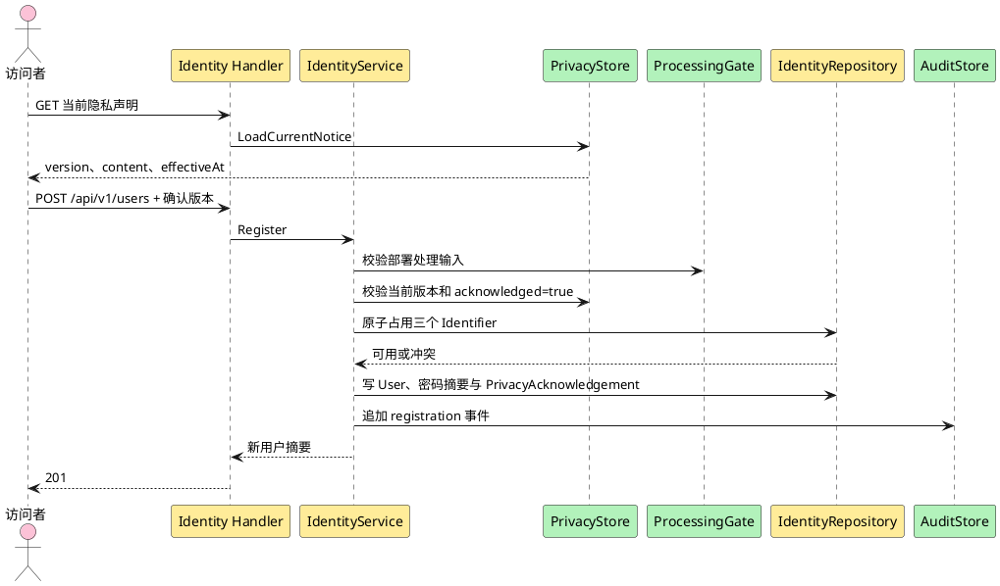

**说明**：注册前先展示当前声明。确认版本、User、三个标识、PrivacyAcknowledgement 与成功审计在同一事务提交；未确认、版本过期、部署处理输入缺失或任一写入失败都不留下账号。

##### 类/组件设计

`RegisterUser` 负责归一化、密码策略、ProcessingGate、当前声明版本和事务协调。`PrivacyNotice` 是发布声明版本的权威对象，`PrivacyAcknowledgement` 是主体确认事实。`IdentityIdentifier` 是唯一性真相源。普通注册 User 初始为 `role=member`、`status=active`、`credential_mode=permanent`，并在同一事务把 `onboarding_completed_at` 记为注册时间。

##### 接口设计

`GET /api/v1/privacy-notices/current` 无需认证，成功：

```json
{"version":"<opaque-version>","effective_at":"<rfc3339>","content":"<current notice>","content_hash":"<digest>"}
```

`POST /api/v1/users` 无需认证，但要求 ProcessingGate 已开放。

请求：

| 字段 | 类型 | 必填 | 校验 |
|---|---|---:|---|
| `username` | string | 是 | 去首尾空白后非空；禁止控制字符；格式和最大长度 TBD |
| `email` | string | 是 | 去空白、小写唯一键；须为可解析邮箱；最大长度 TBD |
| `phone` | string | 是 | 去空白后非空；不擅自改国家码；格式/长度 TBD |
| `password` | string | 是 | 至少 8 位且同时含字母和数字 |
| `privacy_notice_version` | string | 是 | 必须等于当前已发布版本 |
| `privacy_acknowledged` | boolean | 是 | 必须为 true |

成功 `201`：

```json
{"id":"<opaque>","username":"alice","role":"member","status":"active","must_change_password":false,"created_at":"2026-10-20T00:00:00Z"}
```

错误：`request.invalid_json`、`privacy.acknowledgement_required`、`privacy.notice_outdated`、`identity.validation_failed`、`identity.identifier_conflict`、`platform.processing_gate_closed`、`platform.database_unavailable`、`platform.internal_error`。普通注册的非快照错误可按其既有合同使用 `field_errors`；管理员创建的 `identity-administrator-create-response/v1` 是严格例外，其 `identity.identifier_conflict` 必须使用空数组且不得披露 username、email、phone 或任何冲突字段，不改变登录统一失败。

##### 数据结构设计

事务新增 `users`、三条 `identity_identifiers`、一条 `privacy_acknowledgements` 和一条成功审计事件。Acknowledgement 保存 `user_id,notice_version,acknowledged_at,source_kind,source_fingerprint`，不保存多余 PII。失败审计不得保存完整邮箱、手机号或密码。

#### 3.3.3 Story：设置注册密码（US-IDENTITY-01.2）

##### 实现设计

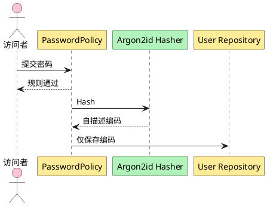

**说明**：密码策略先于昂贵哈希，减少无效输入的资源消耗。Argon2id 编码包含算法版本、实际参数、盐和摘要；明文在请求结束前从可控变量中释放，不进入持久化和可观测数据。

##### 类/组件设计

`PasswordPolicy` 只表达已确认业务规则；`CredentialHasher` 表达算法变化。验证成功发现旧参数时可返回 `needs_rehash`，由成功认证事务升级编码，不降低参数。

##### 接口设计

复用 `POST /api/v1/users` 的 `password` 字段。字段错误统一 `identity.validation_failed`，`field_errors.code` 可取 `password_too_short`、`password_requires_letter`、`password_requires_digit`。响应永不回显密码或摘要。

##### 数据结构设计

`users.permanent_password_digest` 保存 Argon2id 自描述字符串。盐由密码学安全随机源逐条生成。内存、迭代、并行、salt 和 key 长度均由显式配置注入且无代码默认；`64MiB/t=3/p=4/salt=16 bytes/key=32 bytes` 只是目标环境 benchmark 的候选起点，不是自动批准的生产基线。parser 可执行包络、profile ID、进程并发 Gate 与交叉约束以 §3.3.1 生产配置表为准。配置缺失、越界或关系非法时服务在任何外部副作用前 fail closed；S3.2 可交付应用侧 Gate，但目标环境 profile 报告、内存/延迟预算与采用记录未通过部署/E2E Gate 前不得声明 production readiness。

#### 3.3.4 Story：登录社区（US-IDENTITY-02.1）

##### 实现设计

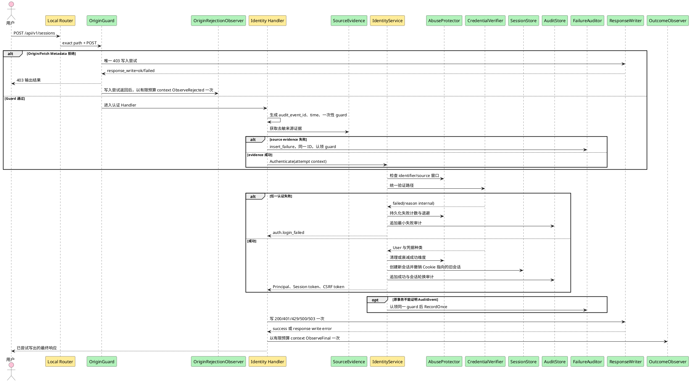

**说明**：TraceMiddleware 先建立 trace，局部 router 只把 exact `POST /api/v1/sessions` 交给本图；未知 path 与错误 method 已在图外分别终止为 JSON 404/405，不进入 OriginGuard。不可信 Origin/Fetch Metadata 由 Handler 外层 OriginGuard 在凭据校验前拒绝，因此不进入登录 attempts；Guard 的写后 platform observer/WARN/安全计数现已存在并由 production composition 装配。两类 observer 都使用请求 context 派生的有限预算 context，取请求 deadline 与 production composition 预算的较早者；取消/超时后一次失败返回并释放资源。现役 production factory 已构造登录 Handler；本轮缺口是把三条 S5.2 管理员路由及其真实依赖接入同一 root，不能为此回退登录链。进入登录 Handler 的事件 ID 必须先于来源证据生成。来源证据失败由 Handler 使用同一 ID 认领一次性 guard；evidence 成功并进入 Service 后，独立审计调用责任才转给 Service。用户名不存在、密码错误、账号停用、账号删除、临时凭据过期/失效、账号维度退避，以及目标用户存在 unresolved password-reset operation，都映射成统一登录失败。登录在验证任何永久/临时密码并创建 Session 前，必须按统一锁顺序检查 operation Gate；查询失败、未知状态或关联不一致同样 fail closed，不得用幂等 succeeded 快照绕过 Gate。未知事务只读核对原准备事件，不能补写；已证明原事务未提交时才允许插入失败事件。Handler 对最终 envelope 只做一次写入尝试，随后才调用 observer；写失败后不再尝试改写错误响应。已有会话再次登录成功时新建会话并撤销旧会话；失败时旧会话保持。

##### 类/组件设计

`CredentialVerifier` 首先锁定并检查目标用户的 password-reset operation Gate，再读取 `recovery_required` 与 `users.credential_mode`；任一 unresolved operation，或 Gate 查询不可用/未知/非法，均统一登录失败且不读取任何凭据、不创建 Session。非初始账号 `recovery_required=true` 时同样统一登录失败。`ConfiguredLoginRecoveryMode` 不承担普通流量维护门禁，只允许在 Service 已证明 `IsInitialAdmin && RecoveryRequired && CredentialModeRecoveryBootstrap` 后调用。非 `recovery_bootstrap` 路径调用数必须为 0，并按各自 credential 状态机处理。全局恢复维护期普通流量 503 由既有独立 RecoveryGate/readiness（S4.x）负责；该 Gate、password-reset operation Gate 与 `HAN_RECOVERY_MODE`/`ConfiguredLoginRecoveryMode` 是三个不同 owner。随后只按 `users.credential_mode` 选择一种凭据路径：

1. `permanent`：只验证 `permanent_password_digest`。
2. `bootstrap`：仅初始 admin，验证 bootstrap 永久摘要，成功会话记录 `authenticated_credential_kind=bootstrap`。
3. `temporary`：读取最新未 consumed、未 superseded 的 TemporaryCredential；无论其为 active、expired 或 recovery_invalidated，都绝不回退永久密码。只有 active 且未过期的最新行可以成功，会话记录该 credential ID。
4. `recovery_locked`：永不接受登录。
5. `recovery_bootstrap`：唯一可编码不变量为 `IsInitialAdmin && RecoveryRequired && CredentialModeRecoveryBootstrap && RecoveryMode==maintenance`。Service 必须先检查前三项；仅前三项都成立时才调用 `RecoveryBootstrapAllowed` 恰好一次，且只有 adapter 明确返回 maintenance/true 才能验证 recovery secret 摘要并创建只允许改密的受限会话。

Recovery-bootstrap 状态矩阵固定如下；“任意”包括 normal/maintenance，除最后三行外 Service 均不得调用 RecoveryMode adapter：

| IsInitialAdmin | RecoveryRequired | CredentialMode | RecoveryMode | adapter 调用数 | 结果 |
|---:|---:|---|---|---:|---|
| false | 任意 | `recovery_bootstrap` | 任意 | 0 | 统一登录失败；不读 recovery credential |
| true | false | `recovery_bootstrap` | 任意 | 0 | 统一登录失败；这是现役 `RecoveryRequired=false` 漏洞的回归边界 |
| true | true | 非 `recovery_bootstrap` | 任意 | 0 | 不开放 recovery-bootstrap；按该 mode 自身状态机处理 |
| true | true | `recovery_bootstrap` | `normal` | 1 | fail closed；不验证 recovery credential |
| true | true | `recovery_bootstrap` | `maintenance` | 1 | 才允许进入 recovery credential 验证 |
| true | true | `recovery_bootstrap` | adapter error/unknown | 1 | 内部失败并 fail closed |

当前最小修复只收紧 `login.go`/Service 不变量和测试，不修改 schema 或 migration；数据库现有 `is_initial_admin`、`recovery_required`、`credential_mode` 已足以表达该合取。

账号不存在仍执行等价成本伪摘要验证。`LoginAbuseProtector` 使用登录标识摘要、可信来源摘要及组合维度，不把计数写进 User 状态。

**内部故障阶段、状态与证据**

Service 返回的内部分类只描述稳定阶段和状态后果，不携带敏感输入。Handler-owned coordinator 先建立 `LoginAttemptContext`，再把前置或 Service 分类与最终公共 code 合成一次 `LoginObservation`：

| 失败位置 | primary `failure_stage` / `reason_bucket` | 已提交状态 | DB AuditEvent | 非 DB 证据 |
|---|---|---|---|---|
| audit event ID 生成失败 | `request_context` / `request_context` | 无事务、无变化 | 无 ID，无法安全调用审计入口；`audit_persisted=unknown` | Handler 发出一次内部故障事件；生产 ID 生成器缺失属于装配失败 |
| 可信来源证据取得失败 | `source_evidence` / `request_context` | 无事务、无变化 | Handler 以预生成 ID调用 `insert_failure` 一次；成功/冲突全等为 yes，已确认未提交为 no，其余 unknown | Handler 发出一次内部故障事件；事件不得含敏感 source 原值 |
| 事务 Begin、bucket/user/temporary credential 查询或写入失败 | 对应 stage / `persistence` | Begin 失败为 none；已开事务且 rollback 成功为 rolled_back；rollback 不可证明为 unknown | 按 §3.3.1 受控独立入口后为 yes/no/unknown | 即使数据库不可用仍由 Handler 发出一次事件 |
| Argon2 Verify/Hash 或 fake credential 验证异常 | `credential_verify` 或 `credential_rehash` / `credential_processing` | rollback 成功则无提交；否则 unknown | rollback 后按受控独立入口结果为 yes/no/unknown | 一次事件；不得记录密码、probe 或 digest |
| RecoveryMode 检查异常 | `recovery_mode` / `persistence` 或 `unknown` | rollback 成功则无提交；否则 unknown | rollback 后按受控独立入口结果为 yes/no/unknown | 一次事件 |
| SessionIssuer 失败或签发值不满足 Cookie 合同 | `session_issue` / `session` | rollback 成功则无提交；否则 unknown | rollback 后按受控独立入口结果为 yes/no/unknown | 一次事件；不得记录 token |
| SessionStore Create/Rotate 失败 | `session_persist` / `session` 或 `persistence` | rollback 成功则旧会话保持且新会话未提交；否则 unknown | rollback 后按受控独立入口结果为 yes/no/unknown | 一次事件 |
| 原事务 Audit Append 前已失败且 rollback 不可证明 | 对应 Append 前 stage / 对应 bucket | unknown | 无 prepared event；不得调用 `verify_prepared`、不得查询或 INSERT，固定 unknown | 一次非 DB 事件兜底 |
| 原事务 Audit Append 已尝试后失败 | `audit_append` / `audit` | rollback 已确认则 rolled_back；否则 unknown | rollback 已确认可走 `insert_failure`；rollback unknown 仅可对实际 Append 事件执行 `verify_prepared`；两者依矩阵为 yes/no/unknown | `no/unknown` 时非 DB 事件兜底，且不得递归审计 sink 失败 |
| 独立失败审计入口失败 | `failure_audit` / `audit` | 沿用 primary 业务事务状态 | 原事务确定未提交且独立 rollback 已确认可为 no；其余 unknown | 一次事件是唯一兜底；请求内不重试审计 |
| Commit 返回失败 | `transaction_commit` / `persistence` | 提交结果不可证明，`state_changed=unknown` | `verify_prepared` 只读完整核对：实际已提交且全等为 yes；未读到/查询不可判定/字段不一致均为 unknown；禁止 INSERT、改写 outcome 或声称 no | 一次事件，禁止声称已回滚或已提交 |
| Commit 成功后 Cookie 输出失败 | `cookie_output` / `response` | 新 Session 已创建或轮换，旧 Session 可能已撤销，`state_changed=session_committed` | yes | 一次事件；公开仍为既有 `500 platform.internal_error` |
| 任一公共响应 body/header 写失败 | `response_write` / `response` | 沿用写入前状态；成功事务固定 `state_changed=session_committed` | 成功事务固定 yes；其他路径沿用已证明值 | 写失败后 observer 才执行；不得二次写响应 |

正常认证失败、账号维度退避和来源限流不是内部故障：它们继续按既有 `401/429`、最小审计和指标处理，不发出 `identity.login.internal_failure`。成功登录的 AuditEvent 与 Session 在同一事务提交；observer 只记录聚合指标，不为每次成功写 INFO 日志。

##### 接口设计

`POST /api/v1/sessions`，请求：

| 字段 | 类型 | 必填 | 校验 |
|---|---|---:|---|
| `username` | string | 是 | 与注册相同归一化 |
| `password` | string | 是 | 非空；不在公共错误中区分规则 |

请求 Header 必须包含与 canonical origin 精确匹配的 `Origin`；浏览器发送 Fetch Metadata 时 `Sec-Fetch-Site` 必须为 `same-origin`。服务默认不返回 credentialed CORS Header。

成功 `200`，设置 A1 Cookie：

```json
{
  "user":{"id":"<opaque>","username":"alice","role":"member","status":"active","must_change_password":false},
  "csrf_token":"<opaque>"
}
```

凭据/账号/临时状态失败始终 `401 auth.login_failed`。来源或全局容量保护可返回 `429 request.rate_limited`，但不得携带账号存在性信号。Origin/Fetch Metadata 失败为 `403 auth.origin_rejected`。成功和认证失败/限流都审计；失败审计 actor_kind 为 anonymous，目标账号 ID 可空。`audit_event_id` 在任何来源证据读取前生成并贯穿 Handler/Service；敏感 source 原值不得进入 AuditEvent。内部失败按 §3.3.1 的原事务+受控独立入口矩阵审计，普通日志不得替代 AuditEvent。

Handler 进入条件是 TraceMiddleware 已建立可信 trace 且 OriginGuard 已通过；invalid JSON `400 request.invalid_json` 仍属于一次 `login_attempts`。OriginGuard 直接返回的 `403 auth.origin_rejected` 不属于认证 Handler 尝试；现役 platform-owned `OriginRejectionObserver` 已在唯一 403 写入尝试返回后补齐 WARN/计数，且不复用 identity attempts。内部 observer 的运行失败或 timeout 不得改变上述接口，也不得把原 `400/401/429/500/503` 改为另一 code。production factory 缺少登录 attempt coordinator/failure auditor/outcome observer/base logger/login metrics/正数有限调用预算，或缺少 Session issuer、可信 source provider、RecoveryMode、Argon2id、abuse policy、Session/CSRF policy，或 OriginGuard 缺 rejection observer/base logger/security metrics/正数有限调用预算，或任一 adapter 不遵从 context 时，属于确定性装配错误：服务必须在注册受影响路由前 fail closed；请求运行期间已装配 observer 的 sink/recorder 失败或超时则 fail open，保持原响应和状态结果，因为把可观测依赖故障变成新的认证行为会破坏 ADR-0014 稳定合同，并可能在 Commit/Cookie/response-write 边界制造更大的状态歧义。

##### 数据结构设计

`sessions` 新增内部 ID、`token_digest`、`csrf_token_digest`、`user_id`、`authenticated_credential_kind`、`authenticated_credential_id`、`issued_at`、`last_seen_at`、`absolute_expires_at`、`idle_expires_at`、`rotated_from_id`。`login_attempt_buckets` 以 kind+digest 表达三类桶，保存窗口、计数和退避截止时间。生产数值不在代码中默认：会话 TTL 与 abuse window/threshold/block/action/decay 均由 §3.3.1 的必填配置提供。

#### 3.3.5 Story：建立初始管理员账号（US-IDENTITY-03.1）

r50 的 normal 首装/重启先按 §4.2 正向准入，再进入本 Story 的 EnsureInitialAdmin；只有空库不能触发 bootstrap。恢复信任根沿本节原业务合同，经同一 Runtime 的 recovery_identity 阶段显式调用；不把维护阶段登录许可等同 PublicReady。

##### 实现设计

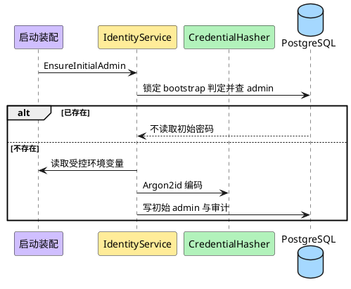

**说明**：唯一约束与事务锁处理重复启动。账号一旦存在，后续启动不得读取、比较或覆盖环境变量密码，也不得以启动事件触发密码轮换。初始管理员首次 bootstrap 或恢复初始化后的首次登录均进入既有强制改密 Gate。

##### 类/组件设计

`InitialAdminTrustManager` 隔离两个入口：bootstrap 仅首次建库；recovery 仅在维护模式为既有初始 admin 重建信任根。`AuthorizationPolicy` 对 `is_initial_admin=true` 的停用、删除、撤权和他人重置一律拒绝。bootstrap 与 recovery secret 使用不同配置键、不同门禁和不同审计事件，不允许复用。

##### 接口设计

没有公共创建 endpoint。运行配置默认名：

| 配置 | 语义 |
|---|---|
| `HAN_INITIAL_ADMIN_PASSWORD` | 仅首次不存在 `admin` 时读取；具体值禁止日志 |
| `HAN_INITIAL_ADMIN_USERNAME` | 不提供覆盖，业务值固定为 `admin` |
| `HAN_RECOVERY_INITIAL_ADMIN_SECRET` | 仅 RecoveryGate 持有独占锁且存在既有 initial admin 时读取；一次性使用、不进入普通启动 |

日常首次登录、恢复首次登录与后续正常自改密均复用 `POST /api/v1/sessions` 与 `PUT /api/v1/users/me/password`；改密规则统一为至少 8 位且同时含字母和数字。任何强制改密状态的有效账号均可调用改密入口；非强制状态只允许初始 admin，其他普通成员或管理员返回 `auth.forbidden`。首次/恢复初始化后的强制改密 Gate 保持不变；改密统一按当前 Session 记录的 credential kind/id 验证当前权威凭据，成功后撤销该用户其他会话并轮换当前会话，bootstrap/recovery bootstrap/temporary 凭据转为 permanent。恢复期间只允许维护网络访问且公共 readiness 关闭。recovery secret 缺失、错误、与 bootstrap 值复用或流程门禁不成立时返回内部恢复失败并保持停服。后续启动不覆盖或轮换既有密码；首期不设置周期性强制轮换或定期过期，也不引入密码历史或新复杂度要求。

##### 数据结构设计

首次建库新增 User、永久 username Identifier 和 bootstrap 审计事件；按 A6 不建立 email/phone Identifier。恢复终结先清空初始 admin 永久摘要并置 `recovery_locked`；受控 recovery secret 以 Argon2id 摘要写入后改为 `recovery_bootstrap`，首次改密后回到 permanent。数据库约束保证只有一个 initial admin。

#### 3.3.6 Story：创建其他管理员账号（US-IDENTITY-03.3）

##### 实现设计

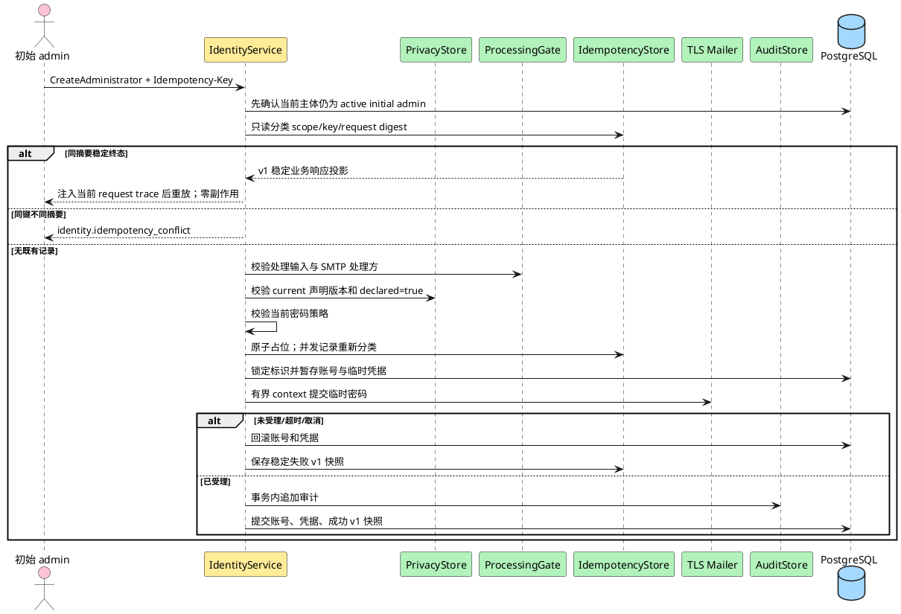

**说明**：HTTP 已完成严格 JSON、Session 与 CSRF 后，Coordinator 的首个业务判断必须重新读取当前主体，确认其仍为 active initial admin；不能仅信任 Session 创建时的旧角色/状态。授权失败时不得访问幂等历史。授权通过后，已有同作用域/同键/同摘要的 succeeded 或稳定 failed 是最高优先级的业务结果：直接返回 `identity-administrator-create-response/v1` 不可变稳定业务响应投影，不重新运行 ProcessingGate、current information notice/声明版本、密码策略，也不读取可变 User/TemporaryCredential。相同键不同摘要仍返回既有 `identity.idempotency_conflict`。`trace_id` 不属于该投影；Handler 对首次响应与重放都使用本次 request context 的 trace 构造 header/body，并保持日志关联一致。无记录时才执行动态前置条件；缺少当前声明、部署处理输入或强制 TLS 配置时不占用标识、不建幂等占位、不发邮件。SMTP 已受理但最终提交失败时返回不确定错误，邮件凭据不可用。

##### 类/组件设计

`CreateAdministrator` 复用注册的 Identifier 与 PasswordPolicy，但角色固定为 admin、`credential_mode=temporary`、`onboarding_completed_at=NULL`、`onboarding_privacy_acknowledged_version=NULL`。`AdministratorInformationDeclaration` 保存初始 admin、目标定位摘要、声明版本、时间和事务性用途；它不扩大操作者权限。Coordinator 接收 production composition 已校验的 SMTP operation budget。调用 `Mailer.Send` 前以请求 context 为 parent 派生 budget deadline；Go `context.WithTimeout`/等价实现必须保留 parent 的更早 deadline，Send 返回后立即 cancel。请求已取消、请求 deadline 先到或预算先到都映射既有 `identity.email_delivery_failed` 确定失败路径：回滚 pending User/Identifier/TemporaryCredential，保存不含 trace 的稳定失败快照，且不得留下可用账号、active 临时凭据或额外审计；不得启动后台 goroutine继续发送或在业务代码硬编码 `10s`。`AdministratorCreateResponseMaterializer` 在首次响应和重放中复用同一 strict snapshot decoder；失败 wire envelope 直接使用快照的稳定 `code/message/field_errors` 并注入当前 request trace，不通过当前 error registry 改写 message。

production 构造必须逐项满足现役 `AdministratorCreateDependencies`：`InformationNotices` 取 §3.3.1 四个声明配置构造的同一不可变 `StaticAdministratorInformationNoticeReader`，其中 `EffectiveAt` 已由 loader 证明为规范 UTC 整秒，构造器和 reader 不得截断、舍入或修正；`Gate` 取同一 `privacy.ProcessingGate`；`PasswordPolicy` 与 `PasswordHasher` 复用登录/改密链的现役 policy 和同一 process-wide gate-backed hasher；`Mailer` 取 §3.3.1 完整 SMTP 配置构造的真实 adapter；`Idempotency`、`DigestKeyring`、`IdempotencyLock`、`IdempotencyTTL` 分别取同一 PostgreSQL store、完整 current+retained keyring、`HAN_IDEMPOTENCY_LOCK_DURATION` 与 `HAN_IDEMPOTENCY_RECORD_TTL`；`SMTPOperationBudget` 取已校验的 `HAN_SMTP_OPERATION_BUDGET`；`Audit`、`IDs`、`Clock` 复用同 pool 的 audit adapter 与 prepared dependencies 的唯一实例。任一依赖缺失、为 nil、使用 fake/no-op、keyring 不闭合或 duration 关系非法时，`newProductionBusinessHandler` 返回 nil handler 和去敏错误，由 startup owner unwind；不得注册部分路由。`AdministratorPrivacyCoordinator` 同样必须复用现役 `CurrentNoticeReader`、同一 Session store/issuer、repository、audit、IDs 与 Clock，不得另建会话或时间/ID owner。

##### 接口设计

`GET /api/v1/admin/administrator-information-provision-notices/current` 仅初始 admin 可调用，返回：

```json
{"version":"notice-2026-10-24","effective_at":"2026-10-24T00:00:00Z","content":"<current statement>","content_hash":"<digest>"}
```

`effective_at` 固定由现役 Handler 对 reader 中的 UTC 整秒值执行 `UTC().Format(time.RFC3339)`；因此上述规范配置值逐字节保持。`2026-10-24T00:00:00.123Z` 等含小数秒输入必须在启动配置解析阶段拒绝，不能进入 reader；Handler 不承担截断或修正职责。

`POST /api/v1/admin/administrators` 要求有效初始 admin 会话、CSRF、`Idempotency-Key`。对首次执行，ProcessingGate 必须开放；对已授权主体的稳定终态重放，按上述优先级直接返回原快照，不重复动态 Gate。

请求：

```json
{"username":"ops","email":"ops@example.test","phone":"+10000000000","temporary_password":"<secret>","information_provision_notice_version":"<version>","information_provision_declared":true}
```

成功 `201`：

```json
{"id":"<opaque>","username":"ops","role":"admin","status":"active","must_change_password":true,"must_acknowledge_privacy":true,"temporary_credential_expires_at":"<rfc3339>","delivery_status":"accepted"}
```

成功 v1 canonical snapshot 固定为以下对象；外层只允许四个字段，成功 `body` 只允许所列八个字段：

```json
{
  "schema_version": "identity-administrator-create-response/v1",
  "http_status": 201,
  "result_code": "created",
  "body": {
    "id": "<opaque>",
    "username": "ops",
    "role": "admin",
    "status": "active",
    "must_change_password": true,
    "must_acknowledge_privacy": true,
    "temporary_credential_expires_at": "2026-10-23T10:00:00Z",
    "delivery_status": "accepted"
  }
}
```

identifier-conflict v1 canonical snapshot 固定为以下完整对象：

```json
{
  "schema_version": "identity-administrator-create-response/v1",
  "http_status": 409,
  "result_code": "identity.identifier_conflict",
  "body": {
    "code": "identity.identifier_conflict",
    "message": "身份标识已被使用",
    "field_errors": []
  }
}
```

该 variant 的 `field_errors` 只能且必须为空数组；非空数组、缺失、null、object/string 等类型漂移全部拒绝。它不得包含或暗示 username、email、phone 或其他冲突字段，因此不存在元素顺序问题。

email-delivery-failed v1 canonical snapshot 固定为以下完整对象：

```json
{
  "schema_version": "identity-administrator-create-response/v1",
  "http_status": 503,
  "result_code": "identity.email_delivery_failed",
  "body": {
    "code": "identity.email_delivery_failed",
    "message": "邮件暂未受理",
    "field_errors": []
  }
}
```

当前 v1 稳定失败 allowlist 只有 `409 / identity.identifier_conflict / 身份标识已被使用 / field_errors=[]` 与 `503 / identity.email_delivery_failed / 邮件暂未受理 / field_errors=[]`。失败快照必须满足 `result_code == body.code`，且 `http_status/code/message/field_errors` 精确匹配对应 canonical fixture；任何 extra/missing/null/type drift、未知 code/message/status 组合、非空 `field_errors` 或 `trace_id` 都拒绝。首次失败和重放 wire envelope 均在该稳定 body 基础上增加本次请求的 `trace_id`，并让 `X-Trace-ID`、context 与日志使用同一值。

声明缺失或 false 使用 `privacy.information_declaration_required`；版本过期使用 `privacy.notice_outdated`。其他错误包括 `auth.forbidden`、`identity.idempotency_key_required`、`identity.idempotency_conflict`、`platform.processing_gate_closed`、`identity.email_delivery_failed`、`identity.operation_uncertain`。错误优先级固定为：当前 active initial-admin 授权 → 已有幂等记录的摘要冲突/稳定重放/processing/uncertain 分类 → 仅首次执行的 ProcessingGate → current notice/声明 → PasswordPolicy → 首次占位与后续业务。邮件 command 的 purpose 固定为 `new_administrator_credential`，Mailer 拒绝表外用途。

新管理员首次登录后可调用：

`POST /api/v1/users/me/privacy-acknowledgements`

```json
{"privacy_notice_version":"<current-version>","acknowledged":true}
```

成功 `200` 追加 Acknowledgement，并把 `onboarding_privacy_acknowledged_version` 更新为当时 current 版本，返回更新后的 `user`、`csrf_token` 并轮换 Session。若改密 Gate 尚未完成，账号仍处于 onboarding 限制。最终开放事务必须再次锁定 current PrivacyNotice：仅当 `credential_mode=permanent` 且 acknowledged version 等于 current version 时写 `onboarding_completed_at`；若两 Gate 之间声明换版，账号继续受限并要求确认新版本。

##### 数据结构设计

在成功业务事务中新增 User、三条 Identifier、TemporaryCredential、AdministratorInformationDeclaration、AuditEvent，并把 IdempotencyRecord 更新为 succeeded，同时持久化首次 `201` 的 `identity-administrator-create-response/v1` 稳定业务快照。稳定 failed 也必须保存同版本且不含 trace 的失败快照。后续重放只能使用该快照；即使新管理员已改密、已确认隐私、被停用或 notice/Gate/PasswordPolicy 已变化，HTTP status 与稳定业务字段仍与首次响应相同，只有每次请求的 trace 元数据按当前 context 重新物化。新管理员后续可按任意顺序完成改密与 `POST /users/me/privacy-acknowledgements`；Gate 状态由 credential_mode 与当前 PrivacyAcknowledgement 共同派生。

#### 3.3.7 Story：管理其他管理员账号（US-IDENTITY-03.4）

##### 实现设计

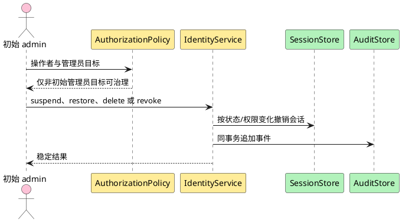

**说明**：初始 admin 保护在统一 Policy 中执行，不依赖路由名称。撤权把其他管理员角色改为 member；停用、删除或撤权后旧会话不得继续持有旧权限。

##### 类/组件设计

`GovernAdministrator` 支持目标状态动作和不可恢复删除。`revoke` 是角色转换 `admin → member`，不是删除账号。权限或强制改密上下文变化通过撤销全部目标会话实现；目标下次登录取得新 Principal。

##### 接口设计

| 方法与路径 | 结果 | 幂等 |
|---|---|---|
| `GET /api/v1/admin/administrators` | 管理员摘要分页 | 只读 |
| `GET /api/v1/admin/administrators/{id}` | 管理员详情 | 只读 |
| `POST .../{id}/suspend` | `200 {user,changed}` | 目标状态幂等 |
| `POST .../{id}/restore` | `200 {user,changed}` | 目标状态幂等 |
| `POST .../{id}/revoke` | `200 {user}` | 重复撤权返回 `identity.invalid_state` |
| `DELETE .../{id}` | `204` | 重复删除按 404 |

全部只允许初始 admin，写请求要求 CSRF。初始 admin 作为目标时只返回 `identity.initial_admin_protected`；其他越权返回 `auth.forbidden`，不得为同一原因并列两个公共 code。

##### 数据结构设计

修改 `users.role/status`，按需要删除 Sessions，追加 AuditEvent。删除管理员也进入与普通用户相同的墓碑和标识生命周期，但只能由初始 admin 发起；如其拥有文章，复用 §3.3.10 的删除协作事务。

#### 3.3.8 Story：查看用户（US-IDENTITY-03.5）

##### 实现设计

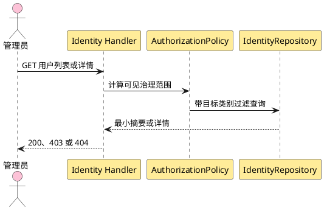

**说明**：普通管理员的查询从数据库层限定为普通用户且排除自己；初始 admin 可查询其他管理员。密码摘要、临时凭据、Session、删除保留字段和审计 metadata 不在返回模型。

##### 类/组件设计

`UserGovernanceView` 分为 Summary 与 Detail，避免列表过度披露。查询 Policy 与写入 Policy 使用同一目标资格规则，防止“能看不能管”范围漂移。

##### 接口设计

普通用户：

- `GET /api/v1/admin/users?cursor=<opaque>&limit=<integer>`
- `GET /api/v1/admin/users/{id}`

管理员目标：

- `GET /api/v1/admin/administrators?cursor=<opaque>&limit=<integer>`
- `GET /api/v1/admin/administrators/{id}`

列表成功 envelope 固定为：

```json
{
  "items":[
    {"id":"<opaque>","username":"alice","role":"member","status":"active","is_initial_admin":false,"must_change_password":false,"must_acknowledge_privacy":false,"created_at":"<rfc3339>"}
  ],
  "next_cursor":"<opaque-or-null>",
  "has_more":true
}
```

分页合同：

1. 排序固定为 `created_at DESC, id DESC`；同时间戳由 ID 严格排序。
2. 游标是版本化、经 HMAC 认证的 base64url 不透明值，包含版本、最后一项的 `created_at/id`、目标类别、操作者可见范围和请求过滤摘要。
3. 继续页必须使用与游标相同的 endpoint、过滤、角色范围和 limit；不匹配、解码失败、签名失败或未知版本返回 `400 request.invalid_cursor`。
4. `limit` 省略时使用部署配置默认值，超过配置上限时按上限裁剪；默认值和上限数值保持 TBD。`limit<=0` 返回 `identity.validation_failed`。
5. 最后一页和空列表都返回 `next_cursor:null`、`has_more:false`；字段始终存在，不省略。
6. 新插入且排序位于当前游标之前的用户不会出现在后续页；keyset 分页不承诺跨请求快照。

Summary 字段始终存在，布尔值不省略。Detail 额外返回 `email`,`phone`,`updated_at`；初始 admin 或无对应当前值时 `email`、`phone` 明确为 `null`，而不是省略。删除墓碑不通过公共治理接口列出。

##### 数据结构设计

使用 `(role,status,created_at,id)` 和 `(created_at,id)` 索引支持过滤分页。纯读不写 AuditEvent；越权探测可写安全日志，但不得把每次正常读取膨胀成审计事件。

#### 3.3.9 Story：停用与恢复用户（US-IDENTITY-03.6）

##### 实现设计

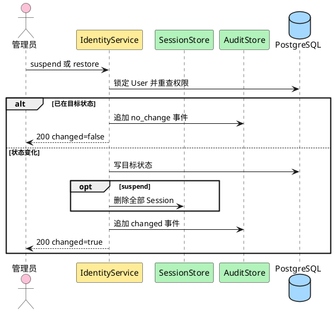

**说明**：目标状态幂等不等于跳过权限检查。停用与会话撤销、审计处于同一事务；文章表不改写，article-management 下一次读取作者状态后派生隐藏。

##### 类/组件设计

`SetAccountStatus` 只允许 `active ↔ suspended`；`deleted` 是终态。普通管理员只能作用于其他普通用户，初始 admin 才能作用于其他管理员；任何管理员都不能用普通用户接口治理自己。

##### 接口设计

- `POST /api/v1/admin/users/{id}/suspend`
- `POST /api/v1/admin/users/{id}/restore`
- 管理员目标对应 `/api/v1/admin/administrators/{id}/...`

无请求体；要求 Cookie、CSRF。成功 `200`：

```json
{"user":{"id":"<opaque>","status":"suspended"},"changed":true}
```

错误：`auth.forbidden`、`identity.user_not_found`、`identity.invalid_state`、`platform.internal_error`。不要求 `Idempotency-Key`。

##### 数据结构设计

事务更新 `users.status/updated_at`、删除 Sessions（停用）并追加 AuditEvent。User 行使用 `FOR UPDATE` 避免停用、恢复、删除并发覆盖。

#### 3.3.10 Story：删除用户（US-IDENTITY-03.7）

##### 实现设计

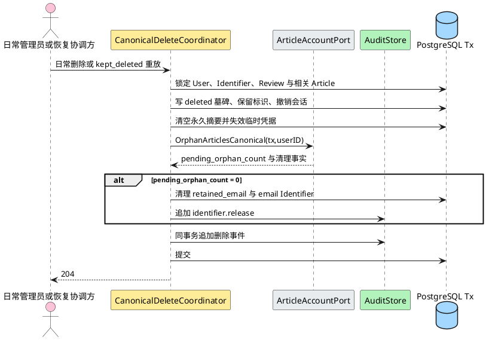

**说明**：日常删除与恢复 `kept_deleted` 使用同一协调器和同一跨模块事务。重放是幂等的：已经满足某项删除不变量时保持原值；缺失项必须补齐。任一身份、标识、文章、通知邮箱、review 或审计步骤失败都回滚并保持 recovery Gate/readiness=false。

r45 固定两类此前只有目标、没有可实施合同的约束，二者都必须在同一事务、任何身份/标识写入之前完成判定：

- **标识墓碑绑定不变量**（对应 Review R01 F001）：删除事务在锁定目标 User 后，必须同时锁定该 User 在 `identity_identifiers` 中的**全部**行（`SELECT ... WHERE user_id = $1 FOR UPDATE`，含零行情形），再按 User 的当前 `status` 分两条路径校验，两条路径都必须在**任何写入之前**完成判定。

  **路径 A：首次删除与正常 `kept_deleted` 重放（锁定 User 的 `status <> 'deleted'`，`email`/`phone` 仍可能非 NULL）**——`username` 行必须存在且 `normalized_value` 与 `users.username` 逐字节一致；`users.email` 非 NULL 时 `email` 行必须存在且逐字节一致；`users.phone` 非 NULL 时 `phone` 行必须存在且逐字节一致；出现「User 对应列为 NULL 但该 `kind` 行仍存在」的孤儿行即判漂移。任一不符即在任何写入前 fail closed 并整事务 rollback，禁止以“UPDATE 影响 0 行”继续。

  **路径 B：备份本身已为 `deleted`（锁定 User 已为 `status = 'deleted'`）**——按 ADR-0018，正常 `kept_deleted` 重放的恢复点来自删除发生**之前**的备份，账号在恢复库中仍为未删除状态，因此**路径 A 是正常重放路径**；路径 B 只在恢复点本身已记录 `deleted` 时适用。此时首次删除已把 `users.email`/`phone` 置 NULL，因此不能再用这两列与墓碑行比对值绑定，改用可核对事实：`username` 行必须存在、`reserved`、`released_at IS NULL` 且与 `users.username` 逐字节一致；`email` 行若存在，必须 `reserved`、`released_at IS NULL` 且与 `users.retained_email` 逐字节一致（`retained_email` 是首次删除写入的原邮箱地址）；`phone` 行若存在，必须 `reserved` 且 `released_at IS NULL`，以继续占用原手机号的唯一性。

  | kind | 必需条件 | 允许前置 lifecycle | 目标 lifecycle | `released_at` |
  |---|---|---|---|---|
  | `username` | `users.username` 恒非 NULL，故恒必需 | `active` 或 `reserved` | `reserved` | NULL |
  | `email` | 仅当锁定 User 的 `email` 非 NULL 时必需（`users.email` 可空） | `active` 或 `reserved` | `reserved` | NULL |
  | `phone` | 仅当锁定 User 的 `phone` 非 NULL 时必需（`users.phone` 可空） | `active` 或 `reserved` | `reserved` | NULL |

  lifecycle 按上表推进：允许的前置集合为 `active` 或 `reserved`（`released_at` 为 NULL），目标一律 `reserved`；前置落在集合之外（含 `released_at` 已非 NULL 的已释放行）即视为漂移并 fail closed。两条路径都只固定「必需行存在、可核对值一致、lifecycle 可安全前进」：`email` 行在零待处置文章时按第 5 步**同事务删除**（释放复用），该删除发生在本次校验之后，不违反本不变量；`username` 与 `phone` 行在本设计范围内**不存在删除路径**。

  **残余限制（须由独立 Design Review 裁定）**：仅在恢复点本身已记录 `deleted` 时才会进入的路径 B 只能证明 `phone` 墓碑**存在且未被释放**，无法证明其 `normalized_value` 与被删账号原手机号一致——首次删除已把 `users.phone` 置 NULL，而当前 schema（`migrations/0002_identity.sql`）没有类似 `retained_email` 的「保留手机号」列可供比对。因此路径 B 对 `phone` 只能 fail-closed 地要求「行存在 + `reserved` + `released_at IS NULL`」，不能完成值级绑定校验。若评审认为该缺口不可接受，最小候选修复为新增 retained phone 列（属 migration 变更，超出本卡写集，须单独授权），或把 `CanonicalDeleteRecoveryKept` 收敛为只允许在账号尚未删除时执行、重放路径交由独立对账机制处理。本卡不擅自选择，保持现状并如实记录。
- **phone 墓碑保守取值**（对应 Q2 未决）：在 phone 清理条件（Q2）未获确认期间，phone 的保留策略固定为**永久 `reserved` 墓碑**——删除事务把 phone Identifier 置为 `reserved` 且 `released_at` 保持 NULL，且**不提供**清除 phone 墓碑的路径；`users.phone` 置 NULL 只表示该列不再是当前联系值，不解除 `identity_identifiers(kind='phone')` 的唯一性占用。该取值与「手机号在保留数据存续期间阻止复用」一致，属可逆的保守默认；Q2 确认后才由后续设计增量引入释放条件。

##### 类/组件设计

`CanonicalDeleteCoordinator` 接收 mode=`daily_governance/recovery_kept_deleted`。日常模式执行现有权限检查；恢复模式要求维护锁、RecoveryRun、RecoveryAccountReview decision 和 initial admin 恢复身份。两种模式都执行：

1. 写不可恢复 User 墓碑和 deleted_at，永久保留 username Identifier；
2. 把活动邮箱复制到 retained_email（已有相同 retained 值则不重复），清空公开 email/phone；**在清空之前**按上文「标识墓碑绑定不变量」完成全行加锁与逐 `kind` 校验，随后按既有生命周期保留 Identifier（username/email/phone 均置 `reserved`，phone 按 Q2 保守取值永久保留）；
3. 删除全部 Session、清空永久密码摘要、把 TemporaryCredential 全部置为失效；
4. 调用 article-owned `OrphanArticlesCanonical`：`author_id=NULL`、`publication_state=held`、`orphaned_from_user_id=user_id`，`violation_state` 原值不变；
5. 零待处置文章时同事务清理 retained_email/email Identifier；有文章时保留到最后处置事实；
6. 追加 canonical delete、article orphan 和必要 identifier.release AuditEvent；恢复模式同事务把 RecoveryAccountReview 写为 kept_deleted completed。

**trace 单一权威**（对应 Review R01 F003）：`context.Context` 是 canonical 删除 trace 的唯一权威来源。Handler 仍可从 ctx 取出 trace 用于请求侧关联，但 `CanonicalDeleteRequest.TraceID` 若保留，只能作为**一致性断言**使用：协调器必须在任何写入前校验 `request.TraceID` 与 `platform.TraceIDFromContext(ctx)` 完全一致，缺失或不一致即 fail closed；且同一个 `ctx` 必须原样传递给 `ArticleAccountPort.OrphanArticlesCanonical`，使 identity 与 article 在同事务写入的 AuditEvent 共享同一 `trace_id`。不允许出现 identity 用一个 trace、article 用另一个 trace 的分裂，也不允许绕过 ctx 只信显式字段。

  具体失败时点与归属：`platform.TraceIDFromContext(ctx)` 返回 `ok=false`，或返回的 trace 为空或非规范值时，协调器必须立即 fail closed，**不得**回落到 `request.TraceID`、`audit_event_id`、随机值或空字符串，也不得在缺失 trace 的情况下继续发起 article 协作；反之若 ctx 有合法 trace 而 `request.TraceID` 为空或不一致，同样 fail closed。Handler 现有的「从 ctx 读 trace 并在缺失时返回内部错误」行为（`internal/identity/handler.go:1137-1144`）继续保留，但**不构成**协调器侧的充分保护——协调器必须独立完成同一校验，因为 `recovery_kept_deleted` 的受控 consumer 可能不经 HTTP 入口调用。

**恢复授权能力**（对应 Review R01 F002，详见 §4.2 新增 3.1 步）：`recovery_kept_deleted` 不得仅凭请求中的 `RecoveryRunID` 或一条孤立 `RecoveryAccountReview` 行获得授权。该模式必须由受控 recovery consumer 持有的 transaction-scoped 授权能力驱动，能力本身不可由 HTTP 入口或普通内部调用构造；能力有效性必须同时经**同一 identity-owned `RecoveryRunStore`** 的权威状态证明与 maintenance/readiness Gate 的当前状态证明，二者缺一即 fail closed。任何情况下都不新增第二个 RecoveryRun authority、第二个 Gate、包级 global 或可由调用方伪造的 capability。

**事务编排长度**（对应 Review R01 F004）：`canonicalDeleteInTransaction` 必须满足 go-service 的 50 行上限，按「身份墓碑与标识阶段」「article/retained_email 阶段」「审计与 review 终结阶段」做**行为保持**的局部提取；单一事务 owner、调用顺序、错误映射与 rollback 语义均不得改变，也不得因此引入第二 authority。

##### 接口设计

- `DELETE /api/v1/admin/users/{id}`
- `DELETE /api/v1/admin/administrators/{id}`（仅初始 admin）

要求 Cookie、CSRF；成功 `204`。可选 Header `X-Account-Deletion-Reason` 只允许 `governance` 或 `privacy_withdrawal`，省略视为 governance；该值只进入审计 metadata，不改变权限、目标资格、事务或删除后果。运营撤回请求必须由具备既有删除权限的管理员调用同一 API，首期无自助入口。

内部端口：

| 调用 | 输入 | 输出/保证 |
|---|---|---|
| `ArticleAccountPort.OrphanArticlesCanonical` | tx、deleted user ID、mode | 幂等置空作者、写 `held` 和来源关联、保留违规；返回计数与清理事实 |
| `IdentityLifecyclePort.ClearRetainedEmailIfEligible` | tx、deleted user ID、article 完成事实 | 清理专用邮箱和 email Identifier；追加审计 |

恢复 `kept_deleted` 矩阵：

| 恢复点场景 | canonical 删除结果 | retained_email | Audit/开放条件 |
|---|---|---|---|
| 有普通文章 | 全部 `author_id=NULL`、`held`、`orphaned_from=user` | 保留到文章全部处置 | 身份/文章/审计同事务成功后 review 完成 |
| 零现存文章 | 无 Article 写入，pending=0 | 同事务清理并释放 email Identifier | delete + identifier.release 审计成功 |
| 含违规文章 | 同样无归属化和 `held`，`violation_state=violating` 保留 | 按待处置文章保留 | 普通用户不可见；不得把违规清除 |
| 已部分满足删除后果 | 缺失字段幂等补齐，不覆盖已有相同来源/违规事实 | 按最终 pending 计数 | 任一冲突或无法证明来源时停服待核 |

##### 数据结构设计

User 保留 `id,username,status=deleted,is_initial_admin,deleted_at` 和必要墓碑字段；username Identifier 永久保留。恢复模式不能只写 User：RecoveryAccountReview、Identifier、Session、永久/临时凭据、article 协作、retained_email 和 AuditEvent 必须形成同一提交结论。phone Identifier 的清理条件仍为 Q2；r45 将 Q2 未决期间的取值固定为保守默认——phone 墓碑**永久 `reserved`、`released_at` 保持 NULL、不提供释放路径**，因此 `users.phone=NULL` 不解除唯一性占用。r45 同时要求删除前完成 `identity_identifiers` 全行加锁与逐 `kind` 存在性/kind 值/`normalized_value` 逐字节一致性/lifecycle 校验，且该校验必须先于任何写入执行。

#### 3.3.11 Story：重置用户密码（US-IDENTITY-03.10）

##### 实现设计

`PasswordResetOperation` 继续是 ADR-0023 方案 A 的唯一安全权威，并同时覆盖首次 reset 与普通用户 `password_reset` resend。`new_administrator` resend 继续使用 ADR-0011，不进入本状态机。r38 不改变公共 REST、错误码、权限或 requirements，只把 F006 的 purpose 分流、新 operation/execution generation、旧能力时点与恢复收敛纳入同一 durable 协议。

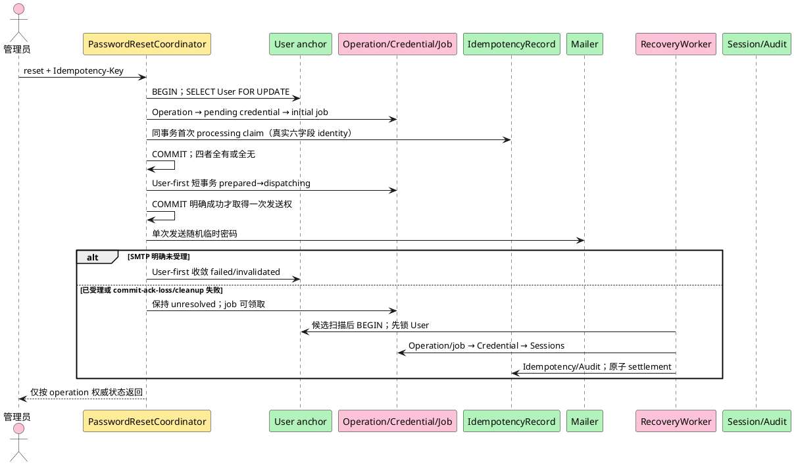

**安全与线性化不变量**：所有 password-reset create/claim/resend、Login、PasswordChange、Session resolve 与 S10.4 RecoveryWorker 自动路径都先锁 User（稳定 per-user anchor），随后统一为 `Operation/recovery job → old/new exact Credential → Sessions → Idempotency/Audit`。禁止任何路径先锁 Operation 再等 User。对从未 reset 的账号即使不存在 operation 行，User 行锁也阻止并发 reset/resend 插入越过 Gate；候选扫描、token/session 预读或 job 扫描只能提供定位提示，不能授权、持租约或替代事务内复核。未来 `identity-auth-S10.5` maintenance mode 必须沿用该不变量，但当前不存在 production 维护入口。

##### 首次 reset 与普通用户 resend 的四记录原子创建

新增 password-reset 专用事务端口 `PasswordResetAtomicRepository.BeginOrClassifyCandidate`；不得复用“先独立提交通用 Claim、再创建 operation”的调用形态。首次 reset 和普通用户 resend 的每个新候选都必须在一个数据库事务中：

1. 解析路由目标并锁目标 User；权限/目标资格失败时不创建任何记录。
2. 在 User 锁内先按真实 `(scope_hash,key_locator)` 分类同键记录。同键既有记录必须同时读取 operation 与 IdempotencyRecord，并核验六字段、User、request kind、predecessor/replaced credential、exact new credential、job 与 generation；只有完全一致才按该 operation 权威状态 replay。同键同摘要永不分配新 generation、生成新秘密或发送邮件；同键异摘要、异目标或异 purpose 冲突。存在 IdempotencyRecord 而缺 operation、反向缺失、字段漂移或跨 User 绑定均为完整性故障，目标 User 进入 integrity hold，禁止新建“补偿 operation”猜测历史。
3. 只有该 key 不存在、确需创建新业务候选时才检查 writer Gate。普通用户 resend 必须证明 `auth_integrity_hold=false`、不存在 unresolved operation，且存在 current `password_reset` TemporaryCredential 及其 terminal succeeded predecessor operation；否则返回既有 `identity.operation_uncertain` 或既有 invalid-state 映射，零 claim、零 operation、零 credential、零 job。历史同键 replay 不因后来 generation 已推进而改写原结果，但其自身绑定漂移或 integrity hold 仍 fail closed。
4. 新候选在 User 行内把 `users.password_reset_execution_generation` 从 N 单调推进到 N+1，并把 N+1 同时写入 operation 与 IdempotencyRecord `execution_generation`。首次 reset 的 `request_kind=initial_reset`；普通用户 resend 的 `request_kind=resend`，并绑定 `predecessor_operation_id` 与 `replaced_credential_id`。auth generation 此时不推进。
5. 新候选按统一子顺序插入 `PasswordResetOperation`、本次 exact `pending_delivery` TemporaryCredential、initial recovery job，最后插入该 key 的首次 `processing` IdempotencyRecord claim；利用 DEFERRABLE INITIALLY DEFERRED 复合 FK 在 commit 时整体核验。任一步失败连同 User execution counter 增量全部回滚，禁止只留下 claim、operation、credential、job 或 generation gap。
6. 新业务候选必须使用新 Idempotency-Key；同一 key 的普通 retry 只重放原 generation。上一个 operation 未终结、settlement 不一致或 User hold 时，即使换 key 也拒绝；只有 terminal settlement 已证明旧 generation 安全终结且 resend context 仍 current，才可建立下一 operation/execution generation。

四记录事务 commit 后，请求必须再以 User-first 短事务把本次 operation 从 `prepared` 条件转换为 `dispatching`，写入不可变 `delivery_attempt_id/delivery_attempted_at`；只有该转换明确提交成功的原请求才可调用 Mailer 一次。该转换 commit acknowledgement 丢失时不得发送，same-key replay 和 worker 也不得补发。initial job 的 `next_attempt_at` 晚于 SMTP operation 最迟结束时刻与显式安全余量。

SMTP 明确未受理时，Coordinator 按 User-first 锁序把本次 exact pending credential 失效、operation 终结为 `failed`、job 完成并写稳定失败；resend 的 predecessor/current old credential、User auth generation 与既有 Session 保持。SMTP 已受理时，请求以短事务持久写 `delivery_state=accepted` 并进入 `recovery_required`，再由请求或 worker执行 settlement；返回未知、结果记录 commit-ack-loss 或同步 cleanup 失败时保持 unresolved 并由 durable job 收敛。请求线程有限 cleanup 只可请求提前 `next_attempt_at`，不能承担安全证明或直接改终态。

##### Operation、job 与 capability settlement 状态机

`password_reset_operations` 除主键/User/credential/状态/时间外，持久保存：

| 字段组 | 合同 |
|---|---|
| 幂等 identity | `scope_hash,key_locator,key_digest,digest_key_version,request_digest,execution_generation`；六字段复合 FK 指向真实 IdempotencyRecord identity，`(scope_hash,key_locator)` 仍是同键定位键 |
| generation | `base_auth_generation,target_auth_generation`，target 必须等于 base+1；创建时核验 User 当前 generation=base |
| settlement | `settlement_state=pending/temporary_active/permanent_successor/invalidated/integrity_hold`、`settled_auth_generation`、`successor_auth_generation`、`settled_at`；状态与字段组合由 CHECK 封闭 |
| candidate lineage | `request_kind=initial_reset/resend`；resend 必须保存 terminal predecessor operation 与 replaced current credential，且 exact new credential 只能属于本 operation |
| delivery authority | `delivery_state=not_started/dispatching/accepted/rejected/unknown`、不可变 `delivery_attempt_id/delivery_attempted_at`、`delivery_result_recorded_at`；worker 不拥有 SMTP send |
| authority | `state=prepared/dispatching/commit_unknown/recovery_required/converging/succeeded/invalidated/failed`、低基数 `recovery_reason`、`created_at/updated_at/terminal_at` |

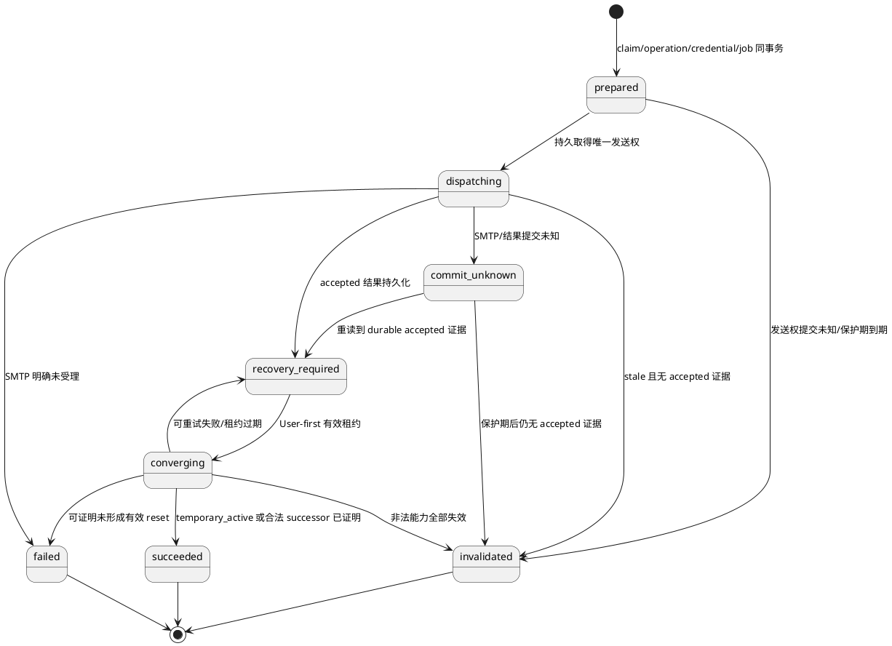

只有 `succeeded/invalidated/failed` 是 operation 终态；`dead_letter` 不是 operation 终态。operation 终态不可改成另一终态，但 settlement 可在同一 succeeded lineage 内从 `temporary_active` 单调推进到 `permanent_successor`；任何反向、跳代、跨 operation 或证据漂移都设置 User integrity hold，不通过篡改终态“修复”。

`password_reset_recovery_jobs` 为一对一 durable outbox：`ready/leased/retry_wait/succeeded/dead_letter`，包含 attempt、next attempt、lease owner/expiry、低基数 failure code 与完成时间。worker 候选查询可使用 `SKIP LOCKED` 找到 operation/user ID，但不得在扫描事务持有 job/operation 锁；真正领取在新事务中先锁 User，再锁 operation/job 并 CAS 写租约。单 operation 最多一个未过期租约；崩溃仅在租约过期后接管。job 只恢复数据库 settlement，永远不调用 Mailer；`prepared/dispatching` 到期但没有 durable accepted 证据时，只能 invalidated/failed 本次新候选。

##### auth generation、lineage、合法 successor 与 integrity hold

本节同时使用两种不得混同的权威：

| 权威 | 本质与 owner | 可证明事实 | 不得承担的职责 |
|---|---|---|---|
| **current capability root（当前能力根）** | identity User/credential/session 当前投影；由 `users.credential_mode/auth_generation`、当前 permanent source 或当前 temporary credential 及其 operation 共同拥有 | 此刻允许验证哪一种凭据、当前 generation 与当前 root lineage 是否自洽 | 不得作为全部历史 operation 的合法性索引；不得要求每个旧 succeeded operation 仍等于 current root |
| **immutable legal history（不可变合法历史）** | identity operation/credential 持久证据与 shared idempotency identity 共同拥有；不是单一 current 列 | 某次历史 reset 是否确实属于同一 User，并以合法 generation、delivery、exact credential、settlement 与幂等结果完成；resend 还证明 predecessor/replaced 关系 | 不得授权当前凭据；不得因后来 current root 合法替换而被改写、删除或降格为 drift |

- `users.auth_generation` 是认证能力单调版本；普通存量从 0 开始。`permanent_password_generation` 与永久摘要同生同灭，并记录可空的 current permanent root `permanent_password_source_operation_id/permanent_password_source_credential_id`。这两个 source 字段只描述当前永久能力，不是历史合法性外键。
- TemporaryCredential 保存 `auth_generation` 与 `source_operation_id`；password-reset exact credential 必须绑定 operation.target generation。Session 保存 `auth_generation,lineage_operation_id,lineage_credential_id`；`authenticated_credential_kind/id` 仍说明本次证明材料。旧 credential 已 superseded/consumed/expired 或旧 Session 已 revoked/清理，不等于历史非法；但 operation replay/lineage 保留期内仍必须保留 §3.3.12 要求的 exact credential 关系，提前删除所需历史证据属于 evidence missing。
- reset 或普通用户 resend 成功激活 temporary 时，User auth generation 原子推进到 target、credential_mode=temporary、本次 exact credential=active、resend 所绑定的 old credential=superseded、全部既有 Session 撤销，operation settlement=temporary_active。旧值永久失效的唯一时点就是该 settlement 事务 commit。
- PasswordChange 只有在 User-first Gate clear、exact operation=`succeeded`、exact temporary credential=active 且 generation=target 时，才能原子生成 `target+1` 永久 successor：写永久摘要/generation/current root lineage、consume exact credential、撤销其他 Session、轮换当前 Session并把 operation settlement 推进到 permanent_successor。任意 unresolved operation 下不得消费、写摘要或轮换。
- 后续正常改密继续将 User generation 加 1，并保留当时 current permanent root；没有 reset root 的普通账号保持 source null。后续 reset/resend 以当时 User generation 为 base，合法成功后可以把 current root 替换为后续 operation。该替换是能力演进，不修改更早 operation 的 immutable legal history。
- 历史 replay 按历史 operation 自身终态、delivery、settlement、generation、exact credential 与 Idempotency identity 判断。当前 generation 大于历史 settled/successor generation、后续正常改密、后续 reset 或 current root 已替换均不单独构成漂移；同键 replay 不重写当前能力。
- unresolved 竞态产生的永久摘要/Session 若无法证明来自 exact succeeded transition，必须在 User-first 事务中失效并撤销。只有持久证据缺失、跨 User、generation/operation/credential/幂等 identity 不一致、非法 delivery/settlement/predecessor/replaced lineage，或当前能力投影本身不可合法解释时，才设置 `users.auth_integrity_hold=true` 及 operation/reason/time。Login、PasswordChange、Session resolve 与新 reset/resend writer 全部拒绝该 User。
- integrity hold 只能由 RecoveryWorker 或下述受控运行命令在同锁序、完整审计且证明 operation、credential、Session、永久摘要、generation、IdempotencyRecord 已收敛后清除；普通请求、直接 SQL 或仅删除异常记录不得清除。

历史 succeeded operation A 的判定必须按以下顺序执行，后一步不得用来推翻前一步已证明的合法历史：

1. **User-first 与既有 Gate**：锁目标 User；既有 `auth_integrity_hold=true` 或任一 unresolved operation 继续 fail closed。数据库读取/锁/commit 的暂时失败返回既有 uncertain/internal 映射并保持状态，不得把“本次读失败”持久化成新的 drift。
2. **定位不可变历史 A**：按 operation ID 或真实 `(scope_hash,key_locator)` 读取 A、其 exact credential、IdempotencyRecord、必要的 predecessor/replaced credential 与一对一 job。要求全部属于同一 User，六字段 identity、request kind 与 exact FK 一致；持久行确认缺失或关系断裂才是 drift，不能自动补行。
3. **验证 A 自身合法性**：A 必须是 terminal `succeeded`，delivery 必须有合法 accepted authority，`target=base+1`，exact credential 的 User/source operation/auth generation 必须匹配；settlement 只能是与持久字段相符的 `temporary_active` 或 `permanent_successor`。若为 resend，predecessor operation 与 replaced credential 必须是同 User 的合法当时上下文。A 的合法性不要求 A 仍为 current root。
4. **独立验证当前能力投影**：按 `credential_mode` 验证当前 temporary 或 permanent 能力自身的 operation/credential/generation/settlement；后续正常改密允许 generation 增长且保留原 root，后续 reset B 允许以其合法 target/permanent successor 替换 root，当前 temporary C 允许以其合法 succeeded/temporary_active lineage 成为 current。验证 current 时不得反向要求 current root 等于 A。
5. **分类请求语义**：
   - 同 key、同摘要、同目标、同 purpose 的 A replay：重放 A 的原 terminal response snapshot，零新 generation、秘密、邮件或能力写入；
   - 新 key 或新 resend context 若仍引用 A，但当前能力已由合法正常改密、后续 reset B 或 current temporary C 推进：返回既有普通 invalid-state 映射，内部分类为 `stale/ineligible`，零 claim/operation/credential/job/generation/hold 写入；
   - 只有 A 或 current projection 在步骤 2～4 出现正向可证明的不一致，才分类为 `integrity_drift` 并按既有合同写 durable hold。
6. **最终不变量**：`current root != A` 既不是 drift 的充分条件，也不得作为 hold reason；drift 必须能指向缺失或冲突的具体持久证据。普通 stale/ineligible 只拒绝本次新候选，不触发 worker/受控恢复，也不影响当前合法凭据、Session 或后续以正确 current context 发起的 reset/resend。

多代状态矩阵如下；“A replay”专指 A 原 Idempotency-Key 的精确重放，“A 作新候选上下文”指新 key 尝试把 A 当作 current predecessor/root：

| 历史与当前状态 | current capability root | A replay | A 作新候选上下文 | hold |
|---|---|---|---|---|
| A=`succeeded/temporary_active` 且 exact temporary A 仍 current | temporary A | 重放 A 原成功 | 通过其他 Gate 后可作为 current context | 否 |
| A 已合法生成 permanent successor，尚无后续变更 | permanent A | 重放 A 原成功 | 若业务需要 current password-reset credential，则按既有资格规则处理；root 相等本身不放宽 Gate | 否 |
| A permanent 后发生一次或多次正常改密，generation 已推进但 root 仍为 A | permanent A、较新 generation | 重放 A 原成功 | 普通 stale/ineligible；不得回退 generation | 否 |
| A permanent → 后续 reset B temporary → B permanent，current permanent root 已合法替换为 B | permanent B | 重放 A 原成功 | 普通 stale/ineligible；B 是 current，A 是合法历史 | 否 |
| A permanent → B permanent → 后续 reset C 已合法 settlement 为 current temporary | temporary C；permanent 投影保留 B 的历史来源但不参与当前认证 | 重放 A 原成功 | 普通 stale/ineligible；A、B 均不得因 C current 而漂移 | 否 |
| A 或 current 的 operation/credential/User/generation/delivery/settlement/幂等/predecessor/replaced 证据缺失或冲突 | 不可合法解释 | fail closed，不重放成功 | integrity_drift/ineligible | 是；按既有受控收敛清除 |

该矩阵不要求新增 A→B 专用 FK：A 的 immutable legal history 与 B/C 的 current capability 投影分别使用现有 operation、credential、generation、settlement 和 Idempotency 关系证明；只要两侧各自合法且 generation 单调，current root 的合法替换即足以解释 A 已过时。反之，不得以“推测存在后续 reset”掩盖实际缺行、跨 User 或非法 settlement。

该分离保持 ADR-0023 的 operation 权威与“关系不一致即 fail closed”不变，只收窄“何谓不一致”：合法 current root 演进不是不一致。identity boundary 的 owner、管理员权限、两个公共 reset/resend 路径、成功响应及既有 `identity.operation_uncertain`/invalid-state/幂等冲突映射均不变；`stale/ineligible` 是内部分类，不新增公共错误 code。普通 stale 无恢复动作；真实 drift 在 S10.4 继续写 hold 并由自动 worker收敛；dead-letter 的人工恢复须等待后续 `identity-auth-S10.5` maintenance mode，不得把 internal operator 当作已可执行命令。

普通用户 resend 的 old credential 后置固定如下：

| 时点/结果 | old credential 持久状态 | 是否可认证 |
|---|---|---|
| 新四记录事务提交前 | 原状态不变 | 按原 Gate |
| 新 operation 为任一非终态 | 保持原 `active/current`，不得提前 supersede | 否；unresolved operation Gate 暂时阻断 Login、PasswordChange、Session resolve |
| SMTP 明确未受理，或 stale `prepared/dispatching` 且无 durable accepted 证据 | 新 candidate invalidated/failed；old 状态、auth generation、Session 不变 | operation 终态且无 hold 后恢复按 old credential 认证 |
| SMTP accepted 已持久化但 settlement 未完成/commit unknown | old 仍未永久 supersede | 否；继续由 Gate 阻断 |
| succeeded settlement commit | 同事务把 new credential 置 active、old 置 superseded、推进 auth generation、撤销旧 Session | 仅 new credential 可认证；old 从该 commit 起永久失效 |
| 关系、generation 或 accepted 证据不可证明 | 不猜测 current；进入 integrity hold | 否；受控收敛前持续拒绝 |

requirements 中“生成新临时密码后旧值立即失效”的内部实现时点解释为“新秘密完成 accepted settlement 并成为可认证能力的同一事务”，不是随机秘密在内存中产生或 pending digest 插入的时刻。该解释保持用户可观察语义：不会同时存在两个可用临时密码，也不会因未受理邮件永久破坏旧值。

##### 三消费者 Gate 与 Session resolve transaction

| 消费者 | User-first 检查与提交点 | fail-closed 行为 |
|---|---|---|
| Login | 定位 User 后在认证事务锁 User；检查 integrity hold 和 operation，再验证唯一 credential，创建 Session，commit 成功后才写成功响应 | unresolved/unknown/坏绑定/查询或 commit 失败统一 `401 auth.login_failed`；不验证可疑凭据、不创建可授权 Session |
| PasswordChange | caller-owned tx 锁 User→operation→exact credential→Sessions→Idempotency/Audit；commit 后才返回成功 | Gate 不 clear 时凭据、摘要、generation、settlement、Session 全不变；必要时撤销当前陈旧 Session，仍不生成 successor |
| Session resolve | token/session 预读只取得候选 User；caller-owned DB transaction 内锁 User，检查 hold/operation，锁并复核 credential lineage 与 Session，必要时同事务撤销；事务 commit 成功后才返回 Principal | 无 User、无 Session、unresolved、lineage 漂移、查询/撤销/commit 失败均返回未认证且绝不返回 Principal |

##### 受控 worker、dead-letter 与可观察事实

worker 每次执行均按 User-first 锁序重读权威状态；到期仍为 `prepared/dispatching/commit_unknown` 且无法证明 SMTP 受理时，只失效本次 exact pending credential并收敛 `invalidated/failed`，禁止重发。对 resend，该收敛必须证明 predecessor/current old credential、User auth generation 与既有 Session 未被本次候选改变。可重试故障写 `retry_wait` 与显式退避；达到自动上限进入 `dead_letter`，operation/hold/Gate 保持不变。

r44 对当前交付边界作如下收口：S10.4 只交付 internal `PasswordResetOperator` port/实现并供自动 worker 使用；`retry`、`settle-failed-or-invalidated`、`confirm-succeeded` 只是后续维护能力的稳定候选名称，当前没有 production 可执行入口、命令解析、授权入口或可演练 runbook。不得把 unit test 对 operator 的直接调用解释为 production 运维能力。

r49 当前事实：S10.5沿用原任务；已有Root/Identity部分实现；CODE cleanup原R01两HIGH的当前状态见Review/Tasks：R02仅关闭F002固定修订，F001仍OPEN，Root-ready及组合CLI/PG仍HOLD。此处按已暴露的实现缺口修订合同，不复制Tasks状态/认领、不重新授CODE或运行权限。此前两root/五文件不足及七路径来源保留在§9.4.3；公共AUTH与新预算/数值端点合同引用ADR-0026 r04、architecture r31，实际版本/hash核对见该节。本版仍draft，待新TE/规划对账及独立复审，不冒人的accepted/checkpoint或生产运维就绪。

##### Maintenance：单一审计化 requeue

maintenance 是同一 `han-server` 的一次性子命令；首个动作只把获批 dead-letter 重新排队，settlement 继续由原 worker 持真实 lease 执行。最初基线的 `PasswordResetOperator` 只有 `Execute(ctx, PasswordResetRecoveryLease)`；私有 Claim 排除 dead_letter，故两个 root 文件不足，不能让命令拼 lease、root UPDATE 或复制 worker 完整能力 classifier。`settle-failed-or-invalidated`、`confirm-succeeded` 保留 r44 候选名称的历史来源，本轮不交付或设计伪入口；hold=true、终态及清 hold 均不属于 requeue 能力。

**调用方交互**：唯一拟议命令为 `han-server maintenance password-reset retry`，无其他 argv/flag；唯一请求来自 stdin 的一份 ADR-0026 signed envelope。operation/user/request/before/理由/evidence 只在签名 payload 中出现，删除旧散落 flags、expected-before-digest、额外 approval-ref 和十五字段快照合同；不接受 argv 中 token、SID、role、DSN、key、config path 或第二请求来源。输入上限、strict envelope、canonical P、完整 before、签名消息和 trust 格式只按 ADR-0026 编解码，此处不维护第二份 wire schema。

无参数启动完全沿用原 server 配置、迁移、bootstrap、worker 和退出行为；非 Windows 也保持原 server 行为。未知/混合子命令、额外参数、空/超限/多请求 stdin均非零，绝不回落 server。main 必须先于普通 productionDependencies 的模式相关构造分支；maintenance 不调用 `loadStartupConfig/runComposed`、business builder 或 lifecycle 来获得依赖。`HAN_RECOVERY_MODE` 不选择执行模式也不授维护权限；维护分支要求它显式为 `normal`，`maintenance`/缺失/非法均 pre-DSN 拒绝，作为与灾备路径冲突的局部排除检查，不改 recovery-bootstrap 四项合取、RecoveryOpenGate 或全局 HTTP/readiness 合同。互斥限于同一进程调用，其他正常 server 实例可继续运行其原 worker。

**真实 authority 与生产前置**：按 ADR-0026 使用 Windows 实际 process owner SID 与单独审批 Ed25519 签名。专用 production 构造在 `runtime.GOOS==windows` 后调用 `os/user.Current().Uid`，与 `windows-sid:` namespace 下的受控注册主体精确比较；不读取 Username/Name/USER/USERNAME，不接受调用方 principal resolver。Current 的缓存只代表本次身份固定进程的 owner快照，不称为锁内重新读取 token。其他平台、查询失败、空/非法 SID pre-DSN fail closed，无 POSIX fallback。业务 Session/admin、recovery secret、Journal key均不复用。

executor 必须同时匹配真实 SID、signed payload 与受控 executor allowlist；approver 来自部署公钥映射，须具 approve用途且不同于executor。operator 内校验 ADR-0026 的 plain Ed25519、固定签名域、原始 canonical P、严格长度/编码、部署/epoch、有效窗及动作/目标/before/理由/ref绑定；不得使用 ctx/ph、请求自选 alg、先hash再验签或 ENV 自报身份。软件只证明两注册OS主体分离，不能推出两自然人或实际敲命令的人不同。签名只背书 evidence_ref，不证明外部材料真实，也不自动打开其 URL/文件。

trusted ENV 仅在受保护 launcher/job、固定 binary/DSN/目标 schema、真实进程SID及 key注册/ACL边界内成为部署配置；ENV 本身不自证可信。普通提交者不得改 trust/环境、获得目标库写凭据、控制替代命令或自选配置路径；运行时只有审批公钥，无私钥。本轮只定义软件消费合同，不交付 launcher/ACL、真实DSN/key注册、实际审批签发或自然人归属。上述外部前置均 NOT RUN，不以缺生产key阻断合成注册材料下的真实软件实现验证，也不据合成验证宣称可直接生产维护。

**组件和 Go API（目标合同；部分实现不等于已验收）**：所有授权协议/身份查询/事务代码仍在现有 `password_reset_operator.go`；root不拥有领域SQL。复用同一 `PasswordResetOperator`/`PasswordResetStore`、permit、`audit.Store`和事务接口。仅新增§9.4.3两个compile-selected私有stdin adapter：Windows原生API不放进跨平台main.go，`!windows`实现维护拒绝；二者不是第二入口或服务。不新增store/worker/audit包/配置文件/依赖，`go.mod`不变。普通 `NewPasswordResetOperator(dependencies)` 和 `Execute(ctx,lease)` 不变，不加载维护trust；其他平台server保持可编译及原行为。

| Go 接缝 | 最小签名与责任 |
|---|---|
| 专用生产构造 | `NewPasswordResetMaintenanceOperator(config PasswordResetMaintenanceConfig, clock LoginClock) (*PasswordResetOperator, error)`；pre-DSN解析/复制只读trust并取得真实SID。该构造不需pool，不接受actor/OS resolver；测试注入仅同文件包私有seam |
| pre-DSN请求验证 | `(*PasswordResetOperator).ValidateRequeue(ctx context.Context, envelope []byte) (*PasswordResetRequeueRequest, error)`；ADR严格解码和验签/授权完成后返回私有字段的opaque request。复制原始P/signature并私有绑定本invocation的较早绝对operationDeadline；Requeue不得换context重置它，缺失或不匹配deadline拒绝。空值、跨实例/错配置请求拒绝，不开放setter或绕过验证的生产构造 |
| 唯一写动作 | `(*PasswordResetOperator).Requeue(ctx context.Context, request *PasswordResetRequeueRequest, dependencies PasswordResetRequeueDependencies) (PasswordResetRequeueResult, error)`；内部再次校验已绑定不可变请求/本构造trust/SID/时间，直接内部调用也不能绕过。只允许专用maintenance构造的实例调用；普通实例/未验证request拒绝 |
| DB依赖 | `PasswordResetRequeueDependencies` 四项显式依赖：`Transactions passwordResetTransactionStarter`、`Store *PasswordResetStore`、`Audit audit.Store`（零值是有效现役实现）、`Permit *PasswordResetConnectionPermit`。按每次调用注入，不藏global或迟延service locator；root在验证后connect，再传入同一pool/Store/permit；Clock归专用构造，Audit ID直接使用request UUID，无新ID生成器 |
| 输入DTO映射 | `PasswordResetMaintenanceConfig` 含`TrustJSON []byte`及显式`MaxTTL time.Duration`、`OperationBudget time.Duration`、`ShutdownBudget time.Duration`；root从既有`HAN_SHUTDOWN_BUDGET`的同一parser取得最后一项，constructor再次校验`1s..60s`并私有复制。该值给operator合作清理截止及实际join，不是SDK CPU/整个调用的硬完成上限；不用operationBudget或固定10s替代它，不新增字段/ENV/wire。constructor复制trust并按ADR唯一schema解析，外部不能用Go字段覆盖SID/已签目标。opaque request保存私有原始P/signature/deadline副本与本operator绑定，不暴露actor/verified bool或公共resolver。内部固定struct按ADR的14项payload/25项snapshot顺序映射：int64、bool、string，nullable用指针并另外校验字段presence；无omitempty、无map数值路径，DB时间按六位UTC格式。缺nullable字段不等于null；Requeue重验字节/签名/绑定，不能只检查一个已验标记 |
| 结果DTO | `PasswordResetRequeueResult` 含`Disposition PasswordResetRequeueDisposition`（仅`applied|already_applied`）、`Receipt PasswordResetRequeueReceipt`及`After PasswordResetRequeueSnapshot`。Receipt的Go string字段按ADR顺序映射其六字段规范receipt；After是ADR完整snapshot的精确typed值。新提交与消费重放都保留原receipt.outcome=applied，只有本次Disposition不同；原始after不冒称当前状态。root只将Disposition、Receipt的request/operation/audit引用映射stdout，不输出Receipt/After全文 |

**配置和 pre-DSN 顺序**：完整必需输入恰为ADR-0026 r04 §2的七项ENV；下表仅映射Go使用点，语法/缺键/失败时序不另立合同。mode/argv → 六项非DSN配置的内在校验及recovery冲突 → Windows真实SID/受控trust → 有界stdin与全部请求/签名/有效期 → 读取DSN/现役parse → primary及全部fallback数值地址验证/正连接预算与MaxConns交叉校验 → connect/ping → Requeue。前四阶段失败时DSN getenv/parse/connect/ping/业务访问均0，authority不依赖PG认证。

| 配置键（恰七项） | 本地映射和失败边界 |
|---|---|
| `HAN_PASSWORD_RESET_MAINTENANCE_TRUST` | 必填；ADR严格有界JSON；一次读取、constructor私有复制本invocation的deployment/epoch/key/executor集合；无请求trust/热加载 |
| `HAN_PASSWORD_RESET_MAINTENANCE_MAX_TTL` | 必填正Go duration、无默认；显式建议`15m`；映射Config.MaxTTL，正签名窗口按ADR，无时钟宽限 |
| `HAN_PASSWORD_RESET_MAINTENANCE_OPERATION_BUDGET` | 必填正Go duration、无默认；显式建议`30s`；映射Config.OperationBudget，stdin/验证/业务共用原D，至D停止新业务及合作取消；非SDK CPU/进程硬返回或DB绝对提交上限 |
| `HAN_PASSWORD_RESET_WORKER_CONNECTION_BUDGET` | 必填规范十进制正int32 `1..2147483647`；复用`parsePositiveDecimal`，拒绝空白/符号/前导零/零负/非数字/溢出，无默认。每进程独立pool/permit，不构造worker；只有正值>parse后MaxConns才允许post-parse拒绝 |
| `HAN_SHUTDOWN_BUDGET` | 必填、无前后空白的Go duration，闭区间`1s..60s`、无默认；同一现役parser→Config.ShutdownBudget→operator清理与root释放。给合作cleanup/I/O中断截止，已开始不可取消阶段须join且可能越期；不延长stdin、业务D/TTL，不启worker coordinator |
| `HAN_RECOVERY_MODE` | 必填原文精确`normal`；缺失/空白/大小写或空白变体/`maintenance`/其他值均pre-DSN拒绝；只是恢复冲突排除，不是维护授权 |
| `HAN_DATABASE_DSN` | 仅前述授权成功后读取；缺失/全空白parse=0。现役parser保持ambient PG/外部源拒绝；parse成功后primary及每个fallback Host必须为数值IPv4/IPv6，hostname/隐式localhost等非字面量invalid_config/2，parse=1、OS lookup/connect/ping/业务0；请求不可覆盖目标库/选项 |

数值端点和正连接budget与MaxConns校验均须在connect前完成。正连接budget>parse后MaxConns时parse=1、connect/ping/业务访问=0，内在非法budget不得为了MaxConns提前parse。合法最小环境需显式七项，逐键缺失/空白/非法、int32边界、shutdown端点与越界、normal精确匹配及数值端点/MaxConns两类post-parse负例分别验收。维护不加载普通server或整个worker配置，SMTP/Article/Argon2/bootstrap/Session/Journal/worker lease/retry/MaxRetries/batch读取计数0；现役DSN parser对ambient `PG*`只作拒绝检查，不采纳为第八项输入。所有预算均无代码默认，不读取真实环境值验证本设计。

**User-first事务与状态**：operator 获取一次permit，显式以`pgx.TxOptions{IsoLevel: pgx.ReadCommitted}`开始caller-owned事务（空options只继承部署默认，不能充当此保证），按 signed user_id 锁 User，再锁该 User所属operation/job；不得预读其他主体来替代payload中的目标绑定。锁内重验不可变请求、部署epoch/key/executor权限、当前时间/context及scope；这是对固定owner/trust快照的验证，不声称即时在线撤销。先按下述F003标量guard查全局request UUID，只有已存在且通过guard的事件才调用现役Get；不存在分支不再Get，才对新请求比较 signed before全部字段，精确比较不靠不完整摘要或陈旧preflight。读取/解析/绑定无法证明时拒绝，不写hold或猜测current；这里只判定可排队，不复制worker完整lineage/能力安全classifier。

| 锁内分支 | 允许结果与不变量 |
|---|---|
| 相同Audit UUID已有成功事件，action/target/原始P与签名摘要/两主体/部署epoch等绑定完整一致 | 重新验签和当前授权/有效窗成功后返回`already_applied`与原事件引用；不再比较当前before、不UPDATE、不Append，不把原after冒称此刻状态 |
| 相同ID不同绑定、旧metadata版本/额外或缺字段/不规范编码/摘要不符、过期/已撤销请求 | conflict或forbidden；零业务写；历史成功事件不授予重放豁免 |
| 新请求：signed user/operation匹配，完整before逐字段等于锁内事实；job=`dead_letter`且lease/completed均null；hold=false；operation非terminal且settlement=pending；attempt可安全加1 | 只将job置`ready`，`next_attempt_at=max(old,now)`、`updated_at=max(old,now)`；保留attempt_count、last_failure_code、created_at，lease/completed保持null。重读实际after并同tx追加Audit；User/operation/credential/Session/业务Idempotency/hold均零写 |
| 合法但非适用状态、terminal、hold=true、陈旧before、缺行、非法0008组合或attempt=MaxInt64 | 非零拒绝并保留原Gate/hold，不修终态、不补SMTP accepted、不调用Execute、无发送邮件/新秘密 |

适用operation三元组只允许现役0008的合法unresolved/pending集合：prepared/not_started、dispatching/dispatching、commit_unknown/(dispatching或unknown)、(recovery_required或converging)/accepted；既有terminal、FK/CHECK/trigger和succession不改。所有真实fixture保留这些约束，不制造非法笛卡尔状态。**一份审批/同requestID最多一次已提交重排（one enqueue）**；保留attempt_count，不减不重置，不恢复或冻结自动预算。原worker后续真实Claim/Renew/Execute及失败重试严格遵循各运行worker当时的显式MaxRetries/退避配置；不保证exactly-one attempt。真实反例是原MaxRetries=2、dead-letter count=2，后续worker改为5后重排可继续多次自动尝试。再次dead_letter要重排必须取得新合法审批、新requestID及匹配新before；旧请求只返回原消费事实。以上为Lead在2026-10-28依据TE r02及现役settle/Fail实际代码采纳的准确合同，旧final咨询保留为时点来源，不将它的额外一次attempt措辞带入本方案；未改变原worker策略。

**真实Audit/精确消费**：requeue和`audit.Store.Append(ctx,tx,event)`同一事务；ID=request_id利用现役全局UUID PK，action/actor/metadata逐项按ADR-0026映射。actor_kind=system、actor_system取真实`windows-sid:<SID>`、actor_role取ADR固定维护execute用途，不伪造业务admin；actor_user_id=null，target_type=`password_reset_operation`、target_id=operation_id。此维护事件按ADR使用TraceID=request_id；不把该UUID传给仅接受26位base32的`platform.ContextWithTraceID`，不改变HTTP/既有canonical-delete的context trace合同或改写原事件。OccurredAt、job写入及after共用一次UTC微秒时刻，不能Audit时另取时间；成功Audit只证明排队动作提交，不代替人的accepted或审批材料外部真实性。

**消费读取上限（F003）**：现役Get在返回前已把整块metadata扫入bytes并Unmarshal，故不能在它之后才防超限。operator在上述锁/授权检查后，用私有`guardPasswordResetRequeueAudit(ctx,tx,requestID,expectedBinding)`只按`WHERE id=$1`查全局UUID，返回`metadataBytes int64`、`bindingOK bool`等固定大小标量；禁止SELECT metadata/任意Event文本、客户端RowToMap或以action/target过滤隐藏碰撞。长度用`octet_length(convert_to(metadata::text,'UTF8'))::bigint`，不是压缩/内部`pg_column_size`、字符数或已materialize后的Marshal长度。

Get前SQL binding布尔项必须覆盖每个无界Event text：actor_kind=system、actor_system=本请求真实SID、actor_role=ADR固定用途、action/target_type/outcome=ADR固定值、target_id=已签operation_id、trace_id=request_id，error_code/source_fingerprint均IS NULL，actor_user_id IS NULL；nullable比较用IS NOT DISTINCT FROM或明确IS NULL，null不能被Scan成功后当true。不向客户端返回这些可能巨大的外来文本。id为UUID、occurred_at为固定类型时间；OccurredAt有限/合法性仍在identity事件核验时检查。私有guard结果仅`metadataBytes int64,bindingOK bool`，`pgx.ErrNoRows`唯一表示不存在；任一绑定false/未知或metadataBytes不在`0..65536`时立即state_conflict/4，不Get、不写；guard查询/连接协议错误为failed/6，取消仍按原优先级，不把失败当作无记录。

维护连接在operator通过`tx.Conn().PgConn().ParameterStatus("client_encoding")`确认精确UTF8；不支持值/不能证明时invalid_config/2，连接已建立但业务写为0，不新增ENV或改变server。operator在同一事务内复用`audit.Store.Get(ctx,queryer,requestID)`，queryer为仅转发该tx的私有`audit.QueryRower`适配器，在参数前加入`pgx.QueryResultFormatsByOID{pgtype.JSONBOID:pgx.TextFormatCode}`；不改Get的SQL/API/通用codec。实际metadata传输因此恰为guard所度量的UTF8 JSONB文本，至多65536字节，另有有界协议framing；不是未计入版本字节的binary或转码膨胀估计。simple protocol原本也是文本，不能以切换执行模式绕过UTF8/guard。adapter及strict解码全部在operator.go，root零SQL；每个生产Requeue直接调用也执行这些检查，测试仅私有seam。

ReadCommitted下已看到的成功guard行来自已提交事实，0001全局UUID PK与statement级UPDATE/DELETE append-only trigger使其到后续Get间不能增长、替换或改变；同tx/同schema/search_path/encoding，operator不插入SET/DDL。受保护部署禁止TRUNCATE、禁trigger或替换表，属于原数据库信任边界，不假装由guard防御特权库管理员。Get仍须完整校验Event/metadata；意外无行/损坏/error一律冲突/失败，不能退回新排队。guard不存在时不做后续Get：跨目标并发插入同UUID的超大事件只由后续Append全局PK裁决，UUID冲突整tx rollback后state_conflict/4，不能证明rollback仍unknown/5；不在本调用fetch winner、另开事务或自动重试，未来invocation重新授权和guard。

新事件先检查metadata序列化上限，再用原Append同tx写入，Append后复用标量guard确认实际JSONB文本及绑定仍合格才进入commit；超限/异常rollback，不另取clock或改after/receipt。guard在DB backend仍可能detoast/渲染巨大JSONB，不能声称常量服务器CPU/内存；保证的是超限内容不会先完整传输到客户端/pgx或通用Get/map分配。查询共享operation context，服务器成本/取消仍须真实PG验收，不能靠U调用顺序称已验证。

现役`audit.Store.Get`将metadata解成`map[string]any`，JSON数字会落float64。专用metadata恰按ADR-0026 §4的13项string字段及64KiB总上限编码；identity严格恢复`payload_b64`、`approval_signature`、`after_b64`、`result_b64`的原始规范字节，检查各自上限/唯一base64/摘要，再用专用struct解码、重编码和Event绑定核验。其余字段/版本以ADR单一定义为准，此处不复制第二个v1表。不得从lossy map重建signed P、int64 before/after或精确重放结果，不修改audit包。reason/ref/before只从P解出；after为UPDATE后读取的ADR完整snapshot，只允许ADR三项job字段变化；result为ADR六字段全string规范receipt，并非CLI四字段输出。重放返回原receipt/after及本次already_applied处置，不更改原receipt.outcome。受限审计可事后验签，但stdout/stderr/log不打印P、签名、reason/ref、trust或授权材料。

Audit失败、条件UPDATE行数非1、全局ID冲突、提交前时间窗/context失效均rollback；rollback错误不得冒称已无变更。**Commit返回错误一律`outcome_unknown`和非零**，本调用不另开核验事务确认成功、不自动重试、补写Audit、清hold或复制settlement classifier。后续同一仍有效的signed request以真实消费事件走already_applied；过期请求不能沿旧事件绕过授权。目标User锁保证同目标串行，Audit全局PK保证跨目标request UUID最多一次提交。

**退出、输出与资源**：`PasswordResetMaintenanceError`含`Code PasswordResetMaintenanceCode`（封闭string枚举）与私有cause，提供Error/Unwrap；root经errors.As只将Code映射以下退出码，未知类型/code一律maintenance.failed/6，禁止直接输出err.Error()/SQL/stack。成功在DB资源关闭后仅写一个UTF-8 JSON+LF，键序固定`request_id,operation_id,outcome,audit_id`，均string、无额外字段；outcome取本次Disposition，仅applied/already_applied，不表示账号恢复。此前失败stdout空、stderr仅稳定code+LF；stdout写失败可有部分字节，非零且不再写第二对象。server原退出语义不变。

| exit | code（CLI专用，不新增公共REST错误） |
|---|---|
| 0 | `applied`或`already_applied`；明确提交/原消费已证，实际cleanup/join和输出成功，且无取消、cleanup overrun或其他失败 |
| 2 | `maintenance.invalid_request` / `maintenance.invalid_config` / `maintenance.mode_conflict` |
| 3 | `maintenance.unsupported_platform` / `maintenance.authority_unavailable` / `maintenance.forbidden`；覆盖真实SID、签名、用途、主体/部署/epoch/时间窗失败，不透露目标存在性 |
| 4 | `maintenance.state_conflict`；缺行/陈旧before/不适用状态/request ID冲突 |
| 5 | `maintenance.outcome_unknown`；Commit报错或无法证明rollback，无成功输出 |
| 6 | `maintenance.failed`；DB/Audit/完整性/取消/panic/输入输出/资源释放失败，或原本成功但cleanup越期；实际join后返回，unknown/5优先 |

原非零主错误规则保持，unknown/5优先；cleanup越期/失败不能把明确提交事实说成rollback。Root与Operator一致：原成功若取消、cleanup失败或越期改failed/6，原unknown不能降成6；其他已有非零主错误保留并附私有cleanup cause。panic若已尝试Commit但未明确获确认，归unknown/5；明确提交后panic/输出/cleanup失败归6，保留已提交事实并用原request后续查消费。信号取消维护操作返回非零，不沿server正常信号路径退出0。所有分支HTTP handler/server工厂、两个listener、Serve、全部worker工厂/Reconcile/Start、migration、bootstrap、Mailer、Article Journal均为0。valid maintenance只有按次pool、permit、Store/operator、审计与clock；没有后台轮询或第二root。

**stdin资源所有权与串行可用量轮询（F001）**：私有`readMaintenanceEnvelope(ctx context.Context,input *os.File) ([]byte,error)`在当前调用goroutine内取得stdin读端与关闭权，生产只用固定adapter，不接任意io.Reader/调用方reader。Windows adapter对GetFileType/可查询byte-pipe属性作检查，console/普通file/message pipe或API错误pre-DSN拒绝；这些OS检查只能证明相应属性，不能认证匿名本地来源、launcher身份或“别处无读端”。支持普通`os.Pipe/CreatePipe`继承的匿名byte-pipe，不要求FILE_WRITE_ATTRIBUTES或overlapped改造。

受保护launcher必须保证local anonymous byte-pipe来源、child为所有读端重复句柄中的唯一消费者、继承后关闭parent的重复读端，其他进程/线程/缓冲器不读取或对同一读端file object并发IO；root只在维护分支取得输入，parent仅拥有writer且可保持开启。该条件把既有独占所有权具体化到跨进程重复句柄，不靠ENV声明、pipe类型或payload证明。OS可发现的不合格载体拒绝；调用方/部署无法保证独占和来源时不得启用该维护invocation，不能弱fallback；软件不声称仅凭GetNamedPipeInfo能侦测所有违规dup。无参数server不消费此adapter，也不改变launcher公共请求协议。

Windows专用checked wrapper只解析固定系统`kernel32.dll`的GetNamedPipeInfo/PeekNamedPipe，并复用syscall.GetFileType/ReadFile；本机Go的sysdll将该精确DLL名限定System32，须使用该固定系统加载路径，不能由配置/请求传DLL/path/symbol。BOOL先判断成功才解释LastError；Find/Call失败去敏failed/6，属性不合格invalid_request/2；uint32/指针参数正确、同步调用期间保持Go指针和input句柄存活，禁止从unsafe整数重建已失效对象。portable私有`maintenanceInputOps`方法为`Peek() (available uint32,eof bool,err error)`、`ReadAvailable([]byte) (int,error)`、`Close() error`；`openMaintenanceInput(input *os.File) (maintenanceInputOps,error)`由两个平台文件同签名实现，root不接生产注入。原生Handle/Proc只在`maintenance_stdin_windows.go`；`maintenance_stdin_other.go`按`!windows`实现unsupported_platform/3。算法/私有fake seam留main.go/main_test.go，无新增test源、依赖或第二root。

operationBudget从maintenance校验开始共用与调用方较早的绝对deadline，不重起stdin窗口。每次Peek前后、读取前后、接受EOF前检查ctx，EOF/deadline竞争时取消优先。Peek以NULL数据buffer只取available计数；成功available=0且writer仍开不是EOF。无数据时当前goroutine只select ctx.Done或单个one-shot timer，建议`10ms`技术轮询间隔并裁至剩余deadline；它不是新ENV/隐藏operationBudget/TTL，退出时stop并回收timer，不忙轮询或后台常驻loop。

仅当available>0且ctx尚有效才直接同步`syscall.ReadFile`，非空buffer长度不大于min(刚观察available,ADR上限+1剩余量,有界chunk)；生产禁止`os.File.Read`、空pipe上的Read、先启动blocking reader或以Close/CancelIoEx打断它。只保留ADR 16KiB+1字节，读到+1立即invalid_request/2，不等EOF；成功零进度/异常native结果fail closed，不转成可能阻塞的重试。writer关闭但仍有缓存时先消费缓存，实际耗尽后的broken-pipe才映射EOF；完整JSON/签名材料到齐而writer未关仍不验签、不读DSN。真正EOF、长度合格且最后ctx检查成功才返回消息。

**无漏取消依据**：取消可发生在最后检查与内核ReadFile之间，但此前available为正；local匿名byte-pipe的唯一消费者条件使已观察缓存不能被另一reader移走，writer只能追加或关闭，不将该读取变成等待未来字节。该有限读取返回已有字节/关闭/错误后立刻重查ctx；空pipe只等待可取消timer。因此无需“最后一次Cancel覆盖未来提交”，R01的read引用→先Cancel→后阻塞提交交错不再作为实现路径。[Microsoft PeekNamedPipe](https://learn.microsoft.com/en-us/windows/win32/api/namedpipeapi/nf-namedpipeapi-peeknamedpipe)对多线程同步handle上的Peek可能阻塞有明确警告：这里依赖同一file object无其他未完成IO且全部native调用串行完成，并非称Go是单线程或Peek无条件非阻塞；任一前提无法履行不以正常probe通过代替证明。

所有输入native调用由同一goroutine完成，success/error/cancel/超限/panic均在最后调用返回后一次关闭自有读端；Close时无pending IO、并发关闭或reader引用。**输入goroutine=0、输入取消callback=0**，无待join的遗留任务；timer/句柄全部回收后helper才返回或进入验签/DB。Close/输入失败按failed/6或适用invalid_request/2，原取消优先，stdout空不打印输入；不靠parent EOF/Kill/退出进程制造回收，不用shutdownBudget延长stdin窗口。信号context自己的注册清理仍由root负责。

main_test用私有native seam确定性覆盖：空Peek前后取消、空等待取消、positive available后/ReadFile前取消、有限Read返回后的取消、持续trickle跨deadline、16KiB与+1、缓存后EOF/EOF-deadline优先、异常/零进度及一次Close且pendingIO=0/timer释放。每个合法及时EOF正例必须仍可走验签；不能靠拒绝所有pipe规避。第五carrier真实构建同一binary，在Windows用普通os.Pipe验证合法EOF、空/半份/完整合法输入不EOF、延迟/分块输入：parent写端保持到child退出且不Kill制造成功，child自己预算失败、去敏非零；Root U的零DSN计数与真实B资源/退出证据分层。新机制/U/真实Windows B均NOT RUN；旧backend六次普通blocked-read后取消通过仅属被替代机制，不能关闭F001或代替上述时序证明。

**D/K、合作清理与返回保证**：原operation绝对deadline为D，S仍为显式ShutdownBudget，K=D+S不增加；每次既有cleanup实际deadline C=min(开始清理时刻+S,K)，安全检查时间加法、各层不得重起窗口或把CPU越期补成新预算。到D停止新的授权/Acquire/连接交接/Ping/Requeue及DB业务，已开始的不可取消SDK调用只能完成并收束，不再交付可用连接或续开业务；签名TTL/锁内时间检查不重开。原在途DB命令仍可能提交，D不是数据库绝对提交时刻。

**本版明确撤回r48硬完成承诺**：C/K是合作取消与中断可取消I/O的截止，不是所有SDK CPU/native阶段、join或整个进程的硬返回上限。上下文覆盖完整ConnectConfig不能抢停SCRAM的无ctx PBKDF2；现役10M迭代上限不是可配置时间上限，也无context-aware KDF hook。不得扩大S、限制为通常4096轮、关闭SCRAM、换认证或以benchmark伪证旧承诺。已开始不可取消阶段必须实际结束/join；若底层永不返回，本进程可能一直等待，本版不提供硬进程寿命隔离。不能提前return、detach、用parent/watchdog Kill冒清理或把未完成计数改0。

root将同一S传Config，constructor校验/复制，operator用`WithoutCancel(operationCtx)`配C建立合作cleanup context；不是无deadline的新增业务context。到C即取消阶段ctx并中断已登记transport；逾期后只允许已开始阶段的完成、rollback/释放及其join，不继续授权、UPDATE、Append、提交核验或追加timeout Audit。原rollback/Commit结果分类不变；不能确认rollback或Commit报错仍unknown/5，物理断开/Release不证明回滚。permit持到Rows/QueryRow.Scan、tx及实际借用连接归还；Requeue返回后root再收束SDK连接和pool。

**Root/Operator一致的越期处置**：任一cleanup context超时或实际完成单调时刻超过该C，即粘性记录overrun；所有join结束后再核单调时间，不能因最终归零/ctx回调晚调度而清掉标记。可用原error/private cause及Root私有owner记录承载，不新增公共DTO/Go签名/CLI字段。operator的原成功遇cleanup越期返回typed failed/6，root不得吞掉；root自己join越期也使原成功改failed/6，stdout空、stderr仍只稳定code。原unknown/5最高优先，其他已有非零主错误保持；明确已提交的ready/Audit或原消费事实永久保留，清理失败不改状态、不重写审计，也不自动重排。信号/取消即使提交已明确也非零，不能套server正常信号exit0。仅在实际清理/Pool.Close、输出都成功且无越期/取消/其他错误时允许exit0。

**维护数值端点与DNS资源边界**：DSN解析后，root检查`ConnConfig.Host`及每个`Fallbacks[].Host`均为标准库可解析的数值IPv4/IPv6字面量，不能只检首选或先解析域名再称其数值。hostname、隐式localhost、空/其他非数值端点均在connect前invalid_config/2；parse=1，OS Lookup/connect/ping/业务访问0。root替换本维护pool的LookupFunc为本地literal校验/返回，绝不调用DefaultResolver；Dial只接受数值host/port，不以DNS或其他endpoint fallback兜底。它避免此次维护调用启动Windows默认GetAddrInfoW后台工作，不能把任意Lookup wrapper退引用当OS工作已join。普通server仍用原DSN/hostname支持；TLS验证/SNI不变，不跳过证书验证或新增信任材料。部署数值端点/证书匹配尚未核，不能默认当前环境可直接运行；这是维护DSN支持面缩减，不是配置名或签名wire变化。

**同一连接owner与constructor实际完成**：main.go私有owner继续登记constructor attempt、literal Lookup/Dial阶段cancel、primary/fallback/TLS底层/cancel socket及成功`*pgx.Conn/PgConn/CleanupDone`。MinConns/MinIdleConns=0、无异步AfterRelease业务hook，只有root的Ping/Requeue；quiescing原子停止新动作/迟到交接并取消在途阶段。registry锁只改登记，不持锁执行SDK Close/IO/join；失败/迟到transport关闭与登记同锁裁决，不让socket逃逸。零socket不等于constructor或SDK完成。

BeforeConnect登记attempt并安装literal Lookup、原D内的Dial和连接tracer；`pgx.ConnectTracer.TraceConnectStart`返回从原operationCtx派生且不晚于D的ctx，TraceConnectEnd记录SDK成功/失败、取消派生ctx并退该阶段引用；兼容ConnConfig.Tracer的QueryTracer两方法只透传ctx/无输出，不打印SQL/Args/ConnConfig/DSN。这仍是合作取消，不宣称CPU可抢停。TraceEnd成功登记连接但仍constructor-owned；AfterConnect在入pool前交接，若已取消/到D/quiescing，由该constructor安全调用栈触发合作SDK Close并实际join后拒绝，不再允许Ping/Requeue。失败在成功暴露SDK对象前，用实际SDK返回、transport关闭、阶段及constructor完成留证，不伪造健康CleanupDone。

TraceEnd早于AfterConnect/puddle发布或失败移除；禁新Acquire、两Min=0且root调用返回后，还须实际`ConstructingConns()==0`、`AcquiredConns()==0`及Lookup/Dial/tracer/AfterConnect阶段引用0，再结算未发布失败attempt。C到期时只标记越期、请求中断，仍等真实完成，不让计数永增、不把ctx.Done分支提前返回当join；该等待不再声称必在C前结束。所有本次owner启动/登记的构造/阶段、借用连接、回调/timer及SDK关闭均须实际收束；不把Pool.Close名称等同整个Go runtime/OS所有线程枚举归零。

**SDK Close→CleanupDone→Pool.Close及TLS中断**：root待constructor/业务SDK调用栈归还后才操作SDK，禁止与初始化/Query/Rollback并发调用非安全PgConn方法。每个已交接连接由root和BeforeClose共享`closeMaintenanceConnection(ctx,*pgx.Conn) error`及entry mutex/once/结果latch，唯一胜者触发SDK Close，再实际join CleanupDone；健康idle不先raw断开，不等待未来Pool.Close触发它。已有asyncClose不并发重入SDK Close，拒新CancelRequest拨号、关闭登记transport中断可取消等待，再join原通知。raw Close/SDK closed返回都不冒完成事件；BeforeClose为同helper幂等fallback，最后同步Pool.Close回收pool，不遗弃关闭goroutine。

可避免的网络越期仍须修复：本维护transport在cleanup阶段将SetDeadline/SetReadDeadline/SetWriteDeadline（包括清空/放宽）锁内裁至同一C，不能由TLS内部now+5s或SDK15s覆盖；若使用同C的raw-interrupt callback，必须覆盖同步SDK Close期间并实际join。正常路径仍先SDK Close，强制中断只为使IO退出；过期后不解除cap让后续清理IO获得新等待窗口。它不抢停CPU/native计算；需把“底层IO deadline未放宽”与“所有调用实际返回时刻”分开验收。F002已有CODE R02关闭结论仅对其固定代码修订，不外推本r49新合同或后续修订。

**验证分层与七文件充分性**：r49新增验收侧重D停止业务、C/K合作中断、实际join及越期分类，而非把旧“全部C前完成”断言暗删成绿。保留旧r48 FAIL/raw/hash并记录原保证被新合同替代；真实SDK 10M SCRAM反例须仍观察cutoff时未完成，最终join后非零、无新增业务。U验证Root/Operator failed6、unknown5优先、明确commit事实/无timeout Audit、callback/latch/permit及正常apply/replay先SDK触发→通知→pool。可控真实SDK/原语层另核TLS deadline不可放宽、1s cleanup、constructor迟到/互斥；这不是PG/B。主/全部fallback数值合法、hostname/隐式localhost拒绝及literal Lookup不调用OS DNS另核post-parse计数。

原pre-DSN authority、native stdin/EOF与零servereffects、canonical/int64、ReadCommitted/scalar guard/text Get、one enqueue/MaxRetries2→5、返回去敏和普通server回归保持原义；私有principal/transport seam不冒真实SID/PG/OS证明。详细Case归TE消费原I-S105-02/11/15/20/21/22及资源矩阵，原25 CaseID不增。已有作者SDK-peer和Reviewer原语运行只按原来源记录；本FD未运行Go/PG/CLI，新r49合同验收均未由本轮执行或PASS。

第五carrier必须真实构建同一`./cmd/han-server` binary到获准Temp并运行子进程，在Windows实际owner SID下用两注册合成主体、合成审批key和显式trust ENV验证真实软件；executor取实际进程SID，approver为另一合成注册SID，该层不证明另一真实OS账号在场。合法隔离PG schema保留全迁移链及0008约束，由独立SQL observer核实际before/after、ready/Audit同提交、Audit故障全rollback、跨连接并发/陈旧拒绝、全局ID冲突、严格metadata及>2^53的int64保真、原receipt/after重放和零重发。F003真实PG需合法同UUID巨型metadata/巨大未知成员/外来Event文本碰撞、JSONB文本膨胀与64KiB边界、已有行guard→Get间不可变及无行guard后并发foreign insert；观察超限只传固定标量/未执行Get、零重排，区分backend渲染成本与客户端接收/分配证据。必须覆盖MaxRetries 2→5反例：同一审批只提交一次重排，而现役worker按新配置可产生多次自动attempt；不得把one enqueue测成exactly-one attempt，旧审批在再次dead_letter也不能再次排队。helper-process/直接函数/scripted SQL不冒真CLI/PG；真实Commit-ack-loss缺可信注入时另标NOT RUN，不能由fake填成PASS。

carrier自含retain-only fixture/harness，不调用会autoDROP的newSchemaHarness，不改共享fixture/其他测试文件，不禁trigger；所有schema、快照、binary和raw证据保留，连接/自有进程资源关闭，清理另授权。DSN/key材料仅由未来获准环境注入，argv/日志不含凭据；本轮未读取实际值、建key/PGrole/GRANT或运行Go/PG。实际第二SID允许/拒绝运行矩阵仍未验，同SID仅改ENV用户名不能算反例；真实部署launcher/ACL/注册/签发、撤销排空与恢复后epoch轮换、Host/E2E分别NOT RUN。部署撤销必须关新启动并排空/终止旧配置进程及其事务，再换trust/epoch；每进程快照不热更新、不承诺即时无竞态撤销或跨备份回滚防重放。灾备期间部署禁用该入口、恢复后更换epoch，不借此实现RecoveryOpenGate/Journal/CAS/key retirement或通用HTTP恢复Gate。

**AUTH-S105结论**：AUTH/签名/状态机仍以ADR-0026为唯一协议；r49消费其r04合作截止/数值端点修订与architecture r31，实际核对见§9.4.3。原Go API/四字段Config/七ENV名称/七路径不变，预算语义与维护DSN支持面明确改变；不扩RecoveryRun/Gate/CAS/key retirement或普通server。本轮是已有部分实现暴露缺口后的设计修订，不新授CODE/Go/PG运行，不因Lead技术采用关闭CODE finding。Root-ready/组合CLI-PG仍HOLD，待稳定TE、规划对账和独立复查；实际部署/签发、数值endpoint/TLS证书、第二SID仍未验，不冒production readiness或人的accepted/checkpoint。

在 `identity-auth-S10.5` 完成前，`dead_letter` 必须持续保持 operation Gate/hold，不能由运维恢复；仍禁止直接 UPDATE operation、job 或 IdempotencyRecord。S10.4 可观察性只报告 worker 自动路径的 operation/job/generation、delivery、settlement、IdempotencyRecord/AuditEvent 关联及 unresolved/retry/dead-letter 聚合，不得报告不存在的 maintenance command 结果。

##### 接口与仓储端口

- `PasswordResetAtomicRepository.BeginOrClassifyCandidate(tx,targetUser,requestKind,idemIdentity,requestDigest,resendContext?)`：首次 reset/普通用户 resend 的唯一 claim/operation/credential/job 原子端口；先在 User 锁内分类同键，再只对新 key 检查 writer Gate并分配 per-user execution generation；resend 绑定 predecessor/replaced credential；通用 Claim API 不得在外层先提交。其内部 lineage classifier 至少区分 `current_eligible`、`legal_history_stale`、`integrity_drift`、`unresolved`：`legal_history_stale` 必须零 capability/hold 写入，且不得由 current root 与历史 operation 不相等单独升级为 drift。
- `PasswordResetDispatchRepository.ClaimMailAttempt(tx,userID,operationID,attemptID)`：User-first 条件转换 `prepared→dispatching`；只有 commit 明确成功的调用方可发送一次，worker/replay 无发送权。
- `PasswordResetGate.CheckLockedUser(tx,userID)`：要求调用方已锁 User；读取 hold、unresolved operation 与 current capability lineage/settlement，未知即拒绝；普通用户 resend 也必须先消费此 Gate。该 Gate 证明当前能力，不代替历史 operation 的 immutable evidence classifier。
- `PasswordResetRecoveryRepository.LeaseAndConverge(candidate,owner,now)`：候选不授权；内部新事务执行 User-first 租约和收敛。
- `SessionResolver.ResolveInTransaction(ctx,token)`：预读候选后由 resolver/caller 持有完整事务，commit 后才物化 Principal。
- `PasswordResetOperator`：S10.4 internal port/实现，只由自动 worker 调用同一状态机；不存在 `PasswordResetOperatorCommand` production 入口。direct execution 边界的 permit 责任仍须可单测，但生产维护 caller 归待登记 `identity-auth-S10.5`。

##### 公共接口

- `POST /api/v1/admin/users/{id}/password-reset`
- `POST /api/v1/admin/administrators/{id}/password-reset`

无请求体；要求 Cookie、CSRF、`Idempotency-Key`。成功 `200`：

```json
{"user_id":"<opaque>","temporary_credential_expires_at":"<rfc3339>","delivery_status":"accepted"}
```

不返回临时密码；错误、权限和目标资格保持既有合同，不新增公共 code。

##### Migration、索引、约束与升级

前向 migration 的实际编号由实施阶段按下一可用序号核实；不得改历史 migration。必须：

1. 为 `idempotency_records` 增加覆盖 `scope_hash,key_locator,key_digest,digest_key_version,request_digest,execution_generation` 的候选 UNIQUE，供 operation 六字段复合 FK；保留真实 PK `(scope_hash,key_locator)`。
2. 为 users 增加非负且单调的 `password_reset_execution_generation`，与 `auth_generation` 分离。backfill 取该 User 已有 operation 的最大 execution generation；没有 operation 为 0；重复、倒退或无法解释的历史值阻断升级。
3. 新建/扩展 operation/job，并添加 User、exact new credential、可空 predecessor/replaced credential、job、一对一与六字段 IdempotencyRecord FK；需要循环插入的 FK 使用 DEFERRABLE INITIALLY DEFERRED，commit 时必须全满足。
4. 为 operation 增加 `request_kind`、delivery attempt/result 字段；添加每 User 非终态部分唯一、`(user_id,execution_generation)` 唯一、exact new credential 唯一、`(scope_hash,key_locator,execution_generation)` 唯一、Gate `(user_id,state)` 与 worker job 索引。CHECK 要求 resend 的 predecessor/replaced credential 非空，initial_reset 两者为空；delivery attempt 字段与 delivery/authority state 合法组合。
5. 为 users 增加非负 `auth_generation`、永久密码 generation/source、integrity hold 字段；为 credential/session 增加 generation 与 lineage；为 operation 增加 base/target/settlement 字段。CHECK 固定 target=base+1、generation 非负、hold/settlement/terminal/lease 字段组合。
6. 存量 User/永久凭据/Session 回填 auth generation 0，root lineage 为 null；不得把历史 consumed credential 猜测成 password-reset successor。preflight 若发现 password-reset processing/uncertain/succeeded claim、孤立 credential/job、无法解释的 current 临时凭据或不满足新约束的数据，阻断 migration/writer，由受控核对先失效不可信能力并审计，不能伪造 predecessor operation。
7. crash/constraint 测试证明首次 reset 与 resend 四记录全有或全无，数据库拒绝 claim-only、operation-only、counter-only、wrong locator/version/digest/generation、跨 User/credential、resend 缺 predecessor/replaced credential、双 unresolved、坏 delivery/settlement 与坏 lineage。

部署顺序：停止旧 password-reset/reset-resend writer 与可能绕过 Gate 的旧 reader → preflight → migration/backfill → 部署同时理解 User-first Gate、lineage、purpose 分流、dispatch ownership 与双 worker coordinator 的所有消费者 → Reconcile 两 worker并通过 readiness → 最后同时开放首次 reset 与普通用户 resend writer。升级期间可继续开放不依赖 password-reset operation 的 `new_administrator` resend，但其 purpose 分派必须明确且不能误入普通用户 route。配置缺失、任一必需 worker/Gate/atomic/dispatch repository 未装配，或 migration/约束版本不可证明时，普通用户 reset/resend 与三类认证消费者 fail closed。写入任何新 operation/generation/lineage 后禁止回退旧二进制；只允许前向修复，不授权 destructive down migration。

##### Production composition 与双 worker lifecycle

唯一 `cmd/han-server` root 必须保留 Article deletion worker 和 PasswordReset recovery worker 各自 owner，不得用后者覆盖现役单一 `runtime.worker` 槽位。增加最小 coordinator：

1. 构造并校验两个 worker、PasswordReset atomic/dispatch repository、Gate/internal operator、purpose router 与 Article 资源；缺 Article worker 时 Article deletion route/readiness fail closed，缺 PasswordReset worker/Gate/atomic/dispatch repository 时普通用户 reset/resend writer 及 Login/PasswordChange/Session resolve fail closed。`new_administrator` resend 仍须完整装配 ADR-0011 mail/idempotency 路径，不因 PasswordReset worker 缺失而改走假成功。
2. listener 开放前固定 `ArticleDeletion.Reconcile → PasswordReset.Reconcile`；任一 Reconcile 同步失败都不调用 Start、不开放流量。两者全成功后按同顺序调用无同步 error 的 `Start(context.Context)`；Article 与 PasswordReset 的后续运行错误都只经 `Done/Err` 上报。
3. business server、metrics server或任一 worker运行失败触发统一 shutdown；Stop 对两个 worker各调用一次，shared shutdown deadline 内并发 Wait，避免一个 worker耗尽另一个的全部预算。
4. 首触发错误为主错误；若同一轮同时可见，稳定优先级为 business server → metrics server → PasswordReset worker → Article worker → context/signal 异常。Stop/Wait/Close 错误以稳定组件名聚合，不覆盖主错误。
5. 两个 worker全部停止后才关闭 Article 专属资源，最后关闭 DB pool；pool 不得在任一 worker仍可能提交时关闭。信号路径仅在所有 shutdown/cleanup 成功时退出 0。
6. 回归现役 Article lifecycle：单次 Reconcile/Start/Stop/Wait、Start 无同步 error、运行错误经 Done/Err 触发、shared deadline、closeArticle 次数/顺序、pool 最后关闭及错误文本/优先级；不得只新增 PasswordReset happy path。

architecture r27 已同步 User-first 线性化、能力谱系、双 worker lifecycle，以及 F006 的 purpose 分流、普通用户 resend successor operation/execution generation、dispatch ownership、stale candidate 与旧值 settlement；固定对象 SHA256 为 `A153AC6DEA7BD725EA9470D2D2933396EE9A2F12399CC11FDEC2CB97B4E443CB`。r39 只回引该系统级合同；r40 进一步澄清既有字段的历史/current 判定语义，均不改变 r38 特性机制或 ADR-0023 核心方案。

##### 验证矩阵

| 场景 | 必须证明 |
|---|---|
| 首次 claim crash points | claim/operation/exact pending credential/initial job 全有或全无；不存在 claim committed、operation absent 的可达提交状态 |
| 真实 key identity / 同键重试 | 按 `(scope_hash,key_locator)` 定位并核验其余四字段与 generation；同摘要同目标分类同 operation，异摘要/异目标冲突，无第二邮件/operation |
| no-row barrier | 无 operation 行时 Login/PasswordChange/Resolve 与 reset create 仍由 User 锁线性化；确定性 barrier 证明不存在查无行后越过插入 |
| deadlock/锁序 | create、三消费者与 worker 自动路径无 Operation-first；未来 S10.5 maintenance mode 亦不得例外；并发矩阵无循环等待，超时/死锁注入保持 Gate |
| Session resolve | caller-owned tx 内 User/Gate/lineage/Session 复核并在 commit 后才返回 Principal；撤销或 commit 失败不返回 Principal |
| commit-ack-loss committed/not committed | committed 可重读并最终一致 succeeded 或安全 invalidated；未提交时首次四记录全无且 retry 可重新原子开始；不出现 succeeded replay + invalid credential |
| cleanup 双失败/dead-letter | durable job存在；自动失败后 Gate/hold不解除；S10.4 无 production 人工恢复入口，待 `identity-auth-S10.5` 完成前持续不可运维恢复且禁止直接 UPDATE |
| Login/Session 竞态 | reset create 前完成的 Session 被成功收敛撤销，或消费者看到 Gate；unresolved 下无可授权 Principal |
| consumed 竞态 | 只有 exact succeeded lineage 可生成 target+1 successor；非法永久摘要/Session 原子失效，证据不足进入 hold |
| 正常 successor / 后续改密 | succeeded temporary A → permanent successor A → 后续正常 generation 单调递增且 current root 仍为 A；A 原 key replay成功，新 key 把 A 当 current reset context 时普通 stale/ineligible；两者均不误触发 hold |
| 后续 reset A→B / 历史 replay | A 与 B 均为同 User、各自 generation/operation/credential/delivery/settlement 合法，B 的 permanent successor 已替换 current root；A 原 key replay返回原结果，新 key 引用 A 为普通 stale/ineligible，零 hold/零能力写入 |
| A→B→current temporary C | A、B 的 immutable history 合法，C 为同 User 合法 succeeded/temporary_active current；A replay不要求 current root=A，A/B 作为新候选旧上下文均普通 stale/ineligible，不得因 current temporary lineage 指向 C 而 hold |
| current root 与历史 root 不同 | 单独制造 root inequality 时 classifier 必须先验证历史与 current 两侧；只有关系/字段缺失或非法才 drift，合法 root replacement 必须稳定得到 legal_history_stale |
| `MarkUncertain` 与 succeeded | 不调用 processing-only 覆盖；按 operation/settlement权威分类，冲突保持 Gate/hold，不产生 succeeded replay + invalid capability |
| integrity drift/hold | 持久证据缺失、跨 User、坏 FK、generation、operation、credential、delivery、settlement、lineage、snapshot或Audit进入hold；瞬时查询错误只 fail closed 不新写hold；普通请求不能清除，受控收敛后才审计清除 |
| resend 四记录与 generation | 新 key 在 User 锁内分配 N+1，并与 claim/operation/new credential/job 全有或全无；同键 replay 保持 N 且零新秘密/邮件；counter-only/gap 不可提交 |
| unresolved/hold resend | existing unresolved operation 或 integrity hold 时零写入拒绝；换 key 不能绕过；terminal predecessor/current credential 不一致进入 hold |
| old credential 时点 | pending/unresolved 时 old 行不提前 supersede但 Gate 阻断；SMTP 未受理/stale candidate 失败后 old 恢复；succeeded settlement 同事务永久 supersede old、激活 new、撤销旧 Session |
| dispatch/stale prepared | 只有明确提交 `prepared→dispatching` 的原请求可发送一次；该提交 ack-loss 时零 SMTP；prepared/dispatching 到期且无 accepted 证据只失效本次新值，worker/replay 均不重发 |
| resend commit-ack-loss | prepare、dispatch claim、accepted-result、settlement 四个 commit 点分别注入 committed/not-committed/unknown；所有未知路径保持 Gate，最终只得到 new succeeded 或 new invalidated + old preserved |
| resend consumed race | PasswordChange 先持 User 锁并 consume old 时 resend 无 current context、零写入拒绝；resend 先提交 unresolved operation 时 PasswordChange 被 Gate 拒绝；不存在任意 consumed 即合法 successor |
| purpose 分流 | `new_administrator` resend 只走 ADR-0011 residual-window 测试替身且不创建 operation/job；`password_reset` resend 必须创建 durable candidate，路由/purpose 混淆 fail closed |
| resend migration/混跑/回退 | counter/backfill、request kind、predecessor/replaced/delivery CHECK 与索引成立；旧 resend writer 停止；新行出现后旧版本回退被阻断 |
| migration/混跑/回退 | preflight阻断 legacy orphan；约束拒绝坏组合；两个Gate/worker未齐不开放；写新行后旧版本回退被阻断 |
| 双 worker lifecycle | 两个 Reconcile/Start、任一运行失败、并发 Wait/shared deadline、错误优先级/聚合、Article资源与pool关闭顺序全部确定 |

上述只定义后续 test-plan/实施证据，不表示已运行。真实 PostgreSQL commit-ack-loss、多实例租约、SMTP/TLS、部署与 E2E 仍未验证；本轮不得读取或使用真实 DSN。

#### 3.3.12 Story：重发临时密码邮件（US-IDENTITY-03.11）

##### 实现设计

重发按 credential purpose 使用两套已接受的安全权威，不得共享失败推断：

| purpose | 安全权威 | 新候选协议 |
|---|---|---|
| `new_administrator` | ADR-0011 的 SMTP 受理 + 数据库提交与 residual-window 治理 | 继续现有 pending credential 事务；SMTP 未受理旧值保持，受理后提交失败返回既有 uncertain；不创建 PasswordResetOperation/job |
| `password_reset` | ADR-0023 的 PasswordResetOperation、job、三消费者 Gate 与 worker | 每个新业务候选分配新的 operation/execution generation；四记录在 SMTP 前原子创建；unresolved/hold 拒绝；worker 只做 settlement、永不重发邮件 |

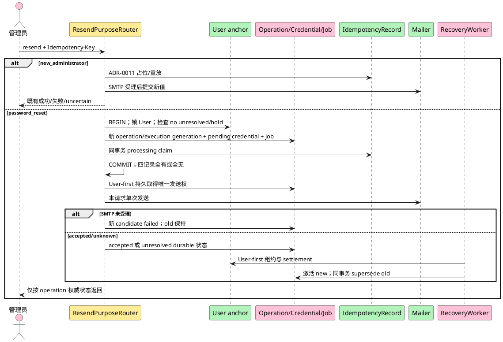

**说明**：两条路径只共享公共 REST、权限、Mailer TLS/处理方门禁和幂等摘要规则。`new_administrator` 仍允许 ADR-0011 residual window；普通用户 `password_reset` 在任何 SMTP 调用前已经有 durable Gate。普通用户 resend 的 old credential 在新 operation 非终态期间仍保留 current 状态但不可认证；只有 succeeded settlement 同一事务才永久 supersede old 并激活 new。失败或 stale pre-acceptance candidate 只失效 new，worker 和 replay 均不得重发邮件。

##### 类/组件设计

`ResendPurposeRouter` 在 transport、Session/CSRF 与授权后按 route/purpose 选择唯一 coordinator，不能让客户端提交 purpose：

- `new_administrator`：仅初始 admin；目标必须有可重发的新管理员临时凭据上下文。调用 ADR-0011 coordinator，不创建 password-reset operation/job。
- `password_reset`：任一能重置该普通用户的当前有效管理员；调用 `PasswordResetResendCoordinator`。Coordinator 先锁目标 User，再按真实同键 identity 分类；same-key replay 优先按原 operation 权威状态返回。只有 key 不存在、Gate clear 且 current password-reset credential 与其 terminal succeeded predecessor operation 一致时，才原子建立 successor operation。
- 没有可重发上下文、目标/role/purpose 不匹配、old credential 已 consumed/superseded/expired/recovery_invalidated 时，使用既有失败映射且不创建记录。unresolved operation 或 integrity hold 使用既有 `identity.operation_uncertain`，不新增公共 code。

普通用户 resend 的持久对象与所有权：

| 对象 | owner | 状态/关系不变量 |
|---|---|---|
| successor PasswordResetOperation | identity operation store | 新 operation ID；`request_kind=resend`；execution generation=N+1；绑定 predecessor operation、replaced old credential、exact new credential、真实六字段 Idempotency identity |
| IdempotencyRecord | shared idempotency store，经专用 atomic repository 协作 | 与 operation 同事务创建；same key 同摘要只指向同一 operation/generation；terminal replay 不读取 current credential 来改写历史结果 |
| new TemporaryCredential | identity repository | 初态 `pending_delivery`，source operation/target auth generation 精确绑定；settlement 前不可认证 |
| recovery job/outbox | identity recovery repository | 与 operation 一对一同事务；只恢复数据库状态，不持有明文 secret，不发送邮件 |
| old TemporaryCredential | identity repository | 作为 `replaced_credential_id` 被锁定；settlement 成功前不永久 supersede；失败路径不得改变 |

普通用户 resend 的时序合同：

1. User-first 锁下完成授权复核、same-key 分类、Gate、current old credential/predecessor 校验和 N+1 分配；同一事务创建 claim/operation/new credential/job。
2. 四记录 commit 明确成功后，原请求在 User-first 短事务用不可变 attempt ID 把 operation 置为 dispatching；只有该 commit 明确成功才发送一次。该 commit unknown 时不发送。
3. SMTP 未受理：新 credential invalidated，operation failed，old credential/auth generation/Sessions 保持；Gate 清除后 old 恢复按原规则使用。
4. SMTP accepted：持久 accepted 证据后由请求或 worker settlement；同一事务激活 new、supersede old、推进 auth generation、撤销旧 Session、写 Idempotency/Audit 并终结 succeeded。
5. SMTP 返回未知、accepted 结果写入 commit unknown、settlement commit unknown 或 cleanup 双失败：operation 保持 unresolved，三消费者与新的 reset/resend 都被 Gate 拒绝，worker按租约收敛。
6. `prepared/dispatching` 超过保护窗口且没有 durable accepted 证据：worker只 invalidated 本次 new candidate 并终结失败；old 保持。即使 provider 实际受理过邮件，该邮件秘密也因 new credential 失效而不可用。
7. PasswordChange 与 resend 竞争时都先锁 User：PasswordChange 先完成会导致 old consumed，resend 无上下文而零写入拒绝；resend 先提交 operation 则 PasswordChange 看到 unresolved Gate 而不消费 old。

##### 接口设计

- `POST /api/v1/admin/users/{id}/password-reset/resend`
- `POST /api/v1/admin/administrators/{id}/temporary-password/resend`

无请求体；要求 Cookie、CSRF、`Idempotency-Key`。成功响应与密码重置相同。普通管理员重发新管理员凭据返回 403；同键同摘要返回原结果；同键不同摘要返回 409。公共路径、HTTP、错误码、权限和 response shape 不变；purpose 由 route 与目标类型确定。

幂等分类必须同时读取 operation 权威：

| IdempotencyRecord / operation | 返回与副作用 |
|---|---|
| 不存在 key，且 password_reset Gate clear/context current | 创建 N+1 四记录候选；后续最多一次 SMTP |
| 同 key 同摘要，operation unresolved | 返回既有 `identity.operation_uncertain`；零新 generation、零新秘密、零 SMTP |
| 同 key 同摘要，operation succeeded 且 immutable legal history 一致 | 重放原 accepted 快照；不要求 old/new credential 或该 operation 仍为 current root，不改当前能力 |
| 同 key 同摘要，operation failed/invalidated | 重放稳定失败；若要新候选必须使用新 key |
| 同 key 异摘要/异目标/异 purpose | 409；零副作用 |
| 新 key 引用合法但非 current 的旧 succeeded operation | 既有 invalid-state 映射；内部 `stale/ineligible`；零 claim/operation/credential/job/generation/hold 写入 |
| record/operation 缺失、跨 User、generation/predecessor/credential/delivery/settlement/lineage 漂移 | integrity hold；fail closed，不自动补行 |

##### 数据结构设计

`users.password_reset_execution_generation` 为每个新 reset/resend 候选分配单调 N；`users.auth_generation` 仅在凭据能力 settlement 时推进。PasswordResetOperation 的 resend 关系字段、delivery attempt/result 字段和 §3.4.1 的 FK/CHECK/索引共同阻止复用旧 operation、脱离 old credential、重复发送权或 counter-only 提交。TemporaryCredential 的业务 `generation/auth_generation` 仍按同一用户能力单调；数据库约束分别保证每个 user/purpose 最多一条 settled current 能力（`active/expired`）与最多一条 in-flight `pending_delivery` 候选，因此 resend unresolved 期间允许 old active 与 new pending 同时持久存在，但 Gate 使两者都不可被旁路认证。过期把 settled current 行置为 expired，但仍阻断永久密码回退；成功改密把当前行置为 consumed 并把 credential_mode 改为 permanent。记录清理周期 TBD，且不得在其 IdempotencyRecord replay/operation lineage 保留期前删除 predecessor、replaced credential 或 exact new credential 证据。

### 3.4 数据、状态与权限合同

#### 3.4.1 身份侧表

`User`、`Session`、`TemporaryCredential` 和 `IdentityIdentifier` 由 identity-auth 写入；`IdempotencyRecord`、`AuditEvent` 由共享能力拥有。本文不定义或重复 article-owned 表。

| 表 | 字段 | 类型与约束 |
|---|---|---|
| `users` | `id` | UUID PK |
|  | `username` | text not null；展示值；删除后永久保留 |
|  | `email`,`phone` | text nullable；active/suspended 普通账号与其他管理员必填；删除时置空 |
|  | `permanent_password_digest` | text nullable；Argon2id 自描述编码；删除时清空 |
|  | `auth_generation`,`permanent_password_generation` | bigint；auth_generation NOT NULL、非负、单调；永久摘要存在时 generation 必须存在且不大于 auth_generation |
|  | `password_reset_execution_generation` | bigint NOT NULL、非负、只在 User-first 四记录原子事务为新的 reset/resend 业务候选加一；same-key replay 不增加 |
|  | `permanent_password_source_operation_id`,`permanent_password_source_credential_id` | UUID nullable；只保存当前永久能力的 root reset lineage；普通注册/bootstrap 可同时为空；不得用作全部历史 succeeded operation 的合法性索引 |
|  | `auth_integrity_hold`,`auth_integrity_hold_operation_id`,`auth_integrity_hold_reason`,`auth_integrity_hold_at` | hold 为 NOT NULL boolean；其余字段与 hold 使用交叉 CHECK；hold 激活认证与 reset/resend writer Gate |
|  | `role` | text check `member/admin` |
|  | `is_initial_admin` | boolean；仅一行 true |
|  | `status` | text check `active/suspended/deleted` |
|  | `credential_mode` | text check `permanent/bootstrap/temporary/recovery_locked/recovery_bootstrap`；决定唯一认证路径 |
|  | `recovery_required` | boolean；非初始账号恢复终结后为 true，核对与凭据重置完成前不得登录 |
|  | `onboarding_privacy_acknowledged_version` | text nullable；保存 onboarding 最近确认版本 |
|  | `onboarding_completed_at` | timestamptz nullable；写入后后续声明换版不重新锁定该用户 |
|  | `retained_email` | text nullable；仅 deleted 墓碑可有；只供转移通知 |
|  | `created_at`,`updated_at`,`deleted_at` | timestamptz |
| `identity_identifiers` | `user_id`,`kind`,`normalized_value` | PK/唯一 `(kind,normalized_value)`；kind=`username/email/phone` |
|  | `lifecycle` | `active/reserved`；存在即参与唯一性；username 永不删除 |
|  | `created_at`,`released_at` | timestamptz；释放时删除或留审计后物理删除 |
| `sessions` | `id`,`user_id` | UUID PK、FK；按 user 索引 |
|  | `token_digest`,`csrf_token_digest` | bytea unique / bytea；不存原值 |
|  | `issued_at`,`last_seen_at`,`absolute_expires_at`,`idle_expires_at` | timestamptz；期限配置 TBD |
|  | `rotated_from_id`,`revoked_at`,`revoke_reason` | 可空；支持轮换追踪，不能用于恢复旧 token |
|  | `auth_generation`,`lineage_operation_id`,`lineage_credential_id` | generation 非负且创建后不可变；root lineage 可空但必须成对且 FK 一致；permanent Session 也保存 lineage |
| `temporary_credentials` | `id`,`user_id`,`purpose`,`generation`,`state` | purpose=`new_administrator/password_reset`；state=`pending_delivery/active/expired/superseded/consumed/recovery_invalidated` |
|  | `secret_digest` | Argon2id 自描述编码 |
|  | `delivered_to_email` | text；交付地址快照；公共接口不返回 |
|  | `auth_generation`,`source_operation_id` | generation 非负；password_reset credential 必须绑定 operation 且等于 target generation；new_administrator 可无 operation |
|  | `issued_at`,`expires_at`,`superseded_at`,`consumed_at`,`invalidated_at` | timestamptz |
| `password_reset_operations` | `operation_id`,`user_id`,`temporary_credential_id` | UUID PK；User/TemporaryCredential FK；exact new credential 一对一唯一绑定 |
|  | `scope_hash`,`key_locator`,`key_digest`,`digest_key_version`,`request_digest`,`execution_generation` | 真实 IdempotencyRecord identity；六字段复合 FK/核验，`(scope_hash,key_locator,execution_generation)` 唯一 |
|  | `request_kind`,`predecessor_operation_id`,`replaced_credential_id` | kind=`initial_reset/resend`；resend 后两字段 NOT NULL 且与同 User 的 terminal predecessor/current old credential一致；initial_reset 两字段必须为空 |
|  | `base_auth_generation`,`target_auth_generation` | bigint 非负；target=base+1，创建时 base 等于锁定 User generation |
|  | `settlement_state`,`settled_auth_generation`,`successor_auth_generation`,`settled_at` | settlement=`pending/temporary_active/permanent_successor/invalidated/integrity_hold`；字段组合封闭且只单调推进；terminal succeeded operation 的合法 settlement 构成不可变历史证据，不因 current root 后续替换而回写 |
|  | `delivery_state`,`delivery_attempt_id`,`delivery_attempted_at`,`delivery_result_recorded_at` | delivery=`not_started/dispatching/accepted/rejected/unknown`；attempt ID 一次写入；状态/时间使用交叉 CHECK；只有明确提交 dispatching 的原请求可发送 |
|  | `state`,`recovery_reason` | state=`prepared/dispatching/commit_unknown/recovery_required/converging/succeeded/invalidated/failed`；原因仅固定低基数 |
|  | `created_at`,`updated_at`,`terminal_at` | 非终态 `terminal_at` 必须为空；终态必须非空 |
| `password_reset_recovery_jobs` | `operation_id`,`status`,`attempt_count`,`next_attempt_at` | operation_id PK/FK；status=`ready/leased/retry_wait/succeeded/dead_letter` |
|  | `lease_owner`,`lease_expires_at`,`last_failure_code` | 仅 leased 允许完整租约字段；failure code 去敏、低基数 |
|  | `created_at`,`updated_at`,`completed_at` | succeeded 才允许 completed_at；dead_letter 不代表 operation 终态 |
| `privacy_notices` | `version,content,content_hash,effective_at,status` | 版本不可变；同一时间仅一个 current |
| `privacy_acknowledgements` | `id,user_id,notice_version,acknowledged_at,source_kind,source_fingerprint` | 只追加；注册与新管理员 Gate 证据 |
| `administrator_information_declarations` | `id,actor_user_id,target_locator_digest,statement_version,declared_at,purpose` | 只追加；purpose 固定账号创建与事务性邮件 |
| `login_attempt_buckets` | `bucket_kind,bucket_key_digest,digest_key_version,window_started_at,failure_count,blocked_until,updated_at` | 全字段 NOT NULL；kind=`subject/source/subject_source`；阈值/窗口/退避 TBD |
| `recovery_account_reviews` | `recovery_run_id,user_id,backup_role,backup_status,backup_deleted_at,decision,evidence_ref,reviewed_by,reviewed_at,credential_reset_at` | decision=`pending/restored/kept_deleted/denied`；备份事实只供核对，不授权 |

公共字段 `must_change_password` 由 `credential_mode IN (bootstrap,temporary,recovery_bootstrap,recovery_locked)` 派生。对 `onboarding_completed_at IS NULL` 的新管理员，`must_acknowledge_privacy` 由 `onboarding_privacy_acknowledged_version != current PrivacyNotice.version` 派生；已完成 onboarding 的用户固定为 false。调用方不能提交或直接修改两个派生字段。

索引与约束：

1. `identity_identifiers(kind,normalized_value)` 唯一，处理活动账号与墓碑保留的统一冲突。
2. `users(username)` 不作为唯一真相源；username Identifier 永久存在。
3. `users` 上部分唯一索引保证只有一个 `is_initial_admin=true`。
4. `sessions(token_digest)` 唯一；`sessions(user_id)` 支持即时撤销。
5. `temporary_credentials(user_id,purpose)` 建两条互不重叠的部分唯一：state 属于 `active/expired` 时最多一条 settled current 能力，state=`pending_delivery` 时最多一条 in-flight 候选。这样 resend 可同时保存 old active 与 new pending；operation 非终态部分唯一和 User-first Gate 共同禁止第二个 password-reset pending 候选。过期 settled current 仍阻断永久密码回退。
6. `privacy_acknowledgements(user_id,notice_version)` 唯一；历史版本不更新覆盖。
7. `login_attempt_buckets(bucket_kind,bucket_key_digest)` 唯一，两个键均 NOT NULL，并按 `blocked_until` 建清理/查询索引。
8. `idempotency_records(scope_hash,key_locator,key_digest,digest_key_version,request_digest,execution_generation)` 增加候选 UNIQUE；真实 PK `(scope_hash,key_locator)` 不变。operation 以六字段复合 FK 精确绑定；`password_reset_operations(user_id)` 建非终态部分唯一，`temporary_credential_id` 唯一，`(user_id,execution_generation)` 与 `(scope_hash,key_locator,execution_generation)` 唯一。
9. `password_reset_operations(predecessor_operation_id)` 与 `(user_id,replaced_credential_id)` 索引支持 resend lineage 核对；CHECK 固定 `initial_reset/resend` 字段组合。不能只靠该索引证明 current，事务仍须锁 User/old credential并核 predecessor settlement。
10. `password_reset_operations(user_id,state)` 支持 Gate；`password_reset_recovery_jobs(status,next_attempt_at,lease_expires_at)` 支持候选扫描。领取事务仍必须先锁 User，扫描锁不构成租约。
11. operation/job 状态、delivery attempt/result、终态时间、settlement、execution/auth generation、integrity hold、lineage 与租约字段使用交叉 CHECK；一对一及 DEFERRABLE 复合 FK 阻止 orphan/半状态。所有状态枚举用数据库检查约束；应用层仍执行 current/predecessor 语义校验。
12. `sessions(user_id,auth_generation)` 与 lineage 索引支持 Gate/撤销核验；`temporary_credentials(source_operation_id,auth_generation)` 唯一约束 exact reset generation。

LoginAttemptBucket 规范编码和并发合同：

1. 先构造长度前缀二进制 `kind || len(part1) || part1 || len(part2) || part2`。
2. subject 的 part1 是归一化登录标识；source 的 part1 是可信代理规则得到的 canonical source；subject_source 同时包含两者。
3. `bucket_key_digest = HMAC-SHA-256(versioned_key, canonical_bytes)`；数据库不保存原标识或原来源。
4. 失败通过 `INSERT ... ON CONFLICT(bucket_kind,bucket_key_digest) DO UPDATE` 原子增加计数并推进窗口/退避；成功衰减、清理和恢复操作使用同一唯一键与行锁，禁止读后写竞态。

#### 3.4.2 共享表消费合同

| 表 | 关键字段 | identity-auth 使用规则 |
|---|---|---|
| `idempotency_records` | `scope_hash,key_locator,key_digest,request_digest,digest_key_version,status,execution_generation,result_code,response_snapshot,locked_until,reviewed_by,reviewed_at,expires_at` | 真实 PK 为 `(scope_hash,key_locator)`；password-reset 首次 reset 与每个普通用户 resend 新 key 的首次 claim 必须与 operation/exact credential/job 同一 User-first 事务创建，并由六字段 UNIQUE/FK 绑定；读取先按 operation/settlement 权威分类，不能单凭 succeeded/uncertain replay。创建管理员 v1 快照合同不变 |
| `audit_events` | `id,occurred_at,actor_kind,actor_user_id,actor_system,actor_role,action,target_type,target_id,outcome,error_code,trace_id,source_fingerprint,metadata` | `id` 主键；actor_kind=`anonymous/user/system`；正常成功/失败同事务 INSERT；登录独立失败审计复用原 `id` 做 INSERT-on-conflict+只读核对；无 UPDATE/DELETE |
| `processing_gate_records` | `region_ref,controller_ref,legal_basis_ref,smtp_processor_ref,effective_at,recorded_by` | 值由实际责任人登记；缺任一对应输入时相关 capability closed |
| `recovery_runs` | `run_id,backup_ref,journal_key_id,journal_key_version,journal_secret_fingerprint,journal_stage,journal_consumed_at,article_evidence_version,article_evidence_digest,article_evidence_ref,article_evidence_completed_at,article_namespace,article_replay_verified_at,started_at,completed_at,outcome,account_count,permanent_credential_count,session_count,temporary_credential_count,idempotency_count,pending_review_count,audit_event_id` | identity-owned RecoveryRunStore 唯一读写；`backup_ref` 与 Begin key ID/version/fingerprint 创建后不可变；outcome=`running/failed/identity_ready/article_deletion_ready/ready_to_consume/journal_consumed/succeeded`；只保存已验证 DTO 的绑定字段/引用；时间为 UTC 微秒 |

`response_snapshot` 只保存稳定业务响应投影，不保存 Header、Set-Cookie、CSRF、密码、临时密码、摘要、完整邮箱/手机号、`trace_id` 或内部 cause。创建管理员 v1 的外层字段精确为 `schema_version,http_status,result_code,body`，body 封闭字段见 §3.3.1/§3.3.6。其写入与 succeeded/稳定 failed 状态同一完成事务提交，之后不可变；重放不得再从 `users` 或 `temporary_credentials` 计算业务结果。首次响应和重放均由 Handler 使用本次 request context 物化：成功 status/body 来自快照且响应 Header 使用当前 trace；失败 status 与稳定 `code/message/field_errors` 来自快照，再添加当前 `trace_id`，使 Header/body/context/log 四者一致。不得重放历史 trace，也不得调用当前错误注册表重新解析稳定 message。`source_fingerprint` 保存请求来源的受控标识或摘要，不保存不必要的原始网络数据。登录 `audit_event_id` 由 HTTP 编排边界在任何 source evidence 获取前生成一次；Handler 前置失败、Service 原事务和 `LoginFailureAuditor` 不得各自生成不同 ID。来源证据失败 AuditEvent 的 `source_fingerprint` 必须为 null，metadata 只保存固定低基数阶段/原因，不保存 Origin、Fetch Metadata、代理 Header、IP 或 provider error。独立入口遇到主键冲突，或在 Append 已尝试后执行 unknown 事务核对时，必须读取并比较 `audit.Event` 的全部不可变字段和 canonical metadata；任一不一致视为完整性故障，不能覆盖旧行或声称 `audit_persisted=yes`。commit unknown、以及 Append 后 rollback unknown 查询未读到记录时只能返回 `unknown`，不得插入、不得声称 `no`；Append 前 rollback unknown 不得发起查询。

管理员创建 v1 是封闭 schema；所有字段均必填，不存在可选外层字段：

| 层级 | 精确字段集 | JSON 类型与约束 |
|---|---|---|
| 外层 | `schema_version,http_status,result_code,body` | `schema_version` 为固定 string `identity-administrator-create-response/v1`；`http_status` 为 integer；`result_code` 为 string；`body` 为 object |
| success body | `id,username,role,status,must_change_password,must_acknowledge_privacy,temporary_credential_expires_at,delivery_status` | `id/username/role/status/temporary_credential_expires_at/delivery_status` 为 string；两个 `must_*` 为 boolean；当前合法组合固定 `201/created`、`role=admin`、`status=active`、两个布尔值均为 true、`delivery_status=accepted` |
| failed body | `code,message,field_errors` | `code/message` 为 string；`field_errors` 为 array、必填且只能为 `[]`；非空、缺失、null 或类型漂移均拒绝；`result_code == body.code` |

当前 v1 稳定失败映射只有 `409/identity.identifier_conflict/身份标识已被使用/field_errors=[]` 与 `503/identity.email_delivery_failed/邮件暂未受理/field_errors=[]`。identifier conflict 不得披露 username/email/phone 或任何冲突字段；两个 variant 都不存在 `field_errors` 元素顺序问题。任何其他 HTTP/status/result/body 组合、unknown/extra/missing key、null、错误 JSON 类型、失败 body 中的 `trace_id`、非空 `field_errors`，或 success body 的第九字段都必须在应用 decoder 与数据库 CHECK 两层拒绝。

`migrations/0007_idempotency_response_snapshot_v1.sql` 的合同如下：

1. 不修改 `migrations/0004_idempotency.sql`；只删除并以新名称重建 `response_snapshot` CHECK，不改表列、默认值、索引、状态约束或历史行，也不重写 JSONB。
2. 新 CHECK 只接受两个互斥分支：
   - **legacy**：对象无 `schema_version`，必有 `outcome:string`，可选 `resource_id:string`、`error_code:string`，键集合只能是这三个字段的合法子集且必须包含 `outcome`；
   - **administrator v1**：精确满足上表外层与 success/failed 其中一个 body variant、固定版本/映射/类型和值约束；两个 failed variant 的 `field_errors` 都必须是空 JSON array，尤其 identifier conflict 不允许任何字段项。
3. 未知版本、同时混入 legacy/v1 字段、未知/额外字段、缺失必填字段、null 或类型漂移继续由数据库拒绝；不得为了通过 migration 弱化成“任意 JSON object”。
4. 应用 reader 双读：无 `schema_version` 时只按 strict legacy 解码；有 `schema_version` 时只能是指定 v1 并按封闭 variant 解码。Go strict decoder/writer 必须把 identifier conflict 的 `field_errors` 编码并验证为精确空数组，拒绝非空、缺失、null 和类型漂移，不得从 unique violation、请求或当前 User/Identifier 推导冲突字段。未知版本、伪 legacy 或坏 v1 fail closed，不查询 User/TemporaryCredential 兜底。管理员创建的新完成记录只写 v1；其他既有幂等消费者可继续写 legacy。
5. 升级顺序固定为：停止仍只理解 legacy CHECK/reader 的旧进程 → 在 PostgreSQL 18 执行 `0007` → 启动 strict 双读且管理员新写 v1 的进程。禁止新旧 writer 在旧 CHECK 下并行，也禁止先让新 writer 写 v1 再执行 migration。
6. 第一条 v1 记录写入前，可回退到旧二进制；第一条 v1 写入后，禁止回退到不理解 v1 的旧 reader，也禁止恢复 `0004` 的旧 CHECK。此后只能前向部署兼容 reader 或修复 migration；数据库备份回退也必须证明不存在 v1 行，否则 fail closed。
7. 文件 owner 是共享 idempotency persistence / migration owner，不是 Administrator Handler 的隐式责任；Task-Planner 必须在后续 tasks/plan 对账中显式登记 `migrations/0007_idempotency_response_snapshot_v1.sql`、实现 owner、顺序和 PostgreSQL 18 验证，不得要求 Backend-Dev 越权修改 `0004`。
8. PostgreSQL 18 集成验证必须覆盖：从仅有 `0004` 的库升级且 legacy 行字节/语义保持；legacy 继续可写可读；v1 success 与两种稳定失败可写可读；identifier conflict 只接受 canonical `field_errors=[]`，并拒绝任意非空数组、缺失、null、类型漂移和冲突字段披露；外层/body 的 extra/missing/null/type drift 及未知版本被 DB 拒绝；旧记录仍按 legacy 重放；应用对未知版本 fail closed。未取得这些证据前，不得声明 migration、S5.2 持久化或 production readiness 完成。

RecoveryJournalEntry 位于业务数据库外的固定 `recovery/v1` namespace，字段为 `namespace,sequence,run_id,backup_ref,key_id,key_version,secret_fingerprint,stage,recorded_at,previous_record_hash,record_hmac`；持久 disk record 与 MAC payload 使用相同 `backup_ref`，stage 只允许 `begun/consumed`，`recorded_at` 为 UTC 微秒。每个 namespace 通过 provider-neutral JournalHeadAnchor port 绑定 `journal_id,epoch,committed sequence/hash,CAS revision,pending old/new head/operation`；目标生产 provider 必须位于独立故障域，S4.2 fake 不构成该证明。同 run 的 begun/consumed 必须保持同一 backup/key/fingerprint；同 run ID、wrong backup 或任一 retained key 计算出的同版本历史 fingerprint 已存在时，新的 Begin 拒绝；同 run 已 consumed 时，MarkConsumed 和新的恢复均拒绝。`KeyRetirementCapability` 不是 Journal/RecoveryRun 字段，只能作为绑定精确 key 版本的瞬时验证/消费输入；任何持久化或日志复制都违反协议。

`ArticleDeletionReplayStatus` v1 是 strict tagged union。`status=ready` 时只允许 ADR-0020 的以下 20 字段，全部必填且非 null：

| 顺序 | 字段 | JSON 类型/约束 | canonical v1 |
|---:|---|---|---|
| 1 | `evidence_version` | string，固定 `article-deletion-replay/v1` | 是 |
| 2 | `run_id` | string，非空 | 是 |
| 3 | `backup_ref` | string，非空 | 是 |
| 4 | `namespace` | string，固定 `article-deletion/v1` | 是 |
| 5 | `journal_head_sequence` | integer，非负 | 是 |
| 6 | `journal_head_hash` | string，`sha256:<lower-hex>` | 是 |
| 7 | `inventory_scope` | string，固定 fixture/producer 定义的 scope 值 | 是 |
| 8 | `backup_cutoff` | string，UTC RFC 3339 | 是 |
| 9 | `inventory_digest` | string，`sha256:<lower-hex>` | 是 |
| 10 | `deletion_operations_digest` | string，`sha256:<lower-hex>` | 是 |
| 11 | `audit_events_digest` | string，`sha256:<lower-hex>` | 是 |
| 12 | `tombstones_total` | integer，非负 | 是 |
| 13 | `tombstones_replayed` | integer，非负；唯一重放计数字段名 | 是 |
| 14 | `already_absent` | integer，非负 | 是 |
| 15 | `deletion_operations_reconciled_count` | integer，非负 | 是 |
| 16 | `audit_events_verified_count` | integer，非负 | 是 |
| 17 | `status` | string，固定 `ready` | 否 |
| 18 | `evidence_digest` | string，`sha256:<lower-hex>` | 否 |
| 19 | `evidence_ref` | string，非空、不透明 | 否 |
| 20 | `completed_at` | string，UTC RFC 3339；首份 evidence 元数据时间 | 否 |

ready canonical v1 仅包含前 16 字段，严格按表中顺序编码为 UTF-8、无 BOM、无多余空白的单行 JSON；`status/evidence_digest/evidence_ref/completed_at` 明确排除。所有整数用 JSON integer，其他 canonical 字段均为 JSON string。`evidence_digest = SHA-256(canonical_json_bytes)`。计数满足 `tombstones_total = tombstones_replayed + already_absent`。

共享 ready fixture（producer/consumer 必须嵌入相同内容或使用同一生成源）：

```json
{
  "evidence_version": "article-deletion-replay/v1",
  "run_id": "run-01",
  "backup_ref": "backup-2026-10-20T00:00:00Z",
  "namespace": "article-deletion/v1",
  "journal_head_sequence": 7,
  "journal_head_hash": "sha256:aaaa",
  "inventory_scope": "recoverable-backups-before-cutoff",
  "backup_cutoff": "2026-10-20T00:00:00Z",
  "inventory_digest": "sha256:bbbb",
  "deletion_operations_digest": "sha256:cccc",
  "audit_events_digest": "sha256:dddd",
  "tombstones_total": 3,
  "tombstones_replayed": 2,
  "already_absent": 1,
  "deletion_operations_reconciled_count": 3,
  "audit_events_verified_count": 3,
  "status": "ready",
  "evidence_digest": "sha256:169e0f30407867083598ab146c950968e1b5f508ed4fd5d5198bb61e788926a7",
  "evidence_ref": "evidence-01",
  "completed_at": "2026-10-20T01:00:00Z"
}
```

对应 canonical bytes 固定为：

```json
{"evidence_version":"article-deletion-replay/v1","run_id":"run-01","backup_ref":"backup-2026-10-20T00:00:00Z","namespace":"article-deletion/v1","journal_head_sequence":7,"journal_head_hash":"sha256:aaaa","inventory_scope":"recoverable-backups-before-cutoff","backup_cutoff":"2026-10-20T00:00:00Z","inventory_digest":"sha256:bbbb","deletion_operations_digest":"sha256:cccc","audit_events_digest":"sha256:dddd","tombstones_total":3,"tombstones_replayed":2,"already_absent":1,"deletion_operations_reconciled_count":3,"audit_events_verified_count":3}
```

固定摘要为 `sha256:169e0f30407867083598ab146c950968e1b5f508ed4fd5d5198bb61e788926a7`。

unavailable variant 只允许以下 6 个字段：

| 顺序 | 字段 | JSON 类型/约束 |
|---:|---|---|
| 1 | `evidence_version` | string，固定 `article-deletion-replay/v1` |
| 2 | `run_id` | string，非空 |
| 3 | `backup_ref` | string，非空 |
| 4 | `namespace` | string，固定 `article-deletion/v1` |
| 5 | `status` | string：`pending/unknown/failed` |
| 6 | `reason_code` | string，非空稳定分类 |

```json
{
  "evidence_version": "article-deletion-replay/v1",
  "run_id": "run-01",
  "backup_ref": "backup-2026-10-20T00:00:00Z",
  "namespace": "article-deletion/v1",
  "status": "pending",
  "reason_code": "replay_in_progress"
}
```

unavailable 字段集合必须精确为上述六项，禁止携带任何 canonical 字段、`evidence_digest`、`evidence_ref` 或 `completed_at`。

article-management 持久化 `DeletionReplayRun` 和不可变 `DeletionReplayEvidence`。同一 run+backup 的 covered input 不变时，ready variant 必须复用首份 `evidence_ref/evidence_digest/completed_at`；covered input 变化才追加 evidence 并原子更新 current 指针。unavailable 不是 Evidence，不持久化伪 canonical 字段。

identity 先以严格对象解析读取 `status` 并选择 variant。`pending/unknown/failed` 必须精确匹配六字段 schema，随后立即 fail closed，不执行 canonical 重算。

`ready` 必须精确匹配二十字段 schema，identity 才使用前十六字段重算摘要，并在锁定 RecoveryRun 的事务中比较 run/backup/namespace/version/digest 和计数。未知 status、混合 variant、缺失/额外/null/错误类型、替代命名、错 backup、不可读或摘要/ref 不匹配均保持停服。identity 不读取 article 内部表，也不自行生成 evidence_ref 或 completed_at。

| 恢复对象 | 所有者 | identity-auth 权限 |
|---|---|---|
| RecoveryRun、RecoveryAccountReview | identity-owned RecoveryRunStore | 唯一读写；短事务行锁/条件转换；Coordinator 只按 run_id 调用 |
| `recovery/*` Journal 与 JournalHeadAnchor | recovery provider；identity 编排 | S4.2 只拥有 provider-neutral Anchor port/协议、调用边界和确定性替身；不得绕过 OS 锁、CAS 或平台/权限门禁；生产 provider/config/wiring 与独立故障域验证仅由 S4.5 交付 |
| `KeyRetirementCapability` 验证/单次消费 | S4.2 定义 port/opaque 类型；生产 issuer/verifier owner 待独立任务确定 | identity 只提交瞬时 capability 与精确 key 绑定并消费结果；不得解析/mint/持久化；无生产 wiring 时 retire/delete 始终拒绝 |
| `article-deletion/*` Journal、DeletionOperation、Article 删除状态 | article-management | 无直接读写 |
| DeletionReplayEvidence / ArticleDeletionReplayStatus | article-management 持久化、失效与幂等重算 | 只读消费 DTO，并保存已验证 version/digest/ref；不读内部表 |
| Article 删除 AuditEvent | 共享审计，由 article 追加 | 只核 DTO 的 `audit_events_digest/audit_events_verified_count`，不读取文章内容 |

IdempotencyRecord 状态机：

| 当前状态 | 事件 | 下一状态/响应 |
|---|---|---|
| 不存在 | 首次合法请求占位 | processing，generation=1 |
| processing | 业务成功/确定失败 | succeeded / failed，并保存安全响应快照 |
| processing | 租约过期、SMTP 受理后提交未知 | uncertain |
| succeeded/failed | 同键同摘要 | 返回原结果，不执行副作用 |
| processing | 同键同摘要 | `identity.idempotency_in_progress` |
| uncertain | 同键同摘要 | `identity.operation_uncertain`，不自动执行 |
| processing/uncertain | ADR-0018 恢复终结 | recovery_review_required |
| recovery_review_required | 普通同键同摘要 | `identity.operation_uncertain`，不抢占 |
| recovery_review_required | 受控核对有独立批准来源且证明原域具体安全失败（§4.2 r56） | failed，保存原域精确结果/快照，与核对审计原子提交；不能以放弃代具体结果 |
| recovery_review_required | 受控核对批准重新执行 | processing，generation+1，新租约并写核对审计 |
| 任意已存在状态 | 同键不同摘要 | `identity.idempotency_conflict` |

数据库约束：

- `CHECK (status IN ('processing','succeeded','failed','uncertain','recovery_review_required'))`。
- `CHECK (execution_generation >= 1)`。
- succeeded/failed 必须有 `result_code` 和通过 `0007` 双分支 CHECK 的 `response_snapshot`；processing 必须有 `locked_until`。
- legacy 快照必须无 `schema_version` 且精确符合 `outcome` 必填、`resource_id/error_code` 可选的 string-only 封闭对象；管理员 v1 必须精确符合外层四字段与 success/failed 封闭 variant。未知版本、混合分支、extra/missing/null/type drift 均视为内部完整性故障，禁止回退到查询可变业务表。
- recovery_review_required 必须清空可自动抢占租约；只有受控恢复事务可写 `reviewed_by/reviewed_at` 并转换状态。
- 状态转换使用 `SELECT ... FOR UPDATE` 或带旧状态条件的原子 UPDATE；受影响行数不为 1 时失败，不允许最后写入者覆盖。

安全与部署配置维度：

| 配置 | 约束 |
|---|---|
| `HAN_PUBLIC_ORIGIN` | canonical same-origin；缺失时浏览器登录能力 fail closed |
| `HAN_TRUSTED_PROXY_CIDRS` | production 登录必填、无默认；建议直连为 `none`；否则使用经 mask/Unmap 的 canonical CIDR，拒绝 trust-all、不可安全 mapped prefix、等价重复和 host bits；只有匹配的 strict host:port direct peer 可提供 wire-order XFF |
| `HAN_ADMINISTRATOR_INFORMATION_NOTICE_VERSION/EFFECTIVE_AT/CONTENT/SHA256` | 四键必填、无默认；构造不可变 current notice。时间只接受以 `Z` 结尾、offset=0、非零且与 `parsed.UTC().Format(time.RFC3339)` 逐字节一致的规范 UTC 整秒 RFC3339；任何小数秒拒绝。hash 必须与正文原始 UTF-8 bytes 精确匹配；不得 trim/normalize/运行时生成或修正时间 |
| `HAN_SMTP_TLS_MODE` | 必填、无默认；仅 `implicit_tls` / `starttls_required`，不得按端口推导或降级 |
| `HAN_SMTP_HOST`、`HAN_SMTP_PORT`、`HAN_SMTP_SERVER_NAME`、`HAN_SMTP_FROM` | 全部必填、无默认；port `1..65535`，465/587 仅建议；From 通过现役 mailbox validator |
| `HAN_SMTP_AUTH_MODE`、`HAN_SMTP_USERNAME`、`HAN_SMTP_PASSWORD` | auth mode 必填且仅 `plain/none`；plain 要求 username/password 非空，none 要求两者精确为空；认证材料不得日志或进入错误 |
| `HAN_SMTP_CA_BUNDLE` | 唯一可选项；空表示仅系统根，非空必须是可读取 clean absolute path并成功追加至少一张 PEM 证书；不得替换系统根或忽略坏文件 |
| `HAN_SMTP_PROCESSOR_REF` | 必须匹配 ProcessingGate 中获批准处理方 |
| `HAN_SMTP_OPERATION_BUDGET` | 生产必填、无默认；部署基线 `10s`，parser 合法闭区间 `1s..60s`；production composition 注入 `AdministratorCreateCoordinator`，Mailer.Send 使用请求 deadline 与配置预算的较早者并及时 cancel |
| `HAN_PROCESSING_REGION_REF`、`HAN_PROCESSING_CONTROLLER_REF`、`HAN_PROCESSING_LEGAL_BASIS_REF` | 只保存实际责任人登记的引用；不提供默认值 |
| `HAN_INITIAL_ADMIN_PASSWORD`、`HAN_RECOVERY_INITIAL_ADMIN_SECRET` | 独立配置键与运行门禁；不得相同、不得日志，recovery secret 只在维护模式读取 |
| `HAN_RECOVERY_RUN_ID` | 每次恢复唯一，由恢复责任人生成；重复 run 被 Journal 拒绝 |
| `HAN_RECOVERY_JOURNAL_PATH` | 指向独立受控持久卷；不得位于业务数据库备份恢复目录 |
| `HAN_RECOVERY_JOURNAL_KEY_<key_id>_<version>`、`HAN_RECOVERY_JOURNAL_ACTIVE_KEY`、`HAN_RECOVERY_JOURNAL_VERIFY_ONLY_KEYS` | 恰有一个 active 新 run key；verify-only retained key只禁止 Begin 新 run，但可终结该 key 已 begun 的 run；有未消费 begun run或保留/归档记录时不得退役/删除；静态条件满足后仍须 capability 验证/单次消费成功 |
| `HAN_IDEMPOTENCY_CURRENT_KEY_VERSION`、`HAN_IDEMPOTENCY_RETAINED_KEY_VERSIONS`、`HAN_IDEMPOTENCY_HMAC_KEY_<version>` | current 与显式 verify-only retained 列表发现完整 keyring；retained 为空只能写 `none`，否则 `1..16` 个严格递增 token；每 key 原始 `32..64` bytes。缺失/未闭合/重复/非法时启动失败 |
| `HAN_IDEMPOTENCY_LOCK_DURATION`、`HAN_IDEMPOTENCY_RECORD_TTL` | 全部必填、无默认；lock 建议 `2m`、合法 `1s..5m` 且 `> SMTP budget`；TTL 建议 `24h`、合法 `1h..30d` 且 `> lock` |
| `HAN_LOGIN_BUCKET_HMAC_KEY_<version>`、`HAN_LOGIN_BUCKET_CURRENT_KEY_VERSION` | 防暴力桶摘要版本集；r26 登录 factory 必须显式提供 current version/key 且无默认；version token `1..64` bytes，key 建议 32 raw bytes、合法 32..64，具体 parser、敏感性和失败合同见 §3.3.1；旧版本保留到对应桶清理完成 |
| `HAN_METRICS_ADDR` | 生产必填独立 listener 地址；无默认；只注册 `/metrics`，由部署网络策略限制访问 |
| `HAN_LOGIN_DURATION_BUCKETS_SECONDS` | 生产必填、无默认；部署基线 `0.005,0.01,0.025,0.05,0.1,0.25,0.5,1,2.5,5`；parser 接受 `1..32` 项正数、有限、严格递增、无重复且最大值 `<=60s` 的列表，合法非基线值允许 |
| `HAN_LOGIN_OBSERVATION_BUDGET` | 生产必填、无默认；部署基线 `250ms`，parser 合法范围 `1ms..5s`（含端点）；与请求更早 deadline 取较早者 |
| `HAN_ORIGIN_OBSERVATION_BUDGET` | 生产必填、无默认；部署基线 `250ms`，parser 合法范围 `1ms..5s`（含端点）；与请求更早 deadline 取较早者 |
| `HAN_LOGIN_FAILURE_AUDIT_BUDGET` | 生产必填、无默认；部署基线 `2s`，parser 合法范围 `10ms..30s`（含端点）；独立失败审计调用不得越过该 deadline |
| `HAN_SHUTDOWN_BUDGET` | 生产必填、无默认；部署基线 `10s`，parser 合法范围 `1s..60s`（含端点）；两个 server 的并发 Shutdown 共享唯一 deadline |
| `HAN_SESSION_TOKEN_ENTROPY`、`HAN_CSRF_TOKEN_ENTROPY` | r24 定义为十进制随机字节数，production 登录必填、无默认；建议各 32 bytes、合法各 32..64；不另设 `*_BYTES` 别名 |
| `HAN_TEMP_CREDENTIAL_ENTROPY` | 临时凭据路径继续要求满足获批准安全基线；不由本轮登录 factory 消费 |
| `HAN_LOGIN_MAX_BODY_BYTES`、`HAN_ARGON2_*`、`HAN_LOGIN_ABUSE_*`、`HAN_SESSION_ABSOLUTE_TTL`、`HAN_SESSION_IDLE_TTL`、`HAN_SOURCE_FINGERPRINT_*`、`HAN_TRUSTED_PROXY_CIDRS`、`HAN_RECOVERY_MODE` | r26 登录 production factory 的部署建议/benchmark 候选、完整读取方、类型、必填/默认、executable floor/ceiling、交叉约束、敏感性、失败与测试合同见 §3.3.1；Argon2 profile ID 与全局并发 Gate 同为必填，任一缺失/非法在 connect/Ping/migrate/compose/listen 前失败 |
| 连接池、会话清理周期 | 配置维度保留；数值仍为 TBD，不由本轮 production route factory 猜测。SMTP operation budget 已固定，不再列为 TBD |

本表中的全部生产配置必须由 `cmd/han-server` 在任何数据库副作用、listener 绑定和业务路由注册前一次性解析校验；缺失、解析失败、非有限或超范围均启动失败，不得用测试 fake/no-op、包级默认或硬编码回退。部署基线不是 parser 唯一 allowlist。

本表不定义任何生产 Anchor provider 或 key-retirement capability 配置键：Anchor provider、凭据、endpoint、持久性选项和启动装配由 S4.5 承担；retirement evidence/issuer/verifier、mint、单次消费存储、审计与启动 wiring 由另一个非 S4.5 独立任务承担。S4.2 的两类测试替身都不得从生产配置加载、成为启动默认值或被当作生产授权。

审计动作使用稳定标识；下列 `action` 不是公共错误 code，不进入错误响应：

| action | 触发 |
|---|---|
| `identity.register` | 注册成功或持久化失败 |
| `identity.login` | 登录成功与所有统一失败 |
| `identity.session.rotate` | 登录、改密或权限上下文变化 |
| `identity.password.change` | 强制改密或初始 admin 正常改密 |
| `identity.administrator.create` | 创建其他管理员 |
| `identity.role.revoke` | 撤销其他管理员权限 |
| `identity.account.suspend` / `restore` / `delete` | 账号治理 |
| `identity.password.reset` / `temporary_credential.resend` | 临时凭据操作 |
| `identity.identifier.release` | 专用邮箱或后续标识清理 |
| `identity.idempotency.conflict` | 同键不同摘要 |
| `identity.smtp.residual_window` | SMTP 已受理后数据库提交失败或未知 |
| `identity.privacy.acknowledge` | 用户确认某一版本隐私声明 |
| `identity.administrator.information_declare` | 初始 admin 作信息提供声明 |
| `identity.processing_gate.evaluate` | 部署处理门禁开启或拒绝 |
| `identity.recovery.invalidate` | 恢复后批量失效及结果 |

#### 3.4.3 User 状态机

```plantuml
@startuml
skinparam shadowing false
skinparam defaultFontName "Microsoft YaHei"

[*] --> active : 注册或管理员创建
active --> suspended : 停用
suspended --> active : 恢复
active --> deleted : 删除
suspended --> deleted : 删除
deleted --> [*]
@enduml
```

**说明**：`deleted` 是不可恢复终态。角色与状态正交：其他管理员可以在 suspended 时被撤权为 member；恢复后只能获得当前持久化角色。初始 admin 不允许进入 suspended/deleted，也不允许撤权。

#### 3.4.4 凭据与会话状态

| 动作 | `credential_mode` | TemporaryCredential | 可接受凭据 | 会话 |
|---|---|---|---|---|
| 普通注册 | permanent | 无 | 永久密码 | 不自动创建 |
| 初始 admin bootstrap | bootstrap | 无 | bootstrap 永久摘要；独立例外 | 首次登录创建受限会话并记录 bootstrap |
| 创建其他管理员 | temporary | new_administrator active | 仅该最新临时值 | 无 |
| 管理员重置 | temporary | password_reset active | 仅该最新临时值；旧永久密码暂停 | 全部撤销 |
| 普通用户 resend 非终态 | 保持原值 | old password_reset 仍 current；new 为 pending_delivery | 无；operation Gate 关闭 | 不新建/轮换；Resolve 不授权 |
| 普通用户 resend failed/invalidated | 保持原值 | new invalidated；old 状态不变 | Gate clear 后恢复 old 的原规则 | 本次候选不撤销既有 Session |
| 普通用户 resend succeeded | temporary | new active；old 同事务 superseded | 仅 new | 旧 generation Session 全部撤销 |
| 临时凭据过期 | temporary | state=expired | 无；统一登录失败，不回退 | 无 |
| 临时凭据 superseded/恢复失效 | temporary | state=superseded/recovery_invalidated | 无；等待最新成功重置/重发 | 全部撤销 |
| 临时凭据登录 | temporary | active 且未过期 | 仅该 credential ID | 创建受限会话并记录 type/id |
| 成功改密 | permanent | 当前值 consumed | 新永久密码 | 其他会话撤销，当前会话轮换 |
| password-reset operation unresolved | 保持权威 User 当前值，但认证 Gate 关闭 | exact credential 可为 pending/active/consumed 等待收敛 | 无 | Login 不创建；PasswordChange 不轮换；ResolvePrincipal 不授权并由 worker 撤销 |
| 恢复终结：非初始账号 | recovery_locked | current 临时凭据 recovery_invalidated，永久摘要清空 | 无；`recovery_required=true` | 全部删除 |
| 恢复终结：初始 admin | recovery_locked | 全部失效，永久摘要清空 | 无，等待独立 recovery secret | 全部删除 |
| recovery secret 重建初始 admin | recovery_bootstrap | 无 | 仅 recovery secret 的 Argon2id 摘要 | 首次恢复登录创建受限会话 |
| 逐账号核对并重置凭据 | temporary | 新 password_reset active | 仅新临时凭据；同事务清除 recovery_required | 原 Session 已不存在 |
| 删除账号 | permanent（不可用） | 全部 invalidated | 无 | 全部撤销 |

凭据选择前必须在 caller-owned transaction 中先锁 User，通过 password-reset operation 与 integrity hold Gate，再读取 `credential_mode`；不存在“最新有效临时凭据，否则永久密码”的回退分支。`recovery_locked` 永不接受登录；`recovery_bootstrap` 只允许既有初始 admin 使用当前 RecoveryRun 的一次性 recovery secret。改密只接受当前 Session 中记录的 credential kind/id：`permanent/bootstrap/recovery_bootstrap` 的 ID 必须为空且 kind 必须与账号权威 `credential_mode` 一致；`temporary` 的 ID 必须非空、等于当前权威临时凭据 ID，且该凭据仍为 active、未过期、未 consumed。任一 kind/id 失配，或临时凭据在登录后被重发 settlement 永久 supersede、过期、恢复失效、消费，或目标 User 存在 unresolved password-reset operation 时，立即拒绝/撤销当前 Session；不得回退永久密码。普通用户 resend 仅创建 pending new candidate 时不提前改变 old credential 行，但 unresolved Gate 已使 old 暂时不可认证。operation unresolved 或 integrity hold 时 PasswordChange 不改变凭据、永久摘要、auth generation、settlement 或任何 Session，由 S10.4 自动 worker 按 §3.3.11 收敛；进入 dead-letter 后持续 Gate/hold，人工恢复等待 `identity-auth-S10.5`。合法 password-reset successor 必须从 exact succeeded operation/credential 的 target generation 原子生成 target+1；后续正常改密继续单调递增并保留 root lineage。

#### 3.4.5 新管理员双 Gate

| Gate | 完成证据 | 未完成时允许 |
|---|---|---|
| 改密 Gate | `credential_mode=permanent` 且当前临时凭据 consumed | `GET /users/me`、改密、读取/确认隐私声明 |
| 隐私 Gate | `onboarding_privacy_acknowledged_version = current PrivacyNotice.version` | `GET /users/me`、改密、读取/确认隐私声明 |

其他管理员能力只在两个 Gate 同时完成时开放。最终开放事务锁定 User 与 current PrivacyNotice，并写 `onboarding_completed_at`。若 PrivacyNotice 在两个 Gate 之间换版，只有仍未完成 onboarding 的账号重新变为 privacy pending；`onboarding_completed_at` 已存在的用户不重新锁定，因为 r16 未授权持续重确认 Gate。

#### 3.4.6 权限矩阵

| 动作与目标 | 初始 admin | 其他有效管理员 | 普通用户 |
|---|---|---|---|
| 注册、登录 | 作为用户调用 | 作为用户调用 | 允许 |
| 读取自己的身份 | 允许 | 允许 | 允许 |
| 强制改密（`must_change_password=true`） | 允许 | 允许 | 允许 |
| 非强制状态自改密 | 允许；复用既有改密接口和至少 8 位且同时含字母和数字的规则 | 拒绝，`auth.forbidden` | 拒绝，`auth.forbidden` |
| 创建其他管理员 | 允许 | 拒绝 | 拒绝 |
| 查看/停用/恢复/删除普通用户 | 允许 | 允许，不能是自己 | 拒绝 |
| 重置/重发普通用户临时凭据 | 允许 | 允许，不能是自己 | 拒绝 |
| 查看/治理其他管理员 | 允许 | 拒绝 | 拒绝 |
| 停用、删除、撤权或重置初始 admin | 拒绝；仅正常自改密 | 拒绝 | 拒绝 |
| 提供 article Principal/作者状态 | 系统内部 | 系统内部 | 系统内部 |
| `recovery_required=true` 账号使用日常能力 | 初始 admin 不使用该标志，走 recovery_bootstrap | 拒绝登录与授权 | 拒绝登录与授权 |
| 维护模式逐账号核对与解除 recovery Gate | 仅恢复后的初始 admin | 拒绝 | 拒绝 |

#### 3.4.7 S1–S16 实现映射

| 接缝 | identity-auth 实现落点 |
|---|---|
| S1 同源接入与身份 | canonical Origin、Fetch Metadata、默认拒绝 credentialed CORS、SessionStore、CSRF、已有会话重新登录撤销 |
| S2 作者状态 | `ArticleIdentityReader.GetAuthorStates` 批量只读返回 id/status |
| S3 停用/恢复 | `SetAccountStatus`、Session 撤销、AuditEvent；不写 Article |
| S4 canonical 删除与无归属化 | 日常/kept_deleted 共用 CanonicalDeleteCoordinator + OrphanArticlesCanonical 同事务 |
| S5 处置与清理 | 提供转移目标/墓碑联系；消费 article 完成事实清理 retained_email |
| S6 事务性邮件/TLS/残余窗口 | purpose allowlist、隐式 TLS/强制 STARTTLS、证书/主机名、处理方门禁、幂等 uncertain 与告警 |
| S7 分级治理 | AuthorizationPolicy 与 Principal role/initial 标识 |
| S8 公共错误 | 业务错误及 router-owned 404/405 映射 ADR-0014 envelope；禁止 raw text fallback |
| S9 幂等 | 仅创建管理员、重置、重发使用键；停用/恢复目标状态幂等 |
| S10 审计与删除证据 | actor_kind 模型；隐私、声明、治理、恢复与删除证据只追加 |
| S11 永久删除 | identity 只提供 Principal/角色，不保存可恢复文章数据 |
| S12 隐私证据与部署门禁 | PrivacyNotice/Acknowledgement、管理员声明、ProcessingGate、双 Gate Guard；缺实际输入关闭能力 |
| S13 维护模式与恢复信任根 | RecoveryGate 终结事务、全部永久/临时凭据和 Session 失效、非初始账号 recovery Gate、独立 recovery secret |
| S14 逐账号核对/canonical 删除/RPO | RecoveryAccountReview；kept_deleted 重放 S4；无法重建 denied；article 不新增恢复能力 |
| S15 Recovery Journal 防重放 | FileRecoveryJournal Begin/Consumed/验链、RecoveryRun 双向对账、run/指纹复用拒绝和开放门禁 |
| S16 deletion replay evidence Gate | ReplayAndVerify/ReadStatus 均以 run+backup；identity 按唯一 20 字段 v1 fixture 解析，仅用 canonical 前 16 字段重算 SHA-256，二次 ref/digest 一致后才 MarkConsumed |

#### 3.4.8 内部只读与协作接口

Password-reset Gate 采用**消费者侧中性端口**：接口声明在 `internal/session`，因为 Session 不得反向导入 `internal/identity`，而 identity 现有依赖方向本就是 `identity → session`。该端口不暴露 operation DTO、lineage/current-capability 分类枚举、SQL、幂等 identity 或 settlement 内部字段：

```go
type PasswordResetGate interface {
	CheckLockedUser(context.Context, pgx.Tx, string) error
}
```

- 第三个参数是非空 User ID；传入的 `pgx.Tx` 必须是调用方仍持有、未 commit/rollback 的事务，且调用方已经以 `FOR UPDATE` 锁定同一 User。Gate 不创建、提交或回滚事务，也不代替消费者锁 User。
- 返回 `nil` 的唯一含义是：基于 durable operation、lineage、settlement、current capability projection 与既有 integrity hold 的权威读取，当前认证能力可安全继续。任何非 `nil` 都是 fail closed；消费者不得按错误具体类型推断“仍可认证”。
- 确定的 unresolved/hold/非法 durable 证据返回 identity-owned closed cause；查询、scan、context cancellation/deadline 等错误保留原 cause 供内部观测。两类错误都不得产生 Principal、credential verify、密码写入或 Session 授权副作用，也不新增公共 REST 错误码。
- Gate 判断是只读认证屏障：瞬时读取/锁错误不得创建新 hold；既有 hold 必须阻断。需要形成 durable hold 的写入由 identity-owned writer/worker 按既有状态机负责；S10.4 没有 production 人工清除入口，未来清除只能由 `identity-auth-S10.5` maintenance mode 在证据/审计合同下执行。
- `identity.PasswordResetStore.CheckLockedUser` 是该接口的唯一 production 实现，并复用 identity 私有的 durable lineage/current-capability classifier。Login、PasswordChange、Session 及其 repository 不得复制 Gate SQL、operation 状态集合、lineage/settlement 规则或 classifier；fake 只允许用于消费者局部测试。

**依赖注入方向与阶段分界**：

1. `session.Store` 的唯一可构造合同为：

   ```go
   type StoreTransactor interface {
       QueryRow(context.Context, string, ...any) pgx.Row
       Begin(context.Context) (pgx.Tx, error)
   }

   type StoreDependencies struct {
       Transactions      StoreTransactor
       PasswordResetGate PasswordResetGate
   }

   func NewStore(StoreDependencies) (Store, error)
   ```

   `StoreTransactor` 同时承担 token 最小预读和 caller-owned transaction 创建；`NewStore` 对 nil transaction boundary 或 nil Gate 立即返回构造错误。现有 `NewStore(QueryRower)` 必须被该合同原位替换，不得保留可授权 legacy constructor、重载替代入口、optional Gate、运行期 nil 分支、allow-all/no-op 或 deny-all 过渡 Gate。
2. `LoginDependencies` 与 `PasswordChangeDependencies` 各增加必填 `PasswordResetGate session.PasswordResetGate`。`NewLoginService`、`NewPasswordChangeService` 在任何 credential probe/verify 或其他运行副作用前验证其非 nil；缺失时与其他不完整依赖一样构造失败。两个 constructor 不得提供无 Gate 的兼容包装器、默认实现或第二个可授权入口。
3. `internal/session` 只声明中性端口及上述消费者依赖，不得导入 `internal/identity`。`identity.PasswordResetStore` 依靠 Go 结构化接口满足端口，identity service 只知道 `session.PasswordResetGate`；依赖始终单向为 `identity → session`。
4. S10.3 在唯一 `cmd/han-server` production composition root 内构造一个可寻址的共享实例：

   ```go
   passwordResetGate := &identity.PasswordResetStore{
       Idempotency: idempotency.Store{},
   }
   ```

   同一指针实例必须分别注入 `session.NewStore(StoreDependencies{Transactions: pool, PasswordResetGate: passwordResetGate})`、`LoginDependencies.PasswordResetGate` 与 `PasswordChangeDependencies.PasswordResetGate`。production root 不得构造第二个 Store/Gate、不得让任一消费者使用 fake，也不得在 Gate 构造失败后继续注册路由或开放 listener。
5. `cmd/han-server/main.go` / `_test.go` 中与上述 Gate construction/wiring、共享实例和三消费者启动失败证明有关的增量已由 S10.3 task-level CLOSED。S10.4 顺序接管这两个文件，但不重新拥有或改写 Gate 注入：它只能从同一 `productionBusinessBuilder.passwordResetGate` 取得 S10.3 已构造的指针，构造唯一 PasswordReset operator/worker、传入已验证 runtime config，并把 worker 写入同一 `businessRuntime`。重新 `&identity.PasswordResetStore{...}`、复制 classifier、另建 builder/root、使用包级全局或让 lifecycle 反向构造依赖，均视为第二 authority 并禁止。
6. S10.4 的配置流固定为 `loadStartupConfig → passwordResetRuntimeConfig → businessComposition → productionBusinessBuilder → PasswordReset operator/worker → lifecycleConfig`。只有 `main.go` 读取环境；`internal/identity` 构造器只接收 typed config，`lifecycle.go` 只接收两个已构造 worker。五项任一缺失、空白、解析失败、目标类型溢出、零值、负值或其他内在范围错误都在 DSN parse 前失败，并使 DSN parse 及以后调用数为 0；只有 connection budget 已成功解析且为正、但大于 `pgxpool.Config.MaxConns` 的交叉错误在 DSN parse 后、connect 前失败，此时只允许 DSN parse=1，connect/listener/Serve/worker Start 及其余后续调用数均为 0。

**三消费者事务顺序**：

- **Login**：沿用既有 login caller-owned transaction；abuse 检查后按用户名读取并 `FOR UPDATE` 锁 User，立即调用 Gate。只有 `nil` 后才允许读取/验证/rehash credential、记录认证成功、创建或轮换 Session、追加成功审计并 commit。Gate 非 `nil` 时不得调用 password hasher 的真实 credential verify、不得 rehash、不得创建/轮换 Session；失败审计仍可沿既有合同处理，但不能把审计成功解释为 Gate clear。
- **PasswordChange**：沿用既有 password-change caller-owned transaction；`FindUserForPasswordChange` 锁 User 后立即调用 Gate。只有 `nil` 后才允许读取当前 credential、验证当前密码、校验/哈希新密码、消费临时凭据、推进 generation/settlement、写永久密码、撤销/轮换 Session 或完成 onboarding。Gate 非 `nil` 时上述认证能力状态全部保持不变。
- **Session resolve**：先按 token digest 做最小预读，只取得候选 User ID；该结果不能形成 Principal、不能通过 CSRF、不能刷新 idle time。随后 Session 开启 caller-owned transaction，`FOR UPDATE` 锁同一 User，调用 Gate，再锁定并重读 token 对应 Session 与 credential lineage。Gate clear 后才允许按既有规则判断 CSRF/expiry/status/lineage；需要撤销的 Session 在同一事务写入撤销并 commit，但仍返回零 Principal。正常路径先 commit，再从已复核的事务内快照物化 Principal；rollback、commit error/unknown 或任何检查失败均返回零 Principal。resolve 本身不新增 rotation 行为；其他既有 rotate 调用同样必须发生在 User lock 与 Gate clear 之后。

| 接口 | 消费者 | 输入 | 输出 | 失败语义 |
|---|---|---|---|---|
| `session.NewStore(StoreDependencies)` | production root、session 包测试 | 同一非 nil Gate；同时支持 token 预读与 `Begin` 的 transaction boundary | 唯一可授权 `session.Store` | 任一依赖缺失立即构造失败；不存在旧 `NewStore(QueryRower)`、optional/default Gate、allow-all/no-op、deny-all 过渡或第二 constructor |
| `identity.NewLoginService(LoginDependencies)` | production root、identity/main 测试 | 既有登录依赖 + 同一非 nil `session.PasswordResetGate` | 唯一可授权 Login service | Gate 缺失在 fake credential probe/verify 前构造失败；不得保留无 Gate wrapper |
| `identity.NewPasswordChangeService(PasswordChangeDependencies)` | production root、identity 测试 | 既有改密依赖 + 同一非 nil `session.PasswordResetGate` | 唯一可授权 PasswordChange service | Gate 缺失立即构造失败；不得保留无 Gate wrapper |
| `session.Store.ResolvePrincipal` | HTTP 接入 | session token、可选 CSRF、显式 `Now`；token 预读只允许得到候选 User ID，不构成授权 | caller-owned tx commit 成功后才物化并返回 Principal | tx 内固定为锁 User→调用 `PasswordResetGate`→锁定并重读 Session/credential lineage→必要的 revoke；resolve 本身不新增轮换业务，若既有调用需要 rotate，同样只能在 Gate clear 后执行。Gate/CSRF/lineage/Session 检查失败回滚且返回零 Principal；需要持久撤销的路径先在同一 tx 撤销并 commit，但仍返回零 Principal；commit 失败或结果未知一律零 Principal |
| `session.PasswordResetGate.CheckLockedUser` | Login、PasswordChange、Session resolve；reset/resend writer 直接复用同一 Store 私有 classifier | caller-owned active `pgx.Tx`、已 `FOR UPDATE` 锁定的非空 User ID | `nil` 仅表示 durable current capability clear；无 DTO 或分类细节外泄 | 无 operation 行由已持有的 User 锁提供 insertion barrier；unresolved、既有 hold、不可解释的 lineage/settlement/current projection、未知/查询失败均非 `nil`。消费者只按 nil/non-nil 决策，不得由缓存、幂等快照或自有 SQL替代 |
| `PasswordResetAtomicRepository.BeginOrClassifyCandidate` | PasswordResetCoordinator、PasswordResetResendCoordinator | 已锁 User、request kind、六字段 idempotency identity、request digest、可选 resend context | 新 key 候选的 counter+claim+operation+exact pending credential+initial job 全有或全无，或同键既有 operation 分类 | 禁止外层通用 Claim 先提交；同键不增 generation；跨User/字段/predecessor漂移冲突；任一孤立证据进入 hold，不猜测补行 |
| `PasswordResetDispatchRepository.ClaimMailAttempt` | 两个 password-reset coordinator | 已锁 User、operation ID、不可变 attempt ID | 明确提交 `prepared→dispatching` 后授予当前请求一次发送权 | commit unknown 不发送；same-key replay、worker均无发送权；未来 maintenance mode 也不得重发邮件 |
| `PasswordResetOperator` | S10.4 PasswordReset worker（唯一 production consumer） | S10.3 同一 `*identity.PasswordResetStore`、同一 pool-backed stores、审计/ID/Clock、同一 runtime connection-permit owner | 自动 settlement 的事务结果；direct execution 边界仅为 internal 可测合同，无 production caller | worker 已持 permit 时 helper 不嵌套 acquire；direct 顶层调用自行恰好 acquire 一次；统一 User-first 锁序，失败保持 Gate/hold；禁止直接 UPDATE 或第二 Store/Gate；维护入口归 `identity-auth-S10.5` |
| `PasswordResetRecoveryWorker.Run` | 双 worker coordinator | typed lease/backoff/max-retries/claim-batch/connection-budget、同一 operator/permit owner、取消 context | 到期 job 的幂等收敛结果 | 候选扫描、每次租约取得/续约、每个 settlement job 逐项恰好一次 acquire/release；领取/执行先锁 User；租约过期接管；达到自动上限进入 dead_letter并保持Gate；无环境读取/代码默认 |
| `WorkerLifecycleCoordinator.Run` | `cmd/han-server` | 已构造的 ArticleDeletionWorker、PasswordResetWorker、双server、shared shutdown deadline、Article资源与DB pool | 主错误+稳定组件名 cleanup errors | `Article Reconcile → PasswordReset Reconcile → Article Start → PasswordReset Start → Serve`；两个 Reconcile 可同步失败并阻止后续，两个 Start 均无同步 error；运行错误经 Done/Err；两个Stop各一次、同一 deadline 并发Wait；两worker停后close Article资源、等待Serve/关listener，最后pool；稳定错误优先级见§3.3.11 |
| `GetAuthorStates` | article 列表/详情 | User ID 集合 | `id,status` 映射 | 缺失按不可用，fail closed |
| `GetTransferTarget` | article 转移 | 目标 User ID | active 资格、邮箱 | suspended/deleted/缺失为不合格 |
| `GetDeletedTransferContact` | article 转移 | tombstone User ID | retained_email | 非 deleted 或已清理为不可用 |
| `LoginAttemptCoordinator.Begin` | 登录 HTTP 编排边界 | context、ID generator、clock | `LoginAttemptContext{audit_event_id,occurred_at,phase,guard}` | 必须早于任何 source evidence；ID/time 失败时不进入 provider/Service |
| `LoginAttemptCoordinator.EnterService` | 登录 Handler | attempt context、已去敏 source evidence | phase=`service_entered` 的同一 context | 仅允许从 pre_service 转移一次；转移后 Handler 不得再认领 failure-audit guard |
| `LoginFailureAuditor.RecordOnce` | Handler 前置失败或 IdentityService，二者互斥 | 带 cancellation/deadline 的 context、同一 attempt/guard、`insert_failure` 完整失败事件，或仅在 Append 已尝试时提供 `verify_prepared` 的完整原事务事件 | `audit_persisted=yes/no/unknown` 与内部 error | production composition 使用 `HAN_LOGIN_FAILURE_AUDIT_BUDGET=2s`；guard 全请求至多认领一次；Append 前 rollback unknown 不调用；失败不递归 |
| `LoginOutcomeObserver.ObserveFinal` | 登录 HTTP 最终结果边界 | 带 cancellation/deadline 的 context、固定 endpoint、Handler duration、outcome、reason bucket、public error code、failure stage、transaction/state/audit/rollback 状态 | 无业务返回；响应写入尝试后一次日志发出尝试和指标采样 | 使用 `HAN_LOGIN_OBSERVATION_BUDGET=250ms`；logger/metrics 共享同一剩余 deadline；失败后一次返回，不二次写公共响应 |
| `LoginMetrics.Record` | 生产 LoginOutcomeObserver | 同一有界 context、去敏 observation 与 seconds duration | 标准库并发安全 registry 的 Handler-scope Counter/classic Histogram 采样 | 仅 allowlist 标签；duration 使用经合法配置解析的 buckets；invalid JSON 计入 attempts；OriginGuard 403 不计 |
| `OriginRejectionObserver.ObserveRejected` | platform OriginGuard | 带 cancellation/deadline 的 context、固定 `reason`、低基数 `response_write=ok/failed` | 唯一 403 写入尝试返回后，一次 WARN 发出尝试与一次安全计数调用 | 使用 `HAN_ORIGIN_OBSERVATION_BUDGET=250ms`；logger/metrics 共享同一剩余 deadline；不二次写响应、不重试 |
| `OriginSecurityMetrics.RecordRejection` | 生产 OriginRejectionObserver | 同一有界 context、固定 `reason,response_write` | 标准库并发安全 registry 中 `han_platform_origin_rejections_total` 增量 | 标签仅 `reason,response_write`；禁止 trace/Origin/Header/IP/endpoint 原值 |
| `MetricsExposition.ServeHTTP` | 独立 metrics server | `/metrics` GET、registry 快照；忽略 `Accept` 格式偏好 | 成功为完整 Prometheus text 0.0.4；编码失败为固定去敏 500 | 先完整内存编码/验证再提交 200；精确 Content-Type、UTF-8/LF/最终 LF、escaping、浮点、Counter/classic Histogram 合同见 §3.3.1；不得部分成功 |
| `prepareProductionLoginDependencies` | `cmd/han-server` startup | 已校验 `productionBusinessConfig`、`crypto/rand.Reader` | 不含 pool 的 `preparedLoginDependencies`：hasher、abuse、issuer、source、RecoveryMode、IDs/clock、fake digest | 禁止环境读取、网络/DB/listener/goroutine；任一构造/随机/Hash 失败启动终止；秘密不进入 error |
| `IdempotencyStore.ResolveExisting` | `AdministratorCreateCoordinator` | caller-owned tx/read context、scope/key/request digest 与 keyring | `not_found` 或既有记录的 conflict/replay/in_progress/operation_uncertain 分类；不插入 processing | 必须在 current active initial-admin 授权后、动态 Gate 前调用；strict 双读 legacy/v1，管理员稳定 replay 只返回 v1 稳定业务投影；摘要冲突保持 409；缺/坏/未知 snapshot 禁止查询业务表兜底 |
| `AdministratorCreateCoordinator.CreateAdministrator` | 管理员 HTTP Handler | 已解码请求、当前 Principal、CSRF 已通过、Idempotency-Key、当前 request trace | 首次执行或版本化稳定重放 | 首业务判断重查 active initial admin；授权后 replay 优先于动态 Gate；首次执行的 Mailer.Send 使用 request/budget 较早 deadline并及时 cancel；重放零邮件/用户/凭据/占位/审计副作用；稳定快照不含 trace |
| `AdministratorCreateResponseMaterializer.Materialize` | 管理员 HTTP Handler | strict v1 snapshot、本次 request context | 首次或 replay 的 HTTP status/body/header | success/failed 稳定字段只取 snapshot；失败 body 添加当前 `trace_id`，Header/context/log 同值；不得以 `platform.WriteError` 或当前 registry 改写快照 message |
| `newProductionBusinessHandler` | `cmd/han-server` production `composeBusiness` | 非空 pool、完整 `businessComposition{loginMaxBodyBytes,prepared,logger/metrics/observer/guard/auditor,smtpOperationBudget}` | `TraceMiddleware(localBusinessRouter)`；router 对未知 path/错误 method 写稳定 JSON 404/405，注册登录及 S5.2 三条既有路由 | 不 bind、不关闭 pool、不启动 goroutine；依赖/预算缺失或构造失败返回 nil handler+去敏 error，listener/route-register 调用数为 0；禁止 raw ServeMux fallback或仅测试装配 |
| `CryptoRandomLoginSessionIssuer.Issue` | `IdentityService` | User、credential kind/id、显式 token/CSRF 字节数与 absolute/idle TTL | 完整 `session.CreateInput`；raw token/CSRF 只返回给 SessionStore/HTTP 边界 | `crypto/rand`、UUID 或时间失败即 error；不得返回部分值或记录秘密 |
| `TrustedSourceEvidenceProvider.Evidence` | Login Handler | strict host:port `RemoteAddr`、canonical trusted prefixes、XFF 全实例 wire-order 链、source HMAC key/version | `RegistrationSourceEvidence{Kind,Fingerprint}` | zone 拒绝，mapped IPv6 Unmap；direct peer 不可信时忽略 forwarded；可信时最多 16 hops、右向剥离且必须得到首个 non-trusted client；原始 IP/Header 不外泄 |
| `ConfiguredLoginRecoveryMode.RecoveryBootstrapAllowed` | `IdentityService` | 启动已验证的 `normal/maintenance` 枚举；仅前三项合取已由 Service 证明后调用 | normal=false；maintenance=true | 调用前必须满足 initial admin + recovery_required + recovery_bootstrap；无运行时 I/O/fallback；error/unknown fail closed |
| `ServerLifecycleCoordinator.Run` | `cmd/han-server` | 两个 server/listener、Serve loop 结果、`SIGTERM`/`SIGINT`、`HAN_SHUTDOWN_BUDGET`、DB pool | 主错误、附加 cleanup errors 与进程成功/失败结果 | 只记录首个触发源；shared deadline 并发 Shutdown；失败/超时后双 Close；等待两 loop 后关 pool；`http.ErrServerClosed` 在协调关闭时正常；退出码规则见 §3.1.7 |
| `OrphanArticles` | identity 删除事务 | tx、User ID | `orphaned_count,pending_orphan_count,retained_email_can_clear` | 任一失败回滚删除事务 |
| `ClearRetainedEmailIfEligible` | article 处置事务 | tx、User ID、完成事实 | cleared/unchanged | 条件不足保持；审计失败回滚 |
| `FinalizeDatabaseRecovery` | RecoveryGate | backup ref、独占锁、recovery run | 终结计数与 review 集合 | 失败保持维护模式 |
| `RebuildInitialAdminTrust` | RecoveryGate | 一次性 recovery secret | initial admin recovery_bootstrap | 缺失/错误/复用保持停服 |
| `ReviewRecoveredAccount` | 恢复后的 initial admin | run、User、evidence、decision | kept_deleted/denied 或新临时凭据并清 Gate | 无法重建默认 denied |
| `ReviewRecoveredIdempotency` | RecoveryCoordinator | record、review decision | failed 或 generation+1 processing | 普通请求不得调用 |
| `RecoveryRunStore.Load/Transition` | RecoveryCoordinator | run ID、expected state、绑定字段 | 短事务锁行并条件转换；返回权威 RecoveryRun | stale state、run/backup/evidence 不匹配或并发冲突时重读；不可证明时停服 |
| `RecoveryJournal.Begin` | RecoveryCoordinator | run ID、不可变 backup ref、候选 secret、完整 retained keyring、UTC 微秒 time | 全 keyring 判重后仅 active key 经 pending→committed 发布绑定 run+backup+key/fingerprint 的耐久 begun 记录 | 任一历史命中、wrong backup、缺 key、anchor/权限/平台/锁不可证明、损坏或不可写时停服 |
| `RecoveryJournal.MarkConsumed` | RecoveryCoordinator | run ID、UTC 微秒 time | 从 begun 记录沿用 backup ref 与 Begin key ID/version/fingerprint，耐久发布唯一 consumed 及 committed anchor；Begin key 已 verify-only 仍允许终结 | 重复消费、绑定改变、Begin key 缺失、CAS 或落盘失败时停服；不得改用 current active |
| `RecoveryJournal.Read` | RecoveryGate | run ID、完整 keyring | 已验链且与 committed anchor 一致的最新 JournalEntry，含独立持久 backup ref | 删除、旧前缀/旧快照、anchor 回退、unknown key 或 begun/consumed 绑定不一致时停服 |
| `RecoveryJournal.VerifyAgainst` | RecoveryGate | RecoveryRunStore 按 run ID 返回的权威 RecoveryRun、完整 keyring | provider 独立读取 Journal，比较 Journal/Anchor/Store 的 run+backup、Begin key/fingerprint、阶段和时间；消费前再与 Article evidence 核 run+backup | 任一来源/字段/阶段/key/时间不一致时停服；仅对象内部自比较不通过 |
| `ArticleDeletionGate.ReplayAndVerify` | RecoveryCoordinator | run ID、backup ref | 恰好一个 variant：成功为 ready 20 字段，否则 unavailable 6 字段 | replay/input/operation/audit 任一未 ready 返回 unavailable 或公共错误 |
| `ArticleDeletionGate.ReadStatus` | RecoveryCoordinator | run ID、backup ref | 恰好一个当前 variant | backup/run 不匹配、运行中、旧版/不可读或输入漂移返回 unavailable |

### 3.5 UX/API 联合走查

| 用户承诺 | 支撑接口 | 状态/失败支撑 | 结论 |
|---|---|---|---|
| 注册前告知、确认与部署门禁 | `GET /privacy-notices/current`、`POST /users` | 未确认、旧版本或处理输入缺失均不建账号 | 对齐 |
| 登录失败不泄露且防 login CSRF | `POST /sessions` | same-origin Origin/Fetch Metadata；认证失败单一 `auth.login_failed` | 对齐 |
| 已认证状态可观察 | 登录响应、`GET /users/me` | Cookie、Principal、CSRF | 对齐 |
| 已有会话再次登录 | `POST /sessions` | 成功创建新会话并撤销旧会话；失败保持旧会话 | 对齐 |
| 临时凭据 fail closed | 登录、改密、重置、重发 | credential_mode 唯一路径；过期/恢复失效不回退永久密码 | 对齐 |
| 新管理员双 Gate | 改密、`POST /users/me/privacy-acknowledgements`、Guard | 两项顺序不限，未全部完成返回 `auth.must_complete_onboarding` | 对齐 |
| 初始 admin 永久保护 | 所有治理 API | Policy 统一拒绝 | 对齐 |
| 管理员信息提供声明 | 声明 notice GET、创建管理员 POST | 缺失或旧版本时不创建账号 | 对齐 |
| 创建管理员稳定重放 | 创建管理员 POST | 当前 active initial-admin 授权先行；随后稳定终态快照优先于 ProcessingGate/current notice/声明/密码策略；摘要冲突仍为 409；重放零副作用；失败 envelope 使用当前 request trace | 对齐 |
| SMTP 事务用途与 TLS | 创建/重置/重发 API | purpose allowlist、处理方门禁、TLS/证书/主机名、显式 operation budget、request/budget 较早 deadline、及时 cancel、failed/uncertain 503 | 对齐 |
| 重试不重复副作用 | 三类 Idempotency-Key API | 版本化原结果、冲突、处理中；创建管理员不从可变业务状态重建 | 对齐 |
| 防暴力与过载 | 登录及入口保护 | 持久账号/可信来源窗口、统一失败、429 仅来源/容量维度 | 对齐 |
| 治理列表分页 | 两类治理列表 | `items,next_cursor,has_more`、签名游标、过滤绑定、null 结束 | 对齐 |
| 停用/删除立即结束登录 | 状态/删除 API | Sessions 同事务撤销 | 对齐 |
| 删除后文章无归属且保留违规 | 删除内部端口 | 同事务 OrphanArticles | 对齐 |
| 专用邮箱用后清理 | OrphanArticles、内部 lifecycle port | 零文章同删除事务清理；多文章最后处置清理 | 对齐 |
| 用户撤回个人数据处理 | 运营转交 + 原删除 API | 不新增权限/自助入口，删除原因进入审计 | 对齐 |
| 数据库恢复、防重放与删除证据 | RecoveryJournal、RecoveryRun、CanonicalDeleteCoordinator、ArticleDeletionGate | identity 原子比较 run+backup+版本化 evidence；旧 ready/输入变化/不可读返回 unknown/failed；重读一致后才 MarkConsumed | 对齐 |
| 公共错误稳定 | 唯一错误注册表 | 每个公开 code 只有一个 HTTP/message/retry/log/cause 映射 | 对齐 |

所有新增公共 API 都有 requirements r16 中的访问者、用户、管理员或隐私/onboarding 消费者；内部接口都有 article-management、HTTP 接入、部署门禁或恢复过程消费者。没有为未来 CLI、外部身份提供方或消息队列预造入口。

## 4 可靠性/可用性/Function Safety 设计

本特性不控制人身、设备或物理安全过程，Function Safety 不适用；账号、权限与数据完整性风险按可靠性、安全和隐私处理。

### 4.1 软件功能流 FMEA

| 流程 | 故障模式 | 用户/系统影响 | 检测 | 规避与恢复 | 残余风险 |
|---|---|---|---|---|---|
| 注册 | 并发占用同一标识 | 可能重复账号 | 唯一约束冲突 | 整体回滚，返回 409 | 无重复；用户需换标识 |
| 登录 | ID/source/DB/查询/Argon2/Session/Audit/Commit 内部失败 | 无法登录；事务状态可能 rollback 或 unknown | attempt coordinator 阶段/guard、AuditEvent 原事务/独立入口结果、`identity.login.internal_failure`、trace、内部故障计数/延迟 | ID 先于 source；Handler/Service 共享一次性审计 guard；原事务未提交已证明才插入失败事件；Append 前 rollback unknown 零查询，Append 后及 commit unknown 才只读完整核对；Handler 唯一日志 | 独立审计与 DB 同故障域，失败时只能以 `audit_persisted=no/unknown` 和非 DB 事件暴露；生产告警按 §4.7 固定基线，容量阶段再调优 |
| OriginGuard 拒绝观测 | observer/logger/metrics sink 阻塞、忽略取消或运行时失败 | 唯一 403 写入尝试已发生，但 Guard 返回或 WARN/安全计数可能在预算内延迟/丢失 | `response_write` 结果、context cancel/deadline、observer 返回错误、外部日志/指标管道健康 | 先写 403 后以有限预算 context 同步调用 observer 一次；cancel/timeout 后一次失败返回并释放资源；不二次写响应、不重试、不递归、不进入 identity attempts | 外部 sink 故障期间拒绝证据可能缺失；不能证明有界取消的 adapter 或缺预算时路由必须 fail closed |
| 登录响应 | Cookie 设置或唯一响应写入尝试失败 | Session 已创建/轮换但客户端可能未收到完整响应；旧 Session 可能已撤销 | `cookie_output` 或 `response_write`、`state_changed=session_committed`、`audit_persisted=yes` | 不补发、不回滚已提交事务；写入尝试后一次非 DB 证据关联 trace；不得二次写响应 | 用户需重试且可能产生另一 Session；清理周期 TBD |
| 登录观测 | observer/logger/metrics sink 阻塞、忽略取消或运行时失败 | 聚合指标或非 DB 事件可能延迟至预算上界或丢失 | context cancel/deadline、observer 返回错误、Prometheus scrape `up` 与部署管道健康 | 缺依赖/显式预算/取消保证时装配 fail closed；`250ms/250ms` 共享 deadline，运行时失败/timeout 后一次返回并释放资源，不重试、不递归记录，保持原 HTTP/事务/审计合同 | sink 故障期间不能保证持久证据；由四类告警、角色升级链和 `docs/runbooks/identity-observability.md` 处置，实际 receiver/平台仍须部署 Gate 证明 |
| Metrics exposition | name/escaping/浮点/Counter/Histogram 编码不合规，或编码中途失败 | scrape 被拒绝、P95/告警失真或客户端收到部分 200 | 独立 parser/严格 fixture conformance、encoder error、真实部署 scrape | 固定 text 0.0.4；完整内存编码和验证后才提交 200；失败返回固定 `metrics encoding failed\n` 去敏 500，不暴露 cause | 自研 serializer 仍有维护成本；真实 backend 兼容性由部署 Gate 再证明 |
| 双 server 运行终止 | 任一 Serve 原始 error、Shutdown 阻塞/失败、Close/listener/pool cleanup 失败 | 进程无限等待、孤儿 listener、请求访问已关闭 pool，或错误退出码掩盖故障 | 首触发源、shared deadline、两个 Shutdown/Close/Serve loop 结果与 cleanup error 集合 | server error/信号共用 coordinator；并发 Shutdown，失败/超时后双 Close；等待 loops 后关 pool；原始 server error 优先，cleanup errors 附加 | 信号路径只有全部收敛成功才退出 0；Close fallback 不抹去 Shutdown 失败 |
| production 登录 composition | 配置缺失/弱化、production factory 被回退为固定错误、fake/no-op adapter 被误接入，或 route/middleware 顺序错误 | 服务启动后无登录路由、未知 path 被 Origin 改成 403、出现 text/plain 404/405，或以不完整安全策略开放认证 | `loadStartupConfig` 全键矩阵、productionDependencies factory 身份、构造调用轨迹、路由/中间件 HTTP 测试 | 全配置在 connect/Ping/migrate/compose/listen 前 fail closed；production 只指向 `newProductionBusinessHandler`；依赖构造失败返回 nil handler；`Trace → local router → (JSON 404/405 或 OriginGuard → Login)` 固定 | 建议部署值已固定且必须显式注入；只有范围内调优、Argon2 并发与真实容量仍待验证 |
| Session/source/recovery adapter | 随机源失败、TTL 关系错误、代理链伪造/歧义、HMAC key 缺失、RecoveryMode 静默默认或 recovery_required 被跳过 | Session/CSRF 可预测、来源桶失真/隐私泄漏、recovery bootstrap 错误开放 | deterministic random reader、strict RemoteAddr/XFF/trusted-prefix fixture、HMAC known-answer、四项 recovery 矩阵 | `crypto/rand`；idle<=absolute；strict host:port + netip/Unmap；16-hop XFF 右向链；trust-all/等价前缀拒绝；独立 source HMAC；四项合取且 mode 必填无默认 | 来源全可信而无 client、非法地址或 mode 结果不可证明时登录 fail closed；错误配置环境可用性下降是预期安全取舍 |
| 会话 | token 泄露或固定 | 身份仿冒 | 异常访问、审计 | 高熵 token、只存摘要、登录/改密轮换 | XSS/终端泄露仍需部署防护 |
| CSRF | Header 缺失或伪造 | 跨站写入 | 中间件拒绝计数 | 会话绑定 token、SameSite | 同源 XSS 可绕过 |
| 停用/删除 | 会话撤销失败 | 被治理用户继续操作 | 事务失败 | 状态与撤销同事务，失败回滚 | DB 故障期间治理不可用 |
| 用户删除 | article 无归属化失败 | 账号/文章不一致 | 事务错误 | 同 UnitOfWork 全回滚 | 长事务容量待测 |
| 审计 | 原事务或独立失败审计 INSERT/commit/query 失败 | 高危状态或失败尝试无可证明 AuditEvent | `audit_persisted=no/unknown` 与非 DB 兜底事件 | 高危业务写 fail closed；登录独立入口共享 guard 至多调用一次；Append 前 rollback unknown 不调用/不查询，Append 后及 commit unknown 才只读全字段核对，禁止盲写；失败不递归 | 审计 DB 与业务同故障域；DB 整体不可用时只能保留非 DB 诊断证据 |
| 创建管理员幂等重放 | 成功后改密/隐私确认/停用等改变当前业务状态，动态 Gate/notice/密码策略变化，或历史 trace 被错误复用 | 相同键重试偏离首次稳定业务结果、trace 关联错乱、错误重发邮件或重复写状态 | `response_snapshot.schema_version`、scope/key/request digest、当前 header/body/context/log trace 一致性、重放调用计数 | current active initial-admin 授权后先只读分类；稳定终态只返回不可变 v1 业务投影，不查可变业务表、不执行任何副作用；Handler 注入当前 trace且不重查 registry | 快照损坏/未知版本时 fail closed；record TTL 显式 `1h..30d`、建议 `24h`，到期清理由实现/运行验证证明不早删 |
| 幂等快照数据库升级 | 新 v1 被 `0004` CHECK 拒绝，或升级/回退顺序错误 | SMTP 已处理后无法完成快照、旧 reader 误读 v1、服务不可安全回退 | migration version、CHECK 负例、legacy/v1 round-trip、部署顺序与第一条 v1 写入证据 | 前向 `0007` 精确双分支；停旧进程后迁移再启双读/v1 writer；不改 `0004`、不重写旧行；v1 写入后只允许前向修复 | PostgreSQL 18 集成证据未取得前 S5.2 持久化与 production readiness 均未证明 |
| SMTP operation budget | 配置缺失/非法、请求无 deadline、provider 阻塞或忽略取消 | 创建管理员稳定失败、事务/连接长期占用或留下部分状态 | startup parser、Mailer deadline probe、cancel/timeout fixture、DB/邮件/审计调用计数 | `HAN_SMTP_OPERATION_BUDGET` 必填无默认，基线 `10s`、合法 `1s..60s`；取 request/budget 较早 deadline并及时 cancel；未受理路径回滚且零可用账号 | S5.2 不证明真实 provider/TLS 延迟；由 S5.3 验证，范围外调整须修订设计 |
| SMTP 未受理 | 无法交付凭据 | 新管理员创建/重发回滚；password-reset candidate 失败 | Mailer 结果与 operation delivery state | ADR-0011 路径不提交新可用值；ADR-0023 路径只 invalidated 本次 pending candidate并保留 old 能力 | 管理员需用新 key 发起新业务候选 |
| 非 password-reset SMTP 已受理后 DB 失败 | 用户收到不可用新管理员凭据 | 认知混乱 | uncertain、trace、告警 | ADR-0011 幂等恢复、最新凭据、邮件提示只使用最新值 | residual window 已接受；不得套用于普通用户 password_reset resend |
| password-reset commit-ack-loss / cleanup 双失败 | 邮件凭据可能已提交、登录并派生 Session，甚至被 consume 后写入永久密码；幂等可能仍为 succeeded | uncertain 与真实认证能力不一致，或 succeeded replay 指向失效凭据 | PasswordResetOperation、exact credential/session lineage、IdempotencyRecord、worker job/lease 与 AuditEvent 联合核对 | operation/job 在 SMTP 前持久化；非终态三 Gate；请求 cleanup 只加速；worker 按固定锁序原子收敛凭据、派生/目标 Session、永久密码能力和幂等状态 | worker 重试耗尽时账号保持 fail closed 并进入 dead_letter 人工处置；可用性让位于认证安全 |
| 普通用户 password_reset resend 提交/投递不确定 | new 邮件已受理但 accepted/settlement 未持久，或 prepare/dispatch commit acknowledgement 丢失 | old 暂时不可认证；new 可能永不启用 | request kind、execution generation、delivery attempt/result、predecessor/replaced credential、job/lease | 只有明确提交 dispatching 的原请求可发送一次；所有未知保持 Gate；无 accepted 证据的 stale candidate 只失效 new，有 accepted 证据才原子 new-active/old-superseded | provider 受理但 accepted 证据丢失时邮件秘密不可用；这是 fail-closed 取舍 |
| password-reset 合法多代历史误判 | reset A 后合法 reset B 替换 current root，或 B 后 current temporary C；若把 `current root != A` 当 drift，会给正常 User 写 durable hold | 合法账号的 Login/PasswordChange/Session resolve/后续 reset 全部被长期阻断 | immutable history 与 current capability 两侧字段、内部分类结果、hold 写入计数 | 按 §3.3.11 顺序独立验证 A 与 current；A 原 key replay，A 作为新候选上下文返回 stale/ineligible；仅具体证据缺失/冲突才 hold | 实现若仍复用 exact-current-root 布尔条件会重现 R04 F003；须以 A→B、A→B→C 行为测试阻断 |
| password-reset worker 崩溃/重复执行 | job 卡住、重复 Audit 或重复能力变更 | Gate 长期关闭或状态漂移 | lease owner/expiry、attempt、条件状态转换、终态重读 | 单有效租约、过期接管、幂等终态；dead_letter 不解除 Gate；shutdown 等待/归还后再关 pool | 退避、租约和重试上限数值待容量输入与运行验证 |
| 幂等记录卡在 processing | 同键请求无法完成 | 暂时 409 | 租约超时扫描/请求恢复 | 过租约转 uncertain 后可重试 | 管理员创建 lock 显式 `1s..5m`、建议 `2m`，且严格大于 SMTP budget |
| Argon2id 参数过高 | 登录资源耗尽 | DoS 风险 | 基准、延迟和内存 | 显式配置；建议 `64MiB/t=3/p=4/salt=16/key=32`，parser 仅接受 §3.3.1 包络并保留入口限流 | 范围内调优和并发容量仍待目标环境验证 |
| 标识清理误判 | 过早释放邮箱/手机号 | 复用或通知失败 | 审计、跨模块集成测试 | article 完成事实、同事务清理 | 其他标识条件 Q2 未决 |
| 数据库从旧备份恢复 | 永久密码、旧角色/状态/删除事实、Session、临时凭据或幂等状态复活 | 旧账号或权限重新获得访问 | RecoveryRun、RecoveryAccountReview、恢复审计和 readiness | 永久/运行凭据全失效、账号 recovery Gate、独立信任根、逐账号核对；失败停服 | RPO/RTO/核对容量 TBD |
| kept_deleted 只改 User 或部分失败 | 文章仍有作者/公开、标识或通知邮箱不一致 | 删除合同被破坏 | canonical 删除计数、事务、AuditEvent | 日常/恢复共用 CanonicalDeleteCoordinator；任一子步骤回滚并停服 | 跨模块事务容量 TBD |
| Recovery Journal/keyring 重放或迁移不完整 | secret 跨 key-version 复用、消费状态未知 | 恢复信任根被重复建立 | 全 retained key 候选判重、key_id/version、校验链、Journal/Anchor/DB 对账 | 一个 active+verify-only keyring 整体迁移；缺 key/未知 key/计算失败停服 | retained key 数量与迁移 RTO TBD |
| Recovery Journal backup 绑定错误 | run 相同但 Journal、RecoveryRunStore 或 Article evidence 的 backup_ref 不同，或 consumed 改写 begun backup | 错误备份被当作已完成验证并开放 | JournalEntry/disk/MAC 内不可变 backup_ref；Store/Journal/Article 三方独立来源比较 | wrong/缺失 backup fail closed；不得只在调用方对象内部自比较 | 历史无 backup 记录的迁移方案需单独批准 |
| Journal 删除、合法旧前缀或旧完整快照 | 文件内链可能仍合法 | 已消费 run/secret 被当作未发生 | committed CAS Anchor 的 epoch/sequence/hash | 任一回退/缺失不匹配停服；不得重建覆盖 anchor | Anchor provider 可用性 |
| Anchor pending 时进程崩溃 | 文件与 anchor 双写停在中间 | 新头是否发布不确定 | pending old/new head、CAS revision、OS 锁 | 文件=旧头清除/完成，文件=新头提交，第三状态停服 | 临时文件介质故障 |
| MarkConsumed 后 DB 更新前崩溃 | Journal consumed、RecoveryRun 仍 ready_to_consume | 重试可能二次消费或永久卡住 | 精确 consumed 记录与 committed anchor | 只允许补写 journal_consumed；其他阶段倒挂停服 | Store/Journal 同时不可用 |
| active key 在 run 中途轮换 | v1 begun 后 v2 active，v1 降 verify-only | 若改用 v2 消费则绑定断裂；若禁止 v1 终结则永久卡住 | begun 中的固定 key ID/version/fingerprint 与 keyring 状态 | verify-only 允许写该 run 唯一 consumed；有未终结 run/保留记录时禁止退役删除 | key 保留/归档退出条件 TBD |
| Windows/DACL/OS 锁不可证明 | owner-only 或崩溃释放不能保证 | 未授权篡改或永久阻塞 | 启动支持门禁、DACL/锁测试 | Windows 生产 unsupported；未来 DACL 不可证明或共享 FS unknown 时停服 | 允许 SID 清单 TBD |
| Journal/DB 时间精度漂移 | 纳秒写文件、微秒写 PostgreSQL | VerifyAgainst 误报或漏报 | UTC 微秒规范检查 | 同一规范值双写并精确比较；非规范存量拒绝 | 历史迁移方案需单独批准 |
| 测试 Anchor 被误装配为生产 provider | S4.2 只有确定性替身，没有生产配置、启动装配或独立故障域证明 | 删除/回退连续性可能无法跨故障域证明却被错误开放 | 交付范围检查、启动 Gate、部署证据检查 | fake 不得注册为生产 provider；S4.5 及真实验证完成前生产恢复 Gate 关闭 | 具体 provider/技术栈仍为 unknown |
| KeyRetirementCapability 缺失、复制/重放或 fake 被当生产授权 | 静态退出条件满足但生产 evidence、issuer/verifier 或单次消费闭环缺失 | key 被过早退役，历史记录或未发现的归档仍无法验证 | 精确 key 绑定、verifier 结果、消费重放测试、范围检查 | 缺失/错误/重放/不可判定一律拒绝；S4.2 无 mint/wiring，非 S4.5 独立任务完成前 retirement 持续 disabled | evidence 来源与生产 owner 仍为 unknown |
| Article tombstone 未重放或对账失败 | 旧备份中的永久删除 Article 重新出现 | 已删除内容在列表/详情/治理入口复现 | ArticleDeletionReplayStatus、DeletionOperation/Audit 对账、独立 namespace 验链 | Recovery Journal 消费前等待 article Gate；任一失败停服 | tombstone/inventory 保留期 TBD |
| stale/错 backup replay ready | 旧证据被用于当前恢复批次 | 当前备份未完整重放却开放 | run+backup 键、evidence version/digest、双次 ReadStatus 与 RecoveryRun 原子比较 | 输入变化使旧 ready unknown/failed；不 MarkConsumed | evidence 版本演进需兼容管理 |

### 4.2 冗余设计

首期不设计进程级或数据库级冗余。PostgreSQL 恢复采用 architecture r23、ADR-0018/0019 的 recovery Gate：

1. 在任何生产恢复状态变更前，先验证后续独立任务已交付并装配生产 CAS Anchor provider，且真实独立故障域验证通过；仅存在 S4.2 确定性替身时禁止开始生产恢复。随后进入 maintenance/recovery 模式并关闭公共 readiness，验证平台支持矩阵、owner-only 权限、进程退出自动释放的 OS 独占锁、完整 keyring、Recovery Journal 校验链和独立 CAS Anchor。Windows 生产 FileRecoveryJournal 或共享文件系统语义未证明时在任何状态变更前停服。
2. 恢复责任人提供唯一 `recovery_run_id`、不可变 `backup_ref` 与独立 recovery secret。`Journal.Begin(run_id,backup_ref,recovery_secret)` 使用所有 retained key 计算候选 fingerprint，任一对应历史记录命中即拒绝；全部未命中时只用当时 active key按 pending→替换→committed 协议写 begun，并把 run+backup+key ID/version/fingerprint 固定在 JournalEntry、disk record 和 MAC payload。secret 明文不持久化；时间只生成一次 UTC 微秒值。
3. 恢复已校验业务数据库备份后，RecoveryCoordinator 只按 `run_id` 调用 identity-owned RecoveryRunStore，在短事务中创建/加载与 Journal begun 记录的 run ID、backup_ref、Begin key_id/version/fingerprint 和时间完全匹配的 RecoveryRun；provider 读取持久 Journal，Store 提供独立数据库事实，调用方不得提交完整 RecoveryRun 或用同一对象内部字段自比较，任一侧缺失或不一致停服。
3.1（r45 固定）`CanonicalDeleteCoordinator(mode=recovery_kept_deleted)` 不可由任意内部调用方直接触发。受控 recovery consumer 必须持有一个 transaction-scoped 的恢复授权能力，该能力只能在本次恢复流程内、由 RecoveryCoordinator 上下文构造，HTTP 入口与普通内部调用均无法构造或伪造。协调器在接受恢复模式前必须完成**双重证明**：
   - **Store 侧**：经同一 identity-owned `RecoveryRunStore` 按 `run_id` 加载并短事务锁定权威 RecoveryRun，要求其 `backup_ref` 与本次恢复流程已绑定的 `backup_ref` 逐字节一致，`outcome` ∈ **`{running}`**（按 §4.2 主线，逐账号核对与 `kept_deleted` 重放发生在第 6 步，此时该 run 尚未推进到第 8 步的 `identity_ready`，因此唯一允许值是 `running`；`failed` 以及任何 `identity_ready` 及其后阶段一律拒绝，后者表示核对已结束、不得再执行删除），并核对 `run_id` 与目标 review 行的 `recovery_run_id` 精确相等；
   - **Gate 侧**：maintenance/readiness Gate 的**接口由本设计固定、生产实现不在本卡交付**——其最小合同为一个只读判定，签名级语义为「`CheckRecoveryOpenGate(ctx, tx) error`：在调用方事务内判定当前是否处于维护模式且公共 readiness 关闭；满足则返回 nil，否则返回稳定错误」；`recovery_kept_deleted` 的调用方必须在任何写入前取得 nil 结果。

   任一侧缺失、nil、不可用、`run_id` 无对应权威行、`backup_ref` 不一致、`outcome` 不在上述允许集合，或 Gate 未返回 nil 时，必须在任何写入前 fail closed 并保持 readiness 关闭。`recovery_account_reviews` 当前**没有**到 `recovery_runs` 的外键（`0002_identity.sql`），因此该绑定必须由上述 Store 显式校验取得，不能依赖数据库约束或请求参数自行成立。若 `RecoveryRunStore` 现有接口（`internal/recovery/journal.go:125` 的 `Load` / `Transition`）不足以在调用方事务内完成该锁定/校验，允许在本设计范围内精确定义其**只读/锁定扩展**（例如按 `run_id` 在调用方 `pgx.Tx` 内 `SELECT ... FOR UPDATE` 的只读方法），但不得新增第二个 RecoveryRun authority、第二个 Gate、包级 global，也不得允许调用方提交完整 RecoveryRun 对象。

   Gate 的生产装配与本卡的边界：`identity-auth-S9.1` 只负责**消费**上述只读 Gate 并在缺失或未开放时 fail closed；生产 Gate 的实现与装配（维护模式进入/退出、readiness 翻转、与 `platform.CodePlatformRecoveryInProgress` 的 503 关联）继续归 §4.2 的 RecoveryGate 主线与后续部署/维护卡（含候选 `identity-auth-S10.5`），不在本卡扩张写集。在 Gate 生产实现交付前，`recovery_kept_deleted` 在该 Gate 为 nil 时必须 fail closed，因此**不得**出现「无 Gate 仍可执行恢复删除」的中间可用状态。
4. 单一恢复终结事务先把恢复点中的账号 `role/status/deleted_at` 原事实写入 `RecoveryAccountReview`，随后按原状态分支。r55 记 D0 为该不可变 review 的 `backup_status=deleted`，ND0 为 `active/suspended`；它们是原字段的判断记号，不新增快照字段/表或 authority：
   - 非初始 ND0 冻结为 `status=suspended`，保留原 role/contact/identifier 与 `deleted_at=NULL`；设置 `recovery_required=true`、`credential_mode=recovery_locked`，按原合同清空永久密码能力；
   - 非初始 D0 保持 `status=deleted`、原非 NULL deleted_at、NULL email/phone、原 retained_email 及既有标识墓碑，不填联系人、不清/重建墓碑或改删除时间；同样设置 recovery_required=true/recovery_locked，并按原合同撤销认证能力；
   - 初始 admin 清空永久密码摘要并进入 `recovery_locked`；
   - 删除全部 Session；
   - 把所有 pending_delivery/active/expired TemporaryCredential 标为 `recovery_invalidated`；
   - 把 processing/uncertain IdempotencyRecord 转为 `recovery_review_required`；
   - 追加恢复终结 AuditEvent 和影响计数；同一事务按下文 r56 合同绑定本次转为 review_required 的原六字段精确 cohort，不能只留总数。
   D0 仍纳入原完整账号/review集合和 AccountCount；失效计数按原定义统计实际对象/原状态，已 NULL 的 digest 不虚计一次新失效。两分支均创建原 pending review，不能以“已deleted”自动记 denied/kept_deleted 或省略核对。generation/lineage、durable operation/job/hold与幂等核对合同不改；精确已提交终结的重试只核原 source/audit/count/binding，不能二次 freeze、重建review或清除后继新凭据。initial 专用信任根不适用此非初始例外。
5. 终结事务成功后才用 recovery secret 为既有 initial admin 写 recovery_bootstrap 摘要；初始 admin 在维护访问面首次登录并强制改密，成功后成为唯一恢复授权根。
6. 初始 admin 逐账号核对 `RecoveryAccountReview`：
   - 可证明应保持 deleted：调用 `CanonicalDeleteCoordinator(mode=recovery_kept_deleted)` 幂等重放完整身份/文章删除事务；全部成功后才写 decision=kept_deleted；
   - 可证明角色/状态且原/当前均非 deleted：按原 F002 新临时凭据及原子结算写可信 role/status、清除该目标 recovery_required 和追加审计；D0 不通过该分支复活；
   - 无法按 RPO 重建：在原授权/证据引用/review/Audit下明确写 decision=denied；ND0 保持 suspended，D0 保持原合法 deleted 墓碑，两者均保持 recovery_required=true/recovery_locked、旧认证能力不可用。不得清 Gate、新发凭据、填 contact 或把 D0 改 suspended/active；denied 不冒充 kept_deleted/canonical 完成，也不免审查或丢弃原未决项。
7. recovery_review_required 幂等记录逐条受控核对，只能转 failed 或按 N003 合同进入新 generation 的 processing；普通同键请求不能触发转换。
8. 全部身份账号 review、canonical 账号删除和幂等核对满足本节 r55 的 Complete 共同与逐 decision 谓词后，Store 在短事务行锁下把 RecoveryRun 条件转换为 `identity_ready`，执行 `RecoveryJournal.VerifyAgainst`，但此时不得 MarkConsumed 或开放 readiness。
9. 调用 article-owned `ArticleDeletionGate.ReplayAndVerify(run_id,backup_ref)`，等待独立 namespace 重放 tombstone、核 inventory、DeletionOperation 和 AuditEvent，并持久化不可变 DeletionReplayEvidence。
10. 调用 `ReadStatus(run_id,backup_ref)` 后先判 variant：若 status 为 pending/unknown/failed，要求对象恰好 6 字段并立即 fail closed，不重算 digest；只有 status=ready 才要求完整 20 字段、`inventory_scope` string，并用前 16 字段重算固定 SHA-256 canonical JSON。
11. ready 验证由 Store 在短事务锁定 RecoveryRun，比较 DTO.run_id/backup_ref/namespace、fixture version、digest 和计数；通过后保存 version/digest/ref/completed_at 并条件转换为 `article_deletion_ready`。外部 `ReadStatus` 不在该事务内。转 `ready_to_consume` 前再次 ReadStatus，必须仍为 ready 且 evidence_ref/evidence_digest 完全相同；Store 重新锁行后，以 Store、Recovery Journal 持久记录与 Article evidence 三个独立来源精确核对 `run_id + backup_ref`，unchanged 后才转换。任何 wrong backup、unavailable、混合 variant 或 input 变化都停止，不得跨外部调用持有数据库事务。
12. RecoveryRun 为 `ready_to_consume` 且两个 namespace 已分别验证后，释放数据库事务，再执行 `RecoveryJournal.MarkConsumed(run_id)`。provider 从 begun 记录读取并沿用 Begin 时绑定的 backup_ref、key ID/version/fingerprint；即使 active 已轮换、Begin key 已 verify-only，也只允许该 run 的唯一 consumed 终结记录，禁止改用当前 active。成功后 Store 在新短事务中重读权威 run、验证 committed anchor 与精确 consumed 记录，再转换为 `journal_consumed`；最终对账成功后才转换为 `succeeded` 并开放 readiness。
13. 若 `Begin(v1)` 后轮换为 v2 active/v1 verify-only，`MarkConsumed` 必须仍以 v1 终结。若进程在 MarkConsumed 成功后、Store 提交 `journal_consumed` 前崩溃，重启加载 v2+v1 keyring，只允许在 DB=`ready_to_consume` 且 Journal/Anchor 存在同 run+backup+v1 key/fingerprint 的精确 consumed 记录时补写 `journal_consumed`。DB 更早而 Journal 已 consumed，或 DB=`journal_consumed/succeeded` 但 Journal/Anchor 缺失、回退或不匹配，均 fail closed；禁止再次 MarkConsumed 或改用 v2。

恢复运行手册必须把“生产 Anchor provider 独立任务已完成、配置/启动装配存在、真实独立故障域验证通过”列为首个不可绕过 Gate，并明确 S4.2 fake 不能满足该 Gate；随后才执行 Recovery Journal+独立 Anchor+完整 keyring、平台/文件系统支持检查、owner-only 权限与 OS 锁、Article Deletion Journal/inventory、维护模式、身份终结、canonical 账号删除、article tombstone ReplayAll、DeletionOperation/Audit 对账、两个 namespace 独立验链、RecoveryRunStore 状态对账、Recovery Journal MarkConsumed 和开放签核。任一 namespace/anchor 缺失、混用、损坏、回退或迁移不完整都保持停服。RPO、RTO、批量容量、retained key 数量和 tombstone 保留期均为 TBD。

```plantuml
@startuml
skinparam shadowing false
skinparam defaultFontName "Microsoft YaHei"
autonumber

actor "恢复责任人" as O #fcc2d7
participant "RecoveryGate" as R #b2f2bb
database "Recovery Journal" as J #d0bfff
database "CAS Head Anchor" as C #d0bfff
database "PostgreSQL" as DB #a5d8ff
actor "初始 admin" as A #fcc2d7
participant "ArticleDeletionGate" as D #e9ecef
participant "Readiness" as H #b2f2bb

O -> H : 关闭业务 readiness
O -> R : run ID + recovery secret
R -> R : 加载 active + verify-only keyring
R -> R : 验证平台/ACL/OS 锁
R -> J : Begin(run, backup, secret) 并绑定 active key
R -> C : pending -> committed CAS
O -> DB : 恢复已校验备份
O -> R : 执行 recovery run
R -> DB : RecoveryRunStore 按 runID 创建/加载
R -> DB : 终结事务：ND0冻结 / D0保墓碑、全量恢复失效与pending review
R -> DB : 删除 Session、临时凭据 recovery_invalidated
R -> DB : processing/uncertain -> recovery_review_required
R -> DB : 追加恢复审计与账号 review 行
R -> R : 读取独立一次性 recovery secret
R -> DB : initial admin -> recovery_bootstrap
A -> R : 维护登录并强制改密
A -> DB : 逐账号核对；kept_deleted 调 canonical 删除
A -> DB : 受控核对幂等记录
R -> DB : Store: RecoveryRun -> identity_ready
R -> J : VerifyAgainst 读取持久 run+backup+Begin key
R -> D : ReplayAndVerify(run, backup)
D --> R : 持久化 evidence
R -> D : ReadStatus(run, backup)
D --> R : 版本化 ArticleDeletionReplayStatus
R -> DB : Store 短事务锁 run，保存 evidence -> article_deletion_ready
R -> D : MarkConsumed 前再次 ReadStatus
R -> R : Store、Journal、Article 三方核 run+backup
R -> DB : Store: RecoveryRun -> ready_to_consume
R -> J : MarkConsumed 沿用 Begin key
R -> C : pending -> committed CAS
R -> DB : Store: 验精确 consumed -> journal_consumed
alt 再次对账一致且全部完成
  R -> DB : Store: RecoveryRun -> succeeded
  R -> H : 开放 readiness
else 任一步失败
  R -> H : 保持关闭并告警
end
@enduml
```

**说明**：ready 不是可跨备份复用的布尔值。identity 分别读取 RecoveryRunStore、Recovery Journal 持久记录与 article DTO，并精确比较三个独立来源的 `run_id + backup_ref`；不得在调用方构造的单一对象内部自比较。崩溃续跑或输入变化后必须按 run+backup 重读证据，旧 ready、错 backup、旧版本或 digest 不匹配都不能进入 MarkConsumed。active key 轮换不改写 Begin 绑定；唯一自动收敛窗口是 DB=`ready_to_consume`、Journal/Anchor=同 run+backup+Begin key 的精确 consumed。

#### r50 全局恢复与正常重启的完整接线

本节是 §4.2 的生产承接合同。原十三步的账号、canonical、Ready20/Unavailable6 与唯一崩溃补写窗口保持；“完成后开放”具体化为同一 runtime 核证、三 worker 实际就绪和公共切换，不由 Consume 返回值或模式开关直接开放。

**局部推荐与取舍**：在 ADR-0027 内采用短事务全量投影、独立无副作用 reader、版本化来源元数据、进程内阶段能力和 root-owned restore driver。复用现有 Store/Coordinator/Journal、S16 authority 和 lifecycle，不另存 ready、不另建服务。对照直接复用 Read/ReadStatus 的方案：前者会 repair pending，后者把正常 Facts 变化当历史失效，均不满足已接受合同。新增元数据/显式部署配置增加升级成本；以缺来源拒启、受控迁移承担代价，不以 fake 或自动首装补偿。用户授权推荐值继续，Main 已采用这五个方向；具体本版成果仍待评审与接纳。

| 视图 | 唯一 owner 与后继映射 |
|---|---|
| 逻辑 | identity Store/执行者拥有 run 与身份业务结论；recovery Runtime 组合证明、持有阶段/关闭原因；article writer/closure 拥有其 namespace 和发布真实性；platform 只申请请求 lease |
| 开发 | recovery `runtime.go/admission.go/installation.go` 定义最小中性端口，`journal.go/coordinator.go` 扩 ctx/来源绑定；identity `recovery_run_store.go/recovery_execution.go` 实现；article 文件落点见其 §3.4.6/7；platform `recovery_guard.go` 与 cmd `recovery_runtime.go/recovery_restore.go` 适配。生产 CAS Anchor provider 首期不提供（ADR-0030），仅保留 provider-neutral port 与确定性测试替身，root 不得构造或注册隐式 adapter，生产 enter/install 继续 closed。均为将来新实施责任，不借旧 task 写权 |
| 进程 | 单部署全生命周期独占；普通 HTTP 和三 worker 都计入 lease/真实结束，受控恢复显式运行 finalizer，不开普通循环；公共关闭、内部许可、故障关闭是不同派生状态 |
| 部署 | 同一 binary/root/pool/router registry；外部 CAS 与两 Journal/完整 keyring 沿原独立故障域。正常、recovery 和 requeue 共用恢复域外稳定 OS 锁；首期无多主机承诺 |
| 场景 | normal 证明→内部调谐→开放；enter 关闭/排空→Begin→真实 DB 替换→身份 running→Consume→内部调谐→开放；恢复中/失权/未知保持关闭，详下表 |

```plantuml
@startuml
skinparam shadowing false
component "cmd 唯一 root 与生命周期" as Root #d0bfff
component "recovery Runtime 机制" as Runtime #b2f2bb
component "identity Store 与恢复 consumer" as Identity #ffec99
component "article 锚定写者与发布证据" as Article #a5d8ff
component "platform 请求屏障" as Guard #b2f2bb
Root --> Runtime : 装配同一实例
Root --> Identity : 注入相同 Store
Root --> Article : 注入独立 CAS 键与同一屏障
Guard --> Runtime : Acquire 与 Release
Runtime --> Identity : 消费者中性 ports
Runtime --> Article : snapshot 与 closure ports
@enduml
```

图中箭头表示调用，不表示 Go import 反转。框架端口声明在 recovery，identity/article 结构化实现；root 负责桥接 lifecycle 和平台 adapter，两个领域不会被 recovery 具体包反向依赖。

#### r60 生产 root 装配合同与 11 端口清单

本表是唯一 production root 装配清单，绑定 `cmd/han-server` 的 `recoveryRootInputs` 与 `recovery.NewRuntime` 依赖集合。分类沿 gap-map:160：`journal`／`articleSnapshots`／`consumer`／`installation` 复用既有组件；`restore` 归 ADR-0031；`commitments`／`sources`／`anchor` 归 ADR-0030 边界；`articleAccount`／`exclusive`／`secretCandidate` 归本项。新增端口、替换来源或改变归属须先修订本节与对应 ADR；未在本表内登记的依赖不得注入 production root。`store`、`runs`、`genesis`、`identity`、`exit`、`lifecycle` 等既有依赖不在本 11 项内，不因本节改变其归属或语义。r66.1 就地完成本节的先行修订：`recovery.NewRuntime` 的签名固定为 `func NewRuntime(ctx context.Context, d RuntimeDependencies, restoreLease ExclusiveLease) (Runtime, error)`；`restoreLease` 是 restore 动作在装配阶段对已登记 `exclusive` 端口一次 `Acquire` 的**端口产出值**（r66.4 起由 assembly 在构造前取得并注入，`recoveryFlow.acquire` 只校验并读取 `injectedExclusive`、不再自行 `Acquire`），不是新增依赖项、不是新端口、不是可独立配置／替换的依赖，`RuntimeDependencies` 的 11 项端口集合未变，故不进入本表、不改变本节登记的依赖归属；该参数为**非可选入参**，`nil` 表示该 Runtime 的 restore 动作保持 closed，不等于省略参数。新增端口、替换来源或改变归属仍须先修订本节与对应 ADR。

| 端口 | 生产唯一来源 | 归属方 | 当前状态 |
|---|---|---|---|
| `journal` | 既有 `recovery.ContextRecoveryJournal` 受控文件 Journal（ADR-0019），root 以 `recoveryOpenJournal` 打开 | recovery／identity 既有组件 | 组件已建成；head anchor 未交付时构造为 closed（`recoveryClosedJournalAnchor`），生产状态变更仍 closed |
| `articleSnapshots` | 既有 article 锚定写者的 `recovery.VerifiedJournalReader` 只读快照面 | article（写者） | 组件已建成；未绑定读为 `recoveryClosedVerifiedJournalReader`，保持 closed |
| `consumer` | 既有 `recovery.RecoveryConsumer`（ADR-0027 维护幂等 resolve 消费顺序） | identity | 组件已建成；root 未注入时为 `recoveryClosedConsumer` |
| `installation` | 既有 `recovery.InstallationExecutor`（受控安装执行，ADR-0027） | identity／recovery | 组件已建成；root 未注入时为 `recoveryClosedInstallationExecutor` |
| `restore` | 生产 restore driver 只在 r61 批准记录、目标凭据与平台预检全部通过后由唯一 production root 构造；任一缺失即 `nil` → `recoveryClosedRestoreDriver` 占位，`enter`／`resume` 在 Begin 前拒绝（ADR-0031／r61） | cmd root（ADR-0031） | closed；批准、凭据、平台任一不满足即拒绝 |
| `commitments` | 已登记 anchor adapter bundle 中的 `recovery.InstallationCommitmentStore`（ADR-0030 registry） | recovery（ADR-0030 边界） | 首期 registry 为空，解析为 `recoveryClosedPort`；生产 closed |
| `sources` | 已登记 anchor adapter bundle 中的 `recovery.InstallationSourceVerifier`（ADR-0030 registry） | recovery（ADR-0030 边界） | 首期 registry 为空，解析为 `recoveryClosedPort`；生产 closed |
| `anchor` | 已登记 adapter bundle 的 `recovery.AnchorReader`；首期不提供生产 CAS provider（ADR-0030） | cmd root（ADR-0030） | closed；`HAN_RECOVERY_ANCHOR_ADAPTER`／`HAN_RECOVERY_ANCHOR_CONFIG_PATH` 均无默认，未配置即不启动 anchor 能力 |
| `articleAccount` | article `CommandService.OrphanArticlesCanonical`（仓储 `CanonicalOrphanRepository`）经 `identity.ArticleAccountPortFunc` 桥接 | article 拥有语义；root 装配 | article 侧实现已存在；production root 未装配，`recoveryClosedArticleAccount` 使账号删除 closed |
| `exclusive` | 已登记 anchor adapter bundle 四端口集合中的 `recovery.DeploymentExclusive`（ADR-0030 registry；bundle 四项须齐备，缺一即 `ErrAdmissionBinding`；空、未登记或配置路径不可用即四项一起落 `recoveryClosedPort`）；root 侧唯一 `DeploymentExclusive` 适配器形态为 `restoreDeploymentExclusive`（ADR-0032），当前无生产构造点，必须显式提供 acquire 否则 `ErrAdmissionUnsupported` | cmd root／platform（ADR-0032） | 生产 closed：`newRecoveryAnchorRegistry(nil)` 使 registry 恒空，`exclusive` 只能是 `recoveryClosedPort`，`normal`／`recovery`／`requeue` 生产装配一律 closed；`recoveryRootInputs.exclusive` 仅为合成／测试注入，生产不得用它替代 registry 来源；设施／ACL／文件系统锁语义未验证即拒启 |
| `secretCandidate` | `HAN_RECOVERY_INITIAL_ADMIN_SECRET` 环境变量本身，由 root 惰性只读候选适配器读取 | cmd root | 合同已定；root 未注入时为 closed reader（`recovery_runtime.go:631-640`）；读取不等于验证 |

**正常准入只允许两条证明路径**：

1. 有效 genesis＋Store 完整集合为空＋Recovery Journal 从未 Begin；genesis 核两 namespace 从初始承诺连续延伸，article 日常追加后不要求永远空链。
2. 全部可见 recovery 历史逐一闭合；每条 succeeded 必须精确匹配 begun/consumed 的 run、backup、Begin key/fingerprint/UTC 微秒时间，以及 Store 保存的不可变 publication/evidence。按已验 Begin 顺序确定末次恢复，核其历史 article head 是当前可信链前缀；正常删除推进 Facts/current 不失效该历史证明。

unfinished/failed、外部 begun 无 DB 行、DB run 无精确 Journal、缺 publication 来源、错安装/backup、pending/孤立暂存优先阻断，即使存在更晚 succeeded 也不忽略。首期无自动 supersede；无法证明历史覆盖时回架构，禁止删除旧 run 或手填成功。任一路径执行 `读取两 namespace revision → Store 完整快照 → genesis/精确 closure → 重读 Store revision 和两个 namespace revision`，均精确相等才产生内部许可。最大尝试数固定 2（首读＋一次完整重核），始终受 proof ctx 截止；漂移丢弃旧结果，无缓存 true，不逐 GET Consume。普通合法 append 的后继由 writer 通知单独核对，不重新 Consume。

**阶段与关闭原因**：

new runtime 构造仅校验依赖/配置，不取得开放状态或创建介质；部署锁由唯一 root 先取得、再进入任何证明/迁移/受控动作，lease.Check 必须读取实际本地独占设施状态，不能以 caller bool/no-op 实现。丢失独占与依赖故障会撤销当前代际；重建许可必须完整重核，不跨进程缓存。

| 阶段/目的 | 允许动作 | 仍禁止 |
|---|---|---|
| closed/checking | 纯读证明、关闭/排空、取得独占 | 新业务 lease、bootstrap、普通 worker、修 pending |
| install（r53，仅公开 Install 核证后产生） | 同精确 manifest 的安装执行；bound 分支仅协调原 article namespace，按本文受控冷打开/回读 | 普通工作、恢复身份/Consume、新业务 tombstone、任意 phase mint、凭协调结果开流 |
| recovery_restore（r51，尚不要求 DB 有 running 行） | 仅同一已批准 RestorePlan 的一次 Replace；必须先独立确认 Begin committed、精确绑定及关闭/排空/独占 | 身份/Session/review/canonical、BindRestoredRun、Consume、article追加/协调、普通工作 |
| recovery_bind（r51，已独立确认 restore/target 回执） | 仅同一 IdentityRecoveryExecutor.BindRestoredRun 创建/精确核同 Store 的 running 与不可变来源/审计 | 身份终结/信任根/review、再次 Replace、Consume、article追加/协调、公共工作 |
| recovery_identity（同 run running） | 受控身份终结、恢复登录/强改密、review/canonical/幂等核对 | 普通业务、普通循环、新任意 tombstone |
| recovery_replay | 同一 Consume 调 ReplayAndVerify；Append 只可精确 committed operation 幂等读取；r51 仅在独立确认 succeeded/精确 consumed-publication 后再允许 RecoveryExit/RevokeRecoverySessions 的收口 | 借 Replay 新建 tombstone、running 身份/认证业务、先开 HTTP、清其他关闭原因 |
| startup_reconcile | 已有有效内部准入；Article deletion→PasswordReset→Article notice 同序 Reconcile/Start，Journal 可执行该阶段的正常收敛追加 | PublicReady 尚 false；无普通请求；任何恢复专用权限 |
| public_ready | 三 worker 均已实际启动且未 Done/Err，来源复核有效，关闭原因集合为空，才接受普通 lease | 调用方手工指定 ready；从旧进程恢复 permit |
| faulted/draining | 撤销代际、取消新普通工作、真实 join、受控只读核验 | 超时视为已结束、迟到成功自动解锁、未排空 Begin |

每个关闭原因有 runtime 生成的不可复用 token，包含原因种类、operation ID 和代际。article 正常 append 在 pending 前调用 `PauseArticleAppend(ctx,operationID) (AppendBarrier,error)`；只同步确认新 request/三类 worker claim 均已被禁止，不等当前持 lease 的 append 排空。失败回调 `FaultArticleAppend(ctx,barrier,cause) error` 原子升级同一原因、使旧代际不能授新工作，并触发 lifecycle Stop/Join。成功回调 `CompleteArticleAppend(ctx,barrier,VerifiedHeadAdvance) error` 仅核同 namespace/id/epoch、精确前后 head/revision、无 pending、连续后继后解除该 token；不清其他原因，不把 startup/recovery 变 public_ready。token/方法定义在 recovery，article 只消费其最小通知接口；能力零值/跨实例/重复或迟到完成均拒绝。通知不可用即停止普通入口，不能沿旧 permit 继续。

r53 / C2 固定该成功回调为 Append 的最终成功线性化：article 持进程内 mutex，先真实结束全部 I/O/回读/media与namespace检查及本次 namespace 锁 Close/归还，最后核取消，再调用 Complete。任何此前失败均用尚有效的原 barrier 升级关闭；不能在 Complete 之后才由 wrapper/defer 发现 Close/check/ctx 错误并返回 unknown。Complete 接受前取消仍 fail closed；返回 nil 后只释放不失败的内存 mutex并返回原耐久记录，后到取消不改写成功、不再 Fault 已完成 token。其他关闭 cause/原 WorkLease取消照旧限制后续 Finalizer/事务，不因 Append成功授业务权。完整资源/竞争语义及最小验收见 [article design](../article-management/design.md) §3.4.6/6.1；此 C2 在原 article 八源修排序，不要求 Runtime 新 API/状态或放松 own-cause，C1 的先行两源另由 Main 授权。

r54 / C2 的 namespace Close 返回 error/unknown 不表示所有权已终结。article 私有 lease 按 article design §3.4.6 的 WaitReleased(ctx) 合同真 join；原 Append/reader/包围的 startup/action 未终结前不能返回并撤销其原工作计数，caller 不先 Release 原 WorkLease。错误先沿原有效 barrier Fault/撤权，再等待同一资源 owner；与 Stop 错代际竞争导致 Fault 拒绝时保留该 cause，已关闭的 Runtime 不因此恢复权限。ctx 取消/超时记录失败、禁止后续业务，却不批准 join 提前结束；原 panic 亦须在终结后才按原值重抛。无 barrier 的纯 reader 不借资源错误获得 Fault 权限，仍由原包围 call/action 完成真 join。

原资源尚 owned 时，现有 Runtime work/operations/normalDone 生命期仍在，drain 不能完成或先 Close deployment。重复/并发 Stop 只等同一 drainDone，不重发 namespace Close、不重置共享截止、不新建 drain/authority。真实 namespace 终结后原调用才返回原失败，原 WorkLease/action 才结束，同一 drain 再按现有 lifecycle/observation cleanup 条件归还部署所有权一次；其他 cleanup 失败不被清除。此为既有 mandatory join 的收口，未知期间不承诺提前 HTTP/Append 错误返回；不把 append cause 塞进 observationCleanupErr，不新增债登记/Resolve、持久 ready 或 Runtime 状态。

本规则不自动把 Install 已返回的长期控制 handle 注册成普通 work。S4.16 root/Lifecycle 仍须明确持有同一控制 handle 的 Close/join，含并发 Stop 时的清算，所有使用者及其资源终结后才归还 deployment/最后关闭 pool；不能从 Install=nil 推资源已关。原 C1 producer/ports/安装前后证与 r25 本地先供 snapshot 的合同不变，不要求独立 S4.18 等待完整 root/S4.13 或当前 C2 实现。

普通请求 lease 在 Trace/exact method-path 识别后、Session/Article 下游前取得，覆盖完整响应/事务。三 worker 在发现/claim 新工作前取得各自 lease，覆盖该次 DB/Journal/SMTP 和 fenced 结果保存直至真实结束。用 discoverer/claim/converger/dispatch 依赖适配器接入，不改 lease/重试/业务 SQL 算法；已有工作遇临时 append 屏障可终结，故障升级则收到取消。Article notice 仍先 `BeginShutdown(sharedDeadline)`，保留至多一次有界 fenced 保存，再 Stop/Wait；三个 Done 全关闭且 HTTP/维护在途和未决事务/子进程均 join 才算排空。

`Runtime.ShutdownContext() (context.Context, bool)` 是同进程 Runtime 与 ordinary lifecycle adapter 的内部查询合同。未进入关闭返回 `nil,false`；首次 Stop/fault 选定关闭 owner context 后返回该 context 本身及 `true`，重复查询/关闭沿用同一对象。Runtime 在撤销 phase/代际或取消工作前，已在同一同步保护下保存该上下文；Stop 使用首次调用上下文，fault 无既有关闭上下文时使用原 owner context。查询并发安全，仅取已发布值，不派生 context、不创建或重置预算、不取消、不触发 drain，也不等待 StopAndJoin。

adapter 的撤代际取消回调先查询 Runtime，以已发布的首个关闭上下文绑定 notice 的共享截止，再转发工作取消；普通 caller 自身超时仍只取消该次工作，不发起整体关闭。StopAndJoin 备用及直接调用继续沿同一首次绑定 once，不覆盖既有截止；不得等待其入口后才绑定，以免入口屏障与取消回调互等。Runtime mutex 内只发布/读取状态，不调用外部 BeginShutdown/StopAndJoin 或执行 join；外部调用在解锁后进行。这是内部组件合同，不改变 HTTP API、持久格式或通知清算算法。

所有等待共享首次关闭时建立的绝对截止；截止过后记录失败并继续等待真实 Done/子进程退出，不另开 detached goroutine 宣称成功。进程无法停止未取消下层时保持锁、不开 Begin/不开流/不提前关 pool，可由另行授权的运行处置终止；不承诺硬返回时限。Stop 对每个 owner 至多一次，错误优先级沿现役 lifecycle，cleanup 附加不覆盖根因。Article 资源在三个 worker/HTTP/维护调用结束后关闭，pool 最后关闭；指标 server 失败也触发整体关闭。

ordinary Acquire 在初次观察 ready 后，最终授予仍在 Runtime 锁内区分健康 article append 的临时 pause 与终止关闭。若仅健康 pause 竞争使授予暂不可用，在该锁内取得当前 `changed` 通知，解锁后回现有等待并重核条件；解除 pause 后才能按原独占/代际/ctx 检查授予，不忙轮询、不绕过屏障。`request` 仍立即拒绝；terminal fault、失权、代际撤销和 caller 取消/超时保留原失败及错误链，不把所有 `ErrAdmissionClosed` 一概重试或吞掉。

lifecycle adapter 的三项集合固定来自实际注册：Article deletion、PasswordReset recovery、Article notice。Reconcile 带 startup_reconcile 许可；Start 返回本身不证就绪，各 owner 的启动包装器须在实际运行单元进入循环、可观察 Done/Err 后发一次进程内 started 握手，不改变业务调度算法。ordinary 循环的 Acquire 在公共激活前等待屏障或 ctx 取消，不能把临时关闭误报为业务 terminal；startup Reconcile 的显式内部调用不等该公共屏障。任一握手失败/提前 Done/Err 即 Stop/Join，三个均就绪才允许 Runtime 公共激活。新增维护 listener 沿同一 lifecycle 增加 server slot，结果通道容量按实际 server/worker 数量分配；共享截止/错误优先级不另起一套。

##### r51 Enter/Resume 的当前绑定与产证

这两个公开入口是恢复目的的唯一中性 producer，不能复用会拒绝 running 的 normal 完成证明来产证，也不导出任意 purpose/grant 构造器。Runtime 私有保存本次精确 RunBinding＋已验证 InstallationBinding/RestorePlan/Begin/receipt 的关联；不新增导出 DTO，不取 normal 的末次 succeeded/last-run 作为当前绑定。run/backup 与 Begin/Store 独立来源逐字节相等；目标 DeploymentID/InstallationID/TargetDigest 与批准 plan 相等，SourceInstallationID/SourceSchemaDigest 单独核源备份，不能与目标标识混为一项。

Enter 在副作用前校验本动作全部依赖/输入，沿同一 root 禁新普通请求/三类 claim，实际 join 既有请求、worker、事务/子进程并持部署独占；冷启动也须由真实 owner 证明未运行，不能传 drained bool。Restore.Prepare 只核批准来源及现有输入，不授恢复权；平台/工具/来源未知时在 Begin 前拒绝。全量外部来源与安装绑定有效后，用 contextual Journal.Begin 写本次 begun，再用纯读 snapshot 独立核 committed Anchor/链、run/backup、Begin key/version/fingerprint/一次 UTC 微秒时间及当前 revision；ACK未知不 Replace。只有此事实与同一 plan/独占仍全等，才生成 recovery_restore grant 并传给 Restore.Replace。

Replace 真实 join 且 VerifyRestored/独立目标来源按原回执合同全部成立后，撤销 restore grant，生成仅供 BindRestoredRun 的 recovery_bind grant。该谓词证明的是已批准实际替换及精确来源，不冒称此时 DB 已有 running。绑定提交后独立从同一 Store/Journal 重读 run、不可变 restore binding/安装及 Begin 元数据，不信 BindRestoredRun 返回对象自比较；确认 running、同 run/backup/install/receipt 后才撤 bind grant，授 recovery_identity。Finalize/PrepareTrust/受控核对只能消费此阶段许可；CompleteIdentityReview 真正提交 identity_ready 并独立读回后，才换成 recovery_replay，交 RecoveryConsumer.Consume 的 PhaseContext。

Resume 不新 Begin，不盲 Replace：重读现有 Begin/完整 retained key、两 namespace/安装及同一 plan 的耐久 receipt/独立目标证明，按持久阶段续接。若替换已可证但 Store 绑定 ACK未知/缺失，只能在原设计已允许的精确回执路径用 recovery_bind 核同一绑定；无耐久可核来源仍 restore_unknown，不能靠 caller done 填 run。已有 running 直接按其真实绑定产 identity 许可；identity_ready 及后继仅进入原 Consume 允许的向前核证，succeeded 的恢复尾部只核关闭证明/退出，不再执行 Consume 或重置凭据。普通历史证明始终不放宽 failed/unfinished/缺行优先；受控当前 run 的预期中间态不是忽略其他历史/自动 supersede 的例外，更不扩大唯一 ready_to_consume＋exact consumed 窗口。

每次换用途都取消旧 grant 的 ctx、替换当前 grant，并重核目的/当前绑定/独占/来源；同一运行代际内亦仅当前 grant 可用，跨代际/重启更不得复用。失权、ctx取消、依赖故障、来源漂移或未知立即撤许可/代际、保持关闭并真实 join；外部 I/O 不跨 PG 长事务。前置两种许可不授 CheckJournalUse 的 committed_read/new_append/coordinate 或安装写权，来源核验用原纯读 snapshot；Begin 仍是 Runtime 关闭/排空/独占后的直接受控 Journal 操作。没有错误路径可用 Unsupported 空壳、固定 Ready 或导出 phaseLocked 替代 producer。

r52 在 Resume 的 PrepareRecoveryTrust 前固定一个独立核验关口：同 Store/run/安装与终结/信任根审计独立证明 initial 信任根仍未准备、确需原 secret，且当前 recovery_identity grant/ctx/部署独占有效，才由 RecoverySecret.ReadInitialRecoverySecret 读候选原 buffer；读取成功仅表示取得候选。随后调用 Journal.VerifyBeginSecret(ctx,同RunBinding,候选)。返回后 Runtime 对照此前独立核得的 Begin/snapshot，再纯读复核 run/backup/keyID/version/fingerprint/规范UTC微秒、namespace/id/epoch及来源/head/revision exact，校验该 begun 时间与Store.started_at一致，并再次检查当前 grant/代际/ctx/独占及 initial仍需准备。全等才把该候选交 PrepareRecoveryTrust；任何错误/漂移/取消/失锁都零调用该写方法并沿原关闭/真实join/清buffer规则处理。已准备或已强改密时零实际 ReadInitialRecoverySecret、零 VerifyBeginSecret、零重置；不以旧内存bool、读取ENV成功或 VerifyAgainst 成功跳过此关。

**完整恢复执行**：

r51 各端口调用、独立来源读取及真实 join 均在 Runtime 互斥锁外进行；端口可以回调同一 Runtime 的 CheckPhase/PhaseContext，不得因此形成锁自等待。调用前后核当前 grant/代际/独占，外部结果返回时若旧许可已撤销即丢弃成功资格并保持关闭。

```plantuml
@startuml
skinparam shadowing false
autonumber
actor "恢复责任方" as Ops #fcc2d7
participant "唯一 root / Runtime" as R #b2f2bb
participant "Recovery Journal / CAS" as J #d0bfff
participant "受控 RestoreDriver" as D #d0bfff
participant "identity consumer / Store" as I #ffec99
participant "article producer" as A #a5d8ff
Ops -> R : recovery enter
R -> R : 公共关闭 / 三 worker 与请求排空 / 独占
R -> J : Begin committed 并独立重读
R -> D : recovery_restore / Replace 精确备份与目标
D --> R : 已 join 回执与目标核验材料
R -> I : recovery_bind / 核安装 / 同事务绑定 running 与回执
R -> I : 独立读回后 recovery_identity / 身份终结与核对
I -> I : CompleteIdentityReview 条件转 identity_ready
R -> A : 同一 Consume / fresh 双读 / publication 绑定
R -> J : ready_to_consume 后 MarkConsumed
R -> I : journal_consumed / 最终核对 / succeeded
R -> R : RecoveryExit 禁新维护准入 / complete先返回 / 真实join
R -> I : replay grant + succeeded / RevokeRecoverySessions与审计读回
R -> R : 退出确认后撤cap / 三 worker 调谐启动
R -> R : 重新核来源 / 公共入口与readiness开放
@enduml
```

Begin 必须在真实排空和部署独占后、任何 DB 替换前 committed；其 ack 未确认不得替换。identity executor 只消费阶段许可、同一 Store 和现有 canonical/credential/idempotency 服务：身份终结在单短事务快照 reviews、冻结/失效、写审计；同一 run 重试先查精确已提交审计和计数，不能再次清掉已改的新凭据或重建 review。PrepareRecoveryTrust 仅在本 run 终结已确认且 initial admin 仍 recovery_locked 时写摘要；已 recovery_bootstrap/permanent 时核绑定后零覆盖。CompleteIdentityReview 在短事务验证同 run 全部 review 已为 kept_deleted/restored/denied 的合法终态、kept_deleted canonical 审计/不变量均成立、未完成幂等核对为零、initial admin 已强改密后条件转 identity_ready；denied 保持受限，不授普通账号权限。任何 review/schema/计数/审计未知均不转换。恢复的 password-reset 未决 operation/job 继续按既有 Gate/settlement 合同收敛，不能因全局恢复清空 hold 或把 dead-letter 当成功。

##### r55 Complete：合法墓碑与逐 decision 终态

本段展开上文“合法终态”，不把所有 recovery_required 清 false，也不靠 decision 标签/无 pending 单项放行。T 表示现役合法已删形态：status=deleted、deleted_at非NULL、email/phone/permanent digest为NULL，以及原 canonical 允许的 identifier/retention事实；L 表示 recovery_required=true、credential_mode=recovery_locked、旧认证能力已按终结合同撤销。D0/ND0仅用原 immutable review source；不新增联系人/identifier影子快照或缺失phone事实。

**共同 C**：权威同安装/run/backup仍 running，有效 recovery_identity/关闭/独占；原 finalization source/audit/count一致；按原范围核完整需 review 的账号集合（含 D0）及唯一 review，不能按当前 suspended 过滤。缺行、漏行、非法source/计数、Rows.Err均拒绝；initial仍核原独立强改密证明。每项terminal review的 reviewed_by/reviewed_at、非空受控 evidence_ref和同run/target/decision审计必须可核，D0缺原deleted_at或当前非deleted/删除时间被改均拒绝。原 recovery_review_required 幂等和被引用恢复候选/operation/claim/job须按原规则合法收敛，unknown/未完成结算不因 denied/kept_deleted 而清除；不新增“所有hold必须清零”或清理dead-letter的权限。

| review decision / 原来源 | Complete 必须核的分支 P |
|---|---|
| pending、缺失、非法值 | false，不转 identity_ready |
| kept_deleted / ND0或D0 | 当前 T＋L，credential_reset_at=NULL；同一次完整canonical的身份/Article/标识/retention/审计全部可核。D0保留原deleted_at，ND0由canonical设置；不能只改User或以deleted标签代完整canonical |
| denied / ND0 | 当前suspended＋L、deleted_at=NULL、credential_reset_at=NULL；明确合法review/拒绝审计，不新发凭据/清Gate，不要求普通可登录 |
| denied / D0 | 当前T＋L、原deleted_at保持、credential_reset_at=NULL；明确合法review/拒绝审计与合法墓碑/retention形态；不冒充kept_deleted或虚记canonical成功，不豁免原未决项核对 |
| restored | 原来源非deleted；现役F002可信批准、精确恢复operation/credential/claim/job/Audit整组已提交，目标Gate/可信role-status/能力谱系及非NULL credential_reset_at满足原结算。trusted suspended仍停用，不接受D0先被改suspended后再“恢复” |

转换谓词为 `C AND 对完整原目标集合逐项满足 P`；在同 Store 短事务锁下条件推进，不反向锁 User/review、不跨外部 I/O，任何未知继续关闭。它只得 identity_ready，不替代后继 Consume/精确consumed/PublicReady核证。denied D0 是经审查的受限终态，不是自动放行；满足不了共同C或合法墓碑/Audit仍拒绝。kept_deleted的retained_email/email identifier可沿原canonical依据真实文章完成事实合法清理，不能把旧retained值复制回来；finalize/denied本身不授权该清理。

restoration_operation_id不为对齐谓词盲设NULL：ND0曾有失败候选后转denied/kept_deleted，可保留已合法failed/invalidated指针和历史并核无未决副作用；0010的source/terminal/pointer约束不变。D0没有合法新restored候选；异常D0 operation或terminal restored记录按原核对拒绝，不制造合法历史或抹掉job/hold。

**canonical来源限制沿用**：实际 Path B 对email/phone是该行存在时验证reserved/未释放，email仅在retained_email非NULL时比较值。不能据此声称原phone值或缺失行已被验证，也不把未出现的行说成完整证明；本版不改既有 A/B validator、适用前置或 §3.3.10 的残余限制，不新增retained_phone/迁移。kept_deleted仍走原running/Store＋Gate/完整caller-owned canonical，denied不取得替代该路径的权力。

Consume 不包 running；仍从 identity_ready 经 fresh ReplayAndVerify/第二次 ReadStatus、Ready20 严格解码、同 ref/digest/completed_at、双 namespace 与 revision 核验后转 ready_to_consume。保存 evidence 时另调用 article 的精确 publication port，持久保存其 ref/digest；这不是扩展 S16 wire。所有 article/文件/CAS I/O 在短事务外；Store 转换时重读 run/绑定/revision，changed/unknown 零盲前滚。只有 ready_to_consume＋精确 consumed 允许补 journal_consumed，且只能在受控入口，normal 纯读拒绝不补。succeeded 仍是恢复业务结论，不代表已开始服务。

首次 fresh 最终对账在 Consume 完成时取得并保留本次来源，不用历史查询代替。随后 startup Reconcile 若合法新追加，按同一 Runtime 接收的连续 HeadAdvance 扩展这份准入：开流前核 Store revision/原 publication 不变、两 namespace 精确已核后继/无 pending；不强求新普通追加后的 Facts 仍等于旧恢复输入，否则会把合法调谐变成死锁。无法解释的 head/Store/来源变化立即关闭，不能通过忽略 stale 或再次换旧 evidence 放行；normal 后续重启才走独立历史路径。

##### R01-F001：维护 Session 与初始信任根的原子退出

RECOVERY-DES-R01 的两个 HIGH 已由 Main 接受返工，未风险豁免；本节对应 F001，下一节对应独立的 F002。原 R01 CHANGES REQUIRED 保留，两项仍待 Kuhn 对新 SHA 复审，不由作者记 CLOSED/PASS。报告 SHA256 `69BB9C4DC548902EC2A72AA57D84386B75B57097B14EDF4927D005F43D117195`，receipt SHA256 `28334886983FAC0C7B92972EB42AFF23BEE1AC525FF2AFB0EA045DA8EC4C1E08`；本次版本仍 r50/stories r17，人的精确接纳 unknown。

**实际接缝与局部选择**：`login.go:1448–1453` 要求 initial admin 的 recovery_bootstrap 同时 RecoveryRequired=true；`session/store.go:568` 的普通解析总条件要求 false，且 authorization_state_invalid 会撤销 Session；`bootstrap.go:344–356` 的普通 SetPermanentPassword 不清 flag。因此采用同一 SessionStore 所有权下的维护专用解析/签发适配，以及 identity-owned 强改密原子事务；复用会话摘要、CSRF、密码 policy/hasher、审计与轮换原语，不复用不适用的普通 SQL 总条件。全局删掉 recovery_required 条件、提前清 flag 或仅传入 maintenance bool 都不采用，它们会把尚未重建信任根的身份授予普通消费者。

**维护会话的中性端口**（以下为待实施目标签名，不是现役符号）：

```go
// internal/session defines consumer-neutral binding; no import of identity/recovery.
type RecoverySessionBinding struct {
    RunID, InstallationID, RuntimeID string
    Generation int64
}
type MaintenanceSessionAuthority interface {
    CheckLockedMaintenanceUser(context.Context, pgx.Tx, string, RecoverySessionBinding) error
}
type MaintenanceStoreDependencies struct {
    Transactions StoreTransactor
    PasswordResetGate PasswordResetGate
    Authority MaintenanceSessionAuthority
}
func NewMaintenanceStore(MaintenanceStoreDependencies) (MaintenanceStore, error)
func (MaintenanceStore) ResolvePrincipal(context.Context, ResolveInput) (Principal, error)
func (MaintenanceStore) CreateMaintenance(context.Context, pgx.Tx, CreateInput, RecoverySessionBinding) (Credentials, error)
func (MaintenanceStore) RotateMaintenance(context.Context, pgx.Tx, string, time.Time, string, CreateInput, RecoverySessionBinding) (Credentials, error)
// RotateMaintenance strings are oldToken and revokeReason, with revokedAt before reason.
// internal/identity: same HTTP body/result as the existing change-password API.
type RecoveryTrustChange interface {
    ChangeRecoveryPassword(context.Context, recovery.PhasePermit, PasswordChangeRequest) (PasswordChangeResult, error)
}
```

identity 实现 MaintenanceSessionAuthority，使用同一 RecoveryRunStore 和 Runtime 私有 phase/surface 校验；session 只拥有解析/持久化 SQL，不能自行从 mode 字符串授恢复权。root 为公共与维护 surface 各构造一个 HTTPAuthorizer，但共用唯一 pool/Session 表和 router registry：公共使用原 Store.ResolvePrincipal；维护使用 NewMaintenanceStore，依赖缺失立即构造失败，无 fallback。maintenance binding 从 Runtime 校验过的私有 ctx 取得，不接受 Header、URL、Cookie附带 run、任意 Principal 或 caller 构造的 binding 自证。

构造器仅验证必需依赖、零 DB/文件访问；调用须有非 nil、带剩余预算的 ctx，User/run/installation/RuntimeID均合法且generation为正。CreateMaintenance/RotateMaintenance 在 caller-owned tx 中要求已按User→Store锁定并再次执行同一Authority/Gate检查，检查、会话插入/撤旧及审计共提交；nil tx、错scope/kind/绑定、过期许可、缺审计或行数冲突均不发cookie。Rotate复用现役oldToken/revokedAt/reason/replacement参数及CSRF轮换语义，不从任意SessionID代取旧token。维护resolver仍使用SessionRequired/既有公共错误映射，不把未知证明当无须认证；准入检查失败不尝试普通解析。

0010 的必要增量是在原 `sessions` 增加 `access_scope text NOT NULL DEFAULT 'ordinary' CHECK IN ('ordinary','recovery_maintenance')`、`recovery_run_id,recovery_installation_id,recovery_runtime_id text NULL`、`recovery_generation bigint NULL CHECK >0`。CHECK 固定 ordinary 时四绑定全 NULL，maintenance 时全非空；generation 受 bigint 界限约束。旧会话默认 ordinary，只读旧行不改。普通 resolver 保留原 `u.recovery_required=false` 合取，并增加 `s.access_scope='ordinary'`，因此维护 token 即使已变 permanent 也不能作为普通 token 使用。Create/Rotate 的普通入口固定 ordinary；新增 session-owned `CreateMaintenance/RotateMaintenance` 显式接收已核绑定，不把普通 Create 的默认改为维护。credential kind 枚举不新增，公开 Cookie/CSRF/Principal wire 不变。

PrepareRecoveryTrust 在已核同 run running、安装/外部 Begin/终结审计及公共关闭/独占后，锁 initial admin，把其置为 active、role=admin、is_initial_admin=true、RecoveryRequired=true、credential_mode=recovery_bootstrap，保存一次性 secret 的 Argon2id 摘要，固定新的 bootstrap auth_generation，撤销其全部旧 Session。它不得清旧 integrity hold/未决 reset；Gate 有阻断则保持关闭。向同一 `recovery_runs` 增加 nullable `initial_admin_user_id uuid,initial_admin_bootstrap_generation bigint,initial_admin_changed_generation bigint,initial_admin_change_audit_id uuid,initial_admin_changed_at timestamptz`：前三者区分准备与已强改密，changed generation/audit/time 同空或同非空；不是新的 ready/outcome。User、信任根元数据、审计与撤旧会话在同一短事务提交，commit unknown 独立回读，精确已准备/已改密则零再次写摘要/零退回 bootstrap。Resume 不因新进程重置已改的密码。

准备时新 bootstrap G 取已锁 User 的 auth_generation+1，摘要写现役 permanent_password_digest、permanent_password_generation=G，mode=recovery_bootstrap；它是独立恢复信任根，permanent_password_source_operation_id/source_credential_id 均为 NULL，旧永久密码/旧reset能力不变成它的来源。强改密后摘要及两 generation 同为 G+1，两个 source 字段仍 NULL；run change audit 证明的是本次恢复强改密，不伪装 password-reset operation。所有 bigint 自增溢出拒绝；尚有 hold/未决 operation 不以清 current_operation 绕过 Gate。

维护 POST sessions 仍使用现有 Login 密码校验/失败统一/Origin与限流；仅 Runtime recovery_identity、同一 Store 的 running/安装/代际、初始 admin active 且上述 bootstrap 元数据一致才允许 recovery_bootstrap 分支。root 注入的 RecoveryBootstrapAllowed 检查真实阶段与同一 Store，不是静态 maintenance bool；签发器调用 CreateMaintenance，在 Login 成功事务保存 binding。已强改密后在维护面重新登录仅允许该初始 admin 的 permanent 新凭据及已提交 change 元数据，签发新的 maintenance-scope Session；其他账号/普通 admin 不进入维护登录。公共面仍在 Session/业务之前被全局屏障拒绝。

维护 resolver 的顺序为 token摘要预读仅定位 → 短事务锁 User → identity authority 经同一 Store 锁定 running run/安装并核 phase/runtimeID/generation → 原 PasswordResetGate.CheckLockedUser → 读取并锁 maintenance Session → expiry/revoked/auth_generation/CSRF/凭据 lineage 校验 → commit 后才产生 Principal。不持事务做外部 I/O。只有精确 initial admin 存在两种合法态：

| User 与 Session | 许可 |
|---|---|
| recovery_required=true、mode=recovery_bootstrap、Session同kind且generation等于本run bootstrap generation | Principal.MustChangePassword=true；仅 AccessCurrentIdentity 的 GET me 与 AccessChangePassword 的 PUT password。AccessGeneral、review/canonical/complete均拒绝 |
| recovery_required=false、mode=permanent、Session同kind且generation精确匹配本run已提交change元数据 | 允许同一精确维护 allowlist 内的 review/幂等核对/complete；每次仍核 running/安装/当前代际及initial身份 |
| 其他 flag/kind/身份/run/安装/代际/hold/expiry/CSRF组合 | 拒绝；原普通 resolver/非initial没有例外，不能调用普通解析后失败再 fallback 成维护解析 |

GET me 复用现有 CurrentIdentity 结果和受限标记；PUT password 由同一现有 handler协议/CSRF/错误映射调用 RecoveryTrustChange，不直接用普通 SetPermanentPassword 期待它清 flag。强改密事务先锁 initial User，再经同一 Store 锁 run，再按原 Operation→Credential→Session→Audit 次序校验 Gate、当前 Session 的精确 scope/binding/kind/generation、旧密码及统一新密码规则。更新谓词必须含 initial=true、active、recovery_required=true、mode=recovery_bootstrap、当前bootstrap generation及run绑定。单事务完成：新永久摘要、auth_generation=G+1/permanent_password_generation=G+1、合法 source lineage、mode=permanent、仅该initial的recovery_required=false；写 changed generation/audit/time；撤销旧/其他Session并轮换当前为同绑定 maintenance-scope 的 permanent Session；追加原改密及恢复信任根审计。任一失败全部回滚，不先清 flag、不返回 Principal/cookie成功。非初始账号的 flag 由 F002 或 denied/kept_deleted 原合同处理，不能随初始admin一并清除。

强改密 commit unknown 不重跑写密码。按 run change audit/ref、User generation/mode/flag、旧/新 Session 摘要及审计逐项回读判定，精确提交后不重置、不能持旧密码再改一次；响应丢失未收到新 cookie 时，用户在同一维护登录入口用新永久密码重新登录。原密码/旧cookie不复活；未能证明提交则继续503/关闭，不把无行当未提交后重写。初始bootstrap秘密在准确准备后清理buffer，后继重试只读元数据，不以secret覆盖已改密码。

同进程切普通面采用 **撤销全部维护会话后重新普通登录**：root 禁新维护动作并等全部维护HTTP/强改密/settlement实际退出；同一Store短事务确认initial已强改密、撤销本run所有 maintenance Session并追加切换审计；再撤销Runtime维护代际/能力，经已定义fresh/worker就绪条件才公共激活。初始admin的新永久凭据及false flag保留，普通登录签发ordinary Session；不把维护cookie“升级”成普通权限。ACK loss先查撤销/审计结果，未确认不激活公共面。重启/Resume产生新的 RuntimeID/代际，旧维护Session不被重新接纳；已强改密事实持久保留，仍用新永久密码进入新维护Session。

##### r51 RecoveryExit 与同 Store 撤会话的精确收口

Runtime 在 fresh Consume 已成功后仍保持 public closed、普通 claim 关闭和当前 recovery_replay grant。它必须独立重读同一 Store 的 succeeded/run/backup/安装/restore binding，核 Journal 精确 committed begun/consumed（沿原 Begin key/version/fingerprint，begun时间等于Store.started_at、consumed时间等于Store.journal_consumed_at），以及 Store 所指不可变 publication/evidence/ref/digest/completed_at、两 namespace 来源与当前受控进展一致；不能只信 ConsumptionResult，也不改选 current/旧 ready。首次 fresh 不用历史替代；Resume 若已 succeeded，仅按该精确已提交 closure 核恢复尾部，不再 Consume。缺/错/漂移/unknown 不调用成功出口、不授 startup。

随后用同一当前 replay grant、同 RunBinding 和 root 所有的有界 ctx 调用 Exit.ExitRecovery；ctx/PhaseContext 保持原 Trace，不借已经结束/取消的 complete HTTP ctx继续工作。root-owned 适配先核许可属于此实例/代际/安装/目标，拒任意 caller bool/绑定自证；只在上述 succeeded 收口条件下允许出口，不新增 recovery_exit 目的，不扩 running-only identity 权限。Runtime 自己也禁止在 grant失效/失锁/来源变更时接受出口成功。

root 先禁新维护请求/登录签发/写动作及新 settlement claim，再让该恢复面所有既有 HTTP、强改密、settlement、事务/子工作真实 join。complete handler 只写其已定响应并通知 root，必须实际返回后由 root 的独立控制流程推进；不能在其调用栈内调用会等待该 HTTP 的 Exit。等待共享原关闭截止，取消/超时只记失败并撤销新工作，不能冒已join、丢后台工作或提前归还锁/pool。

真实 join 后，root 只调用同一 IdentityRecoveryExecutor.RevokeRecoverySessions(ctx,permit,binding)，不在 cmd 写 SQL。该 identity receiver 使用唯一 RecoveryRunStore/pool；重核 replay目的、同 run/backup/install、权威 succeeded/initial强改密证明和不可变来源绑定。先按确定 User ID 次序锁受影响 User，再锁 Store run，再锁 Session/Audit；待锁账号集合可先纯读定位，但入事务后须在禁止新签发/已join前提下复核完整集合，不能反向持 Store 等 User。仅撤销 access_scope=recovery_maintenance 且属本 run/已核安装的全部未撤销 Session，覆盖旧 RuntimeID/代际及已过期行；同run错安装行视为错绑而不是静默漏掉。ordinary Session、永久密码、auth generation、强改密证明和原 run outcome 不改。

同一短事务追加恢复切换审计（action 固定 `recovery_maintenance_exit`，现有审计字段精确记录 run/安装和本次撤销结果），在 Store run 锁下按该 action＋run/安装串行查询判重；不增 schema、ready/退出结果表或幂等 DTO。已有完整同绑定退出审计且未撤销维护 Session 为零时，精确重试只读返回；有审计而仍有未撤会话/错绑定则拒绝并保持关闭。无该审计的首次退出（即使原会话数为零）也须在同一事务确认条件、撤销并审计，不能以“查不到 Session”单项当证明。任何行数/集合/审计/来源检查失败全回滚。

RevokeRecoverySessions 的 nil 仅表示事务已确认，或 commit ACK loss 后用独立连接/有界只读快照核得同 run/安装/权威阶段、完整退出审计及该范围未撤销维护 Session=0 均成立；确认前不返回 nil。未知先读不盲写；确定未提交且同许可/独占/来源仍合法才可重试同一收口，部分事实/读失败/失权保持 unknown/closed。ExitRecovery 仅在真实join和上述同Store确认均完成时返回 nil；中性接口返回 error，不给 caller “已完成”布尔值或自报 proof。

Runtime 接受出口成功后，撤销 replay/维护能力与旧阶段 ctx，再经 startup_reconcile 的三 worker真实握手、原最终来源复核才公共激活。任一失败走原 Stop/Join/资源归还规则，不清其他关闭原因；不以恢复 succeeded 代服务就绪。公共开放后 initial admin 用已改新永久密码重新普通登录，维护 cookie 从不升级。

##### R01-F002：restored 的受控恢复 reset 与原子结算

`password_reset.go:180–209,779–789` 的日常 prepareDurableCandidate/TargetEligible 拒绝 RecoveryRequired/recovery_locked，并以当前 role 对照 TargetRole；`:1293–1299` 的 SetCredentialMode 要求 false；`password_reset_operator.go:489–536` 的 accepted settlement 同样拒绝 recovery_locked。故这里复用 durable candidate、claim/job、dispatch ownership、Mailer及合法settlement原语，另设 identity-owned 恢复资格/最终写入接缝，不直接调用日常 ResetPassword 或普通 SetCredentialMode 来模拟恢复成功。日常上述三个拒绝条件保持。

```go
// internal/identity; ports do not add a public reset route or a second authority.
type RecoveryRestoreRequest struct {
    TargetID string
    Role Role
    Status UserStatus
    EvidenceRef, IdempotencyKey string
}
type RecoveryRestoreReset interface {
    ResolveRestored(context.Context, recovery.PhasePermit, RecoveryRestoreRequest) error
    SettleRestored(context.Context, recovery.PhasePermit, string, string) error
}
// SettleRestored strings are runID and targetID; it has no Mailer dependency.
type RecoveryReviewApproval struct {
    Version, InstallationID, RunID, TargetID, ActorID string
    Role Role
    Status UserStatus
    EvidenceRef, EvidenceDigest string
}
type RecoveryReviewEvidenceReader interface {
    ReadApprovedReview(context.Context, string, string, string, string) (RecoveryReviewApproval, error)
}
// strings are installationID, runID, targetID, evidenceRef; read-only and ctx-bounded.
```

ResolveRestored 仅供现有维护 `reviews/{user_id}/resolve` 的 decision=restored 调用；该分支要求现役作用域 Idempotency-Key header，参数校验/摘要编码沿原helper。run/安装/当前Runtime代际来自私有phase，不从body取；actor必须通过 F001 已强改密维护认证。原 body 的 role/status/evidence 是待核输入，identity recovery consumer 必须验证对应可信审查证据确实支持该目标、提议角色/状态，不以备份 role/status 或 caller 声明代证据。metadata/phase不全即零 candidate/秘密/SMTP；target必须非initial、未deleted、suspended+true+recovery_locked、同run review=pending，收件地址满足原邮箱/处理门禁；可信角色可与备份角色不同，日常 TargetRole比较不用于此受控分支。

r55 在新候选/结算写分支同时核原 immutable review 来源非 D0 与当前 target 未 deleted：D0/current-deleted 在生成新secret/ID/claim/SMTP或清Gate前拒绝，不能以body/批准的role-status创造undelete。合法ND0的F002资格、投递unknown保护、租约和原子结算不变。合法terminal同意图只读重放仍先按原不可变绑定/原幂等结果分类，不把pending候选资格提前套用到terminal重放；异常D0-restored不作为合法成功。

恢复写事务统一锁序：初始actor User → target User → 同一Store的RecoveryRun → 该target review → Operation → Credential → Sessions → Idempotency/Audit（job按现有租约顺序在User锁后处理）。与 canonical 的 User→Store→review一致；所有恢复后台结算先User再Store/review，不持Store锁再等待User。CompleteIdentityReview 的全体检查在Store锁下只做无行锁快照/计数，不反向取User/review锁；身份终结若要锁User先按确定顺序完成，再锁Store。外部SMTP、证据加载、时钟等待、Journal/CAS都不跨此事务。

Reader 由 identity consumer 定义、root 注入经批准来源的只读适配；缺依赖构造失败，不能用 body/备份行/刚写的 approval 自证。返回 Version 精确 `han-recovery-review/v1`，全部字段非空，role/status 枚举合法，ActorID 为本 run 已强改密初始 admin；EvidenceDigest 为可信来源不可变批准原件的 SHA256，不是 caller 自报摘要。来源记录须逐项绑定上述安装/run/target/actor/role/status/ref，适配器核既有来源授权后才返回；实际提供方、批准主体/介质/ACL仍unknown，不另建签名系统。读取在事务外，identity把已验证不可变记录绑定当前许可；事务内再次核 run/安装/target/actor/提议一致，保存 digest。结算按同一记录精确重读核验后再入事务，来源不明/更改/拒绝均零结算。只有完整批准记录可用的受控 fixture 可证明软件正向，不能当真实批准。

**旧权威先分类**：在生成secret/ID/新claim前，用原classifier/Gate核 user的hold、完整operation/credential/current lineage及既有同键结果。相同terminal restored review直接返回原204、零reset/SMTP；相同键已有candidate只读分类/唤醒结算，不重发。旧unresolved先依现有 delivery证据、next_attempt_at保护窗、job lease和合法settlement收敛；prepared/dispatching/unknown未到期不提前结算，hold/dead-letter不清、不冒terminal。对原规则无法确定终态的旧accepted/unknown或recovery_invalidated谱系保持pending/Gate，不套新restored分支替它改结果；只有旧权威已合法终结且Gate允许新候选，才继续。这里提供无旧unresolved合法fixture的完整restored正向，不用全denied代替。

**恢复候选的不可变绑定**：0010在既有 `password_reset_operations` 增 nullable `recovery_run_id,recovery_installation_id,recovery_evidence_ref,recovery_evidence_digest text`、`recovery_actor_id uuid`、`recovery_target_role,recovery_target_status text`。全空表示原日常operation；恢复operation必须全非空，role限member/admin，status限active/suspended，digest为规范SHA256，组合FK `(recovery_run_id,user_id)` 指向原review，run/安装/actor/证据/可信提议创建后不可改/清。既有review增 `restoration_operation_id uuid NULL`，指向其当前受控候选；pending时原 reviewed_by/reviewed_at/credential_reset_at仍NULL，只有原子终结才写restored。新候选/替换已确定失败候选时在同一User-first事务绑定该指针；terminal review禁止换指针。全部旧operation保留、无新run结果表/新request_kind或邮件协议。

Idempotency scope固定内部 `recovery_review_restore/v1`，由原helper绑定actor/target/run/installation与本次body摘要（role/status/evidence全部包含），与日常reset scope隔离；同键错摘要拒绝。同一事务创建counter+claim+operation+exact pending_delivery credential+recovery job+review指针；operation仍用现役initial_reset、base_auth_generation=当前G、target=G+1，新临时凭据使用原purpose=password_reset、生成/Argon2id/7天寿命，credential generation沿该账号既有最大值递增。旧凭据保持recovery_invalidated，不伪造旧permanent/temporary root，不提前改User的suspended/true/recovery_locked；只按原机制推进execution counter/current operation绑定。当前阶段原Gate会阻断旧新凭据认证，candidate只获得durable ownership，不获账号开放。

恢复 candidate 不伪装 resend：PredecessorOperationID/ReplacedCredentialID 均NULL；旧 operation/credential及其已消费/失效历史和审计保留。目标 permanent_password_digest 仍NULL，不提前造永久root；新的 exact临时凭据 SourceOperationID=新operationID，AuthGeneration=target G+1，current_operation在候选事务绑定新operation。最终temporary当前能力由该新operation/credential证明；旧历史幂等核对仍走原核对合同，不得为了创建新root抹掉原hold或把unknown改success。

candidate commit unknown先按精确scope/key/operation/review绑定回读；已有则不生成新秘密、不二次派发，不确定继续关闭。仅本次已确认新建candidate且持有原secret的调用者，才沿原 ClaimMailAttempt→prepared/dispatching ownership→同一次 Mailer.Send→accepted/rejected/unknown证据记录执行一次投递；SMTP在事务外，用原TLS/处理门禁/预算，取消后结果保存有界并真实join。accepted仅写原受理事实/加速可结算job，不在这个事务先把User改temporary/false或完成review。原unknown保护窗、ACK loss、拒绝分类、stale candidate、old/new代际与lease规则不变；重试/resume/settlement均无Mailer，不发明补发或重新生成秘密。

**谁在恢复中结算**：root的同一IdentityRecoveryExecutor增加受控settlement驱动，显式调用 SettleRestored；三个ordinary worker仍不Reconcile/Start。它只在recovery_identity/run=running/公共关闭/独占下，读取该review的精确operation，依原job due/next_attempt_at、owner/attempt/租期/MaxRetries和连接permit做Claim/Renew，再调用恢复专用settlement事务；不是开启普通扫描循环或绕过job时间。accepted落盘或Resume只唤醒此驱动，唤醒不授权；驱动重新核phase/Store/review/lease。actorSession可因响应取消消失，已提交operation中的初始admin批准绑定仍要精确核验；新HTTP写必须重新认证。期限/失权/冲突停止新claim，已启动事务真实join；超预算不清Gate、不借S10.5 requeue签名/epoch开后门。

恢复专用accepted结算要求 operation同run/安装/提议/证据/actor与pending review指针全等，delivery=accepted、状态仅原recovery_required/converging、settlement=pending；User仍suspended/true/recovery_locked、G=base、current_operation等于该候选、无hold，新凭据仍exact pending_delivery、未过期且auth_generation=G+1。复用原converging/credential/租约/幂等分类，但用受控repository的条件写代替普通 SetCredentialMode/settleAccepted 中的recovery_locked拒绝。**一个短事务**内同时完成：激活exact新凭据；User auth_generation=G+1、mode=temporary、当前operation/credential合法lineage、可信role/status及仅该目标recovery_required=false；撤销该目标全部旧Session；operation succeeded/temporary_active及settled generation；原claim成功快照与job终结；review decision=restored、evidence_ref/reviewed_by/reviewed_at/credential_reset_at及restoration_operation_id；追加reset和恢复review审计。所有条件UPDATE/行数/外键/审计均验证，否则全回滚。只有提交成功才返回restored 204；提议status=suspended也保持suspended，只清已完成恢复Gate，普通登录仍拒绝停用态。

该事务是“新凭据已安全结算才解除恢复Gate”的原子线性化点，不先把账号暂改为日常eligible。新有效临时凭据启用后的普通password-change/Session lineage仍沿原协议，不新增认证种类。expired/stale/错绑定/无受理证据保持未完成并沿原合法失败分类；rejected/未dispatch/unknown到期的原非受理结算仅失效本候选/终结相应operation/claim/job，User仍recovery_locked、review仍pending，不误记restored。dead-letter、hold与原unknown保护不得由本分支清除。

accepted最终提交ACK loss按精确operation＋review＋User代际/flag/role/status＋credential＋claim/job＋Audit独立回读：全已提交即原204，零新reset/SMTP/角色改写；确定未提交且原lease/证据仍合法才能重试同一结算，不重建candidate；部分/不明继续503/Gate，不把operation.succeeded单项当review成功。新字段加入原commit-outcome classifier的原子完成/未完成判据，不能仅沿旧classifier检查operation而遗漏review/Gate。最终CompleteIdentityReview要求所有restored都有同一已提交结算/审计，新凭据与谱系可核，pending unresolved为零后才identity_ready；原failed/denied/kept_deleted及unknown限制不变。

r55 的最终 Complete 还须满足本节“合法墓碑与逐 decision 终态”的共同C/分支P；恢复凭据成功不能掩盖其他目标的缺review/canonical/denied审计或异常D0来源，不新建第二套结算结果/authority。

ResolveRestored 返回 nil 仅表示上述全部终态已确认；本次 accepted 后可在同一剩余预算内唤醒并等待受控结算结果，未到 job due/仍 pending/预算用尽则沿既有不可判定503，不提前204。后台驱动只处理已绑定此 run 的恢复 operation，另对旧 operation 使用原合法 operator 的无投递结算；两者不混用资格。重复请求先核 terminal review 与不可变批准/operation/原幂等 identity，同意图已终结即204；不同意图/错 key 摘要按原冲突拒绝。普通请求无 maintenance scope/permit、非initial或跨run均403/401，格式422，保留既有错误结构；ctx取消在下一I/O/写前停止，已提交候选不删除，由受控 driver按同一证据续接。新 generation/自增 counter 溢出在写前拒绝，不归零重用。

0010上述scope/信任根/恢复operation/review绑定为新nullable元数据与约束，旧SQL迁移不改、旧行不假回填；恢复分支的NULL→绑定/changed证明写入按同一Store事务递增revision。AdmissionRun投影和Store Digest末尾按顺序增加 `initial_admin_user_id,initial_admin_bootstrap_generation,initial_admin_changed_generation,initial_admin_change_audit_id,initial_admin_changed_at`（保留SQL NULL）；字段类型依uuid/text、bigint/int64、timestamptz/*time.Time。新执行转identity_ready必须有完整initial changed证明与review终结证据，旧历史不由migration补成功。Session scope查询、签发/强改密、restored candidate/settlement和classifier适配属于未来新runtime实施责任，精确候选为 identity `recovery_execution.go/recovery_auth.go/recovery_password_reset.go`、现有 `login.go/bootstrap.go/password_reset.go/password_reset_store.go/password_reset_operator.go` 的必要共用接缝、session `store.go`/新增 `maintenance_store.go`、唯一root及0010直接测试；不重开S4.2/S10.5，不给本轮源码/迁移实施权。

关系约束不能仅靠调用方顺序：initial user/bootstrap generation 同空或同非空，changed 三字段非空时要求该准备绑定存在且 changed generation > bootstrap generation；两代际均为正 int64。review 指针到 operation 使用 `(restoration_operation_id,user_id)` 组合 FK，operation 增必要对应 UNIQUE；其回指 review 的 run/target 亦组合 FK，故不能串账号。run/installation 的相等及批准内容由同一 Store 锁下校验；重复已绑定的字节级同值只读，变值或清空拒绝。普通存量无恢复元数据不被新分支选中。0010 后即禁止旧二进制/普通 resolver 混跑（它不识别维护 scope）；回退只能停服后以前向修复或已批准的整套恢复流程进行，不能回退 schema 或删新字段。0011/article 与 S13–S16、原 HMAC/wire/worker 调度不因这两个 finding 改动。

##### DB 替换的受控 driver 与未知结果

`RestoreDriver` 是 root 中受信任备份工具的适配边界，不是 caller 自报恢复完成的 API；软件合同先固定，首期不提供生产 restore 工具与生产批准主体（ADR-0031），生产 enter/resume 的 DB 替换在 Begin 前以 closed 拒绝，仅保留软件合同与确定性测试替身。recovery 只声明 `Prepare(ctx,RunBinding) (RestorePlan,error)`、`Replace(ctx,PhasePermit,RestorePlan) (RestoreReceipt,error)`、`VerifyRestored(ctx,RestorePlan) (RestoreReceipt,error)`；具体实现放 cmd，不能把测试 driver 注册进生产。

`RestorePlan` 固定 `Version='han-db-restore/v1',RunID,BackupRef,DeploymentID,InstallationID,TargetDigest,ArtifactDigest,SourceApprovalRef,SourceApprovalDigest,SourceInstallationID,SourceSchemaDigest string; ArtifactBytes int64; ArtifactPath string`。来自独立批准、只读挂载的 restore manifest；其批准摘要只能由 r61 独立批准文件的 `source` 记录经 r61 独立 `RestoreSourceVerifier` 核验，不复用 `recovery.InstallationSourceVerifier`；不能仅信文件内自带 hash，也不得用 manifest 自身字段互证。artifact 为 no-follow regular file，父目录和工具路径均受保护；Prepare 验 target 非秘密描述符摘要、精确 backup/安装/schema、全文件 SHA256/长度及实际 adapter 格式支持，不用 inventory 的 backup 名称替代实际制品证明。现有 inventory wire 不变，manifest 是恢复执行输入；没有批准来源不得临时填当前文件 hash 自证。

生产 adapter 只允许执行配置中唯一批准程序：备份来源与可执行文件须由部署方具名恢复批准角色分别以批准记录登记，绑定 `SourceApprovalRef/Digest` 与二进制 SHA256、owner/ACL、受控只读挂载，批准者不得同时是执行者、本次 run 发起者或工具/备份供应方自批；执行主体是 root 启动的独立非交互子进程，须以独立于 root 的专用执行身份运行，root 不代替执行、不进入 shell、不重放，并保留部署锁、Journal/keyring、Store 绑定/审计写入与恢复 secret，不向子进程传递部署锁、Journal/keyring、审批 key、管理入口或除目标连接外的凭据。执行身份权限边界：只允许对目标 DB 执行 restore 与只读验证；目标连接凭据必须属于独立数据库角色，数据库角色与 GRANT 矩阵由批准记录固定、未证明即保持 closed；替换窗口之外，该角色权限不得覆盖 Journal/keyring、部署锁、Store 权威绑定与审计记录的任何写入；替换窗口之内，对目标库的写入只能来自已批准 artifact 的整库还原本身，执行身份不得自行构造、注入或声明任何权威 binding，也不得写 Journal/keyring 或部署锁，替换完成后由 root 以独立读取路径与同一 Store 短事务创建/核本次 running 与不可变 binding（同下文 Replace 合同），artifact 内既有历史行不得当作本次权威；受保护对象以批准记录固定的可检清单（Journal、keyring、部署锁、Store 权威绑定与审计记录）作为 restore 完成后的核对项，不改变 restore 的整库语义，也不引入 schema 级排除或 root 数据搬移。精确 argv 为 `<executable> restore-v1` 或只读 `<executable> verify-v1`，不用 shell、不允许 manifest 注入附加 argv；执行身份切换不得经 shell 脚本、su、sudo 等包装实现，具体机制由批准记录固定并在实现阶段以隔离实测证明。stdin 是私有管道的 strict v1 plan＋target connection 安全配置；不在 argv、stdout、日志或磁盘传 DSN/密码。传递环境采用最小 allowlist，零继承业务 secret/审批 key；执行身份除目标 DB 连接外无网络出口；子进程不自行启动 server/requeue，不在替换期间运行 migration/bootstrap/worker。程序二进制 SHA、owner/ACL、受控 manifest、执行身份与 fd/进程树隔离预检失败均在 Begin 前拒绝。POSIX 是唯一生产候选且首期仍 closed；Windows 生产 unsupported，须在任何状态变更前拒绝，仅允许软件合同测试。

私有 stdin 对象恰为 `{"plan":<上述v1计划>,"target_connection":<root安全连接配置>}`；plan JSON 顺序为 `version,run_id,backup_ref,deployment_id,installation_id,target_digest,artifact_digest,artifact_bytes,source_approval_ref,source_approval_digest,source_installation_id,source_schema_digest,artifact_path`。target_connection 仅在私有管道传由 `HAN_RECOVERY_RESTORE_TARGET_DSN_FILE` 单独读取并校验的 DSN（r61.4），字段精确为 `{"dsn":string}`，不产生新默认/TLS配置；禁止回退业务库 `HAN_DATABASE_DSN`、不从既有 pool 反推；子程序不读任意宿主ENV。stdout仅receipt，stderr由root丢弃原文、只记退出分类和Trace；两条管道都有界且必须join。实际可信工具/权限和原生耐久回执证明尚unknown，不能把本协议或程序自行宣称通过当真实恢复验证。

Replace 只在 Runtime 已独立重读 Begin committed、排空且持独占时调用一次；子程序必须对同一已校验 artifact/target 执行 restore，完成所有子进程/事务后输出至多 65536 bytes 的单个 UTF-8 strict JSON receipt。精确字段为 `version,run_id,backup_ref,deployment_id,installation_id,target_digest,artifact_digest,artifact_bytes,source_approval_digest,restored_schema_digest,restored_at,receipt_digest`；所有键必填、无重复/额外/null，时间 UTC 六位微秒；receipt_digest 为按上述顺序排除自身后的 SHA256。root 不把 exit=0 或摘要自洽当恢复证明：必须实际 join、重开目标连接，核受批准 source installation 元数据/目标描述符、schema digest 与 adapter 的只读 VerifyRestored 对同一目标/备份回执逐项一致，再经同一 Store 短事务创建/核 running＋不可变 restore binding/审计。真实 adapter 必须提供能独立核实该 artifact 已还原的工具原生/安装来源证据；仅报告 DB 可连接、caller Done bool、当前行数或自己刚写的 run 不合格。（r64.8 取代：本字段表由 r64.8 的 12 字段 wire 取代；旧字段处置见 r64.8。）

Replace/提交 ack 丢失、进程崩溃或取消均保持关闭，回读 Store/两 Journal/目标和 adapter 的耐久恢复回执；同一精确 binding/receipt 全部可证才 resume，不重新 Begin/恢复 secret 判重或再次 Replace。无持久可核来源（包括子程序完成但 Store 绑定前崩溃且无可核回执）即 `restore_unknown`，人工通过原受控备份工具核验/修复后再 verify/resume；不自动重放 DB 替换、不接受人工勾选 done。该保守暂停是明确恢复结果，不阻断其余软件设计；若要自动越过此未知窗口，须回架构定义新的证明，不能在 Task 增加 bool。任何外部工具调用均沿 io ctx、停止并真实 join 后才归还 target/pool/锁。

制品校验与实际 restore 必须使用同一 no-follow 打开的稳定 fd/handle（需要 seek 时仍用该 handle）；核读前后 fstat/路径身份、完整字节数与摘要，禁止验完 hash 再按可替换路径重新打开。原生耐久回执只能由 restore 工具或其备份系统原生写入、独立于本次进程可重读的持久记录（恢复目录、恢复任务记录或安装来源证据）提供，并须绑定 artifact digest、target 与 source installation；root 以独立读取路径与批准记录逐项核对，不接受 stdout receipt、exit=0、DB 可连接或本次 run 行自证。工具/批准记录/执行身份/ACL/进程隔离的真实信任未证明时，这个软件协议仍不足以启用生产替换；当前无批准工具、批准记录、隔离与原生回执证据，生产替换保持 closed。

##### 精确命令、配置与受控访问面

argv（不含 shell quoting）只允许：

| 命令 | 参数与效果 |
|---|---|
| `han-server` | 无额外参数且 mode=normal；先关闭/独占，核 normal 正向证明才 bootstrap/调谐/开放 |
| `han-server recovery enter --installation-manifest <absolute-path>` | 首装或受控存量锚定安装，manifest.kind 限 `genesis/anchored_migration`；不 Begin、不替换 DB、不据此忽略既有 run |
| `han-server recovery enter --run-id <id> --backup-ref <ref>` | mode=maintenance；预检→关闭/排空/独占→Begin→Replace→running 身份执行与受控维护面 |
| `han-server recovery resume --run-id <id> --backup-ref <ref>` | 同一权威绑定的受控续接；零新 Begin；先核回执/权威，再按原阶段执行；完整后切普通面 |
| `han-server recovery verify` | 不带 caller run；持独占、所有入口关闭，只读核完整集合/来源，退出 0 仅代表证明成立，永不开 listener/worker/修复 |

缺参数、重复/未知 flag、位置参数、混合 installation/run 形态均 invalid_config，零 DB/CAS/文件写；run/backup 必须精确值，secret 不进 argv。恢复命令族在 maintenance 分流前独立精确识别，不误入现有 requeue parser。恢复动作错误稳定去敏退出非零，verify 关闭/未知退出 1，配置/平台不支持退出 2；成功受控服务持续运行直至信号或明确完成，不能“启动成功”冒恢复成功。

| ENV（全部无默认） | 校验与消费 |
|---|---|
| `HAN_RECOVERY_MODE` | 沿用 normal/maintenance；普通 server maintenance 旧拒启在新受控入口整体交付前保留；mode 单独不授许可 |
| `HAN_RECOVERY_DEPLOYMENT_ID,HAN_RECOVERY_INSTALLATION_ID,HAN_RECOVERY_TARGET_DIGEST,HAN_RECOVERY_INSTALL_COMMITMENT_REF` | 与受控安装 commitment、DB 安装行、restore plan 精确相等；目标摘要不含 DSN 密码 |
| `HAN_RECOVERY_RUNTIME_LOCK_PATH` | 恢复域外绝对规范路径、owner-only、no-follow 的单一文件，且须位于已验证支持可靠 OS 独占锁语义的本地 POSIX 文件系统（共享／NFS 类在锁语义未证明前不宣称支持）；POSIX 生产唯一候选为独占非阻塞 OS 文件锁（常驻 `O_CLOEXEC` fd 持有至进程退出，进程死亡即释放；非 `O_EXCL` 锁文件、非 DB advisory lock、非内存 mutex、非 caller bool／no-op）；normal/recovery/requeue 同一部署共用同一把锁；未验证设施／ACL 即拒绝启动；文件存在不等于持有锁，解锁不靠删文件 |
| `HAN_RECOVERY_JOURNAL_PATH,HAN_RECOVERY_JOURNAL_ID,HAN_RECOVERY_JOURNAL_EPOCH,HAN_RECOVERY_KEYRING_PATH,HAN_RECOVERY_JOURNAL_FILE_MODE` | 独立于 article 的路径/key material；epoch 正十进制，file mode owner-only；keyring 恰一 active＋完整 verify-only，读取/移除明文 buffer 按原合同 |
| `HAN_RECOVERY_ANCHOR_ADAPTER,HAN_RECOVERY_ANCHOR_CONFIG_PATH` | 生产必须显式指定已登记 adapter ID 与受保护绝对配置路径，二者无代码默认值、互不推断；未配置即不启动 anchor 相关能力、生产 enter/install 保持 closed。首期不提供生产 adapter（ADR-0030），当前无已登记产品/凭据/独立故障域，任何未登记、不可达或验证不通过均 closed；无自动 fake/file/SQL fallback，root 不得按环境或其他配置推导 adapter |
| `HAN_ARTICLE_DELETION_JOURNAL_ID,HAN_ARTICLE_DELETION_JOURNAL_EPOCH` | 新增 article 固定绑定；原 ROOT/FILE_MODE/keyring 与 `HAN_ARTICLE_BACKUP_INVENTORY_PATH` 只读复用，不别名为 recovery 配置；两 namespace 独立 CAS 键 |
| `HAN_RECOVERY_PROOF_BUDGET,HAN_RECOVERY_IO_BUDGET,HAN_RECOVERY_DRAIN_BUDGET` | Go duration，严格正数且 <=24h；建议显式 30s/30s/30s 仅软件试验参考，非默认/容量承诺；deadline 取父截止与相应预算之较早者，关闭后共享截止不重置 |
| `HAN_RECOVERY_READ_MAX_BYTES,HAN_RECOVERY_READ_MAX_RECORDS` | ASCII 正十进制 int64，bytes<=进程可表示的最大 int；建议显式 8388608/100000 仅受控软件样本预算；超限 closed，不截断或隐含历史上限；真实容量 TBD |
| `HAN_RECOVERY_RESTORE_EXECUTABLE,HAN_RECOVERY_RESTORE_EXECUTABLE_SHA256,HAN_RECOVERY_RESTORE_MANIFEST_PATH` | enter/resume 必填；绝对路径、批准工具二进制 SHA、独立来源 manifest；verify/genesis 形态不执行工具；未知不补值 |
| `HAN_RECOVERY_RESTORE_APPROVAL_PATH,HAN_RECOVERY_RESTORE_TARGET_DSN_FILE` | enter/resume 必填；绝对规范路径、owner-only、no-follow regular、受控只读；批准文件按 r61.2、目标凭据按 r61.4 校验；缺失或不可核即 closed，禁止回退 `HAN_DATABASE_DSN` |
| `HAN_RECOVERY_CONTROL_HTTP_ADDR,HAN_RECOVERY_CONTROL_ORIGIN` | 维护 listener 必须数值 loopback host＋1..65535 port，与 business/metrics 不重叠；Origin 为精确批准 HTTPS origin，沿原 Cookie/Origin/CSRF 与可信 TLS 终结合同；无法证明受控网络/安全传输则拒启 |
| `HAN_RECOVERY_INITIAL_ADMIN_SECRET` | 唯一生产来源为该环境变量本身，由 root 惰性只读候选适配器读取；无文件／配置文件／DB／argv／密钥管理服务替代来源，无代码默认值；沿 S04 既有独立一次性秘密，仅 enter 与 Store 独立证明本 run 信任根仍未准备的 resume 瞬时读取，其余形态零读取（normal/verify/已完成信任根不读）；不复用 bootstrap/requeue 签名材料或 epoch；读取成功不等于验证，由 `Journal.VerifyBeginSecret` 持 retained Begin key 纯读验密，Runtime 再核来源／许可／ctx／独占才允许 `PrepareRecoveryTrust`；不持久化、不进日志／Trace，失败同样清零 |

RecoverySecretSource 仍是 root 的惰性ENV候选读取适配，候选唯一生产来源是 `HAN_RECOVERY_INITIAL_ADMIN_SECRET` 环境变量本身，无文件／配置文件／DB／argv／密钥管理服务替代来源、无代码默认值；该设施不单独开实现卡（U7），随唯一 production root 装配一并承接。不把读取成功当验证；Resume 仅在 Store 独立证明本 run initial admin 信任根仍未准备需 secret 时调用。r52 由 Journal.VerifyBeginSecret 持对应 retained Begin key 纯读验证，Runtime再核精确来源／当前许可／ctx／独占才允许PrepareRecoveryTrust；已准备／已改密零实际读取／验证，绝不再次 Begin。Root原候选buffer、Trace、deadline与清零合同保留，失败同样及时清buffer，不持久化秘密；Enter 的 Secret 仍只用于本次 Begin／信任根建立。原 S10.5 Windows SID 与 FileRecoveryJournal POSIX 支持矩阵都不扩：平台不满足原入口条件仍拒绝；共用 launcher／锁是新 runtime 集成责任，不宣称已闭软件增加跨平台能力。

全部适用配置在连接/迁移/Begin 前校验；环境中“不适用”的恢复秘密不得因普通启动被加载。runtime 集成将来让 requeue 走同一 launcher/锁，只增加跨入口互斥前置，原 ADR-0026 SID、签名、审批 epoch、合作截止/审计消费不变。恢复期间不启动 requeue，退出恢复后按原安全流程换不复用 epoch；本轮没有其代码或部署写权。

**r60 部署独占的平台矩阵（ADR-0032）**：生产唯一候选为 POSIX 独占非阻塞 OS 文件锁，锁 fd 以 `O_CLOEXEC` 打开并在进程存续期常驻，进程死亡由内核释放；锁路径须为恢复域外绝对规范路径、owner-only、no-follow、单一文件，且须位于已验证支持可靠 OS 独占锁语义的本地 POSIX 文件系统（共享／NFS 类在锁语义未证明前不宣称支持），normal／recovery／requeue 三入口共用同一把锁。设施缺失、ACL 不可验证、路径不合法或锁获取失败一律在任何 DB／CAS／文件状态变更前拒绝启动（退出码 2），无 fallback、无降级；文件存在不等于持有锁，解锁不靠删文件，禁止 caller bool／no-op／fake。Windows 生产 unsupported：配置或平台不支持一律退出码 2，仅允许软件合同与确定性测试替身试验。本项不扩 ADR-0026 的 Windows SID 矩阵，也不扩 FileRecoveryJournal 的 POSIX 支持矩阵；`recovery_exclusive.go` 当前仍是“必须显式注入 acquire、否则 `ErrAdmissionUnsupported`”的 closed 占位，具体 OS 后端实现属未来实施责任，本设计不声称已接线或验证。

**r63 生产 restore 契约的最小修复修订（B13J／S4.24a）**：r63 只修复 `review-arch-r02` 与 `review-sec-r02` 指出的 BLOCKER／HIGH，以及 Lead 复核确认的确定性缺陷；不改变「首期不提供生产 restore 工具与生产批准主体」的结论，不解除生产 closed，不把任何 NOT RUN 当作 PASS，不新增第二 authority、fallback 或隐式默认，不把 closed 改为 open。以下全部是契约定义，不是实现、不是实测、不是批准。`recoveryClosedRestoreDriver` 仍是默认；生产 `VerifyRestored` 与 `enter`／`resume` 继续 closed。

**r63.0 修订范围与取代关系**。r63 不重写 r62 全文；被推翻的句子由本节与后续小节明确取代，r62 原文保留作历史。取代清单：（1）r62.1 的两条 golden vector canonical 串与两行摘要由 r63.1 取代；（2）r62.1 的信任根 keyset 与 r62.2 的 `person_name` 判定分支由 r63.2 取代；（3）r62.3 的读取点／时钟段与 r62.6.9 的 `VerifyRestored` 八步由 r63.3 取代；（4）r62.6.2 的 claim 形状与句柄说明由 r63.4 取代；（5）r62.4 的 DSN 清零清单与「SHA-256 前 8」错误文本由 r63.5 取代；（6）r62.7.1／r62.7.2 的 loader、ENV、maps、network、挂载与 ACL 部分由 r63.6 取代；（7）r62.7.2／r62.7.3 的 CapBnd／NoNewPrivs／setns／seccomp 实现主张由 r63.7 取代；（8）r62.5 与 r62.6.3 的回执、审计、sequence、lease 接线由 r63.8／r63.9 取代。r61 正文（本文件 r61 标题之后的全部内容）不被修改；凡 r63 与 r61 冲突，以 r63 为准，并在 r63.9.3 逐条列出被取代的 r61 句子。本节所有 r62／r61 编号都是章节标签，不是最终行号。
**r63.1 JCS golden vector 修正与可复算规则（闭合 ARCH-F001／SEC-F001、NEW-R02-07）**。r62.1 的两条 canonical 串不是合法 JCS：顶层 `revocation` 排在 `reviewer` 之前，违反自身「对象键按 UTF-16 code unit 升序」的规则；旧摘要 `3c7b1cff…` 与 `9df40264…` 只对应非 canonical 字节，不能作为验收向量。r63.1 已就地重排两条向量并写回摘要（本文件 r62.1 的两行摘要标注「r63.1 修订」）：`source` 仍为 1115 字节、摘要为 `de914622d3f8e90724d6c6fa83e0bd40d98e6510e2bbcf3bd592077c2e7b0cab`；`tool` 仍为 2357 字节、摘要为 `8c0c89e3daf0e024f266ff99443a6b54a2393d177d6cfaed27d21b894a326508`。与旧串的首处差异分别在字节偏移 454 与 1738；正确顺序是 `record_type` < `reviewer` < `revocation`（`reviewer` 第四字符 `i` 小于 `revocation` 的 `o`），嵌套对象 `acl`、`elf`、`executor`、`issuer`、`mount`、`network`、`receipt`、`reviewer`、`revocation`、`security` 也必须递归升序。

canonical 规则固定为：其一，签名输入是记录对象删除 `approval_digest` 与 `signatures` 后的 JCS 字节；其二，对象键按 UTF-16 code unit 升序递归排序，本项目全部键为 ASCII，等价于字节升序；其三，UTF-8、无 BOM、无空格、无缩进、无尾随换行；其四，字符串只转义 `"`、`\` 与 U+0000–U+001F，其中 `\b`、`\t`、`\n`、`\f`、`\r` 用短转义，其余控制字符用 `\u00xx` 小写十六进制，不做 HTML 转义，非 ASCII 字符按 UTF-8 原样输出；其五，所有整数型字段一律用十进制字符串，匹配 `^(0|[1-9][0-9]*)$`，禁止前导零、负号、指数与浮点；其六，数组顺序默认有意义，只有 `supplier_principal_ids`、`environment`、`mount.options`、`dt_needed`、`ld_so_conf_paths`、`rpath`、`runpath`、`dt_audit`、`dt_depaudit`、`keys`、`principals`、`reviews`、`receipt_anchors` 按各自键或元素字节升序去重；其七，未适用字段用空串或空数组，禁止省略与 `null`。本条明确禁止用 Go 标准库 `encoding/json` 的默认 `json.Marshal` 生成 canonical bytes：它默认做 HTML 转义（`<`、`>`、`&`），并对 U+2028／U+2029 有额外处理，二者都会改变字节。实现必须使用显式键排序与显式转义的 JCS 编码器；若实现的键序与向量不一致，必须拒绝该实现，不得反过来修改向量迎合实现。（r64.11 取代：排序数组清单增补 `organizations`、`appointments`。）
第三方复算步骤（只依赖公开规则，不依赖本仓库代码）：（1）把 canonical 串按 JSON 解析为对象，保留全部字段，不丢键、不补键；（2）对每个对象递归按 UTF-16 code unit 升序排序键，数组保持原顺序（除上列明确要求排序的数组）；（3）用紧凑序列化输出：无空格、无缩进、无尾随换行，字符串按上列转义规则，整数按十进制字符串原样输出；（4）把结果编码为 UTF-8 字节；（5）对该字节做 SHA-256，得到 32 字节摘要，再写成 `sha256:` 加 64 位小写十六进制。任何签名、`approval_digest` 或回执摘要都必须由验证方按此规则重算，绝不信任记录内携带的摘要。作者本轮复算得到上述两个摘要，但**作者复算不等于独立验证**；独立验证必须由未参与本设计的实现或评审方重新执行同一规则。

**r63.2 信任根 v2、principal、任命与复核独立性（闭合 SEC-F002、ARCH-F003、NEW-R02-06、NEW-R02-08）**。r62 的信任根只有 `principals` 与 `appointment_ref` 字符串，没有可机核的任命记录与组织集合；同一个人用两个 `person_name`、两个未登记的 `appointment_ref` 仍可伪装成两个主体。r63.2 把信任根升级为 `version` 固定 `han-restore-approval-trust-root/v2`，exact keyset 为 `version, issued_at, anchor_ref, organizations, keys, principals, appointments, reviews, receipt_anchors`，无额外键、无 `null`。本条取代 r62.1 的 v1 keyset；信任根仍是批准文件之外的验签材料，不是恢复授权主体，不产生 admission 决定，不替代 root 的 `PhasePermit`，不构成第二 authority。
记录 keyset 与约束：`organizations` 每项恰为 `org_id, display_name, kind, valid_from, valid_until, revocation`，`kind` 只允许 `internal`／`supplier`／`external_verifier`／`root`；按 `org_id` 升序且唯一。`keys` 每项恰为 `key_id, principal_id, alg, public_key, valid_from, valid_until, revocation`，`alg` 只允许 `ed25519`，`public_key` 是 32 字节原始公钥的 base64url 无填充编码；按 `key_id` 升序且唯一，且 `public_key` 在全表内**全局唯一**。`principals` 每项恰为 `principal_id, display_name, kind, appointment_ref, org_id, affiliations, valid_from, valid_until, revocation`，`kind` 只允许 `root`／`approver`／`reviewer`／`executor`／`supplier`／`verifier`／`producer`；`affiliations` 是 `org_id` 数组，必须来自 `organizations` 登记集合，按字节升序去重，不得是自由文本、`person_name` 或 `principal_id`。`appointments` 每项恰为 `appointment_ref, principal_id, org_id, role_name, valid_from, valid_until, revocation`；按 `appointment_ref` 升序且唯一，且**一个 `appointment_ref` 只能绑定一个 `principal_id`、一个 `org_id`、一个 `role_name` 与一个有效期**，不得一对多。`reviews` 每项恰为 `review_id, reviewer_principal_id, reviewer_key_id, issuer_principal_id, executor_principal_id, backup_ref, artifact_digest, tool_sha256, reviewed_at, decision, sig`；`decision` 只允许 `approved`／`rejected`；`sig` 是复核人以 `reviewer_key_id` 对「删除 `sig` 后的 review 对象 JCS 字节」的 Ed25519 签名，base64url 无填充；按 `review_id` 升序且唯一。`receipt_anchors` 每项恰为 `anchor_ref, producer_principal_id, producer_key_id, public_key, verifier_principal_id, verifier_key_id, audit_sink, sequence_floor`；按 `anchor_ref` 升序且唯一；`sequence_floor` 是十进制字符串。r63.2 新增的 `organizations`、`appointments` 与既有登记集合一样，按各自键升序去重后参与 JCS。（r64.3／r64.4 取代：`receipt_anchors` 现行 keyset 见 r64.3，`principals` 增 `person_ref` 见 r64.4；`sequence_floor` 改名 `baseline_sequence`。）

交叉约束是合取，任一不满足即拒绝：（1）`key_id` 全局唯一，`public_key` 全局唯一；同一个 `public_key` 不得登记给两个 `principal_id`。（2）**同一个 `principal_id` 在任一时刻最多只有一把有效签名密钥**：不得存在两把 `principal_id` 相同、`valid_from <= now < valid_until` 且 `revocation.state=active` 的密钥；违反 → `ErrAdmissionBinding`。（3）每个 `principal.appointment_ref` 必须解析到 `appointments` 中唯一一条记录，且该记录的 `principal_id`、`org_id`、`valid_from`、`valid_until` 必须与 principal 侧**逐项相等**；角色一律取自 `appointments.role_name`（`principals` 没有 `role_name` 字段，不存在该比较）；`appointment_ref` 不得绑定多个 principal。（4）issuer、reviewer、executor 的 `principal_id` 两两不同，`appointment_ref` 两两不同，`org_id` 也两两不同；同一 principal 不得持有两个同时有效的任命，也不得靠两个不同 `person_name` 绕过。（5）issuer 与 reviewer 的 `org_id` 及 `affiliations` 不得包含任一 `supplier_principal_ids` 成员的 `org_id`，也不得包含 executor 的 `org_id`；executor 的 `org_id.kind` 必须是 `supplier`。（6）`reviews.reviewer_principal_id`／`issuer_principal_id`／`executor_principal_id` 必须与批准记录三者逐一相等，`backup_ref`、`artifact_digest` 与被批记录相等，`decision=approved`，`reviewed_at` 与批准记录 `reviewer.reviewed_at` 字节相等；复核人签名验证失败 → `ErrAdmissionBinding`。（7）`reviews.tool_sha256` 必须与 `tool.executable_sha256` **逐字节相等**（同为 `sha256:` 小写形式）；任何不一致 → `ErrAdmissionBinding`；这就是 NEW-R02-08 的唯一字段映射，不允许把 `reviews.tool_sha256` 解释成 `tool.approval_digest` 或 `tool.receipt` 的其他摘要。（8）`person_name`／`display_name` 只作展示，允许为空串，**不参与任何拒绝、相等或独立性判定**；r62.2 的「`person_name` 与信任根 `display_name` 不一致 → `ErrAdmissionBinding`」分支由本条作废。（9）principal、任命、组织、密钥任一已撤销或已过期（`revocation.state=revoked`、`valid_until <= now`）→ `ErrAdmissionClosed`；缺失登记、角色不符、交叉失败 → `ErrAdmissionBinding`；信任根不可读 → `ErrAdmissionIncomplete`；平台无法验签 → `ErrAdmissionUnsupported`。（r65.4 取代：交叉约束（3）删除 `role_name` 与 principal 侧比较。）
root 独立性与验证方独立性（NEW-R02-06）：信任根必须登记至少一个 `principals.kind=root` 的 root principal 与其 `key_id`；producer、executor、issuer、reviewer、verifier 的 `principal_id` 与 `key_id` 均不得等于任何 root principal／key，且其 `org_id` 不得等于 root 的 `org_id`。该检查必须能从信任根字段机核，不依赖调用者自报；若信任根没有 root 登记、root 公钥未登记或无法证明调用进程不是 root → `ErrAdmissionIncomplete` 并保持 closed。`receipt_anchors` 的 `producer_principal_id` 必须不同于 executor、issuer、reviewer、root；`verifier_principal_id` 必须不同于 producer、executor、issuer、reviewer、root；`producer_key_id` 与 `verifier_key_id` 必须不同且都登记在 `keys`；`public_key` 必须等于 `producer_key_id` 对应的公钥。任一不满足 → `ErrAdmissionBinding`。验证方签名由外部见证系统提供时，本设计只校验其签名与登记身份，不代替外部见证；若外部见证不存在 → `ErrAdmissionUnsupported`，不得用本地文件冒充实外部见证。

**r63.3 时钟、DSN 快照、唯一调用图与 in-flight 撤销（闭合 SEC-F003、ARCH-F011，并处理 ARCH-F018 的 sequence 基线）**。时钟：每个检查点取一次 `(wall, mono)` 样本，同一次检查内向内传递，不得中途重取；进程内维护 `mono` 高水位，若本次 `mono` 小于已观测高水位，立即 `ErrAdmissionClosed`。本条明确：**高水位只在进程内单调，不持久化，跨进程或重启后的时钟回拨不保证被检测**；该残余风险登记在 r63.9.5，不声称已解决。`issued_at <= reviewed_at <= now`、`valid_from <= now < valid_until`、`valid_until - valid_from <= 366 天`、`now - issued_at <= 366 天` 的判定不变；`now` 早于上次已观测值一律 closed，不允许用回拨延长有效期。

DSN 快照（取代 r62.3 的「逐字节比较 DSN」表述）：预检读取目标 DSN 文件后，只在不可变快照中保留 `dsnLength`、`dsnSHA256`（32 字节）与文件身份 `st_dev`、`st_ino`、`size`、`mode`、`uid`、`gid`、`mtime`；**快照不保留 DSN 明文**。`snapshot.Clear()` 清零 `dsnSHA256` 与身份元数据，不再与「逐字节比较 DSN」矛盾。`revalidateApproval` 重新读取 DSN 文件、计算同一摘要、比较摘要与文件身份：摘要或身份任一漂移 → `ErrAdmissionClosed`；读取缓冲在比较后立即清零（见 r63.5）。不接受「只比较长度」或「只比较 inode」的弱化实现。
唯一调用图（取代 r62.3 的读取点段与 r62.6.9 的 `VerifyRestored` 八步；编号固定，实施不得增删或重排）。预检与启动：P1 `loadStartupConfig`；P2 `clearStartupSecrets` 清理启动秘密中的 DSN 明文；P3 `recoveryRestoreStartupPreflight` 读取批准文件、信任根与目标 DSN，构造不可变快照并完成 r63.2 的全部合取，随后 `parseDatabase`。P3 是首次解析与校验入口；P2 之后不得再从启动秘密读取 DSN 明文。快照只保留摘要与身份元数据，不保留明文，其 `snapshot.Clear()` 在 driver／assembly 退出路径执行，而不是启动时执行。`Replace` 路径：R1 `prepared(ctx)` 与幂等检查；R2 `revalidateApproval`；R3 `source.VerifyRestoreSource`；R4 启动子进程前再次 `revalidateApproval`；R5 `execute("restore-v1")`；R6 **子进程返回后、解码回执前再次 `revalidateApproval`**；R7 解码回执并应用；R8 审计与结果。`VerifyRestored` 路径：旧步骤一 `revalidateApproval`；旧步骤二 `source.VerifyRestoreSource`；旧步骤三 启动子进程前再次 `revalidateApproval`；旧步骤四 `execute("verify-v1")`；旧步骤五 **子进程返回后、解码回执前再次 `revalidateApproval`**；旧步骤六 从 `independent_read_path` 独立读取回执字节；旧步骤七 验证 producer 签名；旧步骤八 读取外部见证的旧键 `sequence_floor`（仅历史；现行字段为 `baseline_sequence`）并校验本次 `sequence` 严格更大；旧步骤九 追加审计记录、`fsync`、由验证方签名并让外部见证原子推进旧键 `sequence_floor`（仅历史；现行推进的是见证 head `sequence`）；旧步骤十 返回带 `audit_record_ref` 的结果副本。R6 与 V5 是 ARCH-F011 的闭合点：execute 返回后若批准、信任根或 DSN 已漂移，必须 `restore_unknown` 或 closed，**绝不允许当成成功**。（r64.5／r65.5／r66.2 整体取代：本条 P／R 编号与旧步骤一…十仅作历史、不再构成定义；旧 `V1`–`V10` 标签已全部改名为旧步骤名，不得与现行 `V7`–`V11` 混用；现行 P1–P6／R1–R8／V1–V11 只以 r64.5／r65.5 及 r66.2 为准（r67.2 再确认：V7–V11 的载荷与签名主体唯一权威为 `:4062` 与 `:4074`；r67 不改变本条指向），V 编号全文唯一。）

读取失败分类在启动预检与 `Prepare` 内的读取上固定为唯一 canonical 的按原因映射（r71.4 依据 `:4377` 与 ADR-0031 r12 取代本条旧写法；旧「批准文件、信任根或目标 DSN 不可读 → `ErrAdmissionClosed`」作废，旧「回执独立读取路径或审计投影不可读 → `ErrAdmissionIncomplete`」并入本映射）：缺键、文件缺失或不可读（含批准文件、信任根、目标 DSN、回执独立读取路径与审计投影）→ `ErrAdmissionIncomplete`；同一快照内格式／签名／字段不一致 → `ErrAdmissionBinding`；未到 `valid_from`、已过 `valid_until`、`revocation.state=revoked` 与预检通过后的字节／`generation` 漂移 → `ErrAdmissionClosed`；平台不支持 → `ErrAdmissionUnsupported`；四类区别不得互换，本条不另立分类，映射保持 fail-closed 不变。**唯一 policy 专属例外（r72.1）**：批准记录（policy）的 `tool.receipt.trust_anchor_ref` 缺键、空串或字段名不符不在本映射的「缺键 → `ErrAdmissionIncomplete`」之内，而按启动前 `ErrAdmissionBinding`、工具已启动后 `restore_unknown` 分类；该例外只限此字段，不得扩展到任何其他缺键，且不改变本条 fail-closed 与「任一非 nil 都在 Begin 前返回」。`revalidateApproval` 对预检快照的漂移／替换判定（`:4133`）按 ADR「R／V 重验失败按该路径既有错误分类」保留，不属本映射。审计记录的 `result` 枚举固定为 `verified`／`unknown`／`closed`／`incomplete`；`restore_unknown` 只能写 `unknown`，**不得写 `verified`**，也不得因审计写入失败把 unknown 改写成成功。任一检查点失败都在返回成功之前发生；不存在「先返回成功再异步核验」的分支。
**r63.4 `RestoreSourceClaim`、制品 fd 所有权与 offset（闭合 ARCH-F005、N004）**。r62.6.2 的 claim 同时带 `Artifact *os.File`、`ArtifactPath` 与两个私有快照类型 `Approval restoreApprovalSnapshot`／`Tool restoreToolSnapshot`；`restoreApprovalSnapshot` 定义在 `cmd/han-server`，`internal/recovery` 无法引用，构成包边界矛盾。r63.4 把 claim 固定为 `internal/recovery` 的导出类型，删除两个私有快照字段；批准与工具的不可变快照仍留在 `cmd/han-server`，不进入 claim：

```go
type RestoreSourceClaim struct {
    Version              string
    RunID                string
    DeploymentID         string
    InstallationID       string
    BackupRef            string
    ArtifactDigest       string
    ArtifactBytes        int64
    TargetDigest         string
    SourceInstallationID string
    SourceSchemaDigest   string
    SourceApprovalRef    string
    SourceApprovalDigest string
    ToolApprovalRef      string
    ToolApprovalDigest   string
    ArtifactPath         string
    Artifact             *os.File
}
```

字段语义：`ArtifactPath` 只作诊断展示，**不得用于重新打开文件**；verifier 只使用 `Artifact`。fd 所有权唯一属于 driver：`restoreSource.OpenApproved` 返回的 `*os.File` 由 driver 持有并在 driver 生命周期结束时关闭一次；verifier 只读，不 `Close`，不 `dup` 后转交，不按路径 `os.Open`。offset 规则唯一：verifier 读取 ELF 头必须使用 `Artifact.ReadAt(header, 0)`（等价 `pread`，不改变文件 offset）；若实现使用 `Read`／`Seek` 路径，必须在头读取后立即 `Artifact.Seek(0, io.SeekStart)` 复位，并在 defer 中再次复位，复位失败 → `ErrAdmissionBinding`。`execRestoreTool` 在放入 `ExtraFiles` 之前必须断言 `Artifact.Seek(0, io.SeekStart)` 返回的 offset 为 0；失败 → `ErrAdmissionBinding`，不得把带残留 offset 的 fd 交给子进程。任何共享 fd 的读取都不得依赖「调用顺序恰好把 offset 留在 0」的隐式假设。

**r63.5 DSN wire、清零点与错误脱敏（闭合 SEC-F004，并取代 r62.4 的旧清零清单）**。wire 形状不变：`target_connection.dsn` 仍是 JSON 字符串，由自定义 `appendJSONString` 写出，不使用 base64，不使用 `net/url` 解析带密码的 DSN。子进程不得用默认 `encoding/json` 把 DSN 解到不可变 `string`；必须用自定义流式字节解析器直接写入 `[]byte`，解析后立即消费并在 `Clear` 时清零。DSN 不得进入 argv、ENV、日志、Trace、Journal、审计正文、stdout、stderr 或 panic 文本；所有跨越 DSN 作用域的错误必须经统一 redactor，禁止用 `%v`／`%q`／`%s` 直接格式化 DSN。
清零点固定为九处，缺一即视为未实现：（1）预检读取 DSN 文件后的读缓冲，在计算 `dsnSHA256` 后立即清零；（2）快照的 `dsnSHA256` 与身份元数据在 `snapshot.Clear()` 中清零；（3）`revalidateApproval` 每次读取 DSN 的读缓冲，在比较后清零；（4）百分号解码缓冲，在解码完成后清零；（5）`privateRestoreInput` 的输入缓冲，在写入子进程 stdin 后清零；（6）`runChild` 在管道写入完成后清零本地副本；（7）`Close` 对 `d.dsn` 清零；（8）driver／assembly 退出路径对快照调用 `snapshot.Clear()`，清零 `dsnSHA256` 与身份元数据；（9）子进程解析器的工作缓冲在消费完成后清零。任何 `[]byte` 副本、临时 `string` 转换、错误包装或 debug 输出都不得延长明文生命周期；Go 无法保证编译器不复制字符串时，禁止把 DSN 转成 `string`。（r64.9 取代：清零点与错误文本以 r64.9 为准。）

错误文本只允许携带**分类与进程内随机关联 ID**；**不得携带 DSN 长度、SHA-256 前缀、任何摘要或任何可离线比对的指纹**。r62.4 的「错误里带 SHA-256 前 8 位」由本条作废：即使截断摘要也会构成离线 oracle，攻击者可对候选 DSN 逐一计算前缀。若实现需要关联多次错误，只能使用进程内随机关联 ID，不得使用 DSN 的任何派生值；本段所称「进程内随机关联 ID」即 r66.3 定义的 `nonce`，其生成、作用域、生命周期与呈现以 r66.3 为唯一判据。验收必须包含 canary 负向测试：在 argv、ENV、日志、Trace、Journal、审计、stdout、stderr 与 panic 捕获中搜索 canary DSN，任一命中即失败；该测试在 Windows 语义层可真实执行，Linux 宿主层仍为 NOT RUN。（r64.9 取代：清零点与错误文本以 r64.9 为准。）

**r63.6 loader、ENV、`/proc/self/maps`、网络与信任根挂载（闭合 SEC-F005、N007，并处理 SEC-F008 的示例精度）**。loader 绑定：`pt_interp_path` 必须来自 ELF `PT_INTERP` 本身，不得由配置自报；`ld_so_cache_path` 必须是该解释器**实际读取**的 cache 路径，glibc 为 `/etc/ld.so.cache`；`ld_so_conf_paths` 必须是 `ld.so.conf` 的完整 include／glob 闭包，每个文件单独登记 `path` 与 `sha256`。若无法证明解释器实际读取的 cache／conf 路径与本记录逐字节一致 → `ErrAdmissionUnsupported`，不得猜默认路径。r62.7.3 的 argv 恰为 `{executable_path, verb}` 不变，因此不通过 argv 传 `--inhibit-cache`；解释器自身的 `DT_NEEDED` 必须并入 `dt_needed`（或以等价记录逐项登记），不得只校验工具主 ELF。`/etc/ld.so.preload` 的路径本身必须是 root-owned、no-follow、位于 `ro,nodev,nosuid` 挂载、父目录受控；文件存在且非空 → `ErrAdmissionClosed`。`ld_so_conf_paths` 中的符号链接、无法读取的 include、未登记的 hwcap／loader flag 一律拒绝；`static` 向量继续保持空数组。（r64.6 取代：`LD_LIBRARY_PATH` 不再允许；dynamic 绑定见 r64.6。）
ENV 白名单：子进程 `envp` 必须**逐项等于** `tool.environment`，实现先 `env_clear` 再设置列出的变量，不继承父进程任何变量；`tool.environment` 的键只允许 `LANG`、`LC_ALL`、`TZ`、`PATH`，且 `PATH` 的每个目录必须是绝对规范路径并列入批准记录；拒绝任何 `LD_*`（含 `LD_LIBRARY_PATH`）、`*_PRELOAD`、`*_OPTIONS`、`GLIBC_*`、`MALLOC_*`。未列出的变量一律不进入子进程；canary 测试必须在子进程 `/proc/<pid>/environ` 中确认不存在父进程 canary。（r64.6 取代：允许键只剩 `LANG`／`LC_ALL`／`TZ`／`PATH`；任何 `LD_*` 一律 closed。）

maps 复核：exec 成功后立即扫描 `/proc/<pid>/maps`，在读取回执前再扫描一次；两次的可执行文件映射集合必须相等。每个带 `x` 权限的文件映射必须解析到 `tool`、`pt_interp_path` 或 `dt_needed.path` 之一，且 `(st_dev, st_ino)` 与打开时一致；允许 `[vdso]`、`[vvar]`、`[vsyscall]` 内核映射；出现未知文件映射、`(deleted)`、`memfd:` 或匿名可执行映射 → `ErrAdmissionClosed`。由于 r63.7 明确 seccomp 不可用，本扫描只是**检测**不是**阻止**；扫描窗口内的 `dlopen` 依赖工具合同，属残余风险，不得声称已隔离。

网络：`tool.network.mode` 只允许 `none`（不联网）或 `self_attested`（工具自证 + 事后审计）；`netns` 仅作为 canonical vector 的语法 fixture 保留，运行时不接受，遇到即 `ErrAdmissionUnsupported`。本设计**不声称**已建立 netns、setns 或任何网络隔离；`netns_inode`／`netns_path` 在 `none`／`self_attested` 下必须为空串。`self_attested` 时 `target_addr` 必须与批准记录中的实际目标配置逐字节一致，工具必须在回执中自证连接目标；事后审计只核对声明，不阻止连接。无法把 network 字段绑定到实际配置时 → `ErrAdmissionBinding`，不得用「已隔离」措辞掩盖仅自证。（r64.7 取代：`none`／`self_attested` 都只是工具自证 + 事后审计，本设计不提供网络隔离。）

信任根与批准文件挂载（N007）：二者必须位于 `ro,nodev,nosuid,noexec` 挂载，属主 root，group／other 无写权限；父目录逐级 `lstat` 无符号链接且属主 root；信任根与批准文件不允许任何 POSIX ACL 扩展，检测到 `system.posix_acl_access` 或 `system.posix_acl_default` 即 `ErrAdmissionClosed`。这是最简单的可机核 ACL 策略，避免 ACL 与 mode 的交叉解释；工具与 artifact 的 ACL 仍按 r62.7.4 的规范摘要核对，但信任根侧不接受 ACL。
**r63.7 pre-exec 能力：unsupported，不是已实现（闭合 SEC-F006、N006）**。Go 的 `os/exec.SysProcAttr` **没有**在 `fork` 之后、`execve` 之前执行任意代码的机制，因此本设计无法用 Go 标准库在 pre-exec 阶段完成：drop `CapBnd`、设置 `PR_SET_NO_NEW_PRIVS`、`setns(2)` 进入 netns、安装 seccomp filter。r62.7.2 中「exec 后由父进程复核 `CapBnd=0`／`NoNewPrivs=1`」与「seccomp 只允许…」「netns 内…」的表述由本条取代：这些能力在本设计范围内声明为 **unsupported**，需要它们时返回 `ErrAdmissionUnsupported` 并保持 **closed**；不得实现成「先 exec 再补设置」，也不得声称已达成隔离。删除 r62 中任何「已通过 CapBnd／NNP／setns／seccomp 达成隔离」的暗示；本设计不提供 wrapper、不引入 cgo、不新增 launcher 进程。

`tool.exec` 只保留 Go 能真实保证的部分：`SysProcAttr.Credential`（专用非 root uid/gid，`Groups` 为空切片，`NoSetGroups=false`）、`Pdeathsig`、`Noctty`、`Setpgid`、fd 3／4 继承与 `Path="/proc/self/fd/3"`。语义顺序固定为：清除 supplementary groups → `setgid` → `setuid`，由 `Credential` 在 child `execve` 前生效；`Pdeathsig`／`Setpgid`／`Noctty` 在 fork 后、exec 前设置。这里只声明 Go 字段的语义，不声明逐条 syscall 序列。`recovery_restore_exec_linux.go` 的职责删除 seccomp／netns；若部署要求这些能力，只能由本设计之外、经独立评审的机制提供，本设计不把它们算作已满足。`security.capabilities` 仍必须为空串，`setuid`／`setgid` 文件位与 `security.capability` xattr 仍必须不存在；这些是**拒绝条件**，不是「已隔离」的证明。`NoNewPrivs` 只能作为事后观测值登记为 unknown／NOT RUN，不能作为准入前提，也不能写进成功回执。

**r63.8 回执策略与实际回执、审计 sink、sequence 与外部见证（闭合 ARCH-F018，并处理 N001／N002／N003）**。概念拆分：批准记录中的 `tool.receipt` **只是回执策略**（policy），不是实际回执；为保持 r63.1 的 tool vector 字节不变，字段名仍是 `tool.receipt`，但其 13 个字段中的 `signature`、`issued_at`、`sequence`、`audit_record_ref` 是空串／`"0"` 占位，**不得被读成实际值**。实际回执是工具 stdout 的 strict v1 `RestoreReceipt`，恰为 12 个字段：`version, producer_identity, producer_key_id, trust_anchor_ref, trust_anchor_sha256, verifier_identity, verifier_principal_id, signature_alg, signature, issued_at, sequence, audit_record_ref`；`version` 固定 `han-restore-receipt/v1`。`independent_read_path` 与 `audit_sink` 是策略中的位置字段，不属于 12 字段回执正文。字段映射唯一：`producer_identity`、`producer_key_id`、`trust_anchor_ref`、`trust_anchor_sha256`、`signature_alg`、`verifier_identity`、`verifier_principal_id` 必须与 policy 逐字节相等；`signature`、`issued_at`、`sequence`、`audit_record_ref` 只来自 producer envelope 与审计，**绝不从 policy 取值**。
producer envelope 固定为 `{"receipt": <12 字段 RestoreReceipt>, "attestation": <7 字段>}`；`attestation` 恰为 `producer_identity, producer_key_id, trust_anchor_ref, sequence, issued_at, signature_alg, signature`。签名对象唯一：对 `{"receipt": R, "attestation": A}` 的 JCS 字节做 Ed25519 签名，其中 `R` 是 12 字段回执**删除 `signature` 与 `audit_record_ref`** 后的 10 字段对象，`A` 是 attestation **删除 `signature`** 后的 6 字段对象。`audit_record_ref` **不进入签名载荷**，也不是空串占位；它是验签与审计完成后的投影字段，只写入返回给调用方的副本，不回写、不改变已签名回执。`signature` 只出现在 wire 的完整回执与 attestation 中，验证时先取出、再删除、再重算；不得把包含 `signature` 或 `audit_record_ref` 的字节当作签名输入。验签公钥只来自 `receipt_anchors.public_key`，不接受回执自带公钥、环境变量覆盖或 `insecure` 分支。

`VerifyRestored` 的旧版校验步骤细节（r65.5／r65.2 取代：V 编号、载荷与 head 形状以 r65.5／r65.2／r66.2 为准；以下旧文字仅作历史，已由 r65.5 整体取代、不再构成定义；现行 V1–V11、8 字段验证方签名载荷与 head 形状只以 r65.5／r65.2 及 r66.2 为准（r67.2 再确认：V7–V11 的载荷与签名主体唯一权威为 `:4062` 与 `:4074`；r67 不改变本条指向），V 编号全文唯一；映射：旧步骤一＝现行 `V7` 独立读取、旧步骤二＝现行 `V8` producer 签名、旧步骤三＝现行 `V9` 见证 head、旧步骤四＝现行 `V10` 审计／验证方签名／推进；旧步骤名不是现行编号）：旧步骤一从 `independent_read_path` 独立读取回执字节；旧步骤二按 `:3988` 的唯一 producer envelope（`JCS` 的 `receipt`＋`attestation` 两键对象；`R` 为 12 字段回执删除 `signature`／`audit_record_ref` 后的 10 字段对象，`A` 为 attestation 删除 `signature` 后的 6 字段对象）重算签名载荷并验证 Ed25519；该 8 字段验证方载荷（r66.2 定义指向）只用于 `V10` 的**验证方**签名，不是 producer 载荷，失败 → `restore_unknown`（工具已启动）或 `ErrAdmissionBinding`（启动前）；旧步骤三从 `receipt_anchors.baseline_sequence` 取初始基线，并从**外部见证**读取当前 head（exact keyset `anchor_ref, sequence, issued_at, head_sig_alg, head_sig`，恰 5 键）与见证签名，要求本次 `sequence` 严格大于 `max(baseline_sequence, head.sequence)` 且见证 head 可验证；旧步骤四计算 `receipt_sha256 = sha256(JCS(12 字段回执删除 audit_record_ref 后的对象))`，追加审计记录，`fsync` 文件与父目录，由验证方对 `{anchor_ref, prev_record_sha256, receipt_sha256, result, sequence, verified_at, verifier_principal_id, verifier_key_id}` 的 JCS 字节签名，然后请求外部见证**原子推进** head `sequence`；外部见证必须先以 `receipt_anchors.verifier_key_id` 验证验证方签名，验证失败不得推进；推进失败 → `restore_unknown`。`sequence` 的持久化责任方是外部见证，不是 producer、不是本地审计文件、不是信任根；`receipt_anchors.baseline_sequence` 只是初始基线，运行时不回写信任根。`audit_record_ref` 的唯一算法是：构造审计记录（含 `prev_record_sha256`、`receipt_sha256`、验证方签名、`result`、`sequence` 等字段，**不含 `audit_record_ref` 自身**），取 JCS 字节的 SHA-256，写成 `sha256:` 加小写 hex；写入后只把该值填进返回副本。回填发生在签名校验与审计写入之后，绝不参与 producer 签名。审计记录 exact keyset 固定为 `audit_record_ref, anchor_ref, sequence, verified_at, verifier_principal_id, verifier_key_id, receipt_sha256, prev_record_sha256, result, verifier_signature`；`audit_record_ref` 不参与自身摘要计算，其余 9 个字段参与。空 `audit_sink`（0 字节）时 `prev_record_sha256` 为空串；非空时它必须等于最后一条已 `fsync` 记录的 `audit_record_ref`，否则 `restore_unknown`。五个摘要字段的位置唯一：`approval_digest` 只在批准记录，`trust_anchor_sha256` 只在 policy 与回执，`receipt_sha256` 与 `prev_record_sha256` 只在审计记录，`audit_record_ref` 只在审计记录与返回副本。回填 `audit_record_ref` **不触发 `receipt_sha256` 重算**，因为 `receipt_sha256` 的定义已排除该字段。

审计 sink：读与追加必须使用两个独立 fd。追加 fd 用 `O_WRONLY|O_APPEND|O_CLOEXEC|O_NOFOLLOW` 打开，读 fd 用 `O_RDONLY|O_CLOEXEC|O_NOFOLLOW` 打开；文件属主 root、模式 `0600`，执行身份不得有写权限。追加前对读 fd 或同一文件的锁 fd 取 `flock(LOCK_EX)`，在读最后一条记录、计算 `prev_record_sha256`、追加、`fsync` 的整个区间持锁；单写者由 flock 保证，不依赖进程内互斥。每条记录必须一次 `Write` 写出；短写、`EINTR` 重试后仍短写、`fsync` 失败、父目录 `fsync` 失败 → `restore_unknown` 或 closed，**绝不允许返回成功**。不允许 `O_RDONLY` 追加，不允许无锁读改写，不允许把审计写入失败吞掉。外部见证不存在、不可验签或无法原子推进时，`VerifyRestored` 返回 `ErrAdmissionUnsupported` 并保持 closed；本地 `witness_path` 或审计投影只是缓存，**不是外部见证**，其回滚风险登记在 r63.9.5。**r63.8 的取代范围**：本条只取代 r62.5 中与实际回执字段、签名载荷、审计 sink 打开模式、`sequence` 基准与 `audit_record_ref` 回填相冲突的句子；r62.5 关于 `independent_read_path` 与工具／artifact 挂载来源分离、并以 `O_RDONLY|O_CLOEXEC|O_NOFOLLOW` 打开的要求继续有效，且 `independent_read_path` 与 `audit_sink` 必须是不同文件、不同挂载来源，执行身份对二者均不可写；任一不满足 → `ErrAdmissionIncomplete`。
**r63.9 跨章闭环、影响面与未闭合项**

**r63.9.1 ARCH-F004 与 r60 的适用关系与优先句（由 r64.1 改写）**：`RestoreSourceVerifier`、批准快照、工具句柄、目标 DSN 是 `controlledRestoreDriver` 的构造期内部依赖，不构成 r60 表格登记项，不注入 `recoveryRootInputs`，也不作为新端口加入 `RuntimeDependencies`。`restoreLease` 是已登记 `exclusive` 端口一次 `Acquire` 的产出值，不是新端口或新依赖项，故不进入 r60 的 11 端口表；`exclusive` provider 本身仍按既有装配位于 `RuntimeDependencies`。r60 原文「未在本表内登记的依赖不得注入 production root」继续适用于所有端口与可独立配置／替换的依赖，但不适用于端口产出值；这是原文的适用关系，不是例外。r60 原文不被修改；driver 内部依赖不得借此获得端口地位，r60 的 11 端口清单与唯一 production root 不变。

**r63.9.2 ARCH-F006 lease 接线（取代 r62.6.3 的 `Bind(runtimeValue, anchors.Exclusive)`）**：`anchors.Exclusive` 是 **provider**，不是已取得的 lease；r62.6.3 把 provider 直接传给 `Bind` 会使实施者自行 `Acquire` 第二份 ownership。r63.9 固定唯一接线：装配阶段调用 `anchors.Exclusive.Acquire(ctx)` **恰好一次**，取得 `recovery.ExclusiveLease`；该 lease 是已登记 `exclusive` 端口一次 `Acquire` 的**产出值**，不是新端口、不是新依赖项、不是「新的只读依赖」；它作为**非可选参数** `restoreLease` 传入 `recovery.NewRuntime(ctx, deps, restoreLease)`，在构造期一次赋给 `*recovery.Runtime` 的 `injectedExclusive` 字段（不进入 `RuntimeDependencies`、不进入 r60 的 11 端口表；不得改为可选参数、`Bind*` 方法、全局变量或结构体字段注入），并把同一个 lease 传给 `driver.Bind`。`recovery.Runtime` 的 restore 流不再调用 `Acquire`；`driver.Bind` 不再接受 provider，也不做类型断言或包装。lease 的唯一持有者是装配体（`newRecoveryRootAssembly` 的调用方），活到进程退出；driver 与 Runtime 只读使用，不 `Close`、不转交、不复制。若 `inputs.exclusive == nil`，`anchors.Exclusive` 就是既有 `recoveryClosedPort`，`Acquire` 在 driver 构造前失败并原样返回 `ErrAdmissionClosed`；不得为绕过它另建 ownership，也不得把 `Bind` 失败降级为 warning。`authority` 仍是同一个 `*recovery.Runtime`，不新增第二 authority。（r64.1 取代：lease 的唯一取得点、Close 责任与 nil 分类以 r64.1 为准；「不再 Acquire」只限定 restore 相关流。）（r65.1／r65.11 取代：该 lease 是端口产出值、不是「新的只读依赖」；以非可选参数 `restoreLease` 传入 `recovery.NewRuntime(ctx, deps, restoreLease)`，构造期赋给 `injectedExclusive`；改法以 r65.11 为准。）（r66.4 取代：旧二阶段 `Bind` 方法取消；同一 `restoreLease` 在 driver 构造期传入并写 `ownership`，`authority` 在 `NewRuntime` 成功后指向同一 Runtime；`enter` teardown 以 r66.4 为准。）

**r63.9.3 r61 历史正文的取代清单（不改 r61 字节）**：r61 正文保持原样，以下旧句由 r63 取代，读者必须以 r63 为准：（1）r61.2「有效期与撤销」段中「字节漂移 → `ErrAdmissionBinding`」由 r63.3 改为 `ErrAdmissionClosed`；（2）r61.3「进入唯一 production root 装配点」段的 nil→closed 笼统表述由 r62.6.9 与 r63.9.2 按 action 固定；（3）r61.4「传递方式」段中「`dsn` 由 `string` 改为 `[]byte`」与「线上仍是字符串」的冲突由 r63.5 的自定义字符串 wire + 流式字节解析取代；（4）r61.5「首选 `execveat(fd, "", argv, envp, AT_EMPTY_PATH)`」与「Windows／非 Linux 一律退出码 2」由 r62.7／r62.6.10 与 r63.7 取代；（5）r61.7「除预检外不得在别处读批准文件」与「失败一律退出码 2」由 r62.3 的唯一重校验入口与 r62.6.10 的退出码映射取代。r63 不删除、不改写这些 r61 句子，只在 r63.0 与本条声明取代关系。（6）r61.2 的「`reviewer.person_name` 必须具名且独立于签发人与执行者；同一人即记录不成立」与失败分类中的「复核非具名 → `ErrAdmissionBinding`」两处以人名为判据的表述由 r63.2 取代：独立性与具名判定一律按 `principal_id`、`appointment_ref`、`org_id` 机核，`person_name`／`display_name` 允许为空串且不参与任何判定。（7）r61.3 的 `RestoreSourceClaim` 字段列表由 r62.6.2 扩展、再由 r63.4 固定为导出形状；r61.3 的四项必核字段与 `ArtifactBytes int64` 不变，字段不得删减。
**r63.9.4 建议写集（只作建议，不是任务卡；本轮不改 `tasks.md` 任何一行）**：

| 文件 | build tag | 变更 | r63 职责 |
|---|---|---|---|
| `cmd/han-server/recovery_restore.go` | 无 | 修改 | driver DSN 摘要快照、唯一调用图 R1–R8／V1–V11、`revalidateApproval`、lease 只读使用、`restoreProcessTool` 仅测试替身 |
| `cmd/han-server/recovery_restore_approval.go` | 无 | 新增 | 信任根 v2、JCS、Ed25519、principal／appointment／organization 交叉、复核签名、`receipt_anchors` |
| `cmd/han-server/recovery_restore_target.go` | 无 | 新增 | 目标 DSN 文件边界、流式字节解析、`appendJSONString`、九处清零与 redactor |
| `cmd/han-server/recovery_restore_host_linux.go` | `linux` | 新增 | `validateRestoreHost`、mountinfo／ACL／loader／ENV／maps／network 绑定、`restoreHostLease` |
| `cmd/han-server/recovery_restore_host_other.go` | `!linux` | 新增 | `validateRestoreHost` 返回 `ErrAdmissionUnsupported` |
| `cmd/han-server/recovery_restore_exec_linux.go` | `linux` | 新增 | `execRestoreTool`、`Credential`／`Pdeathsig`／`Noctty`／`Setpgid`、fd 3／4、进程组与 reap；**不含** seccomp／netns／CapBnd／NNP |
| `cmd/han-server/recovery_restore_exec_other.go` | `!linux` | 新增 | `execRestoreTool` 返回 `ErrAdmissionUnsupported`，零状态变更 |
| `cmd/han-server/recovery_restore_receipt.go` | 无 | 新增 | 12 字段 `RestoreReceipt`、producer envelope、签名载荷、审计记录、验证方签名、`audit_record_ref` |
| `cmd/han-server/recovery_restore_witness.go` | 无 | 新增 | 外部见证客户端、`baseline_sequence` 基线与见证 head `sequence` 的原子推进；缺失即 closed |（r65.3 取代：基线字段一律 `baseline_sequence`；外部见证推进的是 head `sequence`。）
| `cmd/han-server/recovery_runtime.go` | 无 | 修改 | restore 动作装配阶段唯一 `Acquire` 一次，把同一 lease 作为 `restoreLease` 实参传给 `recovery.NewRuntime` 并传给 `driver.Bind`；`install` 排除 restore 必需端口 |（r65.12 取代：lease 以非可选参数传入 `NewRuntime`，见 r65.12。）（r66.4 取代：不再经旧 `Bind` 接线；同一 lease 在构造期传给 driver，`enter`／`resume` 的 assembly teardown 以 r66.4 为准。）
| `cmd/han-server/main.go` | 无 | 修改 | 唯一预检调用、`recoveryRestorePreflightError` 到退出码 2 |
| `cmd/han-server/recovery_config.go` | 无 | 修改 | 四个新键、`readAction`、`actionRequiresRestore`、配置存在性 |
| `internal/recovery/restore_source.go` | 无 | 新增 | `RestoreSourceClaim` 导出形状与 `RestoreSourceVerifier`；不扩 `InstallationSourceVerifier`、不改 `RestorePlan` |
| `internal/recovery/runtime.go` | 无 | 修改 | 把 `:768` 的单一 `exclusive` 拆为 `ownedExclusive`／`injectedExclusive` 两个互斥字段（无第三处字段承载 lease）；`NewRuntime` 增非可选参数 `restoreLease`；`recoveryFlow.acquire` 只读 `injectedExclusive`、不再 `Acquire`；`closeObservationLease`／`Stop` 只关 `ownedExclusive`、不关 `injectedExclusive` |（r65.12 取代：改法以 r65.12 为准。）

测试建议：`recovery_restore_test.go`（修改）、`recovery_restore_approval_test.go`（新增）、`recovery_restore_target_test.go`（新增，含 canary）、`recovery_restore_receipt_test.go`（新增）、`recovery_restore_witness_test.go`（新增）、`recovery_restore_host_linux_test.go`（新增，`linux`）、`recovery_restore_host_other_test.go`（新增，`!linux`）、`recovery_restore_exec_linux_test.go`（新增，`linux`）、`recovery_restore_exec_other_test.go`（新增，`!linux`）、`recovery_config_test.go`（修改）、`recovery_restore_production_integration_test.go`（新增或修改）、`internal/recovery/restore_source_test.go`（新增）。`tasks.md` 当前 S4.24a 的 4 文件写集仍不足以实现本契约；**该缺口属 Task-Planner 后续动作，本轮不改 `tasks.md`、不改卡面、不勾选**。建议 Task-Planner 以上表为基线重划写集；在写集更新前保持不可实施。

**r63.9.5 未闭合项、范围外项与 NOT RUN 边界**：（1）**N005（范围外）**：ADR-0031 r07 状态陈述与 `tasks.md` 状态段不一致，需 ADR 与任务卡决策；本轮只登记，建议架构决策方先统一 r07 状态，再由 Task-Planner 对账任务卡，两者都不得由本设计代改。（2）**F017（范围外）**：写集缺口属 Task-Planner。（3）**SEC-F007（NOT RUN）**：Linux 目标／CI 上的 host／ACL／mount／loader／fd-exec／maps／network／witness 实测均未运行；Windows 只覆盖解析与语义层，`//go:build linux` 的 skip 与无匹配测试的 exit 0 都不等于 PASS。（4）真实信任根、密钥、组织／任命记录、批准记录、外部见证、审计 sink 与生产工具均不存在；生产 restore 继续 closed，`recoveryClosedRestoreDriver` 仍是默认，`enter`／`resume` 不因本设计解锁。（5）时钟高水位只在进程内，跨重启回拨不保证；本地 witness／审计投影存在回滚风险，只有外部见证可验证 head 才是完整闭环。（6）CapBnd／NoNewPrivs／setns／seccomp 在本设计范围内 unsupported；不声称已隔离。（7）`recovery_restore_exec_linux.go` 的 Go 语义、`/proc` 可用性、fd-exec 与 loader 行为仍需 Linux 证据；当前一律 unknown／NOT RUN。（8）SEC-F002：`person_ref` 自证，同一自然人两个 `person_ref` 不可检测；压制仅人工复核与组织任命记录，不声称已解决。（9）SEC-F004：`execute` 持有 `input` 副本，本进程清零不覆盖 GC／管道／子进程副本。（10）`NoNewPrivs` 已按 r64.0 放宽为观测值，不声称 no-new-privs 隔离；`CapBnd` 仅观测。（11）audit sink 抗 root 整体替换只到外部见证 head。

**r63 结束声明**：r63 是契约修订，不是实现、不是实测、不是批准。它不构成评审通过、不构成生产 restore 可用、不构成 `enter`／`resume` 解锁、不构成约束 8 满足，也不构成 `identity-auth-S4.24a` 可关闭。任何 NOT RUN 仍是 NOT RUN；任何 unsupported 仍是 closed。

**r64 生产 restore 契约的第二轮最小修复修订（B13J／S4.24a）**

**r64.0 修订范围、取代清单、不变量与放宽登记**。r64 只闭合 `review-arch-r03` 与 `review-sec-r03` 仍未闭合的设计侧 BLOCKER／HIGH／MEDIUM／LOW，并落点 Lead 复核确认的确定性缺陷；它是契约文本修订，不是实现、不是实测、不是批准，也不改变 r63 已固定的软件合同之外的行为。**不变量（逐条为判定，不是口号）**：（1）「首期不提供生产 restore 工具与生产批准主体」的结论不变；（2）生产 restore 继续 closed，`recoveryClosedRestoreDriver` 仍是默认；（3）`enter`／`resume` 不因本修订解锁；（4）任何 NOT RUN 仍是 NOT RUN，不得写成 PASS；（5）不新增第二 authority、fallback、隐式默认或「本次忽略」分支；（6）r60 的 11 端口清单、唯一 production root 与 ADR-0031 的解除条件不被本修订改写。**取代清单**：（1）r63.1 的 canonical 排序数组清单由 r64.11 补齐 `organizations`、`appointments`；（2）r63.2 的 `principals` keyset 由 r64.4 增补 `person_ref`，`receipt_anchors` keyset 与 `sequence_floor` 由 r64.3 改名并增补见证字段；（3）r63.3 的 P1–P3／R1–R8／V1–V10 编号图由 r64.5 的完整替换图取代，时钟与 DSN 快照段保留；（4）r63.5 的清零点与错误文本由 r64.9 取代；（5）r63.6 的 ENV／loader／cache／maps 判据由 r64.6 取代，网络判据由 r64.7 取代；（6）r63.7 的 `CapBnd`／`NoNewPrivs` 断言由 r64.7 取代；（7）r63.8 的 12 字段回执 wire 继续是唯一 wire，其验证方签名载荷由 r64.2 固定、审计 sink 边界由 r64.10 固定、旧字段表处置由 r64.8 固定；（8）r63.9.1 的 r60 适用关系由 r64.1 改写，r63.9.2 的 lease 接线由 r64.1 取代，r63.9.4 的建议写集由 r64.12 增补，r63.9.5 的未闭合项由 r64.13 增补。**放宽登记（3 项，逐项含放宽内容／理由／影响／抵消措施／残余）**：（1）`NoNewPrivs`：放宽内容为由 `4203` 的「`NoNewPrivs=1` 拒绝条件」降为**事后观测值**（保留 `:3985`／`:4041` 现有文字）；理由：Go `os/exec` 没有 fork 后、`execve` 前的任意代码钩子，标准库无法设置 `PR_SET_NO_NEW_PRIVS`，留作拒绝条件会使唯一合法实现永远不可达；影响：不声称已获得 no-new-privs 隔离；抵消措施：`CapInh=CapPrm=CapEff=CapAmb=0`、`Uid`／`Gid` 四元组等于 `executor.uid`／`gid`、`Groups` 为空仍是**拒绝条件**；残余：提权面仍在，见 r65.13（4）。（2）`CapBnd`：放宽内容为由 `4203` 的「`CapBnd=0` 拒绝条件」降为**事后观测值**；理由：Go `os/exec` 无 fork 后／`execve` 前钩子，标准库无法降 bounding set；影响：不声称 bounding-set 准入隔离；抵消措施：`CapInh=CapPrm=CapEff=CapAmb=0`、`Uid`／`Gid` 四元组、`Groups` 为空仍是拒绝条件，需要真实隔离 → `ErrAdmissionUnsupported` 并保持 closed；残余：bounding set 保留但不在 exec 时约束子进程，见 r65.13（4）。（3）`PATH`：放宽内容为相对 r61.5 `4423` 的「禁止 `PATH`」重新允许；理由：ADR-0031 `:1144` 允许批准目录内的 `PATH`，不违反 ADR；影响：ENV 收紧面缩小；抵消措施：`PATH` 每个目录必须是绝对规范路径并列入批准记录，`LD_*`／`*_PRELOAD`／`*_OPTIONS`／`GLIBC_*`／`MALLOC_*` 一律 `ErrAdmissionClosed`；残余：可执行文件搜索面扩大，见 r65.13（4）。**非安全放宽、仅容量变更（1 项）**：信任根上限 `65536` → `1048576` 字节（`:4049`）；理由：`organizations`／`appointments`／`reviews`／`receipt_anchors` 四集合叠加；判定位置：信任根读取边界，早于任何签名校验；失败分类 `ErrAdmissionIncomplete`；本项不改变任何准入判定集合。（r65.0／r65.13 取代：逐项放宽登记见 r65.0 与 r65.13。）该放宽同时登记进 r64.13 与 r63.9.5，不解除生产 closed。本节及以下 r64 子节所引 `design.md` 行号（形如 `:NNNN`）均为 r64 写入后的现行行号，可直接在当前文件定位；代码文件行号另以文件名限定。

**r64.1 lease 接线与 r60 适用关系（D1／ARCH-F006 BLOCKER；D2／ARCH-F004 HIGH）**。固定类型与唯一取得点：装配阶段为 restore 动作对已登记的 `exclusive` 端口调用 `Acquire(ctx)` **恰好一次**，取得 `recovery.ExclusiveLease`；该值作为**非可选参数** `restoreLease` 传入 `recovery.NewRuntime(ctx, deps, restoreLease)`，构造期一次赋给 `*recovery.Runtime` 的 `injectedExclusive`（不进入 `RuntimeDependencies`；不得改为可选参数、`Bind*` 方法、全局变量或结构体字段注入），`driver.Bind` 接受同一个 lease，不再接受 provider。代码现状与改法逐项点名：`internal/recovery/runtime.go:729` 的 `func NewRuntime(ctx context.Context, d RuntimeDependencies) (Runtime, error)` 改为 `func NewRuntime(ctx context.Context, d RuntimeDependencies, restoreLease ExclusiveLease) (Runtime, error)`；`Runtime` 在 `:768` 的单一 `exclusive ExclusiveLease` 由 `ownedExclusive`（由 `installationFlow`／`RunNormal`／`admissionRuntime` 经 provider 取得，唯一由 Runtime 关闭）与 `injectedExclusive`（构造期一次赋值、永不关闭）两个互斥字段替代，不得有第三处字段承载 lease；不新增 `Bind*` 方法。`installationFlow.acquire`（`:476`／`:486`）与 `admissionRuntime`（`:870`／`:988`）仍走 `deps.Exclusive` provider 并写 `ownedExclusive`，**保持原样**；`recoveryFlow.acquire`（`:1554`／`:1562`）**属于 restore 流**——它是生产 restore 路径 `Enter`（`:1517`→`:1529`）与 `Resume`（`:1538`→`:1546`）的唯一 lease 使用点，按 r65.11 改为只读 `f.r.injectedExclusive` 并删除 `deps.Exclusive.Acquire` 与 `f.r.exclusive = l`；r63.9.2 的「Runtime 不再调用 Acquire」只限定为 **restore 相关流**（`install`／`admission` 仍各自 `Acquire`，不受影响），不得读成全局断言；`closeObservationLease`（`:1022`–`:1023`）与 `Stop` 路径的 `drain()`（`:1419`–`:1424`）只 `Close` `ownedExclusive`，**不得 `Close` `injectedExclusive`**。`restoreLease` 的唯一 `Close` 责任方是装配体的生命周期 teardown（覆盖 `enter`／`resume` 等 restore 取 lease 动作，恰好一次，活到进程退出）；关闭失败不得改变已完成回执的结论，但必须进入错误分类（`ErrAdmissionIncomplete` 或 `restore_unknown`，按关闭发生点选择），不得吞掉。若 `inputs.exclusive == nil`，`anchors.Exclusive` 就是既有 `recoveryClosedPort`，`Acquire` 必须在 driver 构造前失败并**原样返回 `ErrAdmissionClosed`**；不得另建 ownership、不得把失败降级为 warning、不得把 nil 当无锁运行。**r60 适用关系**：`restoreLease` 是已登记 `exclusive` 端口一次 `Acquire` 的**产出值**，不是新端口、不是新依赖项，`RuntimeDependencies` 的端口集合未变，因此不进入 r60 的 11 端口表（`:3603`）、不注入 `recoveryRootInputs`、不加入 `RuntimeDependencies`；`exclusive` provider 本身仍按既有装配位于 `RuntimeDependencies`，不得因本条被移出。r60 `:3603` 的「未在本表内登记的依赖不得注入 production root」针对**端口与可独立配置／替换的依赖**，不针对端口产出值；其「改变 `NewRuntime` 依赖集合须先修订本节与对应 ADR」由 r65.1 的行号声明完成适用关系登记，本条不修改 `:3603` 任何字节。r63.9.1 与 `:3997` 已就地统一为同一写法；r63.9.2 的其余句由本条取代。r64.12 在建议写集增补 `internal/recovery/runtime.go`。（r65.11 取代：`recoveryFlow.acquire` 属 restore 流；lease 以非可选参数 `restoreLease` 传入 `NewRuntime`，构造期赋给 `injectedExclusive`；改法以 r65.11 为准。）（r66.4 取代：旧构造后绑定取消，改为构造期注入同一 `restoreLease`；`enter` teardown、`activeExclusive()` 与全部 lease 读取点以 r66.4 为准。）

**r64.2 验证方签名载荷与信任锚来源（D3／ARCH-F018 HIGH）**。验证方签名载荷的 exact keyset 恰为 8 项，全部为 string：`anchor_ref`、`prev_record_sha256`、`receipt_sha256`、`result`、`sequence`、`verified_at`、`verifier_principal_id`、`verifier_key_id`。载荷字节 = 该 8 键对象的 JCS 字节；等价地，对审计记录删除 `audit_record_ref` 与 `verifier_signature`（以及任何 `signature` 键，若实现中存在）后的对象做 JCS。`audit_record_ref` 与 `verifier_signature` **不进入载荷**；canonical 规则与整数十进制字符串规则沿用 r63.1，签名算法只允许 Ed25519。验签公钥唯一来源是 `keys[verifier_key_id].public_key`，且该 key 记录的 `principal_id` 必须等于 `verifier_principal_id`；不接受回执自带公钥、ENV 覆盖、`insecure` 分支或任何「先信后验」路径；任一不满足 → `ErrAdmissionBinding`（启动前）或 `restore_unknown`（工具已启动）。`verified_at` 是 V10 检查点（r64.5）**一次性**取样的 UTC 微秒时间（六位小数、`Z` 结尾），向内传递，不得二次取钟；同一审计记录的 `verified_at` 与签名载荷中的值逐字节相等。`anchor_ref` 在 `receipt_anchors.anchor_ref`、批准记录（policy）**必填**的 `tool.receipt.trust_anchor_ref`、回执 `trust_anchor_ref`（回执中的 `anchor_ref`）、审计记录 `anchor_ref`、外部见证 head `anchor_ref` **五处**必须逐字节相等；policy 侧缺键、空串或字段名不符即不得放行（删除「若该键存在」条件分支，不保留「policy 该键可缺」的读法），按启动前 `ErrAdmissionBinding`、工具已启动后 `restore_unknown` 分类，且这是 `:3944`／`:4377` 通用「缺键／缺字段 → `ErrAdmissionIncomplete`」的**唯一 policy 专属例外（r72.1）**，只限 `tool.receipt.trust_anchor_ref` 这一个字段、不得扩展到任何其他缺键；其余四处任一不等，均 → 启动前 `ErrAdmissionBinding`，工具已启动后 `restore_unknown`。验签失败 → **不得推进见证 sequence**，返回 `restore_unknown`；审计记录的 `verifier_principal_id`／`verifier_key_id`／`anchor_ref` 必须与载荷逐字节相等。（r65.5 取代：`anchor_ref` 等式链由四处扩为五处。）

**r64.3 见证协议、`baseline_sequence` 与 head（D4／NEW-R03-03 MEDIUM；D8／N001 BLOCKER）**。信任根 `receipt_anchors` 的基线字段由 `sequence_floor` 重命名为 `baseline_sequence`（十进制字符串，匹配 `^(0|[1-9][0-9]*)$`，表示初始基线，运行时不回写信任根）；旧键 `sequence_floor` 出现在信任根即视为未知键 → `ErrAdmissionBinding`。`receipt_anchors` 的 exact keyset 固定为 `anchor_ref, producer_principal_id, producer_key_id, public_key, verifier_principal_id, verifier_key_id, audit_sink, baseline_sequence, witness_principal_id, witness_key_id, witness_public_key, witness_endpoint, witness_protocol, witness_tls_spki_sha256`，共 14 项，无额外键、无 `null`；`baseline_sequence` 只由部署方 out-of-band 更新。见证字段约束：`witness_protocol` 固定 `han-restore-witness/v1`；`witness_endpoint` 必须是 `https://` 绝对 URL，长度上限 2048 字节，不得含用户信息（userinfo）或片段（fragment）；`witness_public_key` 是 32 字节原始 Ed25519 公钥的 base64url 无填充编码，且必须与 `keys[witness_key_id].public_key` 逐字节相等；`witness_principal_id` 必须是已登记 principal，`kind=verifier`，其 appointment 的 `role_name` 为 `restore_witness`（封闭枚举见 r65.4），且不得等于 `verifier_principal_id`。外部见证 head 记录的 exact keyset 固定为 `anchor_ref, sequence, issued_at, head_sig_alg, head_sig`：`head_sig_alg` 只允许 `ed25519`；`head_sig` 是 64 字节签名的 base64url 无填充编码；签名载荷 = 该对象删除 `head_sig` 后的 JCS 字节；签名者公钥 = `receipt_anchors.witness_key_id` 对应公钥。判决：当前 head 可验签且 `head.sequence >= baseline_sequence`，本次回执 `sequence` 必须严格大于 `baseline_sequence` 与 `head.sequence`；head 的 `anchor_ref` 必须与回执／policy／审计逐字节相等；任一不满足 → `restore_unknown`（已启动）或 `ErrAdmissionBinding`（启动前）。policy（批准记录 `tool.receipt`）的 `audit_sink` 必须与 `receipt_anchors.audit_sink` 逐字节相等，不等 → `ErrAdmissionBinding`；见证不存在、不可达、不可验签或无法原子推进 → `ErrAdmissionUnsupported` 并保持 closed，不得用本地文件替代。**golden vector 复核**：`source` 与 `tool` 两条向量均不含 `sequence_floor`／`baseline_sequence`／见证字段；作者按 r64.6 的字节重算规则实际复算得到 `source` 1115 字节、`sha256:de914622d3f8e90724d6c6fa83e0bd40d98e6510e2bbcf3bd592077c2e7b0cab`，`tool` 2357 字节、`sha256:8c0c89e3daf0e024f266ff99443a6b54a2393d177d6cfaed27d21b894a326508`，字节与摘要均不变；复算方法是从 `:4072`／`:4078` 的代码块取精确行字节（不含换行）做 SHA-256，不抄写摘要。（r65.3 取代：keyset 为 14 项并含 `witness_tls_spki_sha256`；endpoint 约束、见证独立性与 `baseline_sequence` 单调性以 r65.3 为准。）

**r64.4 principal、`person_ref`、角色与密钥绑定（D5／SEC-F002 BLOCKER）**。`principals` 每项 exact keyset 增补 `person_ref`，固定为 `principal_id, person_ref, display_name, kind, appointment_ref, org_id, affiliations, valid_from, valid_until, revocation`；`person_ref` 是稳定、非展示的字符串，非空；`display_name` 仍只作展示、可为空串、不参与任何判定。约束（合取，任一不满足即拒绝）：（1）同一 `person_ref` 在全部 active principal 中**全局唯一**（不再按 `(role_name, org_id)` 分桶）；同一时刻出现两个 `valid_from <= now < valid_until` 且 `revocation.state=active`、`person_ref` 相同的 principal → `ErrAdmissionBinding`。（2）六席两两不同：`reviewer`／`issuer`／`executor`／`producer`／`verifier`／`witness`（即 `reviews.reviewer_principal_id`、`reviews.issuer_principal_id`、`reviews.executor_principal_id`、`receipt_anchors.producer_principal_id`、`receipt_anchors.verifier_principal_id`、`receipt_anchors.witness_principal_id`）所指向 principal 的 `person_ref` **两两不等**；违反 → `ErrAdmissionBinding`。（3）principal 的有效角色**只来自** `appointments.role_name`；`reviews.reviewer_principal_id` 的 appointment `role_name` 必须为 `restore_reviewer`，`issuer_principal_id` 为 `restore_approver`，`executor_principal_id` 为 `restore_executor`；`receipt_anchors.producer_principal_id` 必须为 `restore_producer`，`verifier_principal_id` 必须为 `restore_verifier`，`witness_principal_id` 为 `restore_witness`；`role_name` 的封闭枚举与其它值拒绝规则见 r65.4；不得按 `display_name`、`person_ref` 或 principal 自报推断角色。（4）密钥绑定：`reviews.reviewer_key_id` 的 `keys.principal_id` 必须等于 `reviews.reviewer_principal_id`；`receipt_anchors.producer_key_id`／`verifier_key_id`／`witness_key_id` 的 `keys.principal_id` 必须分别等于 `producer_principal_id`／`verifier_principal_id`／`witness_principal_id`；`public_key` 与 `witness_public_key` 的绑定按 r63.2 与 r64.3；任一不等 → `ErrAdmissionBinding`。**残余风险（不得声称已解决）**：`person_ref` 是自证标识，没有外部身份源可核；同一自然人使用两个不同 `person_ref` 仍不可检测；压制手段仅为人工复核与组织侧任命记录，设计不声称已闭合该风险。（r65.4 取代：`person_ref` 全局唯一、六席两两不同、角色封闭枚举与 appointment 逐项相等以 r65.4 为准。）

**r64.5 唯一调用图完整替换（D6／SEC-F003 BLOCKER）**。本条**完整替换** r63.3 的编号图（P1–P3／R1–R8／V1–V10）并声明 r63.3 的旧编号不再有效；编号唯一，不得增删、重排或复用。预检与启动：`P1 loadStartupConfig`；`P2 clearStartupSecrets`；`P3 recoveryRestoreStartupPreflight`（读取批准文件、信任根、目标 DSN，构造不可变快照并完成全部合取，随后 `parseDatabase`）；`P4 source.OpenApproved`（取得已核 no-follow fd，唯一 artifact 句柄）；`P5 RestoreSourceVerifier` 调用**恰好一次**，且**早于 `Journal.Begin`**；`P6` 在 `Journal.Begin` 之前**重读批准文件精确字节并与不可变快照比对**，漂移 → `ErrAdmissionClosed`。`Replace` 路径：`R1 prepared(ctx)`（保留，含幂等与关闭检查）；`R2 revalidateApproval`；`R3 source.VerifyRestoreSource`；`R4` 启动子进程前再次 `revalidateApproval`；`R5 execute("restore-v1")`；`R6` 子进程返回后、解码回执前再次 `revalidateApproval`；`R7` 解码回执并应用；`R8` 审计与结果。`VerifyRestored` 路径：`V1 prepared(ctx)`（幂等与关闭检查）→ `V2 revalidateApproval` → `V3 source.VerifyRestoreSource` → `V4` 启动子进程前再次 `revalidateApproval` → `V5 execute("verify-v1")` → `V6` 子进程返回后、解码回执前再次 `revalidateApproval` → `V7` 从 `independent_read_path` 独立读取回执字节（读取前执行一次 `revalidateApproval` 类重验） → `V8` 验证 producer 签名（验签前再执行一次 `revalidateApproval` 类重验；这两次重验只增加拒绝点、不放宽既有检查，失败 → `errors.Join(recovery.ErrRecoveryWriteUnknown, err)`／`restore_unknown`） → `V9` 读取外部见证 head 并校验 `sequence` 严格更大 → `V10` 追加审计记录、`fsync`、验证方签名并让外部见证原子推进 `sequence` → `V11` 返回带 `audit_record_ref` 的结果副本。`V1` 的 `prepared(ctx)` 不得省略或下移；`R1` 的 `prepared(ctx)` 保留。**历史关系**：r62.6.2（`:4142`）规定的 `Prepare` 调用时机（`OpenApproved` 成功后、返回 plan 之前、早于 `Journal.Begin`）与 r61（`:4346`）规定的 `Prepare` 在 `Journal.Begin` 之前重读批准文件字节继续有效；r63.3 省略 `Prepare` 路径与 `prepared()` 属回归，r64 恢复，不是新增语义。每个检查点仍只取一次 `(wall, mono)` 样本并内传；`R6`／`V6` 之后的漂移必须 `restore_unknown` 或 closed，绝不允许当成成功。（r65.5 增补：`cmd/han-server/recovery_restore.go:352` 在 `tool.Run` 之后调用 `d.prepared(ctx)` 是既有实现，归入 R6 的第二次同构复核，不新增编号；`execute` 之后保留该调用；R1–R8 不是穷举。）

**r64.6 loader、ENV、maps 与 cache 口径（D7／SEC-F005 BLOCKER）**。**ENV**：`tool.environment` 允许键只剩 `LANG`、`LC_ALL`、`TZ`、`PATH`；`PATH` 的每个目录必须是绝对规范路径并列入批准记录。`LD_LIBRARY_PATH` **从允许键中移除**；任何 `LD_*`（含 `LD_LIBRARY_PATH`）、`*_PRELOAD`、`*_OPTIONS`、`GLIBC_*`、`MALLOC_*` 出现即 `ErrAdmissionClosed`，并写明这是 ADR-0031 `:1117`／`:1144`／`:1164` 的闭锁口径，设计不得放宽。r63.6 中「如需抑制 cache，只能让 `LD_LIBRARY_PATH` 精确等于 `dt_needed` 父目录集合」整句及其替代路径**删除**，不保留「登记后可放行」的例外。**loader 绑定分档**：`static`（无 `PT_INTERP`、`dt_needed` 为空）是**默认与首选**形态；`dynamic` 仅在下列合取全部成立时允许：**无任何 `LD_*`**，`pt_interp_path` 来自 `PT_INTERP`、`ld_so_cache_path` 与 `ld_so_conf_paths` 闭包摘要逐项相等、解释器自身 `DT_NEEDED` 并入记录；若无法在不使用被禁 ENV 的前提下证明解释器读取的就是这些路径 → `ErrAdmissionUnsupported`（closed），不得猜默认路径、不得用 `--inhibit-cache`（argv 恰为两项，不可加参数）。**父目录与挂载覆盖**：r62.7.4 的父目录算法（逐级 `lstat` 无符号链接、属主 root、`mode & 0022 == 0`、同一 `ro` 挂载内）必须同时适用于 `pt_interp_path`、每个 `dt_needed.path`、`ld_so_cache_path`、每个 `ld_so_conf_paths.path`、`/etc/ld.so.preload`、工具与 artifact；`dt_needed` 所在挂载要求 `ro,nodev,nosuid` 且无 `noexec`。**maps 时点**：以 `:3978` 为准——exec 成功后立即扫描 `/proc/<pid>/maps` 一次，读取回执前再扫描一次，两次的可执行文件映射集合必须相等；`:4184` 第（8）项的「exec 前与 exec 后」由本条取代，不得实现成 exec 前基线。**cache 证明字段唯一**：`:4184` 第（6）项与 `:3975` 的「解释器实际读取路径」必须使用同一套字段 `ld_so_cache_path` + `ld_so_cache_sha256` + 父目录／挂载规则（对 `ld_so_conf_paths` 逐项 `path` + `sha256`），不得一套用 cache 摘要、另一套用 conf 闭包或自报默认路径；两套口径并存即视为未实现。（r65.10 取代：`static` 是默认与首选，不再称唯一完整可绑定形态。）

**r64.7 能力断言与 `network.mode`（D11／SEC-F006 HIGH；D12／N006 HIGH）**。能力判据重述：`CapInh=CapPrm=CapEff=CapAmb=0`、`Uid`／`Gid` 四元组全部等于 `executor.uid`／`gid`、`Groups` 为空仍是**拒绝条件**（可由 `SysProcAttr.Credential` 降权达成）；`CapBnd` 因由 root 继承、Go 无 pre-exec 钩子，**降级为事后观测值**，只能记 `unknown`／NOT RUN，不得作为准入前提或成功条件；`NoNewPrivs` 同样只为观测值，其放宽按 r64.0 的放宽登记执行。`seccomp`／`netns`／`setns` 一律 unsupported：需要时 `ErrAdmissionUnsupported` 并保持 closed，不得「先 exec 再补设置」。明确写「bounding set 保留但不在 exec 时约束子进程」这一事实：`CapBnd` 的收敛只有静态链接 + 非 root 父进程或设计外机制可达成，本设计**不声称**。`network.mode` 语义：`none` 与 `self_attested` 都只是**工具自证 + 事后审计**；删除「`none` = 不联网」这种无机核执行机制的断言；本设计不提供网络隔离能力，`netns_inode`／`netns_path` 在两种模式下必须为空串；`netns` 仅作为 canonical fixture 语法保留，运行时不接受；需要真实隔离的部署 → `ErrAdmissionUnsupported`（closed）；无法把字段绑定到实际目标配置 → `ErrAdmissionBinding`。

**r64.8 回执 wire 唯一化（D9／N003 HIGH）**。唯一 wire 是 r63.8 的 12 字段 `han-restore-receipt/v1`：`version, producer_identity, producer_key_id, trust_anchor_ref, trust_anchor_sha256, verifier_identity, verifier_principal_id, signature_alg, signature, issued_at, sequence, audit_record_ref`。`:3884`（r61 restore driver 的 12 字段表）、`:1602`（Go `RestoreReceipt` 结构）、`:1667`（§4.2 字段说明）的字段表**全部由本条取代**，原句只保留历史；`internal/recovery.RestoreReceipt` 旧 Go 类型不是 stdout 解析契约，不得用它解码工具 stdout。去取代清单与旧字段处置：`run_id`、`backup_ref`、`deployment_id`、`installation_id`、`target_digest`、`artifact_digest`、`artifact_bytes`、`source_approval_digest` 留在 `RestorePlan`／批准记录，由 `VerifyRestored` 只读核对，不进入回执；`receipt_digest` 不再作为回执字段，其证明作用由 `audit_record_ref` + `receipt_sha256` 承载（Store 绑定若保留同名列，只保存 `receipt_sha256` 且不得当 wire）；`restored_schema_digest` 归 `VerifyRestored` 只读核对，不进入回执；`restored_at` 不作回执权威时间，回执时间只认 `issued_at` 与审计 `verified_at`。`attestation`（`producer_identity, producer_key_id, trust_anchor_ref, sequence, issued_at, signature_alg` 6 字段 + `signature`）与 `RestoreReceipt` 的同名字段必须逐字节相等：`producer_identity`、`producer_key_id`、`trust_anchor_ref`、`sequence`、`issued_at`、`signature_alg`、`signature` 七项逐一相等；任一不等 → `ErrAdmissionBinding`（启动前）或 `restore_unknown`（已启动）。`audit_record_ref` 只出现在完整回执与返回副本，不进入 producer 签名载荷、不进入 attestation。（r65.8 增补：第三个别名是 `restoreReceiptWire`（`cmd/han-server/recovery_restore.go:52`–`:65`，含 `receipt_digest,omitempty`）；改造后 `rg restoreReceiptWire cmd` 必须为 0。）

**r64.9 DSN 清零点与类型（D10／SEC-F004 HIGH）**。九处清零点改写为**代码级缓冲名**，缺一即未实现：（1）`privateRestoreInput` 的**返回值** `input`（`cmd/han-server/recovery_restore.go:342`）在 `execute` 中 `defer clear(input)`；（2）`execute` 的 `input` 引用在返回前必须已清零，不得跨调用长期持有明文；（3）`runChild` 管道写入后的**本地副本**在 `Write` 返回后清零；（4）`raw`（`recovery_restore.go:351`）在解析后立即清零；（5）`revalidateApproval` 读缓冲在比较后清零；（6）百分号解码缓冲在解码完成后清零；（7）`snapshot.dsnSHA256` 与身份元数据在 `snapshot.Clear()` 中清零；（8）子进程解析器工作缓冲在消费完成后清零；（9）driver 关闭路径清零并置 `nil`。强制类型：`privateRestoreInput` 的参数与内部字段、`d.dsn` 一律改为 `[]byte`（`recovery_restore.go:71`、`:78`、`:392`），禁止用 `string` 承接 DSN；`privateRestoreInput` 的匿名 wire 结构（`cmd/han-server/recovery_restore.go:74`–`:76` 的 `Target.DSN`）中的 `Target.DSN` 字段必须**删除**（不是改类型）：DSN 由 `appendJSONString` 直接追加进 `Target` 对象，不得经 `json.Marshal` 结构体字符串字段（现状 `:79` 的 `json.Marshal` 路径需按此改造）；`:78` 的「内部字段改 `[]byte`」只限定 `privateRestoreInput` 的参数与内部变量以及 `d.dsn`，不涉及任何 wire 结构体；与 `:4129`（r62.4）的「wire 结构体字段类型仍是 `string`」不冲突（见 r65.9）。错误文本只允许**分类与进程内随机关联 ID**，不得携带任何 DSN 或任何可离线比对派生值（摘要、指纹、前缀等）；这是 r64 对 `:4122`「`privateRestoreInput` 对包含 `target_connection` 的错误降级」的补充：降级后只保留分类，不含任何派生值。**残余风险**：`execute` 在调用期间持有 `input` 副本，Go GC、管道内核缓冲与子进程地址空间仍可能保留副本；本条只保证本进程可见副本按上列时点清零，不保证「DSN 绝不泄露」，该风险登记进 r64.13。（r65.9 取代：DSN 路径为 `privateRestoreInput` 匿名 wire 的 `Target.DSN`；该字段删除而非改类型。）

**r64.10 审计 sink 边界与抗 rename（D13／N008 HIGH）**。现行判据（不是残余风险段）：`audit_sink` 父目录必须属主 root、模式 `0700`、逐级 `lstat` 无符号链接；不允许 `system.posix_acl_access`／`system.posix_acl_default`，检测到即 `ErrAdmissionClosed`。追加 fd 与锁 fd 均以 `O_NOFOLLOW|O_CLOEXEC` 打开；文件属主 root、模式 `0600`，执行身份不得有写权限；`audit_sink` 与 `independent_read_path` 必须是不同文件、不同挂载来源。打开时记录 `(st_dev, st_ino)`，每次追加前复核相等，不等 → `restore_unknown`；`flock(LOCK_EX)` 持锁区间必须覆盖「读最后一条记录 → 计算 `prev_record_sha256` → 追加 → `fsync` 文件 → `fsync` 父目录」，任一失败 → `restore_unknown` 或 closed，绝不返回成功。**残余风险仅保留**：持有 root 或父目录写权限者可整体替换 `audit_sink`；本设计的抗回滚只到「外部见证 head 可验」，**不声称抗 root**；不得把父目录边界、ACL、inode 复核或锁区间写进残余风险段而弱化为建议。

**r64.11 canonical、大小上限与陈旧引用（D14／SEC-F008、N009、N010 LOW）**。r63.1 的 canonical 排序数组清单补齐 `organizations`、`appointments`，与 `keys`、`principals`、`reviews`、`receipt_anchors` 并列；r63.2 新增集合的参与方式与 r64 一致：按各自键或元素字节升序去重后参与 JCS。信任根文件大小上限从 `1..65536` 提高到 `1..1048576` 字节（理由：`organizations`／`appointments`／`reviews`／`receipt_anchors` 四集合叠加）；判定位置是**信任根读取边界**，早于任何签名校验；超限即 closed，失败分类保持 `ErrAdmissionIncomplete`（与 `:4061` 现值一致，fail-closed 方向不变）；approval 文件仍为 `1..65536`，超限 → `ErrAdmissionIncomplete`。`:4090`（`tool.receipt` 见 r62.5）、`:4122`（错误带 SHA-256 前 8）、`:4184`（r62.7.1 loader 八步）各加取代标记；`:4122` 的「长度」一并删除，错误文本只保留分类与进程内随机关联 ID。`:4078` 的 `tool` 向量紧邻处必须写明：该向量 `network.mode=netns` 只是 canonical fixture，不构成运行时可接受的批准记录，不得复制为示例；向量字节不变。r61 段中 `tool.receipt` 示例的 `sequence_floor` 只是历史，不是现行信任根字段；现行基线一律 `baseline_sequence`。

**r64.12 建议写集（只作建议，不是任务卡；本轮不改 `tasks.md` 任何一行）**。在 r63.9.4 表基础上增补：`internal/recovery/runtime.go`（无 build tag，修改，职责「`:768` 的单一 `exclusive` 拆为 `ownedExclusive`／`injectedExclusive` 两个互斥字段（无第三处字段承载 lease）；`NewRuntime` 增非可选参数 `restoreLease`；restore 流只读 `injectedExclusive`、不再自行 `Acquire`；`closeObservationLease`／`Stop` 只关 `ownedExclusive`、不关 `injectedExclusive`」）；同一表的 `cmd/han-server/recovery_runtime.go` 职责按 r65.12 收紧为「restore 动作装配阶段唯一 `Acquire` 一次、把同一 lease 作为 `restoreLease` 实参传给 `recovery.NewRuntime` 并传给 `driver.Bind`；assembly 生命周期 teardown 恰好 `Close` 一次（覆盖 restore 取 lease 动作）」；`cmd/han-server/recovery_restore.go` 职责增补 `privateRestoreInput`／`d.dsn` 的 `[]byte` 类型、九处代码级清零点与 `execute` 持有副本登记。该表仍只作建议，不改 `tasks.md`、不改卡面、不勾选；写集更新属 Task-Planner，写集更新前保持不可实施。（r65.12 取代：写集以 r65.12 为准。）（r66.4 取代：旧构造后绑定取消，改为构造期注入同一 `restoreLease`；`enter` teardown 与 driver ownership 以 r66.4 为准。）（r72.4 澄清：本建议写集为**累积口径**；r65.12／r66.4 只局部取代其所列职责写法，不废止其余增补项——含 r63.9.4 表内 `recovery_restore_approval.go`、`recovery_restore_target.go`、`recovery_restore_receipt.go`、`recovery_restore_witness.go`、`recovery_config.go`、`internal/recovery/restore_source.go` 六个生产文件及其配套 host／exec／approval／target／receipt／witness／config／restore_source 测试，供 `F017-R1` 写集扩写使用；是否并入本卡仍由 Task-Planner 决定。）

**r64.13 未闭合项与残余风险（补充 r63.9.5）**。（1）SEC-F002 残余：`person_ref` 是自证标识，同一自然人两个 `person_ref` 不可检测，压制仅人工复核与组织任命记录，不声称已解决。（2）SEC-F004 残余：`execute` 持有 `input` 副本，Go GC／管道／子进程地址空间可能保留 DSN，本进程清零不等于全链路不泄露。（3）`NoNewPrivs` 按 r64.0 放宽为观测值，故不声称 no-new-privs 隔离；`CapBnd` 仅观测，seccomp／netns／setns unsupported。（4）`network.mode=none` 不是网络隔离，只是工具自证 + 事后审计。（5）audit sink 抗 root 整体替换只到外部见证 head，不声称抗 root。（6）真实信任根、密钥、组织／任命记录、批准记录、外部见证、审计 sink 与生产工具均不存在；生产 restore 继续 closed，`recoveryClosedRestoreDriver` 仍是默认，`enter`／`resume` 不解锁。（7）Linux 目标／CI 的 host／ACL／mount／loader／fd-exec／maps／network／witness 实测均未运行；Windows 只覆盖解析与语义层，`//go:build linux` 的 skip 与无匹配测试的 exit 0 都不等于 PASS。（8）N005（ADR-0031 r07 状态与 `tasks.md` 状态段不一致）与 F017（写集缺口）属范围外，只登记，分别由架构决策方与 Task-Planner 处理。

**r64 结束声明**：r64 是契约修订，不是实现、不是实测、不是批准。它不构成评审通过、不构成生产 restore 可用、不构成 `enter`／`resume` 解锁、不构成约束 8 满足，也不构成 `identity-auth-S4.24a` 可关闭。任何 NOT RUN 仍是 NOT RUN；任何 unsupported 仍是 closed。

**r65.0 修订范围、取代清单、不变量与放宽登记（闭合 `review-arch-r04`／`review-sec-r04` 的开放项）**。r65 是 r64 之后的契约文本修订：只闭合两份 r04 独立复审仍开放的设计侧条目（ARCH-F004、ARCH-F006、ARCH-F018、NEW-R03-03、NEW-R04-01～05、SEC-F002、SEC-F003、SEC-F006、N001、N011、N012、N013、N014、N015、N016），不写实现、不写测试、不改 `tasks.md`；ADR-0031 在本工作树现行为 `adr-0031-r09`（`decisions/framework.md:1082`，该版本由本轮之外的既有工作形成），本轮不修改 ADR、不主张其评审状态；设计文本不依赖 ADR 版本号。**不变量（逐条判定）**：（1）「首期不提供生产 restore 工具与生产批准主体」不变；（2）生产 restore 继续 closed，`recoveryClosedRestoreDriver` 仍是默认；（3）`enter`／`resume` 不因本修订解锁；（4）任何 NOT RUN 仍是 NOT RUN，不得写成 PASS；（5）不新增第二 authority、fallback、隐式默认或「本次忽略」分支；（6）r60 的 11 端口清单、唯一 production root 与 ADR-0031 的解除条件不被改写；（7）不勾选 `tasks.md` 的 `identity-auth-S4.24a`，不构成约束 8 满足。**取代清单**：（1）`:3990`（r63.8）的 V 编号、验证方签名载荷与见证 head 形状由 r65.5／r65.2 取代；（2）`:3997`（r63.9.2）的「新的只读依赖」表述由 r65.1／r65.11 统一为「端口产出值，以非可选参数 `restoreLease` 传入 `recovery.NewRuntime(ctx, deps, restoreLease)`，不进入 `RuntimeDependencies`、不进入 r60 的 11 端口表」；（3）`:4012`（r63.9.4）的 `sequence_floor` 由 r65.3 改为 `baseline_sequence`；（4）`:4017`（r63.9.4）的写集职责由 r65.12 取代；（5）`:4027`（r64.0）的单项放宽登记由 r65.0 与 r65.13 的 3+1 项登记取代；（6）`:4029`（r64.1）把 `recoveryFlow.acquire` 列为「非 restore 流」属事实错误，由 r65.11 改正（restore 流只读注入 lease，`install`／`admission` 的 provider 路径保持原样）；（7）`:3936`（r63.2）交叉约束（3）中 principal 侧不存在的 `role_name` 比较由 r65.4 删除并重写；（8）`:4031`（r64.2）的「`anchor_ref` 四处相等」由 r65.5 扩为五处；（9）`:4033`（r64.3）的 keyset 在 r64 基线为 13 项，r65.3 固定为 14 项并增补 endpoint 与独立性约束（现行 `:4033` 已按 r65.3 同步显示 14 项，定义以 r65.3 为准）；（10）`:4035`（r64.4）的 `person_ref` 分桶与三席限制由 r65.4 取代；（11）`:4039`（r64.6）的「`static` 是唯一完整可绑定形态」由 r65.10 取代；（12）`:4043`（r64.8）增补第三别名 `restoreReceiptWire` 的处置（r65.8）；（13）`:4045`（r64.9）的 `restorePlanWire` DSN 命名由 r65.9 取代；（14）`:1718` 的 `receipt_version` 字面由 r65.8 改为 `han-restore-receipt/v1`；（15）r61 段 `:4423` 行尾的 r64.6 就地标记按 NEW-R04-02 删除，r61 正文恢复原字节（r65.6）；（16）`:4037`（r64.5）的 R 图增补 R6 第二次同构复核的既有节点（r65.5）。**放宽登记（3 项，每项含放宽内容／理由／影响／抵消措施／残余）**：（1）`NoNewPrivs`：放宽内容为由 `:4203` 的「`NoNewPrivs=1` 拒绝条件」降为**事后观测值**（保留 `:3985`／`:4041` 现有文字）；理由：Go `os/exec` 没有 fork 后、`execve` 前的任意代码钩子，标准库无法设置 `PR_SET_NO_NEW_PRIVS`，留作拒绝条件会使唯一合法实现永远不可达；影响：不声称已获得 no-new-privs 隔离；抵消措施：`CapInh=CapPrm=CapEff=CapAmb=0`、`Uid`／`Gid` 四元组等于 `executor.uid`／`gid`、`Groups` 为空仍是拒绝条件；残余：提权面仍在，见 r65.13（4）。（2）`CapBnd`：放宽内容为由 `:4203` 的「`CapBnd=0` 拒绝条件」降为**事后观测值**；理由：Go `os/exec` 无 fork 后／`execve` 前钩子，标准库无法降 bounding set；影响：不声称 bounding-set 准入隔离；抵消措施：`CapInh=CapPrm=CapEff=CapAmb=0`、`Uid`／`Gid` 四元组、`Groups` 为空仍是拒绝条件，需要真实隔离 → `ErrAdmissionUnsupported` 并保持 closed；残余：bounding set 保留但不在 exec 时约束子进程，见 r65.13（4）。（3）`PATH`：放宽内容为相对 r61.5 `:4423` 的「禁止 `PATH`」重新允许；理由：ADR-0031 `:1144` 允许批准目录内的 `PATH`，不违反 ADR；影响：ENV 收紧面缩小；抵消措施：`PATH` 每个目录必须是绝对规范路径并列入批准记录，`LD_*`／`*_PRELOAD`／`*_OPTIONS`／`GLIBC_*`／`MALLOC_*` 一律 `ErrAdmissionClosed`；残余：可执行文件搜索面扩大，见 r65.13（4）。**非安全放宽、仅容量变更（1 项）**：信任根上限 `65536` → `1048576` 字节（`:4049`）；理由：`organizations`／`appointments`／`reviews`／`receipt_anchors` 四集合叠加；判定位置：信任根读取边界，早于任何签名校验；失败分类 `ErrAdmissionIncomplete`；本项不改变任何准入判定集合。**行号口径**：r65 内所有 `:NNNN` 均为 r65 写入后的现行行号；r63／r64／r62／r61 正文中的 `:NNNN` 保持其写入时的历史编号，换算规则是：历史行号 ≤ `:4056` 时现行不变，历史行号 ≥ `:4057` 时现行 = 历史 + 15（例：`:4061` → `:4076`、`:4072` → `:4087`、`:4078` → `:4093`、`:4081` → `:4096`、`:4090` → `:4105`、`:4114` → `:4129`、`:4122` → `:4137`、`:4142` → `:4157`、`:4184` → `:4199`、`:4188` → `:4203`、`:4232` → `:4247`、`:4263` → `:4278`、`:4346` → `:4361`）。
**r65.1 lease 是端口产出值：以非可选参数传入 `NewRuntime`（ARCH-F004 HIGH；ARCH-F006 第 2／第 6 项）**。`restoreLease` 是已登记 `exclusive` 端口一次 `Acquire(ctx)`（装配阶段、恰好一次）的**产出值**，不是端口、不是可独立配置／替换的依赖、不是新依赖项。它作为**非可选参数**进入构造函数：`func NewRuntime(ctx context.Context, d RuntimeDependencies, restoreLease ExclusiveLease) (Runtime, error)`；该参数在构造期一次赋值到 `injectedExclusive` 字段，**不进入 `RuntimeDependencies`**、不进入 `recoveryRootInputs`、不进入 r60 的 11 端口表（`:3603`），也不得改为可选参数、结构体字段注入、`Bind*` 方法或全局变量。`exclusive` **provider** 本身仍按既有装配位于 `RuntimeDependencies`，不因本条移出。r60 `:3603` 的「未在本表内登记的依赖不得注入 production root」只约束**端口与可独立配置／替换的依赖**，不约束端口产出值；`RuntimeDependencies` 的端口集合未变，故 `:3603` 原文继续有效、一个字节不改；其「改变 `NewRuntime` 依赖集合须先修订本节」由本条的**行号声明**完成适用关系登记（新增的是端口产出值参数，不是新端口或新可替换依赖）。`:3995`（r63.9.1）与 `:3997`（r63.9.2）经就地改写后与本条完全一致：均称「端口一次 `Acquire` 的产出值，以非可选参数传入 `NewRuntime`」，均写明不进入 `RuntimeDependencies` 与 11 端口表，均不称「新的只读依赖」。`inputs.exclusive == nil` 时 `anchors.Exclusive` 就是既有 `recoveryClosedPort`，`Acquire` 必须在 driver 构造前失败并**原样返回 `ErrAdmissionClosed`**；不得把 nil 当无锁运行、不得把失败降为 warning、不得另建 ownership。`authority` 仍是同一个 `*recovery.Runtime`，不新增第二 authority。**优先级**：与 r63.9.1／r63.9.2／r64.1 的字面冲突一律以本条为准。
**r65.2 验证方签名载荷的 8 字段唯一形状（ARCH-F018 HIGH；N001（a）；SEC-F003）**。验证方签名载荷 exact keyset 恰为 8 项、全为 string：`anchor_ref`、`prev_record_sha256`、`receipt_sha256`、`result`、`sequence`、`verified_at`、`verifier_principal_id`、`verifier_key_id`；载荷字节 = 该 8 键对象的 JCS 字节，等价于对审计记录删除 `audit_record_ref` 与 `verifier_signature`（以及任何 `signature` 键，若存在）后的对象做 JCS。`audit_record_ref` 与 `verifier_signature` 不进入载荷；canonical 与整数十进制字符串规则沿用 r63.1；算法只允许 Ed25519。验签公钥唯一来源是 `keys[verifier_key_id].public_key`，且该 key 记录的 `principal_id` 必须等于 `verifier_principal_id`；不接受回执自带公钥、ENV 覆盖、`insecure` 分支或任何「先信后验」路径；任一不满足 → `ErrAdmissionBinding`（启动前）／`restore_unknown`（已启动）。`verified_at` 只在 V10 检查点一次性取样（UTC 微秒、六位小数、`Z` 结尾），向内传递、不二次取钟，且审计记录与载荷中的值逐字节相等。`:3990`（r63.8）的旧载荷 `{receipt_sha256, sequence, verified_at, result, prev_record_sha256}` 由本条取代，该行已就地加 r65.5／r65.2 取代标记；验签失败不得推进见证 `sequence`。
**r65.3 `receipt_anchors` 14 项、`witness_endpoint` 全部约束、见证独立性与 `baseline_sequence` 单调性（N011 HIGH；NEW-R04-03／NEW-R04-04；NEW-R03-03）**。`receipt_anchors` 的 exact keyset 固定为 14 项：`anchor_ref, producer_principal_id, producer_key_id, public_key, verifier_principal_id, verifier_key_id, audit_sink, baseline_sequence, witness_principal_id, witness_key_id, witness_public_key, witness_endpoint, witness_protocol, witness_tls_spki_sha256`；无额外键、无 `null`；`witness_tls_spki_sha256` 是 SPKI 的 SHA-256，写作 `sha256:` 加小写 hex。`witness_endpoint` 约束（合取）：（a）必须是 `https://` 绝对 URL；（b）解析后**全部** A／AAAA 记录必须非 loopback（`127.0.0.0/8`、`::1`）、非 link-local（`169.254.0.0/16`、`fe80::/10`）、非私网（`10.0.0.0/8`、`172.16.0.0/12`、`192.168.0.0/16`）、非 ULA（`fc00::/7`）、非未指定地址（`0.0.0.0`、`::`）；逐项判定必须拒绝的非公网字面值至少包含 `127.0.0.1`、`::1`、`10.0.0.1`、`192.168.1.1`、`fc00::1`、`0.0.0.0`；（c）host 必须与登记值**精确相等**（不做 CNAME 归一、不接受别名替换）；（d）禁止跟随重定向；（e）禁止 userinfo、fragment 与**任何 query**（任何凭据或参数都不允许）；（f）必须固定 TLS 信任锚：只信任 `witness_tls_spki_sha256` 对应的 SPKI，并强制 hostname 校验（不得 `InsecureSkipVerify`，不得以系统默认根替代登记 pin）。判定（可机核）：`witness_endpoint` 解析后任一 A／AAAA 落入 `127.0.0.0/8`（含 `127.0.0.1`）、`::1`、`10.0.0.0/8`、`172.16.0.0/12`、`192.168.0.0/16`、`fc00::/7`、`fe80::/10`、`169.254.0.0/16`、`0.0.0.0`／`::` 时，预检必须返回 `ErrAdmissionBinding` 或 `ErrAdmissionUnsupported` 并保持 closed；host 与登记值不精确相等、跟随重定向、userinfo／fragment／query 存在、TLS pin 不可固定 → 同样拒绝；无法固定 `witness_tls_spki_sha256` 或独立 TLS 信任锚 → `ErrAdmissionUnsupported`。**部署前置（不是代码判定）**：见证方与部署方／root 必须分属**不同管理域**；该前置不满足时不得部署，残余见 r65.13。**独立性合取**：`witness_principal_id` 的 `org_id` 必须解析到 `organizations.kind = external_verifier`；`witness_principal_id`／`witness_key_id` 的 `org_id` 不得等于 root／executor／producer／issuer／reviewer 任一方 `org_id`；`witness_key_id` 不得等于上述任一 `key_id`；任一不满足 → `ErrAdmissionBinding`。**`baseline_sequence` 单调性**：只允许**单调不减**；任何人工 out-of-band 重钉的新值必须 ≥ 旧值，且必须由**人的明确批准**并留审计记录；本次回执 `sequence` 必须严格大于 `max(baseline_sequence, head.sequence)`；降低尝试、无批准证据的重钉 → `ErrAdmissionBinding`（启动前）／`restore_unknown`（已启动）（ADR-0031 不变量 6／约束 8）。见证 head 仍为 5 键 `anchor_ref, sequence, issued_at, head_sig_alg, head_sig`：`head_sig_alg` 只允许 `ed25519`，签名载荷为删除 `head_sig` 后的 JCS 字节，公钥 = `receipt_anchors.witness_key_id` 对应公钥。残余：本地无法证明外部见证未被整体替换（r65.13）。（r66.5 取代：`receipt_anchors` 为 15 项并增 `witness_host`；endpoint 2048 B 上限、DNS 固定 IP 集合与连接后复核、`Unmap`／非规范 IPv4、TLS pin 唯一路径、pin 轮换、verifier 独立性以 r66.5 为准。）
**r65.4 角色封闭枚举、`person_ref` 全局唯一与六席两两不同（SEC-F002 BLOCKER，子项 a／b／c）**。`appointments.role_name` 是**封闭枚举**，只允许 `restore_approver`、`restore_reviewer`、`restore_executor`、`restore_producer`、`restore_verifier`、`restore_witness` 六个字面值；其它任何值 → `ErrAdmissionBinding`。裸角色名（`reviewer`／`approver`／`issuer`／`executor`／`producer`／`verifier`／`witness`）只是席位简写，必须经显式映射 `reviewer→restore_reviewer`、`approver`／`issuer→restore_approver`、`executor→restore_executor`、`producer→restore_producer`、`verifier→restore_verifier`、`witness→restore_witness` 才能写入 `appointments`；裸名不得进入 `appointments.role_name`，不得改写冻结向量中的 `restore_reviewer`／`restore_approver`／`restore_executor`。`principals.kind` 的枚举保持不变：`root`／`approver`／`reviewer`／`executor`／`supplier`／`verifier`／`producer`；`witness` 是**角色**不是 `kind`——`witness_principal_id` 指向的 principal 其 `kind=verifier`、其 appointment 的 `role_name=restore_witness`。交叉约束（3）重写为：每个 `principal.appointment_ref` 必须解析到 `appointments` 中唯一一条记录，且该记录的 `principal_id`、`org_id`、`valid_from`、`valid_until` 与 principal 侧**逐项相等**（`principals` 没有 `role_name` 字段，因此不再比较 principal 侧不存在的该字段）；角色一律取自 `appointments.role_name`；`appointment_ref` 不得绑定多个 principal；任一不满足 → `ErrAdmissionBinding`。`person_ref` 约束：（1）同一 `person_ref` 在全部 active principal 中**全局唯一**，不按 `(role_name, org_id)` 分桶；（2）六席——`reviewer`／`issuer`／`executor`／`producer`／`verifier`／`witness`（`reviews.reviewer_principal_id`、`reviews.issuer_principal_id`、`reviews.executor_principal_id`、`receipt_anchors.producer_principal_id`、`receipt_anchors.verifier_principal_id`、`receipt_anchors.witness_principal_id`）的 `person_ref` **两两不等**；违反 → `ErrAdmissionBinding`。`:4035`（r64.4）的角色字面量、分桶与三席限制由本条取代；`:3936`（r63.2）交叉约束（3）已就地删除 `role_name` 比较并加 r65 标记。残余：同一自然人用两个 `person_ref` 分别登记 reviewer 与 witness（或其他任一席）仍不可检测，跨 approval／跨信任根同样不可检测（r65.13）。（r66.5 补充：`root`／`supplier` 的 `appointment_ref` 允许为空串，且不参与 `restore_*` 六值枚举与六席判定；其余 principal 仍须解析。）
**r65.5 V 编号、`anchor_ref` 五处等式链与 R 图既有检查节点（ARCH-F018；NEW-R04-05；N015；SEC-F003）**。`VerifyRestored` 编号与语义固定为：`V7` 从 `independent_read_path` **独立读取**回执字节（读取前执行一次 `revalidateApproval` 类重验，失败 → `errors.Join(recovery.ErrRecoveryWriteUnknown, err)`／`restore_unknown`）；`V8` 验证 **producer 签名**（验签前再执行一次 `revalidateApproval` 类重验，只增加拒绝点、不放宽既有检查；唯一载荷见 `:3988` 的 producer envelope：`JCS({"receipt": R10, "attestation": A6})`，`R10` 删除 `signature`／`audit_record_ref`，`A6` 删除 `signature`；8 字段只用于 `V10` 验证方签名，定义以 r66.2 为准）；`V9` 读取**见证 head** 并校验 `sequence` 严格大于 `max(baseline_sequence, head.sequence)`；`V10` 追加审计记录、`fsync`、**验证方签名**，随后在外部见证**原子推进** `sequence` 之前再调用一次 `revalidateApproval`（r67.5：重读批准文件、信任根与 `receipt_anchors`，重算 `generation` 三元摘要并核对有效期与撤销；任一失败 → `errors.Join(recovery.ErrRecoveryWriteUnknown, err)`，由调用方按 `restore_unknown` 处置，**不得推进 head**），再原子推进 `sequence`；`V11` 返回带 `audit_record_ref` 的结果副本。`anchor_ref` 等式链从四处扩为**五处**且逐字节相等（含 `receipt_anchors.anchor_ref` 自身）：`receipt_anchors.anchor_ref`、批准记录（policy）**必填**的 `tool.receipt.trust_anchor_ref`、回执 `trust_anchor_ref`（回执中的 `anchor_ref`）、审计记录 `anchor_ref`、见证 head `anchor_ref`；policy 侧缺键、空串或字段名不符即不得放行（删除「若该键存在」条件分支，不保留「policy 该键可缺」的读法），按启动前 `ErrAdmissionBinding`、工具已启动后 `restore_unknown` 分类，且是 `:3944`／`:4377` 通用「缺键／缺字段 → `ErrAdmissionIncomplete`」的**唯一 policy 专属例外（r72.1）**，只限 `tool.receipt.trust_anchor_ref` 这一个字段、不得扩展到任何其他缺键；其余四处任一不等，均按 `ErrAdmissionBinding`（启动前）／`restore_unknown`（已启动）。R 图与现有代码的对应：`cmd/han-server/recovery_restore.go:352` 在 `tool.Run` 之后调用 `d.prepared(ctx)`（含 `CheckApproved`、`checkRestoreArtifact`、`Seek(0)`；当前在 exec 后、回执解码前）是**既有实现**，归入 **R6 的第二次同构复核**，不新增编号；`execute` 之后必须保留该调用，不得删除；`R1`–`R8` 与 `V1`–`V11` 只枚举**契约检查点**，不得读成穷举代码中的所有检查，也不得据此删除既有检查。`:3990`（r63.8）的 V 编号与 head 形状已就地标记为 r65.5 取代（验证方 8 字段载荷的现行定义为 `:4059`，其绑定以 r66.2 为准）；`:4031`（r64.2）已就地标记为五处取代。
**r65.6 ENV 白名单与 r61 字节恢复（NEW-R04-01 `PATH` 项；NEW-R04-02 MEDIUM）**。ENV 允许键为 `LANG`、`LC_ALL`、`TZ`、`PATH`；`PATH` 每个目录必须是绝对规范路径并列入批准记录；`LD_*`（含 `LD_LIBRARY_PATH`）、`*_PRELOAD`、`*_OPTIONS`、`GLIBC_*`、`MALLOC_*` 出现即 `ErrAdmissionClosed`（ADR-0031 `:1117`／`:1144`／`:1164`）。r61 段及其前置的 r62 尾段（现行 `:4247` 至文件末）必须保持原字节：`:4423` 行尾的 r64.6 就地标记整段已删除，该行恢复为以「子进程实际 `environ` 与白名单逐字节不等即 closed。」结尾；r61 与 r64.6 的取代关系只由 `:4039`（r64.6）与本条的行号声明承担，不得在 r61 正文里留下任何 r64／r65 就地标记；r61 段现无任何 r64／r65 就地标记。（r66.6 取代：PATH 目录的最小权限、批准记录载体与禁裸名解析以 r66.6 为准；r61 原字节不动。）
**r65.7 能力判据与三项放宽的登记口径（SEC-F006 HIGH）**。`CapInh=CapPrm=CapEff=CapAmb=0`、`Uid`／`Gid` 四元组等于 `executor.uid`／`gid`、`Groups` 为空、`AT_SECURE=0` 仍是**拒绝条件**；`CapBnd` 与 `NoNewPrivs` 降为**事后观测值**，只允许记 `unknown`／NOT RUN，不得作为准入前提、成功条件或回执字段。seccomp／netns／setns 一律 unsupported：需要时 `ErrAdmissionUnsupported` 并保持 closed。三项放宽（`NoNewPrivs`／`CapBnd`／`PATH`）的放宽内容、理由、影响、抵消措施与残余以 r65.0 为准，并在 r65.13 复述登记；`:4203`（r62.7.2）已就地加「`CapBnd`、`NoNewPrivs` 降为观测值」标记。本设计不声称已获得 no-new-privs 或 bounding-set 的准入隔离。
**r65.8 回执版本字面与第三个 wire 别名（N012 LOW）**。`recovery_restore_bindings.receipt_version` 的 CHECK 字面由 `han-db-restore/v1` 改为 `han-restore-receipt/v1`（`:1718`，已就地改写并加标记）；`RestorePlan.Version` 的 `han-db-restore/v1`（`:3878`）**保留不动**，两者不是同一个版本域。第三个别名是 `restoreReceiptWire`（`cmd/han-server/recovery_restore.go:52`–`:65`，含 `receipt_digest,omitempty` 字段）；改造后 `rg restoreReceiptWire cmd` 必须为 **0**，唯一 wire 仍是 r63.8 的 12 字段 `han-restore-receipt/v1`（r64.8）。`restorePlanWire` 与 `restoreReceiptWire` 都不携带 DSN 字段（见 r65.9）。本节是设计要求、**未实施**：当前基线 `rg restoreReceiptWire cmd` = 3（`recovery_restore.go:52`、`:129`、`:147`），不满足上述验收判据；删除 `restoreReceiptWire` 与改写 `recovery_restore.go` 属 Task-Planner 写集。
**r65.9 DSN 写入路径的命名与删除而非改类型（N013 LOW）**。DSN 进入子进程的唯一路径是 `privateRestoreInput` 的匿名 wire 结构（`cmd/han-server/recovery_restore.go:74`–`:76` 的 `Target.DSN`）：该 `Target.DSN` 字段**删除**（不是改类型），DSN 由 `appendJSONString` 直接追加进 `Target` 对象；`recovery_restore.go:78` 的「内部字段改 `[]byte`」只限定 `privateRestoreInput` 的参数与内部变量以及 `d.dsn`，不涉及 `restorePlanWire`／`restoreReceiptWire` 等 wire 结构体。改造后 `rg Target\.DSN cmd` 必须为 **0**。`restorePlanWire`（`cmd/han-server/recovery_restore.go:36`–`:50`）保持 `string` 字段、**无 DSN 字段**；DSN 只存在于匿名 `Target` wire（`:74`–`:76`）。`recovery_restore.go:78` 的 `[]byte` 只限 `privateRestoreInput` 参数／内部变量与 `d.dsn`，不涉及任何 wire 结构体。与 `:4129`（r62.4）的消解：该条「wire 结构体字段类型仍是 `string`」只针对 `restorePlanWire`／`restoreReceiptWire`（两者本就无 DSN 字段），与匿名 `Target` wire 删除 `DSN` 字段不冲突；不得并存「`Target.DSN` 改类型」与「删除 `Target.DSN` 字段」两种改法。本节是设计要求、**未实施**：当前基线 `rg Target\.DSN cmd` = 2（`recovery_restore.go:78`、`recovery_restore_test.go:45`），`appendJSONString` 尚不存在，均不满足上述验收判据；`recovery_restore_test.go:45` 的引用须随实施更新。
**r65.10 `static`／`dynamic` 的形态分档（N014 LOW）**。`static`（无 `PT_INTERP`、`dt_needed` 为空）是**默认与首选**形态，不再称「唯一完整可绑定形态」；`dynamic` 仅在下列合取全部成立时允许：无任何 `LD_*`；`pt_interp_path` 来自 `PT_INTERP`；`ld_so_cache_path` 与 `ld_so_conf_paths` 闭包摘要逐项相等；解释器自身 `DT_NEEDED` 并入记录；父目录与挂载规则覆盖 r64.6 列出的全部路径。无法在不使用被禁 ENV 的前提下证明解释器读取的就是这些路径 → `ErrAdmissionUnsupported`（closed），不得猜默认路径、不得用 `--inhibit-cache`。`:4039` 已在原句就地改写为「默认与首选」并加标记，与「`dynamic` 允许」不再互斥。
**r65.11 lease 的注入参数与两个互斥字段：`recoveryFlow.acquire` 只读 `injectedExclusive`（ARCH-F006 BLOCKER 主体；ARCH-F004；SEC-F003／N001 的 lease 半边）**。装配阶段对已登记 `exclusive` 端口调用 `Acquire(ctx)` **恰好一次**，得 `recovery.ExclusiveLease`，并以非可选参数 `restoreLease` 传入 `recovery.NewRuntime(ctx, deps, restoreLease)`；构造函数在**构造期一次赋值**到 `injectedExclusive`，此后不再写。`Runtime` 结构固定**两个互斥字段**替代现行 `internal/recovery/runtime.go:768` 的单一 `exclusive ExclusiveLease`：`ownedExclusive recovery.ExclusiveLease`（由 `installationFlow.acquire`（`:476`／`:486`）、`RunNormal`（`:870`／`:876`）与 `admissionRuntime`（`:919`／`:966`／`:988`）经 `deps.Exclusive` provider 取得，唯一由 Runtime 关闭）与 `injectedExclusive recovery.ExclusiveLease`（构造期一次赋值，永不关闭）；不得有第三处字段承载 lease，同一动作只允许一个字段非 nil。`recoveryFlow.acquire`（`:1554`）**属于 restore 流**：删除 `deps.Exclusive.Acquire`（`:1562`）与 `f.r.exclusive = l`（`:1564`），改为读取 `f.r.injectedExclusive` 并执行与 `checkExclusive(ctx, lease)`（`:1570`）等价的持锁校验；`f.begin` 与 `f.refreshAfter` 等读取点一律改读 `injectedExclusive`。`Enter`（`:1517`→`:1529`）与 `Resume`（`:1538`→`:1546`）共用同一注入 lease，重复进入不得产生第二次 `Acquire`。`injectedExclusive == nil`（含未传参、typed nil）→ 在任何 `beginAction`／状态变更之前立即 `ErrAdmissionClosed`，不得当无锁运行。`closeObservationLease`（`:1022`–`:1023`）与 `Stop` 路径的 `drain()`（`:1419`–`:1424`）只 `Close` `ownedExclusive`；`injectedExclusive` **永不 `Close`**；装配体是 `restoreLease` 唯一关闭方（`defer`，覆盖全部 restore 取 lease 动作，恰好一次），关闭失败按关闭发生点归 `ErrAdmissionIncomplete`／`restore_unknown`，不得吞掉。若 `inputs.exclusive == nil`，`anchors.Exclusive` 就是既有 `recoveryClosedPort`，`Acquire` 必须在 driver 构造前失败并**原样返回 `ErrAdmissionClosed`**；不得把 nil 当无锁、不得把失败降为 warning、不得另建 ownership。可机核判据：`rg 'func NewRuntime\(ctx context.Context, d RuntimeDependencies, restoreLease ExclusiveLease\) \(Runtime, error\)' internal/recovery` = 1；`rg 'recovery\.NewRuntime\(ctx, deps, restoreLease\)' cmd` = 1；`rg '\bexclusive\s+ExclusiveLease' internal/recovery/runtime.go` = 0 且 `ownedExclusive`／`injectedExclusive` 各 ≥ 1；`recoveryFlow.acquire` 函数体内 `rg '\.Acquire\('` = 0；`closeObservationLease` 与 `Stop`／`drain` 函数体内 `rg 'injectedExclusive'` = 0。
**r65.12 建议写集（只作建议，不是任务卡；本轮不改 `tasks.md` 任何一行）**。在 r64.12 基础上，`internal/recovery/runtime.go`（无 build tag，修改）职责固定为三点：（1）把现行 `:768` 的单一 `exclusive ExclusiveLease` 拆为两个互斥字段 `ownedExclusive recovery.ExclusiveLease`（`installationFlow`／`RunNormal`／`admissionRuntime` 经 provider 取得并写，唯一由 Runtime 关闭）与 `injectedExclusive recovery.ExclusiveLease`（构造期一次赋值，永不关闭），不留第三处 lease 字段；（2）`func NewRuntime(ctx context.Context, d RuntimeDependencies) (Runtime, error)` 改为 `func NewRuntime(ctx context.Context, d RuntimeDependencies, restoreLease ExclusiveLease) (Runtime, error)`，`restoreLease` 为非可选参数、构造期赋给 `injectedExclusive`，不进入 `RuntimeDependencies`、不得可选参数／`Bind*` 方法／全局变量／其他字段注入；（3）`recoveryFlow.acquire` 删除 `deps.Exclusive.Acquire` 与写 `f.r.exclusive`，改为读 `injectedExclusive` 并做 `checkExclusive` 等价持锁校验，`Enter`／`Resume` 共用同一注入 lease、不再第二次 `Acquire`；`injectedExclusive == nil` → `ErrAdmissionClosed`；`closeObservationLease` 与 `Stop`／`drain` 只关闭 `ownedExclusive`。`cmd/han-server/recovery_runtime.go`（修改）职责：restore 动作（`enter`／`resume`）装配阶段唯一 `Acquire` 一次，把同一 lease 作为 `restoreLease` 实参传给 `recovery.NewRuntime` 并传给 `driver.Bind`；assembly 生命周期 teardown 以 `defer` 恰好 `Close` 一次（唯一关闭方），关闭失败按关闭发生点归 `ErrAdmissionIncomplete`／`restore_unknown`。`NewRuntime` 签名变更波及全部调用点与 `recovery.Runtime` 测试替身（构造函数调用需补实参），属实现写集，本轮不改代码、不登记为已实施。**实施缺口（显式残余）**：现行 `joinWork`（`cmd/han-server/recovery_runtime.go:941`–`:964`）只覆盖 `normal`／`resume`，`enter`／`install` 走 `ErrAdmissionBinding`（`:957`），且没有函数级 `defer Close` 的现成位置；本设计要求把 teardown 挂在覆盖全部 restore 取 lease 动作的 assembly 生命周期上，并建议 Task-Planner 扩展 `joinWork`／teardown，确保 `enter` 也被覆盖。**分流判据（可机核）**：只有 `enter`／`resume` 调用 `recoveryFlow.acquire` 并消费 `injectedExclusive`；`install` 由 `installationFlow.acquire` 经 `inputs.exclusive` provider 自取并写 `ownedExclusive`（`recoveryEnterInstallMissingPorts` 的 `exclusive` 项与 `newRecoveryRootAssembly` 的 `install` 分支保持不变），`normal` 由 `RunNormal` 经同一 provider 取得 `ownedExclusive`，`verify` 走 `admissionRuntime.Verify` 的 provider 路径（临时 lease 由 `closeObservationLease` 关闭）；`install`／`normal`／`verify` 路径上 `injectedExclusive` 保持 nil 且不构成错误，`enter`／`resume` 上传 nil 即 `ErrAdmissionClosed`。判据：`rg 'recovery\.NewRuntime\(ctx, deps, restoreLease\)' cmd/han-server` = 1；`rg 'deps\.Exclusive\.Acquire' internal/recovery/runtime.go` 在 `recoveryFlow.acquire` 函数体内 = 0；任一路径出现第二次 restore `Acquire` 即判为第二 ownership 缺陷。该表仍只作建议；不改 `tasks.md`、不改卡面、不勾选；写集更新属 Task-Planner，写集更新前保持不可实施。（r66.4 取代：旧构造后 `Bind` 接线取消；同一 `restoreLease` 在构造期传入 driver 并写 ownership；`enter` teardown 与 `activeExclusive()` 以 r66.4 为准。）
**r65.13 残余与未闭合项（补充 r63.9.5 与 r64.13）**。（1）`person_ref` 是自证标识：同一自然人使用两个 `person_ref` 不可检测，跨 approval／跨信任根的同一自然人仍不可检测；压制仅人工复核与组织任命记录。（2）root 可整体替换信任根与见证：本设计不声称抗 root，审计与见证链的权威止于外部见证 head。（3）`witness_endpoint` 已按 r65.3 收窄，但仍不能排除 DNS 投毒、同管理域冒充与 TLS pin 之外的信任链缺陷；部署前置：见证方与部署方／root 必须分属**不同管理域**，该前置是部署责任，不是代码判定。（4）三项放宽的残余提权面：`NoNewPrivs` 观测化后不声称 no-new-privs 隔离；`CapBnd` 观测化后 bounding set 不在 exec 时约束子进程；`PATH` 重新允许后目录集扩大可执行文件搜索面——三项均以 r65.0 的抵消措施为下限，残余不消除。（5）非安全放宽、仅容量变更 1 项：信任根上限 `65536`→`1048576` 字节（`:4049`），只改容量、不改任何准入判定集合，失败分类 `ErrAdmissionIncomplete`。（6）Linux host 层全部 NOT RUN：host／ACL／mount／loader／fd-exec／maps／network／witness 实测均未运行；Windows 只覆盖解析与语义层，`//go:build linux` 的 skip 与无匹配测试的 exit 0 都不等于 PASS。（7）F017（`tasks.md` 写集缺口）**待 Task-Planner 对账**：本轮不改 `tasks.md`、不改卡面、不勾选；写集更新前保持不可实施。（8）N005（ADR-0031 r07 状态与 `tasks.md` 状态段冲突）仍属范围外，交架构决策方与 Task-Planner，本轮不改 ADR。（9）本修订不构成评审通过、不构成生产 restore 可用、不构成 `enter`／`resume` 解锁、不构成约束 8 满足、不构成 `identity-auth-S4.24a` 可关闭；任何 NOT RUN 仍是 NOT RUN，任何 unsupported 仍是 closed。**B1 批准记录载体与读取路径（设计级处置）**：批准文件与信任根是两个独立文件、不同只读挂载来源；配置键 `HAN_RECOVERY_RESTORE_APPROVAL_PATH`、`HAN_RECOVERY_RESTORE_APPROVAL_TRUST_ROOT_PATH`、`HAN_RECOVERY_RESTORE_APPROVAL_TRUST_ROOT_SHA256`；两者都以 `O_RDONLY|O_CLOEXEC|O_NOFOLLOW` 打开 regular file、owner-only、打开后 fstat 与路径身份一致；approval 长度 `1..65536`、trust root `1..1048576`；启动预检构造不可变快照；重验点完整集合以 `:4037`／`:4062`／`:4135`／`:4137` 为准，B1 只作摘要、非穷举：`P3` 预检、`P6`（`Journal.Begin` 前）、`prepared(ctx)`＝`R1`／`V1`、`R2`／`R4`／`V2`／`V4`、`R6`／`V6`、`V7`（独立读取回执前）／`V8`（验证 producer 签名前）／`V10`（验证方签名后、推进见证 `sequence` 前）。错误分类随检查点按路径同步（B1 仍只作摘要、非穷举；完备集合为 `P6` 与 `P6` 之后每个检查点，以 `:4037`／`:4062`／`:4135`／`:4137` 为准）：只有启动预检与 `P3`／`P6` 位于 `Journal.Begin` 之前，其漂移 → `ErrAdmissionClosed` 且不进入 `Journal.Begin`；`R1`／`R2`／`R4` 属 `enter` 的 `Replace` 路径、位于同一 `Journal.Begin` 之后，`V1`／`V2`／`V4` 属 `VerifyRestored`（`enter` 侧在 `Journal.Begin` 之后，`resume` 侧无新 `Journal.Begin` 且在 `Prepare` 之后），这些点的失败按 `:4377` 原因分类（缺键或不可读 → `ErrAdmissionIncomplete`，同快照内不一致 → `ErrAdmissionBinding`，有效期／撤销／预检后漂移 → `ErrAdmissionClosed`）；**唯一例外（r72.1）**是批准记录（policy）的 `tool.receipt.trust_anchor_ref` 缺键、空串或字段名不符 → 启动前 `ErrAdmissionBinding`、工具已启动后 `restore_unknown`，只限该字段；越过工具启动点后（`R6`／`V6` 以及 `V7`（独立读取回执前）／`V8`（验证 producer 签名前）／`V10`（验证方签名后、推进见证 `sequence` 前））一律按 `errors.Join(recovery.ErrRecoveryWriteUnknown, err)`／`restore_unknown`；任何情况下不得推进 `sequence`、不得当成功。**B2**：`RestoreSourceClaim` 是唯一入参；扩展只允许新增 claim 字段或版本化接口；`InstallationSourceVerifier` 若扩展必须 nil → closed，不新增端口、不改 `RuntimeDependencies`。**B3**：restore 专用 DB 角色凭据只经 `HAN_RECOVERY_RESTORE_TARGET_DSN_FILE` 单文件读取（owner-only、no-follow、绝对规范路径），不得回退 `HAN_DATABASE_DSN`；`[]byte` 承接、九处清零；DSN 只经私有 stdin；快照只留摘要／身份。**B5**：`recovery_restore_host_linux.go`（`linux`）、`recovery_restore_host_other.go`（`!linux` → `ErrAdmissionUnsupported`）、`recovery_restore_exec_linux.go`（`linux`）、`recovery_restore_exec_other.go`（`!linux`，零状态变更）；`!linux` 一律 closed；写集扩展只作建议交 Task-Planner，不改 `tasks.md`。**B6**：门顺序固定为配置存在性 → 批准／凭据解析 → 路径／SHA → 平台 host gate；Windows 生产 unsupported 退出码 2；负向矩阵至少覆盖非 Linux、ACL 存在、mount 不满足、路径非规范、fd-exec 不可用、loader 不可证明、witness 不可达／验签失败、`restoreLease` 未传参／nil（restore 动作立即 `ErrAdmissionClosed`）、`Target.DSN` 残留、`restoreReceiptWire` 残留；无 fallback、无 Windows 例外。**新增残余**：见证与 root／executor／producer 独立性只由组织登记与人工复核保证；同一自然人两个 `person_ref` 不可检测；DNS 投毒／同管理域冒充不因 TLS pin 消除；GC／管道／子进程 DSN 副本不在本进程清零范围；golden vector 仅两条；F017 写集待 Task-Planner、N005 属范围外、`NewRuntime` 签名变更波及调用点与测试替身（实现写集）。**模拟见证边界**：本机独立 witness CLI（Ed25519、私钥不入服务 ENV／工作目录）只是测试替身，其证据必须标注「模拟见证、未真实验证」；真实实现是外部审批系统／HSM，未验证。

**r66.0 修订范围、唯一优先级与历史更正（NEW-R05-03；NEW-R05-05；NEW-S05-03；NEW-S05-02 的优先级半边）**。本修订号为 `identity-auth-design-ir01-r66`（`:5`／`:38` 已登记）。**行号口径（可机核）**：本块占插入后的 `:4072`–`:4083`，r62 历史段自插入后 `:4084` 起；本块与 r65 及以前各节所引行号，凡在 `:4072` 之前者不变，凡在插入点之后者一律为**插入前**编号（插入后 = 插入前 + 12）：r61 标题插入前 `:4278`／插入后 `:4290`，r62 尾段表头 `:4247`／`:4259`，中间边界 `:4263`／`:4275`，golden source `:4087`／`:4099`，golden tool `:4093`／`:4105`，r61.5 `PATH` 禁句 `:4423`／`:4435`。未明示的 `:4xxx` 一律按插入前读取；同一对象两种编号并存时以「插入前／插入后」明示者为准。**唯一优先级规则（可机核，不需读者推断）**：修订号大者覆盖小者，`r72 > r71 > r70 > r69 > r68 > r67 > r66 > r65 > r64 > r63 > r62 > r61`；同一修订内小节编号大者覆盖小者；跨修订字面冲突一律按此判定，与条文出现位置、出现次数、行号先后无关。据此：`:4435`（r61.5）的「禁止 `PATH`」由 r66.6 取代；`:4062` 的 V7–V11 由 r66.2 重新绑定；`:3942`／`:3990` 的旧步骤名与历史映射不参与验证。**r61 段定位更正（NEW-R05-05／NEW-S05-03）**：现行 r61 真标题在 `:4290`；`:4259` 是 r62 尾段写集表表头 `| 文件 | build tag | 变更 | 职责 |`（其上一级标题在 `:4257`，即 `**r62.9.1 完整文件表**`；评审判语称 `r62.9.2`，属该表头命名差异，不改变「旧标签 `:4247`（现行对应 `:4259`）不是 r61 标题」的结论）；`:4263`（插入前；插入后 `:4275`）是中间边界。按 raw 字节（含 LF/CR）自该行首至 EOF 复算：起点取该行行首在当次冻结副本中的字节偏移，终点取 EOF，不重新编码、不做换行归一；字节数 = 终点偏移 − 起点偏移，摘要 = 该区间原始字节的 SHA-256。正文不固化易腐数值：每次修订只对当次冻结副本复算，并把结果与取得时点写入该次修订的 `hashes.txt`；引用时必须同时给出「源文件 SHA-256 + 行号 + 取得时点」，不得把上一修订的复算值标为「现行」。r66 时点值（r67 前）只作历史：`:4259` = 282,599 B／`7D1DDC08…`、`:4275` = 280,319 B／`5BD8E870…`、`:4290` = 277,334 B／`E40EB7A2…`；r67 的两处就地修订（`:4369` +91 B、`:4373` +790 B）已使这三段后缀比 r66 各 +881 B；此后只有当 `:4259`、`:4275`、`:4290` 各自的行首之后内容被改写时，对应后缀才会变化——r68 与 r69 的全部改写均在 `:4259` 之前，故二者三段后缀与 r67 逐字节相同；r68 时点值**未登记**（`design-revision-r08/hashes.txt` 无后缀节，属登记缺口，本句如实标注），r68 与 r69 的三段后缀逐字节相同由 r69 `hashes.txt` 节 [5] 的「对照 r68 基线……三段字节数与 SHA256 相同」佐证，r69 时点值（取得时点 2026-11-02 17:07:41 +08:00）登记在 `design-revision-r09/hashes.txt` 节 [5]，是该时点的唯一登记；r70 时点值登记在 `design-revision-r10/hashes.txt`（含取得时点），此后一律不再把任何历史值复现为「现行」。旧标签 `282,706 B／a1a256f5…` 在现行文件不可复现，作废；`282,599 B／7d1ddc08…` 只对应「r62 尾段＋r61 段」的合并范围（起点 `:4259`），不得再标作 r61 段基线。**基线漂移登记**：派发声明对象为 1,045,111 B／5,464 行／`87D70DA85EC73ED02D4B2DDE8F2A303BD6B9DAB6CE2544D5114DBEF58D9DC2E9`（`identity-auth-design-ir01-r65`）；r05 作者 `design-revision-r05/report.md`／`hashes.txt` 记录的输出为 1,045,042 B／5,464 行／`D2A6B54B2153858DC6366995C4332A380D9DA0BEDE863BDDC80D51663A3D8BE2`，与上述现行进入值差 +69 B，即 NEW-R05-02 已登记的未回写漂移，该旧值只作历史、不复用、不作字节差基准；任何未在 r06 报告中按终值复算的数值一律不参与判定；唯一基线为 r06 终值（`design-revision-r06` 的 report.md 与 hashes.txt，须在本文件最后一次写盘后生成）；本轮在既有 r66 块内做行内修订，并对 `:3603`、`:3942`、`:3990`、`:4062`、`:4187` 等既有行追加 r66 就地指针，报告已分别登记。**r67 就地修订（无新增／删除行）**：r67 时本文件修订号为 `identity-auth-design-ir01-r67`（`:5`／`:38`）；唯一优先级规则扩为 `r68 > r67 > r66 > r65 > r64 > r63 > r62 > r61`，同一修订内小节编号大者覆盖小者。r67 不重写 r66 块，只在其既有行内追加「r67」子句，未列点保持 r66 原文：r67.1＝`checkOwnership` 在已持 `r.mu` 的区间内改用不自取锁的 `activeExclusiveLocked()`（`:4076` 第(1)点）；r67.2＝V7–V11 载荷与签名主体指向并入 r66.2（`:3942`／`:3990`）；r67.3＝`recoveryPreflight` 是 nil lease 的唯一判定点，`recoveryFlow.acquire` 不再承担（`:4076` 第(7)点）；r67.4＝driver ownership 构造顺序与 `recoveryRootInputs.restore` 工厂化的测试字面量（`:4073`／`:4076`）；r67.5＝`V10` 验证方签名后、推进见证 head 前重验（`:4062`／`:4135`／`:4137`）；r67.6＝`generation` 三元摘要定义（`:4369`／`:4373`）。`bundle_digest` 仍为显式 OPEN（首期不实现），`nonce` 仍为进程内错误关联标识，`SEC-F007` 仍为 NOT RUN，三者不因 r67 改变。**r68 就地修订（无新增／删除行）**：本文件现行修订号升为 `identity-auth-design-ir01-r68`（`:5`／`:38`）；唯一优先级规则扩为 `r68 > r67 > r66 > r65 > r64 > r63 > r62 > r61`。r68 只在既有行内改写：r68.1＝`activate` 持锁区间固定用 `activeExclusiveLocked()` 并补 `:892` 调用点（`:4076` 第(3)点）；r68.2＝`readControlled` 入口一次取 lease 并贯穿到 `recheckProof` 的数据流（`:4076` 第(2)点）；r68.3＝`enter` 改为可 join 的 goroutine 并定义 `completeOnRequest`（`:4076`）；r68.4＝`:4079` 的 V 编号范围限定为载荷绑定；r68.5＝`:4072` 的三段后缀值改为可复算规则；r68.6＝信任根配置键统一为长名并加别名拒绝（`:4070`／`:4195`）；r68.7＝pin 轮换的窗口、判定时点与批准／审计字段绑定（`:4077`）；r68.8＝B1 重验枚举与错误分类同步 r67.5（`:4070`）。**r69 就地修订（无新增／删除行）**：本文件现行修订号升为 `identity-auth-design-ir01-r69`（`:5`／`:38`）；唯一优先级规则扩为 `r69 > r68 > r67 > r66 > r65 > r64 > r63 > r62 > r61`。r69 只在既有行内改写：r69.1＝`enter` 的 secret 唯一取得路径（`start` 的 `enter` goroutine 在 `bounded` 内经 `ports.Secret.ReadInitialRecoverySecret` 读取并显式传入 `RecoveryInput.Secret`，读取失败与空值分类见 `:4076`；`:1682` 同步）；r69.2＝双路 join 屏障（`flowWG`／`flowBothDone`，`joinWork` 固定 `Stop` → 等 `flowBothDone` → `waitFlow` → `closeRestoreLease`，执行器不响应 ctx 时 fail-closed 持有租约；`:4076`）；r69.3＝三段后缀断言改为条件式并删除易腐的随行改写断言（`:4072` 本段）。**r70 就地修订（无新增／删除行）**：本文件现行修订号升为 `identity-auth-design-ir01-r70`（`:5`／`:38`）；唯一优先级规则扩为 `r70 > r69 > r68 > r67 > r66 > r65 > r64 > r63 > r62 > r61`。r70 只在既有行内改写：r70.1＝`waitFlow(ctx)` 的单点合同（阻塞于 `flowDone`／`ctx.Done()`，`flowDone` 未关闭前不返回任何结果值，`joinWork` 第③步改为读已记录结果，并给出两种顺序的可机核判据；`:4076`）；r70.2＝join 屏障固定只由 `start` 起 1 个 reaper（删除「各起一次性 reaper」，`close(a.flowBothDone)` 全文恰 1 次且只在 `flowWG.Wait()` 之后；`:4076`）；r70.3＝r68 三段后缀值改判为登记缺口并如实指向 r69 `hashes.txt` 节 [5]（`:4072` 本段）。 **r71 就地修订（无新增／删除行）**：本文件现行修订号升为 `identity-auth-design-ir01-r71`（`:5`／`:38`）；唯一优先级规则扩为 `r72 > r71 > r70 > r69 > r68 > r67 > r66 > r65 > r64 > r63 > r62 > r61`，同一修订内小节编号大者覆盖小者。r71 只在既有行内改写：r71.1＝批准记录（policy）的 `anchor_ref` 必填化为 `tool.receipt.trust_anchor_ref`，缺键／空串／字段名不符一律不得放行（`:4031`／`:4062`）；r71.2＝B1 摘要的错误分类与 `Journal.Begin` 门禁按路径更正（`:4070`）；r71.3＝`V7` 独立读取回执前与 `V8` 验证 producer 签名前各一次 `revalidateApproval` 类重验登记进唯一 V 图（`:4037`／`:4062`）；r71.4＝不可读错误分类收敛为唯一 canonical 并按 `:4377` 改写 `:3944`（`:3944`／`:4377`）；r71.5＝版本、唯一优先级与声明登记（`:5`／`:38`／`:4072`／`:4083`）。 **r72 就地修订（无新增／删除行）**：本文件现行修订号升为 `identity-auth-design-ir01-r72`（`:5`／`:38`）；唯一优先级规则扩为 `r72 > r71 > r70 > r69 > r68 > r67 > r66 > r65 > r64 > r63 > r62 > r61`，同一修订内小节编号大者覆盖小者。r72 只在既有行内改写：r72.1＝批准记录（policy）`tool.receipt.trust_anchor_ref` 缺键／空串／字段名不符的分类与「唯一 policy 专属例外」登记（`:3944`／`:4031`／`:4062`／`:4070`／`:4377`）；r72.2＝`V7` 独立读取回执前、`V8` 验证 producer 签名前的两次 `revalidateApproval` 补入「读取点与时钟点」枚举（`:4135`）；r72.3＝`revalidateApproval` 的删除／截断／非 regular／不可读错误分类收敛（`:4133`）；r72.4＝r63.9.4／r64.12 建议写集的累积口径澄清（`:4051`）；r72.5＝版本、唯一优先级与声明登记（`:5`／`:38`／`:4072`／`:4083`）。
**r66.1 依赖集合的就地修订、`NewRuntime` 唯一签名与全量调用点清单（F004 HIGH；ARCH-R05-F001 BLOCKER）**。`:3603`（r60）已就地写入 r66.1 句：`restoreLease` 是已登记 `exclusive` 端口一次 `Acquire(ctx)` 的产出值，不是新端口、不是可独立配置或替换的依赖，`RuntimeDependencies` 的 11 项端口集合未变，故不进入 11 项表；新增端口、替换来源或改变归属仍须先修订 `:3603` 与对应 ADR。唯一签名固定为 `func NewRuntime(ctx context.Context, d RuntimeDependencies, restoreLease ExclusiveLease) (Runtime, error)`：第三参数**非可选**（每个调用点必须显式给出实参），但**允许为 nil**（nil 的语义是「本 Runtime 的 restore 动作保持 closed」，不是省略参数）；不得改为可选参数、变参、`Bind*` 方法、全局变量或 `RuntimeDependencies`／`recoveryRootInputs` 字段注入；`restoreLease` 不进入 11 端口表、不改变端口集合，`recoveryRootInputs` 不新增该字段（其 `restore` 改为工厂，见 r66.4）。ADR-0031 全文 `NewRuntime` 出现 0 次（本轮实测），该签名变更不产生 ADR 条文冲突；是否在 ADR 显式登记该构造契约由架构决策方拍板，本轮不改 ADR（见报告「越界需求」）。**全量调用点与测试替身清单（本轮实测：`rg -n 'NewRuntime\(' --glob '*.go'` = 39 行／17 文件；其中定义 1 行、调用 38 行，生产调用唯一 1 行）**：定义 `internal/recovery/runtime.go:729` 改为上述签名。生产唯一调用 `cmd/han-server/recovery_runtime.go:641` 传装配取得的同一 `restoreLease`：`enter`／`resume` 为非 nil，`install`／`normal`／`verify` 传显式 typed nil `recovery.ExclusiveLease(nil)`。其余 37 个测试调用点中 36 个**统一传同一个惰性测试替身 `recoveryTestLease{}`**（`Check(context.Context) error` 恒返 nil，`Close() error` 只递增计数并返 nil）；Runtime 永不 `Close` 注入 lease，故该替身的 `Close` 计数在全部测试中必须保持 0。统一替身而非逐点判 nil 的理由：替身对 owned 动作完全惰性（不读、不校验、不关闭），而在 `runtime_test.go:1032` 的 `testModeDependencies` 与 `:1188` 的 `testMissingActionPorts` 中，`Enter`／`Resume` 必须返回缺端口类 `ErrAdmissionBinding`；若传 nil 会先命中 `ErrAdmissionClosed` 而改变原断言，因此这些点**必须**传替身，统一规则可避免逐点误判。逐文件固定为：`internal/recovery/runtime_test.go:67,211,235,1032,1188,1244,1336,2051,2094,2122,2642`（11 处，全部替身；`:1032`／`:1188` 必须替身，`:2094`／`:2122` 直接调用 `Resume`／`Enter`，同必须替身）；`internal/recovery/runtime_test.go:1658`（构造器负向用例 `NewRuntime(nil, RuntimeDependencies{})`，传显式 typed nil，期望构造失败，不涉及 restore 动作）；`internal/recovery/installation_test.go:133,455,482`（3 处，替身）；`internal/recovery/admission_test.go:146,196,696`（3 处，替身）；`internal/article/deletion_journal_anchor_test.go:198,1053,1407`（3 处，替身）；`internal/article/deletion_journal_snapshot_test.go:157`（1 处，替身）；`internal/article/replay_publication_test.go:321`（1 处，替身）；`internal/article/replay_publication_integration_test.go:618`（1 处，替身）；`internal/platform/recovery_guard_test.go:781`（1 处，替身）；`internal/identity/recovery_installation_test.go:80`（1 处，替身）；`internal/identity/recovery_execution_test.go:492`（1 处，替身）；`internal/identity/recovery_execution_postgres_test.go:764`（1 处，替身）；`cmd/han-server/recovery_workers_test.go:156,532`（2 处，替身）；`cmd/han-server/recovery_restore_test.go:228`（1 处，替身；构造顺序固定为先 `f.world = newS414World(p)`、再 `newControlledRestoreDriver(f.source, f.target, f.tool, s414Canary, f.world.lease)`，第五实参取自已初始化的 `f.world` 且非 nil；删除 `:209`／`:233` 的 `ownership` 字段赋值；`recovery_restore.go:203` 的构造器签名增第五参数 `ownership`；r67.4 修订，`:204` 不得早于 `:208`）；`cmd/han-server/recovery_production_chain_integration_test.go:900,1327,2449`（3 处，替身）；`test/integration/recovery/runtime_fixtures_test.go:916,1339,2451`（3 处，替身）。合计 1 定义 + 1 生产 + 37 测试 = 39 行。**可机核判据**：`rg -n 'NewRuntime\(' --glob '*.go'` 行数 = 39；`rg -l 'NewRuntime\(' --glob '*.go'` 文件数 = 17；`rg -c 'func NewRuntime\(' internal/recovery/runtime.go` = 1；改后 `rg -c 'NewRuntime\(ctx, deps, restoreLease\)' cmd` = 1；39 行中每一行都在 `NewRuntime(` 的闭括号前出现第三实参（生产为 `restoreLease`／typed nil，测试为 `recoveryTestLease{}`／`runtime_test.go:1658` 的 typed nil），缺任一行即编译失败。据此 r60 的「先修订本节」在文本上满足，ARCH-R05-F001 的全量清单要求在文本层满足。
**r66.2 V7–V11 的载荷与签名主体唯一绑定（SEC-F003 BLOCKER；N001 BLOCKER，同一根因）**。五个检查点各自绑定唯一载荷定义与唯一签名主体，禁止交叉引用：`V7` 从 `independent_read_path` 独立读取回执**原始字节**，只做长度与 JSON 语法校验，无签名、无载荷；`V8` 验证 **producer 签名**，载荷唯一取 `:3988` 的 producer envelope `JCS({"receipt": R10, "attestation": A6})`（`R10` = 12 字段回执删除 `signature`／`audit_record_ref` 后的 10 字段对象，`A6` = 7 字段 attestation 删除 `signature` 后的 6 字段对象），签名主体唯一为 `producer_key_id`，且该 key 的 `principal_id` 必须等于 `receipt_anchors.producer_principal_id`；`V9` 读取见证 head（exact keyset `anchor_ref, sequence, issued_at, head_sig_alg, head_sig`）并校验 `sequence` 严格大于 `max(baseline_sequence, head.sequence)`，载荷唯一为删除 `head_sig` 后的 JCS 字节，签名主体唯一为 `witness_key_id`；`V10` 追加审计记录、`fsync`、**验证方签名**并让外部见证原子推进，载荷唯一为 `:4059` 的 8 字段 `anchor_ref, prev_record_sha256, receipt_sha256, result, sequence, verified_at, verifier_principal_id, verifier_key_id`，签名主体唯一为 `verifier_key_id` 且其 `principal_id` 等于 `verifier_principal_id`，`verified_at` 只在此处取样一次；`V11` 返回带 `audit_record_ref` 的结果副本，无签名。**8 字段载荷只服务 V10 的验证方签名，不得用于 V8，也不得与 producer 载荷交叉引用**；producer 载荷全文唯一定义在 `:3988`，验证方载荷唯一定义在 `:4059`（`:4031` 为同义历史）。`:4062` 的 V8 子句已就地改为引用 `:3988`（进入本轮前已存在），本节为其唯一权威定义。可机核判据：对 `rg -n 'V8'` 的每条命中行执行 `rg 'V8.*r65[.]2'`，命中数 = 0（本轮实测 0）；V8 子句内不得把旧修订号与 8 字段载荷连写引用。
**r66.3 进程内错误关联 `nonce` 的唯一形状与 `bundle_digest` 的显式 OPEN（ARCH-R05-F003 HIGH；Lead 裁决 2／3）**。**`nonce` 定性**：`nonce` 是**进程内错误关联标识**，只用于把同一次失败 restore 操作的日志与错误响应关联起来；它**不改变任何 wire 形状**，不是协议字段、不是回执字段、不是鉴权／授权／幂等键、不是持久标识。**生成**：每次进入失败 restore 操作时用 `crypto/rand` 读取 **16 字节**并编码为**小写十六进制 32 字符**；只接受这一种编码，不得改用 base64、UUID、时间戳、计数器、序号或任何摘要。**作用域与生命周期**：在**一次失败 restore 操作内**生成一次并在该操作内复用（该操作产生的全部错误共用同一 `nonce`）；**新的一次尝试必须重新生成**；成功路径既不生成也不回执；操作结束即丢弃，不跨操作、不跨请求、不跨进程复用。生成点必须在 redactor 边界**之外**（先取随机值，再进入可能被脱敏的错误构造路径），保证脱敏不会把 `nonce` 本身替换为占位符。**呈现**：日志固定键为 `restore_nonce`；错误响应只经既有结构化错误的 `details.nonce` 暴露；两者值逐字节相等。**生成失败**：`crypto/rand` 失败时固定返回分类 `nonce_generation_failed` 且不带任何替代标识，**不得**回退到序号、计数器、时间戳或任何摘要（含 DSN 摘要）。**禁止面（硬判据）**：`nonce` 不得落盘，不得进入 Journal、审计记录、数据库、成功回执、`restoreReceiptWire`、producer envelope、任何 DSN 派生值、argv、ENV、信任根或批准记录；不得由 DSN 或任何 DSN 派生值构造或参与构造。**与 `:3973` 的关系**：`:3973` 所称「进程内随机关联 ID」即本节 `nonce`，其生成、作用域、生命周期与呈现以本节为唯一判据；`:3973` 的「不得携带 DSN 长度、SHA-256 前缀、任何摘要或任何可离线比对的指纹」继续有效。**`bundle_digest` 显式 OPEN（首期不实现）**：候选含义是「对完整 restore bundle（工具、artifact、批准记录、信任根与源端快照的规范化集合）取单一摘要并放进回执」，用于把整包一致性绑定到一次签名。任一首期候选若要求把它写入 `restoreReceiptWire`，就会**改变 12 字段回执形状**，因此**首期不实现**：本条不定义字段、不定义算法，也**不宣称闭合**。**触发条件**（任一出现才重新评估）：(i) 外部审批需要对完整 bundle 而非单件摘要签字；(ii) 外部见证或 HSM 要求对整包摘要验签；(iii) 回执 wire 升级到新版本并允许增字段。**责任归属**：架构决策方定字段与版本策略，安全评审方定摘要覆盖面与抗替换性，二者共同拍板后才可写入设计。**为何首期不做**：生产 restore 继续 closed，12 字段回执形状是已冻结契约；为一个不改变首期行为的字段改 wire 只会扩大评审面与实施风险。**判据**：全文 `bundle_digest` 只允许出现在本 OPEN 段与 r66.10 的 OPEN 复述中，同处必须带「OPEN／首期不实现」字样；不得出现在成功回执、`restoreReceiptWire`、producer envelope 或任何「已闭合」语境。
**r66.4 按动作选 lease 的统一访问器、全部读取点、driver ownership 与 teardown（F006 BLOCKER；NEW-R05-01 并入；NEW-R05-04 MEDIUM）**。**字段**：`internal/recovery/runtime.go:768` 的单一 `exclusive ExclusiveLease` 由 `ownedExclusive`（由 `installationFlow.acquire` `:486`→`:488` 与 admission `:870`→`:876` 经 `deps.Exclusive.Acquire` 取得，唯一由 Runtime 关闭）与 `injectedExclusive`（`NewRuntime` 构造期一次赋值、永不关闭）两个互斥字段替代，无第三处字段承载 lease。**动作**：`r.action` 为封闭枚举 `install｜normal｜verify｜enter｜resume`，在该动作的 public entry（`Enter`／`Resume`／`RunNormal`／`Verify`／install 入口）内、任何 `beginAction`／`beginObservation`／状态变更之前写入一次，生命周期内不可变；`install｜normal｜verify` 为 owned 动作，`enter｜resume` 为 injected 动作。**访问器**：`activeExclusiveLocked() ExclusiveLease`（调用方须持 `r.mu`）与 `activeExclusive() ExclusiveLease`（自取 `r.mu`）都只按 `r.action` 选择——owned 动作返回 `ownedExclusive`，injected 动作返回 `injectedExclusive`，返回 nil 一律表示 closed。**互斥不变量**：`enter`／`resume` 时若 `ownedExclusive` 非 nil，说明出现第二 ownership，立即 `ErrAdmissionBinding`；`install`／`normal`／`verify` 时 `injectedExclusive` 一律被忽略（不读、不校验、不关闭），因此测试统一传惰性替身不影响 owned 动作。**逐点规则（全部读取点，无遗漏）**：（1）`activeExclusive()` 自取 `r.mu` 后委派 `activeExclusiveLocked()`；`activeExclusiveLocked()` 不自取锁，调用方必须已持 `r.mu`。`checkOwnership`（`:1160`–`:1177`）在 `:1161` 已持锁，因此 `:1162` 必须改为 `lease := r.activeExclusiveLocked()`（与 `:1163` 的 `generationCtx` 同一次持锁快照，`:1164` 解锁），**禁止在该函数内调用 `activeExclusive()`**（Go `sync.Mutex` 不可重入，否则自锁）；解锁后 injected 动作且 `lease == nil` → `ErrAdmissionClosed`，owned 动作且 `lease == nil` → `ErrAdmissionBinding`（与 `checkExclusive` 的 `missingRuntimePort` 分支同值，但判定提前到 `l.Check` 之前），对应 `admission.go:405`–`:406`；机核判据：`checkOwnership` 函数体内 `activeExclusive(` 出现 0 次、`activeExclusiveLocked(` 出现 1 次。其全部调用者因此自动正确：`CheckPhase`（`:1192`／`:1196`）、`ReadPermitBinding`（`:1241`／`:1245`）、`acquireReady`（`:1123`）、`CheckArticleCoordination`（`:293`）；`readControlled` 入口（`admission.go:617`）按第(2)点改为直接调用 `ownershipLease` 并删除该次 `checkOwnership`。（2）`readControlled`（`admission.go:616`）的 `admission.go:648`（现直读 `r.exclusive`）改为**入口一次取值并贯穿**，数据流固定为：`readControlled` 入口调用新增的包内 helper `ownershipLease(ctx) (ExclusiveLease, error)` 取得 `lease`；`err != nil` 立即按分类返回，不读 journal／store；`err == nil` 后 `lease` 作为局部变量贯穿整个函数，`:648` 改为 `recheckProof(ctx, r.deps, lease, v.proof)`；删除 `:617` 的 `r.checkOwnership(ctx)` 调用（语义已由 helper 完整承接）。此后 `readControlled` 函数体内 `r.exclusive` 直读 = 0、`checkOwnership(` = 0。`ownershipLease` 的取值顺序与失败分类固定为：①持 `r.mu` **一次**，取 `lease := r.activeExclusiveLocked()`、`generationCtx := r.generationCtx`、`action := r.action`，随即解锁（与 `checkOwnership` 同一次持锁快照，不自取锁、不重入）；②`generationCtx == nil` → 返回 `ErrAdmissionClosed`（未启动或已 teardown）；③`generationCtx.Err() != nil` → `r.fail(err)` 后返回该错误；④**nil 判定先于 `checkExclusive`**：用 `missingRuntimePort(lease)` 判 nil／typed nil，injected 动作（`enter`／`resume`）→ `ErrAdmissionClosed`，owned 动作（`install`／`normal`／`verify`）→ `ErrAdmissionBinding`，两种都不进入 `l.Check`；⑤`checkExclusive(ctx, lease)` 的其他失败 → `r.fail(err)` 后返回原错误（其中 `l.Check` 失败已包装为 `ErrAdmissionClosed`）；⑥全部通过 → 返回同一 `lease` 与 `nil`。`checkOwnership(ctx) error` 改为 `_, err := r.ownershipLease(ctx); return err` 的薄包装，全部调用者签名与行为不变（`runtime.go:293`／`:404`／`:1123`／`:1196`／`:1245`、`coordinator.go:96`）；`admission.go:617` 这一处按本条删除。（3）`activate`（`:917`–`:921`）在 `:918` 已持 `r.mu`，因此 `:919` 固定改为 `p, lease, generation := r.proof, r.activeExclusiveLocked(), r.generation`，**禁止在 `:919` 调用 `activeExclusive()`**（Go `sync.Mutex` 不可重入，否则自锁）；`:921` 的 `recheckProof(ctx, r.deps, lease, p)` 使用该同一次快照值。`activate` 的调用点逐个点名：`RunNormal` 的 `:892` 与 `replay` 的 `:1943`；两处都只经 `activate` 读取 lease，（`:919` 的 `activeExclusiveLocked()`）不另设读取点。机核判据：`activate` 函数体内 `activeExclusive(` = 0、`activeExclusiveLocked(` = 1，`rg -n 'r\.activate\(' internal/recovery/runtime.go（定义行不计入）` 的调用点为 `:892`／`:1943`。（4）`beginObservation`（`:948`／`:966`）改用 `activeExclusiveLocked()`，且只允许 owned 动作；`r.action` 为 injected 动作 → `ErrAdmissionClosed`，不得临时 `Acquire`。（5）`f.begin`（`:1601`／`:1614`）与 `f.refreshAfter`→`readControlled`→`f.phase`（`:1773`）路径全部经访问器。（6）`confirmSucceeded`（`:1968`）不持 `r.mu`，固定改为先 `lease := f.r.activeExclusive()`（自取锁变体）再 `recheckProof(ctx, f.r.deps, lease, f.view.proof)`；该函数体内 `r.exclusive` 直读 = 0。（7）nil lease 的唯一判定点是 `recoveryPreflight`（`:1497`–`:1514`）：在 `checkedContext`、binding 文本与 `:1504`–`:1512` 的全部端口检查之后、`:1513` 的 `return nil` 之前检查 `injectedExclusive`（含 typed nil，复用 `missingRuntimePort`），nil → 返回 `ErrAdmissionClosed`；此时 `beginAction`、`Lifecycle.StopAndJoin` 与任何状态变更均未发生，且该点严格早于 `Enter`／`Resume` 的 `beginAction`（`:1525`／`:1542`）与 `recoveryFlow.acquire` 的 `Lifecycle.StopAndJoin`（`:1556`）。`recoveryFlow.acquire`（`:1562`／`:1564`／`:1570`）删除 `deps.Exclusive.Acquire` 与 `f.r.exclusive = l`，只读 `injectedExclusive` 并做与 `checkExclusive` 等价的校验；它不再承担 nil 判定，`StopAndJoin` 只在 preflight 通过后执行。机核判据：typed nil 注入下 `beginAction` 未被调用、`StopAndJoin` 计数为 0、返回 `ErrAdmissionClosed`。（8）`Stop`／`drain`（`:1419`、`:1423`–`:1424`）只 `Close` `ownedExclusive`，**绝不 `Close` `injectedExclusive`**。（9）`closeObservationLease`（`:1022`–`:1023`）只关闭传入的 owned 临时 lease（来源 `:988`）。（10）`installationFlow.acquire`（`:486`／`:488`）与 admission（`:870`／`:876`）写 `ownedExclusive`，保持原样。**`enter` 不冲突判据**：`enter` 是 injected 动作，访问器只返回 `injectedExclusive`，永不返回 owned；「`enter` 经 `checkOwnership` 命中缺失 lease」的唯一可能是装配未注入（`restoreLease == nil`），按 closed 处理（`ErrAdmissionClosed`），不会命中「缺失 owned lease」分支；owned 动作永不读 `injectedExclusive`；两个分支互斥，并由封闭枚举加 default → `ErrAdmissionBinding` 保证完备。r65.11 的「nil 立即 closed」只限定 restore 动作；非 restore 动作显式传 typed nil `recovery.ExclusiveLease(nil)`，不报错。**driver**：`RestoreDriver` 保持三方法（`internal/recovery/runtime.go:55`–`:59`），全仓 Go 代码中不存在任何 `Bind` 方法，也不得新增（含任何带 `driver.` 前缀的 `Bind` 形式）；r65 各节中把 lease 交给该不存在方法的接线句（插入前 `:3997`、`:4013`、`:4029`、`:4051`、`:4069`，均在插入点之前、行号不变）一律由本条取代，只作历史，不得据此新增方法或接口，物理字面保留、语义无效；`rg -n 'func .*Bind\(' --glob '*.go'` 的 6 处命中全部是测试函数名（如 `TestRecoveryRuntimeExitRouterRefusesBeforeBind`），不是方法定义；`newControlledRestoreDriver(source, target, tool, dsn, ownership recovery.ExclusiveLease)` 增第五参数并在构造期一次写入 `d.ownership`（现状 `recovery_restore.go:203`–`:208` 不赋值，`:216` 与 `:378`–`:381` 要求非 nil），nil → `ErrAdmissionUnsupported`；生产只经构造器路径，禁止字段注入。**装配与 teardown**：`recoveryRootInputs.restore`（`recovery_runtime.go:441`）改为工厂 `restoreDriverFactory func(recovery.ExclusiveLease) (recovery.RestoreDriver, error)`，`:596`–`:599` 的 closed 占位改由工厂返回 `recoveryClosedRestoreDriver`；接线顺序固定为 `anchors := anchorRegistry.resolve(...)`（`:555`）→ 仅 `enter`／`resume` 对 `anchors.Exclusive.Acquire(ctx)` **恰好一次** → 同一 lease 交工厂 → 放入 `recoveryRootInputs.restore` → `recovery.NewRuntime(ctx, deps, restoreLease)`（`:641`）→ `authority` 指向该 Runtime；`install`／`normal`／`verify` 传显式 typed nil `recovery.ExclusiveLease(nil)`。assembly 增 `restoreLease` 字段、`sync.Once` 与 `closeRestoreLease()`：`closeRestoreLease()` 只对非 nil 的 `restoreLease` 执行一次 `Close`，`sync.Once` 保证 `enter`／`resume`／错误路径／`joinWork` 的多次调用合计**恰好关闭一次**；关闭失败必须记录并向外返回，不得吞掉。`start`（`:872`–`:896`）增 `enter` 分支，结构必须与 `resume` 同构且**可 join**：`bounded, cancel := context.WithTimeout(ctx, budget)` 建立后，先 `a.flowWG.Add(2)`、再起一次性 reaper `go func(){ a.flowWG.Wait(); close(a.flowBothDone) }()`、最后起两条业务 goroutine——其一在函数体首行 `defer a.flowWG.Done()`，并在 `Enter` 之前执行 `binding := a.plan.config.command.binding; candidate, secretErr := a.composition.ports.Secret.ReadInitialRecoverySecret(bounded, binding)`——`secretErr != nil` → `a.setFlowResult(secretErr); a.requestStop(); return`（此时未调用 `Enter`、`beginAction` 未执行），否则 `defer clear(candidate)` 后 `a.setFlowResult(a.runtime.Enter(bounded, recovery.RecoveryInput{RunBinding: binding, Secret: candidate}))`；其二在函数体首行 `defer a.flowWG.Done()` 后 `a.completeOnRequest(bounded)`；两条都保留各自的 `defer cancel()`——随后**立即 `return nil`**，使 `main.go:770` 的 `start` 返回后 `:781` 的 control server 得以启动并接受操作员确认。不得在 `start` 内同步调用 `Enter`：`Enter` → `f.enter` → `f.identity` → `deps.Identity.CompleteIdentityReview` 会阻塞等待确认，而确认面此时尚未启动，同步即死锁（NEW-R07-02）。这两条 goroutine 不是无人 join 的 fire-and-forget，但 `flowDone` **只是首个结果信号、不是 join 信号**：`setFlowResult` 的 `sync.Once` 在第一条结果上关闭 `flowDone`（`recovery_runtime.go:916`–`:921`），此时另一条可能仍在 `CompleteIdentityReview`／executor 内运行，因此 `flowFinished()` 不得作为 `closeRestoreLease()` 的前置短路。**双路 join 屏障（NEW-R08-02／NEW-S08-02）**：assembly 增 `flowWG sync.WaitGroup` 与 `flowBothDone chan struct{}`（与 `flowDone` 同在 `recovery_runtime.go:617` 初始化）；`enter`／`resume` 在起两条业务 goroutine **之前**各执行恰一次 `flowWG.Add(2)`，两条业务 goroutine 在函数体首行各自 `defer a.flowWG.Done()`、都**不**起 reaper，reaper 只由 `start` 在两条业务 goroutine 之前起 **1 个**（`go func(){ a.flowWG.Wait(); close(a.flowBothDone) }()`，不调用 `setFlowResult`、不接触 lease；本设计不为 `flowBothDone` 设 `sync.Once` 兜底，因为不存在第二个关闭点）；`flowBothDone` 只在两条路径都已从函数体退出后关闭，是唯一的 join 信号。`sync.Once` 仍只保证 `flowDone` 与 `closeRestoreLease()` 各自恰好关闭一次，且任何其他错误路径不得在 `flowBothDone` 之前调用 `closeRestoreLease()`；`sync.Once` 只提供幂等，不提供顺序保证。**`enter` 的 secret 唯一取得路径（NEW-R08-01）**：`enter` goroutine 在 `bounded` 建立后、调用 `Enter` 之前，固定经 `a.composition.ports.Secret.ReadInitialRecoverySecret(bounded, binding)` 取得本次候选（`binding = a.plan.config.command.binding`），并以显式 `recovery.RecoveryInput{RunBinding: binding, Secret: candidate}` 绑定；`a.composition` 只能来自 `newRecoveryRuntimeComposition`（`recovery_runtime.go:54`–`:58`），该构造器对缺失／typed-nil `ports.Secret` 已返回 `ErrAdmissionBinding`，`recoverySecretSource.ReadInitialRecoverySecret`（`recovery_sources.go:415`–`:420`）对 nil 接收者、nil `ctx`、空 `RunID`／`BackupRef` 亦返回 `ErrAdmissionBinding`，故读取点不需要第二次 nil 判定，也不得另设配置键、别名或 root secret 环境变量。**失败分类固定为**：`secretErr != nil` → `setFlowResult(secretErr)` + `requestStop()` 后返回，不调用 `Enter`、不发生状态变更；其中生产默认候选源未交付即 `ErrAdmissionClosed`（`recovery_runtime.go:631`–`:633`）、空 `ctx`／binding 为 `ErrAdmissionBinding`（`recovery_sources.go:416`–`:418`）、`bounded` 到期或取消原样为 `context.DeadlineExceeded`／`context.Canceled`，一律不包装、不降级。`secretErr == nil` 时：空候选**不**在 root 侧另判，仍显式传入并由 `Enter:1522` 在 `beginAction`（`:1525`）之前返回 `ErrAdmissionBinding`（唯一空值判定点）；非空候选经 `:1530` 进入 `f.enter` 并交 `Journal.Begin`（`:1617`）验证，失败按该层原错误分类。`candidate` 与 `Enter` 内的 `in.Secret` 是同一 buffer：`Enter` 的 `defer clear(in.Secret)`（`:1518`）负责零化，root 侧只可再 `defer clear(candidate)` 作幂等防御，不得复制、缓存或重读该 buffer；`Journal.Begin` 之后的信任根使用沿既有「本 run Begin/信任根」合同。当前生产候选源仍未交付，`enter` 实际进入即 `ErrAdmissionClosed`，**不得声称解锁**；`resume` 保持现有结构（`prepareTrust` 的惰性读取不变，因为 `Resume` 不显式传 secret）；`install` 起点仍 closed。**`completeOnRequest` 定义（现役实现 `recovery_runtime.go:901`–`:914`）**：签名固定为 `func (a *recoveryRootAssembly) completeOnRequest(ctx context.Context)`；调用点恰为 `start` 的 `resume` 与 `enter` 分支各一次；HTTP 层只在该请求的接受响应 flush 之后 signal，不直接执行完成。流程固定为：`a.composition.waitCompleteRequest(ctx)` 失败 → `setFlowResult(err)` + `requestStop()` 返回；`a.composition.completeIdentity(ctx)` 失败 → 同样 `setFlowResult(err)` + `requestStop()` 返回；两者成功后 `setFlowResult(a.waitFlow(ctx))` 再 `requestStop()`。**`waitFlow(ctx)` 单点合同（NEW-R09-01，唯一实现，两个调用点共用）**：函数体是阻塞 `select`——`case <-a.flowDone:` 返回已记录的 `a.flowErr`（`flowErr` 由 `setFlowResult` 在 `close(flowDone)` 之前写入，关闭即 happens-before 可见）；`case <-ctx.Done():` 到达时先**重查一次** `flowDone`，已关闭则返回已记录的 `a.flowErr`，仍未关闭才返回可诊断的 ctx 错误（`context.DeadlineExceeded`／`context.Canceled`，允许包装但不改变分类）。`flowDone` 未关闭前**不得**返回任何结果值（包括 nil），不得用 `select default` 返回哨兵，也不得用 nil 表示「尚无结果」；唯一不以 `flowErr` 收尾的出口是 ctx 先到期且重查后仍未关闭，此时返回该 ctx 错误。两条业务路径的**每个**出口都先 `setFlowResult` 再返回，故 `flowBothDone` 关闭蕴含 `flowDone` 已关闭；`waitFlow` 本身不承担 join，`joinWork` 第③步在 `flowBothDone` 之后调用它只是在读已记录结果。**两种顺序的可机核判据**：(a) `Enter` 先失败、`completeOnRequest` 后到——`flowDone` 已由该失败关闭，`completeOnRequest` 的 `waitFlow` 必须返回该失败（不得返回 nil），随后该调用点执行 `requestStop()`；(b) `completeOnRequest` 先到而 `Enter` 尚未落结果——`waitFlow` 阻塞于 `flowDone`／`ctx.Done()`，不得以 nil 关闭 `flowDone`，必须等到 `Enter` 的成功或失败结果，或 `ctx` 到期后返回 ctx 错误，绝不以 nil 收敛。**identity 完成时点**由 `completeIdentity` 关闭 `completeDone` 决定（`recovery_sources.go:332`–`:357`）；`CompleteIdentityReview`（`:314`–`:327`）只阻塞在 `completeDone` 或 `ctx.Done()`。**`enter` 的等待边界**就是 `start` 用 `ioBudget` 建的同一个 `bounded` ctx：超时／取消分别由 `waitCompleteRequest`、`CompleteIdentityReview` 的 `ctx.Done()` 与 `waitFlow` 返回可诊断错误（`context.DeadlineExceeded`／`context.Canceled` 的包装），随后 `requestStop()` 取消 generation 并交由 `joinWork` 收敛；不存在无界等待。**`joinWork`（`:942`–`:964`）的严格 teardown 顺序（可机核；NEW-R08-02／NEW-S08-02）**：`case "enter"` 与 `case "resume"` 共用同一顺序模板——①**无条件**先 `Stop(ctx)`（终止 run 与 drain），`flowFinished()` 在这两个 case 中不得作为提前返回条件；②在 `joinWork` 收到的 ctx（`lifecycle.go:330` 的 `shutdownCtx`）上等待 `flowBothDone`（`select { case <-a.flowBothDone: case <-ctx.Done(): … }`），这是唯一的 join 屏障，只有 `Enter` 与 `completeOnRequest` 两条路径都已从函数体退出才会通过；③`waitFlow(ctx)` **只读已记录结果**：`flowBothDone` 通过后两条路径都已先 `setFlowResult` 再退出，`flowDone` 必然已关闭，故这里按上述单点合同返回已记录的 `flowErr`；`flowDone` 已关闭时阻塞 `select` 的 `flowDone` 分支与「`ctx.Done()` 后重查 `flowDone`」分支返回同一 `flowErr`，不存在把结果替换成 `ctx.Err()` 的随机性，也不再承担 join；④**最后**才 `closeRestoreLease()`，故租约释放严格晚于两条路径退出；①②③ 的错误（`Stop` 错误、屏障超时错误、`waitFlow` 结果）全程保留并按 teardown 失败回报段分类，不得吞掉。`case "install"` 只 `waitFlow`；default 仍 `ErrAdmissionBinding`。**执行器不响应 ctx 的分类（不得留空）**：若②在 ctx 到期／取消时仍未通过，说明至少一条路径（通常是停在 `executor.CompleteIdentityReview` 的 `completeOnRequest`）未退出——此时**不得**调用 `closeRestoreLease()`（租约保持持有；宁可泄漏也不得在可能仍在飞的使用中关闭），也不得返回成功：restore 已启动（工具已 exec 或已写库）→ `restore_unknown`（`errors.Join(recovery.ErrRecoveryWriteUnknown, err)`），尚未启动 → `ErrAdmissionIncomplete`；未 join 的 goroutine 与未释放的租约由进程退出回收，本条明确其为 fail-closed 后果并写日志，不得降级为 warning。**teardown 失败回报（不得留空）**：`join`／`reap`／`Close` 任一失败都不得返回成功——若 restore **已启动**（工具已 exec 或已写库），结果固定为 `restore_unknown`；若**尚未启动**（预检或租约校验阶段失败），返回 `ErrAdmissionIncomplete`；两类都必须保留原错误并写日志，不得降级为 warning，也不得在失败后仍报告回执成功。**teardown 覆盖判据（可机核）**：`enter` 与 `resume` 走同一 `joinWork` 分支模板（`Stop` → 等 `flowBothDone` → `waitFlow` → `closeRestoreLease`）；不存在只启动不 join 的 `enter` 路径；`rg -n 'case "enter"' cmd/han-server/recovery_runtime.go` = 1。机核判据：①`start` 的两条业务 goroutine 启动前 `flowWG.Add(2)` 恰 1 次、两条业务 goroutine 各自 `defer a.flowWG.Done()` 恰 1 次且均不起 reaper、`go func(){ a.flowWG.Wait(); close(a.flowBothDone) }()` 在 `start` 内恰 1 次、`close(a.flowBothDone)` 全文恰 1 次且只在 `flowWG.Wait()` 之后；②`case "enter"`／`case "resume"` 内 `flowFinished()` 出现 0 次；③同一 case 内按序出现 `Stop(`、`flowBothDone`、`waitFlow(`、`closeRestoreLease(`；④`closeRestoreLease(` 不早于对 `flowBothDone` 的接收（屏障超时分支直接返回，不关闭租约）。**测试面**：全仓 `NewRuntime(` 39 处／17 文件全部补第三实参；生产 `install`／`normal`／`verify` 传显式 typed nil，测试按 r66.1 的逐点清单传 `recoveryTestLease{}`（唯一例外 `runtime_test.go:1658` 传显式 typed nil）；`recovery_restore_test.go:228` 的调用同步补第三实参；构造顺序固定为先 `f.world = newS414World(p)`、再 `newControlledRestoreDriver(f.source, f.target, f.tool, s414Canary, f.world.lease)`，删除 `:209`／`:233` 的 `ownership` 字段赋值；`recovery_restore.go:203` 构造器签名增第五参数 `ownership`。`recoveryRootInputs.restore` 字段名不变、类型改为 `restoreDriverFactory func(recovery.ExclusiveLease) (recovery.RestoreDriver, error)`：`recovery_enter_install_integration_test.go:232` 的 `restore: s421Restore{}` 与 `recovery_production_chain_integration_test.go:2999` 的 `restore: world.restore` 必须改为工厂闭包（分别返回 `s421Restore{}` / `world.restore`，初始化失败即返回错误）；`main.go:634` 与 `recovery_runtime_test.go:731` 不设该字段，依赖 `:596`–`:599` 的 nil 工厂，nil 工厂必须返回 `recoveryClosedRestoreDriver` 以保持 closed 语义。改后 `rg -n 'restore:\s' cmd/han-server` 只允许命中上述两处工厂赋值。
**r66.5 见证端点、TLS pin 与独立性（N011 HIGH；NEW-S05-04 LOW 的见证半边）**。`receipt_anchors` 扩为 **15 项**并新增独立 `witness_host`；`witness_endpoint` 增加 **2048 B 上限**（按 UTF-8 字节计）。**DNS 固定与连接绑定**：预检只解析一次，把全部 A／AAAA 结果固定为 IP 集合；连接必须用 `DialContext` 只连集合内 IP，禁止在连接期二次解析；连接建立后复核 `RemoteAddr`（先 `Unmap()`）∈ 集合，否则 closed。**host 可判定判据**：`witness_host` 必须是 **DNS 名**——`netip.ParseAddr(witness_host)` 成功即判为 IP 字面值并返回 `ErrAdmissionBinding`（故 `127.0.0.1`、`::1`、`::ffff:127.0.0.1` 一律拒绝；`127.1`、`0x7f.0.0.1`、`0177.0.0.1` 这类 inet_aton 风格写法不因 `ParseAddr` 失败而被当作 DNS 名：`witness_host` 只允许小写 ASCII 字母、数字、连字符与点，每个点分段必须符合 DNS 标签规则（1..63 字节、不以连字符起止），末段全数字或任一段以 `0x` 开头或含前导零一律 `ErrAdmissionBinding`）；`witness_host` 与 `witness_endpoint` 的 host 逐字节相等，且必须小写、无尾点、无 percent 编码、无 IDNA／punycode 形式、无 zone；`tls.Config.ServerName = witness_host`，SNI、pin 与目标 IP 在同一连接上绑定；不相等 → `ErrAdmissionBinding`。**地址判定**：`netip.ParseAddr` 后先 `.Unmap()` 再判定；拒绝 loopback、link-local、私网、ULA、unspecified、multicast，拒绝带 zone；拒绝非规范 IPv4 字面（`127.1`、`0x7f.0.0.1`、`0177.0.0.1` 等）与 `::ffff:127.0.0.1`（`Unmap` 后即 loopback）。**pin 唯一实现路径**：只有见证客户端允许 `InsecureSkipVerify: true`，且必须同时提供 `VerifyConnection`，逐项校验 (i) leaf 证书 SPKI 的 SHA-256 等于 `witness_tls_spki_sha256`、(ii) `leaf.VerifyHostname(witness_host)` 通过、(iii) `NotBefore ≤ now ≤ NotAfter`；任一失败 → closed；其他客户端禁止该例外；不得以系统默认根替代 pin，也不得采用「系统根 + 额外 pin」双条件。**pin 轮换（NEW-S05-07）**：任一时刻只有一个 active pin，请求路径上不接受双 pin 并存。轮换必须由人的明确批准并留审计记录；批准记录必须同时绑定四个字段：`old_spki_sha256`、`new_spki_sha256`、`effective_at`（UTC 微秒）、`approver_person_ref` + `audit_record_ref`，缺一或与 `receipt_anchors.witness_tls_spki_sha256` 不一致 → `ErrAdmissionBinding`。判定时点固定为 `effective_at`：`now < effective_at` 只用旧 pin，`now >= effective_at` 只用新 pin，不设过渡期。所谓「部署回滚窗口」只指离线回滚材料（保留的旧证书／私钥与服务端配置），其**请求接受窗口长度固定为 0**：任何请求路径在任何时刻都不接受旧 pin；`now >= effective_at` 后仍见旧 pin → 立即 closed（`ErrAdmissionUnsupported`；若该 pin 来自未登记的 `receipt_anchors` 条目则 `ErrAdmissionBinding`）。审计记录必须在切换前写入并 `fsync`，写入失败不得切换；切换后 `trust_root_generation`／`anchor_generation` 必须随之变化。**独立性**：`witness_key_id → keys.principal_id → principals.org_id` 的解析链必须成立；`witness_principal_id` 的 org 必须为 `organizations.kind = external_verifier`；witness 的 org 不得等于 root／executor／producer／issuer／reviewer／**verifier** 任一方 org，`witness_key_id` 不得等于上述任一 `key_id`；任一不满足 → `ErrAdmissionBinding`。**与 r65.3(f) 的取代关系（NEW-S05-02 同类冲突的本项处置）**：r65.3(f) 的「不得 `InsecureSkipVerify`」由本项**部分取代**——只有见证客户端允许本项定义的受控例外（`InsecureSkipVerify: true` 与 `VerifyConnection` 三项校验合取，缺一即 closed），SMTP 与其余任何客户端继续禁止（`:1048`／`:1423`／`:1424` 不变）；除此之外 r65.3(f) 继续有效，不因本项放宽。**root／supplier 任命值域（NEW-S05-04 第 5 项；`:4061` 行尾 r66.5 指针的落点）**：`principals.kind = root`／`supplier` 的 `appointment_ref` **只允许空串**，且不得存在以其 `principal_id` 绑定的 `appointments` 记录，不参与 `restore_*` 六值枚举、不占六席；其余 `kind` 的 `appointment_ref` 必须非空并解析到唯一 appointment（`role_name` 只允许 r65.4 六值）；`appointment_ref` 文本格式固定为 1..128 字节 ASCII、匹配 `[A-Za-z0-9][A-Za-z0-9._-]{0,127}`（沿用 `:1253` 既有 token 规则），不 trim、不接受空白或控制字符；任一违反 → `ErrAdmissionBinding`。
**r66.6 `PATH` 放宽的完整抵消措施与优先级落点（NEW-S05-01 HIGH；NEW-S05-02 MEDIUM）**。**优先级**：按 r66.0 的唯一规则，`:4435`（r61.5）的「禁止 `PATH`」由本节取代；r65.6 的「恢复 r61 原字节」只是**字节恢复**声明，不改变语义优先级，也不构成对 `PATH` 的禁止；r61 段仍不得写入 r64／r65／r66 就地标记。**目录载体**：tool 记录的 exact keyset 仅在 `environment` 含 `PATH=` 时新增 `environment_dirs`（string 数组、按字节升序去重）；冻结 tool 向量不含 `PATH`，故其字节不变；`:3930` 的排序数组清单扩含 `environment_dirs`（不就地改 `:3930`）。**逐项目录约束（全部合取）**：绝对规范路径（`filepath.Clean` 后逐字节相等，无 `..`、无 `.`、无空项）；`st_uid == 0`（root 属主）；`st_mode` 非 group／other 可写，且不得为 executor 的 uid／gid 可写；从根到该目录逐级 `lstat` 无符号链接；纳入 loader／挂载父目录的同一覆盖检查；目录所在挂载必须至少 `ro,nodev,nosuid`（缺任一项 → `ErrAdmissionClosed`）。**loader 父目录**：`pt_interp_path`、`ld_so_cache_path`、`ld_so_conf_paths` 各自的父目录不得出现在 `environment_dirs` 内，且不得可写。**执行约束**：禁止 `exec.LookPath` 与任何 `PATH` 搜索；工具自身与全部子进程只按批准的绝对路径 `exec`，不得以裸名启动。`PYTHONPATH`、`NODE_PATH`、`RUBYLIB`、`PERL5LIB` 任一出现即 `ErrAdmissionClosed`（解释器路径变量不得成为绕过 `environment_dirs` 的第二搜索面；`env_clear` 加封闭 allowlist 不替代该显式拒绝）。**上限与一致性**：目录数 ≤ 32、`PATH` 拼接后总长 ≤ 4096 字节；`PATH` 必须逐字节等于 `environment_dirs` 以 `:` 连接的结果，不一致 → `ErrAdmissionClosed`。残余：目录可写导致的二进制种植面由上述合取排除，Linux 权限实测仍为 NOT RUN。
**r66.7 历史编号的机械检索判据（NEW-R05-03 LOW）**。物理唯一不是硬要求；语义唯一由 r66.0 的优先级与本节判定。唯一有效的**载荷绑定** V 编号是 `:4062` 的 V7–V11（载荷与签名主体按 r66.2 绑定）；`V1`–`V6` 仍是有效的前置检查点（`prepared(ctx)`、`revalidateApproval`、`VerifyRestoreSource` 等），完整集合以 `:4037` 的 V1–V11 与 `:4062` 为准，本条不缩减任何检查点；`:3942` 与 `:3990` 中的「旧步骤一…四」、旧 `V1`–`V10` 改名说明与任何「以 r64.5／r64.2 为准」字样一律仅作历史、不参与验证，也不得据以修改现行定义。判据：`rg -n '旧 `?V[0-9]'` 的命中只允许出现在 `:3942` 的改名说明；实现与评审读取 V 编号时以 `:4062` 与 r66.2 为唯一来源。旧基线字段名的现行唯一合法语义是「旧键出现即 `ErrAdmissionBinding`」（r64.3），其余命中只作历史，不得据旧字段实施。
**r66.8 作者证据链的可复算规则（NEW-R05-02 MEDIUM；NEW-S05-03 LOW）**。`design-revision-r06/report.md` 与 `hashes.txt` 必须在**最后一次写盘之后**生成，并记录终值字节数、行数与 SHA256；若其后仍需修改设计文件，必须重算并覆盖报告内全部数值，不得保留旧值或旧行号。报告必须逐项给出 finding → 落点行号 → 修改摘要 → 闭合判定，并单列「未闭合／升级待决」与「本轮不构成评审通过、不构成生产解锁」声明。基线漂移、既有行内改动与本轮行内替换必须分别标注，不得合并成一个净值。r61 段哈希必须使用插入前 `:4278`（插入后 `:4290`）起点并标明「至 EOF、raw 字节含 LF/CR」；只有「r62 尾段＋r61 段」的合并范围才使用插入前 `:4247`（插入后 `:4259`）起点。r05 作者报告的旧数值（1,045,042 B／`D2A6B54B…`）与其「r61 起点 `:4247`」的定位一并作废（`:4247` 是 r62 尾段表头，现行对应 `:4259`；r61 真标题为 `:4290`），以 r06 终值为唯一基线。
**r66.9 F017 与范围外 N005 的登记（不改 `tasks.md`、不改 ADR）**。F017 仍为条件项：`NewRuntime` 签名、双 lease 字段、全部读取点、driver ownership 与测试替身写集的卡面更新属 Task-Planner；本轮只在 r66.4 给出可落卡内容，不勾选 `tasks.md:3186`（实测仍为 `- [ ] identity-auth-S4.24a …`），不声称 S4.24a 已交付或可实施。N005 为范围外 BLOCKER：`decisions/framework.md:1084`（「现行修订 `adr-0031-r09` 未经复评……`identity-auth-S4.24a` 及任何实施/验证卡不得启动」）与 `:1129`（「r09 尚未复评……启动门禁回到 blocked」）对同一门禁给出 blocked，而 `tasks.md:3197` 称「`adr-0031-r07` 为现行修订，已于 2026-11-02 被两路独立复评接受……本卡启动门禁解除」；三者对「现行修订是哪一版、门禁是否解除」给出相反事实；两者冲突不在本轮修改范围，交架构决策方与 Task-Planner 对账，本轮不改 ADR、不改 `tasks.md` 任何行。
**r66.10 不变量与 NOT RUN 边界**。本轮不新增第二 authority、不新增 fallback、不新增隐式默认、不新增可替换依赖；`injectedExclusive` 永不 `Close`；`activeExclusive()` 返回 nil 一律 closed，不得降级为无锁运行。SEC-F007 与全部 Linux 侧能力（host／ACL／mount／loader／fd-exec／maps／network／witness）仍为 **NOT RUN**；`NoNewPrivs`／`CapBnd` 仍只是观测值，不构成隔离已获得；`bundle_digest` 仍是显式 OPEN（首期不实现），不得写成已闭合。SEC-F002、SEC-F006、N012–N016 的已闭合状态不回退。
**r66.11 声明**。本节只完成设计修订，不构成独立评审通过，不构成生产 restore 解锁，不构成 `enter`／`resume` 解锁，不构成约束 8 满足，不构成 `identity-auth-S4.24a` 可关闭；不勾选 `tasks.md` 任何复选框。后续必须由两路独立复审重新判定，并按 r66.8 复核证据链。 r68 修订沿用本声明，不改变任何 NOT RUN／unsupported／closed 状态。 r69 修订沿用本声明，不改变任何 NOT RUN／unsupported／closed 状态。 r70 修订沿用本声明，不改变任何 NOT RUN／unsupported／closed 状态。 r71 修订沿用本声明，不改变任何 NOT RUN／unsupported／closed 状态。 r72 修订沿用本声明，不改变任何 NOT RUN／unsupported／closed 状态。
**r62 生产 restore 契约修订（B13J／S4.24a）**：r62 只修订 r61 被两路 r01 独立评审判为 BLOCKER／HIGH 的契约形状，不改变「首期不提供生产 restore 工具与生产批准主体」的结论，不解除生产 closed，不把任何 NOT RUN 当作 PASS，不新增第二 authority、fallback 或隐式默认，不把 closed 改为 open。以下全部仍是契约定义，不是实现、不是实测、不是批准；真实信任根、密钥、批准记录、见证端点与审计 sink 均不存在，`recoveryClosedRestoreDriver` 仍是默认。

**r62.0 修订范围、保留结论与不变量**。r61 仍然有效的结论原样保留：批准文件是 manifest 之外的独立记录，不复用 `HAN_RECOVERY_RESTORE_MANIFEST_PATH`；批准文件与目标 DSN 文件的字节级边界、strict JSON、single trailing LF、拒绝 BOM／NUL／CRLF 不变；`RestorePlan` 只来自 manifest，manifest 内 hash 不自证；`RestoreSourceVerifier` 不扩展 `recovery.InstallationSourceVerifier`；目标 DSN 只经私有 stdin，不进 argv／ENV／日志／Trace／Journal／审计正文；宿主检查与 fd-exec 的方向、负向 oracle、`restore_unknown` 语义、r60 的 11 端口清单与唯一 production root 均不变。r62 新增或改写：外部信任锚与签名（r62.1）、principal 与复核独立性（r62.2）、重校验点与撤销（r62.3）、DSN 的 wire 类型与清零（r62.4）、外部回执验签与见证（r62.5）、直接 HIGH 的接线（r62.6）、宿主 loader 与 fd-exec 边界（r62.7）、MEDIUM／LOW 处置（r62.8）、影响面与未闭合项（r62.9）。r62 不重写 r61 之外任何章节，不修改 ADR 正文，不修改任务卡。

**r62.1 批准记录的外部信任锚、规范化与签名（闭合 ARCH-F001／SEC-F001，并处理 ARCH-F002／ARCH-F003）**。r61 的 `approval_digest` 只是同一文件内可重算的完整性值，任何能改写批准文件的主体都能重算它，因此它不是真实性证明。r62 把真实性移到批准文件之外的信任根：批准记录由签发人与复核人各自用 Ed25519 私钥签名，验签公钥登记在独立信任根文件中，信任根文件本身由 `HAN_RECOVERY_RESTORE_APPROVAL_TRUST_ROOT_PATH` 指向的绝对规范路径提供、由 `HAN_RECOVERY_RESTORE_APPROVAL_TRUST_ROOT_SHA256` 固定摘要。信任根与批准文件必须位于不同的受控只读挂载来源（`mount.source` 或 `mount.mount_point` 至少一项不同），二者都按 r61.2 的文件边界校验：绝对规范路径、父目录 `0700`、文件 `0600` 等价 owner-only、属主 root、`O_RDONLY|O_CLOEXEC|O_NOFOLLOW` 打开的 regular file、打开后 fstat 与路径身份一致、长度 `1..65536`、UTF-8、无 BOM／NUL、只允许 LF。信任根不是恢复授权主体，不产生 admission 决定，不替代 root 的 `PhasePermit`，也不构成第二 authority；它只提供验签公钥、principal 绑定、复核记录与回执锚。（r64.11 取代：信任根上限改为 1..1048576 字节，超限 ErrAdmissionIncomplete；approval 仍 1..65536。）

信任根的 exact keyset 为 `version, issued_at, anchor_ref, keys, principals, reviews, receipt_anchors`，`version` 固定 `han-restore-approval-trust-root/v1`，无额外键、无 `null`。`keys` 每项 exact keyset 为 `key_id, principal_id, alg, public_key, valid_from, valid_until, revocation`；`alg` 只允许 `ed25519`；`public_key` 是 32 字节原始公钥的 base64url 无填充编码；按 `key_id` 升序且唯一。`principals` 每项 exact keyset 为 `principal_id, display_name, kind, appointment_ref, affiliations`；`kind` 只允许 `approver`／`reviewer`／`executor`／`supplier`／`verifier`／`producer`；`affiliations` 是字符串数组，允许空数组，按字节升序去重。`reviews` 每项 exact keyset 为 `review_id, reviewer_principal_id, issuer_principal_id, executor_principal_id, backup_ref, artifact_digest, tool_sha256, reviewed_at, decision`；`decision` 只允许 `approved`／`rejected`；按 `review_id` 升序且唯一。`receipt_anchors` 每项 exact keyset 为 `anchor_ref, producer_principal_id, producer_key_id, public_key, verifier_principal_id, audit_sink, sequence_floor`；按 `anchor_ref` 升序且唯一。`sequence_floor` 是十进制字符串。（r64.3 取代：`sequence_floor` 改名 `baseline_sequence`，并增补见证字段。）（r66.5：现行 `receipt_anchors` 为 15 项；本行的旧基线字段名只作历史。）

批准文件顶层仍恰为 `version, source, tool` 三键，`version` 固定 `han-restore-approval/v1`。`source` 与 `tool` 各是一条独立记录，记录 exact keyset 为 r61.2 已列字段加上 `supplier_principal_ids, approval_digest, signatures`；`source` 另含 `artifact_bytes`，`tool` 另含 `executor, elf, network, security`。`signatures` exact keyset 为 `issuer, reviewer`，每项 exact keyset 为 `alg, key_id, sig`；`alg` 只允许 `ed25519`，`sig` 是 64 字节签名的 base64url 无填充编码。`approval_digest` 的唯一表示是 `sha256:` 加 64 位小写十六进制；`source` 与 `tool` 各自计算，互不代替。`HAN_RECOVERY_RESTORE_EXECUTABLE_SHA256` 在环境变量边界仍接受 64 位裸十六进制，进入进程后立即规范化为 `sha256:` 形式；批准记录、`RestorePlan`、`RestoreReceipt`、信任根与回执中的所有摘要只接受 `sha256:` 形式，裸 hex 或大写 hex 一律 `ErrAdmissionBinding`。这统一了 r61 与 `validateRestorePlan` 的 `^sha256:[0-9a-f]{64}$`、`RestoreReceipt` 以及运行时 `"sha256:"+hex` 的比较方向。

签名的规范化（canonicalization）采用 RFC 8785 JSON Canonicalization Scheme（JCS），并补以下项目约束，保证两个独立实现得到同一字节：其一，签名输入是记录对象删除 `approval_digest` 与 `signatures` 后的 JCS 字节，UTF-8、无 BOM、无空格、无缩进、无尾随换行；其二，对象键按 UTF-16 code unit 升序，本项目全部键为 ASCII，等价于字节升序；其三，字符串只转义 `"`、`\` 与 U+0000–U+001F，其中 `\b`、`\t`、`\n`、`\f`、`\r` 用短转义，其余控制字符用 `\u00xx` 小写十六进制，不做 HTML 转义，非 ASCII 字符按 UTF-8 原样输出；其四，所有整数型字段（`artifact_bytes`、`st_dev`、`st_ino`、`owner_uid`、`owner_gid`、`uid`、`gid`、`netns_inode`、`sequence_floor`、`sequence`）一律用十进制字符串，匹配 `^(0|[1-9][0-9]*)$`，禁止前导零、负号、指数与浮点；其五，数组顺序默认有意义，只有 `supplier_principal_ids`、`environment`、`mount.options`、`dt_needed`、`ld_so_conf_paths`、`rpath`、`runpath`、`dt_audit`、`dt_depaudit`、`keys`、`principals`、`reviews`、`receipt_anchors` 按各自键或元素字节升序去重；其六，未适用字段用空串或空数组，禁止省略与 `null`。`signing_digest` 是上述 canonical bytes 的 SHA-256（32 字节）；`approval_digest` 是 `sha256:` 加该 32 字节的小写 hex；`signatures.*.sig` 是 Ed25519 对同一 32 字节 `signing_digest` 的签名。（r64.3：现行信任根基线字段名为 `baseline_sequence`；本清单中的 `sequence_floor` 只作历史。）

`source` 与 `tool` 各给一条 golden vector。`source` 的 canonical signing input 精确为：

```text
{"approval_ref":"APR-SRC-0001","artifact_bytes":"1048576","artifact_digest":"sha256:1111111111111111111111111111111111111111111111111111111111111111","backup_ref":"BK-2026-11-02","deployment_id":"dep-han-prod","installation_id":"inst-han-prod","issued_at":"2026-11-02T00:00:00.000000Z","issuer":{"appointment_ref":"APT-ISS-01","person_name":"Approver One","principal_id":"prn-issuer-01","role_name":"restore_approver"},"record_type":"restore_source","reviewer":{"appointment_ref":"APT-REV-01","person_name":"Reviewer One","principal_id":"prn-reviewer-01","review_ref":"REV-2026-11-02-01","reviewed_at":"2026-11-02T01:00:00.000000Z","role_name":"restore_reviewer"},"revocation":{"revocation_ref":"","revoked_at":"","state":"active"},"source_installation_id":"inst-han-old","source_schema_digest":"sha256:2222222222222222222222222222222222222222222222222222222222222222","supplier_principal_ids":["prn-backup-supplier","prn-tool-supplier"],"target_digest":"sha256:3333333333333333333333333333333333333333333333333333333333333333","valid_from":"2026-11-02T00:00:00.000000Z","valid_until":"2027-11-02T00:00:00.000000Z"}
```

该字节串的 SHA-256 是 `de914622d3f8e90724d6c6fa83e0bd40d98e6510e2bbcf3bd592077c2e7b0cab`（r63.1 修订），故 `source.approval_digest` 为 `sha256:de914622d3f8e90724d6c6fa83e0bd40d98e6510e2bbcf3bd592077c2e7b0cab`。`tool` 的 canonical signing input 精确为：

```text
{"acl":{"digest":"sha256:4444444444444444444444444444444444444444444444444444444444444444","kind":"posix_access"},"approval_ref":"APR-TOOL-0001","backup_ref":"BK-2026-11-02","deployment_id":"dep-han-prod","elf":{"dt_audit":[],"dt_depaudit":[],"dt_needed":[],"elf_type":"static","ld_so_cache_path":"","ld_so_cache_sha256":"","ld_so_conf_paths":[],"pt_interp_path":"","pt_interp_sha256":"","rpath":[],"runpath":[]},"environment":["LANG=C.UTF-8","LC_ALL=C.UTF-8","TZ=UTC"],"executable_path":"/opt/han/restore-tool","executable_sha256":"sha256:5555555555555555555555555555555555555555555555555555555555555555","executor":{"appointment_ref":"APT-EXE-01","gid":"65532","principal_id":"prn-executor-01","role_name":"restore_executor","uid":"65532"},"installation_id":"inst-han-prod","issued_at":"2026-11-02T00:00:00.000000Z","issuer":{"appointment_ref":"APT-ISS-01","person_name":"Approver One","principal_id":"prn-issuer-01","role_name":"restore_approver"},"mode":"0755","mount":{"mount_point":"/opt/han","options":["nodev","nosuid","ro"],"source":"/dev/sdb1"},"network":{"mode":"netns","netns_inode":"4026532500","netns_path":"/run/han/restore-netns","target_addr":"db.internal:5432"},"owner_gid":"0","owner_uid":"0","receipt":{"audit_record_ref":"","audit_sink":"/var/lib/han/audit/restore.jsonl","independent_read_path":"/var/lib/han/restore/receipt.json","issued_at":"","producer_identity":"backup-system","producer_key_id":"key-receipt-01","sequence":"0","signature":"","signature_alg":"ed25519","trust_anchor_ref":"anchor-01","trust_anchor_sha256":"sha256:6666666666666666666666666666666666666666666666666666666666666666","verifier_identity":"external-verifier","verifier_principal_id":"prn-verifier-01"},"record_type":"restore_tool","reviewer":{"appointment_ref":"APT-REV-01","person_name":"Reviewer One","principal_id":"prn-reviewer-01","review_ref":"REV-2026-11-02-01","reviewed_at":"2026-11-02T01:00:00.000000Z","role_name":"restore_reviewer"},"revocation":{"revocation_ref":"","revoked_at":"","state":"active"},"security":{"capabilities":"","setgid":false,"setuid":false},"st_dev":"2049","st_ino":"123456","supplier_principal_ids":["prn-backup-supplier","prn-tool-supplier"],"target_digest":"sha256:3333333333333333333333333333333333333333333333333333333333333333","valid_from":"2026-11-02T00:00:00.000000Z","valid_until":"2027-11-02T00:00:00.000000Z"}
```

该字节串的 SHA-256 是 `8c0c89e3daf0e024f266ff99443a6b54a2393d177d6cfaed27d21b894a326508`（r63.1 修订），故 `tool.approval_digest` 为 `sha256:8c0c89e3daf0e024f266ff99443a6b54a2393d177d6cfaed27d21b894a326508`。两条向量纳入验收：独立实现必须复算出同一字节与同一摘要；任何键序、转义、整数表示或数组顺序变化都必须改变摘要。该向量中的 `network.mode=netns` 只是 canonical fixture，不构成运行时可接受的批准记录，不得复制为示例；向量字节不变。（r64.11）

嵌套对象与数组的 exact keyset（与 golden vector 一致，无额外键、无 `null`）：`issuer` 恰为 `appointment_ref, person_name, principal_id, role_name`；`reviewer` 恰为 `appointment_ref, person_name, principal_id, review_ref, reviewed_at, role_name`；`revocation` 恰为 `revocation_ref, revoked_at, state`；`acl` 恰为 `digest, kind`；`mount` 恰为 `mount_point, options, source`；`executor` 恰为 `appointment_ref, gid, principal_id, role_name, uid`；`tool.elf`、`tool.network`、`tool.security` 的 keyset 见 r62.7；`environment`、`supplier_principal_ids`、`mount.options` 是数组而不是对象。`person_name` 在 r62 只作展示，可为空串；`principal_id`、`appointment_ref`、`review_ref` 不得为空。


信任根、批准记录与签名的校验是合取：信任根文件缺失、不可读、摘要不符、`anchor_ref` 缺失 → `ErrAdmissionIncomplete`；信任根 JSON 不合法、键集不符、重复键、未知 `key_id`、公钥长度不符、签名验证失败、`principal_id` 与密钥登记不符、角色不符、复核记录不匹配 → `ErrAdmissionBinding`；密钥或 principal 已撤销、已过期、记录 `valid_until <= now`、`revocation.state=revoked` → `ErrAdmissionClosed`；平台无法执行 Ed25519 验证或无法读取信任根 → `ErrAdmissionUnsupported`。没有「未签名也接受」的兼容分支；r61 的裸摘要批准文件在 r62 下一律 `ErrAdmissionBinding`。签名只证明「持有登记私钥的主体签过该摘要」，不证明该主体在组织上一定是批准角色；后者由 r62.2 的 principal、任命与角色交叉约束机核。

信任根的建立与轮换是部署方的 out-of-band 操作：新信任根文件与新的 pin 必须由人明确批准后同时替换，运行时不接受「本次忽略 pin」「按目录找最新信任根」或环境探测。任何能同时改写信任根文件与 pin 的主体（root 或同权限部署方）仍可替换信任根，这是本设计的残余风险，明确登记为「批准抗伪造止于 root／部署方」，因此生产 restore 继续 closed；不得以「有签名」暗示已抗 root 伪造。真实批准角色、真实密钥、真实两条批准记录与信任根均不存在，属 unknown。

`tool` 记录新增字段的消费者：`tool.approval_digest` 由 `RestoreSourceClaim.ToolApprovalDigest` 携带，由 `RestoreSourceVerifier` 与批准快照逐字节比较，并由 driver 在每次重校验时确认未变化；`tool.approval_ref` 由 `RestoreSourceClaim.ToolApprovalRef` 携带并做同样比较。`source.artifact_bytes` 的映射补齐为：批准记录 `source.artifact_bytes` = `RestorePlan.ArtifactBytes` = 制品的实际字节数，三者必须相等；`ArtifactBytes` 不再只由 verifier 口头要求而无批准来源。`tool.elf`、`tool.network`、`tool.security`、`tool.executor` 的字段与判定见 r62.7；`tool.receipt` 的字段与验签见 r62.5。（r64.8 取代：`tool.receipt` 是 policy，不是实际回执；唯一 wire 见 r64.8。）

**r62.2 principal、任命与复核独立性（闭合 SEC-F002，并补齐 ARCH-F003 的复核记录消费者）**。r61 只用 `reviewer.person_name` 字符串与 issuer 比较，任何能写批准文件的主体都能填两个不同名字，故不能机核独立性。r62 把身份改为信任根登记的稳定标识：`issuer.principal_id`、`reviewer.principal_id`、`executor.principal_id` 必须分别出现在信任根 `principals` 中，且各自 `appointment_ref` 必须等于该 principal 在信任根中的 `appointment_ref`；`reviewer.review_ref` 必须解析到信任根 `reviews` 中唯一一条记录，该记录的 `reviewer_principal_id`、`issuer_principal_id`、`executor_principal_id` 与批准记录三者逐一相等，`artifact_digest`／`tool_sha256`／`backup_ref` 与被批记录相等，`decision=approved`，`reviewed_at` 与批准记录 `reviewer.reviewed_at` 字节相等。

角色交叉约束（合取，任一不满足即拒绝）：（1）issuer、reviewer、executor 的 `principal_id` 两两不同；（2）三者的 `appointment_ref` 两两不同；（3）三者在信任根中的 `kind` 分别为 `approver`、`reviewer`、`executor`；（4）issuer 与 reviewer 的 `affiliations` 不得包含任一 `supplier_principal_ids` 成员，也不得包含 executor 的 principal；（5）executor 的 `affiliations` 只允许 `supplier`，不得包含 issuer 或 reviewer；（6）同一 `review_id` 不得同时批准两个不同 `backup_ref` 或两个不同 `artifact_digest`（信任根内唯一性）；（7）`reviews.decision=rejected` 的记录不得被引用。`person_name` 只作展示，不参与任何判定；r62 起 `person_name` 允许为空串，但 `principal_id`、`appointment_ref`、`review_ref` 均不得为空。

校验时机：启动预检一次性完成 principal 存在性、任命绑定、review 解析与角色交叉；`Prepare`、`Replace`、`VerifyRestored` 在每次 `revalidateApproval` 时重新读取信任根并重算同一合取（见 r62.3），不对预检结果做「已通过即不再核」。失败分类：principal／key 未登记、`appointment_ref` 不符、review 缺失或不匹配、角色交叉失败、supplier 交叉、`person_name` 与信任根 `display_name` 不一致 → `ErrAdmissionBinding`；principal 或任命已撤销、`decision=rejected`、`reviewed_at > now`、`reviewed_at < issued_at`、批准已过期 → `ErrAdmissionClosed`；信任根缺失或不可读 → `ErrAdmissionIncomplete`；平台无法执行 Ed25519 或无法解析信任根 → `ErrAdmissionUnsupported`。

时间与有效期：`issued_at <= reviewed_at <= now`，`valid_from <= now < valid_until`，`valid_until - valid_from <= 366 天`，`now - issued_at <= 366 天`；任一越界即 `ErrAdmissionClosed`。r61.2 字段映射表「有效期与撤销状态」行的「不得永久」由本条量化为 366 天。复核人独立性只在信任根与批准文件位于不同受控来源（r62.1）且 Ed25519 验签通过时成立；能同时改写两者的 root／部署方仍可伪造，残余风险与 r62.1 相同，不因 principal 而消除。

**r62.3 重校验点、时钟、撤销与 in-flight 语义（闭合 SEC-F003／ARCH-F011）**。r61 的 `prepared()` 只调用 `source.CheckApproved` 与 `checkRestoreArtifact`，不重读批准文件；r61.7 又写「除预检外不得在别处读批准文件」，两者叠加使撤销在 `Prepare` 之后不可见，构成 TOCTOU。r62 把「唯一预检入口」精确化为「唯一解析与首次校验入口」，并新增唯一重校验方法：

```go
func (d *controlledRestoreDriver) revalidateApproval(ctx context.Context, now time.Time) error
```

`revalidateApproval` 与 `recoveryRestoreStartupPreflight` 是仅有的两处允许读批准文件、目标 DSN 文件与信任根的位置；r61.2「读取时机」段的绝对禁止表述按此精确化。`revalidateApproval` 重读三者精确字节，按 r62.1／r62.2 重算边界、摘要、签名、principal 与 review；与预检快照相比，字节（含截断）、`generation`、inode、`st_dev`、挂载来源或挂载点任一漂移，或未到 `valid_from`、已过 `valid_until`、`revocation.state=revoked`，均返回 `ErrAdmissionClosed`；文件缺失、不可读、变为非 regular 或被符号链接替换，返回 `ErrAdmissionIncomplete`；同一快照内的格式／签名／字段不一致，返回 `ErrAdmissionBinding`；批准记录（policy）的 `tool.receipt.trust_anchor_ref` 缺键、空串或字段名不符按 r72.1 的唯一 policy 专属例外处理（启动前 `ErrAdmissionBinding`、工具已启动后 `restore_unknown`）。r61.2「有效期与撤销」段的「字节漂移 → `ErrAdmissionBinding`」由本条改为 `ErrAdmissionClosed`。

读取点与时钟点（每点现取 `clock.Now()`，同一检查内只取一次并向内传递）：其一，`runComposed` 在 `loadStartupConfig` 与 `clearStartupSecrets` 之后、`parseDatabase` 之前调用 `recoveryRestoreStartupPreflight(getenv, recoveryCommand, clock.Now())`，取得不可变快照。其二，`Prepare` 在返回 plan 之前、`recoveryFlow.begin` 调用 `Journal.Begin` 之前调用 `revalidateApproval`。其三，`Replace` 在 `d.mu` 内、`d.prepared(ctx)` 与真正启动子进程之前各调用一次。其四，`VerifyRestored` 在 `prepared()` 与启动子进程之前各调用一次。其五，子进程启动回调 `check` 内只调用 `authority.CheckPhase`，不重复读批准文件，避免在 fd-exec 临界区做文件 IO。其六（r67.5），`V10` 在验证方签名之后、外部见证原子推进 head `sequence` 之前再调用一次 `revalidateApproval`（含 `generation` 三元摘要、有效期与撤销状态）；失败不得推进 `sequence`，按 `restore_unknown`（工具已启动）处置。其七（r72.2），`V7` 独立读取回执前与 `V8` 验证 producer 签名前各再一次 `revalidateApproval` 类重验（与 `:4037`／`:4062`／`:4070` 同登记，不新增、不重排、不复用 V 编号）；该两点位于工具已启动后，失败按 `errors.Join(recovery.ErrRecoveryWriteUnknown, err)`／`restore_unknown` 处置。r61.2「读取时机」段的「`now` 不在校验中途重取」作废，改为「同一检查内取一次、跨检查点必须重取」；系统时钟回拨不得延长有效期，若本次 `now` 早于上次已观测 `now`，按 `ErrAdmissionClosed` 处理。

撤销生效时限与 in-flight：`revocation.state=revoked` 从下一次 `revalidateApproval` 读到的那一刻生效，最长延迟等于两个相邻检查点的间隔；本设计在 `Prepare`、`Replace`（启动前）与 `VerifyRestored` 三点都重读，故撤销不晚于下一次检查生效。若撤销发生在子进程启动之后，driver 不得再返回成功：`execute` 在子进程返回后、解码回执前再调用一次 `revalidateApproval`，失败则以 `errors.Join(recovery.ErrRecoveryWriteUnknown, err)` 返回，DB 可能已被改动，调用方只能按 `restore_unknown` 处理。撤销后任何新的 `Prepare`／`Replace`／`VerifyRestored` 一律 `ErrAdmissionClosed`，不进入 Begin、不写 DB／CAS、不建子进程。若 `Replace` 跨越 `valid_until`：启动前越界 → `ErrAdmissionClosed`；启动后越界 → 子进程返回后重校验失败 → `restore_unknown`。（r67.5）该规则同样适用于 `V10` 推进前：若撤销、`valid_until` 或 `generation` 在 `V10` 验签后、推进 head `sequence` 前被读到漂移，`revalidateApproval` 失败，见证 head 不得推进，按 `restore_unknown` 处置。

**r62.4 restore 目标 DSN 的 wire 类型、转换边界与清零（闭合 ARCH-F007／SEC-F004，并处理 ARCH-F013／SEC-F008 的 DSN 部分）**。r61.4「传递方式」段同时要求「`dsn` 由 `string` 改为 `[]byte`」与「线上形状仍是字符串」，二者矛盾：`encoding/json` 对 `[]byte` 编码为 base64 字符串，子进程收到的不是原 DSN。r62 作废该句的 `[]byte` 字段方案，给出唯一自洽形状。

唯一表示：stdin JSON 的 `target_connection.dsn` 始终是 JSON 字符串，解码后字节等于凭据文件的原始 DSN；wire 结构体字段类型仍是 `string`，`restorePlanWire`／`restoreReceiptWire` 不变。禁止对 `[]byte` 直接 `json.Marshal`；禁止 base64；禁止 `json.RawMessage` 承载 DSN；禁止第二个 DSN 字段。（r65.9 消解：`restorePlanWire`／`restoreReceiptWire` 仍无 DSN 字段且字段类型不变；`privateRestoreInput` 的匿名 `Target` wire 删除 `DSN` 字段，DSN 由 `appendJSONString` 直写。）

构造方式与唯一编码路径：`privateRestoreInput(p recovery.RestorePlan, dsn []byte) ([]byte, error)` 用 `json.Marshal(planWire(p))` 生成 `plan` 片段，用项目内 `appendJSONString(dst, src []byte) []byte` 直接把 DSN 字节按 JSON 字符串规则追加到输出，不经 `string(dsn)` 中间副本。`appendJSONString` 只转义 `"`、`\` 与 U+0000–U+001F（短转义优先，其余 `\u00xx` 小写），不做 HTML 转义，非 ASCII 按 UTF-8 原样输出；输出解码后必须逐字节等于输入。这是 DSN 从文件读取到管道写入之间唯一的编码路径；`controlledRestoreDriver.dsn` 类型为 `[]byte`，所有访问在 `d.mu` 内。

唯一清零时点清单（缺一即不满足）：（1）`execute` 在 `privateRestoreInput` 返回后立即 `defer clear(input)`，覆盖成功与所有错误路径；（2）`runChild` 在 `pipes.inW.Write(input)` 返回后、无论成功失败都 `clear(input)`，随后关闭写端；（3）`Close` 在 `d.mu` 内 `clear(d.dsn)` 并置 `nil`；（4）预检快照在 driver 构造完成后调用 `Clear()` 清零其 DSN 副本；（5）子进程在解析连接参数后立即清零其 DSN 缓冲，且不把 DSN 写入任何错误字符串或日志。任一实现若在失败路径提前 `return` 而跳过 `defer`，视为违反本清单。（r64.9 取代：清零点以 r64.9 的代码级缓冲名为准。）

残余风险与处置：Go GC 可能在清零前复制切片，管道内核缓冲、子进程地址空间、core dump 与调试器均可能保留副本，故本条只保证「本进程内可见的副本按上列时点清零」，不保证「DSN 绝不泄露」。生产工具应额外设置 `RLIMIT_CORE=0`、`PR_SET_DUMPABLE=0`，并对含 DSN 的映射调用 `madvise(MADV_DONTDUMP)`；这些是工具侧加固，属 unknown，不得作为已满足的证明。

脱敏：DSN 不进 argv、环境变量、日志、Trace、`Journal`、审计正文、stdout／stderr；错误只允许携带分类与进程内随机关联 ID，不得携带 DSN 或任何可离线比对派生值（摘要、指纹、前缀、主机名或用户名）。`privateRestoreError` 对包含 `target_connection` 的错误一律降级为分类错误。（r64.9 取代：错误文本以 r64.9 为准。）

DSN 语法（唯一入口 `parseRestoreTargetDSN`，预检阶段完成）：只接受 `postgres://` 或 `postgresql://`；必须显式端口；host、database、user 非空；只允许 `sslmode=verify-full`、`connect_timeout=10`、`application_name=han-recovery-restore` 三个固定参数；禁止重复参数、未知参数、空值、`hostaddr`、`service`、`passfile`、`options`、`search_path`；userinfo 只允许 `user:password`；百分号编码必须合法且解码后无 NUL、CR、LF。任一项不满足即 `ErrAdmissionBinding`，在 Begin 前返回；不得回退 `HAN_DATABASE_DSN`，不得从已建立连接反推，不得先连目标库试探。wire golden test（DSN 含 `"`、`\`、非 ASCII、`%2F`）与「base64 形状被拒」负向测试列入 r62.9 的待实施测试。

**r62.5 外部回执验签、独立读取与见证（闭合 ARCH-F018，并处理 SEC-F008 的回执字段）**。ADR-0031 不变量 6 要求回执由工具/备份系统原生写入、经独立读取路径核对、读取时先验签、信任锚固定在批准记录内且轮换经人批准、验证方独立于执行身份与 root、含产生者身份与单调序列、并留审计记录。r61 只在 `tool.receipt` 放了六个展示字段，没有签名、信任锚材料、验签算法、审计字段、序列检查与调用点，故不变量 6 未编码。r62 把 `tool.receipt` 的 exact keyset 固定为 `audit_record_ref, audit_sink, independent_read_path, issued_at, producer_identity, producer_key_id, sequence, signature, signature_alg, trust_anchor_ref, trust_anchor_sha256, verifier_identity, verifier_principal_id`，无额外键、无 `null`。

字段语义：`signature_alg` 只允许 `ed25519`；`signature` 是 64 字节签名的 base64url 无填充编码；`producer_key_id` 必须登记在信任根 `receipt_anchors` 中并映射到 `producer_principal_id`；`trust_anchor_ref` 必须等于该条 `receipt_anchors.anchor_ref`；`trust_anchor_sha256` 必须等于该条 anchor 的 JCS canonical bytes 的 `sha256:` 摘要；`verifier_principal_id` 必须是信任根中 `kind=verifier` 的 principal，且不得等于 executor 或 issuer；`verifier_identity` 必须等于该 principal 的 `display_name`；`independent_read_path` 与 `audit_sink` 都是绝对规范路径，以 `O_RDONLY|O_CLOEXEC|O_NOFOLLOW` 打开，且 `independent_read_path` 所在挂载来源不得等于工具与 artifact 的挂载来源；`sequence` 是十进制字符串，必须 `> receipt_anchors.sequence_floor`；`issued_at` 是 UTC 六位微秒、`Z` 结尾，必须落在 `[now-5m, now]`；`audit_record_ref` 在签名载荷中必须为空串，由验证方写入审计后回填。（r64.3 取代：`sequence_floor` 改名 `baseline_sequence`，见证字段见 r64.3。）（r66.5：现行比较为 `max(baseline_sequence, head.sequence)`；本行的旧基线字段名只作历史。）

签名载荷与验签：回执正文是工具 stdout 的 strict v1 receipt（不改字段）；签名载荷是「回执正文 JCS 字节」与 `{producer_identity, producer_key_id, trust_anchor_ref, sequence, issued_at}` 按 JCS 组成的对象，删除 `signature` 与 `audit_record_ref` 后的 canonical bytes；`signature` 是对该字节的 Ed25519 签名。验签公钥只来自信任根 `receipt_anchors.public_key`，不接受回执自带公钥、不接受环境变量覆盖、不接受任何 `insecure` 分支。

调用点与顺序（`VerifyRestored`）：其一，`revalidateApproval`（r62.3）；其二，`source.VerifyRestoreSource`（r62.6）；其三，`execute("verify-v1")` 取得工具 stdout receipt；其四，从 `independent_read_path` 独立读取回执字节，要求与 stdout receipt 逐字节相等；其五，按上段验签；其六，读 `audit_sink` 最后一条记录的 `sequence`，要求本次 `sequence` 严格更大；其七，追加审计记录 `{audit_record_ref, anchor_ref, sequence, verified_at, verifier_principal_id, receipt_sha256, result}` 并 `fsync`；其八，回填 `audit_record_ref` 后返回 receipt。任一步失败都不得返回成功。

失败分类：`tool.receipt` 缺字段、签名不合法、anchor 不符、verifier 不独立、序列不单调、独立读取与 stdout 不等 → `ErrAdmissionBinding`（启动前）或 `restore_unknown`（工具已启动）；`independent_read_path`／`audit_sink` 缺失或不可读 → `ErrAdmissionIncomplete`；anchor 已撤销、回执过期、`sequence <= floor` → `ErrAdmissionClosed`；平台无法执行 Ed25519 或无法解析信任根 → `ErrAdmissionUnsupported`。

信任根轮换与独立性：`receipt_anchors` 的增删改只经部署方 out-of-band 操作，新 anchor 与新 pin 必须由人同时批准；运行时不接受「本次忽略 anchor」「按目录找最新 anchor」。验证方是信任根登记的独立 principal，可以是外部系统，但其 principal 与公钥必须与执行者、issuer、root 分离。首期不提供真实 anchor、真实见证端点与真实审计 sink，故生产 `VerifyRestored` 继续 closed；本条只固定契约形状，不构成生产可用或约束 8 满足。

**r62.6 直接关联 HIGH 的接线与分流**。

**r62.6.1 ARCH-F004 文本限定（不推翻 r60）**：r60 平台矩阵段的「未登记依赖不得注入 production root」指**端口**与**可独立配置/替换的依赖**；`RestoreSourceVerifier`、批准快照、工具句柄与目标 DSN 是 `controlledRestoreDriver` 的**构造期内部依赖**，不是端口，不得放入 `recoveryRootInputs`，不得加入 `RuntimeDependencies`，不得单独配置、单独替换或由环境变量选择。它们只能由 root 在构造 driver 时一次性传入，生命周期与 driver 相同；r60 的 11 端口清单、唯一 root 与 `recoveryClosedRestoreDriver` 默认均不变。本限定只写在 r62，不改 r60 正文与 ADR-0032。

**r62.6.2 ARCH-F005 `RestoreSourceVerifier` 的制品句柄、调用时机与 plan→claim 映射**：`RestoreSourceClaim` 扩展为 `{RunID, DeploymentID, InstallationID, BackupRef, ArtifactDigest, ArtifactBytes, SourceInstallationID, SourceSchemaDigest, SourceApprovalRef, SourceApprovalDigest, ToolApprovalRef, ToolApprovalDigest string; ArtifactPath string; Artifact *os.File; Approval restoreApprovalSnapshot; Tool restoreToolSnapshot}`。`Artifact` 是 `restoreSource.OpenApproved` 返回的已核 no-follow `*os.File`，verifier 不得按路径重开、不得只比较 claim 与 plan。调用时机：`Prepare` 在 `OpenApproved` 成功之后、返回 plan 之前调用一次（早于 `Journal.Begin`）；`Replace` 在 `revalidateApproval` 之后、启动子进程之前调用一次；`VerifyRestored` 在 `prepared()` 之后、启动子进程之前调用一次。其中 `Replace` 与 `VerifyRestored` 两次发生在 `Journal.Begin` 之后；`Prepare` 那次早于 `Journal.Begin`，不依赖 Begin 后的 journal 状态。

映射表：

| claim 字段 | 来源 |
|---|---|
| `RunID` / `DeploymentID` / `InstallationID` | `recovery.RunBinding` 同名字段 |
| `BackupRef` / `ArtifactDigest` / `ArtifactBytes` / `SourceInstallationID` / `SourceSchemaDigest` | `RestorePlan` 同名字段 |
| `SourceApprovalRef` / `SourceApprovalDigest` | `RestorePlan` 同名字段 |
| `ToolApprovalRef` / `ToolApprovalDigest` | `restoreApprovalSnapshot.tool_approval_ref` / `restoreApprovalSnapshot.tool_approval_digest`（批准快照内，不新增 `RestorePlan` 字段） |
| `ArtifactPath` | `RestorePlan.ArtifactPath`，仅作诊断，不用于打开 |
| `Artifact` | `OpenApproved` 返回的 `*os.File`，调用方不关闭 |
| `Approval` / `Tool` | 预检快照的不可变副本，verifier 只读 |

`SourceSchemaDigest` 的实际值由 verifier 读取 artifact 头部取得，不得只信 `RestorePlan`：artifact 头部是 `han-db-restore/v1` strict JSON（最长 4096 字节、单 LF 结尾），exact keyset 为 `format, schema_digest, installation_id, backup_ref, payload_bytes, payload_sha256`；verifier 解析后要求 `format="han-db-restore/v1"`，并把 `schema_digest`／`installation_id`／`backup_ref`／`payload_bytes`／`payload_sha256` 与 plan／批准记录逐项比较，再对 `payload_bytes` 长度与 `payload_sha256` 全文件摘要做核验。头不合法或缺字段 → `ErrAdmissionBinding`；制品不可读或长度不符 → `ErrAdmissionIncomplete`。

错误映射：claim 与 plan／批准不符、头部字段不符、摘要不符 → `ErrAdmissionBinding`；制品缺失／截断／不可读 → `ErrAdmissionIncomplete`；批准已撤销或过期 → `ErrAdmissionClosed`；verifier 为 nil 或平台不支持 → `ErrAdmissionUnsupported`。verifier 不实现 `recovery.InstallationSourceVerifier`，不进入 r60 端口清单。

**r62.6.3 ARCH-F006 两阶段装配与 `authority`/`ownership` 接线（r66.4 取代；旧二阶段 `Bind` 与「构造后再绑定」取消）**：`newControlledRestoreDriver(source, target, tool, dsn, ownership)` 在构造期接收与 `recovery.NewRuntime` **同一个** `restoreLease`（已登记 `exclusive` 端口一次 `Acquire` 的产出值），并一次写入 `ownership` 字段；`ownership == nil`（含 typed nil）→ 在 `Prepare`／`Replace`／`VerifyRestored` 的任何状态变更前返回 `ErrAdmissionClosed`；平台不支持 → `ErrAdmissionUnsupported`。生产装配顺序固定为：预检成功 → 对 `exclusive` 端口 `Acquire(ctx)` **恰好一次** → 以该 lease 构造 driver → 把 driver 放入 `recoveryRootInputs.restore` → `newRecoveryRootAssembly` 内以同一 lease 调用 `recovery.NewRuntime(ctx, deps, restoreLease)` → `NewRuntime` 成功后立即把 `authority` 设为**同一个** `*recovery.Runtime` → 返回 assembly。不新增 `Bind` 方法，不包装、不代理、不新增第二 authority；`authority` 只能在该 Runtime 构造成功后赋值一次。`ownership.Check` 在 `Prepare`、`Replace`、`VerifyRestored` 每次调用，失败即 `ErrAdmissionClosed`。未注入 ownership 的 driver 被调用时返回 `ErrAdmissionClosed`（接线失败，不是平台不支持）。若该 `Exclusive` 解析为 `recoveryClosedPort`，`Acquire` 在 driver 构造前失败并原样返回 `ErrAdmissionClosed`，生产仍 closed。

**r62.6.4 ARCH-F008 测试替身与生产 exec 分流**：`restoreProcessTool` 明确为**软件合同测试替身**，只用于 `recovery_restore_test.go` 等既有测试，生产 root 的传递闭包不得构造它；既有 Windows 子进程测试继续使用 `restoreProcessTool` 与 `imageConfiguration` 的 `SystemRoot`／`WINDIR` 允许列表，保持可跑。生产 exec 由新增 `restoreExecTool` 实现，定义在 `recovery_restore_exec_linux.go`（`linux`）与 `recovery_restore_exec_other.go`（`!linux`，一律 `ErrAdmissionUnsupported`）；只有 `restoreExecTool` 受 r62.7 的 fd-exec／netns／降权门禁约束。`!linux` 门禁不作用于 `restoreProcessTool`，因此不破坏现有测试；生产路径也不得回退到 `restoreProcessTool`。

**r62.6.5 ARCH-F009／SEC-F007 NOT RUN 与关闭条件**：本设计通过评审也不构成 `identity-auth-S4.24a` 关闭；关闭条件 (4)(5) 需要 Linux 目标或 CI 上的真实负向 (d)(e)(f) 与 9 条验收命令证据，Windows 上的 skip／无匹配 exit 0 不是 PASS。r62 只把 (d)(e)(f) 的契约与负向 oracle 写死，并把 Linux 补证要求登记为独立关闭前置；在本机 Windows 上 (d)(e)(f) 的真实触发结构性不可达，必须显式标 NOT RUN，不得用空断言或「未 panic」替代。卡面 checkbox、三态计数与关闭状态不在本轮修改范围。

**r62.6.6 ARCH-F010 平台分层**：负向 (a)(b) 拆成两层：平台无关的解析/语义层（JSON、字段、摘要、principal、review、DSN 语法、时间关系）在 Windows 可真实触发，断言具体 `ErrAdmission*`；POSIX host 层（owner/root/0700、ACL、mountinfo、loader、fd-exec）标 Linux-only，Windows 只断言 `ErrAdmissionUnsupported` 且零状态变更。Windows 上不再声称 (a)(b) 走完整文件边界「真实可触发」；「真实可触发」只用于解析/语义层。

**r62.6.7 ARCH-F015 配置键、`readAction` 与启动顺序**：新增键 `HAN_RECOVERY_RESTORE_APPROVAL_PATH`、`HAN_RECOVERY_RESTORE_TARGET_DSN_FILE`、`HAN_RECOVERY_RESTORE_APPROVAL_TRUST_ROOT_PATH`、`HAN_RECOVERY_RESTORE_APPROVAL_TRUST_ROOT_SHA256`，全部加入 `recovery_config.go` 的 `recoveryRootConfigurationKeys`（`cmd/han-server/recovery_config.go:58`–`:83`）。`readAction` 只在 `actionRequiresRestore(action)` 为真时读取并校验这四个键；`actionRequiresRestore` 的签名是 `func actionRequiresRestore(action string) bool`，定义为 `action == "enter" || action == "resume"`——因为 `parseRecoveryCommand` 已把 `enter --installation-manifest` 映射为 `action="install"`，`action="enter"` 本身必然携带 `--run-id`／`--backup-ref`；`install`、`normal`、`verify` 均为假。唯一预检调用点在 `runComposed`（`main.go:396`）：`loadStartupConfig`（`main.go:400`）与 `clearStartupSecrets`（`main.go:432`）之后、`parseDatabase`（`main.go:442`）之前，调用 `recoveryRestoreStartupPreflight(dependencies.getenv, *dependencies.recoveryCommand, prepared.clock.Now())`；仅当 `dependencies.recoveryCommand != nil && actionRequiresRestore(dependencies.recoveryCommand.action)` 时调用。`planRecoveryStartup`（`main.go:629`）改为消费预检返回的不可变快照，不得再次读取批准文件、DSN 文件或信任根；职责边界是「预检负责读取与首次校验，plan 负责装配计划」。`clearStartupSecrets` 之后必须调用 `snapshot.Clear()` 清除 DSN 副本。部分配置（只设新键）由 `recoveryRootConfigurationPresent` 识别为 recovery 存在，并在 `loadRecoveryRootConfig` 中 fail-closed，不静默忽略。（r68）信任根两个键的唯一合法字面是上列长名 `HAN_RECOVERY_RESTORE_APPROVAL_TRUST_ROOT_PATH`／`HAN_RECOVERY_RESTORE_APPROVAL_TRUST_ROOT_SHA256`；短名 `HAN_RECOVERY_RESTORE_TRUST_ROOT_PATH`／`HAN_RECOVERY_RESTORE_TRUST_ROOT_SHA256` 未加入 `recoveryRootConfigurationKeys`，只作 r67 及以前历史，出现即 `ErrAdmissionBinding`，不做别名解析、不做回退。

**r62.6.8 ARCH-F017 写集影响（仅报告，不改 tasks.md）**：r61 的 4 文件写集不足以实现 r62 新范围；影响与建议写集见 r62.9 与作者报告。本轮不改 `tasks.md`、不改卡面、不勾选；由 Task-Planner 后续更新。

**r62.6.9 ARCH-F019 按 action 的 nil 语义**：按 `action` 逐一固定，不再使用「现有 `nil → closed` 分支不变」的笼统表述。（1）`install`（即 `enter --installation-manifest`）：不需要 restore，`inputs.restore == nil` 合法；`recoveryEnterInstallMissingPorts` 必须把 restore 从该 action 的必需端口列表排除（实现上按 `inputs.plan.action` 分支，或拆成 `recoveryEnterMissingPorts`／`recoveryInstallMissingPorts`），否则 install 会在 assembly 阶段被误判 `ErrAdmissionClosed`。install 不读批准文件、目标 DSN 文件或信任根（与 r61.2 一致），也不构造 restore driver。（2）`enter`（必然带 `--run-id`／`--backup-ref`）：需要 restore；`inputs.restore == nil` 时由 `recoveryEnterInstallMissingPorts` 返回 `ErrAdmissionClosed`，发生在任何 `Journal.Begin`、DB／CAS／文件写与子进程之前，不进入 `recovery_runtime.go` 的 nil→closed fallback。（3）`resume`：需要 restore；`inputs.restore == nil` 时装配继续使用 `recoveryClosedRestoreDriver`，`Prepare` 返回 `ErrAdmissionClosed`，同样在 Begin 前。（4）`normal`／`verify`：不需要 restore，nil 使用 closed driver，且不会调用 restore。r61 的「现有 `nil → closed` 分支不变」只在 (3)(4) 成立；r61.3「进入唯一 production root 装配点」段的表述由本段取代，r60 的 11 端口表不在本轮可改范围，以本段为准。

**r62.6.10 ARCH-F020 退出码映射**：预检返回的错误包装为 `*recoveryRestorePreflightError`；`main`（`main.go:171`–`:199`）在 `run` 返回后用 `errors.As` 识别该类型并 `os.Exit(2)`，其余非 nil 错误仍经 `lifecycleExitCode` 为 1。`selectRecoveryCommand` 解析失败仍为 2。`Prepare`／`Replace`／`VerifyRestored` 的错误属于 `run` 期，退出码 1；不得声称所有 `ErrAdmission*` 一律 2。r61.7「失败分类与退出码」段与 r61.5「Windows 与非 Linux 显式门禁」段的「一律退出码 2」由本条作废。

**r62.6.11 ARCH-F002／F003 交叉引用**：`approval_digest` 的 `sha256:` 唯一表示与 golden vectors 见 r62.1；`tool.approval_digest` 消费者、`artifact_bytes` 三方映射与 loader 字段见 r62.1／r62.7。

**r62.6.12 SEC-F006 执行身份与权限链**：见 r62.7.3；要点是 root-owned `0755`、专用非 root uid/gid、`Credential` 在 child exec 前生效、禁止 setuid/setgid/file capabilities、禁止 `execveat(AT_EMPTY_PATH)`、`/proc` 不可用即 `ErrAdmissionUnsupported` 且无 fallback。

**r62.7 宿主 loader、网络隔离与 fd-exec（闭合 SEC-F005／SEC-F006，并处理 ARCH-F012／ARCH-F014／SEC-F008 的宿主部分）**：本节把 r61.5 的短语式清单补成可编码 schema 与算法，并作废 r61.5「首选 `execveat(fd, "", argv, envp, AT_EMPTY_PATH)`」：该调用需要 `CAP_SYS_ADMIN`，与「专用非 root 执行身份」冲突。r62 唯一生产 exec 路径是 root 校验 fd → 子进程 fd 3 → `Path="/proc/self/fd/3"` → `Credential` 降权；`/proc` 不可用即 `ErrAdmissionUnsupported`，无 fallback、无 root exec 窗口。全部仍是契约，未在 Linux 实测。

**r62.7.1 `tool.elf` 的 exact keyset 与判定**：`tool.elf` 恰为 `elf_type, pt_interp_path, pt_interp_sha256, dt_needed, dt_audit, dt_depaudit, ld_so_cache_path, ld_so_cache_sha256, ld_so_conf_paths, rpath, runpath`，无额外键、无 `null`。`elf_type` 只允许 `static`／`dynamic`。`pt_interp_path` 与 `pt_interp_sha256`：`dynamic` 时均为非空、路径为绝对规范路径、摘要是 `sha256:` 形式；`static` 时两者均为空串。`dt_needed` 是数组，元素 exact keyset 为 `path, sha256`，按 `path` 字节升序且 `path` 唯一；`path` 必须是绝对规范路径，禁止 soname、禁止 `$ORIGIN`／`$LIB`／`$PLATFORM`、禁止 `..` 或相对片段；`static` 时必须为空数组。`dt_audit`、`dt_depaudit`、`rpath`、`runpath` 必须为空数组，任何非空即拒绝。`ld_so_cache_path`／`ld_so_cache_sha256`：`dynamic` 时非空，`static` 时为空串。`ld_so_conf_paths` 是数组，元素 exact keyset 为 `path, sha256`，按 `path` 升序去重；`static` 时为空数组。

判定顺序（任一失败即 closed，且都在 `Journal.Begin` 之前）：（1）`fstat` 后读取文件头，要求魔数 `\x7fELF`、`EI_CLASS=2`、`EI_DATA=1`、`e_type` 为 `ET_EXEC` 或 `ET_DYN`、`e_machine` 与 root 启动架构一致（amd64→`EM_X86_64`、arm64→`EM_AARCH64`，其他架构 `ErrAdmissionUnsupported`）；`#!` 开头、脚本、其他架构或其他 class 一律 `ErrAdmissionBinding`。（2）解析 program headers 与 dynamic section：有 `PT_INTERP` 时其字符串必须逐字节等于 `pt_interp_path`；解释器文件按 no-follow 打开、root-owned、无 group/other 写、`ro,nodev,nosuid` 挂载、摘要等于 `pt_interp_sha256`；`static` 记录出现 `PT_INTERP` 或 `dynamic` 记录没有 `PT_INTERP`，均拒绝。（3）每个 `DT_NEEDED` 必须是纯 soname（不含 `/`）；其解析路径必须等于 `dt_needed` 中唯一一条 `path`，且集合双向相等——ELF 引用但记录未列、记录列了但 ELF 未引用，均拒绝。解析只允许来自 `ld_so_cache_path` 与 `ld_so_conf_paths` 的并集；其他目录、`$ORIGIN`、`$LIB`、`$PLATFORM`、RPATH／RUNPATH 搜索均不参与。（4）`DT_AUDIT`／`DT_DEPAUDIT` 任一存在即拒绝；`DT_RPATH`／`DT_RUNPATH` 任一存在即拒绝。（5）`/etc/ld.so.preload` 必须不存在或为 0 字节；存在且非空 → `ErrAdmissionClosed`。（6）`ld_so_cache_path` 与每个 `ld_so_conf_paths.path` 都按 no-follow 打开，root-owned、无 group/other 写、`ro,nodev,nosuid` 挂载，摘要逐项相等；`dynamic` 记录缺 cache 路径或摘要不一致 → `ErrAdmissionBinding`；`static` 记录带非空 cache 字段 → `ErrAdmissionBinding`。（7）每个 `dt_needed.path` 文件按同样边界打开并核摘要，且所在挂载必须 `ro,nodev,nosuid`；任一依赖不在记录、摘要不符、挂载可写或含 `noexec` → `ErrAdmissionBinding`，挂载信息不可读 → `ErrAdmissionIncomplete`。（8）exec 前与 exec 后各扫描一次 `/proc/<pid>/maps`：每个带 `x` 权限的文件映射必须解析到 `tool`、`pt_interp_path` 或 `dt_needed.path` 之一，且 `(st_dev, st_ino)` 与打开时一致；允许 `[vdso]`／`[vvar]`／`[vsyscall]` 内核映射；出现未知文件映射、`(deleted)` 路径、`memfd:` 或其他匿名可执行映射 → `ErrAdmissionClosed`。两次扫描集合必须相等，用于发现 exec 与首次扫描之间的 `dlopen`；工具合同同时禁止运行时加载新库，残余风险登记为「扫描窗口内的映射变化依赖 seccomp 与工具合同，未实测」。（r64.6 取代：maps 时点见 r64.6；第（6）项与 `:3975` 统一使用 `ld_so_cache_path` + 摘要 + 父目录／挂载规则。）

**r62.7.2 `tool.network`、`tool.security` 与执行身份**：`tool.network` 恰为 `mode, netns_inode, netns_path, target_addr`；`mode` 只允许 `netns`；`netns_path` 绝对规范、root-owned、no-follow；`netns_inode` 是十进制字符串，必须等于 `stat(netns_path).st_ino`。`tool.security` 恰为 `capabilities, setgid, setuid`；`capabilities` 必须是空串，`setgid`／`setuid` 必须是 `false`；`fstat` 的 `S_ISUID`／`S_ISGID` 位与 `security.capability` xattr 任一存在即拒绝。执行身份由 `tool.executor.uid`／`gid` 固定，必须是专用非 root、非登录、无 supplementary groups 的 uid/gid（`syscall.Credential.Groups` 必须为空切片且 `NoSetGroups=false`，exec 后按 `/proc/<pid>/status` 的 `Groups` 为空复核；`NoSetGroups=true` 视为 `ErrAdmissionBinding`）；`executor.principal_id`／`appointment_ref` 必须与信任根一致（r62.2）。工具属主是 root、模式 `0755`（root 可写，group/other 只读可执行，无 group/other 写）；artifact 属主是 root、模式 `0600`（只经已打开的 fd 4 交给子进程，子进程无需路径权限）。r61 示例中的 `mode: "0600"` 只作历史，r62 起工具必须是 `0755`。（r64.7 取代：`tool.network` 与 `tool.security` 的现行判据见 r64.7；本设计不提供网络隔离。）

exec 后由父进程读取 `/proc/<pid>/status` 与 `/proc/<pid>/auxv`，要求 `Uid`／`Gid` 四元组全部等于 `executor.uid`／`gid`、`Groups` 为空、`CapInh=CapPrm=CapEff=CapBnd=CapAmb=0`、`NoNewPrivs=1`、`AT_SECURE=0`；任一不符 → `ErrAdmissionClosed`。`/proc` 不可用、`hidepid` 导致不可读、auxv 不含 `AT_SECURE` → `ErrAdmissionUnsupported`。root 只负责打开、校验与 `Credential` 设置，绝不以 root 身份 exec 工具；降权由内核在 `fork` 之后、`execve` 之前一次完成，不存在「先 root 跑一段再降权」的窗口。（r64.7／r64.0 取代：`CapBnd`、`NoNewPrivs` 降为观测值；其余拒绝条件见 r64.7。）

网络：netns 内只允许到 `target_addr` 的连接。预检要求 `target_addr` 是 `host:port`；host 若为域名，netns 内 `/etc/hosts` 必须由 root-owned、`0644`、`ro` 挂载的批准文件提供，且该名字只解析到一个地址；不允许 DNS、mDNS、`resolv.conf` 搜索域。netns 内不得有默认路由，只允许 loopback 与到目标地址的 `/32`（IPv4）或 `/128`（IPv6）路由；`/proc/<pid>/net/route` 与 `/proc/<pid>/net/ipv6_route` 必须与记录一致。seccomp 只允许 `socket` 的 `AF_INET`／`AF_INET6` 加 `SOCK_STREAM`，拒绝 `AF_UNIX`、`AF_NETLINK`、`AF_PACKET`、`AF_VSOCK`；拒绝 `bind`、`listen`、`accept` 与非空 `SCM_RIGHTS`；`connect` 只允许目标端口。exec 前与 exec 后各核对一次 `/proc/<pid>/ns/net` 的 inode 等于 `netns_inode`，不一致 → `ErrAdmissionClosed`。（r64.7 取代：netns 判据不成立；`none`／`self_attested` 只自证，不声称隔离。）

**r62.7.3 fd-exec、fd 继承与进程生命周期**：`Cmd.Dir="/"`，`Args` 恰为 `[]string{tool.executable_path, verb}`，`verb` 只能是 `restore-v1`／`verify-v1`，不得有第三个 argv；工具合同禁止用 `argv[0]` 做资源定位或安全决策。`ExtraFiles` 恰为 `[]*os.File{toolFile, artifactFile}`，子进程看到 fd 3 = 工具、fd 4 = artifact；父进程其余 fd 全部 `O_CLOEXEC`，子进程只继承 0（stdin 管道读端）、1（stdout 管道写端）、2（stderr 管道写端）、3、4。stdin 只写 r62.4 的 JSON；stdout 上限 1 MiB，stderr 上限 64 KiB 且只用于分类，不进入回执或日志正文。`Setpgid=true`、独立进程组；取消或超时向 `-pgid` 发 `SIGKILL` 并等待 `Wait` 返回，未 reap 不得归还 target／pool／lease。

端口签名（`cmd/han-server` 内，生产实现分 build tag）：

```go
type restoreHostLease interface {
    ToolFile() *os.File
    Close() error
}

func validateRestoreHost(ctx context.Context, tool restoreToolSnapshot) (restoreHostLease, error)
func execRestoreTool(ctx context.Context, lease restoreHostLease, verb string, plan recovery.RestorePlan, artifact *os.File, input []byte, check restoreStartCheck) ([]byte, error)
```

`validateRestoreHost` 在 Linux 返回只拥有工具 fd 的 lease，在 `!linux` 返回 `ErrAdmissionUnsupported`。artifact 的 no-follow／fstat／挂载／父目录校验由 `restoreSource.OpenApproved` 返回的 `*os.File` 承担，作为 `execRestoreTool` 的独立参数传入，不进入 lease。`execRestoreTool` 只接受该 lease，不得接受路径字符串，也不得 `os.Open` 重开工具或 artifact。lease 活过子进程：`defer lease.Close()` 必须在 `Wait` 与 receipt 解析之后执行；`Close` 只关闭 tool fd 并返回 `errors.Join`，关闭失败不改变已完成回执的结论但必须进入错误分类；artifact fd 由 driver 在其生命周期结束时关闭。`openImage` 的现行路径打开（`os.Open(t.executable)`）由本 lease 取代；`restoreProcessTool.openImage` 仍保留给测试替身，生产 `restoreExecTool` 不调用它。

**r62.7.4 挂载、ACL 与父目录算法（ARCH-F012／SEC-F008）**：`/proc/self/mountinfo` 逐行按空格分列，字段为 `mount_id parent_id major:minor root mount_point options [optional...] - fstype source super_options`；只转义 `\040`（空格）、`\011`（tab）、`\012`（换行）、`\134`（反斜杠），其他 `\NNN` 视为不合法。目标路径的挂载选择规则：在 `mount_point` 是目标路径前缀（exact 或以 `/` 结尾）的候选中取 `mount_point` 字节最长者；仍并列时取 `mount_id` 最大者；并列且 `mount_id` 相同不可能是同一快照的合法状态，按 `ErrAdmissionBinding`。`options` 按逗号分割、字节升序去重后与记录比较；工具、解释器、依赖必须同时有 `ro`、`nodev`、`nosuid` 且无 `noexec`；artifact 必须有 `ro`、`nodev`、`nosuid`，`noexec` 允许。

ACL 规范：读取 `system.posix_acl_access` 原始 xattr；条目按 `tag` 数值（`1=USER_OBJ`、`2=USER`、`4=GROUP_OBJ`、`8=GROUP`、`16=MASK`、`32=OTHER`）升序，同 tag 按 `qualifier` 数值升序；规范文本每行 `tag:qualifier:perm`，`tag`／`qualifier` 十进制、`perm` 为 1 位小写十六进制（0–7）；无 ACL 时摘要为空串。`tag` 1／4／32 的 `qualifier` 必须为 `-1`；`tag` 2／8 的 `qualifier` 必须是 uid／gid 十进制。默认 ACL（`system.posix_acl_default`）不参与，存在与否不影响摘要。摘要 = `sha256:` 加 SHA-256(规范文本 UTF-8 字节)。条目重复、mask 缺失或与权限不一致、未知 tag → `ErrAdmissionBinding`。

父目录：从挂载根到文件父目录逐级 `lstat`，要求无符号链接、属主 root、无 group/other 写（`mode & 0022 == 0`），且每一级都在同一 `ro` 挂载内；文件本身不得是符号链接，`O_NOFOLLOW` 打开后的 `fstat` 必须与打开前的 `lstat` 一致。artifact 与工具的父目录规则相同，工具父目录另要求无 group/other 写。
**r62.8 MEDIUM／LOW 处置登记（不得静默略过）**：

| Finding | 本轮处置 | 落点 |
|---|---|---|
| ARCH-F012 mountinfo／ACL／父目录算法 | 本轮闭合算法；正负 fixture 留待实施 | r62.7.4 |
| ARCH-F013 DSN 结构校验 | 本轮闭合文法与错误映射；负向测试留待实施 | r62.4 |
| ARCH-F014 端口签名与 lease | 本轮闭合签名、调用点与 fd 生命周期 | r62.7.3 |
| ARCH-F016 文件／影响面清单 | 本轮闭合完整文件表 | r62.9.1 |
| SEC-F008 规范化／措辞／示例精度 | 本轮闭合：JCS、ACL 编码、时间关系、mount option 排序去重、`st_dev`／`st_ino` 十进制字符串、`mode=0755`、receipt 字段 | r62.1／r62.4／r62.7 |
| ARCH-F004 文本限定 | 本轮闭合文本限定，不改 r60 | r62.6.1 |
| ARCH-F017 写集不足 | 本轮只在 r62.9 与作者报告给出影响与建议写集；`tasks.md` 未改 | r62.6.8／r62.9.2 |
| ADR-0031 r07 状态冲突 | 需决策（范围外），见 r62.9.4 | r62.9.4 |
| 真实信任根／密钥／批准记录／见证／审计 sink | 明确留待实施；生产继续 closed | r62.1／r62.5／r62.9.4 |
| Linux host／loader／fd-exec／ACL／mount／network 实测 | 明确留待实施与独立验证（NOT RUN） | r62.6.5／r62.9.3 |

**r62.9 影响面、建议写集、NOT RUN 与未闭合项**

**r62.9.1 完整文件表（建议写集，供 Task-Planner 更新卡面；本轮不改 `tasks.md`）**：

| 文件 | build tag | 变更 | 职责 |
|---|---|---|---|
| `cmd/han-server/recovery_restore.go` | 无 | 修改 | driver `dsn []byte`、verifier 形参、`Bind`、`revalidateApproval`、回执验签调用、lease 接线；`restoreProcessTool` 只作测试替身 |
| `cmd/han-server/recovery_restore_approval.go` | 无 | 新增 | 批准文件与信任根解析、JCS、Ed25519 验签、principal／review 交叉、不可变快照 |
| `cmd/han-server/recovery_restore_target.go` | 无 | 新增 | 目标 DSN 文件边界、`parseRestoreTargetDSN`、`appendJSONString` |
| `cmd/han-server/recovery_restore_host_linux.go` | `linux` | 新增 | `validateRestoreHost`、mountinfo／ACL／loader／network、`restoreHostLease` |
| `cmd/han-server/recovery_restore_host_other.go` | `!linux` | 新增 | `validateRestoreHost` 返回 `ErrAdmissionUnsupported` |
| `cmd/han-server/recovery_restore_exec_linux.go` | `linux` | 新增 | `execRestoreTool`、`Credential`、seccomp／netns、进程组与 reap |
| `cmd/han-server/recovery_restore_exec_other.go` | `!linux` | 新增 | `execRestoreTool` 返回 `ErrAdmissionUnsupported`，零状态变更 |
| `cmd/han-server/recovery_runtime.go` | 无 | 修改 | `Bind` 调用；`install` 从 enter／install 缺失端口列表排除 |
| `cmd/han-server/main.go` | 无 | 修改 | 唯一预检调用、`recoveryRestorePreflightError` 到退出码 2 的映射 |
| `cmd/han-server/recovery_config.go` | 无 | 修改 | 四个新键、`readAction`、`actionRequiresRestore`、配置存在性 |
| `internal/recovery/restore_source.go` | 无 | 新增 | `RestoreSourceClaim` 与 `RestoreSourceVerifier`；不扩 `InstallationSourceVerifier`、不改 `RestorePlan` |

测试文件：`cmd/han-server/recovery_restore_test.go`（修改）、`recovery_restore_approval_test.go`（新增）、`recovery_restore_target_test.go`（新增）、`recovery_restore_host_linux_test.go`（新增，`linux`）、`recovery_restore_host_other_test.go`（新增，`!linux`）、`recovery_restore_exec_linux_test.go`（新增，`linux`）、`recovery_restore_exec_other_test.go`（新增，`!linux`）、`recovery_config_test.go`（修改）、`recovery_restore_production_integration_test.go`（新增或修改）、`internal/recovery/restore_source_test.go`（新增）。

**r62.9.2 写集影响说明（只报告，不改任务卡）**：`tasks.md` 当前 S4.24a 写集是 4 个文件——`cmd/han-server/recovery_restore.go`、`recovery_runtime.go`、`main.go`、`recovery_restore_production_integration_test.go`。按 r62 契约，至少还缺 `recovery_restore_approval.go`、`recovery_restore_target.go`、四个 host／exec 平台文件、`internal/recovery/restore_source.go`、`recovery_config.go` 修改与对应测试。按现写集实施只能越界或无法实现；建议 Task-Planner 以 r62.9.1 为基线重划写集，或在写集更新前保持不可实施。本轮未改 `tasks.md` 任何一行。

**r62.9.3 NOT RUN 边界声明**：本机是 Windows，负向 (a)(b) 的解析／语义层可真实触发；POSIX host 层（owner／root／`0700`、ACL、mountinfo、loader、fd-exec、netns／seccomp）为 Linux-only，Windows 只断言 `ErrAdmissionUnsupported` 且零状态变更。(c) 可真实触发；(d)(e)(f) 在 Windows 结构性不可达，标 NOT RUN。`tasks.md` 的 9 条验收命令是 Windows 本地 `gofmt`／`go build`／`go vet`／`go test`，`//go:build linux` 导致的 skip、无匹配测试的 exit 0 都不等于 PASS。Linux 目标或 CI 上的真实 host／ACL／mount／loader／fd-exec／network 实测未运行，属 NOT RUN。**本设计通过评审也不构成 `identity-auth-S4.24a` 关闭；关闭条件 (4)(5) 需要 Linux 目标／CI 上真实负向 (d)(e)(f) 与 9 条验收命令的通过证据，本轮不提供。**

**r62.9.4 未闭合项与理由**：

1. **ADR-0031 r07 状态冲突（需决策，范围外）**：`.add/project/knowledge/decisions/framework.md:1129` 的状态陈述与 `tasks.md:3197` 的状态段对 r07 复评状态的描述不一致（评审原文引 `:3195`；现行状态段位于 `tasks.md:3197`）；ADR 正文与任务卡均不在本轮可改范围，需由架构决策与任务规划分别处理。
2. **真实信任根、签发／复核／执行／验证方密钥、两条批准记录、回执见证与审计 sink 均不存在**：r62 只固定契约形状；生产 restore 继续 closed，`recoveryClosedRestoreDriver` 仍是默认。
3. **首期不提供生产 restore 工具与生产批准主体**：结论不变；无真实工具、备份、见证与审计，因此生产 `VerifyRestored` 与 `enter`／`resume` 继续 closed，约束 8 未满足。
4. **Linux 实测 NOT RUN**：host／ACL／mount／loader／fd-exec／netns／seccomp／AT_SECURE 均未在 Linux 上运行，未取得任何负向 (d)(e)(f) 证据。
5. **`install` 排除与 `Bind` 接线需要改 `recovery_runtime.go`**：属实施任务，不在本轮；r62.9.1 已登记。
6. **r62 未改变任何 `RestorePlan` 字段、`internal/recovery/runtime.go` 公开契约、`restore-v1`／`verify-v1` 软件协议与 `restore_unknown` 语义**。

本报告与本节均不构成评审通过、生产 restore 可用、`enter`／`resume` 解锁、约束 8 满足或 `identity-auth-S4.24a` 可关闭。

**r61 生产 restore 接线的实现形态（B13J／S4.24a）**：以下只把 `identity-auth-S4.24a` 被阻断的 B1／B2／B3／B5／B6 补成唯一可编码形态，不改变 ADR-0031 的结论、不变量与解除条件，也不解除「首期不提供生产 restore 工具与生产批准主体」。新增的一切都是契约形状，不是实现、不是实测、不是批准：真实批准记录、真实工具与备份、POSIX ACL／挂载／loader／fd-exec 实测、原生耐久回执与外部见证仍为 unknown；`recoveryClosedRestoreDriver` 仍是默认，任何一项缺失或不可核即 closed。

**r61.1 目的与边界**：只解决「实施者必须自行发明契约」这一缺口——批准记录载体（B1）、来源核验端口（B2）、目标凭据载体（B3）、平台文件边界（B5）、负向矩阵可达性（B6）。不新增第二 authority、不新增 fallback、不把 closed 改为 open、不引入默认部署方角色或「目录里最新二进制」。全部校验在 `Journal.Begin` 之前完成；Begin 之后不再接受新的批准或凭据来源。

**r61.2 B1 批准记录的载体、格式、字段映射与读取**。载体与配置键：批准记录是独立批准文件，由配置键 `HAN_RECOVERY_RESTORE_APPROVAL_PATH` 提供绝对规范路径。不复用 `HAN_RECOVERY_RESTORE_MANIFEST_PATH`（manifest 是被核验对象），不内联进 ENV，不放进业务配置文件。理由：ADR-0031 r05 第 1 项要求备份来源与可执行文件是两条独立记录、root 须经独立读取路径核对；把批准内联进 manifest 会让核验依据与被核验对象同源，等价于用文件自带 hash 自证，`design.md:3878` 已禁止。文件字节级要求（任一不满足即 closed）：绝对路径且 `filepath.Clean(p)==p`，无 `.`／`..`／尾随分隔符；父目录 `0700`、文件 `0600` 等价 owner-only 且属主为 root；以 `O_RDONLY|O_CLOEXEC|O_NOFOLLOW` 打开后的 regular file，打开后 fstat 与路径身份一致；位于登记过的受控只读挂载来源；长度 `1..65536` 字节、UTF-8、无 BOM、无 NUL；行尾只允许 LF（不接受 CRLF），允许单个尾随 LF。

格式为 strict JSON：键序固定、无重复键、无额外键、无 `null`（未适用字段用空串或空数组）。顶层恰为 `version`、`source`、`tool` 三键，`version` 固定 `han-restore-approval/v1`，`source` 与 `tool` 是两条独立记录对象，不得互相代替、不得共用（r62.1 与 r62.7 扩展字段与 exact keyset；本段保留为 r61 历史形态）：

```json
{
  "version": "han-restore-approval/v1",
  "source": {
    "record_type": "restore_source",
    "issuer": {"role_name": "...", "person_name": "...", "appointment_ref": "..."},
    "issued_at": "2026-11-02T00:00:00.000000Z",
    "valid_from": "2026-11-02T00:00:00.000000Z",
    "valid_until": "2027-11-02T00:00:00.000000Z",
    "revocation": {"state": "active", "revoked_at": "", "revocation_ref": ""},
    "reviewer": {"person_name": "...", "role_name": "...", "reviewed_at": "2026-11-02T00:00:00.000000Z", "review_ref": "..."},
    "deployment_id": "...",
    "installation_id": "...",
    "backup_ref": "...",
    "target_digest": "...",
    "artifact_digest": "...",
    "artifact_bytes": 0,
    "source_installation_id": "...",
    "source_schema_digest": "...",
    "approval_ref": "...",
    "approval_digest": "..."
  },
  "tool": {
    "record_type": "restore_tool",
    "issuer": {"role_name": "...", "person_name": "...", "appointment_ref": "..."},
    "issued_at": "...",
    "valid_from": "...",
    "valid_until": "...",
    "revocation": {"state": "active", "revoked_at": "", "revocation_ref": ""},
    "reviewer": {"person_name": "...", "role_name": "...", "reviewed_at": "...", "review_ref": "..."},
    "deployment_id": "...",
    "installation_id": "...",
    "backup_ref": "...",
    "target_digest": "...",
    "executable_path": "/abs/path/restore-tool",
    "executable_sha256": "...",
    "st_dev": 0,
    "st_ino": 0,
    "owner_uid": 0,
    "owner_gid": 0,
    "mode": "0600",
    "acl": {"kind": "posix_access", "digest": "..."},
    "mount": {"source": "...", "mount_point": "...", "options": ["ro", "nodev", "nosuid"]},
    "environment": ["LANG=C.UTF-8", "LC_ALL=C.UTF-8", "TZ=UTC"],
    "receipt": {"kind": "...", "producer_identity": "...", "sequence_floor": 0, "independent_read_path": "...", "verifier_identity": "...", "trust_anchor_ref": "..."},
    "approval_ref": "...",
    "approval_digest": "..."
  }
}
```

（r62 对 r61.2 示例的修订：`artifact_bytes`、`st_dev`、`st_ino`、`owner_uid`、`owner_gid` 一律为十进制字符串；`tool.mode` 为 `0755` 且 root-owned；`tool.receipt` 由 r62.5 扩展为 exact keyset；`approval_digest` 改为 `sha256:` + JCS；嵌套 keyset 见 r62.1；`tool.elf`／`tool.network`／`tool.security`／`tool.executor` 见 r62.7。示例中的 `0600`、JSON number 与六字段 receipt 只作历史。）

`approval_digest` 的计算：取该记录对象，删除 `approval_digest` 键，按上列固定键序序列化为紧凑 UTF-8 JSON（无空格、无缩进、无尾随换行），取 SHA256 小写十六进制（r62.1 改为 RFC 8785 JCS + `sha256:` 前缀 + Ed25519 签名；本句由 r62.1 取代）。`approval_ref` 是不透明引用（例如部署方记录编号），非空且两条记录不同。

字段清单与 ADR-0031 r07「r05 四项结论」第 1 项最小字段的逐项映射：

| ADR r05 第 1 项最小字段 | 载体位置 | 判定 |
|---|---|---|
| 记录类型 | `source.record_type`／`tool.record_type` | 必须分别为 `restore_source`／`restore_tool`，与所在对象强一致 |
| 角色名与具名人员 | `issuer.role_name`、`issuer.person_name` | 两条记录各自独立填写，均非空 |
| 任命依据引用 | `issuer.appointment_ref` | 非空，指向书面任命 |
| 签发时间（UTC） | `issued_at` | UTC 六位微秒、`Z` 结尾 |
| 适用 installation 与 backup ref | `installation_id`、`backup_ref` | 与 `RestorePlan` 精确相等 |
| artifact digest（SHA256） | `source.artifact_digest` | 与 `RestorePlan.ArtifactDigest` 及实际制品全文件 SHA256 三方相等 |
| source installation id | `source.source_installation_id` | 与 `RestorePlan.SourceInstallationID` 相等 |
| 可执行文件绝对路径与 SHA256 | `tool.executable_path`、`tool.executable_sha256` | 与 `HAN_RECOVERY_RESTORE_EXECUTABLE`／`_SHA256` 及运行时实测三方相等 |
| 该文件 `st_dev`/`st_ino` | `tool.st_dev`、`tool.st_ino` | 与运行时 fstat 相等 |
| owner/ACL | `tool.owner_uid`、`owner_gid`、`mode`、`acl{kind,digest}` | 与运行时 fstat 及 `system.posix_acl_access` 规范摘要相等 |
| 受控只读挂载来源 | `tool.mount{source,mount_point,options}` | `options` 必含 `ro`、`nodev`、`nosuid`，不得含 `noexec` |
| 复核人与复核时间 | `reviewer.person_name`、`reviewer.role_name`、`reviewer.reviewed_at`、`review_ref` | 必须具名且独立于签发人与执行者；同一人即记录不成立 |
| 有效期与撤销状态 | `valid_from`、`valid_until`、`revocation.state` | 三者必填，不得「永久」；`state` 只能是 `active`／`revoked`；`generation` 不是本行新增字段，按 r67.6 的三元摘要定义（见 `:4373`） |

与 `RestorePlan` 的命中关系：`RestorePlan.SourceApprovalRef`／`SourceApprovalDigest` 必须逐字节等于 `source.approval_ref`／`source.approval_digest`；另需 `backup_ref`、`installation_id`、`deployment_id`、`target_digest`、`artifact_digest`、`source_installation_id` 逐项相等。`RestorePlan` 仍只来自 `HAN_RECOVERY_RESTORE_MANIFEST_PATH`；批准文件不提供 plan 字段，manifest 内 hash 不自证。

读取时机：其一，启动阶段 `runComposed` 在 `loadStartupConfig` 之后、`parseDatabase` 之前调用唯一预检 `recoveryRestoreStartupPreflight(getenv, recoveryCommand, now)`，只有 `enter`／`resume` 要求该文件存在并校验通过，`verify`／`genesis`／普通启动不读。其二，`Prepare` 用预检得到的同一不可变快照复核，并在 `Journal.Begin` 之前重读文件精确字节与快照比对，字节漂移即 closed。其三，`Replace`／`VerifyRestored` 经 `prepared()` 再次校验有效期与撤销状态。（r62.3 精确化为唯一预检入口 + 唯一 `revalidateApproval`；跨检查点必须重取 `now`。）（r67.6 `generation` 定义：`generation` 不是批准记录中的独立字段，而是三元摘要——`approval_generation` = 批准文件精确字节的 SHA-256（预检不可变快照记录，`revalidateApproval` 重读时逐字节比对）；`trust_root_generation` = 信任根文件精确字节的 SHA-256，必须等于 `HAN_RECOVERY_RESTORE_APPROVAL_TRUST_ROOT_SHA256`；`anchor_generation` = `receipt_anchors` 中该 `anchor_ref` 条目 JCS 规范字节的 `sha256:` 摘要，必须等于 policy 与回执的 `trust_anchor_sha256`；三项逐字节相等才算同一 generation，任一漂移即 closed／`restore_unknown`，不得以「文件可读」「inode 未变」或「长度未变」替代摘要比较。定义与 ADR-0031 r10 一致，本条只引用、不改 ADR。）

有效期与撤销：判定式为 `issued_at <= valid_from <= now < valid_until`；`revocation.state` 必须为 `active` 且 `revoked_at`／`revocation_ref` 均为空串，`revoked` 时两字段必填。时间一律 UTC，`now` 取预检注入的时钟，不在校验中途重取。撤销只经部署方原子替换批准文件生效，不接受运行时 flag、环境变量或「本次忽略撤销」；文件被删除同样视为不可核。（r62.3 作废『`now` 不在校验中途重取』：同一检查取一次，跨检查点重取。）

失败分类与 fail-closed：缺键、文件缺失或不可读、非绝对规范路径、owner／mode 不符、非 regular 或被符号链接替换、超长、非 UTF-8、JSON 不合法、缺字段 → `ErrAdmissionIncomplete`；字段值与 `RestorePlan`／实测不符、`approval_digest` 不符、签发=复核、复核非具名、两条记录互替 → `ErrAdmissionBinding`；未到 `valid_from`、已过 `valid_until`、`revocation.state=revoked` → `ErrAdmissionClosed`；平台不支持该文件边界 → `ErrAdmissionUnsupported`；预检通过后的字节／`generation` 漂移（含 mtime／size／inode 变化）→ `ErrAdmissionClosed`。任一非 nil 都在 Begin 前返回，不降级为「先恢复后补批准」。（r62.3：预检后字节／inode／挂载漂移改 `ErrAdmissionClosed`；本段 `ErrAdmissionBinding` 仅用于同一快照内不一致；r71.4 已删除本段自相矛盾的旧 `ErrAdmissionBinding` 句，本条为唯一 canonical，`:3944` 按本条读取。）r72.1 增补唯一例外：批准记录（policy）的 `tool.receipt.trust_anchor_ref` 缺键、空串或字段名不符不按本段「缺键 → `ErrAdmissionIncomplete`」，而按启动前 `ErrAdmissionBinding`、工具已启动后 `restore_unknown`；例外只限此字段，不扩展到任何其他缺键。

**r61.3 B2 恢复来源核验端口与唯一 root 装配**。位置与形态：新增独立端口，位于 `internal/recovery/restore_source.go`，包 `recovery`：

```go
type RestoreSourceClaim struct {
    Version              string
    RunID                string
    BackupRef            string
    DeploymentID         string
    InstallationID       string
    TargetDigest         string
    ArtifactDigest       string
    ArtifactBytes        int64
    SourceApprovalRef    string
    SourceApprovalDigest string
    SourceInstallationID string
    SourceSchemaDigest   string
}

type RestoreSourceVerifier interface {
    VerifyRestoreSource(ctx context.Context, claim RestoreSourceClaim) error
}
```

不扩展 `recovery.InstallationSourceVerifier` 的理由：后者属 ADR-0030 anchor adapter registry 的安装来源核验语义，由 `sources` 端口与 anchor bundle 解析驱动；把 restore 批准记录塞进该接口会让 restore 可用性反向依赖 anchor registry（首期 registry 为空即 `recoveryClosedPort`），并把两种不同的信任输入混成一个契约。新增独立端口可用新增文件承载，不改 `internal/recovery` 既有公开契约。

错误语义：返回 `nil` 表示该 claim 已由批准记录与制品独立核验通过；无法取得核验输入（缺批准、缺制品、缺 schema 证据）→ `ErrAdmissionIncomplete`；有输入但任一项不等（`BackupRef`、`ArtifactDigest`、`ArtifactBytes`、`SourceSchemaDigest`、`SourceApprovalRef`／`SourceApprovalDigest`）→ `ErrAdmissionBinding`；当前平台无可用核验实现 → `ErrAdmissionUnsupported`。禁止用 `nil` 表示「跳过」或「未配置」。

必须核验的四个字段：`BackupRef` 与批准记录 `backup_ref` 及备份系统记录一致；`ArtifactDigest` 与 `source.artifact_digest` 及实际制品全文件 SHA256 一致；`ArtifactBytes` 与批准记录、`RestorePlan.ArtifactBytes` 及实际长度一致；`SourceSchemaDigest` 与备份制品内 source installation 的 schema 摘要一致。不得用 `RestorePlan` 自身字段互证，也不得让 manifest 内 hash 成为唯一依据。

进入唯一 production root 装配点：仍在 `cmd/han-server/main.go` 的唯一 root 装配处，顺序为预检成功 → 读取并校验批准文件与目标凭据（r61.2／r61.4）→ 构造批准记录快照、`RestoreSourceVerifier`、目标连接配置与工具句柄 → 以 `newControlledRestoreDriver` 构造 driver 并赋给 `inputs.restore`。任一步失败或任一依赖为 `nil`，`inputs.restore` 保持 `nil`，`recovery_runtime.go` 现有 `nil → recoveryClosedRestoreDriver` 分支不变。该 verifier 是 driver 构造期内部依赖：不登记进 r60 的 11 端口清单、不加入 `RuntimeDependencies`、不称第 12 端口。（r62.6.3：改为两阶段 `Bind`，生产 `authority`／`ownership` 装配见该节；r62.6.9 按 action 修正 nil 语义。）

对既有实现的影响：`recoveryClosedRestoreDriver` 定义与语义不变，仍是默认与回退，不新增方法、不改返回；`newControlledRestoreDriver` 增加一个 `RestoreSourceVerifier` 形参，传入 `nil` 时构造返回 `ErrAdmissionUnsupported`，不得默认放行；`recovery_restore_test.go` 中直接构造 driver 的既有测试点需补测试替身实参，只改测试装配、不改被测语义。（r62.6.3：新增 `Bind`；未绑定调用一律 `ErrAdmissionClosed`。）

**r61.4 B3 restore 目标连接凭据的载体与传递**。配置键为 `HAN_RECOVERY_RESTORE_TARGET_DSN_FILE`，值为绝对规范路径，指向单个凭据文件，语义是 restore 专用数据库角色的连接串；它与业务库 `HAN_DATABASE_DSN` 是两个不同角色、不同键、不同文件。

文件要求：绝对规范路径、`0600` 等价 owner-only、以 `O_RDONLY|O_CLOEXEC|O_NOFOLLOW` 打开的 regular file、受控只读挂载；内容为单个 UTF-8 DSN，长度 `1..4096`，无 BOM、无 NUL、无 CR、无 LF、无首尾空白；不得是目录、FIFO、socket 或设备。

明确禁止的回退：不得回退 `HAN_DATABASE_DSN`；不得复用 root 既有业务 pool 配置；不得从已建立连接反推 DSN；不得从 manifest 或批准文件读 DSN；不得在缺失时先连目标库试探。缺失或不可核即 `ErrAdmissionIncomplete`，在 `Journal.Begin` 前 closed。

读取时机：预检阶段读取并校验，得到进程内不可变快照，且在创建目标 pool、发起任何连接之前完成；`Replace` 复用同一快照，`Prepare` 不建立目标连接。

传递方式：只经私有 stdin，形状仍为 `{"plan":<v1计划>,"target_connection":{"dsn":string}}`；DSN 不进 argv、不进环境变量、不进日志／Trace／stdout／stderr、不落盘、不进 `Journal` 或审计正文。父进程写管道后立即关闭写端，子进程退出后清零缓冲。实现上须把 `target_connection` 的 `dsn` 由 `string` 改为写后可清零的 `[]byte`，在写入管道后与 driver `Close` 时清零；该改动只在 cmd 内，不改 `internal/recovery` 公开契约，也不改变 stdin JSON 的线上形状（仍是字符串）。

**r61.5 B5 POSIX 平台文件边界与 Windows 显式门禁**。文件划分（全部新增于 cmd）：

| 文件 | `//go:build` | 职责 |
|---|---|---|
| `cmd/han-server/recovery_restore_host_linux.go` | `linux` | artifact 与工具的宿主文件边界检查，返回已核 no-follow fd |
| `cmd/han-server/recovery_restore_host_other.go` | `!linux` | `validateRestoreHost` 直接返回 `ErrAdmissionUnsupported` |
| `cmd/han-server/recovery_restore_exec_linux.go` | `linux` | 固定 fd-exec、进程组、封闭 ENV |
| `cmd/han-server/recovery_restore_exec_other.go` | `!linux` | `execRestoreTool` 返回 `ErrAdmissionUnsupported`，零状态变更 |

Linux host 检查项（任一不满足即失败）：`st_dev`／`st_ino` 与 `tool` 记录相等且校验前后 fstat 一致；owner uid／gid／mode 与记录相等；读取 `system.posix_acl_access`，按固定规范（条目排序加十六进制小写）取 SHA256 与 `tool.acl.digest` 相等，无 ACL 时摘要为空且记录也必须为空；从 `/proc/self/mountinfo` 解析当前挂载点，要求 `ro`、`nodev`、`nosuid` 存在且 `noexec` 不存在，挂载源与挂载点与 `tool.mount` 相等；`/etc/ld.so.preload` 不存在或为 0 字节，存在且非空即拒绝；动态 ELF 的 `ld.so.cache`（路径登记在工具记录）SHA256 与记录相等，静态 ELF 要求记录中该摘要为空、不为空即拒绝；ELF 头中 `DT_RPATH`／`DT_RUNPATH` 任一非空即拒绝；artifact 为 no-follow regular file 且父目录受保护。（r62.7 补全 schema、mountinfo／ACL／父目录算法与 loader 判定；本段未覆盖项以 r62.7 为准。）

exec 机制：只对已核 no-follow fd 直接执行，不得校验后按路径重开。首选 `execveat(fd, "", argv, envp, AT_EMPTY_PATH)`；等价实现是把该 fd 经 `exec.Cmd.ExtraFiles` 放进子进程 fd 3，`Path="/proc/self/fd/3"`，`Args[0]` 仍为批准的绝对路径（仅作展示，不用于打开）。进程组／会话独立，父进程持有全部句柄；取消或超时向整组发终止信号并真实 `Wait`/reap，未 join 不得归还 target／pool／锁。（r62.7.3 作废 `execveat(AT_EMPTY_PATH)`：改用 `/proc/self/fd/3` + `Credential`。）

ENV：`env_clear` 后只设置批准记录 `environment` 数组内逐项固定的字面集（建议 `LANG=C.UTF-8`、`LC_ALL=C.UTF-8`、`TZ=UTC`）；禁止 `PATH`、`LD_PRELOAD`、`LD_LIBRARY_PATH`、`LD_AUDIT`、`GLIBC_TUNABLES`、任意 `*_PRELOAD`／`*_OPTIONS`，禁止任何 DSN 或 secret；子进程实际 `environ` 与白名单逐字节不等即 closed。

Windows 与非 Linux 显式门禁：`!linux` 的 `validateRestoreHost` 与 `execRestoreTool` 一律返回 `ErrAdmissionUnsupported`，在任何 `Journal.Begin`／DB／CAS／文件状态变更前返回，退出码 2；不创建子进程、不静默放行、不把「未实现」当「已通过」，也不提供 Windows 例外。（r62.6.10：并非一律退出码 2；预检错误在 `main` 映射 2，run 期错误为 1。）

**r61.6 B6 负向矩阵可达性与未跑标注**。前置顺序不可调换：配置键存在性 → 批准文件与凭据文件解析 → 路径与 SHA 核验 → 平台 host gate。平台门必须先于子进程但晚于配置与解析，否则负向 (a)(b) 在 Windows 上永远不可达，只能退化成空真断言。

| 卡面负向 | 所在层与文件 | 测试类型 | 本机 Windows（linux 目标） |
|---|---|---|---|
| (a) 相对路径、SHA 不符、manifest 缺失或不可读 | 批准解析 `recovery_restore_approval.go`；`recovery_restore_approval_test.go`、`recovery_config_test.go`、`recovery_restore_test.go` | 单元 | 真实可触发（r62.6.6：仅解析／语义层；POSIX host 层 Linux-only） |
| (b) backup ref／digest 缺失、角色自批 | `recovery_restore_approval.go`＋`recovery_restore_approval_test.go` | 单元 | 真实可触发（r62.6.6：仅解析／语义层；POSIX host 层 Linux-only） |
| (c) 平台不支持 | `recovery_restore_host_other.go`／`recovery_restore_exec_other.go`＋`recovery_restore_platform_other_test.go` | 单元／集成 | 真实可触发；断言 `ErrAdmissionUnsupported` 且零 DB／CAS／文件写 |
| (d) shell、附加 argv、stdout receipt、exit=0 | 构造与解析单测；真实 fd-exec 与子进程在 `recovery_restore_exec_linux_test.go` | 单元＋Linux 集成 | 构造／解析可跑；真实 fd-exec 与子进程 NOT RUN（r62.6.5：保留 NOT RUN；关闭需 Linux 补证） |
| (e) 外部见证、批准人独立性 | 批准解析单测；真实签名／见证在 Linux 集成 | 单元＋Linux 集成 | 拒绝分支可跑；真实签名／见证 NOT RUN（r62.6.5：保留 NOT RUN；关闭需 Linux 补证） |
| (f) `ld.so.preload`、`ld.so.cache`、`RPATH`、`RUNPATH` | `recovery_restore_host_linux.go`＋`recovery_restore_host_linux_test.go` | Linux 集成 | NOT RUN／平台不支持（r62.6.5：保留 NOT RUN；关闭需 Linux 补证） |

判定 oracle 统一为：任一负向若进入 `Begin`／`Replace`、写入 DB／CAS／文件、或返回成功，即判定该用例失败。本机 Windows 上 (d)(e)(f) 的真实触发结构性不可达，测试必须以 `//go:build linux` 或运行时平台 skip 明确标 NOT RUN，不得用空真断言或断言「未 panic」替代。

**r61.7 启动预检、失败分类与退出码**。唯一入口 `recoveryRestoreStartupPreflight(getenv, recoveryCommand, now)` 返回不可变快照或 error；除该函数外不得在别处读批准文件或凭据文件。分类为 `ErrAdmissionIncomplete`／`ErrAdmissionBinding`／`ErrAdmissionClosed`／`ErrAdmissionUnsupported`，一律退出码 2（与既有 invalid_config／closed 一致），不进入 Begin、不产生 DB／CAS／文件写、不建子进程。普通启动与 `verify`／`genesis` 不读这两个文件，避免把 restore 私密输入暴露给非替换路径。（r62.3／r62.6.10：唯一预检外允许 `revalidateApproval` 重读；预检错误由 `main` 映射 2，run 期错误为 1。）

**r61.8 影响面与不变量**。受影响：`cmd/han-server/recovery_restore.go`（构造增加 verifier，宿主与 exec 委托到 build-tag 文件）、`recovery_runtime.go`（仅装配）、`main.go`（唯一 root 装配）、`recovery_config.go`（两个新键）及对应测试。新增：`internal/recovery/restore_source.go` 与 r61.5 的四个平台文件及测试。不变：`recovery.InstallationSourceVerifier`、`recoveryClosedRestoreDriver`、`internal/recovery/runtime.go` 既有公开契约、`restore-v1`／`verify-v1` 软件协议、receipt 字段、`restore_unknown` 语义、ADR-0031 的不变量与解除条件、r60 的 11 端口清单。仍 closed：生产 restore、生产批准主体、专用执行身份、POSIX 隔离实测、原生耐久回执、Windows 生产。unknown 不变：真实批准角色与记录、真实工具与备份、ACL／挂载／loader／fd-exec 实测、回执产品形态与外部见证、S4.24a 的独立评审与人的接纳。（r62.9.1 给出完整文件表与建议写集；r62.6.9 修正按 action 的 nil 语义。）

唯一 exact router registry 同时用于公共和维护 surface，由 root 在对应 listener 内部设置不可由 Header/URL 构造的 surface 标识。新增公共 `GET /livez` 返回固定 `{"status":"alive"}`，`GET /readyz` 只有 public_ready 返回200 `{"status":"ready"}`，其余503 `{"status":"unavailable"}`；二者不显示 run/账号/ref/secret，liveness 不授许可。探针只允许 GET，已知错 method 405/Allow，未知路径原404；metrics 不承接恢复动作。

维护 surface 的封闭 allowlist 为 `POST /api/v1/sessions`、`GET /api/v1/users/me`、`PUT /api/v1/users/me/password`，以及新增 `GET /api/v1/recovery/reviews`、`POST /api/v1/recovery/reviews/{user_id}/resolve`、`POST /api/v1/recovery/idempotency/resolve`、`POST /api/v1/recovery/complete`。公共 surface 对 recovery 路径404；维护面其他业务路径只返回恢复503，未知路径404，已知错方法405。不要挂整个 admin 面。

三个新增写动作均要求已强改密的 initial admin、F001维护Session/CSRF、同一 running run 的阶段许可和 Store 锁验证；complete 仅在 identity_ready 前接受。reviews GET 返回 `{"items":[{"user_id":string,"decision":string}],"next_cursor":string|null}`，显式 limit 1..100（建议50，非默认），cursor 为 run_id/installation_id/last_user_id 的紧凑 JSON 经 base64url 编码，严格解码并核当前阶段绑定，不含新签名 key、也不授权限；无角色/密码/历史凭据正文。resolve body 精确为 `{"user_id":string,"decision":"restored|kept_deleted|denied","role":"member|admin"|null,"status":"active|suspended"|null,"evidence_ref":string}`；路径/body user_id 相同；restored 须携 Idempotency-Key，交 F002 ResolveRestored 核可信 role/status/批准来源并使用恢复专用资格及原子结算，不调用日常 ResetPassword/TargetEligible/SetCredentialMode。kept_deleted/denied 必须 role/status=null，canonical 全事务完成才记 kept_deleted，denied 保持受限。restored 的 SMTP/operation 未决不记 review 完成、不204；只复用既有 durable operation、幂等与投递/保护协议，不让日常资格成为恢复死锁。

r55 只精确上述领域结果：denied按ND0/D0分别保持suspended/原deleted墓碑并有明确review/Audit，pending不自动终态；restored不具undelete权限。原路径/body/role-status null/Idempotency-Key/Session-CSRF/错误映射不变。terminal同意图仍只读原204、零新reset/canonical，不同decision/证据或不合法来源拒绝；不能为新候选、denied或幂等重放清掉未决pointer/history。

idempotency resolve 精确 body 为 `{"scope_hash":string,"key_locator":string,"execution_generation":integer,"decision":"failed","evidence_ref":string}`，锁定精确原记录，generation/请求摘要/既有业务结果核对沿原 recovery_review_required 合同；只采用原合同允许的、经证据核对后的 failed 结算；无法证明可终结仍503，不默认清除未知。原受控新generation执行合同保留在原业务服务中，本最小allowlist不授任意业务重放。complete body 只允许 `{}`，调用 executor 核全部事实后推进并响应；内部唤醒仅促使 Runtime 重读 Store、取得 recovery_replay 许可再驱动 Consume，不以消息bool授准入；切普通面前必须让本HTTP调用实际退出；没有 ready/done 布尔输入。上述受控响应复用既有错误结构/Trace；成功 resolve 204，complete 成功接受后200 `{"status":"identity_ready"}` 仅表示该阶段，不承诺 PublicReady。输入结构422、未认证401、非 initial/阶段不合法403、不可判定503（公共恢复错误），无新公开业务权限。

##### r56 幂等失败的来源、消费与完整终态

本节集中展开上述 failed/Complete，不改变原 body、公共错误/Trace 或 N003 原业务 retry。真实 `idempotency.Store.RequireRecoveryReview` 只转换 processing/uncertain；`0004_idempotency.sql` 要求 result_code/response_snapshot 当且仅当 succeeded/failed 存在，故 review_required 不能自读原结果。`Recover(RecoveryFail)` 需要具体 ResultCode/ResponseSnapshot，且通用 legacy 校验不证明领域结果；账号 `ReadApprovedReview` 只有 role/status，不能充此输入。采用原独立批准来源读取模式，复用现有 `idempotency.Recovery`，仅加以下 identity consumer 需要的返回投影；不是新持久表、REST DTO、authority 或签名系统：

```go
type RecoveryFailedEvidence struct {
    Version, EvidenceRef, EvidenceDigest string
    InstallationID, RunID, BackupRef, ActorID string
    Scope []byte
    ApprovedAt time.Time
    Recovery idempotency.Recovery
}
type RecoveryFailedEvidenceReader interface {
    ReadFailed(
        ctx context.Context,
        binding recovery.PermitBinding,
        evidenceRef string,
        scopeHash, keyLocator []byte,
        executionGeneration int64,
    ) (RecoveryFailedEvidence, error)
}
```

**来源成功合同**：Version 精确 `han-recovery-idempotency-failed/v1`；ref 与原输入相等且不可重绑/ABA，digest 是经适配器验证的既存独立批准原件确定字节的64位小写hex SHA256，不能 hash 本次body/新Audit自证。安装/run/backup须与独立Begin及同Store相等；ActorID是本run已强改密initial，与原请求actor区分。Scope是原件中原作用域字节，沿真实原域编码/用途：管理员创建 `原actor NUL identity.administrator.create NUL normalizedusername`；new_administrator resend为 `原actor NUL temporary_credential.resend NUL targetUUID NUL new_administrator`；其他既有域只沿其原合同识别。适配器须核批准权限、原scope/请求/具体结果与完整六字段的独立绑定，不回填查询参数充证明。consumer用现役 `internal/idempotency/store.go` 的 scope-domain/8byte big-endian长度前缀 SHA256 同算法核 ScopeHash并严格核域/target；不从locator猜原结果、不另取rawkey。

返回 Recovery 的四个digest/locator各32bytes、DigestKeyVersion为原非空版本、ExecutionGeneration为原正int64，全部与已存原六字段精确相等；Action只能RecoveryFail，ResultCode和Snapshot为原域具体失败。其 ReviewedBy 必须空、Now/LockedUntil/ExpiresAt必须零，禁止从来源导入执行actor/时钟/租约。ApprovedAt非零、UTC微秒且不晚于consumer本次Now，表示既存批准而非原执行或本次提交时间；须与原件/原事件时序一致，不凭空要求批准一定晚于Begin。外层来源投影不能省成裸Recovery，否则无法核来源digest、actor/scope和批准时间；更不能复用ReviewedBy/Now偷存这些来源属性。

Reader仅作数据读取。nil只在独立原件/权限/上述全绑定/原域失败及副作用无矛盾均已核实、全部启动的I/O和子任务真实join后返回owned不可变拷贝（含bytes、Body和FieldErrors）；不能mint grant、写Store/审计、执行Begin/CAS/repair/SMTP或新业务。ctx非nil且有剩余有限预算，错误保留context/底层cause的errors.Is，不泄露secret/rawkey/request。PermitBinding为真实Runtime读取的观察/lookup数据，不是可重放许可；源绑定不靠每次重启新生的RuntimeID/代际自证，当前目的/代际须consumer另用实际raw PhasePermit核。来源/ref/digest未知或漂移均闭。

**原域响应 allowlist**（不是“能过通用snapshot编码就可写”）：

| 原用途 | 允许 failed 投影及实际消费 |
|---|---|
| 管理员创建 | `identity-administrator-create-response/v1`；Recovery.ResultCode=Snapshot.ResultCode=Body.Code。409/identity.identifier_conflict/“身份标识已被使用”，或503/identity.email_delivery_failed/“邮件暂未受理”。Body.FieldErrors为非nil空数组，其余成功字段为零，legacy三字段为空；符合 `administratorFailureSnapshot` 和 `replayCreateAdministrator` 原封闭四字段/失败三字段合同 |
| new_administrator resend | legacy：Outcome=failed、ErrorCode=identity.email_delivery_failed、ResourceID空；SchemaVersion/HTTPStatus/ResultCode/Body为空或零，Recovery.ResultCode为该失败code；符合 `temporaryCredentialResendFailureSnapshot`，由原 `replayAdministratorCredentialResend→replayPasswordReset` 消费 |
| 有durable password-reset关联的原记录 | 先沿原owner核 operation/claim/exact credential/delivery/settlement/job/lineage及Gate；只有其原classifier承认的合法failed/invalidated历史与原失败响应均精确可证才允许响应投影，不能由generic Recover反定operation。原owner已合法结算者只核原事实，不重复settle；未知/未决/不一致继续503 |

成功created/accepted、任意generic failed/“放弃”、未知用途、混合版本、额外或null字段均不接受；不加响应新variant。原prepared/dispatching/unknown、未到保护窗、hold/dead-letter不被此端口或initial权限清除；不能用另一operation成功、当前无凭据或NULL推断本次失败。秘密/Header/Cookie/CSRF/trace不进入快照；普通重放继续从本请求ctx物化Trace。

**消费顺序与原子写**：唯一调用方为原S4.10 identity-owned维护idempotency resolve consumer，由S4.16原handler/root委派；不是reader或root直接Recover。严格解码原body为32byte scope/locator、正int64 generation、failed及受控ref后，先核实际recovery_identity rawpermit/PhaseContext、当前runtime代际/closed/exclusive、维护Session/CSRF、独立强改密initial、同Store的running/run/install/backup/Begin。按actor User→Store→record短事务预读精确六字段/原状态；若须定位target，仅预读不授权，随后释放事务再ReadFailed。所有源I/O在事务/Runtime mutex外并真实join；有target/原域行时，最终写锁序仍actor/target User（原确定顺序）→Store→适用operation/credential/Session→record/Audit，不倒锁。

核全部来源投影/域结果后，consumer只采一次 `Clock.Now().UTC().Truncate(time.Microsecond)`，须不早于record.CreatedAt/UpdatedAt、run.StartedAt、initial强改密时间及ApprovedAt；时钟回退闭，不伪增时间。写前重核ctx/rawpermit/独占，再在同Store短事务重核run/source/六字段、状态仍review_required及LockedUntil=NULL，以实际已核actor和本次Now构造RecoveryFail，调用原 `Store.Recover`，并同tx追加一次resolution Audit。不改原expires_at/created_at，不延TTL、改generation、发凭据/邮件或创建Retry。行数非1、审计失败或提交未知均不先204。

Audit沿原ID owner一次分配，ctx供Trace；既有Metadata绑定installation/run/backup、原六字段固定hex/版本/generation、failed意图、原用途、来源Version/ref/digest/ApprovedAt及实际actor/提交时间。本增量cohort/resolution的generation及集合计数等int64在Metadata用规范十进制字符串存取并按int64严格解析，来源/提交时间用UTC RFC3339Nano微秒值；不经JSON float64丢失精度，不改其他既有审计元数据格式。完整结果由该不可变原件绑定并在回读时逐字段比较，不把raw Scope/原请求/快照全文/秘密复制进审计，也不能只写verified布尔。所需reader依赖在原executor私有装配首次使用前固定；S4.16后续接真实provider，无第二pool/Store/Runtime。未配置只令受影响resolve及有该未决集合的Complete闭，不凭空要求normal/verify配置未用的真实源，不以no-op或fixture作生产fallback；实际provider/批准主体/介质/ACL仍unknown，只阻对应真实层。

**ACK与terminal幂等**：原writer/tx实际结束后，复用既有独立ACK owner的受控预算/另一物理same-pool连接，不用writer对象自比或detach。事务外重ReadFailed同ref/digest/原件，再短事务核同run、原六字段同generation的failed、完整安全snapshot/ResultCode、ReviewedBy/ReviewedAt/UpdatedAt及同时间的唯一精确resolution Audit，其他原字段未变；只有完整匹配确认204。重试授权后同意图只读原204，零新Recover/Audit/凭据或时间覆盖；不同ref/digest/请求/用途/结果/generation不当同意图，不可判定503。commit未知不盲写，只有原writer已join且独立来源明确证明未提交（原review_required与无该resolution Audit共同成立）才可原意图续接；ACK本身未知维持closed。原异常/context/cause保真。

**cohort与Complete**：原finalize同tx的既有不可变终结Audit Metadata先捕获并保留本次processing/uncertain→review_required的原六字段精确集合；四digest/locator按固定hex、版本原字符串、generation规范十进制字符串，按scope_hash/key_locator/generation确定排序的结构化数组与实际条件转换逐项相等、与原IdempotencyCount一致、无重复，绑定同安装/run/source；若已有等价不可变枚举直接复用，不另建表/authority。只有count或当前剩余行不能证明原集合；旧记录无此集合且无独立既存等价来源则闭，不从当前表反造，精确finalize重试不重建集合/重冻后继新凭据。Complete共同C除原r55全部条件外，对该完整集合逐项核合法终态、精确来源/响应/actor/时间及原子resolution Audit；缺行/删行/漏审计/改快照/仍review_required/未知均拒绝，不能用count=0放行或处理本run后继新记录凑零。原域已独立授权的generation+1链须由其原owner核连续无ABA谱系、实际完成/审计；本入口不授新Retry，新processing不是Complete。

Complete对源核读均在事务外，之后同Store锁内只读audit/record/revision快照，无反向User锁/外部I/O；前后run/revision/原集合/来源变化重核或闭。合法空cohort必须来自精确原终结证明，不能把未读取当空。保留原账号review/D0/ND0/canonical、initial强改密、F002/job Gate及identity_ready→Consume原条件；来源不可读即使DB标failed也不授公共开放。软件正向可用独立批准checkpoint fixture，但不冒实际批准/ACL、真实root/native/E2E或独立Review PASS。

##### genesis、安装中断与兼容迁移

新增控制 body 上限固定65536 bytes；严格UTF-8/重复键/额外或缺失字段/类型校验，除明确允许的role/status/cursor外不接受null；user_id用现役UUID校验器，generation为正int64，evidence_ref为非空受控来源引用。reviews GET 同样必须initial-admin/当前阶段授权，cursor不授权限。terminal review 的同run/target/decision/role/status/evidence精确重试只返回原204，零再次reset/canonical；不一致拒绝。complete提交未知先读同一Store，已identity_ready或后继的相同run不再执行终结/Consume，仍在受控面时可返回原阶段接受响应；最终是否开流只由Runtime重新核证，不由HTTP成功决定。

安装 manifest 精确 v1 字段为 `version,kind,deployment_id,installation_id,target_digest,source_approval_ref,source_approval_digest,recovery,article,issued_at`；namespace 对象各为 `namespace,journal_id,epoch,head_sequence,head_hash`，固定名称 recovery/v1、article-deletion/v1。kind=genesis 必须独立批准首次安装来源、DB 安装来源及完整零 run/零 Begin；不能用空库/Bootstrap bool 生成该批准。kind=anchored_migration 的 source approval 必须绑定恢复域外完整旧链检查点/批准副本及期望 head，停旧写者后逐字节验全链/keys；不是认可当前目录恰好可验的合法前缀。

来源 commitment 使用既有独立 CAS backend 下的安装元数据键 `recovery/v1/installation/<deployment_id>`，不是第三 Journal namespace或 run authority。其封闭编码包含上述 manifest 全字段、版本、manifest_digest 和 `phase=prepared|bound`；prepared 已绑定精确安装/两初始承诺，永不当开放证明。安装器只在 key 不存在的 CAS 前置发布 prepared→经同一 Store 创建/核安装行与 Journal 安装元数据→核两 namespace 精确初始 Anchor 与 DB 绑定→CAS bound 并回读。每次变化产生新 revision，既有安装/Anchor 不覆盖/归零；中断只在公共关闭/独占下重核同一 prepared 与各侧已完成项后续接，第三状态/错绑关闭。normal 只接受 bound，可核从初始 head 连续延伸；任一 Begin 出现永久转完整历史路径。

迁移先停旧 binary/reader/writer 与三 worker/维护 invocation，取得独占，再执行 0010/0011 和受控绑定；新旧未锚定 writer 不混跑。原 tombstone payload/HMAC、S16 fixture、operation/worker 算法不改。旧 evidence 没 publication 来源不回填 accepted：正常历史闭包拒绝；只有独立既存原子发布证明能由 article 的受控迁移核验，无法证明仍关闭并交 Main/架构决定覆盖处置。migration 本身不运行 Replay/Consume、不给缺失旧 run supersede。

启用新 reader/元数据或首次锚定写入后禁止回退到默认开放、会 normal repair pending、未锚定 writer 或不认识 publication 的旧 binary；只有尚未发布任何新元数据/Anchor、无新 writer 活动且仍完全关闭时，才可按既有受控部署流程撤销未启用升级。无删除/降级 migration、无自动 reset epoch。软件验证可用受控 adapter＋真实 DB 验状态/顺序，production 仍要求真实 S4.5 CAS/介质/ACL/备份来源；S4.6 verifier 未交付则 retire/delete 持续禁用。

若独立既存原发布来源确实可证，anchored_migration 可调用 article 的受控导入 port 得到精确 PublicationBinding，再由同一 Store 的 BindLegacyPublication 在关闭/排空/独占、同 run 的 begun/consumed 与旧 evidence 绑定全部已独立验证后，短事务锁原 succeeded 行，仅将原 NULL publication_ref/digest 一次填为该精确来源；同时递增 revision，outcome、evidence、计数、时间、审计原值不改。非 NULL 已绑字段只能精确幂等，不覆盖。它是批准来源的元数据迁移，不是补 run 状态或自动 supersede，不扩大唯一 consumed 崩溃窗口；无可信来源则一项不补、继续关闭。

##### r53 bound 同 manifest 协调重入与冷启动

公开 `Runtime.Install(ctx,manifest)` 是唯一安装/本次协调 producer，不增加通用 Coordinate callback、导出 mint 或新部署入口。fresh/同 prepared 仍执行上文完整算法；本分支只接受独立 commitment=bound、同原 manifest_digest/批准来源、部署/安装/target 与同 Store 安装绑定。原初始 heads 是不可变来源，当前可信链可已延伸，不能要求当前 head 等于初始 head。不得 bound→prepared、换 manifest/epoch、补初始 Anchor/genesis/历史来源或改 RecoveryRun/Store。本操作不消费 run，也不将 failed/unfinished 或缺行忽略成开放证明。

1. **关闭与独占**：动作互斥；先校验 ctx/有限预算、manifest 和当前分支必需依赖，再沿 Lifecycle.StopAndJoin 禁新普通/维护准入并实际 join 普通请求、Article deletion/PasswordReset/Article notice 三 worker、维护 HTTP/强改密/settlement/Tx/子工作（本次控制流程除外），持有同部署实际 ExclusiveLease。冷启动也须确认无在途。root 须在当前维护 handler 已返回后启动控制流程，不能等待自己；不以只停两 worker、caller drained bool 或要求 succeeded 的 RecoveryExit 代替。取得独占前零协调写。
2. **独立前证**：不调用会先拒 pending 的 normal readProof。重复核 InstallationSources.VerifyInstallationSource 和 Commitments.LoadInstallation；读取完整 Store snapshot/revision、干净已 committed 的 recovery namespace snapshot、只读 ArticleAnchorReader。绑定同 manifest 的安装/namespace/id/epoch、原批准初始前缀与合法 pending 的 OldHead/NewHead/唯一 operation；article 文件可信性由后续持 namespace 锁的 writer 校验，原始 Anchor 不自证文件。重读 Store/两 namespace/commitment 的完整值及不复用 tokens，并重验批准，前后必须全等；任何来源未知、未解释缺行/回退/错绑均关闭。此阶段容纳待协调 pending，不授 normal/history/fresh 恢复通过资格。
3. **许可与执行**：Runtime 私有封存上述来源、安装目标、article 起始 snapshot/revision，建立本实例当前 install grant；经 PhaseContext 调固定 InstallationExecutor.Install。executor 通过 article 明确受控 opener 取得同 namespace OS 锁后核起点，才可调用 CoordinateAnchor；不调用 normal 构造并吞 pending 错误。checker 每次核同 grant/ctx/独占，article 写前及 CAS/文件回读沿原协议；不得新 append/Begin/Consume。没有任意外带/可重放 PermitBinding。
4. **独立后证**：executor 返回前所有 I/O 真正结束，且同 handle 已接入 ArticleSnapshots。Runtime 独立重读实际 Anchor 和纯 VerifiedJournalSnapshot：id/namespace/epoch/head/revision exact、pending=nil、完整链包含原批准可信前缀；Store 全投影/revision、recovery namespace、批准与安装 commitment/revision 不变。起点 committed 时不得换 head/token；起点 pending 仅可终结为原 OldHead 或 NewHead，撤回同 OldHead 也须新不复用 revision。H2、伪 nil、unknown/ABA/读取漂移一律拒绝，不盲重放或补第三状态。
5. **退出而非开放**：成功仅确认该次控制与回读；撤销 grant，不启 worker/普通 lease，不清他人 cause。取消/Stop/失败先撤 grant，再实际 join 执行者/文件/CAS/维护子工作；即使超时也不提前释放 namespace/deployment 锁或关闭仍用资源。Runtime mutex 不跨 port/I/O/join。root 按原规则 Close 控制 handle、清理自有 key buffer、Stop 归还独占；先等所有使用者结束。保持唯一活跃 authority；该单次控制 Runtime 无须支持同对象 RunNormal 重置，后续 normal 生命周期从 closed 重新装配、完整纯读证明，不凭 Install=nil 开流。

**单实例装配**：root/组件 C 先建无 I/O、私有单次绑定的转发对象；ArticleAppendRuntime 转发在 NewRuntime 返回后只绑定该同一 Runtime，ArticleSnapshots 转发只在 executor 受控 open 成功后绑定该同一 journal handle，未绑定 Read 返回 ErrAdmissionClosed。Install 前证只用独立 Anchor/安装来源，不调用尚未绑定的 normal reader；executor 返回前完成绑定，后证才读真实 snapshot。normal 路径仍须普通 Open 成功才绑定，不借代理绕 pending；代理没有公开 setter/mint/ready，也不形成第二 Journal/authority。最终 production 装配所需端口的生产来源与构造尚无任务承接，须作为后续生产装配活动的责任经 Planner 对账后登记；已关闭的 S4.16 只交付其卡面范围内的同实例装配与 normal/resume/verify 开流顺序，不含这些生产端口。组件 C 在原 article 测试范围用真实 Runtime/真实控制 opener 验闭环，无反向要求先交付完整 S4.13/root。

输入/缺依赖/错绑定沿既有 ErrAdmissionBinding，来源不全 Incomplete、revision/ABA/未解释改变 Drift、并发 Busy、真实平台不支持 Unsupported；ctx/底层 cause 保留 errors.Is，写结果不明保留 ErrRecoveryWriteUnknown/原 article 分类。错误无 raw secret/key；失败保持关闭和实际 stage/证据，未授权自动清理。上述补足不改变原 journal wire/批准来源、正常 own-cause 规则或恢复 Consume 窗口。

### 4.3 故障管理

- `identity.operation_uncertain`、审计失败、幂等 processing 超租约、SMTP 连续未受理产生结构化 ERROR 和告警。
- 登录事件 ID/source evidence、事务开始/查询、Argon2、RecoveryMode、SessionIssuer、SessionStore、Audit、Commit、Cookie 设置和 response write 等最终内部故障统一产生一条 `identity.login.internal_failure`；唯一发出层是登录 HTTP 最终结果边界，且发出发生在唯一响应写入尝试之后。Handler-owned coordinator 管前置阶段，Service 只管进入 Service 后的阶段；所有下层 adapter 只分类并上抛，`platform.WriteError` 只写公共 envelope。
- RecoveryRun failed、状态倒挂、Anchor 回退/缺失、失效计数不一致或恢复审计缺失产生阻断开放的 ERROR/告警。
- 用户输入、登录失败、权限拒绝不是 ERROR；通过指标和 AuditEvent 统计。
- 同一 cause 只观察一次：多层 `%w` 包装、Audit 失败、Rollback 失败、Commit 不确定或 response write 失败都合并进一个最终 observation；公共响应只含既有最小字段和 `trace_id`，写失败后不得再写第二个 envelope。
- AuditEvent 是业务/安全事实，回答谁在何时尝试了什么和结果如何。事件 ID 在 source evidence 前生成。前置 evidence 失败由 Handler 调用受控入口；进入 Service 后由 Service 负责，二者共享一次性 guard。正常成功/失败继续与登录事务一致；Begin/rollback success 等原事务未提交已证明的路径允许插入失败事件。rollback unknown 发生在 Audit Append 前时不存在 prepared event，固定零 auditor/查询/INSERT并记录 unknown；Append 已尝试后才可按 ID只读完整核对。commit unknown 仍只允许只读完整核对。未读到或不可判定必须为 `unknown`，不得盲写或声称 `no`。该入口失败后不递归审计自身。普通可观测日志只回答稳定失败阶段并提供后续核对线索，不能替代 Audit；指标只做聚合趋势。
- OriginGuard 的 403 WARN/安全计数内部实现与测试骨架已经存在。platform-owned `OriginRejectionObserver` 在唯一 403 写入尝试返回并取得 `response_write=ok/failed` 后，以请求 context 派生的有限预算 context 同步调用一次；日志和安全 counter 只使用固定低基数 reason/response_write。observer/logger/metrics 阻塞、取消、超时或失败不撤销此前写入尝试、不二次写响应、不进入登录 outcome observer 或 login attempts；production route 必须显式装配该 observer，不得因内部类型已存在而使用 nil/no-op。
- Trace 最外层的局部 router 是 404/405 唯一责任边界：未知 path 固定 `404 request.route_not_found`；登录 path 错误 method 固定 `405 request.method_not_allowed` 与 `Allow: POST`。二者均复用 `platform.WriteError`，不得先进入 OriginGuard，也不得调用 Handler、Service、attempt coordinator、登录 observer/metrics 或 Origin observer/metrics。raw `ServeMux` text fallback 属于装配缺陷。
- 生产缺少登录 attempt coordinator/failure auditor/outcome observer、`slog.JSONHandler` logger、标准库 metrics registry/exposition、四个显式预算或合法 duration buckets，或 OriginGuard 缺 rejection observer，或 §3.3.1 的 Argon2id 参数/profile ID/全局并发 Gate、abuse HMAC/策略、Session/CSRF 字节数与 TTL、source HMAC/可信代理、RecoveryMode、body limit 任一配置缺失/非法，或 Session issuer/source provider/RecoveryMode/fake credential probe 任一 adapter 构造失败，或任一观测 adapter 无法证明遵从 context 时，在 connect/Ping/migrate/composeBusiness/listener 与路由前 fail closed；运行期间 observer/sink 失败或 timeout 时 fail open，一次返回并释放资源，不覆盖原 cause、不改变 HTTP、不回滚已提交状态、不重试同一事件。profile ID 的语法通过不等于部署批准，真实 profile 证据缺失时 application 可以完成自身 Gate，但 production readiness 保持关闭。
- `HAN_SMTP_OPERATION_BUDGET` 缺失、空白、非法或不在 `1s..60s` 时，必须在数据库 connect/Ping/migrate、production composition、listener 和业务路由注册前非零退出。构造 `AdministratorCreateCoordinator` 时缺少已校验预算同样 fail closed。运行时 Mailer 超时/取消映射既有 `identity.email_delivery_failed`，立即停止发送尝试并回滚 pending 状态；不得后台继续、重试、改用默认值或把超时变成成功。
- 创建管理员重放若发现快照缺失、未知版本、legacy/v1 混合、字段 extra/missing/null 或类型不符，返回内部完整性故障并停止；禁止查询当前 User/TemporaryCredential 猜测原结果。授权失败永远优先且不得泄露历史结果；授权通过后的稳定 replay/摘要冲突/processing/uncertain 分类优先于动态 Gate。稳定快照不含 `trace_id`；Handler 必须用当前 request context 直接物化快照业务字段和当前 trace，禁止调用当前 error registry 改写历史稳定 message。
- `0007` 执行前不得让管理员创建 writer 写 v1；执行后应用必须 strict 双读且新管理员只写 v1。第一条 v1 写入后若检测到旧 reader、恢复旧 CHECK 或混合版本部署，启动/发布 Gate fail closed并要求前向修复；不得通过删除 v1 行、改写为 legacy 或关闭 CHECK 恢复服务。
- `/metrics` 编码失败必须在 200 提交前返回固定去敏 500；任一 server 原始 error 或信号进入同一生命周期 coordinator。协调关闭产生的 `http.ErrServerClosed` 不算原始错误；Shutdown/Close/listener/pool cleanup 按 §3.1.7 聚合，原始 server error 不被覆盖。信号路径全部成功退出 0，其他运行期终止或任一关闭失败均非零。
- “恰好一条证据”限定为边界的一次调用和最多一次日志发出尝试；外部 sink 不可用时，持久交付无法由进程内 observer 保证。该残余风险由 scrape `up`、部署管道健康、Alertmanager 路由、角色升级链和 `docs/runbooks/identity-observability.md` 承接；实际 provider/receiver、账号和演练结果由部署 Gate 验证，不由应用启动探测。
- 恢复动作不得手工改 AuditEvent；通过新审计事件记录处置。

- password-reset 的所有路径使用稳定 User anchor 和统一子锁序；任何 Operation-first 访问、Session resolve commit 前返回 Principal、claim-only 提交或 lineage/generation 不可解释都属于完整性故障并保持 Gate/hold。S10.4 的 dead-letter 无 production 人工恢复入口，必须持续 Gate/hold并禁止直接 UPDATE；后续维护仅能由待登记 `identity-auth-S10.5` 的互斥 maintenance mode 承接。
- Article deletion 与 PasswordReset worker 的 Reconcile 同步失败、Start 后 Done/Err 运行失败或 Stop/Wait 失败进入统一 lifecycle coordinator；两个 production `Start(context.Context)` 均无同步 error。两 worker 停止前不得关闭 Article 资源或 DB pool，错误按稳定优先级和组件名聚合。

### 4.4 过载控制

登录防暴力和系统过载分层处理：

| 层 | 键/状态 | 处理 | 对外结果 |
|---|---|---|---|
| 登录账号维度 | 登录标识 HMAC 摘要 | 持久窗口、失败计数、配置化阶梯退避 | 始终 `auth.login_failed` |
| 可信来源维度 | 受信代理解析后的来源摘要 | 持久窗口和退避，防单源多账号攻击 | 可返回 `request.rate_limited` |
| 账号+来源组合 | 两摘要组合 | 收敛定向暴力尝试 | 统一登录失败 |
| Argon2id 并发 | 单一 process permit set + 必填全局配置 | 不排队；饱和立即返回携带固定 `1s` 的 typed capacity error | 运行期固定 `request.rate_limited` 429 + `Retry-After: 1`；启动期 fail closed |
| 注册/SMTP/治理 | endpoint、来源、全局容量 | 入口限流、连接池和 SMTP 并发上限 | 429/503 |

`internal/security` 的共享 Argon2 Gate 对 Hash/Verify 使用同一 non-blocking permit set；当前登录的真实 credential Verify、未知账号 fake Verify、startup fake digest Hash/Verify 与 temporary/permanent rehash Hash 全部受同一上限约束。Gate 饱和时立即返回稳定 typed internal capacity error，不等待、不重试、不切备用 hasher；该 typed error 是容量路径 `Retry-After` duration 的唯一 owner并固定携带严格正 `1s`，permit 必须在成功、普通错误和 panic-safe `defer` 展开路径释放。startup 路径沿该错误在 listener 前 fail closed；运行期 Service 是唯一公共映射层，识别该错误并沿现有 rate-limit error carrier 原样传递 `1s`，Handler 继续统一向上取整并输出既有 `request.rate_limited` 429 与 `Retry-After: 1`。该值只表示客户端最小退避，不估算队列或 permit 释放时间；响应 body、日志、审计和 metric label 不得泄露该 duration、Argon2 capacity、permit 数、profile ID 或参数。由于没有 credential verdict，capacity rejection 不写持久 abuse failure bucket；进入 Handler 的尝试仍按既有 outcome=`rate_limited` 采样，内部低基数 reason 固定为 `resource_capacity`，并沿既有 Service/审计责任最多尝试一次最小 rate-limited AuditEvent。可信来源 abuse bucket 的现有动态 duration 与 Header 行为保持不变。

`HAN_TRUSTED_PROXY_CIDRS=none` 明确表示直接部署且不信任任何代理；原始字符串最大 4096 bytes，canonical 项数上限 64。否则 parser 先 canonical/mask，拒绝 IPv4/IPv6 trust-all、不可安全 Unmap 的 mapped prefix，以及 canonical/Unmap 后等价重复。请求的 direct peer 必须是严格 host:port，经 `netip` 规范化并将 mapped IPv6 Unmap 为 IPv4；zone 一律拒绝。direct peer 不可信时忽略 `Forwarded`、`X-Forwarded-For` 等全部转发 Header并使用 peer；direct peer 可信时把全部 XFF 实例按 wire order 合并，最多接受 16 个 forwarded hops，拒绝空项/非法/带端口/zone/歧义，附加 peer 后从右向左跳过 trusted proxies并选择首个 non-trusted client；全链可信或无法证明 client 时 fail closed。计数保存在 PostgreSQL，重启不清空。登录成功按 `HAN_LOGIN_ABUSE_SUCCESS_ACTION` 的 `clear/decay` 及 `HAN_LOGIN_ABUSE_SUCCESS_DECAY` 清理或衰减对应桶，失败和阻断都追加最小审计；指标只用 endpoint、outcome、reason_bucket，不使用账号或来源摘要作为标签。建议部署值为 window `15m`、threshold `5`、block `15m`、action `decay`、decay `1`；全部仍必填无代码默认，parser 包络与交叉约束见 §3.3.1。Argon2 并发上限已固定为可执行 `1..4` 和 512MiB memory×concurrency 绝对保护，但这不替代目标环境 benchmark/profile Gate。F005 production observability 的四类告警采用 §4.7 基线。

### 4.5 升级与前向兼容

一般迁移采用可前向兼容顺序：先增加表/列/索引，再部署读写兼容代码，最后收紧约束。S5.2 的 `0007` 是受旧 CHECK 阻断的显式例外部署序列：停止旧进程，执行只扩宽 CHECK 的 `0007`，再启动 strict legacy/v1 双读且管理员只写 v1 的进程；该顺序避免新 writer 在旧 CHECK 下运行。`0007` 不改列、不重写旧行，legacy 记录继续按原形读取。第一条 v1 写入前可回退旧二进制；写入后禁止回退旧 reader或恢复 `0004` CHECK，只能前向部署兼容 reader/修复 migration。Argon2id 编码自描述，旧参数可在成功认证后重哈希。公共错误 code 不改语义；普通 REST 客户端可忽略兼容新增字段，但封闭快照 schema 不允许额外字段。幂等稳定业务快照以 `schema_version` 封闭解释；reader 必须继续读取已发布版本，未知版本 fail closed，不得回退到可变业务表。未来 v2 需另行设计兼容/迁移策略。`HAN_SMTP_OPERATION_BUDGET` 的合法范围固定为 `1s..60s`；S5.3 可基于证据调整部署基线但不能扩大范围，除非另行设计修订。

### 4.6 人因差错

删除、撤权、重置和创建管理员都需要客户端清晰展示目标用户名/角色；是否二次确认见 Q5。服务端每次仍独立鉴权。幂等键防止重复点击；目标状态幂等防止重复停用/恢复；所有高危动作记录操作者、目标、结果和 trace。

### 4.7 故障预测预防

登录观测采用 ADR-0022 的可实施基线；预算、buckets 与阈值是诊断基线，不是响应时间、可用性或容量承诺。OriginGuard 必须包在认证 Handler 外层；三项 identity 指标只从 Guard 通过后进入 Handler 的执行采样，observer 时间不计入 Handler duration：

| 指标 | 类型/单位 | 采样点 | 标签 allowlist | 消费与处置 |
|---|---|---|---|---|
| `han_identity_login_attempts_total` | Counter / attempts | Handler 进入后，在唯一响应写入尝试完成并确定最终 outcome 时递增一次 | `endpoint,outcome,reason_bucket,error_code` | `Han / Identity Auth` 的 login attempts 按 outcome |
| `han_identity_login_internal_failures_total` | Counter / failures | 发出 `identity.login.internal_failure` 的同一 observation 递增一次 | `endpoint,reason_bucket,error_code,failure_stage` | internal failure 数量、比例与固定分类 |
| `han_identity_login_duration_seconds` | Histogram / seconds | Handler 进入到唯一响应写入尝试返回；observer 时间不计入业务 duration | `endpoint,outcome,reason_bucket,error_code` | login P50/P95/P99；buckets=`0.005,0.01,0.025,0.05,0.1,0.25,0.5,1,2.5,5` |

`endpoint` 只允许路由模板，`outcome` 固定为 `success/authentication_failed/rate_limited/invalid_request/internal_failure`：有效 200 为 success，统一 401 为 authentication_failed，429 为 rate_limited，Handler 内 decode/Content-Type/未知或重复字段导致的 400 为 invalid_request，其余服务端故障及 response write error 为 internal_failure。OriginGuard 返回的 `403 auth.origin_rejected` 没有进入 Handler，不递增 attempts，也不采登录 duration。`reason_bucket` 使用 §3.3.1 封闭 allowlist并以 `none` 表示不适用，`error_code` 使用公共注册表稳定 code 或 `none`。`trace_id`、username/User ID、source、Cookie/CSRF、任何 digest/probe、error message 和动态函数/SQL 名都不得成为标签；尤其 `trace_id` 只能在结构化日志中关联。

Origin 拒绝使用独立的平台安全指标，不混入 identity attempts：

| 指标 | 类型/单位 | 采样点 | 标签 allowlist | 消费与处置 |
|---|---|---|---|---|
| `han_platform_origin_rejections_total` | Counter / rejections | 唯一 `403 auth.origin_rejected` 写入尝试返回后，在同一次 `OriginRejectionObserver` 调用中采样一次 | `reason,response_write` | `Han / Identity Auth` 的 Origin rejection 趋势与写入结果 |

`reason` 只允许 `request_nil/origin_missing/origin_mismatch/fetch_site_rejected`，`response_write` 只允许 `ok/failed`。该指标禁止 `trace_id`、Origin 值、任意 Header/IP、原始 URL、endpoint 动态值和身份字段。对应 WARN 日志可使用可信 `trace_id` 关联，但同样不得复制拒绝输入原值。

生产告警固定为：scrape `up == 0` 持续 `2m` 后 paging；`10m` 窗口至少 20 次 attempt 且 internal failure / attempt `>5%`，条件持续 `10m` 后 paging；`10m` 窗口至少 20 个 duration 样本且 P95 `>2s`，条件持续 `15m` 后 warning；Origin rejection `10m` 累计 `>=20` 且条件持续 `10m` 后 warning。所有信号退出阈值后稳定 `10m` 再 resolve。

Grafana 固定入口名为 `Han / Identity Auth`，最少包含 scrape health、login attempts 按 outcome、login P50/P95/P99、internal failure 按固定分类、Origin rejection 和当前 alert 状态。Alertmanager 将 warning 路由到团队运行告警渠道，将 paging 路由到生产值守通知 receiver；第一响应角色是生产值守，第二响应角色是 Han 服务 owner / identity 技术责任，安全事件升级到安全值守。稳定处置入口为 `docs/runbooks/identity-observability.md`。本文不编造实际自然人、账号、外部 provider、付费方案或已演练结果；采集、30 天留存、Dashboard、rules、receiver、角色映射和 runbook 文件必须由部署 Gate 验证。

容量阶段可基于真实负载在 `1ms..5s`、`1ms..5s`、`10ms..30s`、`1s..60s` 与 buckets `1..32` 项/最大 `60s` 的既定合法范围内调整部署值，并可评审调整告警窗口或阈值；超范围或改变 0.0.4 线协议、指标名称/类型/单位/标签、公共响应、事务/审计、取消失败合同或关闭顺序时必须先修订 ADR/设计。

production 登录路由还必须预防“骨架可启动但业务路由未装配”：`loadStartupConfig` 一次性验证 §3.3.1 全部登录配置，`prepareProductionLoginDependencies` 在数据库和 listener 副作用前构造无 I/O adapter 与 fake credential 自检材料，`productionDependencies().composeBusiness` 只能指向 `newProductionBusinessHandler`。factory 只消费已验证输入并注册精确 `POST /api/v1/sessions`；任何 nil/no-op/fake、固定未配置错误、第二套路由 root、middleware 逆序或 secret 泄漏均由构造测试、路由测试和敏感扫描阻断。

其余仍需采集但不硬编阈值：登录失败率、Argon2id 内存、活跃 Session 数、撤销数量、幂等冲突/processing/uncertain/recovery_review_required 数、恢复待核账号数、审计失败数、SMTP 未受理与 residual window 数、墓碑和保留标识数量。趋势阈值待容量阶段确定。

### 4.8 公共系统依赖

| 公共模块 | 依赖 |
|---|---|
| 权限 | Principal 与 AuthorizationPolicy；每请求重查会话和 User 当前状态 |
| 公共错误 | ADR-0014 结构与稳定映射；HTTP Router 新增 `request.route_not_found`/`request.method_not_allowed`，统一 `platform.WriteError` JSON envelope |
| 审计 | ADR-0016 PostgreSQL 追加式事件；登录 ID 先于 source evidence；已证明未提交时独立插入失败事件；Append 前 rollback unknown 零 auditor/查询/INSERT，Append 后及 commit unknown 才只读完整核对；同 ID/guard 至多调用一次且失败不递归 |
| 日志/追踪 | 生产 `slog.JSONHandler` 经 `platform.LoggerWithTrace` 向 stdout 输出 JSON Lines；部署平台至少 30 天可查询；登录 Handler 与 OriginGuard observer 保持各自唯一发出边界，AuditEvent 仍是权威审计 |
| 指标 | 项目内标准库并发安全 registry/exposition；`HAN_METRICS_ADDR` 独立 listener 只暴露 `/metrics`，固定 Prometheus text exposition 0.0.4、无内容协商及编码失败去敏 500；指标语义/标签由 §4.7 固定，无新 SDK/module |
| 生产登录装配 | `cmd/han-server` 唯一 composition root；`loadStartupConfig`、`prepareProductionLoginDependencies`、`newProductionBusinessHandler` 依次负责全配置校验、无 I/O adapter 准备、DB-backed Service/Handler/local router 构造；Trace 最外层、router 先 path/method 后 Origin，不形成第二入口 |
| 来源证据 | strict `SplitHostPort`/`netip`/Unmap，zone 拒绝；trusted CIDR 拒绝 trust-all/等价重复；XFF 全实例 wire-order 合并、最多 16 hops且仅在 direct peer 可信时参与；独立 HMAC-SHA-256 生成 `network_source_hmac_sha256_v1`，原始 IP/Header 不离开 provider |
| 会话签发 | 项目内 `crypto/rand`、base64url(no padding)、UUID v4 与显式 absolute/idle TTL；`session.Store` 继续只保存 SHA-256 摘要，无静态 Session/CSRF secret |
| 登录恢复模式 | 必填 `HAN_RECOVERY_MODE=normal\|maintenance` 的只读 adapter；Service 先证明 initial admin + recovery_required + recovery_bootstrap，maintenance 才完成第四项合取；不新增入口或 schema/migration |
| 幂等 | 共享 Store 提供 scope/key/request digest 分类和版本化安全响应快照；创建管理员稳定 replay 不读取可变 User/TemporaryCredential，坏/未知快照 fail closed |
| 邮件 | SMTP 适配器只返回受理结果并要求调用 context 含 deadline；production composition 注入 `HAN_SMTP_OPERATION_BUDGET`，Coordinator 取请求/配置较早 deadline并及时 cancel |
| 备份恢复 | PostgreSQL 一致备份；RPO/RTO TBD |
| 升级 | 数据库迁移与代码同批交付 |

## 5 安全/隐私/韧性设计

### 5.1 二层数据流图

```plantuml
@startuml
skinparam shadowing false
skinparam componentStyle rectangle
skinparam defaultFontName "Microsoft YaHei"
left to right direction

actor "浏览器/HTTP 客户端" as Client #fcc2d7
actor "管理员" as Admin #fcc2d7
actor "运营/部署责任人" as Ops #fcc2d7
component "HTTP 同源接入与防护" as Access #b2f2bb
component "Identity 业务处理" as Identity #ffec99
component "隐私与处理门禁" as Privacy #b2f2bb
component "Argon2id" as Hash #b2f2bb
component "强制 TLS SMTP 适配器" as Mail #b2f2bb
database "身份/会话/幂等/审计数据" as Store #a5d8ff
database "Recovery Journal 持久卷" as Journal #d0bfff
cloud "SMTP 服务" as SMTP #a5d8ff

Client --> Access : JSON、Cookie、CSRF
Admin --> Access : 治理请求
Ops --> Privacy : 撤回转交、处理输入
Access --> Identity : Principal、命令、trace
Identity --> Privacy : 声明、确认与能力门禁
Identity --> Hash : 密码或临时凭据
Identity --> Store : 状态、摘要、审计
Identity --> Journal : run/指纹 Begin 与 Consumed
Identity --> Mail : 收件地址与瞬时临时密码
Mail --> SMTP : 受保护 SMTP 通道
@enduml
```

**说明**：信任边界位于客户端到 HTTP 接入、应用到 PostgreSQL、应用到 SMTP。凭据明文只沿客户端→接入→Argon2id 或 Identity→Mailer 的瞬时路径移动；持久化只有摘要和最小业务数据。

### 5.2 数据流元素

| 元素 | 类型 | 个人/敏感数据 | 主要控制 |
|---|---|---|---|
| 浏览器/管理员 | 外部交互方 | 用户名、密码、邮箱、手机号、隐私确认 | TLS、same-origin、Cookie、CSRF、统一失败 |
| 运营/部署责任人 | 外部交互方 | 撤回请求转交、地区/控制者/处理依据/SMTP 处理方引用 | 不授予治理权限；受控登记与审计 |
| HTTP 接入 | 处理过程 | Origin、Fetch Metadata、Cookie、CSRF、JSON | 默认拒绝 credentialed CORS、严格 JSON、trace、限流 |
| IdentityService | 处理过程 | 账号、角色、状态、凭据明文瞬时值 | 最小职责、权限策略、事务 |
| 隐私/处理门禁 | 处理过程/存储 | 声明版本、确认时间、处理输入引用 | 版本不可变、输入缺失 fail closed |
| PostgreSQL | 数据存储 | PII、摘要、会话摘要、审计 | DB 权限、约束、备份、应用无审计更新删除 |
| Recovery Journal + Head Anchor | 独立数据存储 | run ID、版本化 HMAC 指纹、阶段、校验链、committed/pending head | S4.2 只交付 Anchor port/协议/fake；生产 provider 后续 Gate 证明独立故障域，另有 owner-only 权限、OS 锁、原子替换、fsync、HMAC/链验证；无 secret 明文 |
| SMTP | 外部依赖 | 收件邮箱、临时密码明文 | 获批准处理方、强制 TLS、证书链/主机名校验、不得日志 |

### 5.3 STRIDE 分析

| 类别 | 威胁场景 | 已确认/设计控制 | 残余风险 | 验证 |
|---|---|---|---|---|
| S 仿冒 | 猜测/窃取会话、login CSRF 或暴力登录 | same-origin Origin/Fetch Metadata、高熵 token、持久防暴力、统一失败、轮换 | 终端/XSS 泄露 | 跨站登录、轮换、代理伪造与暴力测试 |
| T 篡改 | 修改角色、状态、幂等结果或审计 | DB 约束、事务、最小 DB 权限、审计无更新删除接口 | 高权限 DBA 仍可改 | 权限检查与数据库集成测试 |
| T/R/D 恢复日志 | 篡改、删除、完整前缀截断、旧快照回退、跨 key-version secret 重放或阻断 Journal | 业务库外持久卷、provider-neutral Anchor 协议、active+verify-only 全 keyring 判重、HMAC 链、OS 锁、原子写/fsync、DB 双向对账；生产 Gate 要求 S4.5 的独立故障域证明 | 生产 provider 未选/未装配前恢复链不可投产；provider 与主机同时失陷仍需运行控制 | port/fake 协议分支；S4.5 验证真实 provider、删除/旧前缀/旧快照与 pending 崩溃 |
| T/R/E key 退役授权 | 复制、重放、伪造或错误 key 绑定的 capability 绕过保留/归档退出条件 | opaque capability、精确 key 绑定、验证后单次消费、禁止日志/持久化、默认无 mint/wiring | 生产 evidence 来源与 issuer/verifier 未设计前不能安全启用 | S4.2 fake 仅验证协议；非 S4.5 独立任务验证真实 evidence、签发、单次消费、防重放与审计 |
| T/R/D 删除 namespace/evidence | 混用 namespace、篡改 tombstone 或复用 stale ready | 独立链/HMAC domain；run+backup evidence、canonical digest、Journal/inventory/operation/audit 摘要与双次重读 | 共享持久卷高权限风险 | 错 backup、旧 ready、digest/input 变化与 namespace 混淆测试 |
| R 抵赖 | 管理员否认删除/重置 | AuditEvent 同事务、trace、操作者与目标 | DB 管理员篡改风险 | 审计一致性、备份和权限复核 |
| I 泄露 | 登录枚举、日志泄密、墓碑邮箱或 SMTP 明文泄露 | 统一失败、最小披露、强制 TLS、处理方门禁、敏感字段禁止日志 | 获批准 SMTP 系统仍处理邮件 | 契约、TLS 和日志扫描 |
| D 拒绝服务 | Argon2id、登录、SMTP 长事务耗尽资源 | 独立限流/并发上限/超时、连接池 | 阈值未定 | 基准和压测 |
| E 权限提升 | 普通管理员治理管理员或旧会话保留权限 | 单一 Policy、每请求取当前状态、权限变化撤销/轮换会话 | 代码旁路 | 权限矩阵和依赖方向评审 |
| P 隐私 | 未告知收集、无授权外部处理、撤回绕权或数据无限保留 | 版本化确认、管理员声明、部署门禁、事务性用途、撤回复用删除、分类生命周期 | 实际地区/依据/处理方 Q8 | 隐私契约与生命周期测试 |

### 5.4 产品安全红线对照

| 红线 | 本设计满足方式 |
|---|---|
| A1 后门/隐藏接口/硬编码凭据 | 只存在本文公开 REST 与启动环境变量入口；无隐藏账号、端口、命令；秘密不入代码、示例或日志 |
| A1 隐私违规 | 收集前展示当前声明并记录版本/时间；管理员信息提供声明；事务性邮件；部署处理输入门禁；撤回复用删除；不声称自动合规 |
| A2 管理接口认证 | 所有管理 API 要求有效会话、CSRF、角色和目标资格 |
| A2 禁私有算法/硬编码密钥 | 使用批准的 Argon2id 与标准 HMAC；密钥来自环境变量 |
| A2 凭据不可明文存储 | 永久/临时凭据仅存 Argon2id；Session/CSRF 仅存摘要 |
| A2 恢复凭据不可复用/落盘 | recovery secret 明文不持久；Journal 只存版本化 HMAC 指纹和 consumed 状态，独立 CAS Anchor 防文件回退，重复 run/指纹拒绝 |
| A2 namespace 隔离 | identity 不读写 Article Deletion Journal；两个 namespace 仅共享受控持久卷/keyring 基础设施 |
| A2 审计不可由应用删改 | AuditEvent 只提供 INSERT/查询，应用无 UPDATE/DELETE |
| B 每请求授权 | Middleware 建 Principal，Service Policy 再核操作者与目标 |
| B 服务端认证 | 最终凭据校验、状态和会话均在服务端 |
| B 会话随机与认证后轮换 | 密码学随机 token；登录、改密、权限变化轮换或撤销 |
| B First login | 初始 admin 完成改密；新管理员必须完成改密与当前隐私确认双 Gate；重置用户完成改密 |
| B 最小权限 | 普通用户无管理权限，普通管理员只治理普通用户，初始 admin 保护 |
| B 防暴力破解 | 统一失败、Argon2id、持久三维 bucket；建议 `64MiB/t=3/p=4` 与 window/threshold/block/action/decay=`15m/5/15m/decay/1`，全部仍显式必填无代码默认，parser 仅接受 §3.3.1 包络 |
| B 安全传输 | Cookie `Secure`；HTTP 使用 TLS；SMTP 仅隐式 TLS/强制 STARTTLS并校验证书链与主机名，禁止降级和跳过验证 |

### 5.5 隐私风险分析

隐私预分析结论：本特性收集并处理用户名、邮箱、手机号、请求来源标识和审计主体，必须执行隐私设计。r16 已确定“版本化声明和证据结构”，但实际适用地区、数据控制者、个人数据处理依据和 SMTP 处理方仍未知；这些值只由部署责任人登记，本文不代填，也不据此声明法律合规。

| 数据 | 目的 | 处理 | 保护 | 留存 |
|---|---|---|---|---|
| 用户名 | 登录与显示 | 归一化键、永久墓碑 | 权限、最小响应 | 删除后永久保留，已确认 |
| 邮箱 | 注册唯一性、临时凭据、转移通知 | active 值；删除后 retained_email | 非列表披露、专用用途、审计不存全文 | 专用邮箱按处置完成条件清理 |
| 手机号 | 注册唯一性 | active 或墓碑保留 Identifier | 非列表披露 | 删除后清理条件 Q2 |
| 密码/临时密码 | 认证 | 瞬时明文、Argon2id 摘要 | 不日志、不审计、不响应 | 摘要随账号/凭据生命周期 |
| Session/CSRF | 已认证状态与写请求防护 | `crypto/rand` 原值只到客户端/HTTP 边界，摘要服务端 | Secure/HttpOnly、轮换、撤销；随机字节数与 absolute/idle TTL 必填无默认；无静态 Session/CSRF secret | 期限由部署配置明确；清理周期仍待确定 |
| 登录来源 fingerprint | 防暴力与最小审计关联 | 直接 peer/受控 XFF 只在 provider 内存中规范化；以独立版本化 HMAC-SHA-256 输出去敏 fingerprint | 原始 IP/Header/代理链不进入日志、指标、error 或测试输出；HMAC key 必填无默认、不回显、不记录、不与 abuse key 共用 | key 轮换/保留按安全流程；原始来源不持久化 |
| 登录内部故障 observation | DB/Audit/response-write 不可用时的诊断与聚合趋势 | 仅稳定 endpoint/outcome/reason/error/stage/state、`audit_persisted` 和 trace | 不含原始用户名/User ID、来源/IP/Header、密码/probe、Cookie/Session/CSRF、任何 digest/盐、SQL/参数、Audit metadata 或 error 文本；`trace_id` 不作指标标签 | 生产日志由部署平台至少保留并可查询 30 天；指标留存由实际 backend 策略登记，不得超过诊断最小必要 |
| AuditEvent | 追责与故障恢复 | 最小主体/目标/结果 | 追加式、查询权限 | 保留/归档 TBD |
| IdempotencyRecord | 安全重放 | 请求/键摘要、响应快照 | 无秘密、作用域隔离 | 管理员创建 record TTL 显式 `1h..30d`、建议 `24h`；其他用途另行确认 |
| PrivacyNotice | 收集前告知 | 版本化不可变内容与 hash | 只发布 current；历史可核对 | 版本留存期 TBD |
| PrivacyAcknowledgement | 证明普通用户/新管理员确认 | user、version、time、source | 只追加、审计最小化 | 留存期与账号/合规要求 TBD |
| 管理员信息提供声明 | 证明初始 admin 作出声明 | actor、目标摘要、版本、时间、用途 | 不保存多余目标 PII | 留存期 TBD |
| ProcessingGate 输入 | 上线能力启用前置 | 地区、控制者、依据、处理方的引用 | 受控访问；不写成法律结论 | 由实际责任人维护 |

隐私调用合同：

1. 普通注册必须提交 current notice version 和 `acknowledged=true`，确认与账号同事务。
2. 初始 admin 创建管理员必须提交 current information-provision statement version 和 `declared=true`。
3. 新管理员的 PrivacyAcknowledgement 可以在改密前或后完成；两项完成前 Guard 只允许 onboarding 接口。
4. 邮件 command 必须携带已确认事务性 purpose；没有营销 purpose。
5. 用户撤回请求由运营转交现有管理员，管理员调用原删除 API 并可标记审计 reason；不新增自助入口或运营权限。
6. ProcessingGate 缺任一实际输入时，注册、管理员创建和邮件能力 fail closed；门禁错误不得暗示某法域判断。

### 5.6 韧性设计

r50 只新增恢复信任边界：受控 listener/root surface→阶段能力；restore 私有管道→受信任执行程序/目标DB；安装批准/CAS→本地安装行；article publication→identity精确消费。伪造surface/阶段能力在Session/写入前拒绝；manifest/回执须核独立来源、工具/目标及精确摘要，程序exit0不等于恢复证明；argv不含secret、禁shell拼接、stdout严格有界，stderr不转发原文；元数据不可变/原子约束与双namespace revision检测回退/篡改，unknown默认关闭；外部I/O超时只触发取消/真实join，不把未结束副作用藏后台。公共probe/错误不泄run/账号/secret，维护动作仍initial-admin/CSRF/审计，普通Principal不获能力。原Argon2id、HMAC/retained keys、凭据/Session、最小PII、审计不可变与安全红线合同精确复用；实际ACL/可信工具/批准主体未证不启真实层，不新增签名服务或固定秘密。

- 异常输入：严格 JSON、字段级错误、数据库约束二次兜底。
- 依赖不可用：PostgreSQL 故障全部 fail closed；SMTP 故障只阻断三类临时凭据动作。
- 配置错误：必需安全参数缺失时拒绝启动；一次 `loadStartupConfig` 必须在 DSN parse、connect/Ping/migrate、prepare/factory、listener 和路由注册前校验 `HAN_METRICS_ADDR`、四个观测/审计/生命周期预算、`HAN_SMTP_OPERATION_BUDGET`、duration buckets，以及 §3.3.1 的 r26 登录配置、管理员声明四键、幂等 current/retained 动态 keyring、lock/TTL、SMTP host/port/server-name/from/TLS/auth/username/password 与可选 CA 路径。声明 hash 必须与正文原始字节精确匹配；current+retained 必须与动态键一一闭合；lock 必须 `> SMTP budget`，TTL 必须 `> lock`；SMTP auth=`plain` 要求 username/password 非空，auth=`none` 要求两者精确为空。缺失、空白、解析失败、非法枚举/关系、trust-all/等价代理前缀、密钥不合格或 CA 路径语法非法时返回去敏启动错误，且 DSN parse/connect/Ping/migrate/prepare/factory/listen/route 调用数为 0。CA 读取/解析、系统根取得或 prepared 构造自检失败发生在 `prepareProductionDependencies` 内，允许 `prepare=1`，但 DSN parse/connect/Ping/migrate/factory/listen/route 必须为 0并清理已取得资源。两类失败都不得使用弱回退值、运行时生成 hash、硬编码 secret/端口/期限、测试 fake/no-op 或静默 normal/none 模式。
- 启动构造失败：配置合法后才允许 `prepareProductionDependencies` 读取可选 CA、构造 notice/keyring/TLS/auth/mailer 与无外部 I/O 的 prepared adapter；其后才建立并验证数据库资源。`newProductionBusinessHandler` 不读环境/文件、不 bind、不启 goroutine、不关闭 pool；任一 repository/coordinator/handler/router 构造失败必须返回 nil handler和去敏错误。`runComposed` 是 unwind owner：按实际已取得资源逆序释放 prepared 临时资源、清空 keyring 运行副本、关闭 pool/listener；任何失败路径都不得留下部分可达路由、Serve loop 或后台发送。
- 秘密生命周期：环境字符串只最少读取/复制且不进入日志、错误、响应或测试失败输出；Go string 不承诺物理清零。HMAC 与其他临时 `[]byte` 从物化起即注册 `clear`，在 parser、constructor、factory 成功或失败路径均及时清空；startup 副本转移后置空引用，prepared keyring 的唯一运行副本只保留至 startup unwind 或 Serve loops 结束后的统一 cleanup。请求路径不得复制完整 keyring；SMTP username/password 构造 auth 后尽快释放启动层引用。
- 进程崩溃：一般 IdempotencyRecord processing/uncertain 进入 uncertain；普通请求不能自动抢占或重放副作用。password-reset 初始 reset 与普通用户 resend 另以 durable operation/job 为权威：prepare、dispatch claim、accepted result、settlement 任一 commit unknown 后，非终态继续激活三 Gate，租约过期才允许接管；IdempotencyRecord 不能单独解除 Gate，worker/replay 不能补发邮件。
- password-reset 能力收敛：exact 临时凭据、其派生 Session、目标用户 Session、由该凭据 consume 后写入的永久密码能力、幂等结果和 AuditEvent 必须在 worker 的单一原子事务中保留为一致 succeeded，或全部安全失效并终结 invalidated/failed。对 resend，succeeded 还必须同事务 new-active/old-superseded；failed/invalidated 必须证明 old/auth generation/Sessions 未被候选改变。`consumed`、succeeded snapshot、cleanup 尝试次数或“未查到 Session”任一单项都不构成安全证明。
- 稳定重放：创建管理员的历史成功或稳定失败以版本化稳定业务响应投影封存；授权通过后的 replay 不重跑动态 Gate、notice 或密码策略，不查询可变业务表且零业务/邮件/审计副作用。快照不含 `trace_id`；Handler 以当前 request trace 物化 header/body/context/log，快照不可读时 fail closed，不能用当前状态或当前 error registry 降级重建。
- SMTP 阻塞：发送使用请求 deadline 与配置预算较早者；cancel/timeout 后同步返回并立即释放 timer/连接/临时资源，不启动 goroutine 继续发送。S5.2 证明完整 SMTP 配置解析、TLS/auth adapter 构造、fake dialer 下 deadline/取消/零副作用，但不做 DNS/TCP 或真实 TLS/AUTH；真实 SMTP/TLS 行为留给 S5.3。
- 数据库灾备恢复：维护模式终结事务失效全部永久/临时凭据与 Session，非初始账号进入 recovery Gate；初始 admin 以独立 recovery secret 重建信任根并逐账号核对。无法重建默认不授权。
- 恢复凭据防重放：Journal 在业务库恢复域外先 Begin、后 MarkConsumed；独立 CAS Anchor 防删除/旧前缀/旧快照回退；不可读写、权限/平台/锁不可证明、损坏、部分写、重复 run/指纹或 DB 不一致时保持停服。
- kept_deleted：幂等重放 canonical 删除，身份/标识/文章/通知邮箱/审计任一失败均不允许局部开放。
- 升级回退：自描述哈希、稳定错误 code；S5.2 以 `0007` 精确扩宽 CHECK 并保持 legacy/v1 双读。第一条 v1 写入前可回退旧二进制；写入后禁止旧 reader、旧 CHECK 和 JSON 改写式回退，只允许前向修复。password-reset operation migration 必须先停旧 reset/resend writer，再迁移 execution counter/request kind/predecessor/replaced/delivery 字段，再部署 purpose router、三个 Gate reader+worker，最后开放 writer；一旦存在 operation/job，禁止回退到不识别 Gate 的旧版本。PostgreSQL 18 升级/兼容/拒绝矩阵未通过前保持未验证。
- 资源不足：Argon2id Hash/Verify 共用 process-wide non-blocking Gate，饱和立即返回由 Gate 唯一拥有且携带严格正 `1s` 的 typed capacity error；startup 路径在 listener 前 fail closed，运行期沿 Service→现有 rate-limit carrier→Handler 映射既有 429并精确输出 `Retry-After: 1`。该提示不估算 permit 释放时间且不进入 body/log/metric label；可信来源 abuse bucket 429 继续使用自身动态 duration。入口限流、连接池和已固定的 SMTP operation budget 保持分层；`10s` 只是部署基线，不是 provider 容量或 SLA 结论。Argon2 参数采用 §3.3.1 显式配置与绝对安全包络，`64MiB/t=3/p=4/salt=16/key=32` 仅作 benchmark 候选起点；`MaxConcurrency=1..4` 与 `MemoryKiB*MaxConcurrency<=524288KiB` 是进程绝对保护，不替代目标环境 profile 证据。连接池与其余真实容量数值仍待容量验证。
- 观测有界：Login/Origin observer 预算固定为 `250ms/250ms`，failure auditor 为 `2s`；logger/metrics fan-out 共享同一剩余 deadline。缺失、非法或 adapter 不遵从 context 时不建立数据库资源、不绑定 listener、不注册路由；运行时取消/超时一次失败返回，不以异步 goroutine、后台队列、备用 sink 或硬编码默认值绕过。
- 进程收敛：shutdown 部署基线 `10s`；任一 server error 或信号共用 coordinator，以单一 deadline 并发 Shutdown，失败/超时后双 Close。先停止 password-reset 新 claim，取消并等待 worker 退出/归还租约，再等待两个 Serve loop，最后关闭 listener/pool。正常信号全成功退出 0；原始 server error 或任一 worker/shutdown/cleanup 失败非零，且失败不得因 fallback 最终收敛而被抹去。

## 6 特性非功能性质量属性相关设计

### 6.1 可测试性

r56 S4.10 幂等来源最低验证（全部NOT RUN）：在原IdempotencyUnknownAndCompleteProof补独立既存checkpoint fixture＋实际public Runtime许可＋sameStore/原Recover-Audit与原域真实replay的v1两种失败、legacy newadmin resend及合法linked历史正向；错run/install/backup/actor/scope/各六字段/用途/ref/digest/批准时间、Retry/成功/generic/混合或非法快照均零写。覆盖源取消/子I/O真join/失permit与失锁、unknown/保护窗/hold不被结算、commit后ACKloss独立物理连接精确核证、并发不同意图、terminal重试零新写；Complete核原cohort的缺行/删行/重复/缺Audit/改快照/只计数/后继新记录/不完整generation链和合法空集合。FinalizeOnceAndAtomicAudit补cohort同tx及精确重试不重建，UserStoreReviewLockOrder补事务外读源/原锁序；其余原六组与r55/C2回归保留，fixture不当生产批准。TE后继仅同步原I-REC-10及相邻ACK/Complete/锁序映射，不在此创建Case或正式TP。

r55 S4.10 增量最低验证建议（本轮全部 NOT RUN）：在原 FinalizeOnceAndAtomicAudit、KeptDeletedCanonicalAndDenied、IdempotencyUnknownAndCompleteProof 中覆盖ND0/D0×pending/denied/kept_deleted/restored。真实合法D0的NULLcontacts/原deleted_at/retained及reserved适用行在finalize保留，凭据/Session/幂等失效和完整review/计数/audit仍同事务；精确终结重试在已建新信任根/新凭据后零二次freeze。kept_deleted ND0/D0分别消费真实canonical A/B＋Article，含零/多/部分已处置retention/rollback；denied D0不复活、不免审查、不虚记canonical。混合合法终态及initial证明给出Complete正向；漏review/仅标签/错source/deleted_at/缺Audit/未决candidate或幂等/异常D0-restored均负向，ACKloss核完整原事实不盲重写。新restored对D0在secret/ID/claim/SMTP前零副作用，合法ND0正向和terminal幂等/原unknown保护不减；pointer可保留合法失败历史，不盲NULL。沿原I-REC-01/05/10、I-DEL-07与F002/Complete验收由TE后继精确同步，不新增Case/正式TP或执行权，不以fixture充真实批准/root/native结果。

r54 C2 namespace 生命期最低验证（本轮全部 NOT RUN）：用真实 Runtime/RunNormal/WorkLease/Fault/Stop，Close error 后实际 synthetic handle 仍 held 时，断言 H1 保留、Complete0、新 Acquire 拒绝、Append/原 lease/action 与重复 Stop 均未完成、deployment Close0；由该同一资源 owner 实际一次终结并真 join 后，才观察原失败返回、原工作释放、同一 Stop 收口且 deployment Close1。同时核取消/超时、错代际 Fault race、panic 原值、获取失败却返回 owned handle、纯 reader、startup 包围 action、无 journal mutex/Stop 自等待、无二次 raw Close/FD 重用。旧两 C2 线性化正负、own-cause、组件/PG及原回归仍保留，不仅删断言。真实平台终结证明另验，不以 portable fixture 充 native PASS；详细 TP 待 TE 原窗口。

r53 C1 最低验证建议（全部 NOT RUN）：真实 NewRuntime→公开 Install→独立批准/绑定/关闭 drain/exclusive→真实 article 受控 cold open/CoordinateAnchor→独立 CAS/snapshot 后证，不以 private phase/fake Runtime 证明 producer。正向核 pending 的旧头/新头/撤回换 revision、committed 精确只读、冷 normal 先零写失败再控制协调且下次 normal 纯读。负向核错实例/用途/代际/安装/id/epoch、篡改返回 Pending、来源缺失/Store或namespace ABA、未 drain/失锁/并发、第三头/多候选/ACK unknown、executor 伪 nil；取消或 Stop 与在途 CAS 用真实 join 证明先撤权后归还资源，own-cause/三 worker 旧合同不退化。组件 fixture 仅隔离外部设施/批准来源及尚未交付完整安装的 executor，协调 writer 与 Runtime 必须真实；不声称完整 Install、真实 provider/批准、root/PG/部署或 POSIX 耐久已验证。详细用例由 TE 后续原 TP 窗口承接。

r52 仅针对本 finding 补最低验证建议（NOT RUN）：K1创建Begin后变verify-only、K2 active，未准备信任根的Resume用正确原secret可通过Journal verifier并仅随后PrepareTrust；错secret/缺K1/错version/run/backup、来源/revision ABA、取消/失锁均零PrepareTrust/零新Begin/CAS/repair/mkdir及其他秘密写。已准备/已改密的Resume零实际秘密读取/验证。S4.7以explicit中性fixture证明调用/返回entry exact比较与写前门槛；真实Journal纯读/完整keyring/原HMAC/constant-time实现及零副作用组件证据归S4.8。此建议不代代码测试或独立复审PASS。

r51 仅补有界设计验收建议（全部 NOT RUN）：S4.7 通过真实公开 Enter/Resume 与 explicit 中性 fixtures 记录 Begin读回→restore/bind/identity/replay 各许可来源、错run/install/实例/代际/目的及取消前零非法写；覆盖正常历史 last与当前run不同、Resume零新Begin/Replace、Normal/Verify缺不适用restore依赖仍走正确路径、缺当前动作依赖在副作用前失败。出口用阻塞 complete/settlement证明先返回/真实join再撤会话，fixture证明 Consumer成功但出口缺失/失败/ACK未知绝不启动worker或开流；不直接调用私有 phaseLocked 产正向证据。S4.10 后续用真实同Store PG证明 User-first锁序、全代际维护Session撤销＋审计原子性/独立ACK读回和幂等；S4.16 用真实root桥接出口及三worker/finalproof顺序。此处不造Case/Task，不替源码/PG/Root或独立Review签PASS。

r50 只补设计的可测试性/可观察验收，不在这里创建 Case/Task 或替代正式 TP。Jason 同日稳定架构只读咨询（SHA256 `7492951773C8815ADCD99846F13402A47BD4452DC9CB0C00EA6F3C6394094388`）已核对；它未读本版动态四文件，不是本设计独立 Review。下表对照其16组安全维度并引用现有验收，具体数据/用例待 TE 的两份原 TP 独占窗口承接，所有新增动态验证 NOT RUN。

| 恢复覆盖维度 | 最低足够证据与可观察验收 | 原验收接收 |
|---|---|---|
| 完整集合/阻断优先 | U＋真实 PG：早 failed/缺行＋晚 succeeded 仍 closed，读全列/全行及 Rows.Err，无 latest success 覆盖 | I-REC-05/09/10 |
| 首装→正常删除→重启 | 契约＋PG/root：genesis 初始承诺可延伸；新 Begin 后不再用 genesis；缺来源零自动初始化 | I-REC-09/10、A-DEL |
| 历史与 fresh 分流 | PG 精确 publication/ref/time＋零 Replay/Refresh；另证 fresh stale 仍拒绝，首次恢复不能走历史替代 | I-REC-08、A-REC-05/08 |
| namespace/Store ABA | barrier/U＋PG短事务：两个独立 revision、撤销 H0 也换 token、counter/完整 Digest、漂移不保留 true | I-REC-09/10、S4.5真实层另验 |
| 构造/reader 零 repair | fail-on-write adapter＋文件/PG前后像：无 mkdir/create/sync/CAS/状态转换，pending 返回 closed | I-REC-05、A-REC |
| 正常锚定追加 | 记录阶段顺序＋PG finalizer：committed 回读前零 DELETE/204，精确 operation 幂等 | A-DEL-01～05/08 |
| 全持久化边界/ACK loss | 参数化组件 fault matrix：stage file/dir、pending、publish/dir、alias/dir、committed/回读、DB绑定/审计每处前后注入；独立回读分类且 join | I-REC-10、A-DEL-03～05 |
| 受控协调/可信迁移 | 能力/锁/排空负例＋PG元数据原子性，缺任一前置零协调写，旧合法前缀不自证完整 | I-REC/A-REC；真来源另验 |
| 临时屏障/故障升级 | 确定性交错/U-race＋root抽样：pending前禁新 claim，健康仅清自身、unknown迟到不开放 | A-WIRE-WKR/LIFE、Case18 |
| startup Reconcile | 真 lifecycle/Converger：PublicReady=false 且内部许可有效仍可调谐；三 worker 任一失败都 Stop/Join/关闭 | I-REC-10、A-WIRE |
| controlled Replay | Source→Finalizer＋PG：pending_journal 仅精确 committed Append 只读；缺 operation 重建 journaled；错绑零 Journal 写 | A-REC-08、I-REC-08～10 |
| Begin→替换→身份→Consume→open | 有序 driver/Store/Journal证据＋PG/root：Begin未确认零替换；无回执不信 done；唯一 consumed 窗口受控补写 | I-REC-01/05/08～10 |
| 三 worker/requeue/资源 | blocking request/notice SMTP/Tx/child 与跨入口互斥；超时不冒 join，三个 Done 后 Article资源→pool | A-WIRE-LIFE、S10.5兼容 |
| Case18 两真实 GET | 真 production factory/Trace/exactrouter→屏障：两 GET 各503/现有code，Article service/repo/author-reader各0；开放后同一 Session/AccessGeneral 正向，404/405/Allow与旧写安全链保持 | A-ADM2-18/19/20、S8.2/S1.5 |
| allowlist/probe/最小披露 | 精确路径/方法、伪 surface/普通 Principal 拒绝，readiness503/live不授权，切换排空维护请求；零秘密/正文泄漏 | I-CON/I-REC、Case18 |
| 缺依赖/混跑/回退 | constructor/listen/资源账＋迁移PG：无来源拒启非零、未监听不算503、新元数据后不能回退旧开放 Gate | A-WIRE-CFG/JRN、I-REC-03 |

R01 两项的作者 consumer 静态推演如下；是设计级因果核对，**不是测试 PASS、不是独立复审**。后续 TE 在原 TP 内承接，不新增 CaseID。

| finding / 输入与实际消费者 | 本版闭合路径 / 必须观察的结果 |
|---|---|
| F001：initial、true、recovery_bootstrap → Login → HTTPAuthorizer → me/password | 同 run/安装/代际签发 maintenance Session；专用 resolver 不触发普通 false 总条件/撤销分支；CSRF/expiry/Gate均有效才达 me/password，其他维护写拒绝 |
| F001：PUT password 成功、提交失败或 ACK loss | User＋run proof＋审计＋代际/维护Session轮换同提交；成功flag=false且旧cookie失效；失败无部分变更；未知独立重读，已提交不改第二次，可用新密码重新维护登录 |
| F001：普通token/非initial/错run/旧Runtime或公共面 | 无 fallback、零维护写；普通 resolver 仍要求 false/ordinary。切普通前撤维护Session、撤许可、join，后续只能普通登录 |
| F002：clean target=suspended/true/locked、可信批准、running/pending | 受控资格创建一个 exact candidate；单次dispatch accepted后由受控driver取得原lease，在一个事务激活新凭据/写可信role-status/清目标flag/完成review和Audit；不是全denied |
| F002：SMTP unknown/旧unresolved/hold/dead-letter | 同键零新秘密/SMTP；保护窗与原合法settlement保留，未合法收敛不创建新候选、不记restored、不清Gate。ordinary worker始终未启动 |
| F002：错证据/目标/提议/lease、candidate或final commit ACK loss | 错绑全回滚；精确已提交原204，零reset/SMTP；只确认operation.succeeded但缺review/User/claim/job/audit仍unknown/关闭。daily reset三个拒绝接缝原样 |
| 两项：并发/重启/最终准入 | User→Store→review锁序，counter覆盖新绑定，旧许可作废；新initial密码不重置；全部review合法完成和initial change证明齐备才identity_ready，再走原Consume→succeeded→三worker就绪→公共开放 |

U/C/受控文件-CAS adapter 只证明软件协议；真实 PG 验 SQL/触发器/组合约束/commit unknown/独立回读，root 验真实 handler 链而非手造503。真实 POSIX/fsync/锁、独立故障域 CAS、应用 role/ACL、批准备份/inventory、签发主体、retirement、部署 E2E 和人的接纳分别留证，当前 NOT RUN/unknown；不扩 ADR-0024/0025 或 S3.3/S3.5 的窄范围决定，S3.6不变。性能只测全量历史/retained keys成本、屏障503比例、claim暂停、cancel到join、恢复资源峰值；QPS/P95/RPO/RTO/retention/容量目标仍 TBD。

单元测试覆盖归一化、密码策略、TemporaryCredential/credential_mode 状态机、双 Gate、权限矩阵、游标编解码、请求摘要和公共错误唯一映射；PostgreSQL 集成测试覆盖隐私证据同事务、唯一性、行锁、LoginAttemptBucket、幂等并发、审计同事务、零/多文章删除清理与跨模块原子性。

HTTP/安全集成测试至少覆盖：

- S10.1 durable fail-closed：按 §3.3.11 矩阵覆盖 commit-ack-loss 实际 committed/not committed、核验失败且两次 cleanup 全失败、Login/PasswordChange/Session resolve 竞态、consumed 后永久密码与 Session 收敛、`MarkUncertain` 对 succeeded 冲突、同键同/异摘要、租约过期接管/重复执行/dead-letter、operation/idempotency/credential 不一致，以及 migration/混跑/启动失败/不可安全回退。测试必须断言 unresolved operation 下三个消费者均 fail closed，且不存在 succeeded replay + invalid credential 组合；
- S10.2 durable lineage 分类：以真实 store 行为而非 SQL 字符串搜索构造 A=`succeeded/permanent_successor`，再分别构造 A 后正常改密、A→B 且 B 已成为 current permanent root、A→B→current temporary C。每例必须断言 A 原 key 精确 replay 原成功、以新 key 把 A 当 current context 得到普通 stale/ineligible、User hold 字段与当前 credential/Session/generation 零写入。对照负例逐项破坏 A/current 的 User、operation、credential、base/target/settled/successor generation、delivery accepted、settlement、Idempotency identity、predecessor/replaced 关系，只有这些正向冲突进入 drift/hold；单独改变 current root 不得进入 hold。瞬时 query/commit 错误只证明 fail closed，不得断言已持久化 drift；
- S10.4 production config：五个 `HAN_PASSWORD_RESET_WORKER_*` 键逐项覆盖缺失、空白、解析失败、目标类型溢出、零值、负值及其他内在范围错误；合法值只证明可表达且为正，不固定生产数值。五项任一上述内在失败都必须使 DSN parse/connect/Ping/migrate/prepare/factory/listener/Serve/worker Start 调用数均为 0。只有 connection budget 已成功解析且为正、但大于 `pgxpool.Config.MaxConns` 的交叉负例允许 DSN parse=1；connect 及其后调用数必须为 0。错误只含稳定键名和原因，不得回显配置值；
- S10.4 production composition：从唯一 `productionBusinessBuilder` 证明 S10.3 已构造的同一 `*identity.PasswordResetStore` 指针同时作为 Login、PasswordChange、Session Gate 与 PasswordReset operator/worker 的 durable authority；operator、worker 与 connection-permit owner 各构造一次，server 进程内共用同一 owner，零第二 Store/Gate、零第二 composition root、零包级全局查找。逐项断言候选扫描、租约取得、租约续约、每个 settlement job 和 operator direct 顶层路径的 acquire/release 责任、panic/cancel归还、helper零嵌套 acquire与最大并发；任一 config/operator/worker 构造失败时 listener、Serve 与 worker Start 均为 0，并由既有 startup owner 清理已取得资源；
- S10.4 双 worker lifecycle：用同步屏障而非 sleep 固定 `ArticleDeletion.Reconcile → PasswordReset.Reconcile → ArticleDeletion.Start → PasswordReset.Start → Serve`；覆盖两个 Reconcile 的每个同步失败点，失败时两个 Start/Serve 均为 0。Article 与 PasswordReset production Start 均为 `Start(context.Context)` 且无同步 error；不得为 Article fake 伪造同步 Start failure。分别覆盖两个 worker 在 Start 后经 Done/Err 上报的运行错误、双 server 错误与信号路径。主错误优先级固定为 business server → metrics server → PasswordReset worker → Article worker → context/signal；两个 worker 各 `Stop` 恰好一次，两个 `Wait` 与双 server `Shutdown` 共用同一 deadline，任一 Shutdown 失败/超时触发双 Close。断言两个 worker 停止后才关闭 Article 资源，等待两个 Serve loop和 listener 后最后关闭 pool，且 cleanup error 只附加、不覆盖主错误；
- S11 普通用户 resend durable 分支：覆盖新 key 分配 N+1 且四记录/counter 全有或全无、same-key replay 保持同 operation/generation 且零第二邮件、unresolved/hold 换 key 仍零写入拒绝、old credential 的“保留但 Gate 阻断/失败后恢复/succeeded 同事务 supersede”三阶段、prepare/dispatch/accepted/settlement 四个 commit-ack-loss 点、stale prepared/dispatching 只失效 new、worker 永不发邮件、PasswordChange consumed 竞态、A→B/A→B→temporary C 的旧历史 stale 分类、历史 replay/后续 resend，以及 `new_administrator` 仍只走 ADR-0011 且不创建 operation/job；
- Q1 改密边界：初始 admin 的 bootstrap 首次改密、recovery bootstrap 首次改密与后续正常自改密复用同一接口和“至少 8 位且同时含字母和数字”规则；首次成功前强制改密 Gate 继续限制其他能力；每次成功均撤销其他会话并轮换当前会话。验证范围不增加周期性过期、密码历史或额外复杂度断言；
- same-origin 成功，恶意/缺失 Origin、cross-site Fetch Metadata、credentialed CORS 配置均拒绝；
- 已有会话再次登录成功后旧 Cookie 失效，登录失败时旧会话保持；
- 临时凭据 active/expired/superseded/consumed/recovery_invalidated 和旧永久密码均按状态机 fail closed；
- F005/Kant r14 F001/r15 F001/r16 N002 审计矩阵：对原事务 Begin、Audit Append、Rollback success、Rollback unknown、Commit unknown，以及独立失败审计的 Begin/Append/Commit/查询/完整字段核对逐点注入故障。`insert_failure` 只覆盖 Begin 未建立和 rollback 已确认。rollback unknown 必须分别构造“Append 尚未尝试”和“Append 已尝试”：前者断言不存在 prepared event、auditor/查询/INSERT 均为零、`audit_persisted=unknown` 且非 DB evidence 一次；后者才允许 `verify_prepared` 只读核对实际 Append 事件并证明零 INSERT。commit unknown 合同不变，分别构造“数据库实际已提交”和“数据库实际未提交”：前者按 ID读到与原事务准备事件全部不可变字段/canonical metadata 全等后为 `yes`；后者查询无行仍为 `unknown`，不得补写成功/失败事件或声称 `no`。字段不一致、查询失败与读取不可判定均为 `unknown`/完整性故障。独立 sink 失败不递归。
- F005/Kant r15 F002 attempt coordinator：断言 ID/time/guard 创建严格早于 source provider 调用。source evidence 失败时 Handler 以同 ID认领 guard 并调用 `insert_failure` 一次，Service 调用次数为零；evidence 成功并进入 Service 后 Handler 不再拥有调用权，Service 在适用失败阶段最多认领一次。并发或重复 finalizer 不能使两个调用点合计超过一次。来源失败 AuditEvent、日志、observer 和测试输出均不得出现 Origin/Header/IP/provider error 原值。
- F005/Kant F002 写后观测：对成功 envelope、公共错误 envelope 和已提交 Session 的 body/header Write error 注入故障。断言 `ObserveFinal` 严格发生在唯一响应写入尝试返回之后；成功事务写失败固定 `failure_stage=response_write`、`transaction_outcome=committed`、`state_changed=session_committed`、`audit_persisted=yes`；Handler、`WriteError` 和 observer 均不得二次写响应或重复日志。observer 使用请求 deadline 与 composition 有限预算的较早者，调用后释放 timer/cancel。
- F005/Kant r14 F003 observer/metrics：确定性 fake 可记录调用次数、顺序、输入和返回错误；observer 返回错误时已尝试的 HTTP status/code/message、`Retry-After`、已提交 Session/Audit 和原 cause 均不变。构造器/production composition 缺 failure auditor/outcome observer/logger/login metrics 时拒绝装配；测试 composition 可注入 fake，不允许生产 silent no-op。`han_identity_login_attempts_total` 对 Guard 后 Handler 每次只采样一次：200/401/429/invalid JSON 400 分别映射固定 outcome；OriginGuard 403 为零 attempts/零 login duration。名称/类型/单位和标签 allowlist 固定，自动证明无 `trace_id`、username/source/digest 等高基数或敏感标签。
- Kant r15 F003/r16 N001 OriginGuard observer：用 deterministic fake 覆盖 `request_nil/origin_missing/origin_mismatch/fetch_site_rejected`，逐项断言 Handler 未调用、公共响应仍为原 `403 auth.origin_rejected`、唯一写入尝试返回后 observer 恰好调用一次，WARN 与 `han_platform_origin_rejections_total{reason,response_write}` 各一次尝试。顺序 fake 在 observer 阻塞期间必须已看到 403 写入记录及 `response_write=ok/failed`；取消 fake 则持续阻塞到 observation context cancel，并由被测调用自行有界收敛，不依赖人工解除才能返回。logger 或 metrics fake 返回错误/timeout 时仍不得二次写 403或重试/递归。生产缺 observer/logger/metrics/正数有限预算任一项，或 adapter 无取消保证时，受保护路由装配失败；自动扫描证明 metric labels 只有 `reason,response_write`，日志不含 Origin/Header/IP 原值且 `trace_id` 仅用于日志。
- review-design-r17 F002 有界阻塞：分别让 `LoginOutcomeObserver`、`OriginRejectionObserver`、logger adapter 和 metrics adapter 的 sink 持续阻塞直到收到 context cancellation/deadline。使用可控有限预算和有界测试 harness，断言 Handler/Guard 在上界内返回、每个 observer/logger/metrics 调用次数不增加、不切第二 sink，且没有二次响应、主事务重放、Audit Append/`RecordOnce` 重复；测试结束时 timer、连接、临时资源计数与 goroutine 均回到基线。该场景只验证 provider-neutral context 合同，不选择 backend/SDK/阈值。
- OBS-R01-F001 exposition conformance：独立 parser、严格语法 fixture 或等价验证必须覆盖固定 text format `0.0.4`、精确成功/失败 Content-Type、UTF-8/LF/最终 LF、metric/label name、HELP/label escaping、有限与特殊浮点、Counter 顺序和 classic Histogram 累计 buckets、`+Inf == _count`、`_sum/_count`。注入 encoder 失败时断言 200 尚未提交、无部分正文，且只返回 `500 text/plain; charset=utf-8` 与 `metrics encoding failed\n`，无内部 cause。
- OBS-R01-F002 配置集合：每个预算和 buckets 同时覆盖部署基线、至少一个合法非基线值与非法矩阵。Login/Origin 覆盖 `1ms..5s`，failure auditor `10ms..30s`，shutdown `1s..60s`；buckets 覆盖 `1..32` 项、正数、有限、严格递增、无重复、最大 `<=60s`。缺失、解析失败、非有限、端点外和结构非法必须在数据库副作用/listener/路由前失败；不得断言只有精确基线合法。
- OBS-R01-F003/r22 生命周期：用 deterministic blocking server/handler fake 与同步屏障验证 server error 或 `SIGTERM`/`SIGINT` 只记录首触发源、停止新接入、两个 Shutdown 在同一 shared deadline 内并发、任一失败/超时后对两 server Close、等待两 Serve loop 后关 DB pool；启动 bind 失败只直接清理已建资源。分别断言协调关闭产生的 `http.ErrServerClosed` 正常，信号全成功退出 0，原始 server error、Shutdown 超时/失败、任一 Close/listener/pool cleanup 失败均非零；原始 error 优先，cleanup errors 附加，Close fallback 不抹去 Shutdown 失败。禁止用 sleep 猜测。
- r26 production 登录配置矩阵：逐键覆盖部署建议或 benchmark 候选、包络两个端点、至少一个合法非建议值，以及缺失/空白/解析溢出/端点外/非法枚举/交叉关系/动态 HMAC key 缺失与 secret redaction。Argon2id 覆盖 memory `19456..262144`、iterations `2..6`、parallelism `1..4`、salt `16..64`、key `32..64`、profile ID `1..64` token、max concurrency `1..4`、`memory>=8*p` 与 `uint64(memory)*uint64(concurrency)<=524288`；body 覆盖 `1KiB..64KiB`；两个 key-version token 覆盖 `1..64`，trusted proxy 覆盖原始 `4096` bytes 和 `0..64` 项，两个 HMAC key、Session/CSRF、abuse 与 TTL 覆盖 §3.3.1 全包络。所有负例断言 connect/Ping/migrate/composeBusiness/listen 调用数均为 0，错误只含稳定键名/原因且不含 secret。
- r26 Argon2 process Gate：使用同步屏障而非 sleep，验证 Hash/Verify 共用同一 permit set，startup fake Hash/Verify、运行期真实 Verify、未知用户 fake Verify、temporary/permanent rehash Hash 都不能超过配置上限；逐条让 Gate 饱和并断言立即返回同一 capacity typed error、不排队，错误由 Gate 唯一携带严格正 `1s`，permit 在成功、derive/random error 与 panic-safe defer 路径均不泄漏。startup 路径断言 listener/HTTP 调用为 0；运行期断言 Service 原样承载该 duration，Handler 输出 `429 request.rate_limited` 与精确 `Retry-After: 1`。同时断言公共 body、日志和 metric label 不含 duration、permit 数、profile ID、memory/iterations/parallelism或实时容量；不写持久 abuse failure bucket，最多一次审计，outcome=`rate_limited`、reason=`resource_capacity`。另保留可信来源 abuse bucket 多个动态 duration 的回归，证明没有把全部 429 固定为 `1s`。
- r26 dependency preparation：对 Argon2id raw hasher/process Gate/gate-backed wrapper、abuse digester/protector、`crypto/rand` Session issuer、可信来源 provider、ConfiguredLoginRecoveryMode 和 fake credential probe 分别注入构造/随机失败；断言返回去敏错误、临时 secret/probe 不进入日志或测试输出、没有数据库/listener/route 副作用。fake probe 必须由 Session token 字节数生成，并以同一 Gate 完成 Hash 与 `NewLoginService` fake Verify 自检；临时 `[]byte` 在所有成功/失败路径 clear，string 只断言不日志/不回显/释放引用，不作物理清零断言。Session issuer、Service 与 attempt coordinator 必须观测到同一 deterministic IDs/Clock owner，factory 不得构造第二组。
- r26 production factory/route：断言 `productionDependencies().composeBusiness` 指向 `newProductionBusinessHandler` 而非固定未配置错误或 fake；factory 复用现有 PostgreSQL login repository/bucket store/session/audit adapter 和现有 Service/Handler 构造器。HTTP 顺序固定 `TraceMiddleware → local router → {JSON 404 | JSON 405 + Allow: POST | OriginGuard → LoginHandler.Login}`。404/405 逐例断言 status、稳定 code、固定 message、非空 body `trace_id`、响应 trace header 与 body 一致；405 另断言 `Allow: POST`。两类 fallback 的 Handler、Service、attempt coordinator、login observer/attempt/internal-failure/duration metrics、Origin observer/origin metric 调用数全部为 0，且 Content-Type/body 不得是 raw ServeMux text。factory 不读环境、不 bind、不启动 goroutine、不关闭 pool，失败返回 nil handler。
- r26 Session/source/recovery adapter：Session issuer 使用 deterministic reader/clock/UUID fixture 验证 base64url(no padding)、精确随机字节数、单次 UTC 时间、absolute/idle 到期关系和任一步失败不返回部分凭据；source provider 覆盖 RemoteAddr 非 host:port、zone、mapped IPv6 Unmap、direct peer trusted/untrusted、XFF 多 header wire order、0/1/16/17 hops、空项/非法/端口/zone/歧义/全可信链，以及 trusted CIDR 的 0/1/64/65 项、4096-byte 原始上限、trust-all、mapped prefix、host bits与 canonical/Unmap 后等价重复，证明只输出 `network_source_hmac_sha256_v1` 与 `<version>:<digest>` 且原始地址/Header 不外泄；RecoveryMode 覆盖完整四项合取矩阵，特别回归 `RecoveryRequired=false` 时 adapter/credential verify 均为 0，非 recovery-bootstrap 路径 adapter 调用为 0，并证明只有前三项成立才调用 adapter一次、maintenance 才可继续。独立 RecoveryGate/readiness 的普通流量 503 不由该 adapter 测试替代。该修复不要求 schema/migration。
- S5.2 D001/F001 幂等顺序与快照：表驱动覆盖“主体已不再 active initial admin”始终先返回授权错误且不读取快照；授权通过后，succeeded 与稳定 failed 同摘要在 ProcessingGate 关闭、current notice 换版、声明版本过期、PasswordPolicy 变化，以及目标管理员后续改密、隐私确认、停用等状态变化后，仍逐字段返回首次 `identity-administrator-create-response/v1` status 与稳定业务 body。不同摘要仍为 `identity.idempotency_conflict`；processing/uncertain/recovery_review_required 沿既有合同。每个 replay 断言 User/Identifier/TemporaryCredential INSERT/UPDATE、Mailer.Send、幂等 INSERT/Complete、Audit Append 调用数均为 0，并证明 repository 不读取当前 User/TemporaryCredential。Go strict fixtures 必须精确接受 §3.3.6 canonical success、identifier conflict 与 email delivery failed；identifier conflict 只接受 `field_errors=[]`，不得包含 username/email/phone 或其他字段项，并逐一拒绝非空、缺失、null、类型漂移以及外层/body 的 extra、未知版本、未知映射、敏感字段和 `trace_id`。
- S5.2 当前 trace 物化：使用首次失败 trace A 与重放请求 trace B 的确定性测试，断言快照中不存在 A 或任何 `trace_id`；重放的 `X-Trace-ID`、失败 body `trace_id`、request context 与结构化日志全部为 B。稳定 `http_status/code/message/field_errors` 必须来自快照；测试应让当前 error registry 的 message 与快照不同，证明 materializer 不调用 `platform.WriteError` 或 registry 重算历史 message。成功响应 body 仍精确八字段，Header 使用当前 trace B。
- S5.2 `0007` PostgreSQL 18 集成：从只执行 `0004` 且已有 legacy 行的库升级，断言不重写旧行且 strict legacy reader 仍可重放；legacy 继续可写读，管理员 v1 success、identifier conflict 和 email delivery failed 可写读。identifier-conflict fixture 必须与 Go fixture 完全一致并只含 `field_errors=[]`；逐类构造其非空、缺失、null、类型漂移和冲突字段披露，以及外层/body extra、混合 legacy/v1 与未知版本，证明数据库 CHECK 拒绝。另验证管理员新写只产生 v1、其他既有消费者仍可 legacy、第一条 v1 前回退可行而第一条 v1 后旧 reader/旧 CHECK 回退被部署 Gate 拒绝。该矩阵由共享 idempotency persistence / migration owner 承接。
- S5.2 production 配置总矩阵：对 §3.3.1 r32 表及 r33 `effective_at` 精度收口中的每个键至少覆盖“键缺失、空白或不允许的空值、建议部署值、合法下/上端点、至少一个合法非建议值、解析/格式非法、越界或交叉约束非法”。除显式可选的 `HAN_SMTP_CA_BUNDLE` 外，任何缺键都必须在 DSN parse/connect/Ping/migrate/prepare/factory/listener/route 前失败；loader/parser 负例断言这些调用数均为 0。CA 文件读取/PEM/系统根及其他 prepared 构造负例允许 `prepare=1`，但 DSN parse/connect/Ping/migrate/factory/listener/route 全为 0并验证清理。错误只含键名与稳定原因，不含配置值、正文、账号、密码或 HMAC key。
- S5.2 管理员声明配置：version 覆盖 `1/128/129` bytes、非法首字符/空白/路径字符；effective-at 正例固定包含 `2026-10-24T00:00:00Z`，并断言配置字符串 → `time.Time` → `StaticAdministratorInformationNoticeReader` → Handler `time.RFC3339` 响应 fixture 逐字节保持。负例覆盖 `.1Z`、`.123Z`、`.000Z` 等任何小数秒、非 UTC offset、非 `Z`、非规范等价值、零值与解析失败，全部在启动解析阶段拒绝且 reader/Handler 调用数为 0；Handler 不得截断、舍入或修正输入。content 覆盖 `1/65536/65537` bytes、invalid UTF-8、全空白、CRLF/LF 原样保留；SHA-256 覆盖正确 lower-hex、大小写、63/64/65 长度、非法 hex 与正文单字节变化。正确配置构造的 `StaticAdministratorInformationNoticeReader` 必须逐值返回 Version/EffectiveAt/Content/ContentHash；测试证明实现不 trim、normalize、隐式生成、修正 hash或修正时间。
- S5.2 幂等 keyring/lifecycle：current 与 retained version token 覆盖 `1/64/65` bytes、非法字符、重复、未排序、空项、current 混入 retained、把保留字 `none` 当真实版本，以及 retained 的空列表哨兵 `none`、`1`、`16`、`17` 项；只读取清单列出的动态键。每个 HMAC key 覆盖原始 `31/32/64/65` bytes、缺键与 current/retained 不闭合，证明不 hex/base64 decode、不跨域复用且 error/log 无 secret。lock 覆盖建议 `2m`、`1s/5m`、区间外及 `lock == budget`/`lock < budget`；TTL 覆盖建议 `24h`、`1h/30d`、区间外及 `TTL == lock`/`TTL < lock`。合法构造必须把同一完整 keyring、lock、TTL 注入 `AdministratorCreateCoordinator`；startup 临时 `[]byte` 在成功/失败路径 clear，prepared 唯一运行副本在 unwind/shutdown clear，且请求级无完整 keyring 复制。
- S5.2 SMTP 配置与 adapter：operation budget 覆盖 `1s/10s/60s`、合法非基线、缺失/空白/非法/越界；host/server-name 拒绝 port、bracket、zone、userinfo、path和空白；port 覆盖 `1/465/587/65535`、`0/65536`、非十进制，证明不由 TLS mode 推导。From 使用现役 mailbox validator覆盖合法 mailbox、display-name 漂移、前后空白、CR/LF与解析失败。auth 逐项覆盖 `plain` 的 username/password 必填及 `none` 的两者精确为空，拒绝未知/大小写漂移/silent none；password 和 username 不进入日志/错误。CA 空值构造系统根；非空覆盖 clean absolute path、读取失败、系统根不可得、无证书 PEM、坏 PEM与成功追加，证明不替换系统根。构造结果逐字段断言 Address/Host/From/Mode/ServerName、`MinVersion=TLS1.2`、`InsecureSkipVerify=false`、RootCAs、Auth；fake transport 证明 AUTH 只能发生在已验证 implicit TLS 或 STARTTLS 后。S5.2 不发起真实 DNS/TCP/TLS/AUTH。
- S5.2 production factory/unwind：为 notice、keyring、mailer、session/repository/idempotency/audit/privacy、AdministratorCreateCoordinator、AdministratorPrivacyCoordinator 与 Handler 构造逐点注入失败，断言 `newProductionBusinessHandler` 返回 nil handler和去敏 error，不读环境/CA、不 bind、不启动 goroutine、不关闭 pool；外层 `runComposed` 恰好关闭已拥有 pool/临时 listener并清理 prepared secrets，未创建资源不被重复关闭，route/Serve 调用数为 0。成功路径证明 `startupConfig → prepared → businessComposition → factory` 只有一个 owner和一份运行实例。
- S5.2 SMTP 超时/取消/零副作用：确定性 Mailer fake 记录收到的 deadline并阻塞至 context done。分别验证请求 deadline 早于预算、预算早于请求 deadline、parent 已取消、Send 正常返回四种路径；deadline 取较早者，Send 返回后 timer/cancel 及时收敛，无 goroutine/连接/临时资源遗留。超时/取消映射 `identity.email_delivery_failed`，pending User/Identifier/TemporaryCredential 回滚，零 active credential、零成功 AuditEvent、零额外邮件；稳定失败快照可重放且第二次不调用 Mailer。
- S5.2 production route/composition：从 production factory 对三条既有路由逐一证明正确 method 可达真实 Handler/coordinator；错误 method 返回稳定 JSON 405 与 route-specific 精确 `Allow`，未知 path 为 JSON 404，且 trace header/body一致、无 raw ServeMux text。用调用顺序 fake 固定：notice GET=`Trace → router → Origin → Session/Principal → Handler → active initial-admin authorization`，创建 POST=`Trace → router → Origin → Session → CSRF → Principal/AccessGeneral → Handler → coordinator`，隐私 POST=`Trace → router → Origin → Session → CSRF → Principal/AccessAcknowledgePrivacy → Handler → coordinator`。逐层拒绝必须短路后续调用；GET 不要求 CSRF；ProcessingGate 只在首次创建的 coordinator 动态前置运行，稳定终态重放为零 Gate。三路由与登录/改密断言复用同一 OriginGuard、Session store/issuer、IDs/Clock、repository、notice、Gate、idempotency store/keyring、mailer与audit实例；不得以直接构造 Service、fake factory或第二 router root 替代 production consumer 证据。
- F005 敏感扫描：对结构化日志、observer fake、metric labels、测试失败输出执行 allowlist/denylist 扫描，禁止密码、fake probe、Cookie/Session/CSRF、原始用户名/User ID、原始来源/IP/Header、Argon2/subject/source/bucket digest、SQL 参数、Audit metadata 和 error 文本。
- 注册隐私版本/时间、过期版本、未确认；管理员信息提供声明；新管理员双 Gate 任意顺序；
- “隐私先完成→声明换版→改密”保持受限并要求新版本；“改密先完成→换版→确认”完成后开放；已完成 onboarding 用户换版不重锁；
- 防暴力三类 bucket 规范编码、NOT NULL 唯一键、并发原子 upsert、单账号多来源、多账号单来源、代理伪造、进程重启、衰减和清理；
- SMTP 隐式 TLS/强制 STARTTLS 成功，以及无 TLS、降级、过期/错主机证书、跳过验证和处理方门禁缺失失败；
- 分页空/单/多页、同时间戳、并发插入、过滤绑定、非法/未知版本游标和 null/省略规则；
- 真实备份恢复演练：全部永久密码/Session/current TemporaryCredential 不可用；非初始账号 suspended+recovery_required；旧 deleted/role/status 不直接授权；recovery secret 缺失/错误/复用保持停服；initial admin 强制改密；逐账号核对与默认 denied；任一步失败 readiness=false；
- 幂等恢复回归：processing/uncertain→recovery_review_required；同键同摘要默认 operation_uncertain、不抢占；同键异摘要冲突；只有受控核对可在行锁/租约/审计下转 failed 或 generation+1 processing；并发和 SMTP residual window 不重复发送。
- kept_deleted 恢复矩阵：有普通文章、零文章、含违规文章及部分已满足删除结果，逐项断言 User/Identifier/Session/永久与临时凭据、Article author/held/orphaned_from/violation、retained_email 和 AuditEvent 与日常删除一致；任一故障保持 Gate/readiness。
- RecoveryJournal backup 绑定：`Begin(run,backup,secret)` 拒绝空 backup；JournalEntry、序列化 disk record 与 MAC payload 都包含同一 `backup_ref`，篡改任一处必须验 MAC/链失败。同 run 的 begun/consumed 改变 backup，或 RecoveryRunStore、持久 Journal、Article evidence 任一提供不同 `run_id + backup_ref` 均 fail closed。测试必须用不同来源分别构造 Store 与 Journal 值，证明 `VerifyAgainst` 不是调用方对象内部自比较。
- RecoveryJournal keyring：secret 以 v1 consumed 后，在 active v2、active v3 下再次 Begin 都必须被对应 verify-only key命中并拒绝；不同 secret 用 active key 正常开始。新增完整序列：`Begin(v1) → v2 active/v1 verify-only → MarkConsumed` 必须以 v1 发布唯一 consumed → 在数据库 `journal_consumed` 前模拟崩溃 → 重载 v2+v1 → 验证 v1 consumed/Anchor → 仅补写 DB 状态。另断言 v1 verify-only 不可 Begin 新 run；存在 v1 begun 未消费 run或 v1 记录仍在保留/归档可验证范围时，退役/删除 v1 被拒绝。
- RecoveryJournal 连续性：删除主文件、完整合法旧前缀、旧完整快照、anchor 缺失/回退/epoch 不匹配、缺 v1/v2 key、未知 key ID/version、候选计算失败、只迁 Journal、只迁 active key、verify-only 集合不完整、Begin/Consumed 重复、部分写/HMAC/链损坏、只读/空间不足或 Journal/RecoveryRun 不一致均停服。pending 崩溃矩阵覆盖文件=旧头/新头/第三状态；正常路径验证 OS 锁、临时文件 fsync、替换、目录同步、CAS committed 与完整 keyring 整体迁移。
- RecoveryRunStore/Coordinator：并发 Coordinator、重复执行和每个状态崩溃点均从 run ID 重载权威状态；外部 article/Journal 调用不跨 DB 事务。DB=`ready_to_consume` 且 Journal/Anchor=同 run+backup+Begin key 的精确 consumed 可补写 `journal_consumed`；DB 更早但 Journal consumed，或 DB 已 consumed/succeeded 而 Journal/Anchor 缺失/回退，均 fail closed 且不二次 MarkConsumed。
- 平台/权限/时间/锁：Windows 生产初始化在任何文件/anchor 变更前返回 unsupported；未来 DACL 不可读/不可解释或含未批准写 SID 时 fail closed；共享/NFS 语义未证明时拒绝。Journal/Anchor/DB 使用同一 UTC 微秒值精确比较并拒绝非规范存量；并发进程互斥且句柄关闭/进程退出释放锁，遗留 `.lock` 路径不永久阻塞。
- IA-S4.2-DR-F005 交付边界：十三文件内只实现 provider-neutral `JournalHeadAnchor` port、RecoveryJournal 调用边界和确定性 fake；接口测试覆盖 `Load(namespace)`、expected-revision CAS、pending/committed，以及成功、conflict、stale revision、missing/rollback、不可判定结果。范围检查必须证明未新增生产 provider、Anchor 配置、启动 wiring、新依赖或第十四文件；fake 不得注册为生产 provider。验证报告必须明确 S4.5 与真实独立故障域 Gate 未完成前，不能形成生产可用或 B3 生产就绪证据。
- IA-S4.2-CR-002 retirement 边界：十三文件只实现 opaque `KeyRetirementCapability` 类型、绑定精确 `key_id/key_version` 的验证/单次消费 port、fail-closed 结果和确定性 fake。测试覆盖缺失、空值、拒绝、verifier 不可用、错误 key 绑定、复制/重放与不可判定全部拒绝 retire/delete；并回归 begun 未消费 run 或保留/归档记录仍在范围时，即使 capability 存在也拒绝。范围检查证明无解析、mint、生产 verifier/config/startup wiring、审计后端、新依赖或第十四文件，capability 不进日志/审计/Journal/RecoveryRun；fake 不得成为生产授权。验收材料必须明确 S4.5 只负责 Anchor，retirement 生产闭环另立任务，完成真实验证前生产 key retirement 持续 disabled。
- Article Deletion Gate 真实恢复：先备份，再永久删除普通/违规/无归属文章，随后恢复旧备份；在 Recovery Journal MarkConsumed 前等待 `article-deletion/*` 全 tombstone 重放，断言成员、原作者和管理员列表/详情均不能看到被删文章，违规事实不被恢复。Deletion Journal 不可用/损坏/缺 key、namespace 混淆、重复 tombstone、finalizer 崩溃、DeletionOperation 或 Audit 对账失败均保持 readiness=false；identity 不读取 tombstone 内容。
- Replay evidence ready fixture：producer/consumer 使用完全相同的 20 字段 JSON；`inventory_scope` 必须为 string，canonical bytes 必须独立复算为 `sha256:169e0f30407867083598ab146c950968e1b5f508ed4fd5d5198bb61e788926a7`。object scope、字段换序、缺失/额外/null、类型错误或替代命名全部拒绝。
- Replay evidence unavailable fixture：只允许六字段和 `pending/unknown/failed`；携带任一 canonical 字段、digest/ref/time 即拒绝。identity 收到该 variant 后必须证明未调用 canonical digest 计算器。
- Canonical 排除：分别改变 status、evidence_digest、evidence_ref、completed_at 不改变前 16 字段重算结果；任一前 16 字段变化必须改变 digest。
- Replay evidence 绑定：backup A 的 ready 不能用于 backup B；同 run+backup 在输入不变时复用相同 ref/digest/completed_at；Journal head、inventory、operation/audit digest 或计数变化才追加新 evidence 并使旧 ready 失效。identity 仅凭 DTO 重算相同 SHA-256，二次读取 ref/digest 不变后才可 MarkConsumed/open。

详细用例与覆盖目标由 test-engineer 在 test-plan 产出。本轮不改 test-plan；后续接力必须把 source design revision/object digest 更新为 r44 的精确对象，并在既有合同上补齐 S10.4 五项必填无默认配置、五项内在失败 pre-DSN 与 connection budget/`MaxConns` 交叉失败 post-DSN、唯一 Store/Gate 与 connection-permit owner 实例复用、逐路径 acquire/release、operator/worker construction、双 Reconcile 同步失败、无同步 error 的双 Start、Start 后 Done/Err、Stop/Wait、运行错误优先级与资源关闭顺序，不得只改版本号。S10.4 测试不得声称三个维护命令存在 production 入口；`identity-auth-S10.5` 的 maintenance mode 验证须在该候选后续登记与设计后另行规划。五项生产值均保持 `TBD（待容量验证阶段确定）`，测试使用的确定性值不得被写成部署建议。S5.2 的 SMTP 证据边界为本地配置解析与交叉校验、CA/`tls.Config`/auth/mailer 构造、fake dialer 下 deadline/取消、生产 composition 和零副作用自动化；它不发起真实 DNS、TCP、TLS 握手、证书链/主机名现场验证、SMTP AUTH 或 provider 受理，也不证明真实延迟、吞吐、容量或 production readiness。S5.3 后续必须在真实 SMTP/TLS 环境验证；可依据证据在 `1s..60s` 内调整 operation budget 部署基线，但不得扩大合法范围，除非先另行修订设计。既有技术测试合同继续保持：text exposition 0.0.4 的成功/失败线协议与独立 conformance；四个观测/审计/生命周期预算的部署基线 `250ms/250ms/2s/10s`、合法范围、合法非基线值和非法矩阵；`HAN_METRICS_ADDR` 独立 `/metrics` listener；buckets 基线及 `1..32` 项、正数、有限、严格递增、无重复、最大 `60s`；Login/Origin fan-out 共享同一剩余 deadline；stdout JSON Lines；两个 listener 全部绑定后才开放；server error/信号统一 coordinator、shared deadline 并发 Shutdown、双 Close fallback、worker/Serve loop/pool 顺序、错误优先级与退出码。部署/E2E Gate 还必须核 `HAN_ARGON2_PROFILE_ID` 对应的目标环境 benchmark 报告、内存/延迟预算和采用记录；任意合法字符串不能作为批准证据。部署 Gate 另证明日志至少 30 天可查询、真实 Prometheus scrape、四类告警与退出后稳定 10 分钟恢复、`Han / Identity Auth` 最小面板、Alertmanager warning/paging receiver、角色升级链和 `docs/runbooks/identity-observability.md` 已配置与演练。其余仍以 r18 已固定的取消/资源回收、rollback/commit unknown、一次性审计 guard 和写后 observation 合同为基础，不得把外部部署验证写成应用单测。

现役 `add.manifest.yaml` 的七项项目检查是：`gofmt -l .`、`go mod verify`、`go vet ./...`、`go build ./...`、`go test -tags=contract ./...`、`go test -race ./...`、`go test ./...`。它们是后续实施批次的通用检查 SSOT；既有 PASS 不扩张为本轮 D001、`0007`、封闭快照、当前 trace 物化、SMTP budget/deadline 或 S5.2 production routes 已实现。本轮只修改设计，未运行 Go、PostgreSQL、SMTP/TLS、部署或 E2E。PostgreSQL 18 专用 integration 命令、DSN 与 major 环境继续 `blocked-for-execution`，因此上述 `0007` 升级/双读/拒绝/回退矩阵仍未执行；S3.3/S3.5 继续保持环境阻塞，不得因本设计启动 S3.6、S2.2 或 B6B，也不得宣称 capacity 或 production readiness。

### 6.2 可服务性

每个成功写出的响应使用请求 context 中的当前 trace；响应写失败时仍以同一 trace 关联。管理员创建稳定快照从不保存 `trace_id`：首次与重放均要求 `X-Trace-ID`、失败 body `trace_id`、context 和日志使用本次请求的同一值，历史 trace 不得复用。登录内部故障可用 `event + trace_id + endpoint + failure_stage + reason_bucket + error_code + state_changed + audit_persisted` 查询，DB Audit 不可用或 response write 失败时仍能定位稳定阶段；不得依赖原始 error/SQL/用户/来源/凭据。Origin 拒绝可用 `event=platform.http.origin_rejected + reason + response_write + trace_id` 查询，但日志不得复制被拒绝的 Origin/Header/IP；安全计数只按固定 reason/response_write 聚合。来源 fingerprint 只作为 AuditEvent/防暴力的去敏关联值，日志与指标禁止记录 fingerprint、key version、原始代理链；配置失败只报告键名和稳定原因。生产 logger 固定使用 `slog.JSONHandler`，经 `platform.LoggerWithTrace` 向 stdout 输出 JSON Lines；生产 metrics 固定使用标准库 registry/exposition，经独立 `/metrics` listener 输出固定 text format 0.0.4。外部采集、30 天查询、真实 scrape、Dashboard/rules/receiver、角色映射与演练属于部署 Gate，不是应用启动探测。

恢复诊断必须能用 run ID、backup ref 摘要、evidence version/digest/ref 关联 RecoveryRun 与 ArticleDeletionReplayStatus，但 identity 日志不得复制 tombstone、inventory、DeletionOperation、AuditEvent 明细或文章内容。旧 ready 失效记录使用低敏内部事件；项目通用检查以现役 Manifest 七项为 SSOT。

password-reset 诊断必须能以 `operation_id` 关联 operation/settlement、job/lease、execution generation、User auth generation、credential/Session lineage、IdempotencyRecord 与 AuditEvent；不得记录临时密码、摘要、完整邮箱、Session token/CSRF 或 SQL。S10.4 至少提供 unresolved 数量、最老 unresolved age、retry/dead-letter 数量和自动 worker 结果的低基数观测；具体 metric 名称与告警阈值由后续 observability/容量阶段确认。当前 runbook 只能说明 dead-letter 持续 Gate/hold、禁止直接 UPDATE 且尚无 production 恢复命令，不得列出 `retry`、`settle-failed-or-invalidated`、`confirm-succeeded` 为可执行动作。只有待登记 `identity-auth-S10.5` 完成互斥 maintenance mode、授权/evidence/audit与验证后，后续 runbook 才可声明这些命令可执行。

### 6.3 可演进性

PasswordHasher、`internal/security` process-wide Argon2 Gate、Mailer、版本化 `ResponseSnapshot`、`AdministratorCreateResponseMaterializer`、`LoginAttemptCoordinator`、`LoginFailureAuditor`、`LoginOutcomeObserver`、`LoginMetrics`、platform-owned `OriginRejectionObserver`、`OriginSecurityMetrics`、metrics 0.0.4 encoder、server lifecycle coordinator、`LoginSessionIssuer`、`RegistrationSourceProvider`、`LoginRecoveryMode`、RecoveryRunStore、RecoveryJournalProvider、provider-neutral JournalHeadAnchor port 与 `KeyRetirementCapabilityVerifier` port 是真实变化点。失败审计、observer 和 metrics 通过内部端口替换：Handler-owned coordinator 与 Service 共享审计 guard，Handler 持有 outcome observer，OriginGuard 持有 rejection observer；生产复用现有 PostgreSQL Login/Session/AuditStore 与 `platform.LoggerWithTrace`，测试使用确定性 fake。`newProductionBusinessHandler` 是唯一内部 production route factory；配置输入对象隔离环境解析与业务构造，prepared dependency 隔离无 I/O 自检与 DB-backed wiring。Argon2 Gate 由 composition root 每进程构造一次并经 gate-backed hasher 注入全部消费者，不使用隐藏包级 singleton。四项观测/审计/生命周期预算、SMTP operation budget、duration buckets、`HAN_METRICS_ADDR` 及 §3.3.1 登录配置、标准库 registry/exposition 与 `slog.JSONHandler` 都是显式 composition 输入/依赖，不成为公共 REST 或 Service 接口。快照 schema 通过显式版本与前向 migration 演进；legacy/v1 双读必须保留，未知版本不允许业务表重建 fallback。SMTP budget 的 parser 范围属于 config/composition，Coordinator 只消费已校验值。本修订不引入 SDK/module、导出新的公共 REST API、第二套入口或把 outcome observer 注入 Service。外部 provider、receiver 与容量目标可替换/调优，但不得用全局 logger、默认 no-op、隐藏包级变量或硬编码回退改变既有线协议、幂等重放、deadline、失败合同、关闭顺序与部署 Gate。

S4.2 的 fake 只用于协议测试。具体生产 Anchor provider、配置和装配由 S4.5 引入；retirement evidence/issuer/verifier、mint、单次消费存储、审计与 wiring 由另一个独立任务引入，不得在当前十三文件中用默认实现、布尔 evidence 或运行时猜测替代。平台专用锁/文件实现必须通过 build tag 或等价隔离，不得用运行时猜测绕过 unsupported。Article replay v1 是封闭 tagged union：ready/unavailable 的字段集合和 JSON 类型都不可原位扩展；演进必须发布新 evidence_version 和新共享 fixture。identity 不把未知版本降级解释为任一 v1 variant。

### 6.4 开放性

只开放 REST + JSON 与内部 Go service 端口。没有 OAuth/OIDC、外部身份提供方、CLI 或消息订阅。SMTP 是唯一出站集成。

### 6.5 兼容性

`/api/v1` 为首版。普通 REST 客户端可忽略兼容新增字段，但 ArticleDeletionReplayStatus v1 与 `identity-administrator-create-response/v1` 都是封闭 schema，必须拒绝 extra/missing/null/type drift。管理员 v1 外层精确四字段，success body 精确八字段，failed body 精确三字段且不含 `trace_id`；当前 `identity.identifier_conflict` 与 `identity.email_delivery_failed` 两个 failed variant 的 `field_errors` 都只能且必须为 `[]`，其中 identifier conflict 不得披露 username、email、phone 或任何冲突字段。legacy 快照只允许 `outcome` 加可选 `resource_id/error_code`。创建管理员重放必须保持首次 HTTP status、稳定公共 code/message/field_errors 或成功 body 字段和值；current notice、Gate、PasswordPolicy、目标当前状态或当前 error registry 不能改变历史 v1 结果。每次请求的 trace 元数据例外地使用当前 request context。证据或响应快照演进发布新版本，不在 v1 原位修改，也不以查询当前业务表兼容未知版本。

### 6.6 可伸缩性/可扩展性

password-reset 本轮不增加公共 REST 字段或错误 code；兼容性变化发生在服务端持久状态、purpose 分流、execution counter、dispatch ownership 与认证 Gate。旧二进制不理解 operation，也会让普通用户 resend 落回 ADR-0011 旁路，因此一旦 migration 后写入 operation/job 就不具备回退兼容性；部署必须阻止旧新实例混跑。IdempotencyRecord 的历史状态只有与 operation 权威状态一致时才可 replay，不能以保持旧 replay 行为为由绕过安全 Gate。

服务无进程本地会话状态，可在未来增加实例，但首期无多实例目标。password-reset worker 通过 PostgreSQL 租约支持多实例且不引入 Redis/消息队列；容量维度增加 Gate 查询、到期 job 索引扫描、租约事务和 dead-letter 运维。瓶颈维度为 Argon2id、Session/Gate 查询、AuditEvent 增长、幂等/operation 记录和 SMTP；worker 租约、退避、重试上限、批量领取与连接池预算全部待容量验证，不得硬编码或无证据增加外部队列。

### 6.7 可用性

安全优先于降级：数据库、会话、审计、RecoveryRunStore、RecoveryJournal/Anchor 或 ArticleDeletionGate 无法确认时拒绝请求。登录高风险业务写仍要求事务性 AuditEvent fail closed；Handler/Service 共享同一失败审计 guard。原事务未提交已证明时允许独立插入失败事件；rollback unknown 在 Append 前固定零查询/零 INSERT并为 unknown，Append 后及 commit unknown 才允许只读完整核对，空查询或不可判定保持 `audit_persisted=unknown`，不得盲写或声称 no。创建管理员先验证 current active initial admin；授权后稳定终态快照优先于动态 Gate。快照坏/未知时 fail closed，不从当前 User/TemporaryCredential 降级重建；trace 只取当前 request context。`0007` 未执行、CHECK 版本不可证明、旧 reader 与 v1 混跑或 PostgreSQL 18 验证未完成时，不得宣称 S5.2 持久化或 production readiness。production composition 必须显式提供 `slog.JSONHandler` logger、标准库 metrics registry/exposition、四项范围内观测/审计/生命周期预算、合法 SMTP operation budget、合法 buckets、两个 listener，以及 §3.3.1 全部配置和可构造的 Session issuer/source provider/RecoveryMode/fake probe/Administrator coordinators；缺失、非法、secret 不合格、可信代理歧义或 adapter 自检失败时，在 connect/Ping/migrate/listener/route 前非零退出，不得回退到固定值、nil/no-op/fake 或无保护路由。S10.4 还必须显式提供五项无默认 password-reset worker 配置；五项的缺失、空白、解析、溢出、零/负数或其他内在范围错误均在 DSN parse 前 fail closed，只有已解析正数 connection budget `> MaxConns` 的交叉错误允许 DSN parse、但 connect 及以后为零。唯一 production root 只能复用 S10.3 的同一 Store/Gate构造 PasswordReset operator/worker；缺 worker/operator、出现第二 authority或 lifecycle 试图自行构造依赖均视为启动失败。Mailer 使用 request/budget 较早 deadline并及时 cancel；超时/取消不留下可用管理员或继续后台发送。登录 outcome observer 与 Origin rejection observer 是非权威诊断依赖：完成装配后运行时 sink 失败、取消或超时保持原登录结果或已发生的 403 写入尝试，并在共享 deadline 内一次返回、释放资源、不触发第二次响应写入。两个 listener 必须都绑定，且两个 Reconcile 同步成功并按固定顺序调用两个无同步 error 的 Start 后才开放业务；worker 的后续运行错误只经 Done/Err 上报；任一 server/worker error 或信号进入同一 coordinator，按双 worker Stop、shared-deadline Shutdown/Wait、必要时双 Close、worker-before-Article-before-Serve/listener-before-pool 的合同收敛并给出确定退出码。外部采集、Dashboard、Alertmanager、receiver、runbook 与演练是部署 Gate，不转化为应用启动探测。没有已装配且通过真实独立故障域验证的生产 Anchor provider 时，恢复生产 Gate 必须关闭；确定性 fake 不能降级替代。没有后续独立任务交付并真实验证的 production retirement verifier/mint/单次消费闭环时，所有 key retire/delete 请求必须拒绝；S4.2 capability fake、布尔 evidence 或调用方自报均不能降级替代。Windows 生产 FileRecoveryJournal、未知共享文件系统语义、不可证明 owner-only 权限、Anchor 回退和非规范时间均不得降级。ReplayStatus 缺失、unknown/failed、旧版、错 backup/namespace、digest 不匹配或不可读均视为 Gate 未完成；不得用缓存的旧 ready 降级开放。SLA、RTO、RPO 与最终容量目标待确认。

### 6.8 资料

password-reset operation 非终态、未知、不可读、lineage/settlement 不一致或 User integrity hold 时，Login、PasswordChange、Session resolve 与新 reset/resend writer 都不得降级放行；Session resolve 必须在 caller-owned transaction commit 后才返回 Principal。worker `dead_letter` 仍保持 Gate。若运行环境不能证明 migration/六字段 FK、execution counter、atomic/dispatch repository、purpose router、三个 Gate、双 worker coordinator 均已装配，普通用户 reset/resend writer 与认证路由不得开放。S10.4 的可用性恢复只能依赖自动 worker 前向收敛；dead-letter 在待登记 `identity-auth-S10.5` 完成前不可运维恢复，禁止删除 operation、直接 UPDATE IdempotencyRecord、让 worker 重发邮件或回退旧版本。

identity observability 的交付分为三个串行且各自闭环的 Gate。S3.2 负责 application composition（应用装配，即代码侧 production composition root）：四项观测/审计/生命周期预算与 buckets 配置、JSON Lines logger、metrics registry/exposition、独立 listener、双 bind、共享 deadline shutdown、资源关闭顺序、错误优先级和退出码；其代码、适用测试、独立 Review 与 Lead task Gate 满足后即可关闭，不等待 S3.5 或 S3.6。B4 在三张原任务关闭并通过独立批次 Review 后可按自身 Gate 关闭，也不等待后续部署材料或演练。S3.5 随后交付 provider-neutral production observability 部署材料；材料必须包含全部环境变量、合法范围、部署基线与无默认规则，stdout JSON Lines 采集和至少 30 天查询要求，`HAN_METRICS_ADDR` 网络限制与真实 Prometheus scrape 要求，`HAN_SHUTDOWN_BUDGET` 和进程退出结果验收，`Han / Identity Auth` Dashboard、四类 alert rules 与稳定 10 分钟恢复、Alertmanager warning/paging 路由、角色升级映射，以及 `docs/runbooks/identity-observability.md`。S3.6 最后在真实平台执行采集、查询、scrape、告警、Dashboard、receiver 与 runbook 演练。依赖保持 `S3.2 → S3.5 → S3.6`。SMTP operation budget 是 S5.2 的第五个独立启动配置，不属于上述四项 observability 预算。

production observability readiness（生产可观测性就绪）表示 S3.6 的真实部署、采集、告警和演练证据已通过，不等同于 S3.2 application composition 或 B4 开发批次完成。实际 provider/receiver 账号、自然人排班和付费方案由部署材料与真实验证登记，不写入应用配置或本设计。S3.6 通过前不得宣称 production observability readiness、真实部署/采集/告警演练已通过或需求整体完成；该限制不反向阻塞 S3.2、B4 或 S3.5 按各自关闭合同完成。

S5.2 交付和验证应用侧完整生产配置与 composition：管理员声明四键及精确 hash、幂等 current/retained keyring 与 lock/TTL、SMTP operation budget/host/port/server-name/from/TLS/auth/username/password/可选 CA、secret 生命周期、prepared/factory unwind、Coordinator 依赖注入、三条生产路由与 middleware、fake dialer 下 deadline/取消、版本化幂等快照与零副作用。S5.2 可以读取本地 CA fixture并构造 `tls.Config`/auth/mailer，但不得发起真实 DNS、TCP、TLS 握手、证书现场校验、SMTP AUTH 或 provider 受理。S5.3 才在真实 SMTP/TLS 环境核验 DNS/连通性、隐式 TLS/STARTTLS、系统根加补充 CA、证书链/有效期/主机名、TLS 最低版本、AUTH 顺序与凭据、provider 受理语义、实际延迟/取消和连接释放。S5.3 可依据证据把 operation budget 部署基线从 `10s` 调整为 `1s..60s` 内其他值，但不能扩大合法范围或改变 TLS/auth/fail-closed 合同，除非另行设计修订。S3.3/S3.5 的环境阻塞保持不变，本设计不启动 S3.6、S2.2 或 B6B，也不构成容量或 production readiness 证明。

S10.1 后续资料必须消费 r39/r40 的六字段 atomic claim、User-first/no-row barrier、caller-owned Session resolve transaction、auth generation/lineage/settlement/integrity hold、purpose 分流、普通用户 resend execution generation/dispatch ownership/old credential 时点、自动 worker 与 future maintenance mode 的分界、双 worker coordinator、migration/混跑/回退与完整竞态矩阵。architecture r27 已同步基础系统合同与 F006 purpose/resend 增量（SHA256 `A153AC6DEA7BD725EA9470D2D2933396EE9A2F12399CC11FDEC2CB97B4E443CB`）；`review-design-r39-s10.1-r03.md` 已确认 F006 CLOSED 且 Design Review Gate PASS。S10.2 与 S10.3 均已 task-level CLOSED；r42 Design Review R02 已 PASS，S10.3 已在 13 文件内完成中性接口、唯一 Store/Gate、三消费者、全部直接 constructor call-site 与 production root 共享实例注入。S10.4 复用该已接线 Gate，并在 r44 的精确八文件内只交付 internal operator/自动 worker、五项显式运行配置、单一 connection-permit owner 与双 worker lifecycle；不得重写或旁路三消费者 Gate，也不得声称三个维护动作已有 production 入口。后续候选 `identity-auth-S10.5` 须由 Task-Planner 另行登记并顺序接管 main 两文件实现互斥 maintenance mode；完成前 dead-letter 持续 Gate/hold。五项实际生产值仍为 `TBD（待容量验证阶段确定）`，未取得容量和真实运行证据前不得声明 production readiness。代码 F002 仍 OPEN，S10.1 继续 implementation stopped，S10.4 保持 todo/not started，B6D/S11.1 不启动。本设计不修改 test-plan、Tasks/Plan，也不表示 S10.4 已实现、测试、独立复审、部署或 E2E 完成。

S4.2 交付资料只包含 provider-neutral Anchor port/协议、opaque retirement capability 验证边界、两类 fake 限制、RecoveryJournal 调用边界和十三文件范围证明。生产恢复交付前，S4.5 必须补齐生产 Anchor provider 配置/启动装配与真实独立故障域验证证据；另一个非 S4.5 独立任务必须补齐 retirement evidence 来源/核验、capability 签发、生产 verifier/wiring、单次消费、防复制/重放、审计、测试和真实环境验证资料。两者完成前不得宣称对应生产能力就绪。其余仍需 ADR-0018 RecoveryRun 状态机与崩溃恢复运行手册、RecoveryJournal/keyring/Anchor/OS 锁与支持矩阵手册、owner-only 权限验证步骤、ArticleDeletionReplayStatus v1 tagged-union schema、共享 ready/unavailable fixture、固定 canonical bytes/digest、run+backup 接口契约、article tombstone inventory/key 留存输入和安全加固资料。

### 6.9 License 与供应链

Go 标准库和 `golang.org/x/crypto` 是运行依赖范围。实现批次锁定版本、生成依赖清单并检查许可证与已知漏洞。不得因为 profile 示例自动引入 testify、gopter 或其他生产依赖。

## 7 词汇表

| 名称 | 描述 |
|---|---|
| Principal（已确认操作者） | 接入层从有效 Session 与当前 User 状态构造的最小身份上下文 |
| 不透明 Session Cookie | 客户端只看到随机标识，业务声明全部保留在服务端 |
| 会话轮换 | 安全上下文变化后签发新 token 并使旧 token 失效 |
| 临时凭据 | 7 天有效、成功改密前替代永久密码的最新一次性密码 |
| 目标状态幂等 | 请求表达“使目标进入某状态”；已处于该状态时稳定成功且不重复副作用 |
| SMTP 残余窗口 | SMTP 已受理但数据库提交失败，导致邮件可能到达而凭据不可用的已接受窗口 |
| 受控独立失败审计入口 | Handler/Service 共享同一事件 ID和一次性 guard 的 ADR-0016 接缝；已证明原事务未提交时可插入失败事件，Append 已尝试且事务结果未知时才可只读完整核对，失败后不递归调用自身 |
| OriginRejectionObserver | platform-owned 的同源拒绝安全观测端口；Guard 完成唯一 403 写入尝试后携带固定 reason/response_write 同步调用一次，运行失败不二次写响应 |
| 删除墓碑 | 保存不可恢复删除事实及必要标识生命周期的 User 终态 |
| canonical 删除 | 日常删除与恢复 kept_deleted 共同调用的唯一跨模块删除协调，产生相同身份、文章、通知邮箱和审计后果 |
| Recovery Journal | 位于业务数据库恢复域外的防重放记录，保存 run ID、HMAC 指纹、阶段和校验链，不保存 secret 明文；目标生产形态由独立 CAS Anchor 证明当前头 |
| JournalHeadAnchor | provider-neutral CAS port；目标生产 provider 在独立故障域保存 journal/namespace/epoch 的 committed 与 pending 头，检测删除、旧前缀和旧快照回退；S4.2 只交付协议/fake |

## 8 其它说明

截至 2026-10-24，共享工作树中的 F005 实现已具备 identity 登录 attempt coordinator/failure auditor/outcome observer/metrics 以及 platform logger、Origin rejection observer/metrics 等内部接口和相应测试；`cmd/han-server` 也已具备 metrics/lifecycle/composition、真实登录/改密 factory、标准库 metrics registry/0.0.4 exposition、独立 `/metrics` listener、显式预算解析和双 server 生命周期协调。`cmd/han-server/main.go:859-960` 的 `newProductionBusinessHandler` 当前只装配登录与改密，router 只注册 `POST /api/v1/sessions`、`PUT /api/v1/users/me/password`；三条 S5.2 路由仍会落入 404。既有 Lead 检查 PASS 只绑定当时已实现范围，不是本轮新增 composition 合同的验证。PostgreSQL 18 环境仍缺失，其专用矩阵保持 `blocked-for-execution`。S5.2 独立代码评审 r01 的 F003 仍是本轮直接实现缺口来源；r31 Design Review r03 已对固定 SHA-256 `CBF29B80A33C08455151D8E7621C1A115F3D16185F090A5371ACF1E29D6A55FC` 给出 PASS，现役 test-plan r12 也精确引用该对象。本 r32 在 r31 上仅补齐 production 配置与接线合同，不表示代码已返工。

现役登录/改密 production 路由是必须保留的真实消费者基线，不得因 S5.2 接线而新建第二 root、替换为 fake/no-op或改变其 middleware/错误合同。r32 对应的当前实现缺口是：`platform.DeploymentConfig` 尚无 SMTP port/from/auth；管理员声明四项尚未按本设计读取；幂等 keyring 尚无 retained 发现接线，已拍板的 lock/TTL 也尚未注入；production factory 尚未构造真实 notice/keyring/mailer、`AdministratorCreateCoordinator`、`AdministratorPrivacyCoordinator` 与单一管理员 Handler。实现必须按 §3.1.7 在唯一 root 扩展，而不是重做已经存在的登录 composition。

S3.2 最终预计实施文件集固定为 §9.2 的十八个既有文件；r25 在 r24 十六文件上增加 `internal/security/argon2.go` 与 `internal/security/argon2_test.go`，用于共享 process Gate、typed capacity error 与同步屏障测试。不得新增 schema/migration、新文件或依赖，也不修改 `internal/session/store.go`、`internal/audit/store.go`、`go.mod` 或 `go.sum`。r26 保持 r25 纳入的两个 security 文件和十八文件上限；本修订只完成 design SSOT 更新，不表示 r26 factory、Argon2 Gate、runbook、Dashboard、alert rules、receiver、部署、采集或告警演练已完成。F005、S3.2 与 B4 当前仍保持未关闭，但这不是等待 S3.5/S3.6 的关闭前置；后续可分别按 S3.2 task Gate 与 B4 独立批次 Gate 关闭。S3.2 可在应用侧 Gate、适用测试、独立 Review 与 Lead Gate 满足后关闭，但目标环境 profile evidence 缺失时不得声明 production readiness；S3.6 通过前，production observability readiness 与需求整体完成仍保持关闭。Q1 已关闭并解除对应设计/测试规划阻塞，但尚未证明实现、测试执行或 E2E 完成；整个 design 保持 `draft`。

S5.2 返工必须以 §9.3 为实现影响面输入：共享工作树中的当前代码和测试只是现状证据，不构成修改授权。`0007`、strict legacy/v1 reader、新管理员 v1 writer、当前 trace materializer、封闭 schema、r32 全配置/prepared/factory/路由接线和 PostgreSQL 18 矩阵均未由本轮实现或验证。S5.2 自动化证明 migration、本地配置/CA/TLS/auth 构造、secret lifecycle、依赖注入、factory unwind、deadline/取消传播、稳定快照重放、共享实例和三路由零副作用；S5.3 承接真实 DNS/TCP/TLS/证书/AUTH/provider/延迟验证。S3.3/S3.5 继续环境阻塞，不得启动 S3.6、S2.2、B6B。整个 design 继续为 `draft`，不生成新 Story、checkpoint 或 implemented/implementable 声明。

## 9 需求分解分配表

| US | 设计 Story | API/内部合同 | 核心状态 | 验证层 |
|---|---|---|---|---|
| US-IDENTITY-01.1 | §3.3.2 | Privacy notice GET、`POST /users`、ProcessingGate | User、Identifier、PrivacyAcknowledgement | 单元+DB+隐私契约+HTTP |
| US-IDENTITY-01.2 | §3.3.3 | 注册密码字段 | permanent digest | 单元+基准+DB |
| US-IDENTITY-02.1 | §3.3.4 | same-origin `POST /api/v1/sessions`、`GET /api/v1/users/me`、`LoginAttemptCoordinator`、`LoginFailureAuditor`、写后 `LoginOutcomeObserver`、Handler-scope metrics、platform Origin rejection observer；production `newProductionBusinessHandler` 显式装配 Session issuer/source provider/RecoveryMode/abuse 与全配置 | Session、credential_mode、recovery_required、LoginAttemptBucket、AuditEvent；observation 不拥有业务状态 | HTTP+代理/暴力+恢复 Gate+DB 审计矩阵+commit actual-state+source 前置+response-write+Origin 403 观测/敏感扫描+factory/config/adapters |
| US-IDENTITY-03.1 | §3.3.5 | bootstrap/recovery secret、RecoveryJournal、强制改密 | initial admin、recovery_bootstrap、run/指纹 consumed | 启动+Journal 重放+维护恢复+权限 |
| US-IDENTITY-03.3 | §3.3.6 | 信息声明 GET、创建 POST、隐私确认 POST | acknowledged version、双 Gate、TemporaryCredential、Idempotency | 换版并发+隐私+DB+TLS SMTP |
| US-IDENTITY-03.4 | §3.3.7 | 日常治理、维护模式逐账号核对 | role/status/recovery_required/session | 权限矩阵+恢复核对+DB |
| US-IDENTITY-03.5 | §3.3.8 | 精确分页 envelope、详情 | 最小治理视图、签名游标 | HTTP 分页契约+隐私 |
| US-IDENTITY-03.6 | §3.3.9 | suspend/restore | status/session | 并发+跨模块读取 |
| US-IDENTITY-03.7 | §3.3.10 | 日常 DELETE、kept_deleted canonical 删除、OrphanArticlesCanonical | tombstone、文章 held/source/violation、retained_email、零文章清理 | 日常/恢复矩阵+跨模块事务 |
| US-IDENTITY-03.10 | §3.3.11 | password-reset | credential_mode、TemporaryCredential、Session、Idempotency 正式状态机 | TLS SMTP+状态机+并发+恢复回归 |
| US-IDENTITY-03.11 | §3.3.12 | 按 purpose 分流 resend；普通用户使用 successor operation/execution generation | request_kind、predecessor/replaced credential、delivery state、operation/settlement/Gate | 四记录原子性、同键 replay、old/new 时点、commit-ack-loss、stale candidate、worker settlement、迁移/回退 |

### 9.1 S16 共享恢复合同分配

r56 仅由原S4.10三文件 `internal/identity/recovery_execution.go`、`recovery_execution_test.go`、`recovery_execution_postgres_test.go` 承接identity-owned来源端口/返回投影、私有依赖、原Recover/Audit消费、cohort/ACK/Complete及测试；不修改既有idempotency.Recovery/Store、audit.Store、DDL/Runtime/公开wire，不需第四源码/Task/requires。S4.16仅后续原root/handler装配真实reader并委派，未知provider/ACL不以fixture冒交付。Main实核/独立设计接收后由原Planner/TE只同步受影响IdempotencyUnknownAndCompleteProof、FinalizeOnceAndAtomicAudit和锁序/原I-REC-10映射；本候选不写Task/Plan/TP，不授权任何源码或Go/PG，不重开旧Gate/改Article。

r55 仅在原 identity S4.10 三源码范围承接本节D0/ND0终结、denied、完整canonical和Complete谓词；原六组中上述三组补分支证据，锁序及succeeded撤维护Session/独立ACK两组责任不扩。S4.12新密码消费者后继仅回引原/当前非deleted资格，S4.16仍委派同一executor，HTTP/CLI/恢复工具/Store/canonical字段无改动。Main实际接收及非作者设计评审后，原Planner/TE再精确同步现役卡/TP适用差量，不新Task/requires/Story/第四源码，不给活跃cmd五文件或SOURCE/LOCAL/PG授权；本设计仍draft，人的接纳unknown。

r54 C2 仅由 article S4.7 原八源承接私有 namespace lease/原平台适配/相应 fixtures 与 join 验证；S4.16 继续承担原请求 lease、长期 control handle 和资源-before-pool 真 join。已正式登记的 identity S4.18 仍只交 C1 Runtime 两源/原六组，Zeno 当前独占写窗不因此变成 C2 债 API 实施窗口；其 Planning PASS 含 L-C2-OWNERSHIP-01 限制，不覆盖本资源场景，也不倒挂独立 C1。原 Planner 在本差量稳定后精确同步 Article/S4.16 生命周期与该限制/验证映射，FD 不写 Task/Plan/TP。无需 Runtime 第三源、改 S49 字段或完整 S4.13 安装算法；若平台终结实现确需原 Article 八源外文件，停具体受影响部分交 Main，不默扩。

r53 C1 责任增量：先行中性 producer/checker 有界补丁仅建议原 identity S4.7 五源中的 `internal/recovery/runtime.go`、`runtime_test.go`；Main 另授原 recovery owner 精确两源窗口并独立评审，不由 article 作者暗加第九源，不重开旧三 HIGH。article S4.7 后续 C1 仍原八源：新增 `deletion_journal_anchor.go/deletion_journal_snapshot.go` 及各自 test、`deletion_anchor_finalizer_integration_test.go`，原 `deletion_journal.go/deletion_filelock_flock.go/deletion_filelock_unsupported.go`；在其中做真实 producer→consumer 组件闭环。完整 InstallationExecutor/安装 SQL 仍 [S4.13](../../tasks/tasks.md#task-identity-auth-s4-13) 原五源 `internal/recovery/installation.go` 及其 test、`internal/identity/recovery_installation.go` 及其 test/postgres_test；S4.16 仍 root/命令/单实例装配/实际维护 drain。S4.8/9/10/14、S49 字段/canonical 与当前活跃实现不迁移。原 Planner 后续须显式同步先行两源补丁、article C1 接续和 S4.13/16 port 映射；本设计不改 filelist/requires/批次、不造 TaskID，不将未交付 S4.13/root 变成 article S4.7 的反向前置。技术采用不等于上述补丁已授权实施或完整安装已交付。

r51 只精确补既有正式任务的消费者/退出责任映射，不改文件清单、requires 或批次：

| 原任务 | 本增量的承接 |
|---|---|
| [identity-auth-S4.7](../../tasks/tasks.md#task-identity-auth-s4-7) | 原五源内声明/调用中性 Enter/Resume producer、前置目的/独立当前绑定、RecoveryConsumer/RecoveryExit 及动作依赖，以 explicit fixtures 验证；不实施真实 restore/identity SQL |
| [identity-auth-S4.8](../../tasks/tasks.md#task-identity-auth-s4-8) | r52 在其原11文件范围实现已声明 VerifyBeginSecret 的纯只读reader/完整retained keyring、复用Journal原HMAC/constant-time比较和来源漂移检查；S4.7仅声明/调用neutral方法并做explicitfixture，不把key/算法搬Runtime，S4.16 root仅lazy候选读取 |
| [identity-auth-S4.10](../../tasks/tasks.md#task-identity-auth-s4-10) | 原三个 identity 执行文件的同 executor/Store receiver 另承接 RevokeRecoverySessions 的 succeeded 收口 SQL/审计/独立 ACK 回读；不是只完成 running 阶段便丢失出口 |
| [identity-auth-S4.16](../../tasks/tasks.md#task-identity-auth-s4-16) | 原 cmd/handler 文件承接 root-owned RecoveryExit、禁新维护准入、complete先返回及真实join、同实例装配与出口后最终开流顺序（限其卡面范围，不含 enter/install 生产端口与最终 production 装配）；root不写身份SQL |

现役 S4.10 标题/范围以 running 为主，S4.16 原文未给上述精确新 port、其最终 production 装配也不属已闭范围，r52 的 S4.8 verifier亦需原 Planner 后续显式同步；须在精确窗口一并同步 S4.8/10/16 相应措辞/验证映射，不能声称现卡已逐字明示，也不在本设计代写 Task/Plan/TP。S4.8 原 Journal ctx/Consume适配、S4.9 同一 Store/0010、S4.13 安装、S4.14 restore/部署独占责任均不迁移；无新 Task/文件/requires/schema/ADR或源码窗口。

r50 的共享 wire/fixture 和原验收归属不变。identity S04 承接 genesis/全量准入、恢复执行、正常重启与 root机制；article Story4 承接其锚定 Journal/可信迁移/publication/history，Story8承接真实两GET拒绝/开流兼容。独立 runtime 软件范围的精确候选已在 §3.3.1/4.2 与 article §3.4.6/7 指明，实施及局部测试仍待 Planner 对账/登记；原 identity S4.4/article S4.4 是联合恢复验证接收，不能因此获得生产写权。S4.5 实际 provider/独立故障域和 S4.6 retirement闭环门槛保留，已闭 S4.2/S10.5 不重开。ADR-0027 两 feature 的实际采用登记交 Arch 串行处理，本轮不改 ADR/index/Tasks/Plan/TP。

| 接缝 | identity-auth 责任 | article-management 责任 | 验证 |
|---|---|---|---|
| S16 删除 tombstone 重放与 namespace 隔离 | 严格消费唯一 v1 20 字段 DTO；原子核 backup、前 16 字段 digest、二次 ref/digest；不读 article 内部表 | 持久化/幂等重算 DeletionReplayEvidence；输入不变复用 ref/digest/time，变化才追加 | 共享 fixture 逐字段/类型测试；backup A 不可用于 B；任一证据失败停服 |

### 9.2 S3.2 production composition 实现映射

| 文件 | S3.2 / r26 责任 | 完成证据 |
|---|---|---|
| `internal/identity/handler.go` | 实现 strict RemoteAddr/XFF/trusted-prefix source provider 与版本化 source HMAC；保留既有 `LoginRateLimitRetryAfter` 正 duration 向上取整边界，不改变公共 Handler API | host:port/netip/Unmap/zone/16-hop/right-strip/HMAC/敏感扫描；capacity 精确 `Retry-After: 1`，abuse 动态秒数不回退 |
| `internal/identity/service.go` | Service 在调用 RecoveryMode 前验证 initial admin + recovery_required + recovery_bootstrap；接受结果前再合取 maintenance；识别 Argon2 capacity typed error并把其 `1s` 原样交给既有 rate-limit carrier，映射既有 429且不写 abuse failure bucket | 完整状态矩阵、调用次数、capacity 429 + `Retry-After: 1`、最多一次审计、outcome/reason/metrics 与 fail-closed 回归 |
| `internal/identity/login.go` | Session issuer、ConfiguredLoginRecoveryMode、四项 recovery-bootstrap 不变量、prepared IDs/Clock 复用；扩展现有 credential-error helper，使 capacity typed error沿 `loginRateLimitError`/`LoginRateLimitRetryAfter` 承载 Gate-owned `1s`，abuse decision 仍承载动态 duration | token/CSRF/UUID/time/TTL/随机失败；`RecoveryRequired=false`；真实/fake Verify 与 temporary/permanent rehash 的相同 1s策略；abuse 动态回归 |
| `internal/identity/login_test.go` | issuer/mode/source-adjacent constructor、recovery 状态矩阵及 credential-error/rate-limit carrier 单测 | 无部分凭据、无静默默认、adapter/verify 调用数；capacity `1s` 原样承载且 abuse 动态 duration 不变 |
| `internal/identity/login_integration_test.go` | 保持登录事务、审计、abuse/session/recovery PostgreSQL 合同 | recovery 四项合取、审计/统一失败回归；PG18 专用矩阵独立 blocked |
| `internal/security/argon2.go` | **r25 纳入、r26 保持同一文件边界**：为现有 hasher 增加共享 process permit set、gate-backed Hash/Verify 与稳定 capacity typed error；该错误是容量路径 duration 唯一 owner并固定携带严格正 `1s`；无后台 goroutine/隐藏 singleton | Hash/Verify 同 gate、non-blocking acquire、固定 1s、不估算 permit 释放、panic-safe defer release；未来消费者注入同一 owner |
| `internal/security/argon2_test.go` | **r25 纳入、r26 保持同一文件边界**：同步屏障覆盖并发上限、Hash/Verify 共享、饱和立即拒绝、typed error `1s` 及成功/错误/panic permit 回收 | 不用 sleep；startup/runtime 全消费者同策略；无 permit 泄漏、无容量细节外泄 |
| `internal/platform/http_security.go` | 保持 OriginGuard 写后 observer 与取消合同；供 local router 的 POST 分支复用 | 404/405 不进入 Guard；POST Origin 403 既有合同不回退 |
| `internal/platform/http_security_test.go` | Origin 判定、写后观测与 router 隔离回归 | 404/405 Origin observer/metric 零调用；403 合同保持 |
| `internal/audit/store_integration_test.go` | 保持 F005 受控失败审计/commit unknown 集成证据 | r24 不改变 ADR-0016；适用回归继续通过 |
| `cmd/han-server/main.go` | 扩展 r26 startup config；构造唯一 Argon2 process Gate、prepared dependencies、真实 factory、local router 与唯一 composition root | 23 键负例零副作用；profile/parser 分层；JSON 404/405；exact POST 才进 Origin；不 bind/close pool/start goroutine |
| `cmd/han-server/main_test.go` | 配置、secret 生命周期、IDs/Clock/Argon2 Gate 单 owner、factory/router、startup unwind 与 production/fake 分离矩阵 | I-F005-13～22 加 r24/r25/r26 findings；startup capacity 零 HTTP、运行期 Header、status/code/message/trace/Allow/全调用计数 |
| `cmd/han-server/lifecycle.go` | 保持双 server shared-deadline shutdown/退出码合同 | r24 不改变生命周期；适用回归 |
| `cmd/han-server/lifecycle_test.go` | 保持 lifecycle 故障矩阵 | 并发 Shutdown、双 Close、loop/pool 顺序与退出码 |
| `internal/platform/metrics.go` | 保持标准库 registry/exposition 与登录/Origin 指标合同 | 404/405 不产生 login/Origin 样本；既有 0.0.4 合同 |
| `internal/platform/metrics_test.go` | 指标并发、labels、0.0.4 与调用计数回归 | 404/405 零增量；POST/403 既有样本不回退 |
| `internal/platform/errors.go` | **r24 新增范围**：注册 `request.route_not_found` 与 `request.method_not_allowed` 的稳定 status/message/retry/owner/log 映射 | ADR-0014 唯一映射；不复用 identity code |
| `internal/platform/errors_test.go` | **r24 新增范围**：验证两个公共 code 和 JSON envelope 映射 | 404/405 status、message、retry class、owner/log 唯一性 |

以上十八个文件是 S3.2 最终预计实施上限，文件均已存在；r26 不授权新增第十九个文件。若实施发现必须修改 schema/migration、公共 API、ADR、依赖或范围外文件，必须停止并升级，而不是自行扩面。

### 9.3 S5.2 code review 返工实现影响面

下表是 Test-Engineer、Task-Planner 和 Backend-Dev 的设计输入，不是本轮代码写授权，也不改变 tasks/plan 的 owner 或状态。

| 文件/拟新增落点 | 返工责任 | 必要证据 |
|---|---|---|
| `internal/identity/administrator_create.go` | current active initial-admin 授权优先；只读已有幂等分类；稳定快照重放优先；注入 SMTP operation budget并派生较早 deadline、及时 cancel | D001 顺序矩阵；replay 零副作用；timeout/cancel 回滚；不得硬编码 `10s` |
| `internal/identity/administrator_create_test.go` | 覆盖状态变化后逐字段重放、动态 Gate 变化、摘要冲突、授权失效、deadline/cancel/资源释放 | F001/F002/D001 失败证据全部转为回归；不得只用忽略 context 的 mailer stub |
| `migrations/0007_idempotency_response_snapshot_v1.sql`（拟新增） | 由共享 idempotency persistence / migration owner 前向替换 `response_snapshot` CHECK；精确允许 legacy `outcome/resource_id/error_code` 或封闭 `identity-administrator-create-response/v1`，不修改 `0004`、不改列、不重写旧行 | PostgreSQL 18 从 `0004` 升级；legacy 保持可读写；v1 success/两类稳定 failed 可写读；identifier conflict 只接受 `field_errors=[]`；非空、缺失、null、类型漂移、冲突字段披露、混合格式和未知版本由 DB 拒绝；第一条 v1 写入前后回退 Gate 符合 §4.5 |
| `internal/idempotency/store.go` | strict 双读 legacy/v1；扩展 `ResponseSnapshot` 为封闭版本化稳定业务响应 allowlist；管理员新写只写 v1；提供不插入 processing 的已有记录分类能力 | Go strict writer/decoder 对 identifier conflict 只写读 `field_errors=[]`，拒绝非空/缺失/null/type drift 且不推导冲突字段；其余未知字段/版本/敏感字段/`trace_id` 拒绝；并发 Begin 重分类；不查询业务表兜底 |
| `internal/idempotency/store_test.go` | 验证 canonical success、identifier-conflict、email-delivery-failed 三个 fixture、legacy/v1 round-trip、不可变性、冲突、只读分类零写入，以及 current+retained keyring/lock/TTL 的 store 消费合同 | identifier conflict 精确空数组并拒绝非空/缺失/null/type drift/冲突字段；其余外层/body extra、未知映射和 trace 逐项拒绝；key version选择与过期边界不回退 |
| `internal/idempotency/store_integration_test.go`（拟新增，或由 Task-Planner 指定等价 PostgreSQL 集成落点） | 由共享 idempotency persistence / migration owner 承接 `0004 → 0007` 与真实 CHECK 验证；不得只用 mock 替代 | PostgreSQL 18 升级、兼容、旧行不重写、三个 v1 fixture 写读、identifier-conflict 空数组拒绝矩阵、数据库通用拒绝矩阵和回退限制 |
| `internal/identity/handler.go` | 保持三条既有 API 的 strict method、Session/CSRF/Principal 与公共响应合同；接收 production route wiring；首次与重放均以当前 request context 物化 trace；管理员 current notice 继续使用现役 `notice.EffectiveAt.UTC().Format(time.RFC3339)`，不修改为 Nano、不截断修正 | 正确 method 可达；405/Allow、404、授权；失败 header/body/context/log 使用当前 trace，稳定 message 不经当前 error registry 重算；规范 UTC 整秒 fixture 原样输出 |
| `internal/identity/handler_test.go`（当前不存在，拟新增） | 覆盖 `AdministratorCreateResponseMaterializer`、三条路由、当前 trace A/B 与管理员 current notice UTC 整秒响应 fixture；Task-Planner 必须显式登记新增文件和 owner | 快照无 trace；重放 header/body/context/log 全为本次 trace B；success 精确八字段；identifier conflict 保持 409/code/message 且 `field_errors=[]`；`2026-10-24T00:00:00Z` 响应逐字节一致且 Handler 不做截断修正；无新公共 code |
| `internal/platform/config.go` | 扩展 `DeploymentConfig`/loader，显式承载 SMTP port/from/auth mode/username/password，并保持 host/server-name/TLS mode/可选 CA 现役 owner；不得推导端口或 silent auth none | 每键缺失/空白/建议值/端点/非法、auth 交叉组合、secret redaction；配置失败时 DSN/DB/prepare/factory/listen/route 为 0 |
| `internal/platform/config_test.go` | 表驱动覆盖 SMTP host/port/server-name/from/TLS/auth/username/password/CA 读取边界与去敏失败 | port `1/465/587/65535` 与非法；mailbox 注入；plain/none；CA 空/坏/成功追加；TLS1.2/证书校验配置不可关闭 |
| `cmd/han-server/main.go` | 在唯一 `loadStartupConfig` 增加管理员声明四键、幂等 retained 动态 key/lock/TTL 和完整 SMTP 输入；`effective_at` 按 r33 规范 UTC 整秒合同解析并在 prepared 前拒绝任何小数秒；构造 prepared notice/keyring/mailer，复用同 pool/session/repository/audit/privacy；按 §3.1.7 构造两个 coordinator、单一管理员 Handler并注册三条 S5.2 路由 | 全新增键缺失/非法零副作用；规范整秒/offset/小数秒启动矩阵；notice hash；key 31/32/64/65 bytes；lock/budget/TTL 交叉边界；secret clear；factory nil/unwind；唯一 composition root和共享实例；现役登录/改密不回退 |
| `cmd/han-server/main_test.go` | 配置矩阵、prepared dependency、秘密生命周期、production factory/route/middleware、共享实例与 startup unwind | r32 §6.1 全矩阵加 r33 effective-at 正负例与 config→reader→HTTP fixture；五条已知路由的 404/405/Allow/短路顺序；factory 不读 env/CA、不 bind/goroutine/close pool；外层失败关闭 pool并清理 keyring |
| `internal/mailer/smtp.go` | 复用现役 `SMTPConfig{Address,Host,From,Mode,TLSConfig,Auth}`、必须有 deadline与 context 取消合同；如现役 adapter 尚未保证 AUTH 仅在 TLS 后或 CA/TLS 资源及时释放，则仅做该最小修订 | fake transport 验证 implicit TLS/STARTTLS 后才 AUTH、missing deadline、deadline exceeded、cancel、连接/TLS 资源释放；S5.2 不连接真实 SMTP |
| `internal/mailer/smtp_test.go` | 扩充构造字段、TLS/auth 顺序与取消资源矩阵，不把真实 provider E2E 混入单测 | Address/Host/From/Mode/ServerName/MinVersion/RootCAs/Auth 精确值；明文 AUTH/降级为零；S5.3 边界明确 |

S5.2 需要上述前向 CHECK migration，但不新增列、不修改 `0004`、不重写旧行，也不需要新依赖、ADR、boundary 或 architecture 变更；`response_snapshot` 继续使用现有 JSONB 列。Task-Planner 必须显式登记 `0007`、拟新增测试文件、`internal/platform/config.go/config_test.go`、`cmd/han-server/main.go/main_test.go`、`internal/mailer/smtp.go/smtp_test.go` 及现役 identity/idempotency 落点的 owner。若实现发现必须改变公共 API、列结构、已固定 CHECK 双格式、合法范围、TLS/auth 方向或稳定错误语义，必须停止并升级设计，不得自行扩面。

### 9.4 S10.1 durable fail-closed 返工实现影响面

下表描述 r40 在 r39 基础上补齐 durable lineage 历史分类后的总体候选影响面，并由 r42/r44 对 S10.3 Gate construction/wiring 与 S10.4 worker/config/lifecycle 交接做有界细化；不创建 task、不授权代码修改。F006 保持 CLOSED，r39 Design Review Gate 保持 PASS；S10.2 与 S10.3 已 task-level CLOSED。代码 F002 仍 OPEN，S10.1 为 implementation stopped；S10.4 保持 todo/not started，B6D/S11.1 不启动。

| 落点 | 设计责任 | 必要证据 |
|---|---|---|
| `internal/identity/password_reset.go` 及仓储协作 | 新专用 atomic repository 在 User-first 单事务创建首次 reset/普通用户 resend 的 counter、claim、operation、exact pending credential、initial job；绑定六字段 identity、request kind、predecessor/replaced credential；dispatch repository授予一次发送权；有限 cleanup 只加速 job | 两类四记录全有或全无、counter-only/claim-only不可达、同键/跨User/坏identity分类、四阶段commit-ack-loss、stale candidate |
| `internal/identity/password_reset_store.go` lineage classifier | 将 immutable legal history 验证与 current capability root 验证拆开；保留 same-key terminal replay，新增/稳定 `legal_history_stale` 普通分支；只有具体证据缺失或冲突返回 drift。不得让 current permanent source 必须等于被请求历史 A，也不得让该不等式单独触发 hold | A 后正常改密、A→B current permanent、A→B→current temporary C 均对 A 新上下文返回 stale/ineligible且零hold；A 原key replay成功；逐字段坏证据才hold |
| `internal/identity/password_reset_store_test.go` | 直接驱动分类与 hold 写入行为；保留当前能力错误/跨User/缺行负例，同时补齐“B 已替换 A permanent root”而不是仅“A 仍是 root + temporary C”的多代 fixture | 断言分类值、SQL参数/返回行、hold-only写入次数、User/current credential/Session/generation零变更；避免只做SQL字符串断言 |
| 临时凭据 resend route/coordinator | route决定 purpose；`new_administrator` 继续 ADR-0011，`password_reset` 调用 durable successor operation；公共 REST/错误/权限不变 | 两 purpose 零串线；unresolved/hold 零写入；same-key零第二邮件；old值失败保持/success同事务失效 |
| `internal/identity/login.go` | User-first Gate 后才验证凭据/创建Session；generation/lineage写入 | no-row barrier、unresolved/hold/query/commit failure统一失败、无可授权Session |
| `internal/identity/service.go` PasswordChange | exact succeeded lineage 才生成 target+1永久 successor；后续正常改密generation单调并保留root | 合法successor、非法consumed竞态、后续改密/后续reset、hold进入/清除 |
| `internal/identity/bootstrap.go` 与 `internal/session/` | ResolvePrincipal 进入caller-owned transaction，User-first复核Gate/credential/Session，commit后才返回Principal；Session保存generation/lineage | token预读竞态、operation插入barrier、撤销/commit失败不返回Principal、permanent lineage |
| `internal/idempotency/store.go` | 允许caller-owned tx内以调用方分配的 per-user execution generation 原子claim；提供真实`(scope_hash,key_locator)`和六字段核验，不用processing-only MarkUncertain覆盖succeeded | composite unique/FK、new-key N+1、same-key replay不增代、MarkUncertain/succeeded冲突、坏snapshot fail closed |
| 拟新增前向 migration | operation/job、Idempotency六字段候选UNIQUE/FK、password-reset execution counter、request kind/predecessor/replaced/delivery、auth generation/lineage/settlement/hold、索引/CHECK与preflight/backfill | PG18约束拒绝矩阵、legacy current credential/orphan阻断、两类四记录全有或全无、混跑/回退阻断 |
| r40 schema/ADR/boundary 影响 | 复用现有 `0008` durable 字段、FK/CHECK、ADR-0023 与 identity boundary；历史/current 分离是读取与分类语义澄清，不修改旧 migration、不新增列/状态/公共 code | 静态确认现有字段足以证明两侧；若实现发现必须新增跨 reset A→B FK、改 settlement schema、公共错误或 ADR 核心，停止并升级设计 |
| `cmd/han-server` composition/lifecycle | 保留Article deletion与PasswordReset各自owner；最小coordinator统一双Reconcile、无同步error的双Start、Done/Err、Stop/Wait、shared deadline、错误聚合；资源最后关闭 | 两个Reconcile成功/失败、双Start调用、两worker Start后运行错误/信号矩阵、Article现役回归、缺worker路由fail closed、pool最后关闭 |
| worker/store/operator验证 | User-first租约、退避/dead-letter、自动settlement、唯一connection-permit owner与可观察关联；S10.4无production维护命令 | 多实例单租约；候选扫描/租约取得与续约/每job/direct operator逐路径acquire-release；失败保持Gate；禁止直接UPDATE；最老unresolved/retry/dead-letter/worker结果 |
| architecture r27 系统级回引 | 保持 capability lineage/settlement/integrity hold、User-first/no-row barrier、caller-owned Session resolve与双worker lifecycle，并已同步 purpose 分流、普通用户 resend successor operation/execution generation、dispatch/stale candidate 与 old credential 时点 | SHA256 `A153AC6DEA7BD725EA9470D2D2933396EE9A2F12399CC11FDEC2CB97B4E443CB`；r40 仅澄清历史/current 判定，不改变 architecture 或 ADR-0023 核心 |

#### 9.4.1 identity-auth-S10.3 Gate 适配精确影响面

S10.3 唯一拥有中性接口、唯一 durable Gate 实现、Login/PasswordChange/Session 三消费者适配、全部真实 constructor call-site 迁移和 production root 共享实例注入。全仓 `NewStore` / `NewLoginService` / `NewPasswordChangeService` / `ResolvePrincipal` 调查后的**精确完整写集为以下 13 个既有文件**：

| 文件 | 责任 | 最小变化 | RED / 验证意图 |
|---|---|---|---|
| `internal/identity/password_reset_store.go` | 唯一 production Gate 与 durable classifier/SQL owner | 为现有 `PasswordResetStore` 增加 `CheckLockedUser(context.Context, pgx.Tx, string) error`，直接复用 identity 私有 unresolved、integrity hold、immutable legal history、settlement 与 current capability 分类；保持只读 | clear 才返回 nil；无 operation 行+User锁为 clear barrier；unresolved/hold/坏证据/query/cancel 均非 nil；瞬时错误零新 hold |
| `internal/identity/password_reset_store_test.go` | 验证唯一真实实现 | 增加 Gate 直接测试，不以消费者 fake 替代 Store 证明 | current eligible、合法 stale、A→B、A→B→temporary C、unresolved、既有 hold、逐字段 drift、query/cancel；断言零额外写入与 r40 分类不变 |
| `internal/identity/login.go` | Login 消费 Gate | User `FOR UPDATE` 后、真实 credential verify/rehash 与 Session create/rotate 前调用依赖中的 Gate | closed/error 时真实 verify=0、rehash=0、Session mutation=0；clear 保持既有审计/commit；missing User 抗枚举路径不调用 Gate |
| `internal/identity/login_test.go` | identity 包共享 test-only Gate fake 的唯一声明位置；Login constructor/顺序测试 | 定义未导出的 deterministic clear/closed/error fake/spy，供同包四个测试文件复用；所有 `NewLoginService` 调用显式注入 | nil Gate 构造失败；User lock→Gate→credential→Session；closed/error 不被审计放行；fake 不进入 production `.go` |
| `internal/identity/login_integration_test.go` | 迁移真实 `session.NewStore` 与 `NewLoginService` 集成调用点 | 对 `session.NewStore` 显式提供 transaction boundary 与 deterministic clear Gate；对 Login 注入 identity 包共享 fake，保留现有真实行锁场景 | 编译并证明旧 constructor 不存在；行锁/Gate 顺序不削弱既有 PostgreSQL 集成语义；本卡不运行真实 PostgreSQL |
| `internal/identity/service.go` | 唯一 Login/PasswordChange constructor 合同与 PasswordChange Gate 调用 | 两个 dependencies 增加 `PasswordResetGate session.PasswordResetGate` 并在 constructor 前置拒绝 nil；PasswordChange 在锁 User 后、credential read/verify 及状态写前调用 | 缺 Gate 构造失败且零 verify；closed/error 时 password verify/hash、credential consumption、permanent write、generation/settlement、Session mutation 全为 0 |
| `internal/identity/bootstrap.go` | PasswordChange User-first repository 接缝 | 保持 `FindUserForPasswordChange` 的 `FOR UPDATE` 锁，并提供适配所需既有 generation/lineage 字段；不复制 Gate SQL/classifier | 锁定同一 User ID；Gate 前无 credential/Session 写；无 schema 变化 |
| `internal/identity/bootstrap_test.go` | PasswordChange constructor、锁序与后置测试 | 所有 `NewPasswordChangeService` 调用显式注入 identity 包共享 clear/closed/error fake | nil Gate 构造失败；User锁→Gate；closed/error 零 credential/permanent/session 写；clear 保留既有行为 |
| `internal/identity/administrator_create_test.go` | 迁移管理员 onboarding helper 中的真实 PasswordChange constructor | `newAdministratorPasswordTestService` 显式注入 identity 包共享 deterministic clear Gate，不改变管理员 Story | 证明无 Gate 的兼容入口不存在，同时保持现有 onboarding 回归；fake 仅测试 authority |
| `internal/session/store.go` | 声明消费者侧端口、唯一 Store constructor 与 caller-owned resolve transaction | 增加 `PasswordResetGate`、`StoreTransactor`、`StoreDependencies`；原位替换 `NewStore(QueryRower)`；实现 token预读→begin→User锁→Gate→Session/credential重读→必要revoke→commit→Principal | nil Gate/transaction boundary 构造失败；session 不导入 identity；预读不授权；rollback/commit error/unknown、Gate/CSRF/lineage错误零 Principal；revoke commit 后仍零 Principal |
| `internal/session/store_test.go` | session 包 test-only Gate fake 的唯一声明位置；迁移全部 Store constructor/ResolvePrincipal 直接调用 | 定义未导出的 deterministic clear/closed/error fake/spy；全部 `NewStore` 显式注入依赖，扩展 transaction stub | 旧 constructor 编译入口消失；调用顺序、operation insertion barrier、commit 前 Principal 不可见、commit/revoke/Gate 失败零 Principal |
| `cmd/han-server/main.go` | S10.3 production construction/wiring owner | 在唯一 root 构造一个 `*identity.PasswordResetStore{Idempotency: idempotency.Store{}}`，将同一指针注入 Session/Login/PasswordChange；保持 worker/lifecycle 未提前实现 | 缺 Gate/transaction boundary 启动失败且 listener/route 不开放；共享实例无第二 authority；现役登录/改密路由强制 Gate |
| `cmd/han-server/main_test.go` | main 包 test-only Gate fake 的唯一声明位置；production root 共享实例和直接 Login constructor 测试 | 定义未导出的 deterministic clear/closed/error fake/spy供 main 测试使用；迁移直接 `NewLoginService` 调用；对 factory 增加同一实例/缺 Gate 失败断言 | production composition 三消费者观察同一 Gate 实例；nil/遗漏不能成功构造；fake 不进入 production authority |

三处 test-only fake 位置是包边界决定的最小数量：identity 包只在 `internal/identity/login_test.go` 声明一处并供该包四个测试文件复用；session 包只在 `internal/session/store_test.go` 声明一处；main 包只在 `cmd/han-server/main_test.go` 声明一处。fake 只提供 deterministic clear/closed/error/spy，不执行 SQL、不复制 classifier、不导出、不进入非 `_test.go` 文件，也不得作为 production authority。

全仓其他命中不进入写集：`internal/platform/http_security.go` 只通过既有 `PrincipalResolver.ResolvePrincipal` 调用，公共方法签名不变；article/identity/platform/main 中其余 `ResolvePrincipal` 命中均为 resolver test stub，同样不因 Store 内部事务化而修改。privacy 的同名 `NewStore` 与本合同无关。

**S10.3 已完成的 task-level 关闭条件**：

1. 上述 13 文件作为一个可编译、可部署的有界 revision 完成，不提交或交接“包内 constructor 已强制 Gate、production root 尚未迁移”的中间状态。
2. production root 已构造唯一 Store/Gate并将同一非 nil 实例注入 Login、PasswordChange、Session；全部旧/缺 Gate constructor 均不可授权，且不存在 optional、allow-all/no-op、deny-all 或第二 authority。
3. 项目 Manifest 七项全量检查通过；所有直接 constructor call-site 和 production construction/wiring 测试通过。任务关闭不依赖只写文档的部署禁令。
4. r40 lineage/current-capability 分类、`identity → session` 单向依赖、Session caller-owned transaction/commit barrier及既有公共合同保持不变。

**S10.3 → S10.4 交接**：S10.3 已关闭并在唯一 production root 构造、注入三消费者的同一 `*identity.PasswordResetStore`/Gate 是 S10.4 的强制输入。S10.4 顺序接管 `cmd/han-server/main.go` / `_test.go`，只增加 PasswordReset internal operator、自动 worker、唯一 connection-permit owner、五项显式运行配置、双 worker lifecycle及对应测试；不得重写 Gate、重新构造第二授权实例、恢复旧 constructor、让 worker 绕过三消费者 Gate，或把 Gate wiring 再次记为 S10.4 所有权。S10.4 不交付 maintenance mode、production 命令入口或可执行 runbook。

**后续同步映射（本设计不直接修改）**：

- Test-Engineer 更新 test-plan：保留 S10.3 已关闭的 Gate-aware constructor、三消费者与共享实例回归；新增 S10.4 五项配置全部内在失败 pre-DSN、budget/MaxConns 交叉失败 post-DSN、同一 Store/Gate 与 connection-permit owner 到 operator/worker 的实例复用、候选扫描/租约取得与续约/每个 settlement job/direct operator 的 acquire-release、双 Reconcile 同步失败、双 Start 无同步 error、Start 后 Done/Err、Stop-Wait/资源关闭顺序，以及八文件 production seam。明确 closed 与 query/commit unknown 继续映射既有公共错误，不新增 code；不得把 maintenance 命令写成 S10.4 可执行用例。
- Task-Planner 更新 Tasks/Plan：保持 S10.3 的 13 文件关闭事实及 Gate-only ownership；把 S10.4 原六文件精确写集修订为 §9.4.2 的八文件，新增 `cmd/han-server/main.go` / `_test.go` 的顺序写权限，只允许 worker/config/runtime wiring 增量。S10.4 仍不得拥有 Gate construction，不得产生第二 Store/Gate或第二 composition root，并继续保持 `[ ]`、todo/not started，直至计划修订与授权完成。另行登记稳定候选 `identity-auth-S10.5`，由其在 S10.4 之后顺序接管同一 main 两文件并规划与 server 互斥的 maintenance mode；本设计未创建该 task，也未定义其完整命令公共契约。

S10.3 的已关闭范围明确排除 PasswordReset worker/operator、双 worker lifecycle、worker 运行配置、migration/schema、依赖、公共 REST/错误码及 S11 resend。S10.4 只拥有 internal operator/自动 worker/config/lifecycle，不拥有 production maintenance 入口；后者归待登记 `identity-auth-S10.5`。S10.4 实施若发现八文件仍无法完成普通 server construction/config/wiring，或必须改变 ADR-0023 核心选择、公共 REST/错误、业务边界、需求成功语义、schema/migration、依赖，必须停止并升级上游成果。不能据 r44 声称 S10.4 已实现、已测试、已独立复审、命令可执行或生产可达。

#### 9.4.2 identity-auth-S10.4 production worker/config/lifecycle 精确影响面

S10.4 的精确完整写集为以下八个文件。`main.go` / `_test.go` 是对 S10.3 已关闭接线的顺序接管，不得回写或复制 Gate authority：

| 文件 | S10.4 责任 | 最小变化与验证意图 |
|---|---|---|
| `internal/identity/password_reset_worker.go` | PasswordReset recovery worker | 消费同一 Store/operator、唯一 permit owner及显式 lease/backoff/retry/batch/connection budget；实现 Reconcile、无同步error的Start、Stop/Wait/Done/Err；不读取环境、不持有 Mailer |
| `internal/identity/password_reset_worker_test.go` | worker 状态、租约和收敛测试 | 覆盖租约接管、retry/dead-letter、Stop/Wait、Start后Done/Err运行错误；逐项验证候选扫描、租约取得/续约、每job permit acquire/release与cancel/panic归还；测试值不转化为生产默认 |
| `internal/identity/password_reset_operator.go` | 自动 settlement 的 internal operator | 复用同一 Store和锁序；worker已持permit时helper不嵌套 acquire，direct顶层执行自行恰好 acquire一次；禁止直接 UPDATE、第二 classifier/Gate；不提供production命令入口 |
| `internal/identity/password_reset_operator_test.go` | internal operator 与失败保持 Gate 测试 | 覆盖自动调用幂等、并发、审计、worker-carried permit零嵌套、direct顶层acquire/release及失败保持；证明worker不重发邮件，不把direct test当production入口 |
| `cmd/han-server/main.go` | 唯一 production construction/config/runtime wiring owner | 读取并校验五项必填无默认配置；构造server进程唯一permit owner；复用 `productionBusinessBuilder.passwordResetGate` 构造唯一internal operator/worker；把 Article/PasswordReset 两个命名 worker传给 lifecycle；零第二 Store/Gate/root；不实现maintenance mode |
| `cmd/han-server/main_test.go` | production seam 与 fail-fast 证明 | 覆盖五项内在失败pre-DSN、budget交叉失败post-DSN、同一指针/permit owner复用、operator/worker各一次、缺依赖零 listener/Serve/Start及 startup unwind；断言S10.4无maintenance入口 |
| `cmd/han-server/lifecycle.go` | 双 worker lifecycle consumer | 只消费已构造 worker；固定双 Reconcile同步失败、无同步error的双Start、Start后Done/Err、运行错误优先级、Stop/Wait shared deadline、双 Close fallback和 worker-before-pool 关闭顺序 |
| `cmd/han-server/lifecycle_test.go` | 双 worker确定性生命周期测试 | 用同步屏障覆盖两个Reconcile失败、双Start调用、Start后两个Done/Err运行故障、Stop各一次、Wait/Shutdown共享预算、错误聚合及 Article/Serve/listener/pool 顺序；不得伪造Article同步Start error |

八文件之外的任何 production server 代码变化都不在 S10.4 写集。普通 construction/config/wiring 若发现还需修改 schema/migration、依赖、公共 REST/错误、architecture/boundary/ADR-0023 核心或其他 production seam，必须停止；不得以隐藏全局、第二 composition root或由 `lifecycle.go` 读取环境来规避。未来 `identity-auth-S10.5` 对同一 `main.go` / `_test.go` 的顺序接管不扩张 S10.4 八文件，也不能在 S10.4 中提前实现。

#### 9.4.3 identity-auth-S10.5 maintenance 既有七路径与r49影响面

S10.5最初两root不能承接lease型Execute，r46五文件又不足以跨平台编译原生stdin；这些历史来源保留，既有七路径不扩张。本次是已启动部分实现的合同返修，只修改design/Story，不复制Tasks认领或把本次写权当CODE权限。预算、numeric endpoint/transport与越期分类均可在原main/operator及其测试接缝承载；具体实施/规划状态仍由原owner与Tasks SSOT负责。

| 唯一候选文件 | 实施与验证责任 |
|---|---|
| `cmd/han-server/main.go` | 原唯一root模式/七ENV/合作ShutdownBudget映射、portable输入、pre-DSN验签；post-parse全部numeric endpoint校验/literal Lookup与numeric Dial；constructor/SDK连接所有权、transport cap、真实join/粘性overrun及封闭退出；零领域SQL/零servereffects |
| `cmd/han-server/main_test.go` | 配置及numeric全部端点/零OS DNS计数、stdin/EOF、合作deadline/真实join/overrun6与unknown5、SDK Close互斥/constructor及TLS cap、去敏退出、server/非Windows兼容；所有adapter U留此，不将helper-process冒真CLI |
| `internal/identity/password_reset_operator.go` | 真实owner/ADR协议/opaque request、同类型Requeue、显式ReadCommitted、User-first before/guard/ready、F003 scalar与私有text QueryRower、Audit精确恢复与Append、合作rollback/实际连接归还、deadline/越期分类；Execute不变，零root SQL/无第二classifier |
| `internal/identity/password_reset_operator_test.go` | 私有seam+真实密码学、完整before/int64/授权时窗/消费/unknown/permit；F003传输前guard、合作cleanup/实际归还与越期unknown优先，不冒PG或第二OS账号 |
| `test/integration/identity/password_reset_maintenance_test.go`（新增） | 自含retain harness/合法fixture/独立SQL；真实构建同一cmd binary、普通Windows pipe EOF/noEOF/延迟输入及CLI/PG、多连接/审计原子性/F003持久读取/重放；不autoDROP，不改共享harness |
| `cmd/han-server/maintenance_stdin_windows.go`（新增） | Windows编译选择；固定系统Kernel32 checked native wrapper、byte-pipe可验证属性、串行Peek/有限ReadFile/句柄生命周期；不拥有模式/授权/领域SQL，不含第二root |
| `cmd/han-server/maintenance_stdin_other.go`（新增） | 显式`//go:build !windows`的同签名私有adapter，只拒绝维护；普通server无配置/行为变化，无平台身份fallback |

七文件内可承载所述软件修复，无新增store/worker/migration/audit包/配置文件/依赖/go.mod/公共REST；唯一公共协议仍ADR。OS可查询属性与受保护launcher保证的匿名本地来源/跨dup唯一消费分开验收，不能把pipe类型认证为launcher。外部launcher/trust/DSN/ACL/key注册签发仍非这七文件交付，不新增未采用的overlapped载体或权限。若实施/测试还需第八源码、新依赖/业务wire或超出此已明确独占前提的launcher变更，停止受影响范围并报告精确缺项，不静默扩权。

**评审与本轮采用来源**：历史[Design R01](../../../../../.spec/wip/identity-auth/review-design-s10.5-r01.md)的CHANGES REQUIRED和Dewey Phase1新增健康idle等待环均保留；随后[Design R02](../../../../../.spec/wip/identity-auth/review-design-s10.5-r02.md)对r48/E431等冻结六对象给出设计/规划PASS，SHA256 `0EC5613B883F4853AF72A6A7324FE9E0E2661450F3305C61DDD2DCF5CF5BDCED`。该历史结论不改写、不外推r49或实际CODE。

原[CODE cleanup R01](../../../../../.spec/wip/identity-auth/review-code-s10.5-cleanup-r01.md) SHA256 `8C1063321915846CA299E53DBC58CF037507EFE8015819A2E1EF84599AC0359A`按当时固定对象提出两项HIGH，原件不回写。其后[CODE cleanup R02](../../../../../.spec/wip/identity-auth/review-code-s10.5-cleanup-r02.md) SHA256 `CB2BB815A36E7EE7393BB80F1BCD6D54047214C79ECD377F7783EF42E59C3580`仅关闭F002的main.go `2C2D404F344E5A8E4831C34FB4C240B234B9B099482F13897D38EA470B37FF79` / main_test.go `D46BA87371795849FD525454FB4E67942E7C3002051867B3F335D55EBE0E83B2`固定修订；F001仍OPEN、无完整Root/七文件CODE PASS，当前状态继续以Review/Tasks为准。

[作者gap](../../../../../.spec/wip/identity-auth/evidence-s10.5/root-gap-handoff-r01/GAP-root-cleanup-r01.md)及[root-gap-r01](../../../../../.spec/wip/identity-auth/evidence-s10.5/root-gap-r01/index.json)保留实际SDK-peer FAIL/四源码冻结。SCRAM peer无真实PG/SQL，controlled Lookup release gate不冒Windows系统DNS；早期夹具超时/强停不作有效反例或清理成功。原失败断言不被本次采用改记PASS。

| 来源 | r49处理与仍需证明的边界 |
|---|---|
| 历史S105-DES-R01-F001/F002/F003、S105-DES-R02-F001 | 保留native串行输入、七ENV、审计pre-Get guard和SDK先触发再join等已固定技术点及历史设计层闭环；本次改变的deadline/DNS/越期验收须新复查，不沿用旧PASS |
| S105-CODE-CLEANUP-R01-F001 HIGH | 真实SDK CPU不可ctx抢停；Lead明确采用合作截止＋实际join/越期失败和numeric端点，撤回旧硬完成承诺。这是合同修订，不是原r48下已修复；Root/Operator实现、真实反例新合同验收与Dewey代码复查尚需完成 |
| S105-CODE-CLEANUP-R01-F002（原HIGH，R02限定CLOSED） | CODE R02对上述固定两文件独立复查后关闭F002、新finding0，原R01失败保留；不是因r49合同豁免或作者自测关闭。本r49仍要求TLS cap/回调join和新合同回归，不外推完整CODE/PG/CLI或后续源码 |
| Windows resolver证明边界 | 不是虚构第三finding；采用维护全部端点numeric支持面缩减，以不启动默认OS lookup避免不可join工作，不再把wrapper返回当native完成；实际部署IP/TLS条件NOT RUN |

采用权威为本节所引`lead-adoption.json`（3ED915...）与完整保留的咨询059145...；来源是用户建议授权下Lead技术选择，不是人的accepted/checkpoint或Review PASS。配置语义/DSN支持面必须随原Arch更新永久ADR及architecture，不在此复制第二份协议。

Arch最终输入已实际核对：ADR-0026 `adr-0026-r04` identity.md SHA256 `C35E7DC60004BBE6CE530AB0ADDF50A93FDDDCFA802D573E6B84FAFC5D96D321`；README SHA256 `59217A3621A10003B66630DFA1F0AC43E84A91B64CBE7AAE786D290BFF1B8DC0`；`architecture-ir01-r31` SHA256 `6C9BD31DF00F91198AA66AC650240707D89D55E4257AC1272A5A2B3059C81F22`。原件与[arch-fixed.json](../../../../../.spec/wip/identity-auth/evidence-s10.5/design-r03/arch-fixed.json)（SHA256 `2CACD1C9C2F20D49D4AC4ADE417913BE263D353CA3D72323DDD33953B0F1A0AA`）及其固定副本一致；r49已消费该实际技术/元数据修订，未写ADR或引用计数，不预记TE/未来CODE通过。

TE/Planner后续只消费稳定新对象：原Design R02测试规划冻结E431是历史r22对象，本FD不写test-plan/Tasks/Plan或伪造Run。测试影响限原I-S105-02（numeric/全部fallback/零OS lookup）、11（D与合作cleanup/overrun）、15（正常apply/replay实际清理后成功）、20/21（unknown/6/明确commit事实/输出）、22（SDK CPU越期仍join、TLS不可放宽、无遗弃）及资源矩阵；Case ID/三层载体不扩。其他canonical/authority/scalar guard/one enqueue/MaxRetries2→5/native EOF和server兼容回归保持。新旧Run分别留证，SDK/原语、真实CLI/PG、Host部署/证书/第二SID/E2E不互相替代。本轮未运行Go/PG/CLI/DSN/key；r45 §3.3.10/4.2、原作者自审/确认及其他Story保持原字节。

## 10 信息需求

r50 新增运行输入的实际 provider产品/凭据、genesis及旧链/旧publication批准来源、restore adapter工具及其独立回执、运行锁/权限、维护HTTPS终结、真实备份/inventory与人员均为 unknown。ENV名、类型、命令和软件拒绝合同已在 §4.2 固定；实际值、签发权、ACL/GRANT、介质、RPO/RTO由对应运行/安全责任方提供，缺失仅阻断真实层，不虚构值、不用测试 adapter 作为 production fallback。精确成果的人接纳及下一承接人仍 pending，未生成签名/checkpoint。

ADR-0022 已把 Q13 的实现基线转成可实施合同；用户又明确授权本轮待确认技术细节采用建议值，因此 r26 已固定登录 factory 与安全包络，r27 关闭 Q1，r29～r31 固定 D001、版本化幂等快照、SMTP operation budget、`0007`、当前请求 trace、封闭 v1 schema与 identifier-conflict 空数组。r32 再固定管理员声明、幂等 retained 发现/lock/TTL、SMTP endpoint/from/auth/CA/TLS、秘密生命周期、构造/路由顺序与 S5.2/S5.3 分界，不再需要对应“机制如何设计”的方向输入。下表只保留实际业务文本/版本/时间、秘密与部署值、范围内调优证据、容量及真实环境证据。建议值不是代码默认，部署仍须显式注入；Argon2 候选 tuple 不能因“未提供 override”自动成为获批准生产基线。实际 provider/receiver 账号、自然人排班、付费方案和容量目标不是当前项目事实，其缺失不阻塞 r32 设计决策，但会阻断相应部署、真实 SMTP/TLS 或 production readiness 结论。

r34 提出的架构取舍已由 accepted ADR-0023 采用方案 A。r36 不改变该核心选择，而是按 R01 F001～F004 补齐可执行 schema、User-first 线性化、capability lineage/settlement/integrity hold 与双 worker lifecycle；architecture r26 已同步这些基础系统合同；architecture r27 又同步 r38 的普通用户 resend purpose/operation generation/dispatch/settlement 增量。r39 只回引该结果；r40 只澄清现有 durable evidence 的读取与分类；r41/r42 把三消费者 Gate 落成中性接口、单向注入、事务顺序、唯一 production construction/wiring和共享实例注入，S10.3 现已 task-level CLOSED。r43 把 S10.4 写集从六文件修订为八文件；r44 进一步按 R01 F001～F003 把 S10.4 收窄为 internal operator/自动 worker、显式配置、唯一 permit owner与可实施 lifecycle，并把真实 maintenance mode 留给待 Task-Planner 登记的 `identity-auth-S10.5`。该阶段修正不新增 ADR 核心取舍。代码 F002 仍 OPEN，S10.1 为 implementation stopped；S10.4 保持 todo/not started，B6D/S11.1 不启动。

| 信息 | 责任方 | 需要时间 | 缺失影响 |
|---|---|---|---|
| Session/CSRF/TTL 是否从建议 `32/32 bytes、24h/30m` 在包络内调优及其证据 | 安全责任人/技术代表 | 任何偏离建议值前 | 无 override 时显式配置建议值；缺键或包络/TTL 关系非法时启动失败 |
| 登录 abuse policy 是否从建议 `15m/5/15m/decay/1` 在包络内调优及其证据 | 安全责任人/技术代表 | 任何偏离建议值前 | 无 override 时显式配置建议值；缺键或 action/decay 关系非法时启动失败 |
| Argon2id 目标环境 benchmark/profile：profile ID 对应报告、`64MiB/t=3/p=4/salt=16/key=32` 候选起点的实测结果、max concurrency、内存/延迟预算与采用记录 | 安全责任人/技术代表/部署责任人 | production deployment/E2E Gate 前 | parser 只证明显式参数、profile token 与 Gate 配置完整；报告/预算/采用记录未核验时不得声明 production readiness |
| 登录 bucket/source fingerprint 当前 key version、HMAC key 值及轮换/备份流程 | 安全/部署责任人 | S3.2 production 配置前及每次轮换前 | 两个 key 域独立、秘密无默认且不得记录；当前版本对应键缺失时启动失败 |
| 连接池与 Argon2 之外的其余容量参数 | 项目负责人/技术代表 | 性能与部署设计前 | Argon2 已有 `1..4` 与 512MiB 乘积绝对保护，body limit 已建议 16KiB、合法 1..64KiB且仍须显式配置；其余容量值待验证，不得借此弱化已固定安全合同 |
| password-reset worker 的 lease duration、retry backoff、自动重试上限、批量领取上限与连接池预算 | 技术代表/运行责任人 | S10.4 实施配置与容量验证前 | 五键、类型、正值、无默认、失败时序及 connection budget `<= MaxConns` 已固定；permit 单位与逐路径 acquire/release 已固定。所有实际生产值均为 `TBD（待容量验证阶段确定）`。缺显式值时 listener/worker不得开放，不能使用代码默认、隐藏上限或把 dead-letter 当成功；在 `identity-auth-S10.5` 完成前 dead-letter 不可运维恢复 |
| 管理员信息提供声明的实际 version、UTC 整秒 effective-at、原始正文与离线 SHA-256 | 业务/隐私责任人 | S5.2 集成配置前 | 四键、格式、大小与 hash 精确匹配机制已固定；effective-at 必须为以 `Z` 结尾且无小数秒的规范 `time.RFC3339` 值。未提供实际批准值时配置不能闭合，production 启动失败，对应 current notice 路由不可上线 |
| 幂等 current version、显式 retained version 列表及每版本 HMAC key，连同轮换/备份和值守流程 | 安全/部署责任人 | S5.2 production 配置前及每次轮换前 | 发现机制、token/key 范围、lock=`2m` 建议、TTL=`24h` 建议与交叉约束已固定；部署仍须显式提供版本/secret/期限。缺任一被列版本 key 或无法保留历史验证能力时启动失败 |
| SMTP 实际 host、port、server name、From、TLS mode、auth mode、username/password、可选 CA path、operation budget 与邮件文案 | 技术代表/业务责任人/部署责任人 | S5.2 集成配置前；真实证据在 S5.3 前 | 键名、类型、auth 组合、TLS1.2、系统根+可选 CA、基线 `10s` 与合法范围 `1s..60s` 已固定；未提供实际值时启动失败。S5.3 可凭证据在范围内调整 budget；未验证前不得宣称证书、AUTH、provider 受理、容量、production readiness 或定稿用户说明 |
| 其他删除标识清理条件 | 需求提出人/项目负责人 | 数据清理实施前 | phone 等 Identifier 不可释放 |
| 实际地区、数据控制者、处理依据、获批准 SMTP 处理方 | 项目负责人指定责任人 | 相关能力上线前 | ProcessingGate 关闭；注册、管理员创建和邮件能力不得开放 |
| 生产部署 OS、本地文件系统、canonical origin 与可信代理实际配置 | 部署责任人 | 集成环境前 | FileRecoveryJournal 当前只支持经验证本地 POSIX 语义；其他启动/同源/代理验收不可完成 |
| 普通注册 PrivacyNotice 的实际内容、版本和生效时间 | 业务/隐私责任人 | 注册上线前 | 本轮只固定管理员信息提供声明配置；普通注册 current privacy notice 缺实际值时注册能力保持关闭 |
| 随机临时密码的获批准最低熵基线 | 安全责任人 | 临时凭据实施安全基线前 | `HAN_TEMP_CREDENTIAL_ENTROPY` 配置校验无法完成，对应能力不得开放 |
| 恢复运行手册的备份引用、执行命令与签核责任 | 部署/运维责任人 | 首次备份恢复演练前 | ADR-0018 恢复 Gate 不可验收 |
| RPO、RTO、恢复终结批量容量和运行记录保留期 | 项目负责人/运行责任人/技术代表 | 灾备演练前 | 无法评估核对范围、时长和记录生命周期；不改变默认不授权 |
| 逐账号角色/状态/删除事实的核对责任与证据来源 | 项目负责人指定 initial admin/运行责任人 | 灾备演练前 | RecoveryAccountReview 只能保持 pending/denied，账号不得恢复 |
| 生产 CAS Anchor provider、配置、启动装配与真实独立故障域验证（S4.5） | Task-Planner 已规划的 S4.5；后续开发/部署/运行责任人承接 | 任何生产恢复演练前 | S4.2 只交付 port/协议/fake；S4.5 及验证未完成时恢复生产 Gate 关闭，不得声称 S4.2/B3 生产就绪 |
| Recovery Journal 持久卷位置、owner-only 权限基线、OS/文件系统支持证明、备份/迁移窗口和损坏处置 | 部署/运行责任人 | 首次恢复演练前 | Journal provider 启动失败并保持停服；Windows/共享 FS 不得默认启用 |
| 未来 Windows DACL 允许 SID 清单与安全描述符验证方法 | 安全/部署责任人 | 任何 Windows provider 投产前 | 未登记或无法证明时 fail closed；当前 Windows 生产 FileRecoveryJournal unsupported |
| Journal active key、verify-only retained key 数量上限、保留/归档退出条件与轮换责任 | 安全/部署责任人 | 首次恢复及每次 key 轮换前 | 未消费 begun run 或仍需验证的历史记录存在时不得退役/删除；跨版本判重或既有 run 终结无法完成则服务不得开放 |
| retention/archive exit evidence 来源与核验、KeyRetirementCapability 签发、生产 verifier/config/startup wiring、单次消费、防复制/重放、审计、测试与真实环境验证的非 S4.5 独立任务 | Task-Planner 登记；后续安全/开发/部署/运行责任人承接 | 首次生产 key retirement 前 | S4.2 只有 opaque 验证协议/fake且生产无 mint；任务及验证未完成时 retire/delete 必须持续禁用，不得声明生产就绪 |
| Article tombstone/inventory 保留、DeletionOperation/finalizer 容量、key 留存和 evidence version/canonical schema | article 设计/运行/项目负责人 | 上线、证据版本升级与每次恢复演练前 | ArticleDeletionGate 不能提供可验证 ready，Recovery Journal 不得 MarkConsumed |
| recovery_run_id 生成、审批和双人注入责任 | 项目负责人指定恢复责任人 | 每次恢复前 | Begin 不得执行 |
| 实际日志/metrics provider 接入参数、Grafana datasource、Alertmanager receiver 账号与网络策略 | 部署/运行责任人 | production deployment Gate 前 | 不改变标准库应用 adapter；未配置、未验证 stdout 30 天查询或 `/metrics` pull 时不得宣称生产就绪 |
| 生产值守自然人排班与“生产值守→Han 服务 owner/identity 技术责任→安全值守”角色映射 | 项目负责人/运行责任人 | 告警演练前 | 角色链已固定但不编造自然人；未登记并演练时 paging/warning Gate 不通过 |
| 真实负载容量目标、预算/buckets/阈值调优证据与付费方案 | 项目负责人/技术代表/运行责任人 | 容量测试后、任何基线调优前 | 先采用 ADR-0022 基线；缺失不阻塞实现。范围内部署值可经评审调整；超范围或改变 0.0.4 线协议、指标语义、标签、关闭顺序、失败合同或公共响应须先修订 ADR/设计 |

## 11 参考资料清单

1. [当前需求规格 requirements r16](../../requirements/requirements.md)
2. [系统架构 architecture r27（SHA256 `A153AC6DEA7BD725EA9470D2D2933396EE9A2F12399CC11FDEC2CB97B4E443CB`）](../../design/architecture.md)
3. [identity-auth boundary r13](../../design/identity-auth/boundary.md)
4. [article-management boundary r12](../../design/article-management/boundary.md)
5. [架构决策索引与 ADR-0001～0022](../../decisions/README.md)
6. [项目采用清单](../../../../../add.manifest.yaml)
7. [go-service profile](../../../profiles/go-service/README.md)
8. [identity-auth 详细设计独立审查报告 r01](../../../../../.spec/wip/identity-auth/review-design-r01.md)
9. [identity-auth 详细设计独立复审报告 r02](../../../../../.spec/wip/identity-auth/review-design-r02.md)
10. [identity-auth 详细设计第三轮独立复审报告](../../../../../.spec/wip/identity-auth/review-design-r03.md)
11. [identity-auth 详细设计第四轮独立复审报告](../../../../../.spec/wip/identity-auth/review-design-r04.md)
12. [identity-auth 详细设计第五轮独立复审报告](../../../../../.spec/wip/identity-auth/review-design-r05.md)
13. [article-management design（provider 并行同步；schema 权威为 ADR-0020/boundary）](../article-management/design.md)
14. [identity-auth r06 独立回归复审报告](../../../../../.spec/wip/identity-auth/review-design-r06.md)
15. [identity-auth r07 独立回归复审报告](../../../../../.spec/wip/identity-auth/review-design-r07.md)
16. [identity-auth r08 独立回归复审报告](../../../../../.spec/wip/identity-auth/review-design-r08.md)
17. [development-delivery 批次计划中的 IDENTITY-S3.2-REV-F005 证据](../../plans/ir-01-content-community-batches.md)
18. [identity-auth-S3.2 task/Reviewer finding 记录](../../tasks/tasks.md)
19. [identity-auth design r17 / F005 独立设计评审](../../../../../.spec/wip/identity-auth/review-design-r17.md)
20. [identity-auth design r18 独立复审](../../../../../.spec/wip/identity-auth/review-design-r18.md)
21. [identity-auth F005 最新代码评审 r03](../../../../../.spec/wip/identity-auth/review-code-s3.2-f005-r03.md)
22. [ADR-0022 正文所在决策汇编](../../decisions/framework.md)
23. [identity-auth 生产可观测性决策独立整体评审 r01](../../../../../.spec/wip/identity-auth/review-observability-decision-r01.md)
24. [identity-auth 生产可观测性决策独立复审 r02](../../../../../.spec/wip/identity-auth/review-observability-decision-r02.md)
25. [identity-auth r23 production composition 独立评审 r01](../../../../../.spec/wip/identity-auth/review-design-r23-production-composition-r01.md)
26. [identity-auth r24 production composition 独立评审 r02](../../../../../.spec/wip/identity-auth/review-design-r24-production-composition-r02.md)
27. RFC 9106 §4, Argon2id memory-constrained environment recommendation（64MiB、t=3、p=4、16-byte salt、32-byte tag；仅作目标环境 benchmark 候选起点）
28. OWASP Password Storage Cheat Sheet, Argon2id minimum configuration（19MiB、t=2、p=1）
29. [Identity S5.2 独立代码评审 r01](../../../../../.spec/wip/identity-auth/review-code-s5.2-r01.md)
30. [identity-auth 任务 SSOT 中 S5.2 最新返工说明](../../tasks/tasks.md)
31. [identity-auth 批次计划中 S5.2 最新返工说明](../../plans/ir-01-content-community-batches.md)
32. [Identity design r29 / S5.2 独立 Design Review r01](../../../../../.spec/wip/identity-auth/review-design-r29-s5.2-r01.md)
33. [Identity design r31 / S5.2 定点独立复审 r03（PASS）](../../../../../.spec/wip/identity-auth/review-design-r31-s5.2-r03.md)
34. [identity-auth 风险驱动测试规划 r12](test-plan.md)
35. [Identity design r32 / S5.2 定点独立评审 r04（F001）](../../../../../.spec/wip/identity-auth/review-design-r32-s5.2-r04.md)
36. [identity-auth S10.1 定点代码复审 r02（F002 Major OPEN）](../../../../../.spec/wip/identity-auth/review-code-s10.1-r02.md)
37. [identity-auth design r37 / S10.1 定点独立复审 r02（F006）](../../../../../.spec/wip/identity-auth/review-design-r37-s10.1-r02.md)
38. [identity-auth S10.2 代码复审 r04（F003 OPEN，多代 root replacement）](../../../../../.spec/wip/identity-auth/review-code-s10.2-r04.md)
39. [identity-auth design r41 / S10.3 定点独立评审 r01（F001）](../../../../../.spec/wip/identity-auth/review-design-r41-s10.3-r01.md)

## 附录 A：颜色 legend

| 颜色 | 含义 |
|---|---|
| 黄 `#ffec99` | identity-auth 主体 |
| 蓝 `#a5d8ff` | 数据源 / 协议依赖 |
| 绿 `#b2f2bb` | 运行时执行依赖与共享能力 |
| 紫 `#d0bfff` | 基础设施 / 部署底座 |
| 粉 `#fcc2d7` | 用户角色 / 业务参与者 |
| 灰 `#e9ecef` | article-management 等独立所有权路径 |

## 附录 B：完整性自检

r50 的恢复增量覆盖 §3.3.1 端口/类型/来源schema、§3.2 调用者交互、§4.2 五视图/状态/命令/受控替换/生命周期、§5.6 新信任边界、§6.1 验收层次、§9.1/10 分配与unknown；其余未变能力复用既有设计。下表及后续r49/更早评审、确认记录按历史精确对象保留，不计r50独立Review或人的接纳。新图仅静态核图块/链接/禁用语法；PlantUML syntax/render未运行，不预记PASS。

| 自检项 | 结果 |
|---|---|
| 11 条 identity-owned US | 全部映射到 §3.3.2～§3.3.12 与 §9 |
| 公共基础 + 每 Story 四块 | 已覆盖实现、组件、接口、数据 |
| UX → API → 组件/数据 | §3.2、§3.3、§3.5 双向走查完成 |
| S1–S16 | §3.4.7 逐条落点，与 identity boundary r13、article boundary r12 同语义 |
| S16 唯一 v1 schema | ready 20 字段、unavailable 6 字段；`inventory_scope` string；canonical 前 16；固定 fixture digest |
| 新 API 消费者 | 隐私声明、注册、登录、双 Gate、治理和内部恢复/部署消费者均明确 |
| 错误/状态/失败 | 公共错误、canonical 删除、credential/幂等状态机、RecoveryJournal/RecoveryRun 和恢复 Gate 一致 |
| 数据所有权 | 未定义 article-owned 表；跨模块仅 service 端口 |
| password-reset durable lineage | current capability root 与 immutable legal history 分权；A→B/A→B→temporary C、same-key replay、stale/ineligible、drift/hold 顺序与字段/owner/验证矩阵均已落点；复用现有 schema/ADR/boundary |
| 容量数值 | ADR-0022 的 `250ms/250ms/2s/10s`、duration buckets 与四类告警是部署实现基线，不是 parser 唯一 allowlist 或 SLA/容量承诺；SMTP `10s` 同样只是 `HAN_SMTP_OPERATION_BUDGET` 部署基线，合法闭区间固定 `1s..60s`，真实时延/容量待 S5.3；Argon2 的 `64MiB/t=3/p=4/salt=16/key=32` 仅是 benchmark 候选起点，进程绝对保护固定 `max concurrency 1..4` 与 512MiB 乘积上限，真实 profile 仍待目标环境证据 |
| 安全红线/STRIDE/隐私 | §5 已覆盖 |
| R03 N001/N002 | 顶部响应表与附录 C 给出 canonical 删除和 Recovery Journal 修复位置 |
| 基线接受后同步 | r05 PASS/accepted checkpoint 历史保留；r06 仅同步 S16 联合 readiness |
| S16 evidence Gate | run+backup+namespace/version/digest 原子比较；旧 ready/输入变化 fail closed |
| S4.2 恢复收敛 | identity-owned Store、不可变 backup 三方绑定、Begin-key 终结/退役、`journal_consumed`、provider-neutral Anchor port/fake、opaque retirement capability 验证边界/fake、生产 retirement disabled Gate、平台/ACL、UTC 微秒、OS 锁合同已同步 |
| 后续任务隔离 | S4.5 仅负责生产 Anchor provider 与独立故障域验证；retirement evidence/issuer/verifier/消费/审计/真实验证另立任务，均未提前选型或扩 S4.2 十三文件 |
| F005 登录非 DB 证据 | 唯一 Handler owner、稳定事件/字段/状态、敏感边界、DB/Audit/observer 故障、metrics、生产装配和测试替换点已自包含；公共 HTTP 合同未变 |
| Kant F001 ADR-0016 一致性 | 原事务与受控独立失败审计入口共用事件 ID；Begin/rollback/commit/Audit sink 矩阵、去重、唯一性、非递归和 `audit_persisted` 已固定；普通日志明确不替代审计 |
| Kant F002 写后观测 | `ObserveFinal` 固定在唯一响应写入尝试后；`response_write` 捕获 body/header Write error；成功事务写失败固定 session_committed/audit yes 且禁止二次写 |
| Kant F003 指标作用域 | `han_identity_login_attempts_total` 只覆盖 OriginGuard 后 Handler；outcome 含 success/authentication_failed/rate_limited/invalid_request/internal_failure；Origin 403 不计 attempts |
| Kant r16 N001 Origin 写后观测 | 唯一 403 写入尝试返回并捕获 `response_write` 后才同步调用 observer；阻塞/错误不二次写响应、不进入 login attempts |
| Kant r16 N002 rollback unknown | Append 前无 prepared event且零 auditor/查询/INSERT；Append 后才允许 `verify_prepared` 只读完整核对；commit unknown 合同不变 |
| review-design-r17 F001 | Origin 安全 counter 只有写后采样与 `reason,response_write` 一种合同；禁止原始 Origin/Header/IP、trace 和身份字段标签 |
| review-design-r17 F002 | 两类 observer/logger/metrics 统一遵从 context；production composition 拥有正数有限预算；取消/超时一次返回且 timer/连接/临时资源/goroutine 收敛 |
| review-design-r17 F003 | Manifest 七项通用检查已同步；PostgreSQL 18 专用 integration 保持独立 `blocked-for-execution`，本次未运行 |
| ADR-0022 / Q13 | stdout JSON Lines、30 天部署 Gate、标准库 `/metrics` text format 0.0.4、编码失败前置 500、四个显式预算及合法范围、可配置 buckets、四类告警、Grafana/Alertmanager/角色链/runbook、双 listener shutdown/cleanup/退出码合同已同步；外部账号/排班/容量目标未伪造 |
| r26 production 登录 composition | 唯一 `cmd/han-server` root、内部 factory/config/prepared inputs、精确 route/middleware、Session issuer、source provider、RecoveryMode、fake probe、Argon2 profile/process Gate、资源所有权和失败语义已自包含；23 个登录配置均有读取方、类型、必填/默认、部署建议或 benchmark 候选、可执行包络、敏感性、失败和测试落点 |
| IA-R23-PC-R01-F001 安全包络 | body、两个 HMAC key、Session/CSRF entropy、abuse 与 TTL 分列部署建议和 parser floor/ceiling；Argon2 tuple 已由 r25 进一步降为 benchmark 候选。全部交叉约束可执行，非法值在 connect/Ping/migrate/compose/listen 前失败 |
| IA-R23-PC-R01-F002 recovery 合取 | 唯一允许条件为 `IsInitialAdmin && RecoveryRequired && CredentialModeRecoveryBootstrap && RecoveryMode==maintenance`；Service 在调用 mode adapter 前检查前三项，完整状态矩阵 fail closed且不改 schema/migration |
| IA-R23-PC-R01-F003 source 算法 | RemoteAddr 严格 host:port、`netip` canonical/Unmap、zone 拒绝、全部 XFF 实例按 wire order 合并、16-hop 上限、右向可信代理剥离、trust-all/等价前缀拒绝及原始地址不外泄已固定 |
| IA-R23-PC-R01-F004 route fallback | Trace 最外层，局部 router 先判 exact path/method；稳定 JSON 404/405、`Allow: POST`、trace 与零下游调用合同已固定，禁止 raw ServeMux text fallback |
| IA-R24-PC-R02-F001 Argon2 资源/证据 | tuple 已降为 benchmark 候选；profile parser 与部署批准证据分层；Hash/Verify 单一 Gate、non-blocking 429、permit 回收、审计/metrics 和未来消费者复用合同已固定 |
| IA-R24-PC-R02-F002 maintenance 职责 | login mode adapter 只服务 recovery-bootstrap 四项合取；其他 credential mode 调用为 0；普通流量 503 明确归独立 RecoveryGate/readiness，二者不是同一开关/接口/owner |
| Q1 初始 admin 改密 | 首次及后续统一复用 `PUT /api/v1/users/me/password` 与至少 8 位且同时含字母和数字的规则；允许任何强制改密状态的有效账号及非强制状态的初始 admin；统一核对当前 Session credential kind/id；成功撤销其他会话并轮换当前会话；越权/字段错误/陈旧凭据绑定分别固定为 403/422/401；不引入周期轮换、定期过期、密码历史或额外复杂度 |
| D001 / S5.2 F001 稳定重放顺序 | transport/Session/CSRF 后先重新确认当前主体仍为 active initial admin；授权通过后先只读分类幂等记录。同作用域/同键/同摘要的成功或稳定失败直接返回 `identity-administrator-create-response/v1` 不可变安全快照，优先于 ProcessingGate、current notice/声明版本与密码策略；不同摘要仍冲突，坏快照 fail closed，且不查询可变业务表或产生邮件、用户、临时凭据、幂等占位、审计副作用 |
| S5.2 F002 SMTP operation budget | `HAN_SMTP_OPERATION_BUDGET` 必填、无默认，部署基线 `10s`、合法闭区间 `1s..60s`；缺失、空白、非法或越界在 connect/Ping/migrate、composition、listener、route registration 前 fail closed。Coordinator 使用请求 deadline 与配置预算较早者并及时 cancel，不在业务代码硬编码数值 |
| S5.2 F003 production composition | 唯一 `cmd/han-server` composition root 构造并注入 AdministratorCreateCoordinator，注册 current notice、administrator create、privacy acknowledgement 三条既有路由；禁止仅测试直接构造成功而 production 继续 404 |
| r32 production 配置与生命周期 | 管理员声明四键、幂等 current/retained 动态 keyring、lock=`2m` 建议/`1s..5m`、TTL=`24h` 建议/`1h..30d`、SMTP host/port/server-name/from/TLS/auth/username/password/可选 CA 均有单义读取方、类型、必填/默认、建议、范围、交叉约束、敏感性和失败时序；`startupConfig → prepared → businessComposition → factory` 的 secret clear、pool/listener unwind 与单 owner 已固定 |
| r33 effective-at 精度收口 | 管理员声明时间只接受 UTC/Z、offset=0、非零、无小数秒且与 `parsed.UTC().Format(time.RFC3339)` 逐字节一致的值；config→`StaticAdministratorInformationNoticeReader`→现役 Handler HTTP fixture 逐值保持，启动阶段拒绝任何 fractional seconds，Handler 不截断、不修正、不引入 RFC3339Nano 公共行为 |
| r34 S10.1 durable fail-closed | 持久 PasswordResetOperation 与 recovery job、租约 worker、Login/PasswordChange/Session resolve Gate、固定锁顺序、consumed/永久能力/Session 原子收敛、operation 优先于 IdempotencyRecord、前向 migration/composition/lifecycle/升级回退及完整竞态矩阵已自包含；同步 cleanup 明确不再承担安全不变量 |
| r38 F006 普通用户 resend | `new_administrator` 保持 ADR-0011；`password_reset` 每个新 key 使用新 operation/execution generation，并与 claim/exact pending credential/job 原子创建；同键先分类、unresolved/hold 新候选零写入；old active 与 new pending 由分离部分唯一约束共存但 Gate 阻断，只有 succeeded settlement 原子替换；dispatch ownership、stale candidate、commit-ack-loss、worker settlement、迁移/回退与验证矩阵已同步 |
| S5.2/S5.3 验证分界 | S5.2 证明本地配置/CA/TLS/auth/mailer 构造、secret lifecycle、factory/路由接线、fake dialer deadline/cancel、稳定快照重放与零副作用，不发起真实 DNS/TCP/TLS/AUTH；S5.3 在真实 SMTP/TLS 环境验证证书、主机名、AUTH、provider 受理与延迟，并只允许凭证据在 `1s..60s` 内调整 operation budget。S3.3/S3.5 继续环境阻塞，不启动 S3.6、S2.2、B6B，不声明容量或 production readiness |
| r29 Design Review F001 migration | 前向 `0007` 精确扩宽 `response_snapshot` CHECK 为 strict legacy/v1 双格式；不修改 `0004`、不改列、不重写旧行；管理员新写只写 v1；升级、回退限制、共享 owner 与 PostgreSQL 18 拒绝矩阵已固定 |
| r29 Design Review F002 trace | `trace_id` 排除出稳定业务快照；首次与重放都由 Handler 使用本次 request context 物化，`X-Trace-ID`、失败 body、context 与日志一致；稳定 status/code/message/field_errors 不经当前 error registry 重算 |
| r29 Design Review F003 封闭 schema | v1 外层精确四字段；success body 精确八字段；failed body 精确 `code,message,field_errors` 且排除 trace；canonical success/failed fixtures 与 extra/missing/null/type drift/未知映射拒绝合同已固定 |
| r30 Design Review F001 identifier conflict | 完整 canonical fixture 固定 `409/identity.identifier_conflict/身份标识已被使用/field_errors=[]`；不披露 username/email/phone 或其他冲突字段；`0007`、Go strict codec/fixtures 与 PostgreSQL 18 matrix 同规则拒绝非空、缺失、null 和类型漂移 |
| r26 实现影响面 | S3.2 最终预计实施上限仍为十八个既有文件；沿用 r25 纳入的 `internal/security/argon2.go` 与 `internal/security/argon2_test.go`，仅补齐 capacity duration owner/承载/Header 合同，无第二入口、新文件、新依赖、schema/migration 或 ADR 变化 |
| r42 S10.3 constructor/composition | `session.NewStore(StoreDependencies)`、`NewLoginService`、`NewPasswordChangeService` 均强制同一非 nil Gate；production root 在 S10.3 构造唯一 `*identity.PasswordResetStore` 并注入三消费者；无 legacy/optional/no-op/allow-all/deny-all/第二 authority。精确写集 13 文件，S10.4 只复用 Gate 增加 worker/operator/lifecycle/config |
| r44 S10.4 production construction/config/lifecycle | S10.4 保持 §9.4.2 精确八文件：顺序接管 `cmd/han-server/main.go` / `_test.go` 只做 config/internal operator/自动 worker/runtime wiring；唯一 root 复用 S10.3 同一 Store/Gate，构造唯一进程内 connection-permit owner并传入双 worker lifecycle。五项内在配置失败 pre-DSN，只有正数 budget/MaxConns 交叉失败 post-DSN。Article/PasswordReset Start 均无同步 error，运行错误经 Done/Err。三个维护动作当前无 production 入口；候选 `identity-auth-S10.5` 待 Task-Planner 登记并顺序接管 main 两文件的互斥 maintenance mode |
| 实现现状与验证 | S10.3 已 task-level CLOSED，r42 Design Review R02（SHA256 `94E8C180D4961C6EB141806DFA9662566C8BEC07CB968D3ACCD8F6EAE7D868A2`）已 PASS；现役 production root 已构造并向 Login、PasswordChange、Session 注入同一 `*identity.PasswordResetStore`/Gate。当前 `businessRuntime`、production construction 与 lifecycle 输入仍只携带 Article worker，尚无 PasswordReset worker/operator、permit owner、五项显式配置 seam 或双 worker lifecycle 接线，故 S10.4 仍为 `[ ]`、todo/not started。r43 独立评审 R01 对其固定 SHA给出 CHANGES REQUIRED；本 r44 只修订 design，未修改 stories、ADR/boundary/requirements/test-plan/Tasks/Plan/代码，未创建 `identity-auth-S10.5` task，未运行 Go、PostgreSQL、SMTP/TLS、部署或 E2E，也未证明 S10.4 实现、维护命令可执行或 production readiness |
| 独立评审准备 | r42 的独立 Design Review 已 PASS 且 S10.3 已关闭；`review-design-r43-s10.4-r01.md`（SHA256 `DE750BE1CC2B2B493E4376512ADACF54255AC901EDCDD83829879FDA42E9D7D8`）对 r43 提出 F001 HIGH、F002/F003 MEDIUM并要求变更。r44 已按固定方向修订，仍待独立复审，不因本轮自检自动批准。代码 F002 仍 OPEN，S10.1 为 implementation stopped；S10.4 与 B6D/S11.1 不启动。后续 Test-Engineer/Task-Planner 仅在 r44 复审后同步八文件、配置/permit/lifecycle与 S10.3→S10.4 交接，并另行登记 `identity-auth-S10.5` 候选；不得重新打开 Gate construction authority。本轮不声明实现、测试、部署、E2E 或 production readiness 完成 |

## 附录 C：评审整改响应

| Finding | 修复位置 | 验证入口 |
|---|---|---|
| F001 | §3.2、§3.3.1/2/6、§3.4.1/2、§5.5 | 隐私版本/时间、声明、双 Gate、ProcessingGate、撤回与事务性 purpose 契约 |
| F002 | §3.3.1/4/11/12、§3.4.1/4 | credential_mode 与 TemporaryCredential 全状态矩阵，无永久密码回退 |
| F003 | §3.3.5、§3.4.1/2/4/6/7/8、§4.1/2/3、§5.6、§6.1/8 | 永久/临时凭据与 Session 全失效、recovery Gate、独立信任根、逐账号核对、默认不授权、失败停服 |
| F004 | §3.3.1/6/11/12、§5.1～5.4、§6.1/8 | SMTP TLS 合同和无 TLS/降级/错证书测试矩阵 |
| F005 | §3.3.10、§3.4.8、§4.1 | OrphanArticles 完成事实，零文章同事务清理，多文章后续触发 |
| F006 | §3.2、§3.3.1/4、§5.3、§6.1 | same-origin、CORS 拒绝、Origin/Fetch Metadata、旧会话撤销 |
| F007 | §3.3.1/4、§3.4.1、§4.4、§6.1 | 持久账号/来源/组合桶、代理信任、退避、审计和低基数指标 |
| F008 | §3.3.1 唯一公共错误注册表与 internal event 表 | 每个公开 code 单一责任/日志/cause；启动/重试/中间事件不复用公共 code |
| F009 | §3.3.8 | envelope、next_cursor/has_more、排序、过滤绑定、非法游标和 null 语义 |
| F010 | [stories.md](stories.md) 依赖总览与各 Story `依赖` | K1/K2/K3 显式共享前置、DAG 无环和正文逐项一致 |
| N001 | §3.3.6、§3.4.1/5、§6.1 | acknowledged version 与 current 原子比较；只重锁未完成 onboarding 账号 |
| N002 | §3.3.1/4、§3.4.1、§6.1 | bucket_kind+digest、规范 HMAC 编码、NOT NULL 唯一键、原子 upsert/锁和并发/衰减测试 |
| N003 | §3.3.1、§3.4.2、§4.2、§6.1 | recovery_review_required 正式状态/CHECK、默认 uncertain、受控转换和并发/SMTP 回归 |
| R03-N001 | §3.3.10、§3.4.7/8、§4.1/2、§6.1 | kept_deleted 幂等重放 canonical 删除；有文章/零文章/违规文章矩阵和失败停服 |
| R03-N002 | §3.1.3～3.1.7、§3.3.1、§3.4.2/8、§4.1～4.3、§5、§6 | RecoveryJournal 接口、持久卷文件、run/指纹消费、fsync/校验链、Journal/DB 对账与迁移测试 |
| R04-N002 | §3.3.1、§3.4.2/8、§4.1/2、§5、§6.1/3/8 | key_id/version、一个 active+verify-only keyring、全 retained key判重、退役前置、整体迁移和 v1/v2/v3 测试 |
| 基线后 S16 | §3.1.3～3.1.8、§3.4.2/7/8、§3.5、§4～6 | identity 等待 article tombstone 重放/DeletionOperation/Audit 对账；双 namespace 独立验证后才 MarkConsumed/open |
| IA-DES-R06-N001 | §3.3.1、§3.4.2/8、§4.2、§4.1/§5/§6.1 | DTO 绑定 run+backup+namespace；版本化 canonical digest 覆盖 head/inventory/operation/audit/count/time；重读失效与错 backup fail closed |
| r08 schema 收口 | §3.4.2/8、§4.2、§6.1 | producer/consumer 共用 ADR-0020 v1 fixture；identity 仅凭 DTO 前 16 字段重算 SHA-256；拒绝近似字段与类型漂移 |
| r09 variant 收口 | §3.4.2/8、§4.2、§6.1 | ready 20 字段与 unavailable 6 字段严格分流；string scope；固定 canonical bytes/digest；非 ready 不重算 |
| S4.2-F001 | §3.3.1、§3.4.2、§4.1/2、§5/6 | 独立 CAS Anchor 检测删除、完整旧前缀和旧快照回退；pending 崩溃矩阵 |
| S4.2-F002 | §3.1.3/4、§3.4.2/8、§4.1/2、§6.1 | identity-owned RecoveryRunStore、短事务状态机、`journal_consumed` 与唯一自动收敛窗口 |
| S4.2-F003 | §3.1.6/7、§3.3.1、§4.2、§6.1/7 | Windows 生产 FileRecoveryJournal 在变更前 unsupported；仅支持已验证本地 POSIX 语义 |
| S4.2-F004 | §3.3.1、§5、§6.1/7/8 | owner-only 权限证明；未来 DACL 不可读/不可解释或未批准写 SID 时 fail closed |
| S4.2-F005 | §默认假设 A12、§3.3.1、§3.4.2、§6.1 | Journal/Anchor/DB 同一 UTC 微秒值并精确比较；非规范存量不静默改写 |
| S4.2-F006 | §3.3.1、§4.1/2、§6.1 | OS 文件锁表示所有权并覆盖完整发布窗口；句柄关闭/进程退出释放，`.lock` 存在不阻塞 |
| IA-S4.2-DR-F003 | §3.1.3～3.1.7、§3.3.1、§3.4.2/8、§4.1/2、§6.1 | Begin 接收不可变 backup_ref；JournalEntry/disk/MAC 持久并认证；Store/Journal/Article 三方独立来源比较；wrong backup fail closed |
| IA-S4.2-DR-F004 | §3.1.3～3.1.7、§3.3.1、§3.4.2、§4.1/2、§6.1/3 | MarkConsumed 沿用 Begin key；verify-only 可终结既有 run但不可 Begin；未消费 run或保留/归档记录阻断退役；覆盖轮换后崩溃恢复 |
| IA-S4.2-DR-F005 | §3.1.4/5/7、§3.3.1、§3.4.2、§4.1/2、§5.2/3、§6.1/3/7/8、§10 | 十三文件仅交付 provider-neutral Anchor port/协议/确定性 fake；生产 provider/config/wiring/独立故障域验证由 S4.5 负责；完成前 Gate 关闭且禁止生产可用声明 |
| IA-S4.2-CR-002 | §3.1.3～3.1.7、§3.3.1、§3.4.2、§4.1/2、§5.2/3/4、§6.1/3/7/8、§10 | 十三文件仅定义 opaque KeyRetirementCapability 验证/单次消费边界与 fake；生产无 mint/wiring且默认 disabled；完整生产闭环另立非 S4.5 任务，完成真实验证前禁止 retire/delete 与生产就绪声明 |
| IDENTITY-S3.2-REV-F005 | §3.1.4/5、§3.3.1/4、§3.4.8、§4.1/3/7/8、§5.5、§6.1/2/3/7、§8～10 | 登录 HTTP 最终结果边界唯一观察；DB/Audit 不可用仍有 `identity.login.internal_failure` 发出尝试；稳定字段/状态与敏感 denylist；observer 运行 fail-open、装配 fail-closed；生产 metrics/告警按 ADR-0022 实施基线，容量目标和外部账号不编造 |
| KANT-R14-F001 | §3.1.4～3.1.6、§3.3.1/4、§3.4.2/8、§4.1/3/8、§6.1/2/3/7、§8～10 | 保持 ADR-0016；原事务与独立失败审计入口同 ID；Begin/rollback success/rollback unknown/commit unknown/Audit sink failure 固定去重、非递归和 `audit_persisted`，其中 rollback unknown 的调用条件由 KANT-R16-N002 进一步拆分；无法持久化时非 DB 事件仅兜底诊断 |
| KANT-R14-F002 | §3.1.4～3.1.6、§3.3.1/4、§3.4.8、§4.1/3/7、§6.1/2、§8～10 | observation 在唯一响应写入尝试后；新增 `response_write`；提交成功后 body/header Write error 固定 `state_changed=session_committed`、`audit_persisted=yes`；禁止第二次响应写入 |
| KANT-R14-F003 | §3.3.1/4、§3.4.8、§4.4/7/8、§5.5、§6.1/2/3、§8～10 | 指标改为 Handler-scope `han_identity_login_attempts_total`；invalid JSON 400 可表达；固定五类 outcome；OriginGuard 403 不计 attempts，其平台观测由 r17 写后、r18 有界 observer 合同负责 |
| KANT-R16-N001 | §3.1.4～3.1.7、§3.3.1/4、§3.4.8、§4.1/3/7/8、§6.1/2/3/7、§8～10 | Guard 先完成唯一 403 写入尝试并捕获 ok/failed，再同步调用 observer 一次；阻塞/错误不撤销写入、不二次写响应；低基数 reason/response_write 且禁止原始 Origin/Header/IP |
| KANT-R16-N002 | §3.1.4～3.1.6、§3.3.1/4、§3.4.2/8、§4.1/3、§6.1/2/3/7、§8～10 | rollback unknown 按 Append 是否已尝试拆分；Append 前无 prepared event、零查询/INSERT并直接 unknown，Append 后才可 verify_prepared 只读完整核对；commit unknown 不回退 |
| review-design-r17 F001 | §3.3.1/4、§3.4.8、§4.1/3/7、§6.1/2/7、附录 B | `han_platform_origin_rejections_total` 唯一在 403 写入尝试返回后采样；标签只允许 `reason,response_write`，公共 403 与 Handler 零调用不变 |
| review-design-r17 F002 | §3.3.1/4、§3.4.8、§4.1/3/7、§5.6、§6.1/3/7、§8～10、附录 B | observer/logger/metrics 遵从传入 context；production composition 注入正数有限预算，缺失则 fail closed；阻塞至 cancel 的确定性测试证明有界返回、一次调用、无二次响应/事务/审计及资源回收 |
| review-design-r17 F003 | §6.1/2、§8、附录 B | 七项通用检查与 Manifest 一致；PG18 专用 integration/DSN/major 环境独立 `blocked-for-execution`，不声称已运行或通过 |
| ADR-0022 / Q13 / OBS-R01-F001～F003 | §3.1.4～3.1.7、§3.3.1/4、§3.4.8、§4.1/3/7/8、§5.6、§6.1～3/7/8、§8～11、附录 B | 固定标准库生产观测、Prometheus text 0.0.4 与编码失败去敏 500、`250ms/250ms/2s/10s` 部署基线和 parser 合法范围、合法非基线配置、双 server shared-deadline Shutdown/Close/Serve loop/pool 顺序、错误优先级与退出码；部署 Gate 与容量调优分离，不改变公共/事务/审计/Origin/指标/r18 取消合同 |
| OBS-R02-F001～F002 | §status 流转、§评审整改记录、§6.1/2、§8、§11、附录 B、确认记录 | 现役来源同步到 architecture r23 和 ADR-0022 最新 digest；Manifest 七项检查保持“已登记、本轮未执行”。技术合同继续复用 r20，不重新打开 OBS-R01-F001～F003 或 Q13 |
| TP-S03-R04-F001 | §status 流转、§评审整改记录、§6.8、§8、§9、确认记录 | S3.2 application composition 在自身代码、适用测试、独立 Review 与 Lead Gate 满足后关闭；B4 按三卡关闭与独立批次 Review Gate 关闭；S3.5 交付 provider-neutral 部署材料；S3.6 执行真实部署/采集/告警演练。保持 `S3.2 → S3.5 → S3.6`，S3.6 通过前禁止生产可观测性就绪、真实部署/采集/告警通过及需求整体完成声明 |
| Backend-Dev production composition gap | §3.1.4～3.1.7、§3.3.1/4、§3.4.2/8、§4.1/3/4/7/8、§5.5/6、§6.1～3/7、§8～10、附录 B | 保留唯一 `cmd/han-server` root；补齐 `newProductionBusinessHandler`、`prepareProductionLoginDependencies`、全配置矩阵、Session/source/RecoveryMode/fake-probe adapter、精确 route/middleware、资源所有权、零副作用失败和十八文件实现映射；不改变 ADR、安全边界或引入依赖 |
| IA-R23-PC-R01-F001 | §3.1.7、§3.3.1、§4.3/4、§5.6、§6.1/7、§8～10、附录 B | 分列部署建议/benchmark 候选与 parser executable floor/ceiling；固定 body、Argon2id、HMAC、Session/CSRF、abuse、TTL 的上下限和交叉约束；其中 Argon2 “建议基线”语义由 IA-R24-PC-R02-F001 进一步收紧为仅候选。边界前后档及关系负例均须证明 connect/Ping/migrate/compose/listen 为 0 |
| IA-R23-PC-R01-F002 | §3.3.1/4、§3.4.8、§4.3、§6.1、§8～10、附录 B | recovery-bootstrap 固定四项合取；Service 在调用/接受 RecoveryMode 前检查 initial-admin、recovery-required、credential-mode，矩阵仅完整满足且 maintenance 时允许；当前最小修复不改 schema/migration |
| IA-R23-PC-R01-F003 | §3.3.1/4、§3.4.8、§4.4/8、§5.6、§6.1/2、§8～10、附录 B | 固定严格 host:port、`netip` canonical/Unmap、zone 拒绝、XFF wire-order 合并、16-hop、右向 trusted-proxy 剥离、trust-all/重复等价前缀拒绝；表驱动验证唯一 fingerprint 且原始地址不外泄 |
| IA-R23-PC-R01-F004 | §3.1.4～3.1.7、§3.3.1/4、§3.4.7/8、§4.3/7/8、§6.1/2/3、§8～10、附录 B | Trace 最外层且 router 先判 path/method；新增 `request.route_not_found` 与 `request.method_not_allowed`，统一 `platform.WriteError` JSON envelope，405 含 `Allow: POST`；验证 trace、错误字段及 Handler/Service/attempt/login/Origin 指标零调用 |
| IA-R24-PC-R02-F001 | §3.1.4/5/7、§3.3.1/3/4、§4.3/4、§5.6、§6.1/3、§8～10、附录 B | 保持 ADR-0012 与 r25 benchmark/profile/readiness、单一 Gate、资源包络合同；r26 固定 Gate capacity typed error 为 duration 唯一 owner并携带 `1s`，Service 沿现有 carrier 原样承载，Handler 输出 `Retry-After: 1`。startup/runtime 全消费者同策略，abuse 动态 duration 不变，十八文件边界不变；**待独立 Reviewer 复审关闭** |
| IA-R24-PC-R02-F002 | §3.3.1/4/5、§3.4.8、§4.3、§6.1、§8～10、附录 B | `ConfiguredLoginRecoveryMode` 只服务四项 recovery-bootstrap 合取；非 recovery-bootstrap 路径调用为 0并按自身状态机处理。普通流量全局维护 503 继续由独立 RecoveryGate/readiness（S4.x）负责，不把二者混成同一开关或接口 |
| IA-R27-Q1-R01-F001 | §3.2、§3.3.1/5、§3.4.4/6、附录 B | 删除“当前受限 Session”前置；允许任何强制改密状态的有效账号及非强制状态的初始 admin，统一验证当前 Session credential kind/id；其他非强制账号固定 `auth.forbidden` |
| IA-R27-Q1-R01-F002 | §3.3.1/5、§3.4.4/6、附录 B | 固定 `current_password_mismatch` 与三项既有新密码字段错误为 422；陈旧/失效 credential 绑定为 401 且只撤销当前 Session；普通账号越权为 403；每条均明确凭据、Gate、当前及其他 Session 后置，不新增公共 code |
| IDENTITY-S5.2-R01-F001 | §3.1.8、§3.3.1/6、§3.4.2/8、§3.5、§4.1/3、§5.6、§6.1/5/7、§9.3、附录 B | 固定 active initial admin 授权为首个业务决定；授权后稳定终态快照重放优先于动态 Gate/notice/声明版本/密码策略，返回版本化不可变安全稳定业务响应投影，坏快照 fail closed且零业务/邮件/审计副作用 |
| IDENTITY-S5.2-R01-F002 | §2.3、§3.1.4～3.1.8、§3.3.1/6、§3.4.8、§4.1/3、§5.6、§6.1/3/5/7/8、§9.3、附录 B | 固定 `HAN_SMTP_OPERATION_BUDGET` 必填、无默认、部署基线 `10s`、合法闭区间 `1s..60s`；前置 fail closed、production 注入、较早 deadline、及时 cancel、timeout/cancel 回滚与零副作用 |
| IDENTITY-S5.2-R01-F003 | §3.1.4/5/7/8、§3.3.1、§3.5、§4.3、§6.1/8、§9.3、附录 B | 唯一 production composition root 注入管理员创建协调器并注册 current notice、administrator create、privacy acknowledgement 三条路由；防止测试可达而 production 404 |
| IDENTITY-S5.2-R01-D001 | §3.1.8、§3.3.1/6、§3.4.2/8、§3.5、§4.1/3、§5.6、§6.1/5/7、§9.3、附录 B | 固定优先级为 active initial admin 授权 → 幂等只读分类 → 摘要冲突或稳定快照重放 → 仅新执行进入动态前置条件；稳定重放不创建幂等占位并保持原冲突合同 |
| IDENTITY-DESIGN-R29-S5.2-R01-F001 | §3.1.4/8、§3.3.1/6、§3.4.2/8、§4.1/3/5、§6.1/3/5/7、§8～11、附录 B | 设计新增前向 `migrations/0007_idempotency_response_snapshot_v1.sql`；CHECK 精确允许 legacy 或封闭 v1；不改 `0004`/列/旧行；固定升级、双读、新写、回退、owner 与 PostgreSQL 18 验证矩阵 |
| IDENTITY-DESIGN-R29-S5.2-R01-F002 | §3.1.6/8、§3.3.1/6、§3.4.2/8、§3.5、§4.1/3、§6.1/2/5/7、§8～11、附录 B | `trace_id` 不进入稳定业务快照；Handler 以当前 request context 物化首次与 replay；header/body/context/log 全用本次 trace，稳定 message 不经当前 registry 重算 |
| IDENTITY-DESIGN-R29-S5.2-R01-F003 | §3.3.1/6、§3.4.2/8、§4.1/3/5、§6.1/5、§8～11、附录 B | 外层精确 `schema_version,http_status,result_code,body`；success body 精确八字段；failed body 精确 `code,message,field_errors` 且不含 trace；固定 canonical fixtures 与 strict 拒绝矩阵 |
| IDENTITY-DESIGN-R30-S5.2-R02-F001 | §3.3.1/6、§3.4.2、§6.1/5、§9.3、附录 B | identifier conflict 增加完整 canonical JSON；`field_errors` 只能且必须为 `[]`，非空/缺失/null/type drift 全拒绝且无排序问题；禁止冲突字段披露；DB CHECK、Go strict decoder/writer、Go/PG18 fixtures 使用同一规则 |
| S5.2/F003 production composition 配置与接线补全 | §3.1.4～3.1.8、§3.3.1/6、§3.4.8、§4.3/5/8、§5.6、§6.1/8、§8～11、附录 B | 固定管理员声明、幂等 retained key发现/lock/TTL、SMTP endpoint/from/auth/CA/TLS 全配置；固定 startup/prepared/factory secret与资源生命周期、构造和路由/middleware 顺序、共享实例、失败 unwind、测试矩阵及 S5.2/S5.3 分界，消除 production hardcode/fake/no-op/404 |
| IDENTITY-DESIGN-R32-S5.2-R04-F001 | §3.1.4/7、§3.3.1/6、§6.1、§9.3、§10～11、附录 B | `effective_at` 只接受规范 UTC 整秒 `time.RFC3339`；输入与 formatter 逐字节一致，任何小数秒在启动解析阶段拒绝；reader 与现役 Handler 不截断、不修正，保持既有公共 HTTP 格式 |
| IDENTITY-S10.1-REV-R01-F002 | §2.3/2.4、§3.1.3～3.1.8、§3.3.1/4/11、§3.4.1/2/4/8、§4.1/3/5/8、§5.6、§6.1～3/5～8、§9.4、§10、附录 B | operation/job 在 SMTP 前持久化；非终态三 Gate；受控租约 worker按固定锁序原子收敛 exact credential、派生/目标 Session、consumed 后永久密码能力、IdempotencyRecord 与 AuditEvent；补齐 migration、composition、升级/回退及 commit-ack-loss/cleanup 双失败/竞态验证矩阵。代码 finding 仍 OPEN，S10.1 为 implementation stopped，待后续实现返工与代码复审 |
| IDENTITY-DESIGN-R35-S10.1-R01-F001 | §3.3.11、§3.4.1/2/8、§6.1、§9.4 | 首次 claim/operation/exact credential/job 同一事务；真实 `(scope_hash,key_locator)` + 六字段 identity；复合 FK/唯一约束；claim-only crash state 不可达 |
| IDENTITY-DESIGN-R35-S10.1-R01-F002 | §3.1.4、§3.3.11、§3.4.4/8、§4.3、§6.1、§9.4 | 统一 User-first 子锁序、no-row barrier、Session resolve caller-owned tx 与 commit 后 Principal；无 Operation-first 路径 |
| IDENTITY-DESIGN-R35-S10.1-R01-F003 | §3.3.11、§3.4.1/2/4、§4.3、§5.6、§6.1/2、§9.4 | auth_generation、永久密码/credential/session lineage、settlement、integrity hold；合法 successor、非法竞态、历史 replay、后续 reset与受控清除 |
| IDENTITY-DESIGN-R35-S10.1-R01-F004 | §3.3.11、§3.4.8、§4.3、§6.1/7/8、§9.4 | Article deletion + PasswordReset 双 worker coordinator；Reconcile/Start/Stop/Wait、shared deadline、错误优先级/聚合、Article资源与pool关闭及回归 |
| IDENTITY-DESIGN-R35-S10.1-R01-F005 | [stories.md](stories.md) S02/S04/公共验收 | Q1 已接受；统一改密入口/规则/Gate/Session后置；实现与验证未完成；无周期轮换/密码历史扩面 |
| R01 dead-letter 建议（经 r44 收口） | §3.3.11、§6.2/8、§9.4.2 | S10.4 仅交付 internal operator 与自动 worker，不存在 retry/settle/confirm production 入口或可执行 runbook；dead-letter 持续 Gate/hold。真实互斥 maintenance mode 归待 Task-Planner 登记的 `identity-auth-S10.5`，顺序接管 main/main_test；禁止直接 UPDATE |
| IDENTITY-DESIGN-R37-S10.1-R02-F006 | §3.1.3/4、§3.3.1/11/12、§3.4.1/2/4/8、§4.1/3/5/8、§5.6、§6.1～3/5～8、§9.4、§10、附录 B | purpose 分流；普通用户 resend 新 operation/execution generation；同键先分类且 replay 零新副作用；新 key 四记录原子创建并受 unresolved/hold Gate；old/new 精确时点、dispatch/stale candidate、commit-ack-loss、worker settlement、迁移/兼容/回退与验证矩阵。architecture r27 已同步并由 r39 精确回引；`review-design-r39-s10.1-r03.md` 已确认 F006 CLOSED 且 Design Review Gate PASS |
| IDENTITY-S10.2-REV-R01-F003 | §3.3.11/12、§3.4.1/2、§4.1/3、§6.1、§9.4、附录 B、[stories.md](stories.md) S10/S11/公共验收 | current capability root 只证明当前能力，immutable legal history 独立证明历史 A；A→B 与 A→B→temporary C 对旧 A 为普通 stale/ineligible，same-key replay仍返回原终态；仅具体持久证据缺失/冲突才 drift/hold。r40 只关闭设计歧义，不关闭代码 finding；r40 新增设计增量仍待独立 Review Gate，F003 待后续实施与代码复审 |
| identity-auth-S10.3 G0 设计/写集缺口 | §3.4.8、§9.4.1 | 固定 `session.PasswordResetGate.CheckLockedUser(context.Context, pgx.Tx, string) error`、`identity.PasswordResetStore` 唯一 durable classifier/Gate SQL owner、`identity → session` 单向注入、Login/PasswordChange 调用时点、Session token预读→caller-owned tx→User锁→Gate→Session/credential→commit→Principal 顺序及 rollback/commit barrier；r42 进一步以 F001 修复取代 r41 的九文件/延后接线分界 |
| IDENTITY-DESIGN-R41-S10.3-R01-F001 | §3.4.8、§6.8、§9.4.1、§10、附录 B | S10.3 内唯一 constructor 强制同一非 nil Gate；production root 构造并共享注入唯一 `PasswordResetStore`；精确 13 文件及三处 test-only fake；task-level 关闭要求 production Gate 强制消费、Manifest 全量通过、无不可部署中间 revision；S10.4 只复用 Gate 增加 worker/operator/lifecycle/config。Test-Engineer/Task-Planner 同步项已列明，本设计未越权修改 |
| identity-auth S10.4 production worker/config/lifecycle 返工 | §3.1.4～§3.1.7、§6.1/7/8、§9.4.2、§10、附录 B | 精确八文件保持不变；唯一 root 复用 S10.3 同一 Store/Gate，构造 internal operator、自动 worker与单一进程内 connection-permit owner，显式验证五项配置后传入双 worker lifecycle。五项内在失败 pre-DSN，正数 budget/MaxConns 交叉失败 post-DSN；Article/PasswordReset Start 无同步error、运行错误经Done/Err；无第二 authority/global/lifecycle construction，且不宣称maintenance入口已交付 |
| IDENTITY-DESIGN-R43-S10.4-R01-F001 | §3.1.4/7、§3.3.11、§3.4.8、§6.1/2/7/8、§9.4.2、§10、附录 B/C | S10.4 只交付 internal operator 与自动 worker；三个维护动作无 production 入口/runbook。候选 `identity-auth-S10.5` 待 Task-Planner 登记，顺序接管 main/main_test 并采用与 server 互斥的 maintenance mode；完成前 dead-letter 持续 Gate/hold且不可运维恢复 |
| IDENTITY-DESIGN-R43-S10.4-R01-F002 | §3.1.4/7、§3.4.8、§6.1/7、§9.4.2、附录 B/C | 固定唯一进程内 permit owner、一个 permit 的顶层单连接槽语义、候选扫描/租约取得与续约/每job/direct operator逐项 acquire-release、完整资源持有、defer覆盖 success/error/cancel/panic、helper禁止嵌套；server共用owner，未来maintenance进程独立pool/owner |
| IDENTITY-DESIGN-R43-S10.4-R01-F003 | §3.1.7、§6.1/7、§9.4.2、附录 B/C | 五项 missing/blank/parse/overflow/zero/negative/内在范围错误均 DSN parse及以后为0；只有已解析正数 budget `> MaxConns` 允许 DSN parse=1、connect及以后=0；正文/表/测试矩阵一致 |

<!-- ADD:CHECKPOINTS -->
## 确认记录

> 本区保留历史 checkpoint，并登记 2026-10-22 S4.2 架构决定、IA-S4.2-DR-F003/F004/F005 与 IA-S4.2-CR-002 返工的真实采用来源；2026-10-23 对建议值及退出语义的授权继续由 accepted ADR-0022 承载，architecture r23 只补齐 OBS-R02-F001/F002 的现役追溯和 Manifest 状态。TP-S03-R04-F001 的 r22 精确对象已由现有 checkpoint accepted；用户先授权对 IA-R23-PC-R01-F001～F004 采用建议值形成 r24，再授权对 IA-R24-PC-R02-F001/F002 采用 Reviewer 建议值形成 r25；随后按 r25 独立复审唯一残留及建议值授权形成 r26，并按同一明确授权关闭 Q1 形成 r27；r28 仅返工 `review-design-r27-q1-r01.md` 的 F001/F002；r29～r31 依次固定稳定重放、SMTP operation budget、production routes、`0007`、当前 trace、封闭 v1 schema和 identifier-conflict 空数组。`review-design-r31-s5.2-r03.md` 已对 r31 精确 SHA 给出 Design Review PASS，但 r31 尚无新 checkpoint。r32 按现役消费者与用户授权补齐 production 配置与接线合同；`review-design-r32-s5.2-r04.md` 随后提出唯一 F001，r33 仅按授权定点收口管理员声明 UTC 整秒时间精度。r34 依据 S10.1 code review 唯一开放 Major 形成 durable fail-closed 候选；当前用户于 2026-10-24 明确授权“对待确认或决策项采用建议值并继续”并在本轮指定方案 A，现由 accepted ADR-0023 与 architecture r25 承载架构决定。r35 只同步引用，未获设计批准或实施授权。r36 依据独立 R01 定点修复 F001～F005并作为待原 Reviewer 复审候选；architecture r26 已按本轮用户指令同步 lineage/线性化/双worker系统合同，r37 只消除旧架构引用并保持draft。r38 依据 R02 F006 与 boundary r13，只把普通用户 resend 纳入既有 ADR-0023 durable 协议；architecture r27 已同步对应系统级增量，r39 只回引其固定 SHA，随后 `review-design-r39-s10.1-r03.md` 确认 F006 CLOSED 且 Design Review Gate PASS。r40 依据 R04 F003 仅澄清 current capability root/immutable legal history、多代 stale/ineligible 与 drift/hold 边界；r41 按 S10.3 G0 补齐消费者侧中性接口、唯一 Store 责任、单向注入、事务/commit barrier，但其九文件/延后 production wiring 分界被独立评审 F001 否决；r42 依用户固定值把 Gate construction/wiring、共享实例、13 文件写集与关闭/交接合同收回 S10.3。r42 Design Review R02 已对其固定 SHA PASS，S10.3 现为 task-level CLOSED；r43 在该已关闭 authority 上补齐 S10.4 八文件、显式配置和双 worker lifecycle候选，随后 `review-design-r43-s10.4-r01.md` 对 F001～F003 给出 CHANGES REQUIRED；r44 按用户固定方向收窄维护入口、补齐 permit 与配置/Start语义。本次不手填新的 checkpoint 或 decisionId；r44 增量仍待独立复审。S10.2 与 S10.3 已关闭；代码 F002 仍 OPEN，S10.1 为 implementation stopped，S10.4 为 `[ ]`、todo/not started，B6D/S11.1 不启动。

| 责任角色 | 实际确认人 | 确认内容 | 结论 | 时间 | 备注 |
|---|---|---|---|---|---|
| 项目负责人 | 当前会话用户 | password-reset durable lineage 采用“current capability root 只证明当前能力、immutable legal history 独立保留合法多代历史”的建议方向；A→B/A→B→temporary C 中旧 A 为普通 stale/ineligible而非仅因root不同进入hold | accepted | 2026-10-24 | 仅授权形成 r40 design/stories 候选；F006 保持 CLOSED 且 r39 Design Review Gate 保持 PASS，r40 新增设计增量仍待独立 Review Gate。F003与代码F002仍OPEN，S10.1为implementation stopped；S10.2保持active但暂停实现且不得关闭，S10.3不启动；不表示实现/测试/部署完成 |
| 项目负责人 | 当前会话用户 | Password reset 采用持久 PasswordResetOperation、同事务 recovery job/outbox、数据库租约 worker 与 Login/PasswordChange/Session resolve fail-closed Gate（ADR-0023 方案 A）；普通用户 resend 使用新 operation/execution generation，new_administrator resend 保持 ADR-0011 | accepted | 2026-10-24 | 用户明确固定 F006 建议值；仅授权形成 r38 候选，不表示 r38 设计批准、F006/F002 关闭或实施/测试/部署完成 |
| 项目负责人 | 当前会话用户 | S4.2 十三文件仅负责 opaque KeyRetirementCapability 验证协议/能力边界；生产无 mint 且持续 fail closed；完整生产闭环另立非 S4.5 独立任务 | accepted | 2026-10-22 | 用户于 2026-10-22 明确确认 IA-S4.2-CR-002 方案 A-补充；仅确认架构决定，r13 仍需独立复审 |
| 项目负责人 | 当前会话用户 | S4.2 十三文件仅交付 provider-neutral Anchor port/协议/确定性替身；生产 provider/config/wiring/独立故障域验证另立任务，完成前禁止生产可用声明 | accepted | 2026-10-22 | 用户于 2026-10-22 明确确认 IA-S4.2-DR-F005 方案 A；仅确认架构决定，r12 仍需独立复审 |
| 项目负责人 | 当前会话用户 | 不可变 backup 三方绑定、独立来源验证、Begin-key 固定终结与 key 退役前置 | accepted | 2026-10-22 | 用户于 2026-10-22 明确确认 IA-S4.2-DR-F003/F004 按建议执行；仅确认架构决定，r11 仍需独立复审 |
| 项目负责人 | 当前会话用户 | CAS Anchor、RecoveryRunStore、Windows/DACL、UTC 微秒与 OS 文件锁六点组合 | accepted | 2026-10-22 | 用户于 2026-10-22 明确确认；仅确认本轮架构决定，r10 仍需独立复审 |
| 当前设计负责人 | 待指定 | 设计成果、需求覆盖与提交依据 | pending | — | 待独立评审后交接 |
| 下一任务规划/开发责任人或技术代表 | 待指定 | 方案、契约、实现和验证条件能否承接 | pending | — | Q1 合同已关闭；仍待任务承接、实施与验证，不据此声明完成 |
<!-- ADD:CHECKPOINT decision-76f8d41e4014dca6a8b7e25877da430cd671b51e6d7fc199d1d2157c52d09563 -->
- ADD-CHECKPOINT {"conclusion":"deferred:reorder","confirmations":[{"decidedAt":"2026-10-20T07:35:17.420Z","decisionState":"accepted","remark":"接受 identity-auth-design-ir01-r05 作为通过独立评审的详细设计基线。","role":"当前设计负责人","scope":["设计成果","需求覆盖","提交依据"],"stableId":"current-user"},{"decidedAt":"2026-10-20T07:35:17.420Z","decisionState":"deferred","remark":"实施 Gate 暂缓，先改序进入 article-management 详细设计。","role":"下一任务规划 / 开发责任人或指定技术代表","scope":["方案","契约","实现及验证条件能否承接"],"stableId":"current-user"}],"decidedAt":"2026-10-20T07:35:17.420Z","decisionId":"decision-76f8d41e4014dca6a8b7e25877da430cd671b51e6d7fc199d1d2157c52d09563","deliveryUnit":"ir-01-content-community","objectVersion":{"digest":"sha256:cd2e1eccc87330ca4f7f027f6a7d86f4ea724bcaea44eb4ee5840de17d2741bc"},"producer":"current-user","receiver":"current-user","recordedAt":"2026-10-20T07:35:17.970Z","schemaVersion":1,"stage":"design"}

| 角色 | 实际人 | 确认内容 | 结论 | 时间 | 备注 |
| --- | --- | --- | --- | --- | --- |
| 当前设计负责人 | current-user | 设计成果<br>需求覆盖<br>提交依据 | accepted | 2026-10-20T07:35:17.420Z | 接受 identity-auth-design-ir01-r05 作为通过独立评审的详细设计基线。 |
| 下一任务规划 / 开发责任人或指定技术代表 | current-user | 方案<br>契约<br>实现及验证条件能否承接 | deferred | 2026-10-20T07:35:17.420Z | 实施 Gate 暂缓，先改序进入 article-management 详细设计。 |

<!-- /ADD:CHECKPOINT decision-76f8d41e4014dca6a8b7e25877da430cd671b51e6d7fc199d1d2157c52d09563 -->
<!-- ADD:CHECKPOINT decision-094b56eaec9148d2f91829ae0c3beb9820ce8ec27a347d9af0cc339caa073e02 -->
- ADD-CHECKPOINT {"conclusion":"deferred:reorder","confirmations":[{"decidedAt":"2026-10-20T12:17:09.249Z","decisionState":"accepted","remark":"接受 identity-auth-design-ir01-r09 作为通过独立评审的最终设计基线。","role":"当前设计负责人","scope":["设计成果","需求覆盖","提交依据"],"stableId":"current-user"},{"decidedAt":"2026-10-20T12:17:09.249Z","decisionState":"deferred","remark":"实施 Gate 暂缓；先进入 test-plan，待未决输入补齐后再承接任务规划。","role":"下一任务规划 / 开发责任人或指定技术代表","scope":["方案","契约","实现及验证条件能否承接"],"stableId":"current-user"}],"decidedAt":"2026-10-20T12:17:09.249Z","decisionId":"decision-094b56eaec9148d2f91829ae0c3beb9820ce8ec27a347d9af0cc339caa073e02","deliveryUnit":"ir-01-content-community","objectVersion":{"digest":"sha256:df484400154f7b64c00c40842e02eb254408bdb1c764768c51bf9672dbd09c61"},"producer":"current-user","receiver":"current-user","recordedAt":"2026-10-20T12:17:09.930Z","schemaVersion":1,"stage":"design"}

| 角色 | 实际人 | 确认内容 | 结论 | 时间 | 备注 |
| --- | --- | --- | --- | --- | --- |
| 当前设计负责人 | current-user | 设计成果<br>需求覆盖<br>提交依据 | accepted | 2026-10-20T12:17:09.249Z | 接受 identity-auth-design-ir01-r09 作为通过独立评审的最终设计基线。 |
| 下一任务规划 / 开发责任人或指定技术代表 | current-user | 方案<br>契约<br>实现及验证条件能否承接 | deferred | 2026-10-20T12:17:09.249Z | 实施 Gate 暂缓；先进入 test-plan，待未决输入补齐后再承接任务规划。 |

<!-- /ADD:CHECKPOINT decision-094b56eaec9148d2f91829ae0c3beb9820ce8ec27a347d9af0cc339caa073e02 -->
<!-- ADD:CHECKPOINT decision-0bc3a0de5aa6e86fae6d7fa874c26c0fb29437762310c5e925b62e1493fabca3 -->
- ADD-CHECKPOINT {"conclusion":"accepted:proceed","confirmations":[{"decidedAt":"2026-10-22T11:09:04.122Z","decisionState":"accepted","remark":"接受 identity-auth-design-ir01-r17 作为当前 test-plan 修订的设计基线。","role":"当前设计负责人","scope":["设计成果","需求覆盖","测试规划输入依据"],"stableId":"current-user"},{"decidedAt":"2026-10-22T11:09:04.122Z","decisionState":"accepted","remark":"接受进入测试规划与后续 R 对账；本确认不构成 F005 编码授权。","role":"下一任务规划 / 开发责任人或指定技术代表","scope":["方案","契约","实现及验证条件能否承接"],"stableId":"current-user"}],"decidedAt":"2026-10-22T11:09:04.122Z","decisionId":"decision-0bc3a0de5aa6e86fae6d7fa874c26c0fb29437762310c5e925b62e1493fabca3","deliveryUnit":"ir-01-content-community","objectVersion":{"digest":"sha256:41bb2c83f63fb26c8ea8da7e4b01a8ca3cc9a53f918d25b7a4c9893610a0bf87"},"producer":"current-user","receiver":"current-user","recordedAt":"2026-10-22T11:10:38.025Z","schemaVersion":1,"stage":"design"}

| 角色 | 实际人 | 确认内容 | 结论 | 时间 | 备注 |
| --- | --- | --- | --- | --- | --- |
| 当前设计负责人 | current-user | 设计成果<br>需求覆盖<br>测试规划输入依据 | accepted | 2026-10-22T11:09:04.122Z | 接受 identity-auth-design-ir01-r17 作为当前 test-plan 修订的设计基线。 |
| 下一任务规划 / 开发责任人或指定技术代表 | current-user | 方案<br>契约<br>实现及验证条件能否承接 | accepted | 2026-10-22T11:09:04.122Z | 接受进入测试规划与后续 R 对账；本确认不构成 F005 编码授权。 |

<!-- /ADD:CHECKPOINT decision-0bc3a0de5aa6e86fae6d7fa874c26c0fb29437762310c5e925b62e1493fabca3 -->
<!-- ADD:CHECKPOINT decision-e139a121ce302e24c33066fe3ac8849426ad173cb07fecac75e937e6ddb04706 -->
- ADD-CHECKPOINT {"conclusion":"accepted:proceed","confirmations":[{"decidedAt":"2026-10-22T12:58:54.034Z","decisionState":"accepted","remark":"接受 identity-auth-design-ir01-r18 为当前设计基线；独立设计评审 PASS，F001～F003 已关闭。","role":"当前设计负责人","scope":["设计成果","需求覆盖","测试规划输入依据"],"stableId":"current-user"},{"decidedAt":"2026-10-22T12:58:54.034Z","decisionState":"accepted","remark":"接受 r18/r03 进入 tasks/Plan 同步与独立规划评审；不构成 F005 编码、测试执行、commit 或 push 授权。","role":"下一任务规划 / 开发责任人或指定技术代表","scope":["方案","契约","实现及验证条件能否承接"],"stableId":"current-user"}],"decidedAt":"2026-10-22T12:58:54.034Z","decisionId":"decision-e139a121ce302e24c33066fe3ac8849426ad173cb07fecac75e937e6ddb04706","deliveryUnit":"ir-01-content-community","objectVersion":{"digest":"sha256:384f797b71c39df7dffcdadc2f08406e3c70a1b131b55654f7ac2b70a54baacd"},"producer":"current-user","receiver":"current-user","recordedAt":"2026-10-22T13:03:09.627Z","schemaVersion":1,"stage":"design"}

| 角色 | 实际人 | 确认内容 | 结论 | 时间 | 备注 |
| --- | --- | --- | --- | --- | --- |
| 当前设计负责人 | current-user | 设计成果<br>需求覆盖<br>测试规划输入依据 | accepted | 2026-10-22T12:58:54.034Z | 接受 identity-auth-design-ir01-r18 为当前设计基线；独立设计评审 PASS，F001～F003 已关闭。 |
| 下一任务规划 / 开发责任人或指定技术代表 | current-user | 方案<br>契约<br>实现及验证条件能否承接 | accepted | 2026-10-22T12:58:54.034Z | 接受 r18/r03 进入 tasks/Plan 同步与独立规划评审；不构成 F005 编码、测试执行、commit 或 push 授权。 |

<!-- /ADD:CHECKPOINT decision-e139a121ce302e24c33066fe3ac8849426ad173cb07fecac75e937e6ddb04706 -->
<!-- ADD:CHECKPOINT decision-1f1c1d250d737c03e387c8748a1bcab9fbb5111259e309c3e8f0ec21b1104d18 -->
- ADD-CHECKPOINT {"conclusion":"accepted:proceed","confirmations":[{"decidedAt":"2026-10-23T04:27:18.525Z","decisionState":"accepted","remark":"接受 identity-auth-design-ir01-r21 为当前设计基线；建议值已落档，独立复审 r03 为零 finding PASS。","role":"当前设计负责人","scope":["设计成果","需求覆盖","测试规划输入依据"],"stableId":"current-user"},{"decidedAt":"2026-10-23T04:27:18.525Z","decisionState":"accepted","remark":"接受 r21/r06 进入 Task-Planner R 对账；不构成编码、测试执行、部署、E2E、commit 或 push 授权。","role":"下一任务规划 / 开发责任人或指定技术代表","scope":["方案","契约","实现及验证条件能否承接"],"stableId":"current-user"}],"decidedAt":"2026-10-23T04:27:18.525Z","decisionId":"decision-1f1c1d250d737c03e387c8748a1bcab9fbb5111259e309c3e8f0ec21b1104d18","deliveryUnit":"ir-01-content-community","objectVersion":{"digest":"sha256:d49ba5a13feceb4ffacfb3f776a6df6d6be8b68895d6672024b7ce4f2b5f1523"},"producer":"current-user","receiver":"current-user","recordedAt":"2026-10-23T04:28:50.391Z","schemaVersion":1,"stage":"design"}

| 角色 | 实际人 | 确认内容 | 结论 | 时间 | 备注 |
| --- | --- | --- | --- | --- | --- |
| 当前设计负责人 | current-user | 设计成果<br>需求覆盖<br>测试规划输入依据 | accepted | 2026-10-23T04:27:18.525Z | 接受 identity-auth-design-ir01-r21 为当前设计基线；建议值已落档，独立复审 r03 为零 finding PASS。 |
| 下一任务规划 / 开发责任人或指定技术代表 | current-user | 方案<br>契约<br>实现及验证条件能否承接 | accepted | 2026-10-23T04:27:18.525Z | 接受 r21/r06 进入 Task-Planner R 对账；不构成编码、测试执行、部署、E2E、commit 或 push 授权。 |

<!-- /ADD:CHECKPOINT decision-1f1c1d250d737c03e387c8748a1bcab9fbb5111259e309c3e8f0ec21b1104d18 -->
<!-- ADD:CHECKPOINT decision-4530446ed148585f8b015eec3d4b09c461b021007cfcacb8273306e09e9136d4 -->
- ADD-CHECKPOINT {"conclusion":"accepted:proceed","confirmations":[{"decidedAt":"2026-10-23T05:21:05.495Z","decisionState":"accepted","remark":"接受 identity-auth-design-ir01-r22 为当前设计基线；TP-S03-R04-F001 已由原独立 Reviewer 复审关闭，零开放 finding。","role":"当前设计负责人","scope":["设计成果","需求覆盖","测试规划输入依据"],"stableId":"current-user"},{"decidedAt":"2026-10-23T05:21:05.495Z","decisionState":"accepted","remark":"接受 r22 进入 Task-Planner 修订与复审；不构成编码、测试执行、平台/provider 选择、部署、E2E 或 Git 操作授权。","role":"下一任务规划 / 开发责任人或指定技术代表","scope":["方案","契约","实现及验证条件能否承接"],"stableId":"current-user"}],"decidedAt":"2026-10-23T05:21:05.495Z","decisionId":"decision-4530446ed148585f8b015eec3d4b09c461b021007cfcacb8273306e09e9136d4","deliveryUnit":"ir-01-content-community","objectVersion":{"digest":"sha256:8eae5505954933826b8405c239d17c41cbea624501eb33d3ace2bfff8feee5d8"},"producer":"current-user","receiver":"current-user","recordedAt":"2026-10-23T05:21:27.682Z","schemaVersion":1,"stage":"design"}

| 角色 | 实际人 | 确认内容 | 结论 | 时间 | 备注 |
| --- | --- | --- | --- | --- | --- |
| 当前设计负责人 | current-user | 设计成果<br>需求覆盖<br>测试规划输入依据 | accepted | 2026-10-23T05:21:05.495Z | 接受 identity-auth-design-ir01-r22 为当前设计基线；TP-S03-R04-F001 已由原独立 Reviewer 复审关闭，零开放 finding。 |
| 下一任务规划 / 开发责任人或指定技术代表 | current-user | 方案<br>契约<br>实现及验证条件能否承接 | accepted | 2026-10-23T05:21:05.495Z | 接受 r22 进入 Task-Planner 修订与复审；不构成编码、测试执行、平台/provider 选择、部署、E2E 或 Git 操作授权。 |

<!-- /ADD:CHECKPOINT decision-4530446ed148585f8b015eec3d4b09c461b021007cfcacb8273306e09e9136d4 -->
<!-- ADD:CHECKPOINT decision-a76cb64cb07a0e37c80b3d22b15034e817e68d7c00a9be1759372e0396e6a56f -->
- ADD-CHECKPOINT {"conclusion":"accepted:proceed","confirmations":[{"decidedAt":"2026-10-23T08:04:10.178Z","decisionState":"accepted","remark":"接受 identity-auth-design-ir01-r26 为当前设计基线；独立复审 r04 为零 finding PASS。","role":"当前设计负责人","scope":["设计成果","需求覆盖","测试规划输入依据"],"stableId":"current-user"},{"decidedAt":"2026-10-23T08:04:10.178Z","decisionState":"accepted","remark":"接受 r26 进入 test-plan、tasks 与 batch plan 同步和独立评审；不构成 Git、部署或 E2E 授权。","role":"下一任务规划 / 开发责任人或指定技术代表","scope":["方案","契约","实现及验证条件能否承接"],"stableId":"current-user"}],"decidedAt":"2026-10-23T08:04:10.178Z","decisionId":"decision-a76cb64cb07a0e37c80b3d22b15034e817e68d7c00a9be1759372e0396e6a56f","deliveryUnit":"ir-01-content-community","objectVersion":{"digest":"sha256:42d8d10c37acb55a752c198caef32819d4d73744acd71af6fb1a4fba0366bc3d"},"producer":"current-user","receiver":"current-user","recordedAt":"2026-10-23T08:04:44.168Z","schemaVersion":1,"stage":"design"}

| 角色 | 实际人 | 确认内容 | 结论 | 时间 | 备注 |
| --- | --- | --- | --- | --- | --- |
| 当前设计负责人 | current-user | 设计成果<br>需求覆盖<br>测试规划输入依据 | accepted | 2026-10-23T08:04:10.178Z | 接受 identity-auth-design-ir01-r26 为当前设计基线；独立复审 r04 为零 finding PASS。 |
| 下一任务规划 / 开发责任人或指定技术代表 | current-user | 方案<br>契约<br>实现及验证条件能否承接 | accepted | 2026-10-23T08:04:10.178Z | 接受 r26 进入 test-plan、tasks 与 batch plan 同步和独立评审；不构成 Git、部署或 E2E 授权。 |

<!-- /ADD:CHECKPOINT decision-a76cb64cb07a0e37c80b3d22b15034e817e68d7c00a9be1759372e0396e6a56f -->
