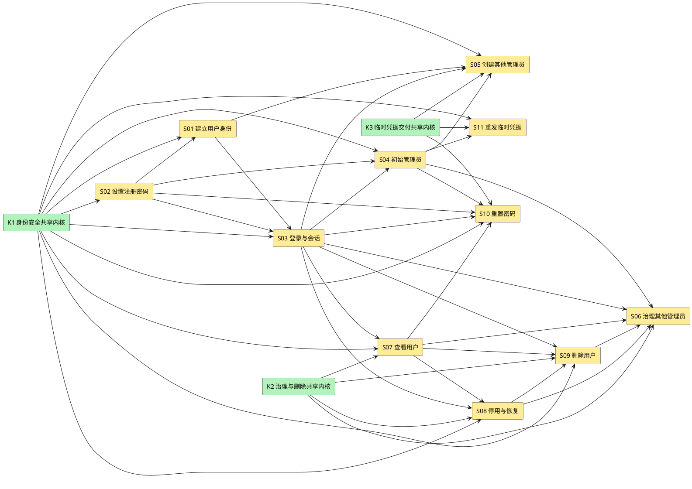

# identity-auth Story 清单

本文只保存 task-decompose 所需的设计切片，不创建 task、批次、认领或完成状态。详细契约以 [design.md](design.md) 为准。

## Story 依赖总览

**说明**：K1 包含公共错误、隐私/处理门禁、会话、同源、防暴力、审计与恢复；K2 包含治理 Policy、精确分页和 ArticleAccountPort；K3 包含 TemporaryCredential 状态机、强制 TLS Mailer、幂等和 SMTP 残余窗口。它们是 design §3.3.1 的共享前置，不是额外业务 Story。S11 的运行前提是 S05 或 S10 已产生可重发上下文，但实现依赖只指向 K3 与 S04，避免把“或”误画成两个必须完成的前置。

## S01 · 建立用户身份

**来源**：`US-IDENTITY-01.1`  
**用户价值**：访问者获得独立、可登录且不会与现有或删除墓碑标识冲突的身份。  
**设计引用**：[design.md §3.3.2](design.md#332-story建立用户身份us-identity-011)

**范围**：当前隐私声明、部署处理门禁、注册请求、标识归一化、User/Identifier/PrivacyAcknowledgement 原子创建、唯一性冲突与审计。

**主成功场景**：
1. 访问者读取并确认当前隐私声明。
2. 提交用户名、邮箱、手机号、由 S02 验证的密码和声明版本。
3. 服务校验 ProcessingGate，原子占用三个标识、记录确认并建立 active member。
4. 返回 201 用户摘要，不自动创建会话。

**扩展场景**：未确认/过期声明、部署输入缺失、字段缺失、已删除用户名、保留期内邮箱/手机号、并发唯一冲突、审计失败。

**验收**：
- 三个标识分别唯一且并发下最多创建一个账号。
- 已删除用户名永久拒绝复用。
- 邮箱/手机号 Identifier 清理前拒绝复用，清理后只重新进入唯一性校验。
- 失败不留下 User 或部分 Identifier。
- 隐私版本、时间、主体和来源与账号同事务；未确认不得创建。
- 不填具体地区、控制者、处理依据或 SMTP 处理方，缺失时能力 fail closed。

**依赖**：K1、S02；ADR-0013、ADR-0014、ADR-0016、ADR-0017。

**划分理由**：纵切完整注册身份结果；密码算法单独由 S02 承担，便于安全基准和实现责任清晰。

**不纳入**：邮箱/手机号验证、自动登录、用户资料编辑。

## S02 · 设置注册密码

**来源**：`US-IDENTITY-01.2`  
**用户价值**：用户凭据满足业务规则并以不可逆摘要安全存储。  
**设计引用**：[design.md §3.3.3](design.md#333-story设置注册密码us-identity-012)

**范围**：密码规则、Argon2id 编码、自描述参数、敏感数据隔离。

**主成功场景**：密码满足至少 8 位、同时包含字母和数字，生成随机盐并保存 Argon2id 编码。

**扩展场景**：规则失败、哈希资源错误、参数配置缺失、旧参数重哈希。

**验收**：
- 数据库、日志、错误、审计和响应均无明文密码。
- 编码包含算法版本、参数、盐与摘要。
- 参数未配置时启动失败，不使用弱默认值。

**依赖**：K1；ADR-0012；已批准 `golang.org/x/crypto`；目标环境参数基准 TBD。

**划分理由**：密码处理是横切安全能力，但由注册、登录、改密和临时凭据共同消费，需先形成独立可验证底座。

**不纳入**：初始管理员首次改密具体策略，仍受 Q1 阻塞。

## S03 · 登录社区与建立会话

**来源**：`US-IDENTITY-02.1`  
**用户价值**：注册用户获得可撤销的已认证状态，失败者不能枚举账号。  
**设计引用**：[design.md §3.3.4](design.md#334-story登录社区us-identity-021)

**范围**：same-origin/login CSRF、统一失败认证、credential_mode/临时凭据状态机、Session Cookie、CSRF、防暴力、Principal 与审计。

**主成功场景**：
1. 用户从可信同源提交用户名和密码。
2. 服务检查持久化账号/来源退避并按 credential_mode 验证唯一凭据路径。
3. 创建新 Session；如请求已有 Session，撤销旧会话。
4. 设置 `__Host-han_session`，返回 CSRF Token 与用户摘要。

**扩展场景**：恶意 Origin/CORS、账号不存在、密码错误、停用、删除、`recovery_required`/`recovery_locked`、临时凭据过期/失效、旧永久密码、代理伪造、DB 故障、退避。

**验收**：
- 所有认证失败均返回 `401 auth.login_failed` 和等价消息。
- 成功 Cookie 具备 Secure、HttpOnly、SameSite 和 `__Host-` 约束。
- Cookie 与 CSRF 原值不入库，服务端只存摘要。
- 登录成功和失败均产生最小必要审计。
- TemporaryCredential current 行过期或恢复失效时统一失败，绝不回退永久密码。
- 防暴力计数跨重启保留；账号维度阻断不改变统一登录失败。
- 灾备恢复后的永久密码、Session 和临时凭据均不可登录；非初始账号在核对前统一失败。

**依赖**：K1、S01、S02；ADR-0005、ADR-0014、ADR-0016、ADR-0018。

**划分理由**：纵切认证入口、会话状态和浏览器防护，直接形成 article-management 的 Principal 前置。

**不纳入**：退出登录、MFA、第三方登录；会话期限数值 TBD。

## S04 · 建立并保护初始管理员

**来源**：`US-IDENTITY-03.1`  
**用户价值**：系统首次可用时具备唯一且永久受保护的管理入口。  
**设计引用**：[design.md §3.3.5](design.md#335-story建立初始管理员账号us-identity-031)

**范围**：首次启动 bootstrap、独立 recovery secret、active/verify-only RecoveryJournal keyring 跨版本防重放、唯一初始管理员、恢复信任根和强制改密。

**主成功场景**：数据库不存在 admin 时读取受控密码，创建 initial admin；首次登录后只允许读取自己和改密。

**扩展场景**：并发启动、环境变量缺失、已存在 admin、停用/删除/撤权/他人重置尝试。

**验收**：
- 重复启动不覆盖既有凭据。
- 初始密码不进入项目文件、日志、错误或审计。
- 初始 admin 四类受保护动作全部拒绝。
- onboarding Gate 未完成时其他业务返回 `auth.must_complete_onboarding`。
- bootstrap/recovery secret 使用不同配置键和运行门禁；恢复 secret 缺失、错误或复用时保持停服。
- recovery secret 只重建既有 initial admin，首次恢复登录必须强制改密。
- 每次恢复使用唯一 run ID 和版本化 HMAC 指纹；Journal Begin/Consumed 与 RecoveryRun 双向一致后才可开放。
- 同 run 或跨 run secret 指纹复用、Journal 损坏/只读/部分写入均保持停服。
- Begin 必须用 active 与全部 verify-only retained key 计算候选指纹；secret 在 v1 consumed 后以 active v2/v3 重放仍被拒绝。
- 新 Journal 记录只用唯一 active key；历史记录仍有效时对应 key 不得退役。缺 key、未知 key、只迁 Journal/active key或 keyring 不完整均停服。

**依赖**：K1、S02、S03；ADR-0007；初始轮换和首次改密规则 Q1。

**划分理由**：启动接入与公共 HTTP 接入不同，单独切片能明确配置、并发和阻塞范围。

**不纳入**：后续轮换实现；Q1 未决前该部分不得标可直接实施。

## S05 · 创建其他管理员账号

**来源**：`US-IDENTITY-03.3`  
**用户价值**：初始管理员可安全扩充管理员队伍，失败时不留下未交付账号。  
**设计引用**：[design.md §3.3.6](design.md#336-story创建其他管理员账号us-identity-033)

**范围**：分级授权、信息提供声明、标识唯一性、管理员设置临时密码、强制 TLS SMTP、处理方门禁、幂等、双 Gate、审计和 residual window。

**主成功场景**：初始 admin 确认当前信息提供声明并携带 Idempotency-Key 创建账号；强制 TLS SMTP 受理后提交 User、TemporaryCredential、声明、AuditEvent 和幂等结果；新管理员完成改密与当前隐私确认后开放其他能力。

**扩展场景**：声明缺失/过期、处理方门禁缺失、越权、标识冲突、同键重放/冲突、TLS/证书失败、SMTP 未受理、SMTP 已受理后 DB 提交失败、仅完成一个 onboarding Gate。

**验收**：
- 仅初始 admin 可调用。
- SMTP 未受理时不存在管理员账号。
- 同键同摘要只创建一次并返回原结果。
- residual window 返回 `identity.operation_uncertain`，邮件凭据不可用且可由 trace 定位。
- 未同时完成改密和当前隐私确认时，其他管理员能力统一拒绝。
- 邮件 purpose 只允许事务性临时凭据，不存在营销入口。
- onboarding 确认版本必须在最终开放事务中等于 current notice；声明换版只重锁尚未完成 onboarding 的账号。

**依赖**：K1、K3、S01、S03、S04。

**划分理由**：纵切管理员创建的完整业务成功判据，不能拆成“先建账号、后发邮件”的两个可独立完成切片。

**不纳入**：邮件正文与 SMTP 超时数值。

## S06 · 管理其他管理员账号

**来源**：`US-IDENTITY-03.4`  
**用户价值**：初始管理员维护其他管理员，普通管理员无法越权。  
**设计引用**：[design.md §3.3.7](design.md#337-story管理其他管理员账号us-identity-034)

**范围**：管理员查询、停用、恢复、删除、撤权、会话撤销和审计。

**主成功场景**：初始 admin 对非初始管理员执行合法治理动作，权限变化后旧会话失效。

**扩展场景**：普通管理员调用、目标是 initial admin、目标不存在、并发状态变化、重复撤权。

**验收**：
- 初始 admin 是唯一治理者。
- 撤权后目标不能用旧会话继续执行管理动作。
- 停用/恢复目标状态幂等；删除不可恢复。
- 所有高风险结果有 AuditEvent。
- 灾备恢复后仅 initial admin 可在维护模式逐账号核对；无法按 RPO 证明角色/状态/删除事实的账号保持 `recovery_required` 且不授权。

**依赖**：K2、S03、S04、S07、S08、S09；密码重置复用 K3。

**划分理由**：同一目标类别共享一致权限与保护规则，作为管理员队伍治理的纵切 Story。

**不纳入**：普通管理员自助资料或密码修改。

## S07 · 查看用户

**来源**：`US-IDENTITY-03.5`  
**用户价值**：管理员只看到履职所需且自己有权治理的用户信息。  
**设计引用**：[design.md §3.3.8](design.md#338-story查看用户us-identity-035)

**范围**：普通用户/管理员列表与详情、版本化签名游标、精确 envelope、最小披露和查询权限。

**主成功场景**：普通管理员查看普通用户；初始 admin 查看普通用户和其他管理员。

**扩展场景**：非管理员、普通管理员探测管理员或自己、不存在目标、空列表。

**验收**：
- Summary 不含邮箱/手机号，Detail 才返回当前活动联系字段。
- 任何视图不含密码摘要、临时凭据、Session、retained_email 或审计 metadata。
- 不可治理目标不被普通管理员枚举。
- 排序稳定，分页游标不重复或遗漏。
- 空页/末页 `next_cursor:null`、`has_more:false`；非法、过期或过滤不匹配游标返回 `request.invalid_cursor`。

**依赖**：K1、K2、S03；ADR-0014。

**划分理由**：查询不改变状态，可与写治理独立实施和测试，但其范围必须复用同一权限策略。

**不纳入**：删除墓碑查询界面、审计查询界面。

## S08 · 停用与恢复用户

**来源**：`US-IDENTITY-03.6`  
**用户价值**：管理员即时控制账号可用性，恢复时不破坏文章治理事实。  
**设计引用**：[design.md §3.3.9](design.md#339-story停用与恢复用户us-identity-036)

**范围**：目标状态幂等、权限复核、User 状态转换、会话撤销、审计和作者状态只读接缝。

**主成功场景**：停用 active 用户并撤销全部会话；恢复 suspended 用户为 active。

**扩展场景**：已在目标状态、越权目标、并发删除、审计失败。

**验收**：
- 重复停用/恢复返回稳定成功与 `changed=false`。
- 每次请求都重新鉴权和核目标资格。
- 停用成功后旧 Session 下一请求立即失败。
- 不批量写 Article；article-management 只读 `User.status`。

**依赖**：K1、K2、S03、S07；S1～S3 接缝。

**划分理由**：目标状态幂等和文章派生可见性构成完整纵切，不与删除终态混合。

**不纳入**：文章状态写入。

## S09 · 删除用户与建立墓碑

**来源**：`US-IDENTITY-03.7`  
**用户价值**：管理员不可恢复地删除账号，同时完整保留文章与标识生命周期约束。  
**设计引用**：[design.md §3.3.10](design.md#3310-story删除用户us-identity-037)

**范围**：权限、User 墓碑、永久用户名、条件邮箱/手机号、Session/凭据失效、文章无归属化、审计和专用邮箱清理接缝。

**主成功场景**：identity 编排同一事务写 deleted 墓碑并调用 ArticleAccountPort；全部成功后返回 204。

**扩展场景**：目标不存在/受保护、撤回请求转交、日常删除、恢复 kept_deleted 重放、article 写失败、零文章立即清理、多文章后续清理、违规文章、审计失败、并发状态动作。

**验收**：
- 任一失败不产生半墓碑或半无归属文章。
- 删除后账号不能登录或恢复。
- 用户名永久拒绝复用；email/phone Identifier 清理前拒绝复用。
- 违规状态不因删除改变。
- retained_email 只在 article 完成事实成立后清理。
- 删除时 `pending_orphan_count=0` 必须同事务清理 retained_email/email Identifier。
- 撤回请求仍由具备既有权限的管理员执行，不新增运营或自助权限。
- kept_deleted 必须调用与日常删除相同的 canonical 协调：User/Identifier/Session/永久与临时凭据、Article author/held/orphaned_from、违规保留、retained_email 与 AuditEvent 同时成立。
- 有文章、零文章和含违规文章三类恢复矩阵任一子步骤失败时，RecoveryAccountReview 不得完成且 readiness 保持关闭。

**依赖**：K1、K2、S03、S07、S08；article-management S4/S5；ADR-0010、ADR-0013、ADR-0016、ADR-0017。

**划分理由**：跨模块原子事务必须作为一个纵切 Story，不能拆成独立身份删除与文章清理 task 后再补偿。

**不纳入**：phone 等其他标识的最终清理条件，仍为 Q2。

## S10 · 重置用户密码

**来源**：`US-IDENTITY-03.10`  
**用户价值**：获授权管理员为用户恢复访问，未交付凭据不会生效。  
**设计引用**：[design.md §3.3.11](design.md#3311-story重置用户密码us-identity-0310)

**范围**：分级权限、服务端随机临时密码、credential_mode、强制 TLS SMTP/处理方门禁、幂等、会话撤销、最新凭据和审计。

**主成功场景**：SMTP 受理后提交最新 TemporaryCredential、撤销会话、设置强制改密和审计。

**扩展场景**：越权、目标不存在、同键冲突、SMTP 未受理、residual window、重复重置。

**验收**：
- 普通用户可由任一有效管理员重置；其他管理员仅初始 admin 可重置；initial admin 不可被重置。
- 成功后旧临时凭据和永久密码均不能绕过最新临时凭据。
- 最新临时凭据过期或恢复失效时统一登录失败，仍不得回退永久密码。
- SMTP 未受理时原凭据和 Session 状态不变。
- 成功响应不含临时密码。
- IdempotencyRecord 为 `recovery_review_required` 时，同键同摘要返回 `identity.operation_uncertain`，普通请求不得自动执行。

**依赖**：K1、K3、S02、S03、S04、S07。

**划分理由**：凭据替换、邮件成功判据、会话撤销和审计必须同一纵切完成。

**不纳入**：普通用户自助找回。

## S11 · 重发临时密码邮件

**来源**：`US-IDENTITY-03.11`  
**用户价值**：未收到邮件的用户可获得新的最新临时凭据，失败不破坏旧值。  
**设计引用**：[design.md §3.3.12](design.md#3312-story重发临时密码邮件us-identity-0311)

**范围**：按凭据 purpose 分级授权、新 generation、强制 TLS SMTP/处理方门禁、幂等、旧值失效时点和审计。

**主成功场景**：生成下一 generation，SMTP 受理并提交后新值生效、旧值 superseded。

**扩展场景**：普通管理员重发新管理员凭据、无可重发上下文、SMTP 未受理、residual window、同键重放。

**验收**：
- 新管理员凭据仅初始 admin 可重发。
- 普通用户密码重置邮件可由有权重置该用户的管理员重发。
- 失败时旧临时凭据保持原有效状态。
- 成功后只有最新 generation 可登录，且有效期从新生成时起 7 天。
- 同键异摘要在 recovery_review_required 状态仍冲突；只有受控恢复动作可转 failed 或新 generation processing。

**依赖**：K1、K3、S04；运行前提：S05 或 S10 已产生可重发的 current TemporaryCredential。

**划分理由**：重发具有独立授权和“成功才替换旧值”的失败语义，不与首次创建/重置合并。

**不纳入**：重复发送旧临时密码、文章转移通知重发。

## 公共验收与范围

所有 Story 共同满足：

- 共享内核和跨模块合同与 identity boundary r11、article boundary r12 的 S1–S16 一致。
- REST 错误为 `{code,message,field_errors?,trace_id}`。
- Cookie 写请求通过会话绑定 CSRF Header。
- 浏览器登录 same-origin，拒绝跨源 credentialed CORS；再次登录成功撤销旧会话。
- 注册隐私确认、管理员信息提供声明和新管理员双 Gate 可核对。
- SMTP 只允许事务性 purpose，并强制 TLS/证书链/主机名/处理方门禁。
- 凭据、Session、CSRF 不进入日志、审计、错误或响应快照。
- 高风险业务状态与 AuditEvent 同事务；审计失败时业务 fail closed。
- 数值型会话期限、容量、限流、连接池、SMTP 超时、幂等/审计保留期保持 TBD。
- 初始管理员轮换和首次改密规则未拍板，S04 相关实施切片保持阻塞；其他 Story 不因此改变已确认合同。
- 数据库恢复后全部永久密码、Session 和 current TemporaryCredential 失效；非初始账号 suspended+recovery_required；initial admin 用独立 recovery secret 重建信任根；不确定幂等进入 recovery_review_required；无法重建默认不授权，失败保持停服。
- kept_deleted 重放完整 canonical 删除，不新增文章恢复；RecoveryJournal 与 RecoveryRun 身份侧对账完成后进入 ArticleDeletionGate 前置。
- Recovery Journal 与完整 active/verify-only keyring 整体备份迁移；retained key 判重性能维度保持 TBD。
- 身份恢复达到 identity_ready 后仍须等待 article-owned ArticleDeletionGate 重放全部有效 tombstone，并完成 DeletionOperation/Audit 对账；两个 namespace 独立验证后才可 MarkConsumed 和开放 readiness。
- identity 只消费 ArticleDeletionReplayStatus，不拥有 Article Deletion Journal、DeletionOperation、Article 状态或文章恢复能力。
- ReplayStatus 必须绑定当前 run_id、RecoveryRun.backup_ref 和 `article-deletion` namespace，并携带受支持 evidence_version 与可重算 digest；backup A 的 ready 不得用于 backup B。
- 崩溃续跑必须按 `ReadStatus(run_id,backup_ref)` 重读；Journal head、inventory、operation/audit 摘要或计数变化使旧 ready 失效，unknown/failed/不可读均禁止 MarkConsumed/open。
- producer/consumer 共用 ADR-0020 唯一 v1 fixture：20 个字段，canonical 固定前 16 个，排除 `status/evidence_digest/evidence_ref/completed_at`；唯一重放字段名为 `tombstones_replayed`。
- identity 只从完整 DTO 重算 SHA-256 canonical JSON；缺失/额外/null/错误类型、任意替代命名、错 backup 或二次 ref/digest 变化均 fail closed。
- ready variant 固定 20 个非 null 字段，`inventory_scope` 为 string；共享 fixture digest 固定为 `sha256:169e0f30407867083598ab146c950968e1b5f508ed4fd5d5198bb61e788926a7`。
- unavailable variant 只含 `evidence_version,run_id,backup_ref,namespace,status,reason_code`，status 仅 `pending/unknown/failed`；identity 收到后立即 fail closed，不重算 digest。
