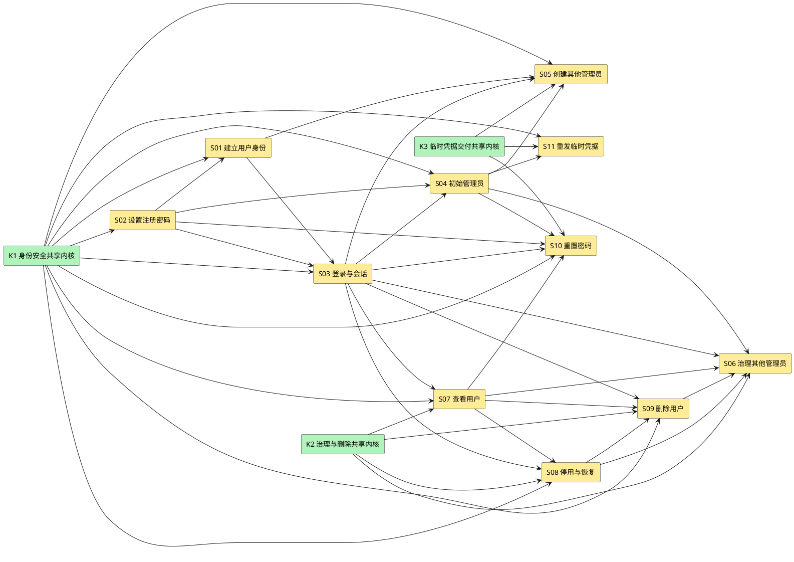

# identity-auth Story 清单

本文只保存 task-decompose 所需的设计切片，不创建 task、批次、认领或完成状态。详细契约以 [design.md](design.md) 为准。

r17 仅按 design r50/architecture r32、ADR-0027 r02 同步原 S04 与公共恢复验收；输入 r16 SHA256 `8B2F13A7BA112C798E750E54AD9BFC7C9D4F20C88DB9BB2662CD43245D3FC6F7`。Main 已采用五个方向并授四文件写窗，本版仍 draft/待非作者评审和精确人的接纳，不把其余 Story 重新认定为全量对账。identity 当前 boundary r13 不提升 accepted，恢复仅复用原已接收 r11 的 S13–S16 语义、accepted article对应合同和ADR-0027；没有第三业务特性、Task或新 StoryID。

r17 同版返工仅承接 RECOVERY-DES-R01 两项 HIGH：F001 维护 Session/原子强改密、F002 restored 受控 reset/原子结算，精确依据及接口见 design §4.2 同名小节。原 R01 CHANGES REQUIRED 保留，两项待 Kuhn 对新SHA复审，作者不标 CLOSED/PASS；不把 metadata 独立 PASS 当技术通过，不扩其他 Story/原日常 reset 合同。

**本轮恢复增量现行元数据（2026-10-29）**：初稿/返工说明中的“待独立评审／两项 OPEN”保留为各自提交时的历史；RECOVERY-DES-R01 CHANGES REQUIRED → Kuhn [R02报告](../../../../../.spec/wip/recovery-runtime/evidence-design-r01/review-r02/review-report.md)／[receipt](../../../../../.spec/wip/recovery-runtime/evidence-design-r01/review-r02/receipt.md) 有界设计复审 PASS，F001/F002 均 CLOSED（仅设计层），OPEN/LIMITED/NEW=0；Main 已全文核报告、receipt、修复 diff 并技术接收。R02 结论仅适用报告列明的受审 SHA，不倒签原 R01，也不预签本次最终元数据核验。

**本轮实际产出者**：Banach／add-feature-designer／runtimeID `01a18389-57ab-7b70-8c86-82a61e7729f1`（Agent 来源，非人的签字）；版本仍 r17、status 仍 draft、人的精确接纳 unknown，不代 implementable/checkpoint/Code/Case/test PASS。ADR/index 的最终 SHA 刷新由 Arch 另串行处理。

## Story 依赖总览

**说明**：K1 包含公共错误、隐私/处理门禁、会话、同源、防暴力、审计与恢复；K2 包含治理 Policy、精确分页和 ArticleAccountPort；K3 包含 TemporaryCredential 状态机、强制 TLS Mailer、幂等，以及按 purpose 分流的交付权威：`new_administrator` 继续 ADR-0011 SMTP 残余窗口，普通用户 `password_reset` 使用 ADR-0023 operation/recovery outbox、租约 worker 和认证消费者 fail-closed Gate。它们是 design §3.3.1 的共享前置，不是额外业务 Story。S11 的运行前提是 S05 或 S10 已产生可重发上下文，但实现依赖只指向 K3 与 S04，避免把“或”误画成两个必须完成的前置。

## S01 · 建立用户身份

**来源**：`US-IDENTITY-01.1`  
**用户价值**：访问者获得独立、可登录且不会与现有或删除墓碑标识冲突的身份。  
**设计引用**：[design.md §3.3.2](design.md#332-story建立用户身份us-identity-011)

**范围**：当前隐私声明、部署处理门禁、注册请求、标识归一化、User/Identifier/PrivacyAcknowledgement 原子创建、唯一性冲突与审计。

**主成功场景**：
1. 访问者读取并确认当前隐私声明。
2. 提交用户名、邮箱、手机号、由 S02 验证的密码和声明版本。
3. 服务校验 ProcessingGate，原子占用三个标识、记录确认并建立 active member。
4. 返回 201 用户摘要，不自动创建会话。

**扩展场景**：未确认/过期声明、部署输入缺失、字段缺失、已删除用户名、保留期内邮箱/手机号、并发唯一冲突、审计失败。

**验收**：
- 三个标识分别唯一且并发下最多创建一个账号。
- 已删除用户名永久拒绝复用。
- 邮箱/手机号 Identifier 清理前拒绝复用，清理后只重新进入唯一性校验。
- 失败不留下 User 或部分 Identifier。
- 隐私版本、时间、主体和来源与账号同事务；未确认不得创建。
- 不填具体地区、控制者、处理依据或 SMTP 处理方，缺失时能力 fail closed。

**依赖**：K1、S02；ADR-0013、ADR-0014、ADR-0016、ADR-0017。

**划分理由**：纵切完整注册身份结果；密码算法单独由 S02 承担，便于安全基准和实现责任清晰。

**不纳入**：邮箱/手机号验证、自动登录、用户资料编辑。

## S02 · 设置注册密码

**来源**：`US-IDENTITY-01.2`  
**用户价值**：用户凭据满足业务规则并以不可逆摘要安全存储。  
**设计引用**：[design.md §3.3.3](design.md#333-story设置注册密码us-identity-012)

**范围**：密码规则、Argon2id 编码、自描述参数、敏感数据隔离。

**主成功场景**：密码满足至少 8 位、同时包含字母和数字，生成随机盐并保存 Argon2id 编码。

**扩展场景**：规则失败、哈希资源错误、参数配置缺失、旧参数重哈希。

**验收**：
- 数据库、日志、错误、审计和响应均无明文密码。
- 编码包含算法版本、参数、盐与摘要。
- 参数未配置时启动失败，不使用弱默认值。

**依赖**：K1；ADR-0012；已批准 `golang.org/x/crypto`；目标环境参数基准 TBD。

**划分理由**：密码处理是横切安全能力，但由注册、登录、改密和临时凭据共同消费，需先形成独立可验证底座。

**不纳入**：周期轮换、定期过期、密码历史或高于已接受基线的新复杂度。Q1 已接受；本 Story 的实现与验证仍未完成。

## S03 · 登录社区与建立会话

**来源**：`US-IDENTITY-02.1`  
**用户价值**：注册用户获得可撤销的已认证状态，失败者不能枚举账号。  
**设计引用**：[design.md §3.3.4](design.md#334-story登录社区us-identity-021)

**范围**：same-origin/login CSRF、统一失败认证、credential_mode/临时凭据状态机、password-reset operation Gate、Session Cookie、CSRF、防暴力、Principal 与审计。

**主成功场景**：
1. 用户从可信同源提交用户名和密码。
2. 服务检查持久化账号/来源退避并按 credential_mode 验证唯一凭据路径。
3. 创建新 Session；如请求已有 Session，撤销旧会话。
4. 设置 `__Host-han_session`，返回 CSRF Token 与用户摘要。

**扩展场景**：恶意 Origin/CORS、账号不存在、密码错误、停用、删除、`recovery_required`/`recovery_locked`、临时凭据过期/失效、旧永久密码、代理伪造、DB 故障、退避。

**验收**：
- 所有认证失败均返回 `401 auth.login_failed` 和等价消息。
- 成功 Cookie 具备 Secure、HttpOnly、SameSite 和 `__Host-` 约束。
- Cookie 与 CSRF 原值不入库，服务端只存摘要。
- 登录成功和失败均产生最小必要审计。
- TemporaryCredential current 行过期或恢复失效时统一失败，绝不回退永久密码。
- 目标用户存在 unresolved/unknown/unreadable password-reset operation 时，Login 在验证凭据和创建 Session 前统一失败；Session resolve 不返回 Principal，查询故障也不得放行。
- 防暴力计数跨重启保留；账号维度阻断不改变统一登录失败。
- 灾备恢复后的永久密码、Session 和临时凭据均不可登录；非初始账号在核对前统一失败。

**依赖**：K1、S01、S02；ADR-0005、ADR-0014、ADR-0016、ADR-0018。

**划分理由**：纵切认证入口、会话状态和浏览器防护，直接形成 article-management 的 Principal 前置。

**不纳入**：退出登录、MFA、第三方登录；会话期限数值 TBD。

## S04 · 建立并保护初始管理员

**来源**：`US-IDENTITY-03.1`  
**用户价值**：系统首次可用时具备唯一且永久受保护的管理入口。  
**设计引用**：[design.md §3.3.5](design.md#335-story建立初始管理员账号us-identity-031)

**范围**：首次启动 bootstrap、独立 recovery secret、active/verify-only RecoveryJournal keyring 跨版本防重放、唯一初始管理员、恢复信任根和强制改密。

**主成功场景**：正常启动先取得 design §4.2 的可信 genesis/完整历史正向准入；随后数据库不存在 admin 时读取受控密码，创建 initial admin；首次登录后只允许读取自己和改密。空库/缺表本身不授首装权。

**扩展场景**：并发启动、环境变量缺失、已存在 admin、停用/删除/撤权/他人重置尝试。

**验收**：
- 重复启动不覆盖既有凭据。
- 初始密码不进入项目文件、日志、错误或审计。
- 初始 admin 四类受保护动作全部拒绝。
- onboarding Gate 未完成时其他业务返回 `auth.must_complete_onboarding`。
- bootstrap/recovery secret 使用不同配置键和运行门禁；恢复 secret 缺失、错误或复用时保持停服。
- recovery secret 只重建既有 initial admin，首次恢复登录必须强制改密。
- F001：同 run/安装/Runtime代际的 maintenance-scope Session 在 RecoveryRequired=true/recovery_bootstrap 下仅达 me/password；普通 resolver 仍要求 false/ordinary，非initial及其他维护写拒绝，不提前清flag。
- 强改密在一个 User-first/Store 事务写永久摘要、auth generation、仅initial的false flag、run change审计证明并轮换维护Session；ACK loss精确回读，已提交零重置，新密码可重新维护登录。Resume不覆盖已改密码。
- 维护→普通切换先禁新维护动作、真实join、撤全部维护Session及能力；公共开放后用新永久密码重新普通登录，不把维护cookie升级普通权限。
- 每次恢复使用唯一 run ID 和版本化 HMAC 指纹；Journal Begin/Consumed 与 RecoveryRun 双向一致后才可开放。
- 同 run 或跨 run secret 指纹复用、Journal 损坏/只读/部分写入均保持停服。
- Begin 必须用 active 与全部 verify-only retained key 计算候选指纹；secret 在 v1 consumed 后以 active v2/v3 重放仍被拒绝。
- 新 Journal 记录只用唯一 active key；历史记录仍有效时对应 key 不得退役。缺 key、未知 key、只迁 Journal/active key或 keyring 不完整均停服。
- normal 每次重建从 closed 开始：完整 Store/双 namespace/安装绑定/精确 publication历史逐一闭合才内部准入，failed/缺行优先；合法删除后 article head 连续前进不误拒重启，不 Consume/Refresh/修 pending。
- 受控 `recovery enter/resume/verify`、ENV/allowlist/probe、genesis/可信迁移、DB restore driver 回执与未知暂停以 design §3.3.1/§4.2 为唯一合同。Begin 必须排空/独占后且实际 DB 替换前确认；不接受 caller Done、静态mode或上一进程true。
- running 身份终结/信任根/review/canonical/幂等核对后才进入现有 Consume；首次 fresh 双读/同 publication/ref/digest/time、双 namespace、MarkConsumed/最终 succeeded 后，三 worker（含 Article notice）内部调谐实际就绪才公共开放。
- startup Reconcile 具有有效内部许可时可在 PublicReady=false 运行；controlled Replay 中 Append 仅允许精确 committed operation 幂等读。normal构造/reader零repair；暂存/pending/unknown与不完整来源关闭。
- 健康append只解除自身临时屏障；故障upgrade/失锁/取消必须禁止新普通claim、真实join，不能迟到成功自动开放。普通server/recovery/requeue互斥，保留S10.5原SID/签名/epoch与软件边界。

**依赖**：K1、S02、S03；ADR-0007；Q1 已接受的统一改密合同。

**划分理由**：启动接入与公共 HTTP 接入不同，单独切片能明确配置、并发和阻塞范围。

**不纳入**：周期轮换、定期过期、密码历史或其他未授权复杂度。bootstrap 首次、recovery bootstrap 首次和后续正常改密统一调用 `PUT /api/v1/users/me/password`，新密码至少 8 位且同时含字母和数字；首次成功前保持强制改密 Gate，成功后撤销其他 Session 并轮换当前 Session。Q1 已接受，但实现与验证仍未完成。

## S05 · 创建其他管理员账号

**来源**：`US-IDENTITY-03.3`  
**用户价值**：初始管理员可安全扩充管理员队伍，失败时不留下未交付账号。  
**设计引用**：[design.md §3.3.6](design.md#336-story创建其他管理员账号us-identity-033)

**范围**：分级授权、信息提供声明、标识唯一性、管理员设置临时密码、强制 TLS SMTP、处理方门禁、幂等、双 Gate、审计和 residual window。

**主成功场景**：初始 admin 确认当前信息提供声明并携带 Idempotency-Key 创建账号；强制 TLS SMTP 受理后提交 User、TemporaryCredential、声明、AuditEvent 和幂等结果；新管理员完成改密与当前隐私确认后开放其他能力。

**扩展场景**：声明缺失/过期、处理方门禁缺失、越权、标识冲突、同键重放/冲突、TLS/证书失败、SMTP 未受理、SMTP 已受理后 DB 提交失败、仅完成一个 onboarding Gate。

**验收**：
- 仅初始 admin 可调用。
- SMTP 未受理时不存在管理员账号。
- 同键同摘要只创建一次并返回原结果。
- residual window 返回 `identity.operation_uncertain`，邮件凭据不可用且可由 trace 定位。
- 未同时完成改密和当前隐私确认时，其他管理员能力统一拒绝。
- 邮件 purpose 只允许事务性临时凭据，不存在营销入口。
- onboarding 确认版本必须在最终开放事务中等于 current notice；声明换版只重锁尚未完成 onboarding 的账号。

**依赖**：K1、K3、S01、S03、S04。

**划分理由**：纵切管理员创建的完整业务成功判据，不能拆成“先建账号、后发邮件”的两个可独立完成切片。

**不纳入**：邮件正文与 SMTP 超时数值。

## S06 · 管理其他管理员账号

**来源**：`US-IDENTITY-03.4`  
**用户价值**：初始管理员维护其他管理员，普通管理员无法越权。  
**设计引用**：[design.md §3.3.7](design.md#337-story管理其他管理员账号us-identity-034)

**范围**：管理员查询、停用、恢复、删除、撤权、会话撤销和审计。

**主成功场景**：初始 admin 对非初始管理员执行合法治理动作，权限变化后旧会话失效。

**扩展场景**：普通管理员调用、目标是 initial admin、目标不存在、并发状态变化、重复撤权。

**验收**：
- 初始 admin 是唯一治理者。
- 撤权后目标不能用旧会话继续执行管理动作。
- 停用/恢复目标状态幂等；删除不可恢复。
- 所有高风险结果有 AuditEvent。
- 灾备恢复后仅 initial admin 可在维护模式逐账号核对；无法按 RPO 证明角色/状态/删除事实的账号保持 `recovery_required` 且不授权。

**依赖**：K2、S03、S04、S07、S08、S09；密码重置复用 K3。

**划分理由**：同一目标类别共享一致权限与保护规则，作为管理员队伍治理的纵切 Story。

**不纳入**：普通管理员自助资料或密码修改。

## S07 · 查看用户

**来源**：`US-IDENTITY-03.5`  
**用户价值**：管理员只看到履职所需且自己有权治理的用户信息。  
**设计引用**：[design.md §3.3.8](design.md#338-story查看用户us-identity-035)

**范围**：普通用户/管理员列表与详情、版本化签名游标、精确 envelope、最小披露和查询权限。

**主成功场景**：普通管理员查看普通用户；初始 admin 查看普通用户和其他管理员。

**扩展场景**：非管理员、普通管理员探测管理员或自己、不存在目标、空列表。

**验收**：
- Summary 不含邮箱/手机号，Detail 才返回当前活动联系字段。
- 任何视图不含密码摘要、临时凭据、Session、retained_email 或审计 metadata。
- 不可治理目标不被普通管理员枚举。
- 排序稳定，分页游标不重复或遗漏。
- 空页/末页 `next_cursor:null`、`has_more:false`；非法、过期或过滤不匹配游标返回 `request.invalid_cursor`。

**依赖**：K1、K2、S03；ADR-0014。

**划分理由**：查询不改变状态，可与写治理独立实施和测试，但其范围必须复用同一权限策略。

**不纳入**：删除墓碑查询界面、审计查询界面。

## S08 · 停用与恢复用户

**来源**：`US-IDENTITY-03.6`  
**用户价值**：管理员即时控制账号可用性，恢复时不破坏文章治理事实。  
**设计引用**：[design.md §3.3.9](design.md#339-story停用与恢复用户us-identity-036)

**范围**：目标状态幂等、权限复核、User 状态转换、会话撤销、审计和作者状态只读接缝。

**主成功场景**：停用 active 用户并撤销全部会话；恢复 suspended 用户为 active。

**扩展场景**：已在目标状态、越权目标、并发删除、审计失败。

**验收**：
- 重复停用/恢复返回稳定成功与 `changed=false`。
- 每次请求都重新鉴权和核目标资格。
- 停用成功后旧 Session 下一请求立即失败。
- 不批量写 Article；article-management 只读 `User.status`。

**依赖**：K1、K2、S03、S07；S1～S3 接缝。

**划分理由**：目标状态幂等和文章派生可见性构成完整纵切，不与删除终态混合。

**不纳入**：文章状态写入。

## S09 · 删除用户与建立墓碑

**来源**：`US-IDENTITY-03.7`  
**用户价值**：管理员不可恢复地删除账号，同时完整保留文章与标识生命周期约束。  
**设计引用**：[design.md §3.3.10](design.md#3310-story删除用户us-identity-037)

**范围**：权限、User 墓碑、永久用户名、条件邮箱/手机号、Session/凭据失效、文章无归属化、审计和专用邮箱清理接缝。

**主成功场景**：identity 编排同一事务写 deleted 墓碑并调用 ArticleAccountPort；全部成功后返回 204。

**扩展场景**：目标不存在/受保护、撤回请求转交、日常删除、恢复 kept_deleted 重放、article 写失败、零文章立即清理、多文章后续清理、违规文章、审计失败、并发状态动作。

**验收**：
- 任一失败不产生半墓碑或半无归属文章。
- 删除后账号不能登录或恢复。
- 用户名永久拒绝复用；email/phone Identifier 清理前拒绝复用。
- 违规状态不因删除改变。
- retained_email 只在 article 完成事实成立后清理。
- 删除时 `pending_orphan_count=0` 必须同事务清理 retained_email/email Identifier。
- 撤回请求仍由具备既有权限的管理员执行，不新增运营或自助权限。
- kept_deleted 必须调用与日常删除相同的 canonical 协调：User/Identifier/Session/永久与临时凭据、Article author/held/orphaned_from、违规保留、retained_email 与 AuditEvent 同时成立。
- 有文章、零文章和含违规文章三类恢复矩阵任一子步骤失败时，RecoveryAccountReview 不得完成且 readiness 保持关闭。

**依赖**：K1、K2、S03、S07、S08；article-management S4/S5；ADR-0010、ADR-0013、ADR-0016、ADR-0017。

**划分理由**：跨模块原子事务必须作为一个纵切 Story，不能拆成独立身份删除与文章清理 task 后再补偿。

**不纳入**：phone 等其他标识的最终清理条件，仍为 Q2。

## S10 · 重置用户密码

**来源**：`US-IDENTITY-03.10`  
**用户价值**：获授权管理员为用户恢复访问；任何提交不确定、cleanup失败或能力谱系不可证明时，账号持续 fail closed。
**设计引用**：[design.md §3.3.11](design.md#3311-story重置用户密码us-identity-0310)

**范围**：分级权限、随机临时密码、首次 reset 与普通用户 resend 的 User-first 原子候选创建、持久 operation/recovery outbox、唯一邮件发送权、租约 worker、Login/PasswordChange/Session resolve Gate、current capability root 与 immutable legal history、auth generation/lineage/settlement/integrity hold、双 worker production lifecycle、migration、幂等与审计。

**主成功场景**：锁定目标 User 后，对首次 reset 或普通用户 resend 的新 key，在一个事务中原子分配 execution generation并创建 IdempotencyRecord claim、PasswordResetOperation、exact pending TemporaryCredential 与 initial recovery job；原请求仅在 User-first 短事务明确提交 `prepared→dispatching` 后拥有一次邮件发送权。SMTP accepted 证据持久化后，请求或 worker 按 `User → Operation → Credential → Sessions → Idempotency/Audit` 原子激活 target generation、撤销旧 Session、写幂等成功和审计并终结 succeeded；resend 同事务 supersede old credential。用户通过 exact temporary credential 改密时，只有 Gate clear 且 exact succeeded lineage 可生成 target+1 永久 successor并轮换当前 Session。

**扩展场景**：候选四记录 crash、真实 key identity 冲突、无 operation 行插入竞态、prepare/dispatch/accepted/settlement commit-ack-loss、cleanup 双失败、stale candidate、三消费者竞态、resend/consumed 竞态、非法能力、正常 successor/后续改密/后续 reset、A→B permanent root 替换、A→B→current temporary C、`MarkUncertain` 与 succeeded 冲突、租约过期/dead-letter/受控命令、双 worker 任一失败、升级混跑与不可安全回退。

**验收**：
- 首次 reset 与普通用户 resend 的每个新 key，其 execution counter、首次 processing claim、operation、exact pending credential、initial job 在同一 User-first 事务中全有或全无；禁止独立 Claim 先提交或留下 counter gap。
- operation 保存真实 `scope_hash,key_locator,key_digest,digest_key_version,request_digest,execution_generation`；按 `(scope_hash,key_locator)` 定位并核验其余字段，复合 FK/唯一约束拒绝脱钩。
- 所有 create/claim/resend、Login、PasswordChange、Session resolve、worker与受控命令统一先锁 User，再按 Operation→Credential→Sessions→Idempotency/Audit；禁止 Operation-first。无 operation 行时 User 锁仍阻止并发插入。
- Session resolve 的 token/session预读不授权；caller-owned transaction 内锁 User、检查Gate/lineage、复核/必要时撤销Session，commit成功后才返回Principal；任一失败不返回Principal。
- `users.auth_generation` 单调；operation记录base/target generation与settlement，credential/session/permanent password保存可核验root lineage。只有exact succeeded operation/temporary credential可生成target+1合法永久successor。
- current capability root 只由 User 当前 credential mode/generation、current permanent source 或 current temporary lineage 证明“现在允许什么能力”；不得要求每个旧 succeeded operation 仍等于该 root。
- immutable legal history 由历史 operation、exact credential、User、base/target/settled/successor generation、delivery accepted、settlement、Idempotency identity及适用的predecessor/replaced关系共同证明；后续合法root替换不得改写该历史。
- unresolved竞态产生的永久摘要或Session必须原子失效；持久证据缺失、跨User、generation/operation/credential/幂等identity不一致、非法delivery/settlement/lineage或current能力自身不可解释时进入持久integrity hold。三消费者和新reset均拒绝，只有worker/受控命令证明收敛并审计后清除；瞬时读取失败只fail closed，不新写hold。
- A 后正常改密、A→B 且 B 已替换 current permanent root、A→B→current temporary C 均保留 A 的合法历史：A 原 key replay原终态；新 key 把 A 当current上下文时普通 stale/ineligible并零claim/operation/credential/job/generation/hold写入。`current root != A` 不得单独成为 drift/hold 理由。
- User 锁内先分类同键：同键同摘要按原 operation 权威状态 replay，普通 retry不增generation、不生成秘密、不发第二封邮件；只有新 key 才检查 writer Gate并创建候选。operation unresolved时 replay 固定uncertain；terminal succeeded且settlement一致才replay success；failed/invalidated稳定replay对应结果；异摘要/异目标/异purpose冲突。
- 普通用户 resend 的 operation 保存 `request_kind=resend`、terminal `predecessor_operation_id` 与 current `replaced_credential_id`；new credential绑定本 operation/target generation。unresolved operation 或 integrity hold 时即使换 key 也零写入拒绝。
- resend unresolved期间 old credential 保持 active/current、new 保持 pending_delivery，但 Gate 阻断两者认证；SMTP明确未受理或 stale candidate 无 accepted 证据时只失效new并恢复old原规则；只有 succeeded settlement 同一事务激活new、supersede old、推进auth generation并撤销旧Session。
- 只有明确提交 `prepared→dispatching` 的原请求可发送一次；dispatch commit unknown时不发送。worker、same-key replay和受控命令均不得重发邮件；无durable accepted证据的stale prepared/dispatching/commit_unknown只能invalidated本次new candidate。
- dead-letter不解除Gate。仅受控运行角色可执行`retry`、`settle-failed-or-invalidated`、`confirm-succeeded`；命令共用租约/User-first锁序和审计，禁止直接UPDATE operation/job/IdempotencyRecord，失败继续Gate。
- migration包含六字段Idempotency候选UNIQUE/FK、execution counter、request kind、predecessor/replaced/delivery字段、operation/job、generation/lineage/settlement/hold、允许old active+new pending但分别限制settled current/in-flight candidate的部分唯一、CHECK/索引和legacy preflight；旧reset/resend writer停止后迁移，全部Gate与两个worker Reconcile成功后才开放；写新行后禁止回退旧二进制。
- production lifecycle同时保留Article deletion与PasswordReset worker owner；固定Reconcile/Start、任一失败触发、两个Stop各一次、shared deadline内并发Wait、稳定错误优先级/聚合、两worker停止后close Article资源并最后close DB pool；Article现役生命周期必须回归。
- 验证覆盖两类候选四记录/counter原子crash、真实key identity、same-key replay、unresolved/hold换key拒绝、old/new时点、no-row barrier/deadlock、Session resolve commit barrier、四个commit点的committed/not-committed/unknown、cleanup双失败、login/resend/consumed竞态、stale candidate、合法successor/后续reset、A→B root替换、A→B→current temporary C、逐字段drift对照、MarkUncertain冲突、hold、worker settlement、受控dead-letter、migration/回退与双worker lifecycle。
- Q1 已接受：bootstrap首次、recovery bootstrap首次和后续正常改密统一使用`PUT /api/v1/users/me/password`、至少8位且同时含字母数字；首次成功前强制改密，成功撤销其他Session并轮换当前Session。实现/验证仍未完成；不扩展周期轮换或密码历史。

**依赖**：K1、K3、S02、S03、S04、S07；ADR-0023。

**划分理由**：原子 claim、operation权威、认证线性化、能力谱系和durable收敛必须作为一个纵切验证，不能拆成同步cleanup与独立幂等补丁。

**不纳入**：普通用户自助找回、外部消息系统、新公共错误码、周期轮换或密码历史。

**S10 Story 的maintenance增量（2026-10-28；关联task `identity-auth-S10.5`，r49合同修订）**：真实映射为`S10` → `US-IDENTITY-03.10` → design r49 §3.3.11/§9.4.3；不新增Story。原FD Ohm产出，Lead按用户建议授权实际采纳合作deadline＋mandatory join＋全部numeric端点整包；正式来源见design引lead-adoption.json。历史r48 Design R02 PASS仅对原冻结六对象，CODE R01原两HIGH保留，CODE R02仅对F002固定源码修订CLOSED，F001仍OPEN，当前状态见Review/Tasks；本版非人的accepted/checkpoint或新PASS，r16头部/其他Story原样保留。

- 单命令`han-server maintenance password-reset retry`仅stdin signed request；实际Windows owner SID＋不同主体Ed25519审批、canonical/13-string metadata的唯一协议为ADR-0026 r04，系统引用architecture r31。pre-DSN不复用Session/ENV身份；零server/listener/Serve/worker/Reconcile/migration/bootstrap/mail，其他平台只拒维护，普通server不变。
- 原D及K=D+ShutdownBudget数值不增大、TTL/业务窗口不重开；D停止新业务，cleanup C=min(开始+显式budget,K)为合作取消/IO中断截止。**撤回K前全部SDK/进程完成保证**；不可抢停的已开始CPU/native阶段必须实际join，可能越期，若底层不返回进程也可能不返回，禁止detach/父进程Kill冒清理。到期及最终单调时刻核查overrun并粘性保留，实际清理后原成功变failed6、stdout空；unknown5优先，其他已有非零主错误保持。明确commit/Audit事实不改，不补DB业务/timeout Audit；取消/信号不因已提交改exit0。Root与Operator同一分类，无新API/DTO/ENV。
- 必需七ENV及Config四字段保留，无默认；只改变维护预算语义及DSN支持面。pre-DSN六非DSN及authority原检查不变；parse成功后primary和所有fallback须为数值IPv4/IPv6，hostname/隐式localhost等invalid_config2、OS lookup/connect0。Lookup本地literal返回、numeric Dial不调用DefaultResolver，不把wrapper结束当GetAddrInfoW join；TLS验证/SNI及普通server不变，部署IP/证书匹配未验。正连接budget>MaxConns仍独立post-parse拒绝，不将两个配置负例混称唯一。
- F001 native输入继续独占匿名byte-pipe串行Peek/仅正available有限ReadFile，实际EOF、取消优先、输入goroutine/callback0、关闭前无pending IO；来源/跨dup唯一消费是launcher前提，OS属性不自证。正常及时EOF须可达，新合同不放宽输入去敏/上限/零DSN；旧六次普通取消不冒证明。
- User-first/完整signed before/hold=false非terminal-pending仅job→ready，nextAt=max(old,now)、attempt不减不重置，不清hold/改terminal/发信。one enqueue不保证one attempt，保留MaxRetries2→5反例；再次dead_letter须新审批/ID/before。F003显式ReadCommitted、全局UUID scalar上限/绑定先于text Get，无行不再Get；Audit同tx及P/after/receipt精确保真、原receipt不改，Commit不明unknown非零，不另开核验。
- SDK资源继续唯一owner登记、constructor阶段/SDK连接/实际借用归还后permit、SDK Close先触发→CleanupDone实际完成→pool回收；迟到/失败/asyncClosing及BeforeClose共享mutex/once，禁与SDK业务调用并发Close。C/K不冒CPU可抢停；TLS transport deadline（含清空/放宽）不得被内部+5s/SDK15s覆盖，越期仍真实join，不以零socket冒constructor完成。F002关闭仅限其CODE R02固定修订，不冒新合同/完整CODE PASS。
- 既有恰七路径见design，不增第八文件/go.mod/依赖/配置名/业务wire。Root/Operator U＋真实SDK-peer/原语＋第五carrier同binary/真实PG层次分开；旧r48 FAIL/raw保留，新验收核cutoff时仍活、最终join后非零，不能删旧失败冒绿。TE待稳定新对象修订原02/11/15/20/21/22及资源矩阵，原25 CaseID和其他回归不变；FD不写testplan/TaskPlan，不替运行计PASS。
- AUTH选择仍明确；受保护launcher/ENV/DSN/ACL/key登记签发、部署数值IP/TLS证书、人员归属、撤销/恢复epoch、第二真实SID及E2E仍未验。Root-ready/组合CLI-PG HOLD，后续规划/代码复查按实际新成果接续；本轮FD未运行Go/PG/CLI或读取实际DSN/secret。

**交付状态约束**：r16 同步 design r40，并继续回引 architecture r27（SHA256 `A153AC6DEA7BD725EA9470D2D2933396EE9A2F12399CC11FDEC2CB97B4E443CB`）。本修订只关闭 durable lineage 设计歧义，不改变公共合同、schema或 ADR-0023 核心；`IDENTITY-DESIGN-R37-S10.1-R02-F006` 保持 CLOSED，r39 Design Review Gate 保持 PASS，r40 新增设计增量仍待独立 Review Gate。`IDENTITY-S10.2-REV-R01-F003` 与代码 `IDENTITY-S10.1-REV-R01-F002` 仍 OPEN，S10.1 为 implementation stopped；S10.2 保持 active，但受 r40 增量影响暂停实现且不得关闭；S10.3 与 B6D 不得启动。不得据本清单声称 r40 已 approved/implementable/production-ready 或实现/验证完成。

## S11 · 重发临时密码邮件

**来源**：`US-IDENTITY-03.11`  
**用户价值**：未收到邮件的用户可获得新的最新临时凭据，失败不破坏旧值。  
**设计引用**：[design.md §3.3.12](design.md#3312-story重发临时密码邮件us-identity-0311)

**范围**：按凭据 purpose 分流安全权威、分级授权、新 generation、强制 TLS SMTP/处理方门禁、幂等、operation/job/Gate/worker、current capability root/immutable legal history 分类、旧值失效时点、migration/回退和审计。

**主成功场景**：`new_administrator` 继续 ADR-0011：SMTP受理并提交后新值生效。普通用户 `password_reset` 在User锁内先分类同键；新key在单事务分配N+1 execution generation并原子创建claim、successor operation、exact pending credential与job，原请求取得持久一次发送权后调用SMTP；accepted settlement同一事务激活new、supersede old、推进auth generation、撤销旧Session并完成幂等/审计。

**扩展场景**：普通管理员重发新管理员凭据、无可重发上下文、两purpose串线、unresolved/hold、SMTP未受理、ADR-0011 residual window、prepare/dispatch/accepted/settlement commit-ack-loss、stale prepared/dispatching、同键重放、A→B/A→B→temporary C旧历史、worker settlement、PasswordChange consumed竞态、升级混跑与回退。

**验收**：
- `new_administrator` 凭据仅初始 admin 可重发，继续 ADR-0011 SMTP受理/数据库提交与residual-window合同；不得创建PasswordResetOperation/job或误用普通用户Gate。
- 普通用户 `password_reset` 邮件可由有权重置该用户的管理员重发；route/target决定purpose，客户端不能提交purpose。每个新业务候选使用新Idempotency-Key、新operation ID和N+1 execution generation；same-key replay保持原operation/generation。
- 普通用户新key必须在User-first单事务创建execution counter增量、IdempotencyRecord claim、successor operation、exact pending credential和initial job，全有或全无；operation精确绑定六字段identity、predecessor operation、replaced old credential与target auth generation。
- User锁内先分类同键；同键同摘要按operation的unresolved/succeeded/failed/invalidated权威状态重放，零新generation/秘密/邮件；异摘要、异目标或异purpose冲突。只有key不存在时才检查writer Gate并创建新候选。
- 同键 succeeded 重放只验证该 operation 的 immutable legal history，不要求其仍为 current root；A 后合法正常改密、reset B root替换或current temporary C均不得改变A原重放结果。
- existing unresolved operation、integrity hold、predecessor/old credential不一致，或old已consumed/superseded/expired/recovery_invalidated时，即使换key也拒绝且零claim/operation/credential/job。
- 普通用户 resend 非终态时old保持active/current、new为pending_delivery，但Login、PasswordChange、Session resolve和新reset/resend均被Gate拒绝；数据库允许一条settled current与一条in-flight candidate共存，不允许第二个pending候选。
- SMTP明确未受理时只invalidated/failed本次new，old/auth generation/Session保持；Gate清除后old恢复原规则。SMTP accepted settlement成功时才同事务激活new、supersede old、推进auth generation并撤销旧Session；成功后只有new generation可登录，有效期从本次新秘密生成时起7天。
- 只有明确提交`prepared→dispatching`的原请求拥有一次发送权；该提交ack-loss时不发送。worker、replay、受控命令永不重发；stale prepared/dispatching/commit_unknown无durable accepted证据时只失效new，即使provider实际受理，邮件秘密也不可用。
- prepare、dispatch claim、accepted result、settlement任一commit-ack-loss或cleanup双失败都保持durable unresolved Gate；worker按租约和统一锁序只做数据库settlement。dead-letter不解除Gate，受控命令失败继续Gate。
- PasswordChange先consume old时resend零写入拒绝；resend先提交unresolved operation时PasswordChange被Gate拒绝。历史replay和后续resend不得改写当前能力。新 key 若引用已被合法 B/C 替换的旧 A，必须普通 stale/ineligible且不写hold；只有历史/current具体证据缺失、跨User或关系非法才drift/hold。
- migration/backfill必须覆盖execution counter、request kind、predecessor/replaced/delivery字段、FK/UNIQUE/CHECK/索引与old-active/new-pending约束；停旧reset/resend writer后前向部署，purpose router、Gate、atomic/dispatch repository和PasswordReset worker未齐时普通用户分支fail closed；写入新operation后禁止回退旧二进制。
- 验证矩阵至少覆盖两purpose零串线、四记录/counter crash、same-key replay、unresolved/hold换key、old/new三阶段、四个commit点、stale candidate、worker不发邮件、consumed竞态、A→B与A→B→temporary C普通stale、逐字段drift对照、migration/混跑/回退。

**依赖**：K1、K3、S04；运行前提：S05 或 S10 已产生可重发的 current TemporaryCredential。

**划分理由**：重发具有独立授权和“成功才替换旧值”的失败语义；业务Story独立，但普通用户分支必须复用S10/ADR-0023的唯一durable安全权威，不能保留operation旁路。

**不纳入**：重复发送旧临时密码、文章转移通知重发。

## 公共验收与范围

所有 Story 共同满足：

- 共享内核和跨模块合同与 identity boundary r13、article boundary r12 的 S1–S16 一致。
- REST 错误为 `{code,message,field_errors?,trace_id}`。
- Cookie 写请求通过会话绑定 CSRF Header。
- 浏览器登录 same-origin，拒绝跨源 credentialed CORS；再次登录成功撤销旧会话。
- 注册隐私确认、管理员信息提供声明和新管理员双 Gate 可核对。
- SMTP 只允许事务性 purpose，并强制 TLS/证书链/主机名/处理方门禁。
- 凭据、Session、CSRF 不进入日志、审计、错误或响应快照。
- 高风险业务状态与 AuditEvent 同事务；审计失败时业务 fail closed。
- 依据 ADR-0023、design r40 与 architecture r27（SHA256 `A153AC6DEA7BD725EA9470D2D2933396EE9A2F12399CC11FDEC2CB97B4E443CB`），首次 reset及每个普通用户 resend 新key的claim/operation/exact credential/job必须同一User-first事务；同键先分类且零新副作用，普通用户resend必须使用新operation/execution generation、dispatch ownership、old/new settlement和stale candidate合同。current capability root 只证明当前能力，immutable legal history 独立保留合法多代历史；合法A→B/A→B→temporary C不得仅因root不同写hold。三个认证Gate、PasswordReset worker及现役Article worker必须由唯一production composition协调装配；缺任一项时对应writer/认证/Article路径fail closed；两worker停止后才关闭Article资源，最后pool；dead-letter不解除Gate。
- 依据 ADR-0023，password-reset 一旦写入 operation/job，不得回退到不理解 Gate 的旧二进制；混跑旧 writer/reader 必须由部署 Gate 阻断，只允许前向修复。
- 数值型会话期限、容量、限流、连接池、SMTP 超时、幂等/审计保留期保持 TBD。
- Q1 已接受：bootstrap首次、recovery bootstrap首次和后续正常改密统一使用 `PUT /api/v1/users/me/password`，至少8位且同时含字母数字；首次成功前强制改密，成功撤销其他Session并轮换当前Session。实现与验证仍未完成；不增加周期轮换、密码历史或其他复杂度。
- 数据库恢复后全部永久密码、Session 和 current TemporaryCredential 失效；非初始账号 suspended+recovery_required；initial admin 用独立 recovery secret 重建信任根；不确定幂等进入 recovery_review_required；无法重建默认不授权，失败保持停服。
- F002 restored：同running run/pending目标、已强改密initial批准及可信role/status/evidence精确绑定，专用恢复资格复用 durable candidate/operation/lineage/单次SMTP/lease；不调用拒绝locked目标的日常资格与普通SetCredentialMode，日常条件不改。
- accepted由同一identity executor的受控无Mailer结算driver驱动，普通三worker不运行；一个短事务同时激活exact新凭据、推进代际/可信role-status、清该目标flag、完成operation/claim/job/review及审计才204。trusted status=suspended保持停用；旧unknown/hold/dead-letter先依原Gate合法收敛、不清保护。终态重试/ACK loss核全证据，零新reset/SMTP，部分不明保持pending/503；全部合法终结才identity_ready。
- kept_deleted 重放完整 canonical 删除，不新增文章恢复；RecoveryJournal 与 RecoveryRun 身份侧对账完成后进入 ArticleDeletionGate 前置。
- Recovery Journal 与完整 active/verify-only keyring 整体备份迁移；retained key 判重性能维度保持 TBD。
- 身份恢复达到 identity_ready 后仍须等待 article-owned ArticleDeletionGate 重放全部有效 tombstone，并完成 DeletionOperation/Audit 对账；两个 namespace 独立验证后才可 MarkConsumed 和开放 readiness。
- identity 只消费 ArticleDeletionReplayStatus，不拥有 Article Deletion Journal、DeletionOperation、Article 状态或文章恢复能力。
- ReplayStatus 必须绑定当前 run_id、RecoveryRun.backup_ref 和 `article-deletion` namespace，并携带受支持 evidence_version 与可重算 digest；backup A 的 ready 不得用于 backup B。
- fresh恢复执行崩溃续跑仍按 `ReadStatus(run_id,backup_ref)` 重读；Journal head、inventory、operation/audit 摘要或计数变化使旧 ready 失效，unknown/failed/不可读均禁止 MarkConsumed/open。normal重启另按 design §4.2 的精确历史published closure核验，不把当前Facts变化当历史失效，也不把历史查询用于首次fresh开流。
- producer/consumer 共用 ADR-0020 唯一 v1 fixture：20 个字段，canonical 固定前 16 个，排除 `status/evidence_digest/evidence_ref/completed_at`；唯一重放字段名为 `tombstones_replayed`。
- identity 只从完整 DTO 重算 SHA-256 canonical JSON；缺失/额外/null/错误类型、任意替代命名、错 backup 或二次 ref/digest 变化均 fail closed。
- ready variant 固定 20 个非 null 字段，`inventory_scope` 为 string；共享 fixture digest 固定为 `sha256:169e0f30407867083598ab146c950968e1b5f508ed4fd5d5198bb61e788926a7`。
- unavailable variant 只含 `evidence_version,run_id,backup_ref,namespace,status,reason_code`，status 仅 `pending/unknown/failed`；identity 收到后立即 fail closed，不重算 digest。
- 本 stories r16 仅同步 design r40 的 durable lineage 历史/current 分离，并继续回引 architecture r27（SHA256 `A153AC6DEA7BD725EA9470D2D2933396EE9A2F12399CC11FDEC2CB97B4E443CB`）；不创建task，不改变test-plan/tasks/batch plan。F006 保持 CLOSED，r39 Design Review Gate 保持 PASS；r40 新增设计增量仍待独立 Review Gate。F003 与代码 F002 仍 OPEN，S10.1 为 implementation stopped；S10.2 保持 active，但受 r40 增量影响暂停实现且不得关闭；S10.3 与 B6D 不得启动；不表示 r40 已 approved、implementable、production-ready 或实现/测试/部署完成。
