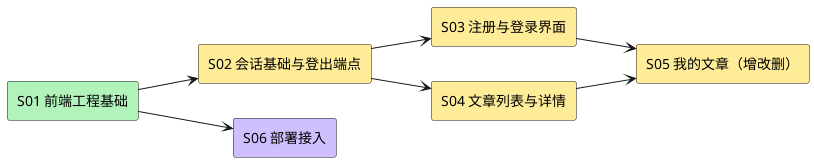

# web-spa Story 清单

本文只保存 `task-decompose` 所需的设计切片，不创建 task、批次、认领或完成状态。详细契约以 [design.md](design.md) 为准，业务验收以 [requirements-web-spa.md](../../requirements/requirements-web-spa.md) 为准。

## Story 依赖总览

## Story 清单

| ID | 名称 | 覆盖需求 | 依赖 | 交付形态 |
|---|---|---|---|---|
| S01 | 前端工程基础 | （支撑全部 US） | 无 | `web/` 脚手架：Vite + React + TS、lint、测试脚手架、目录结构、CI 可执行的 `build` |
| S02 | 会话基础与登出端点 | US-WEB-01.2 第 5 条、US-WEB-01.3 | S01 | 后端新增 `POST /api/v1/sessions/logout` + 前端会话 context、探测、401 处理、CSRF 注入 |
| S03 | 注册与登录界面 | US-WEB-01.1、US-WEB-01.2、US-WEB-01.3 | S02 | `/register`、`/login` 页面与错误映射 |
| S04 | 文章列表与详情 | US-WEB-02.1、US-WEB-02.2 | S02 | `/`、`/articles/:id`，游标分页、空态、404 处理 |
| S05 | 我的文章（增改删） | US-WEB-03.1–03.3 | S03、S04 | `/me/articles`、`/me/articles/new`、`/me/articles/:id/edit`，删除确认 |
| S06 | 部署接入 | US-WEB-04.1 | S01 | 静态产物托管说明、`/api` 反代与 SPA 回退配置样例、HTTPS 前提核对 |

## 切片说明

### S01 · 前端工程基础

- 只搭骨架：路由挂载、构建脚本、lint、测试运行器；不含业务页面。
- 验收：`npm ci && npm run build` 成功；`npm run lint`、`npm run test` 可执行（空测试集允许但需有 runner）。
- 不修改 `add.manifest.yaml`（A5 未授权）。

### S02 · 会话基础与登出端点

- 后端：新增 handler + 路由 + 契约测试；`POST /api/v1/sessions/logout`，需会话与 CSRF，成功 204、未认证 401、幂等。
- 前端：`session` context（unknown/anonymous/authenticated）、启动探测（`GET /api/v1/articles?limit=1`）、统一 401 处理、`X-CSRF-Token` 注入。
- 验收：登出后同一会话再次请求受保护接口得到 401；会话与 token 不出现在 storage。

### S03 · 注册与登录界面

- 注册页展示隐私声明并要求确认；登录失败统一提示；成功后跳转原目标路径。
- 验收：US-WEB-01.1 的 5 条与 US-WEB-01.2 的 5 条逐条可观察（不含 E2E 环境）。

### S04 · 文章列表与详情

- 游标分页（`items` / `next_cursor`），列表项字段严格按 `model.go:291-298`。
- 验收：US-WEB-02.1/02.2；不可见内容统一「内容不可用」。

### S05 · 我的文章（增改删）

- 编辑页预填作者视图（`title/body/moderation_status/editable`）；若 G0 核实编辑要求 `If-Match`，本 Story 需补 ETag 往返（回写设计 A3）。
- 删除需二次确认。
- 验收：US-WEB-03.1–03.3。

### S06 · 部署接入

- 只产出配置样例与核对清单（反代 `/` 静态、`/api/**` 转发、SPA 回退、HTTPS、CSP/frame 头），不执行真实部署。
- 验收：US-WEB-04.1；真实环境 E2E 另立任务。
