# Han 内容发布社区 系统设计与架构说明

> **2026-10-29 r32 全局恢复 runtime**：依据本轮 Main 指定的三文档写入范围及用户再次授权“待确认/决策按建议值继续”，采用 [ADR-0027](../decisions/framework.md#adr-0027)。框架域负责恢复编排与正向准入，identity-owned Store 仍为唯一 run 权威；新增 §6.2.4、§9.1.1 并同步开发、部署与验证追踪。不重开已闭 S4.2/S10.5，不改 S13/S16、wire、SQL 或 worker 策略。实际采用不等于独立 Review、实现或人的成果 checkpoint；本文仍 draft，交 Main 现场核与非作者 Review 后供详细设计消费。下列 r31 及更早记录保留历史来源。

> **r32 / F001 作者修订（2026-10-29）**：Main 接受 Kuhn 独立 R01 的 MEDIUM `ARCH-R32-R01-F001`（报告 SHA256 `81BFE22BC1481630602176CDAD45AA19971BB7B3B328188CB91680DDDFDF0B53`），本次采用 ADR-0027 r02，补齐 article-owned Journal 锚定写者、可信迁移与失败协议，纠正“仅补历史 port”的遗漏。原作者稿/Review R01及原待复审记录保留；[Kuhn独立R02](../../../../.spec/wip/recovery-runtime/evidence-architecture-r32-r01/review-r02/review-report.md)已关闭F001／新增0（仅文档），Main已核收报告/receipt。本文仍draft／未实现／人的接纳unknown，不泛化为代码或环境PASS。

> **2026-10-28 r31 当前维护合同**：Epicurus依据Lead已实际采用的Phase A排名1整包（`cleanup-contract-adoption-r01/lead-adoption.json`，SHA256 `3ED915618A722E910835FB39D990DAF932786A4131EE6E87B131F8238ED5B84A`）同步ADR-0026 r04。维护D仅为停止新业务/合作取消deadline，C=min(cleanup_start+ShutdownBudget,D+ShutdownBudget)是可取消I/O合作清理截止；不可取消SDK/native阶段必须真实join，可能越期甚至无限等待。维护DSN只接受primary与全部fallback数值IPv4/IPv6；普通server/TLS验证/SNI不变。该公开预算语义和支持面确已改变，旧r30/r29说明只保留为当时历史，不作为当前硬完成承诺。CODE finding及Root-ready/combined CLI-PG状态以[正式cleanup复审R02](../../../../.spec/wip/identity-auth/review-code-s10.5-cleanup-r02.md)和[Tasks](../tasks/tasks.md)为准；本文draft，无新人的accepted/checkpoint或独立Review PASS。

> **历史 2026-10-28 r30 / F002 有界返工**：Epicurus 按本会话明确授权，仅将 §8.2 的 S10.5 维护配置引用收口到 ADR-0026 `adr-0026-r03` 的七项必需输入（3项维护专用 + 4项既有）。该修订响应正式 R01 `S105-DES-R01-F002`，不改变信任方案、one enqueue、预算或 F001/F003 合同；本文其他技术段落和旧确认记录保持原字节，仍为 draft，无新成果 accepted/checkpoint 或独立 Review PASS。下列 r29 说明保留为当时产出历史。

> **2026-10-28 r29 有界增量**：Arch-Designer Epicurus（Role ID `01a18106-6fce-7e60-8345-dd51ba9db6ff`）按本会话三文档授权，实际采用已接受的 [ADR-0026](../decisions/identity.md#adr-0026-password-reset-dead-letter-requeue-采用-windows-实际进程-sid-与离线审批签名-2026-10-28)，仅同步 §6.2.3、§6.3.4、§8.2/8.3、§9.1、§12 及元数据。Lead 已依据用户“待确认/决策采用建议继续”明确选用 Windows 实际 owner SID + 单独 approver Ed25519 签名、仅一 requeue；这不是旧双签方案。协议字段/版本/字节以 ADR-0026 为唯一 authority，FD 后续只做局部 Go/CLI 映射；本轮已按 TE r02 的 MaxRetries 2→5 反例及 Lead 决定收口为 one enqueue，不承诺一次自动尝试。
>
> **确认与证据边界**：本次是架构专业产出，不是独立 Review；r29 无新成果 accepted/checkpoint，故标 draft，旧 accepted/作者/评审/确认记录按原版本保留。软件实现与合成验证不要求已有生产 key；实际 launcher/ACL、主体/key 登记签发、部署、第二真实 SID 验证及运行均 NOT RUN。以下原 r28 归属与依据是历史记录，未改写来源。

> **产出归属说明**：`architecture-ir01-r28` 在 r27 已接受结构上关闭 article design r13 独立评审 `ARTICLE-DES-R13-S42-R01-F001` 的架构方向缺口：固定 `BackupInventoryReader` 的生产 authority、受控文件 provider、配置、严格 JSON manifest、交付 owner、唯一装配与 article S4.2/S4.4/S4.5 分工。本文不修改 article design、boundary、代码、任务或测试计划，也不处理同一评审的 F002/F003。
>
> **决策依据**：业务来源仍为 accepted requirements r16；本次输入为 article-management design r13（SHA256 `C90222F21923BE55B78DBF70CF339DDF75A53673C2C4DF1F6312C6F12F0D78D7`）及独立评审 r01（SHA256 `7FD43B16368F19A0C0F055AE0E9267CC16311FD3E05448A87829961EB1E1C0FC`）的 F001。当前用户于 2026-10-25 再次明确“待确认或决策项采用建议值并继续”，因此经架构权衡后原位修订 accepted ADR-0020，不新增竞争 ADR。该决定不改变公共 REST、权限、requirements 或 boundary，不引入远程服务、业务数据库 inventory authority、新第三方依赖或 S4.5 fixture fallback；retention、RPO、RTO、备份周期及容量数值继续 TBD。本轮只提供 Feature-Designer 必须消费的上游合同，不宣称 design 复审、实现、测试、真实恢复、部署、E2E 或 production readiness 完成。

## 1 简介

### 1.1 目的

本文确定 Han 内容发布社区首期的系统结构：模块边界与依赖方向、接口契约、数据所有权、部署形态与运行方式。本文是首期特性设计与任务拆解的结构依据；特性内部算法与页面交互由特性设计承担，不在本文展开。

### 1.2 范围

覆盖需求 `requirements-ir01-r16` 的 19 条 US。

不覆盖：评论、收藏、关注、标签（需求 §3.2 明确排除）；首期未确认的用户资料、退出登录、自助找回凭据与搜索等能力（需求 §3.3）。草稿与下线状态已明确不纳入首期，不再作为待确认能力。

### 1.3 文档结构

采用 4+1 视图组织。逻辑视图按「业务能力 → 领域对象 → 代码框架」三层递进；用例视图独立成节说明系统边界；开发、部署、运行三视图各自说明实现、交付与并发行为。需求到设计的映射见 §10。

### 1.4 利益相关人

| 角色 | 关注点 |
|---|---|
| 内容发布社区用户 | 注册、登录、文章浏览与作者自助管理的可用性 |
| 管理员（初始 `admin` 与其他管理员） | 用户治理、内容治理与越权阻断 |
| 项目负责人 | 交付范围、技术选型落地、初始凭据的安全注入 |
| 后续开发与实施者 | 模块边界、接口契约、数据所有权是否可直接实施 |

### 1.5 对已有架构的借鉴与反思

本项目为绿地项目，仓库内无既有代码可继承（`git log` 仅一个初始化提交，`git status` 显示尚无业务代码）。架构从需求推导，未从任何既有实现反推。

## 2 架构目标与关键质量属性

### 2.1 架构目标

首期目标是用最小结构跑通「注册 → 登录 → 创建文章并直接发布 → 按创建时间倒序分页浏览列表与详情 → 修改后立即展示 → 永久删除」的业务闭环，同时承载分级管理员账号治理与内容治理职责。结构上除 r03 的状态与权限约束外，还必须保证：**浏览器会话使用受保护的不透明 Cookie、会话轮换与 CSRF 合同**；**密码使用经基准确定参数的 Argon2id**；**公共错误最小披露**；**高风险写操作可幂等重放并追加审计**；**删除标识按 r15 生命周期清理**；**ADR-0011 路径的 SMTP 残余窗口被显式监控而非伪装为原子，普通用户 password-reset resend 则由 ADR-0023 durable operation 收敛**。

### 2.2 关键架构需求

对架构构成约束的是三类需求：跨模块状态联动、越权阻断、外部依赖的失败语义。权限判定散落在各模块会同时破坏前两类，因此权限与身份的判定位置在 §6.2 明确为单一归属。

**表2-1 关键架构需求列表**

| 需求名称 | 需求描述 | 需求来源 | 需求类别 | 优先级 | 需求编号 | 提出人 | 责任人 | 工作量 |
|---|---|---|---|---|---|---|---|---|
| 登录态即时失效 | 用户被停用或删除后立即结束其登录状态 | 客户痛点 | 功能 / 安全性 | 高 | US-IDENTITY-03.6、US-IDENTITY-03.7 | current-user | 待任务拆解阶段分配 | 待评估 |
| 一次性凭据交付 | 路由与目标决定 purpose：新管理员创建及 `new_administrator` resend 沿 ADR-0011；首次 password-reset 与普通用户 `password_reset` resend 沿 ADR-0023。普通用户每个新 resend 候选使用 successor operation/execution generation，旧值仅在 succeeded settlement 后永久失效 | 客户痛点 | 功能 / 可靠性 | 高 | US-IDENTITY-03.3、US-IDENTITY-03.10、US-IDENTITY-03.11 | current-user | 待任务拆解阶段分配 | 待评估 |
| 违规内容即时隐藏 | 管理员判定违规后文章立即隐藏且仅管理员可见；违规状态可与作者停用、无归属约束叠加 | 客户痛点 | 功能 / 安全性 | 高 | US-IDENTITY-03.6、US-IDENTITY-03.7、US-IDENTITY-03.12 | current-user | 待任务拆解阶段分配 | 待评估 |
| 无归属文章处置 | 删除用户时文章进入 `held` 并保持隐藏、保留违规判定；只有无归属文章可转移，成功后移除无归属约束，非违规公开、违规继续隐藏 | 客户痛点 | 功能 | 高 | US-IDENTITY-03.7、US-IDENTITY-03.8 | current-user | 待任务拆解阶段分配 | 待评估 |
| 分级管理员治理 | 初始 `admin` 不可被停用、删除、撤权或由他人重置；只有初始 `admin` 可查看、创建和治理其他管理员，普通管理员只能治理普通用户且不能治理自己 | 客户痛点 | 功能 / 安全性 | 高 | US-IDENTITY-03.1、US-IDENTITY-03.3、US-IDENTITY-03.4、US-IDENTITY-03.5、US-IDENTITY-03.6、US-IDENTITY-03.7、US-IDENTITY-03.10、US-IDENTITY-03.11 | current-user | 待任务拆解阶段分配 | 待评估 |
| 越权阻断 | 非作者不得修改文章；非管理员不得执行治理；普通管理员不得治理初始 `admin`、其他管理员或自己 | 市场需求 | 功能 / 安全性 | 高 | US-IDENTITY-03.2、US-IDENTITY-03.4、US-IDENTITY-03.5、US-IDENTITY-03.6、US-IDENTITY-03.7、US-IDENTITY-03.8、US-ARTICLE-03.1 | current-user | 待任务拆解阶段分配 | 待评估 |
| 凭据不落盘 | 初始凭据与所有临时密码的具体值不进入项目文件、示例、日志或版本库 | 客户痛点 | 安全性 | 高 | US-IDENTITY-03.1、US-IDENTITY-03.10、US-IDENTITY-03.11 | current-user | 待任务拆解阶段分配 | 待评估 |
| 文章永久删除 | 作者与管理员删除普通文章后对所有用户不可见且不可恢复 | 客户痛点 | 功能 | 中 | US-IDENTITY-03.2、US-ARTICLE-04.1 | current-user | 待任务拆解阶段分配 | 待评估 |
| 文章浏览与即时修改 | 文章仅含标题和正文；创建即发布且无草稿/下线；浏览提供创建时间倒序分页列表与详情，修改后立即展示最新内容 | 客户痛点 | 功能 | 高 | US-ARTICLE-01.1、US-ARTICLE-02.1、US-ARTICLE-03.1 | current-user | 待任务拆解阶段分配 | 待评估 |
| 通知失败不阻断转移 | 只有无归属文章可转移；新作者或已删除原作者邮件通知失败时文章转移结果仍然有效 | 客户痛点 | 韧性 | 中 | US-IDENTITY-03.8、US-IDENTITY-03.9 | current-user | 待任务拆解阶段分配 | 待评估 |
| 会话与登录失败防护 | 不透明 Cookie、CSRF、会话轮换；登录失败统一且不泄露账号存在性或状态 | 客户痛点 / 安全性 | 安全性 | 高 | US-IDENTITY-02.1、US-IDENTITY-03.6、US-IDENTITY-03.7 | current-user | 待任务拆解阶段分配 | 待评估 |
| 删除标识生命周期 | 用户名永久不复用；邮箱手机号按保留数据限制复用；通知邮箱按处置与快照条件清理 | 客户痛点 / 隐私 | 功能 / 隐私 | 高 | US-IDENTITY-01.1、US-IDENTITY-03.3、US-IDENTITY-03.7、US-IDENTITY-03.9 | current-user | 待任务拆解阶段分配 | 待评估 |
| 错误、幂等与审计 | 公共错误稳定且最小披露；高风险写入防重复；治理动作与业务状态同事务审计 | 安全设计 | 安全性 / 可服务性 | 高 | 19 条 US 的公共失败与高风险写入 | current-user | 待任务拆解阶段分配 | 待评估 |

**敏感场景**：删除用户触发文章归属与发布意图变更、停用用户触发派生可见性收缩、违规约束与其他隐藏约束叠加、无归属恢复或转移、密码重置与邮件投递的失败组合。这些场景在 §6.4、§9 与 §10 给出状态来源、转换与验收映射。

**未量化的属性**：并发规模、响应时间、可用性等级与采用率在需求 §2.2 中明确「尚无业务来源」。本文保留指标维度但不填数值，见 §4.2。

### 2.3 假设和约束

- 后端语言为 Go，且仅启用 `go-service` profile；未启用任何前端 profile。
- Go 工具链版本由项目负责人拍板为 **1.27**（本机实测 `go version go1.27.0 windows/amd64`）。
- PostgreSQL major 固定为 **18**；生产与 CI 使用仍受支持的最新 18.x patch，不把本次取证的 18.6 固化为长期补丁合同。
- 生产数据库连接串只从环境变量 **`HAN_DATABASE_DSN`** 读取，不支持别名、配置文件或代码内默认值。
- Article 生产备份 inventory 文件路径只从必填环境变量 **`HAN_ARTICLE_BACKUP_INVENTORY_PATH`** 读取；值必须是无首尾空白、`filepath.Clean` 后字节不变的绝对路径，不支持别名、相对路径、配置文件、目录扫描、代码默认值或 fixture fallback。
- 生产 HTTP 监听地址只从必填环境变量 **`HAN_HTTP_ADDR`** 读取，无代码默认值；只接受单个 TCP `IP:port`，其中 host 为 IPv4 或方括号 IPv6 字面量，port 为 `1–65535`。
- 生产 metrics 监听地址只从必填环境变量 **`HAN_METRICS_ADDR`** 读取，无代码默认值；仅暴露 `/metrics`，地址校验规则与 `HAN_HTTP_ADDR` 相同，并由部署网络策略限制访问。
- 双 server 关闭预算只从必填环境变量 **`HAN_SHUTDOWN_BUDGET`** 读取，无代码默认值；实现基线 `10s`，合法范围 `1s..60s`。
- `han-server` 每次启动时先校验全部生产配置并构造不依赖数据库的 logger、metrics 与 Login/Origin observer，再连接数据库、构造 failure auditor 并自动执行迁移；任一配置、依赖构造、连接、迁移或两个 listener 绑定失败时以非零状态退出，正常 HTTP 服务只能在 production composition 完整且两个 listener 均成功后开放。任一 server 异常或 `SIGTERM`/`SIGINT` 进入同一个有界关闭协调器；只有信号触发且两个 server、Serve loop、listener 与数据库池均成功收敛时退出码为 0，其他运行期终止均非零退出。
- 首期为单团队、单部署目标，无独立伸缩需求。
- 所有认证信息与临时密码不得进入版本库、示例或日志（`add.manifest.yaml` 的 `security_policy`）。
- 已批准的新增第三方运行依赖为密码哈希使用的 `golang.org/x/crypto/argon2` 与 PostgreSQL 数据访问使用的 `github.com/jackc/pgx/v5`；生产可观测性基线使用 Go 标准库与现有项目接口，不新增 SDK，不引入 ORM 或第三方迁移框架。
- 鉴权、文章所有权与内容安全相关变更必须经过评审。
- 首期不需要多形态支持（无公有云 / 私有云 / 边缘多形态差异），因此不引入形态抽象层。

#### 2.3.1 生命周期约束

首期只有一条产品线：单服务、单 PostgreSQL 18 数据库、单 SMTP 出口。软件版本与数据库结构之间的配套关系由同批次交付的版本化 SQL 维护，不允许只升级代码或只应用迁移；`han-server` 启动时自动把数据库推进到随包版本，成功后才按 `HAN_HTTP_ADDR` 建立单个 TCP 监听并开放正常 HTTP 服务。生产与 CI 在 major 18 内跟进仍受支持的最新 patch；跨 major 升级必须重新决策。SMTP 出口由配置注入，更换出口不改变代码。产品级 EOX 与器件寿命约束在本项目不适用。

## 3 架构原则

原则从项目已确认的约束推导，用于裁决后续设计分歧。

**表3-1 架构原则定义表**

| 维度 | 原则 | 来源 | 解读 | 落地方式 |
|---|---|---|---|---|
| 安全 | 授权判定单一归属 | 本项目需求 | 身份、角色与账号状态由身份认证模块唯一裁定，文章管理模块不得自行解释角色 | 【方法4】中间件与模块接口固定调用方向；评审核对是否出现旁路判定 |
| 安全 | 凭据不落盘 | 项目安全策略 | 口令与临时密码一律以摘要存储；明文仅存在于投递路径的瞬时变量 | 【方法3】日志与错误输出专项检查；【方法4】禁止在错误信息中回显凭据 |
| 安全 | 失败默认关闭 | 架构原则 §7 | 权限、账号状态与文章可见性判定在缺证据时按拒绝处理 | 【方法4】默认拒绝的中间件与查询条件 |
| 数据 | 状态单一写入者 | 架构原则 §4 | 用户状态由身份认证模块写；文章发布意图、违规状态与归属由文章管理模块写；有效可见性只派生不持久化 | 【方法2】数据所有权表（§6.4）明确归属，评审核对是否出现重复状态 |
| 数据 | 业务不变量由数据库兜底 | 本项目需求 | 用户名、邮箱、手机号分别唯一由约束保证，不依赖应用层查重 | 【方法3】迁移脚本与集成测试 |
| 交付 | 单一配置来源 | 架构原则 §6 | 配置仅来自环境变量；生产 DSN 与监听地址分别固定为 `HAN_DATABASE_DSN`、`HAN_HTTP_ADDR`，均无代码默认值 | 【方法4】启动时先校验两项配置；不在代码或文件内保留第二份配置 |
| 韧性 | schema 就绪后才开放服务 | ADR-0021 | `han-server` 启动内自动迁移；配置、连接、迁移或监听失败均非零退出，迁移成功后才 `net.Listen` | 【方法4】启动时序、调用门禁、失败清理与负例验证 |
| 可服务性 | 生产可观测性必须真实装配 | ADR-0022 | 测试 fake/no-op 不得注册为生产依赖；logger、metrics、observer、failure auditor、四项有界预算与两个 listener 完整后才开放业务路由 | 【方法4】composition root、启动/关闭门禁、协议 conformance、部署 Gate 与告警演练 |
| 安全 / 韧性 | Password reset 不确定结果持久 fail closed | ADR-0023 | PasswordResetOperation 是安全结果权威；Login、PasswordChange、Session resolve 不得由幂等记录或局部 cleanup 单独放行 | 【方法4】operation/job 约束、三消费者 Gate、租约 worker、升级/回退和竞态故障注入 |
| 交付 | 结构跟随业务边界 | 抽象原则 §1 | 包按业务模块划分，模块边界与依赖方向在目录上可见 | 【方法4】依赖方向评审；跨模块只走显式接口 |
| 演进 | 单实现不预造抽象 | 抽象原则 §3 | 仅当出现第二个真实实现时才提炼共同契约 | 【方法3】设计评审；邮件与仓储是已有两个真实实现的例外（见 §6.3） |
| 韧性 | 外部依赖显式声明失败语义 | 架构原则 §7 | 每处邮件调用必须明确是整体失败还是不影响主流程 | 【方法1】转换为需求，见 US-IDENTITY-03.3、US-IDENTITY-03.9、US-IDENTITY-03.10、US-IDENTITY-03.11 |

## 4 设计约束

### 4.1 License 约束

首期除 Go 标准库与自研代码外，已批准为 Argon2id 引入 `golang.org/x/crypto`（ADR-0012，依赖批准登记见 ADR-0009），并为 PostgreSQL 数据访问引入 `github.com/jackc/pgx/v5`（ADR-0021）。生产日志与 metrics exposition 使用 Go 标准库和项目内固定低基数 adapter，不为 ADR-0022 新增 SDK 或 module。其他第三方库仍须按技术选型合规规范提出变更请求；具体 module 版本由实现批次锁定并审查许可证与供应链。

### 4.2 性能约束

容量规格尚无业务来源，本文仅固定需测量的指标维度，目标值留待容量评估阶段：

| 指标维度 | 目标值 |
|---|---|
| 登录与文章读取的响应时间分位数（P95） | TBD（待容量评估阶段定） |
| 同时在线会话规模 | TBD（待容量评估阶段定） |
| 会话绝对期限与空闲期限 | TBD（待安全与使用场景评估阶段定） |
| 文章列表查询的单次返回上限 | TBD（待容量评估阶段定） |

ADR-0022 的 observer/auditor/shutdown 超时、Histogram buckets 与告警阈值是为了形成可部署、可诊断的**实现基线**，不是响应时间、可用性或流量承诺。容量实测后可以在 ADR-0022 固定合法范围内调整部署值、窗口与阈值；超出范围或改变指标语义、标签集合、线协议、失败合同、关闭顺序或公共响应时必须先修订 ADR/设计并评审。
| 数据库连接池上限 | 实现基线为可配置项，默认值在实现阶段确定；目标容量 TBD（待容量评估阶段定） |
| 会话记录与临时密码记录的清理周期 | TBD（待容量评估阶段定） |
| 登录与高风险接口限流 | TBD（待威胁与容量评估阶段定） |
| 幂等记录保留期与容量 | TBD（待客户端重试窗口与容量评估阶段定） |
| SMTP 连接与投递超时 | TBD（待目标 SMTP 环境测量阶段定） |

### 4.3 可靠性 / 可用性 / Safety

首期无可用性等级的业务来源，不设定 9 的级数。启动链保持 fail closed：`HAN_DATABASE_DSN` 或 `HAN_HTTP_ADDR` 缺失、空白、非法，数据库连接/Ping、迁移或监听失败，都使进程非零退出；运行期 `Serve` 异常返回也按进程失败处理并清理资源。服务不能以旧 schema、未知 schema 或未确认监听 endpoint 开放。临时凭据业务同样保持 fail closed，但 SMTP 与 PostgreSQL 不具备真正原子提交：ADR-0011 只为新管理员创建与 `new_administrator` resend 接受 SMTP 已受理而数据库最终提交失败的残余窗口；首次 password-reset 与普通用户 `password_reset` resend 按 ADR-0023 以持久 operation/job、三消费者 Gate 与租约 worker 治理 commit-ack-loss，幂等记录不得单独放行。文章转移通知仍为 best effort。功能安全约束在本项目不适用。

### 4.4 安全性 / 韧性 / 隐私保护

- 口令与临时密码使用 Argon2id 摘要；参数经目标环境基准测试确定，明文不进入日志、错误信息、审计或版本库。
- 浏览器会话使用不透明随机 Session Cookie，启用 `Secure`、`HttpOnly` 与 `SameSite`；认证成功和权限变化后轮换会话 ID，写请求校验会话绑定的 CSRF Header。
- 浏览器 API 默认 same-origin，禁止跨源 credentialed CORS；登录校验可信 Origin/Fetch Metadata，已有会话再次登录时撤销旧会话。
- 注册记录版本化隐私确认；管理员创建记录信息提供授权声明；新管理员在改密与隐私确认双 Gate 完成前不得使用其他管理员能力。
- 邮件仅用于事务性场景；SMTP 强制隐式 TLS 或 STARTTLS，并校验证书链和主机名，禁止明文、降级与 `InsecureSkipVerify`。
- 上线前登记地区、数据控制者、处理依据及获批准 SMTP 处理方；缺失时注册、管理员创建或邮件能力 fail closed，不声称自动法律合规。
- 公共 REST 错误只暴露稳定 `code`、用户可读 `message`、可选 `field_errors` 与 `trace_id`；登录失败使用统一结果。
- 创建管理员、密码重置与临时密码重发要求 `Idempotency-Key`；停用和恢复采用目标状态幂等。路由/目标决定 `new_administrator` 或 `password_reset` purpose，客户端不得提交或覆盖 purpose。
- Password reset（含普通用户 resend）受 ADR-0023 持久操作屏障约束：`PasswordResetOperation` 是安全结果权威，Login、PasswordChange、Session resolve 与新 reset/resend writer 在 operation 非终态、integrity hold、未知、非法、不可读或关系不一致时 fail closed；`IdempotencyRecord` 不得单独放行。
- 身份治理、凭据操作、文章治理、转移和永久删除写 PostgreSQL 追加式审计事件，并与业务状态同事务提交。
- 初始管理员凭据由环境变量在首次启动时注入，注入后不落盘（见 §6.3 与 ADR-0007）。
- 初始 `admin` 的保护规则在身份认证模块单点执行：任何操作者都不能停用、删除、撤销其管理员权限或重置其密码；初始 `admin` 只能通过正常改密流程修改自己的密码。
- 只有初始 `admin` 可以查看、创建、停用、恢复、删除、重置密码或撤权其他管理员；普通管理员只能治理普通用户，不得治理初始 `admin`、其他管理员或自己。
- 所有文章读写接口要求已认证身份；需求明确禁止匿名浏览。
- 已删除账号用户名永久保留；邮箱与手机号在对应保留数据存在期间不得复用。专用通知邮箱只用于文章转移，并在关联无归属文章全部处置且通知地址已独立留存后清理；其他删除标识清理条件仍待确认。
- 攻击防护量目标与最低服务能力水平无业务来源，不填数值。

### 4.5 易用性

新管理员创建与 `new_administrator` resend 只有在邮件成功受理后才返回成功；首次 password-reset 与普通用户 resend 还必须由 durable operation 安全 settlement 后返回成功。失败或不确定期间不展示新凭据为可用，且普通用户旧值只有 succeeded settlement 后才永久失效。除此之外的易用性目标在首期未确认。

### 4.6 可服务性

运维人员可通过 `HAN_DATABASE_DSN` 切换数据库连接，通过 `HAN_HTTP_ADDR` 选择单个 TCP IP endpoint，并通过其他已登记环境变量切换 SMTP 出口，不需要改代码或重新构建。两项生产启动变量均无代码默认值；`HAN_TEST_BASE_URL` 只供客户端测试使用，不能替代服务端监听配置。服务不提供独立的运维管理界面。

### 4.7 兼容性

首期无对外已发布接口，无向前兼容负担。内部接口的兼容策略在首个外部消费者出现时再定。

### 4.8 对操作系统的依赖

构建与一般业务运行依赖 Go 1.27 支持的操作系统；本机开发环境为 Windows 11。生产 `FileRecoveryJournal` 当前只支持已验证具备同目录原子替换、文件与目录持久化同步及进程退出自动释放 OS 独占锁语义的本地 POSIX 文件系统。Windows 构建可用于开发与非 Journal 路径，但生产 `FileRecoveryJournal` 初始化必须在任何外部状态变更前返回 unsupported；共享/NFS 类文件系统在锁与持久化语义未证明前同样不进入支持矩阵。未来 Windows provider 只有在可证明 DACL owner-only 边界时才可启用；安全描述符不可读/不可解释或存在未批准写 SID 时 fail closed。

### 4.9 对数据库的依赖

依赖 PostgreSQL 18 的唯一约束、检查约束、事务与 advisory lock。应用通过 `github.com/jackc/pgx/v5` 原生 API 和 `pgxpool` 访问数据库，不经 ORM 或通用数据库抽象层；生产连接串唯一入口为 `HAN_DATABASE_DSN`。用户名永久墓碑、邮箱/手机号条件保留、文章正交状态、幂等记录与追加式审计均以数据库约束兜底；高风险业务状态与 AuditEvent 同事务写入。迁移文件使用 `migrations/NNNN_name.sql`；项目内最小执行器维护 `schema_migrations`，按序把单个迁移与其成功记录放入同一事务，以 PostgreSQL advisory lock 排除并发执行，并在失败时停止。`han-server` 必须先同时校验 DSN 与 `HAN_HTTP_ADDR`，再验证数据库连接并执行迁移；只有 runner 成功返回后才能调用 listener。

### 4.10 对网管平台和网管组件的依赖

不适用：本项目无网管平台。

### 4.11 对外部系统的依赖

依赖 SMTP 邮件服务完成两类投递。SMTP 出口、凭据和超时均由环境变量注入，超时数值保持 TBD。新管理员创建与 `new_administrator` resend 在 SMTP 未受理时 fail closed，受理后数据库提交残余窗口按 ADR-0011 记录、告警并允许幂等重试。普通用户 `password_reset` resend 在 SMTP 前已建立持久 operation/job；worker 只做数据库 settlement，永不补发邮件。文章转移通知不影响转移结果。

### 4.12 出口管制需求的设计

需求阶段未提出出口管制要求，本文不引入相关选型约束。

### 4.13 其它

首期不引入消息中间件、缓存与外部身份提供方。这些组件在首期没有真实职责（架构原则 §3：不存在真实职责时不新增组件）。
## 5 用例视图

### 5.1 上下文模型

系统边界是「Han 内容发布社区」这一后端服务：它统一持有用户身份、账号状态、会话与文章数据，并通过配置的外部 SMTP 服务完成邮件投递。访问者、已认证用户、文章作者与管理员都是系统外部的人；SMTP 服务是唯一的外部系统。

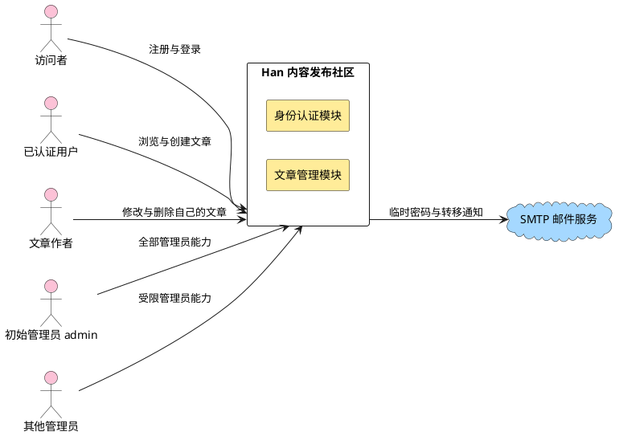

**说明**：图中两类人物通过同一服务入口进入，服务内部只分为身份认证与文章管理两个模块，两者共享同一数据库。系统对外的主动依赖只有一条边——向 SMTP 服务投递邮件，方向是系统发出。这条边是单向的：系统不接收 SMTP 的入站请求，因此邮件通道不构成攻击面入口。

颜色含义见附录 A：粉色为业务角色，黄色为本特性主体，蓝色为协议依赖。

**表5-1 系统对外接口**

| 接口类别 | 部件 | 接口 | 类型 | 功能 | SLA/规格 | 备注 |
|---|---|---|---|---|---|---|
| 软件接口 | 系统 | 对外 HTTP 接口 | REST + JSON over HTTP | 注册、登录、文章增删改查、管理员治理 | 响应时间 TBD（待容量评估阶段定） | 全部接口要求已认证身份，注册与登录除外 |
| 软件接口 | 系统 | SMTP 提交 | SMTP | 发送临时密码邮件与文章转移通知 | 连接与超时 TBD（待容量评估阶段定） | 出口参数由环境变量注入 |
| 软件接口 | 系统 | 数据库连接 | PostgreSQL 协议 | 持久化用户、会话、文章与通知记录 | 连接池上限目标 TBD（待容量评估阶段定） | 数据类型见 §6.4 |

### 5.2 关键用例模型

#### 5.2.1 关键用例

架构强相关的用例集中在三处：登录态与账号状态的联动、文章可见性随治理动作切换、管理员专属能力与普通用户能力的分离。

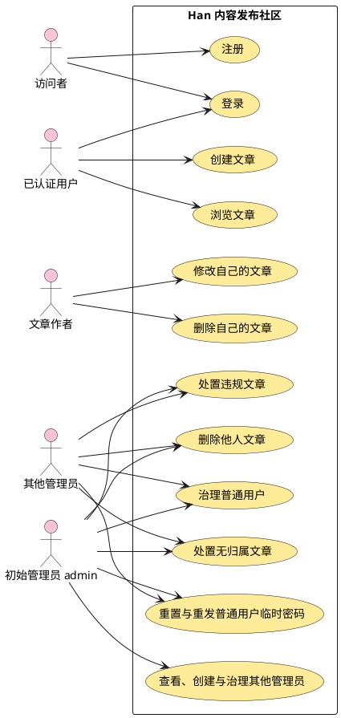

**说明**：初始 `admin` 连接全部管理员能力；其他管理员只连接普通用户治理、普通用户密码重置与重发、文章和内容治理，不连接任何管理员账号治理。初始 `admin` 自身不作为治理目标，只能走正常改密流程。路由与目标类型在服务端唯一决定 resend purpose：普通用户入口固定为 `password_reset` durable 路径，其他管理员临时凭据入口固定为 `new_administrator` ADR-0011 路径；客户端无 purpose 参数。连接关系与下表共同构成系统级权限合同。

**表5-2 管理员权限矩阵**

| 动作与目标 | 初始 `admin` | 其他当前有效管理员 | 普通用户 |
|---|---|---|---|
| 查看、停用、恢复、删除普通用户 | 允许 | 允许 | 拒绝 |
| 重置普通用户密码、重发其密码重置邮件 | 允许 | 允许 | 拒绝 |
| 查看、创建、停用、恢复、删除其他管理员 | 允许 | 拒绝 | 拒绝 |
| 重置其他管理员密码、重发新管理员临时密码邮件、撤销其他管理员权限 | 允许 | 拒绝 | 拒绝 |
| 停用、删除、撤销初始 `admin` 权限或重置其密码 | 拒绝；仅允许自己走正常改密 | 拒绝 | 拒绝 |
| 治理操作者自己 | 初始 `admin` 仅正常改密 | 拒绝停用、恢复、删除、重置或撤权自己 | 不适用 |
| 删除他人文章、处置无归属或违规文章 | 允许 | 允许 | 拒绝 |

权限判定同时检查操作者角色、操作者当前有效状态与目标账号类别；缺少任一证据即拒绝。普通管理员不能通过普通用户治理接口读取其他管理员或自己的受限制治理信息。

#### 5.2.2 交互场景

登录、创建、列表与详情浏览、作者修改构成首期的主链路，全部共享同一会话校验入口。

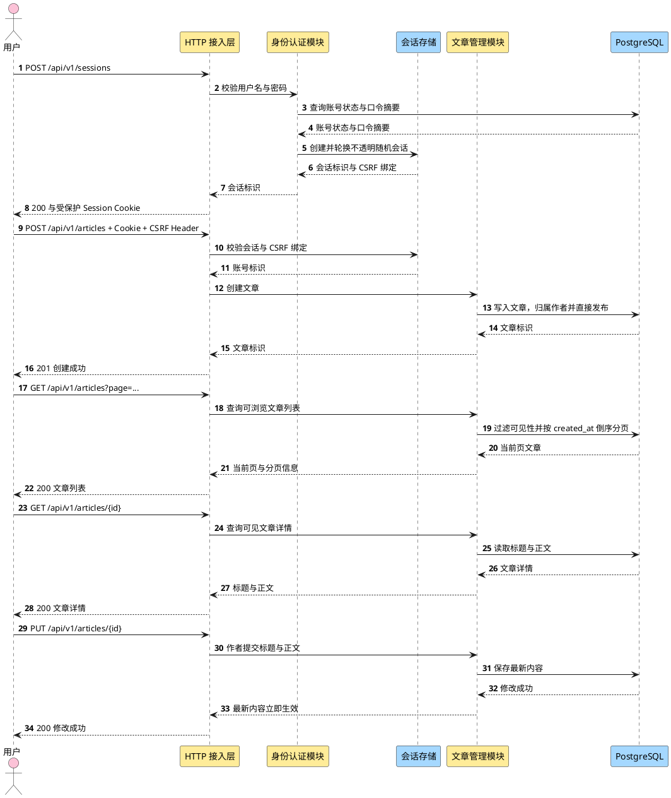

**说明**：会话校验发生在接入层，业务模块不解析 Cookie。登录成功建立不透明随机会话；认证和权限上下文变化会轮换会话 ID。Cookie 自动携带的写请求还必须通过会话绑定 CSRF Header 校验。登录失败对外统一，真实失败原因只进入最小化审计与受控可观测链路。

## 6 逻辑视图

### 6.1 业务模型

业务语言围绕五类对象：**账号**（可登录的身份，带角色、管理员类别、状态与单调认证版本）、**会话**（一次登录的派生能力，可被即时撤销）、**文章**（只有标题与正文，并带发布意图、违规事实与作者归属）、**临时密码**（一次性、有期限并带来源谱系的替代凭据）、**PasswordResetOperation**（首次 reset 与普通用户 resend 的安全结果权威）。有效可见性不是文章上的独立事实，而是由文章发布意图、违规状态、作者归属与作者账号状态共同派生。停用与恢复只改变 `User.status` 和会话；删除把账号写为不可恢复的 `deleted` 墓碑，由身份认证模块保留专用 `retained_email`，并在同一业务事务中把文章 `author_id` 置空、`publication_state` 置为 `held`、写入 `orphaned_from_user_id`，同时保留违规状态；违规判定只改变文章违规事实。

#### 6.1.1 业务能力地图

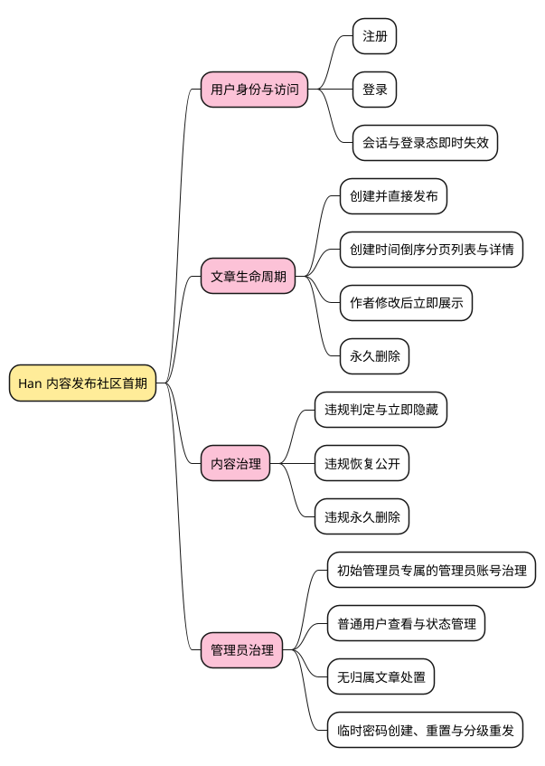

**说明**：四个业务能力分支全部来自已确认需求，未编造能力。前两支是所有用户可见的能力，后两支是管理员专属。**内容治理与管理员治理分开列出**，因为在需求中它们的触发条件与后果不同：内容治理作用于文章本体且由人工判定驱动，管理员治理作用于账号及其连带状态。这张图是逻辑视图的第一层，下一层展开为领域对象（§6.4.3），再下一层展开为实现结构（§7.1）。

### 6.2 逻辑模型

#### 6.2.1 架构模式

采用**模块化单体**：单一部署单元内按业务模块分包，模块之间只通过显式接口调用，共享同一数据库与同一进程内事务边界。选择依据与备选对比见 ADR-0001。

#### 6.2.2 分层逻辑模型

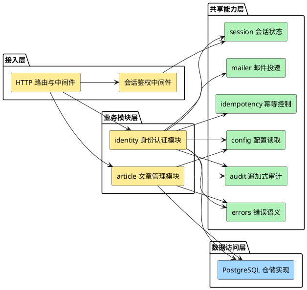

**说明**：依赖方向单向向下。会话、幂等、审计、错误和邮件是共享机制，不成为第三个业务权威模块。幂等入口保存键作用域、请求摘要与原结果；审计入口接受调用方事务并只追加事件。业务模块仍只写自己的权威状态。

这张图没有把 SMTP 与 PostgreSQL 画成业务模块，因为它们是技术部件，按模版要求放在技术模型（§6.3）与部署视图（§8）。

#### 6.2.3 接口设计

**表6-2 接口描述表**

| 接口名称 | 接口类型 | 职责 | 备注 |
|---|---|---|---|
| 注册接口 | HTTP `POST /api/v1/users` | 校验用户名、邮箱、手机号分别唯一与口令规则后建立账号 | 无需认证；失败不产生可用身份 |
| 登录接口 | HTTP `POST /api/v1/sessions` | 校验用户名与口令，创建服务端会话 | 无需认证；账号停用或删除时拒绝 |
| 登出接口 | HTTP `DELETE /api/v1/sessions/current` | 结束当前会话 | 首期是否提供见 §12 待确认项 |
| 当前身份接口 | HTTP `GET /api/v1/users/me` | 返回当前已认证身份与是否需要修改密码 | 用于前端判断强制改密状态 |
| 修改自己的密码接口 | HTTP `PUT /api/v1/users/me/password` | 任何强制改密状态的有效账号及非强制状态的初始 admin 按当前 Session credential kind/id 验证当前密码并修改 | 新密码至少 8 位且同时含字母和数字；其他非强制账号返回 `403 auth.forbidden`；当前密码或新密码策略错误返回 `422 identity.validation_failed`；credential kind/id 陈旧或失效返回 `401 auth.session_required` 且只撤销当前 Session；成功撤销其他 Session 并轮换当前 Session |
| 创建文章接口 | HTTP `POST /api/v1/articles` | 以当前身份为作者创建仅含标题与正文的文章并直接发布 | 需认证；无草稿或下线状态；长度与格式规则待确认 |
| 文章列表接口 | HTTP `GET /api/v1/articles` | 返回当前身份可见的文章，按 `created_at` 倒序并支持分页 | 需认证；页大小待确认；可见性规则见 §6.4 |
| 文章详情接口 | HTTP `GET /api/v1/articles/{id}` | 返回单篇文章的标题与正文 | 需认证；不可见、已删除或不存在文章返回不可用且不泄露内容 |
| 修改文章接口 | HTTP `PUT /api/v1/articles/{id}` | 仅作者本人可修改标题与正文；修改后立即向符合可见性规则的已认证用户展示最新内容 | 需认证；非作者拒绝；不经草稿或下线状态 |
| 删除文章接口 | HTTP `DELETE /api/v1/articles/{id}` + `If-Match` | 作者删除自己的文章；管理员删除他人文章 | Journal tombstone 与物理 DELETE 均完成后才返回 204 |
| 普通用户查询接口 | HTTP `GET /api/v1/admin/users`、`GET /api/v1/admin/users/{id}` | 查看普通用户列表与详情 | 任一当前有效管理员；普通管理员不得借此查看初始 `admin`、其他管理员或自己的受限制治理信息 |
| 普通用户状态接口 | HTTP `POST /api/v1/admin/users/{id}/suspend`、`/restore` | 停用或恢复普通用户 | 任一当前有效管理员；目标必须是普通用户；停用连带会话失效，文章可见性由账号状态派生 |
| 删除普通用户接口 | HTTP `DELETE /api/v1/admin/users/{id}` | 删除普通用户并触发文章无归属化 | 任一当前有效管理员；目标必须是普通用户；文章进入 `held`、保持隐藏并保留违规状态 |
| 普通用户密码重置接口 | HTTP `POST /api/v1/admin/users/{id}/password-reset` | 建立持久 operation/Gate，生成普通用户 exact 临时凭据并邮件投递 | 任一当前有效管理员；SMTP 前原子持久 claim/operation/credential/job，未受理则收敛失败并保留原能力；operation 未安全结算时目标用户认证消费者和新 reset writer fail closed |
| 普通用户重发接口 | HTTP `POST /api/v1/admin/users/{id}/password-reset/resend` | 为普通用户建立 successor operation/execution generation 与 exact pending credential | 任一当前有效管理员；purpose 固定为 `password_reset`。新 key 在 User-first 单事务创建 counter/claim/operation/credential/job；same-key replay 零新副作用；unresolved/hold 零写入拒绝；只有 succeeded settlement 才永久替换旧值 |
| 新管理员创建接口 | HTTP `POST /api/v1/admin/administrators` | 直接创建其他管理员并交付临时密码 | 仅初始 `admin`；邮件未成功受理则账号与临时凭据写入整体失败，不留管理员账号 |
| 管理员查询与状态接口 | HTTP `GET /api/v1/admin/administrators`、`GET /api/v1/admin/administrators/{id}`、`POST /api/v1/admin/administrators/{id}/suspend`、`POST /api/v1/admin/administrators/{id}/restore` | 查看、停用或恢复其他管理员 | 仅初始 `admin`；目标不得是初始 `admin` |
| 管理员删除与撤权接口 | HTTP `DELETE /api/v1/admin/administrators/{id}`、`POST /api/v1/admin/administrators/{id}/revoke` | 删除其他管理员或撤销其管理员权限 | 仅初始 `admin`；目标不得是初始 `admin` |
| 管理员密码重置与重发接口 | HTTP `POST /api/v1/admin/administrators/{id}/password-reset`、`POST /api/v1/admin/administrators/{id}/temporary-password/resend` | 以持久 operation 重置其他管理员密码，或按 ADR-0011 重发新管理员临时密码邮件 | 仅初始 `admin`；password-reset SMTP 前建立 durable Gate；`new_administrator` resend 不创建 PasswordResetOperation/job。两条路径不得串线，失败均保持失败前有效能力 |
| 无归属文章处置接口 | HTTP `POST /api/v1/admin/orphan-articles/{id}/publish`、`/transfer`、`DELETE` | 恢复公开、转移作者或永久删除 | 任一当前有效管理员；作者转移只允许无归属文章，目标用户须正常且未停用；移除无归属约束但保留违规状态 |
| 违规处置接口 | HTTP `POST /api/v1/admin/articles/{id}/violation`、`/restore`、`DELETE` | 判定违规、解除违规判定或永久删除 | 仅管理员；解除违规只移除违规约束 |
| Password-reset dead-letter 重排入口 | 同一 binary 的互斥 maintenance 路径 → identity operator | Windows 实际进程 SID + 另一主体离线审批验证后，仅 User-first 重排 job 并同事务追加 AuditEvent | 协议唯一 authority 为 ADR-0026；同 requestID 最多一次已提交重排，原 worker 按现役配置自动尝试；无公共 REST、伪 lease 或第二安全结果 classifier |

所有 REST 错误统一为 `{code, message, field_errors?, trace_id}`，不得暴露内部 cause。创建管理员、密码重置与临时密码重发必须携带 `Idempotency-Key`；键作用域为操作者、操作类型、目标资源与键值的组合，同键同请求摘要返回原结果，同键不同摘要返回冲突。普通用户 resend 的 same-key replay 必须先在 User 锁内分类并复用原 operation/execution generation，不生成秘密、不发送第二封邮件；新 key 才可建立 successor generation。停用与恢复以目标状态幂等，但每次仍重新校验权限与目标资格。

#### 6.2.4 全局恢复 runtime 的唯一权威与跨层合同（r32）

正常业务只能消费已核验的准入结论，不能由运行模式或局部 Gate 自行开放。ADR-0018/0019/0020 已要求恢复完成前不开流，但当前生产 root 未装配 Coordinator、RecoveryRunStore 与开放联动；普通 server maintenance 拒启只补启动漏口。当前 `main.go` SHA256 为 `1F2E43907A4FDAF4017A937105ED7044F9175069D28913A988FE799597C91B8D`，`main_test.go` 为 `BE69516324272EBC2171DF8632D931E18ACBDD3B3828CB55E9042EBBEB84BA37`。其 Code/Review/QA 接收来自 Main 交接，本轮仅核源码/哈希、未复跑测试；normal 尚无下述正向准入。

本次继承既有单体、net/http、PostgreSQL/pgx、CAS Anchor 与文件 provider 选型，不另选云服务或基础设施。对比只涉及既有安全义务如何接线，依据为已接受 ADR，不是新外部产品选型。

| 方案 | 机制 | 优势 | 劣势 |
|---|---|---|---|
| 仅 mode flag / 拒启 | maintenance 不起普通 server | 现有小修复无新状态 | normal/重启无法识别 unfinished；不满足真实503/完整开流 |
| 框架编排＋既有权威投影（采用） | recovery 判断，identity Store 写 run，root 唯一装配 | 正常重启与恢复语义分离；不复制业务状态 | 需只读 ports、首装证明与运行独占；缺证明会拒绝正常启动 |
| identity 独揽全局 runtime 或另存 ready | 身份同时拥有 HTTP/worker 开放，或新表存开放结果 | 局部调用直观 | 业务域承担框架生命周期；ready 表竞争 run 权威 |

采用第二方案，因为恢复同时约束两个业务域、普通请求和全部普通 worker。新增接缝用于证明同一恢复事实；可用性代价通过显式首装和受控恢复处理，不以默认放行补偿。

| 对象/组件 | owner 与动作 | 禁止越界 |
|---|---|---|
| RecoveryRun / RecoveryRunStore | identity 创建、读取、锁定、条件转换与审计；既有 outcome 状态机唯一权威 | 其他层不直写表，不接 caller 完整 run |
| Recovery runtime / Coordinator | `internal/recovery` 定义消费者最小 ports，编排 running 阶段的 identity 执行者及既有 Consume，作准入判定 | 不另存 outcome；Consume 当前从 identity_ready 起，不包完整入口 |
| Article Journal / replay / published evidence | article 拥有删除Journal写者及其独立namespace Anchor适配层（§6.2.5），生产重放/不可变证据与 current/fresh、历史关闭只读投影 | 不拥有全局开放权；不从文件hash合成防回退revision；其他域不查article私表 |
| 公共接入/worker 屏障 | platform 只消费 recovery 判定；root/lifecycle 执行关流、排空、停启及归还资源 | latch、mode、在途计数仅为进程派生值，无任意 SetReady(true) |
| 唯一 composition root | `cmd/han-server` 构造共享实例、选择互斥运行方式、注入 ports | 无第二 router、pool、Store、replay source/provider 或 locator |

**机制与业务责任分开**：既有 boundary 的恢复 consumer、RecoveryRun 及联合开放业务结果责任仍归 identity，article 仍是 evidence producer。`internal/recovery` 是 identity 恢复 consumer 复用的统一编排/准入机制实现，不是新框架业务服务，不接管账号核对或另签恢复结果；identity consumer 必须完成既有业务校验并经唯一 Store 留下结果，机制才能组合验证。下表 article/Store ports 由该机制承载 identity consumer 调用，历史 port 的实现/发布判断仍由 article 拥有。root 只执行同一结论，未实质重划业务 boundary。

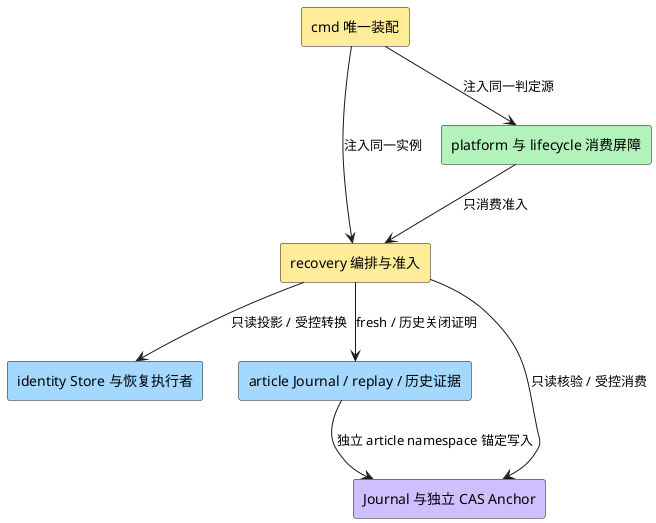

**说明**：框架只通过 identity、article 与 Journal 显式 ports 核事实。platform 不重做判断；root 向 canonical 恢复调用方与公共接入注入同一 runtime，避免两套 Gate 对同一部署产生相反结论。图为目标增量，不代表当前已装配。

**最小新增 ports**：下列名称为详细设计的合同标识，Go 类型封装由 FD 细化，验证项不能交 Task 选择是否保留。

| port / 提供方 → 消费方 | 输入、输出与前后条件 | 失败、权限和兼容 |
|---|---|---|
| `ReadAdmissionSnapshot(ctx)` / identity Store → recovery | 不接 caller 指定“成功 run”；一次短只读事务投影本部署完整 run 集合、全部绑定/阶段/证据字段、首装绑定及可重核集合 revision。不只查 latest succeeded；缺表/不完整结果不等于零行 | 不推进状态；revision 覆盖新增、失败及相关字段，不能只用 max(completed_at)；错误/取消/未知 closed |
| `ReadVerifiedSnapshot(ctx, namespace)` / 各namespace Journal owner → recovery机制/identity consumer | ctx有界，输出已验journal_id/namespace/epoch、committed head、外部CAS revision/pending；recovery另含完整run/begun/consumed绑定，article由§6.2.5写者维护真实独立Anchor并提供可信前缀证明 | 全构造/读取路径不初始化、清pending、修文件或CAS；pending/孤立暂存/缺key或anchor/权限不明closed。normal禁用现有Recovery Read/VerifyAgainst的收敛路径，也不能直接以现有article只验HMAC的reader冒此port |
| `ReadPublishedClosure(ctx, run_id, backup_ref, evidence_ref, evidence_digest)` / article → recovery | 按 Store 精确引用读曾原子发布的不可变 evidence，重算原 Ready20 摘要，核 namespace/version/ref/completed_at/完整结果及发布来源；当时 deletion head 必须是当前已验链 namespace 的可信前缀 | 不按 current 指针换证据，不 refresh Facts/Replay/改 publication。候选行或无法证明已发布的旧行拒绝；当前 private findReplayHistory 按 fresh Facts 筛选，不能直接当此 port |
| `VerifyGenesis(ctx, deployment_binding)` / 既有恢复信任边界 → recovery | 核可信一次性首装、恢复域外防回退 genesis 与 DB 安装绑定、两 namespace 初始承诺及全部 run 为空；仅确无恢复历史时有效 | 不是第二 run authority；不得用缺表/空Journal/缺run/bootstrap bool 生成证明，需显式受控发布与独立 CAS 验证 |
| 准入读取/关闭排空 / recovery → platform/root/lifecycle | 仅进程内可消费、绑定来源 revisions 与本次独占运行权的判定；关流原子禁止新普通工作，再等待在途请求及全部普通 worker 结束 | 默认 closed；失权/错误/漂移/重启撤销。无 caller 可构造许可或 force-open；canonical `CheckRecoveryOpenGate(ctx,tx)==nil` 只证 maintenance＋公共关闭 |

genesis 是安装来源证明，不记录另一 ready/outcome。采用恢复域外、既有独立 CAS 信任边界下的受控一次性发布，绑定部署标识、DB 安装标识、两 namespace 的 journal_id/epoch/初始 head 和版本；DB 侧绑定由同一 Store 管理。后续普通删除可推进 article head，genesis 路径核其从初始承诺连续延伸，不要求永远空 Journal；一旦有恢复 Begin 就不能再用 genesis 绕过 run 核验。FD 必须固定编码、原子发布与中断处理，不能用 `JournalOptions.Bootstrap` 代替授权证明。允许为该绑定及不可变发布来源补最小版本化元数据/迁移，不新建第二 run 状态表、公共 wire 或签名服务；现有字段不能证明发布时必须补来源而非信任旧行。缺失/半完成首装保持关闭，经显式安装修复，不重置既有 Anchor。

**正常启动的正向证明**只有两类：有效 genesis 且无任何恢复历史；或完成恢复的历史关闭证明。后者要求 Store succeeded、Recovery Journal 精确 consumed（同 run/backup/Begin key/fingerprint/时间）与 Store 所引用不可变 published evidence 全等，并核两 namespace 当前连续性/无 pending。合法日常删除导致 current Facts、current 指针或 deletion head 前进，不使历史关闭证明失效；历史 head 仍须是可信前缀。损坏/回退/错绑/缺失/未知版本拒绝。历史 port 不豁免 stale current Ready，恢复阶段仍执行 §9.1.1 fresh 双读。

任何 unfinished、failed、外部 begun 无 DB 行、DB run 无精确 Journal 绑定均优先阻断，即使有更晚 succeeded。只有全部可见历史逐一闭合且无矛盾时，按已验 Recovery Journal Begin 顺序确定最后完成恢复，不能按 DB 时间戳或 caller run_id 选最新成功。首期不自动 supersede failed/缺行历史；无法从既有权威证明覆盖关系即关闭，旧备份丢失 run 历史也不例外。若需处置这类历史，须回架构明确同一权威内覆盖证明，FD/Task 不得忽略旧run、删记录或手填成功；保守限制不阻塞软件接线设计。

两源/两 namespace 在同部署独占运行权保护下前后重核：读 Journal/Anchor revisions → Store 全量快照 → 精确 article 证据 → 重读 Store revision 与两 namespace revisions，全部仍匹配才发布准入。超时/漂移/缺失/不一致关闭，本次重试有界且不保留旧 true；外部 I/O 不跨 PG 长事务，MVCC快照号/内存计数不冒外部防回退证明。普通请求/worker 只取当前进程派生 permit，不逐 GET Consume；受控恢复/信任配置变更先撤销 permit 并排空。发现依赖故障、失锁或恢复权威/隔离保证变化立即关闭；正常业务沿既有验证写路径合法推进 deletion head 不等于新恢复，不因该前进撤销历史证明。缓存不跨重启。越过入口且无 Begin 的人工 DB 替换不在软件协议可证明范围，真实部署权限必须阻止，不能宣称检测任意管理员改库。

现有 RecoveryJournal 写方法没有 ctx，不能据 Consume(ctx) 声称所有外部操作已受取消约束。生产后继必须补 ctx 传播/有界 I/O 接缝并真实 join 已启动操作；写入超时/ack-loss按unknown保持关闭，禁止包一层 goroutine timeout 后脱离未结束副作用。只读准入不调用这些写/收敛方法，也不因生产 provider 尚unknown而省略软件取消/超时合同。

#### 6.2.5 Article namespace 的锚定写者与可信迁移（F001）

article namespace 的防回退证明必须由写者维护，不能由历史只读 port 补造。当前 `internal/article/deletion_journal.go` 的 Options/FileJournal 无 Anchor/id/epoch 依赖；Append→persist 仅写临时记录、fsync、link及目录同步，readVerified只验目录序列/HMAC链。上述文件耐久机制不证明合法旧前缀未回退。本后继增加 article-owned Journal 写者/受控适配层，复用既有 provider-neutral CAS 信任边界，在恢复域外维护独立 `article-deletion/v1` Anchor；不把 RecoveryJournal 的 run/secret记录当 article Anchor，不新增业务服务或 run authority。

root为两个namespace注入经验证的CAS能力，各自有固定journal_id、epoch、committed head及不复用revision；可共用已验证backend，但必须独立CAS键/记录，不能拿recovery revision代替article revision。article是其Anchor推进/协调的唯一领域写者，恢复机制只调用article port、排空/协调，不直写article Anchor。S4.5真实provider/独立故障域硬前置不变；article适配、写入协议及迁移是全局runtime新实施范围，不塞回已闭S4.2/S10.5或测试卡，也不自动改S4.5卡范围/requires。

**正常 Append 的固定协议**如下；原tombstone payload/HMAC、operation幂等、不可见pending→物理删除→204语义保持。所有 append、FindByOperation、replay source与快照读取共用这一锚定Journal实例，不留旧未锚定写者旁路。

1. 在有效业务permit及现有OS写者锁/进程互斥下，读取并验证article Anchor `(id,namespace,epoch,committed H0,revision r0,pending=nil)`，完整文件链head必须等于H0。pending/错绑/缺失先关闭并交受控协调；同operation已存在也只有精确已committed记录及请求绑定一致才能幂等返回，不能凭旧HMAC链或目录sync确认。
2. 生成唯一后继记录H1（序列、previous hash及operation绑定），同目录暂存完整字节并同步文件与暂存目录入口。CAS以r0把Anchor改为pending，固定旧H0、新H1和唯一操作标识；该标识必须能精确核对这份暂存记录/摘要，不能靠扫描“最新文件”选候选。未确认该CAS成功，不发布最终记录、不向删除调用方确认耐久。
3. 只有精确pending已确认，才用不覆盖既有记录的原子发布协议安装该序列文件；同步目录，清除已核暂存别名并同步目录，重验最终链head=H1。以当前pending revision CAS提交committed H1、pending=nil，保持原id/namespace/epoch不变；读取确认精确最终committed及其新revision后，Append才可返回耐久成功。其后finalizer/原SQL删除与Audit仍按既有业务合同执行，不能在pending/unknown时提前物理删除或返回204。
4. writer必须由root注入同一runtime的屏障/故障关闭通知，缺依赖拒绝生产装配；在CAS pending前同步暂停新普通permit/全部普通worker claim。该确认只等新工作已被禁止，不等当前append排空，避免锁内等待自身；已获permit的本次append仍按协议终结并真实join。任一文件/CAS阶段超时、ack-loss、冲突、不可读、失锁或取消，都在返回错误前把同一关闭原因升级为待受控核验，停止新工作并由runtime排空其余在途请求/worker，不能只记录日志或等重启。已发布记录/已提交Anchor不因返回失败回滚/删除；不盲目再append/CAS。通知失效不能沿旧permit继续服务，root必须停止普通入口；未join操作阻止重新开放。

健康Append提交后，writer向同一runtime交付已核的旧/新head与CAS revisions、同id/namespace/epoch和操作绑定；runtime只有在本次后继连续、无pending且其他关闭原因均不存在时，才解除该append自有屏障。正常阶段可能短暂503/暂停新claim，是既定pending关闭策略的可用性代价；不重新Begin/Consume、不把普通append当新恢复，不改worker算法、原操作幂等或删除成功合同。unknown后即使迟到结果为成功也不能自行解锁，须受控重核。上述屏障/通知是进程派生状态，不是新的run结果或任意SetReady接口。

**崩溃/unknown由article协调，normal零修复**：article-owned协调port只在全局runtime已证明公共关闭、普通请求/全部worker排空、同部署独占及目标namespace写者锁成立时可用。normal的构造器、准入快照、历史closure、FindByOperation/ReadAllVerified均不得初始化Anchor、清pending或修补链；构造不得沿现有ensure目录路径把缺失介质变成已安装事实。pending/暂存/未锚定tail只能报unknown/错误，不向finalizer/replay提供未committed tombstone。此article文件/Anchor协调不转换RecoveryRun，也不扩大ADR-0018的DB=ready_to_consume＋精确consumed补状态窗口。

| 独立读取到的文件/Anchor状态 | 唯一允许的受控处理；normal均不写 |
|---|---|
| committed H0、无pending，文件H0＋孤立暂存 | 不把暂存当删除证明；受控核对来源后处置，无法证明即保持关闭，不自动把候选升为新head |
| pending H0→H1，文件H0 | 仅精确H1暂存可验时完成同一发布；若无可验新记录，只能按已核旧H0撤销未确认pending回committed H0，产生新revision且不确认删除成功；第三状态/来源不明关闭 |
| pending H0→H1，文件精确H1 | 核完整链、操作/暂存绑定及目录耐久，完成同一pending的committed CAS，不追加第二份tombstone |
| CAS结果unknown | 持同一锁重新Load独立Anchor/revision并验链；只接受上述精确pending、已完成的committed H1或未发布的committed H0，无确定状态保持关闭；不假设写失败或泛化重放 |
| committed H1且文件H1 | 已完成，无重复append；若原ack丢失，仅精确operation重读可确认既有耐久记录 |
| committed H1但文件为合法旧H0/缺失，或committed H0却多出无对应pending的H1 | 回退/协议违例，拒绝；不重置Anchor、不裁剪/认可尾部、不用较新成功run覆盖 |

CAS revision必须来自独立provider且每次状态改变都不复用，包括pending撤销回同一H0；head相等不等于revision相等。epoch/journal_id不在normal中重建，不能通过重置epoch消除ABA（值变回原样而误判未变）。两namespace分别前后比较各自revision，不能跨namespace比较token大小。Store重核覆盖完整run集合/字段：若用集合摘要作为本地token，必须同时证明独占期间无删除/回退且转换单调；恢复替换需先Begin并改变外部非复用revision。无法证明无ABA则关闭，文件hash、内存计数或PG xmin不替代独立防回退。

**首装/存量迁移只在受控入口一次性发布**：首装将精确空链初始head绑定到既有genesis流程；存量链先停旧append/finalizer/replay写者并排空，提供恢复域外可信完整链检查点/批准副本来源及其期望head，核全链/HMAC/retained keys、部署/目录绑定、固定namespace/id/epoch，再以“Anchor不存在”的CAS前置一次性发布该精确初始承诺和迁移来源。仅观察现存文件链可验，不证明它完整；不得把normal首读的任意合法前缀直接批准为初始head。实际可信来源/发布主体未知即不迁移，不填假值或以人工口述当前hash代替独立证明。

迁移中断只能在全局关闭/独占下按同一迁移标识与精确初始承诺受控续接；既有Anchor不覆盖、不归零。genesis/迁移与DB安装绑定未完整核对前不开放。优先不改写原tombstone字节/摘要或S16 DTO，id/epoch/迁移来源放既有CAS信任边界下最小元数据；如FD发现必须改原S16/wire，先回架构/Main，不在本决定下默改。新旧未锚定写者禁止混跑/回退，真实迁移/介质证明仍NOT RUN；未知真实输入不阻塞带受控adapter的软件协议设计。

### 6.3 技术模型

#### 6.3.1 架构模式

进程内分层 + 模块化分包（见 §6.2.1）。技术部件集中在两层：接入层的 HTTP 服务与数据访问层的 PostgreSQL 仓储。不引入消息中间件、缓存与外部身份提供方。

#### 6.3.2 技术选型

**表6-3 技术选型**

| 决策点 | 选定 | 备选 | ADR |
|---|---|---|---|
| 架构形态 | 模块化单体 | 多服务 | ADR-0001 |
| HTTP 框架 | Go 标准库 `net/http`（1.22+ 方法路由与路径参数） | Chi / Gin / Echo | ADR-0002 |
| 数据库 | PostgreSQL | MySQL / SQLite | ADR-0003 |
| PostgreSQL 兼容线 | major 18；生产与 CI 跟进受支持的最新 18.x patch | 长期固定单一 patch / 不限制 major | ADR-0021 |
| 数据库驱动与连接池 | `github.com/jackc/pgx/v5` 原生 API + `pgxpool` | `database/sql` 驱动 / ORM | ADR-0021 |
| 数据库迁移与启动门禁 | `migrations/NNNN_name.sql` + 项目内最小执行器；`han-server` 启动时自动运行，成功后才监听 | 独立迁移命令或 init job / 人工执行 SQL | ADR-0021 |
| 生产 HTTP 监听配置 | 必填单一 `HAN_HTTP_ADDR`，只接受 IPv4 或方括号 IPv6 的 `IP:port`，port `1–65535`，无默认值 | host/port 拆分 / 部署层预打开 listener | ADR-0021 |
| 生产结构化日志 | Go `log/slog` `JSONHandler` 输出 JSON Lines 到 stdout；部署平台采集并承担 30 天可查询留存 | 应用内绑定日志存储 SDK / 文本日志 | ADR-0022 |
| 生产 metrics | 项目内标准库 registry/exposition adapter；独立 `/metrics` 固定 Prometheus text exposition 0.0.4，不做内容协商 | 引入完整 metrics SDK / OpenMetrics 协商 / 仅日志无 metrics | ADR-0022 |
| Dashboard 与告警路由 | Grafana dashboard + Alertmanager 聚合、抑制、静默和通知；backend/provider 位于部署 adapter/config | 应用内发送 paging / 绑定单一托管平台 SDK | ADR-0022 |
| 接口形式 | REST + JSON | gRPC / REST + Protobuf | ADR-0004 |
| 认证方式 | 服务端会话，会话记录存 PostgreSQL | 会话存 Redis / JWT / JWT + 撤销黑名单 | ADR-0005 |
| 邮件传输 | SMTP 直连，经邮件适配器接口调用 | 第三方事务性邮件服务 / 开发期内存实现单独使用 | ADR-0006 |
| 初始凭据注入 | 环境变量，仅首次启动生效 | 密钥管理服务 / 首次启动交互式注入 | ADR-0007 |
| 工程结构与配置 | 按业务模块分包，配置仅来自环境变量 | 按技术分层分包 | ADR-0008 |
| Go 版本 | 1.27 | — | ADR-0009 |
| Go module path | `han`，绑定正式远程并首次对外发布前允许单独变更 | 猜测组织域名 | ADR-0021 |
| 密码哈希 | Argon2id（`golang.org/x/crypto`） | bcrypt / scrypt | ADR-0012 |
| 公共错误 | 稳定 JSON 错误结构与最小披露 | 裸字符串 / 统一内部错误 | ADR-0014 |
| 写请求幂等 | 作用域化 `Idempotency-Key` + 请求摘要 | 仅唯一约束 / 客户端去重 | ADR-0015 |
| Password reset durable safety | PostgreSQL `PasswordResetOperation` + recovery job/outbox + 数据库租约 worker + Login/PasswordChange/Session resolve Gate | 延长有限同步 cleanup / 长期用户维护锁 | ADR-0023 |
| Article backup inventory | 业务 PostgreSQL 恢复域外、只读挂载的 `article-backup-inventory/v1` 严格 JSON manifest；`HAN_ARTICLE_BACKUP_INVENTORY_PATH` 指向唯一文件 provider | 远程备份 API / 业务 PostgreSQL / article S4.5 fixture | ADR-0020 |
| 审计 | PostgreSQL 追加式 AuditEvent | 普通日志 / 独立审计服务 | ADR-0016 |

选型论证过程与劣势可接受性分析在各 ADR 的「现状 / 痛点 / 改造 / 效果」章节，本文不重复。

#### 6.3.3 关键技术方案

**非 password-reset 临时凭据交付的失败组合处理**：创建管理员及 `new_administrator` resend 在 SMTP 未受理时回滚相关写入，受理后再提交数据库。SMTP 与数据库不能真正原子，因此存在“邮件已受理但最终提交失败”的残余窗口。此时返回失败，邮件中的凭据不可用；幂等重试、后续最新凭据、追加式审计、trace 与告警共同治理，不能声称零风险。Password reset 改由下述 durable operation 在 SMTP 前建立安全屏障。

**Password reset 持久操作屏障与 purpose 分流**：对首次 password-reset 与普通用户 `password_reset` resend，ADR-0023 不再让有限同步 cleanup 承担安全证明；`new_administrator` resend 则保持 ADR-0011。route/target 在服务端决定 purpose，客户端不能提交。每个普通用户 resend 新候选先锁目标 User，在同一 PostgreSQL 事务把 `users.password_reset_execution_generation` 从 N 推进到 N+1，并原子创建真实 `IdempotencyRecord` claim、successor `PasswordResetOperation`、exact pending TemporaryCredential 与 initial recovery job/outbox；counter 与四记录全有或全无。resend operation 保存 `request_kind=resend`、terminal predecessor operation、current replaced credential，以及 `(scope_hash,key_locator,key_digest,digest_key_version,request_digest,execution_generation)`；首次 reset 保存 `request_kind=initial_reset`。operation 是安全结果权威，`IdempotencyRecord` 不得单独放行。

**候选分类与发送权**：User 锁内先按真实 key identity 分类。same-key 同摘要 replay 复用原 operation/generation，零新秘密、零新邮件；同键漂移进入冲突或 integrity hold。只有新 key、无 unresolved operation、无 integrity hold，且普通用户 resend 的 predecessor/current old credential 精确一致时才创建 successor；否则零 claim、零 operation、零 credential、零 job。四记录 commit 后，原请求必须再用 User-first 短事务把本 operation 从 `prepared` 条件转换为 `dispatching` 并写不可变 delivery attempt；只有该提交明确成功的原请求拥有一次 Mailer 调用权。dispatch commit acknowledgement 丢失时不发送；worker、replay 与受控命令永不补发。

**旧值与 settlement**：普通用户 resend 期间允许 old active/current 与 new pending_delivery 合法共存，但 Login、PasswordChange、Session resolve 及新 reset/resend writer 因 unresolved operation 全部 fail closed。SMTP 明确未受理，或 stale `prepared/dispatching/commit_unknown` 无 durable accepted 证据时，只失效本次 new candidate，old credential、User auth generation 与既有 Session 不变。只有 succeeded settlement 同一事务把 new 置 active、old 置 superseded、User auth generation 推进到 target、撤销旧 Session，并完成幂等快照与 AuditEvent；请求线程 cleanup 只能 enqueue 或加速 recovery。

**认证能力谱系与收敛**：`users.auth_generation` 是单调认证能力版本。operation 保存 base/target generation 与 settlement；永久密码、TemporaryCredential 与 Session 保存可核验的 root operation/credential lineage。reset 成功把 User 原子推进到 target generation 并撤销旧 Session；只有 exact succeeded operation 与 exact active temporary credential 可在改密事务中生成 target+1 的永久 successor。历史 succeeded replay 只按 operation settlement/root lineage 分类，不改写后续正常改密或后续 reset 已形成的当前能力。无法证明来源、跨代/跨 operation、终态漂移或非法竞态能力必须原子失效并进入持久 integrity hold；hold 只能由同锁序、完整审计的 worker 或受控运行命令在证明全部能力已收敛后清除。

**统一线性化与认证 Gate**：password-reset create/claim、Login、PasswordChange、Session resolve、RecoveryWorker 与受控命令统一使用 `User → Operation → Credential → Sessions → Idempotency/Audit`，禁止 Operation-first。没有 operation 行时，已锁 User 仍是阻止并发插入 unresolved operation 的 per-user barrier；不能取得锁、状态未知/非法/不可读、六字段或 lineage/settlement 不一致时全部 fail closed。Session token/session 预读不授权；Session resolve 必须在 caller-owned transaction 内锁 User、检查 Gate、复核或撤销 Session，并且仅在事务 commit 成功后返回 Principal。数据库租约 worker 按同一锁序原子收敛 exact credential、派生或目标 Session、consumed 后永久密码能力、幂等快照和 AuditEvent；`dead_letter` 与受控命令失败均保持 Gate。

**幂等与审计**：幂等记录在执行副作用前占位，并绑定规范化请求摘要。高风险业务状态和 AuditEvent 在同一事务提交；审计失败使业务写入 fail closed。审计只保存主体 ID、动作、目标、结果、公共错误码和 `trace_id` 等最小字段。

**数据库与 HTTP 启动门禁**：`han-server` 是进程生命周期所有者，先读取并校验 `HAN_DATABASE_DSN` 与 `HAN_HTTP_ADDR`；地址只允许单个 IPv4 或方括号 IPv6 `IP:port`，port 为 `1–65535`，拒绝空 host、域名、port 0、URL scheme、路径和多地址。两项配置通过后，入口建立连接池、Ping、调用 migration runner；runner 成功后才执行 `net.Listen("tcp", addr)` 并启动 B0 无业务路由的最小 HTTP 服务。migration runner 只负责迁移文件加载、advisory lock、顺序执行、单迁移事务和 `schema_migrations` 记录；它不退出进程，也不控制监听器。监听失败关闭数据库池并非零退出；运行期 `Serve` 异常返回时清理 listener 与数据库池并非零退出。B0 不扩展优雅停机，日志不得输出 DSN。

**生产可观测性 composition 与合法配置**：`cmd/han-server` 是唯一 composition root，必须在数据库副作用、listener 绑定与业务路由注册前一次性解析 `HAN_METRICS_ADDR`、`HAN_LOGIN_OBSERVATION_BUDGET`、`HAN_ORIGIN_OBSERVATION_BUDGET`、`HAN_LOGIN_FAILURE_AUDIT_BUDGET`、`HAN_LOGIN_DURATION_BUCKETS_SECONDS`、`HAN_SHUTDOWN_BUDGET` 及既有生产配置。部署实现基线分别为 Login observer `250ms`、Origin rejection observer `250ms`、failure auditor `2s`、shutdown `10s`，Histogram buckets 为 `0.005,0.01,0.025,0.05,0.1,0.25,0.5,1,2.5,5` 秒；这些值必须由生产环境显式注入，但不是 parser 的唯一 allowlist。Login/Origin budget 合法范围均为 `1ms..5s`，failure auditor 为 `10ms..30s`，shutdown 为 `1s..60s`，端点均包含；buckets 数量 `1..32`，每项必须正数、有限、严格递增、无重复且最大值 `<=60s`。缺失、解析失败或超范围均启动失败；容量评审后可只修改范围内部署值，超范围必须先修订 ADR/设计。Login 与 Origin observer 内的 logger/metrics fan-out 共享调用方传入的同一个剩余 deadline，不为每个 sink 重新叠加预算；adapter 遵从取消，超时后只返回一次失败，不重试、不切换 sink、不泄漏 goroutine/资源，也不改变公共响应、主事务或审计结果。

**日志、metrics 线协议与运行平台责任**：生产 logger 使用 `log/slog.JSONHandler`，经现有 `platform.LoggerWithTrace` 输出一行一个 JSON 对象到 stdout；logger 完成初始化前无法结构化的泛化致命启动信息才写 stderr。应用不写本地日志文件、不绑定日志存储产品；部署/运行责任角色负责采集 stdout/stderr，并提供至少 30 天可查询留存。PostgreSQL AuditEvent 是独立权威审计，不得以运行日志替代。metrics adapter 只实现现有固定指标和低基数标签，实际已有 duration 指标采用上述经典 buckets，不新增用户、trace、URL、Origin 原值等高基数标签。`HAN_METRICS_ADDR` 使用独立 listener 且只暴露 `/metrics`；首期固定 Prometheus text exposition format `0.0.4`，忽略 `Accept` 的格式偏好且不做内容协商。成功响应固定 `Content-Type: text/plain; version=0.0.4; charset=utf-8`，正文为 UTF-8、LF 换行、每样本一行并以最终 LF 结束。metric name 必须匹配 `[a-zA-Z_:][a-zA-Z0-9_:]*`，label name 必须匹配 `[a-zA-Z_][a-zA-Z0-9_]*`；HELP 文本中的反斜杠和换行分别转义为 `\\`、`\n`，label value 中的反斜杠、双引号和换行分别转义为 `\\`、`\"`、`\n`。有限浮点使用 `strconv.FormatFloat(value, 'g', -1, 64)` 等价规范格式，特殊值仅输出 `NaN`、`+Inf`、`-Inf`。Counter 输出 `# HELP`、`# TYPE ... counter` 与样本；classic Histogram 输出 `# HELP`、`# TYPE ... histogram`、按 `le` 数值递增的累计 `_bucket`，必须包含 `le="+Inf"` 且该值等于 `_count`，随后输出 `_sum`、`_count`。encoder 必须先在内存完整编码并验证，再提交 200；编码失败不得发送部分 200，固定返回 `500`、`Content-Type: text/plain; charset=utf-8` 与正文 `metrics encoding failed\n`，不得暴露内部 cause。协议级应用测试必须使用独立 parser、严格语法 fixture 或等价 conformance；真实 scrape 继续作为部署 Gate，但不得是首次发现格式错误的唯一 Gate。

**双 server + 双 worker 有界 shutdown 与退出码**：business server、metrics server、PasswordReset worker、Article deletion worker 任一运行错误或 `SIGTERM`/`SIGINT` 都触发同一个 lifecycle coordinator，并只记录第一个触发源。`http.Server.Serve` 因协调关闭而返回的 `http.ErrServerClosed` 是预期收敛，不算原始错误。协调器先停止新接入、password-reset 新 claim 与两个 worker 的新领取，再以 `HAN_SHUTDOWN_BUDGET` 创建唯一 shared deadline：两个 server 并发 `Shutdown`，两个 worker 各 `Stop` 一次并在同一 deadline 内并发 `Wait`；不得为 server 或 worker 重置预算。任一 server Shutdown 失败或超时时对两个 server 都 `Close`，但 fallback 成功不得抹去先前失败。两个 worker 全部停止后才关闭 Article 专属资源，随后等待两个 Serve loop、关闭 listener，最后关闭数据库池；任何 worker 仍可能提交时不得先关 pool。主错误稳定优先级为 business server → metrics server → PasswordReset worker → Article worker → context/signal 异常；Stop/Wait/Close/listener/Article resource/pool cleanup errors 按稳定组件名聚合并附加，不覆盖主错误。信号路径只有全部 shutdown/cleanup 成功才退出 0；任一原始运行错误、Shutdown/Wait 超时或失败、Close/资源 cleanup 失败均非零退出。启动阶段任一 bind 或 worker Reconcile/Start 失败只清理已建立资源并非零退出，不开放流量。

**告警、Dashboard 与值守入口**：初始告警基线为：scrape `up == 0` 持续 `2m` 后 paging；登录 `10m` 至少 20 次 attempt 且 internal-failure 比例 `>5%`，条件持续 `10m` 后 paging；登录 duration P95 `>2s` 且 `10m` 至少 20 个样本，条件持续 `15m` 后 warning；Origin rejection `10m` 累计 `>=20` 且条件持续 `10m` 后 warning。信号退出阈值后保持 `10m` 稳定再 resolve（由 alert rule 的 recovery/keep-firing 能力或等价部署规则实现）。Grafana dashboard 固定入口名为 `Han / Identity Auth`，最少包含 scrape health、login attempts 按 outcome、login P50/P95/P99、internal failure 按固定分类、Origin rejection 与当前 alert 状态。Alertmanager 将 warning 路由到团队运行告警渠道，将 paging 路由到生产值守通知 receiver；第一响应角色为生产值守角色，第二响应为 Han 服务 owner / identity 技术责任角色，安全事件升级到安全值守角色，不在架构中编造自然人、账号或付费平台。稳定 runbook 入口固定为 `docs/runbooks/identity-observability.md`；实际 receiver、值守排班、runbook、dashboard、alert rules、采集与 30 天留存未部署并演练前不得宣称生产就绪。

**恢复 Journal 连续性与 RecoveryRun owner**：identity-owned `RecoveryRunStore` 是 RecoveryRun 状态与事务的唯一 owner；RecoveryCoordinator 只按 `run_id` 加载和条件转换，不接收调用方构造的完整 RecoveryRun。`RecoveryJournal.Begin(run_id,backup_ref,recovery_secret)` 把不可变 backup 与当时 active key 的 ID/version/fingerprint 绑定到 begun；JournalEntry、disk record 与 MAC payload 都保存并认证 `backup_ref`，同 run 的唯一 consumed 必须沿用 Begin 的 backup/key 绑定。状态主线为 `identity_ready → article_deletion_ready → ready_to_consume → journal_consumed → succeeded`。目标生产形态要求 Journal 头由独立故障域的 CAS `JournalHeadAnchor` 绑定；文件写入按“OS 独占锁 → 校验 committed 头 → 临时文件 fsync → anchor CAS 到 pending → 原子替换并同步目录 → anchor CAS 到 committed”发布。`VerifyAgainst` 分别读取 Journal 与 RecoveryRunStore，再与 article evidence 的 `run_id + backup_ref` 三方精确比较，不得仅在调用方对象内部自比较；错误 backup 一律 fail closed。外部 article/Journal/anchor I/O 不跨 PostgreSQL 长事务。数据库为 `ready_to_consume` 而 Journal 已有精确 consumed 记录时允许重启补写 `journal_consumed`；其他 DB/Journal 阶段倒挂一律 fail closed。

**S4.2 Anchor 交付边界与生产 Gate**：S4.2 的既定十三文件只交付 provider-neutral `JournalHeadAnchor` port、CAS 协议、RecoveryJournal 调用边界和确定性测试替身；port 至少支持按 namespace `Load` 当前 snapshot/revision，以及按 expected revision CAS 到 pending/committed 目标，并把 conflict、stale revision、missing/rollback 与不可判定结果作为可区分的 fail-closed 失败。测试替身只用于确定性编排协议分支，不是生产 provider，不构成独立故障域证据。S4.2 不选择或交付具体生产 CAS provider、配置键、凭据、依赖、启动装配，也不扩大到第十四文件或 `cmd/config`。S4.5 单独负责生产 Anchor provider 选型/实现、配置/装配及真实独立故障域验证；S4.5 及独立验证完成前，恢复链生产 Gate 保持关闭，不得宣称 S4.2/B3 已生产可用或独立故障域已成立。

**恢复 key 轮换、终结与退役能力边界**：一个 active key 只负责新 run 的 Begin；verify-only 禁止开启新 run，但允许为该 key 已 Begin 且未消费的 run 写唯一 consumed 终结记录。`MarkConsumed(run_id)` 必须从 begun 记录读取并沿用 Begin 时绑定的 key ID/version/fingerprint 与 `backup_ref`，不得改用轮换后的 active key。只要 key 尚有 begun 未消费 run，或其记录仍处批准保留/归档可验证范围，就不得退役或删除；即使静态条件满足，retire/delete 也必须提交绑定精确 `key_id/key_version` 的 opaque `KeyRetirementCapability`，并由验证/单次消费 port 成功处理后才允许执行。S4.2 十三文件只定义 opaque 类型、调用边界、fail-closed 结果和确定性测试替身，不解析、签发、持久化、记录或装配生产 verifier；生产不存在 mint 路径，capability 缺失、空值、拒绝、不可用、绑定不匹配、重放或结果不可判定时持续禁用 key retirement。active 轮换不得阻断既有 run 完成。Task-Planner 必须另行登记一个不并入 S4.5 的独立后续任务，负责真实 retention/archive exit evidence 来源与核验、capability 签发、生产 verifier/config/startup wiring、单次消费、防复制/重放、审计、测试和真实环境验证；该任务完成并验证前不得启用或宣称生产 key retirement 就绪。

**恢复时间与权限**：Journal、Anchor 与 RecoveryRun 跨边界时间在生成时规范化为 UTC 微秒，同一规范值写入两侧并精确比较；非 UTC、纳秒或其他非规范存量不得静默改写。Journal 目录、主文件、临时文件与锁入口必须证明 owner-only 写边界；无法证明时拒绝初始化或恢复。

**生产 Backup Inventory authority、provider 与 manifest**：备份/灾备运行责任角色是 inventory 事实的唯一生成与签发 authority，必须从业务 PostgreSQL 恢复域外的备份控制面事实生成文件；部署/恢复责任角色负责把签发文件以只读文件挂载交付到 `HAN_ARTICLE_BACKUP_INVENTORY_PATH`，article-management 只验证和消费，不编辑、补全或推断。v1 的“签发”指责任角色对受控产物的发布与交付批准；`inventory_digest` 只证明 canonical bytes 完整性，不冒充密码学签名。若未来要求密钥签名、远程 API 或新信任服务，必须另行修订架构/ADR。

manifest 顶层只允许且按固定顺序包含 `inventory_version`、`inventory_scope`、`backup_ref`、`backup_cutoff`、`generated_at`、`recoverable_backups`、`inventory_digest`。`inventory_version` 固定 `article-backup-inventory/v1`；`inventory_scope` 固定 `recoverable-backups-before-cutoff`。`recoverable_backups` 是非空数组，每项只允许且按固定顺序包含非空 `backup_ref` 与 `backup_completed_at`；数组按 `(backup_completed_at, backup_ref)` UTF-8 字节序升序且两字段组合不得重复。顶层 `backup_ref` 必须精确出现一次，其 entry 的 `backup_completed_at` 必须等于 `backup_cutoff`，其余 entry 时间不得晚于该 inclusive cutoff，且 `generated_at` 不得早于 `backup_cutoff`。调用的 `backup_ref`、manifest 顶层 `backup_ref`、RecoveryRun/Journal 绑定与 ReplayStatus 的 `backup_ref` 必须全等；scope 或 cutoff 任一不等即 wrong inventory。

`backup_cutoff`、`generated_at` 与所有 `backup_completed_at` 固定为 UTC、恰好六位小数的 RFC3339 文本 `YYYY-MM-DDTHH:MM:SS.ffffffZ`；非 UTC、超过/少于微秒精度、非法日期或需要静默舍入的值一律拒绝。canonical JSON 固定 UTF-8、无 BOM、无额外字段、无多余空白，使用上述字段顺序、JSON string/array 类型和数组排序；digest payload 是排除末尾 `inventory_digest` 后的完整 canonical 顶层对象，`inventory_digest` 必须为 `sha256:` 加 64 位小写十六进制 SHA-256。未知版本、字段缺失/null/别名、重复键、类型漂移、乱序数组或 digest 不符均 fail closed。

文件 provider 最大读取 `1,048,576` bytes。配置路径与最终对象均不得是 symlink，打开后必须为常规文件；descriptor 只读，文件不得含任何 write mode bit，部署还必须证明服务进程看到的是只读挂载。POSIX 下至少拒绝 group/other writable；无法取得或解释等价 owner/ACL、常规文件、只读挂载或 no-follow 语义的平台保持 unsupported/fail closed。签发方用同目录临时常规文件写完整 canonical bytes、同步文件、原子 rename 并同步目录；不得原地改写生产文件。

每次 `ReplayAndVerify` 都重新打开一次 inventory snapshot；`ReadStatus` 的 freshness 路径也重新打开并验证当前 snapshot，不长期缓存、不使用 watcher。provider 以 `lstat → no-follow open → fstat → 有界读取 → fstat → lstat` 核对路径与 descriptor 的文件身份、类型、大小和稳定性；读取期间路径替换、身份/大小变化或权限漂移使当前调用失败，下一次调用再读取新文件。通过验证的 `inventory_digest` 必须进入稳定 `input_digest`；若 `ReadStatus` 发现 digest 漂移，旧 Ready 立即失效，并执行同一幂等 `ReplayAndVerify`/ReplayAll 与 operation/audit 对账路径，只有新 evidence 成功后才能再次返回 Ready。缺失、不可读、超限、权限不安全、错 backup/cutoff/scope、未知版本或任何不可判定结果均返回 unavailable/错误并保持恢复 Gate 关闭。

**文章转移的状态与通知处理**：转移入口只接受 `author_id IS NULL` 的无归属文章；仍有归属的文章必须拒绝且保持作者与可见性不变。转移在事务内写入新 `author_id` 并把 `publication_state` 置为 `published`，从而移除无归属隐藏约束；`violation_state` 原值保留。提交后，非违规文章立即公开，违规文章继续仅管理员可见。系统只通知新作者与已删除的原作者，不保留“现有原作者”分支；已删除原作者地址取自仅为转移通知保留的邮箱。两个通知在提交后独立投递，任一失败只记录结果，不回滚归属、发布意图或派生可见性（需求 US-IDENTITY-03.8、US-IDENTITY-03.9）。

**文章永久删除处理**：授权和强 ETag 校验后，事务把 Article 置为内部 `deletion_pending` 并创建 DeletionOperation，所有查询立即排除该文章。Article Deletion Journal tombstone 原子追加并 fsync 后，finalizer 幂等执行物理 DELETE，并同事务写 AuditEvent 与 operation 完成。只有 tombstone 与物理删除均完成才向 API 返回 204；任何中间失败都不得使文章重新可见。

#### 6.3.4 安全 / 韧性 / 隐私技术模型

**会话安全模型**：Session Cookie 是不透明随机标识，使用 `Secure`、`HttpOnly` 与 `SameSite`。认证成功和角色、权限、强制改密状态变化后轮换 ID，旧 ID 失效。写请求校验会话绑定 CSRF Header。绝对期限、空闲期限和限流数值保持 TBD。

**S10.5 维护信任**：仅 Windows 维护入口以 OS token 对应的实际进程 owner SID 识别 executor，并消费部署登记的独立 approver Ed25519 签名；主体不等于自然人，业务 admin/ENV role 不授权该动作。完整动作/目标/signed before/时效/requestID、规范字节及消费审计均以 ADR-0026 为唯一合同，不在本文复制协议。仅重排 job 不解除 operation Gate/hold，不改 ADR-0023 的能力安全结果权威。

### 6.4 数据模型

#### 6.4.1 架构模式

单一数据库、每类状态一个权威写入者。所有关键状态在同一实例内，跨模块的删除与归属联动使用本地事务，不引入分布式事务或最终一致补偿。有效可见性和隐藏原因是可重建的派生视图，不作为独立权威字段持久化。

#### 6.4.2 关键数据设计

字段与规则：

| 实体 | 关键字段 | 约束 |
|---|---|---|
| User | `id`、身份字段、永久密码摘要、`auth_generation`、`password_reset_execution_generation`、永久密码 generation/root lineage、`auth_integrity_hold`、角色/状态/恢复字段、`retained_email` | `auth_generation` 非负且只单调递增；永久密码摘要与 generation 同生同灭；无法证明认证能力谱系时进入持久 hold。恢复终结时永久密码全部失效，非初始管理员一律 `suspended` 且 `recovery_required=true`；备份中的 role/status 不直接授权 |
| Session | `id`、`user_id`、token/CSRF 摘要、`auth_generation`、`lineage_operation_id/lineage_credential_id`、认证凭据 identity、时间字段 | `id` 为不透明随机值；Session 只能代表可证明的当前 generation/lineage；权限或认证能力变化时轮换/撤销；绝对/空闲期限 TBD；用户停用或删除时删除 |
| TemporaryCredential | `id`、`user_id`、`password_digest`、`auth_generation`、`source_operation_id`、purpose/状态、`expires_at` | 有效期 7 天；password-reset exact credential 必须绑定 operation target generation。普通用户 resend 允许一条 settled current old active 与一条 in-flight new pending 共存，但 Gate 阻断认证；只有 succeeded settlement 才 new active / old superseded |
| Article | `id`、`author_id`、`orphaned_from_user_id`、`title`、`body`、`publication_state`、`violation_state`、`deletion_state`、`version`、时间字段 | `deletion_state=deletion_pending` 是永久删除内部中间态，所有消费者不可见；不是草稿、软删除或可恢复业务状态 |
| TransferNotice | `id`、`article_id`、`new_author_id`、`former_deleted_author_email`、`new_author_result`、`former_author_result` | 只记录无归属文章转移后对新作者与已删除原作者的两路投递结果，不是转移真相源 |
| DeletionOperation | `id`、`article_id`、`article_version`、`status`、`deleted_at`、`journal_key_id/version` | 协调 pending、Journal tombstone、物理 DELETE 与审计完成；不保存内容 |
| DeletionReplayRun | `run_id`、`namespace`、不可变 `backup_ref`、`input_digest`、`current_evidence_ref`、`status` | 唯一键 `(run_id,namespace)`；原子插入/行锁；同 run 不同 backup 稳定失败 |
| ArticleBackupInventoryManifest v1 | `inventory_version`、`inventory_scope`、`backup_ref`、`backup_cutoff`、`generated_at`、排序后的 `recoverable_backups[]`、`inventory_digest` | 业务 PostgreSQL 恢复域外 authority 签发；严格 canonical JSON；目标 backup 精确存在且 completed_at=cutoff；article 只读验证，不写业务库作为 authority |
| ArticleDeletionReplayStatus v1 | ready：前十六 canonical 字段 + `status,evidence_digest,evidence_ref,completed_at`；unavailable：`evidence_version,run_id,backup_ref,namespace,status,reason_code` | `inventory_scope` 为 string；ready 全字段非 null；unavailable 禁止携带伪 canonical/digest/ref/time |
| DeletionReplayEvidence | ready canonical 十六字段、`evidence_digest/evidence_ref/completed_at` | 唯一 `(run_id,namespace,evidence_version,evidence_digest)`；article-owned、不可变、不含内容或 PII |
| IdempotencyRecord | `scope_hash`、`key_locator`、`key_digest`、`digest_key_version`、`request_digest`、`execution_generation`、状态/结果/快照/时间字段 | 真实主键 `(scope_hash,key_locator)`；password-reset 首次 claim 与 operation/credential/job 同一 User-first 事务，并由六字段 identity 唯一/FK 约束；不得越过 operation 单独证明成功或放行认证 |
| PasswordResetOperation | `id`、`user_id`、六字段幂等 identity、`request_kind`、`predecessor_operation_id/replaced_credential_id`、exact new credential、`base_auth_generation/target_auth_generation`、delivery attempt/result、终态、`settlement_state`、settled/successor generation、完整性与时间字段 | identity-owned 安全结果权威；target=base+1；每用户 unresolved 与 `(user_id,execution_generation)` 唯一；resend 必须绑定 terminal predecessor/current old；delivery 与 settlement 单调；非终态、hold、未知、非法、不可读或关系不一致时认证消费者和新 reset/resend writer fail closed |
| PasswordResetRecoveryJob | `operation_id`、`status`、`available_at`、lease owner/expiry、attempt/retry、`last_error_code` | 与 counter/claim/operation/pending credential 同事务创建；数据库租约过期可接管；只做数据库 settlement、不得调用 Mailer；`dead_letter` 不解除 Gate，不保存明文凭据 |
| AuditEvent | `id`、`occurred_at`、`actor_id`、`action`、`target_type`、`target_id`、`outcome`、`error_code`、`trace_id`、`metadata` | 只追加；与高风险业务状态同事务；敏感数据最小化 |
| RecoveryRun | `run_id`、不可变 `backup_ref`、Begin 绑定的 `journal_key_id/version/fingerprint`、`status`、article evidence 绑定、`started_at/journal_consumed_at/completed_at` | identity-owned `RecoveryRunStore` 唯一读写；状态含 `identity_ready/article_deletion_ready/ready_to_consume/journal_consumed/succeeded`；转换使用短事务行锁/条件更新；轮换 active key 不改写 Begin 绑定 |
| RecoveryJournalEntry | `namespace`、`sequence`、`run_id`、不可变 `backup_ref`、`key_id/version`、`secret_fingerprint`、`stage`、UTC 微秒时间、前序哈希与 record MAC | begun/consumed 的 run+backup+key+fingerprint 必须一致；disk record 与 MAC payload 同样覆盖 `backup_ref`；wrong backup fail closed |
| JournalHeadAnchor | provider-neutral port 的 snapshot/revision、`journal_id`、namespace、epoch/generation、committed `head_sequence/head_hash`、pending old/new head 与 operation ID | S4.2 只交付 port/协议与确定性测试替身；S4.5 负责位于独立于 Journal 文件/持久卷和业务 DB 故障域的生产 provider 与验证；缺失、回退或与文件头不一致时 fail closed |
| KeyRetirementCapability | opaque 值；只作为精确 `key_id/key_version` retire/delete 请求的瞬时输入 | S4.2 只定义验证/单次消费 port 与 fake，不解析、不签发、不日志、不持久化；生产无 mint/verifier wiring 时 retirement 持续 disabled/fail closed；完整生产闭环由非 S4.5 独立后续任务交付 |

四项正交权威状态决定文章对成员是否可见：

1. `Article.publication_state` 表示文章管理模块的发布意图；
2. `Article.violation_state` 表示文章是否仍有有效违规判定；
3. `Article.author_id` 表示当前作者归属，空值表示无归属；
4. `User.status` 表示有归属作者的账号状态。

成员可见当且仅当文章存在、`publication_state = published`、`violation_state = clear`，并且文章无作者或作者 `User.status = active`。管理员可按治理权限查看未永久删除的隐藏文章。API 是否暴露派生原因由详细设计决定，本文只定义内部权威状态与判定语义。

**表6-4 派生隐藏原因**

| 原因 | 派生条件 | 解除动作 |
|---|---|---|
| `violation` | `violation_state = violating` | 管理员解除违规判定 |
| `author_suspended` | `author_id` 非空且作者 `User.status = suspended` | 管理员恢复作者账号 |
| `orphan_hold` | `author_id` 为空且 `publication_state = held` | 管理员恢复公开或成功转移文章 |

隐藏原因可以同时存在，违规在面向用户和管理员的原因排序中优先展示，但优先级不覆盖或删除其他原因。`author_id` 可空继续用于表达无归属；用户删除后文章必须保留，级联删除会违反 `US-IDENTITY-03.7`。删除用户时账号写为不可恢复的 `deleted` 墓碑、全部会话撤销、文章无归属化并进入 `held`；身份认证模块拥有墓碑上的 `retained_email`，文章以 `orphaned_from_user_id` 关联该墓碑，以便转移时取得已删除原作者通知邮箱。该关联不参与有效可见性，邮箱保留期限属需求 Q2。

**二十八项关键不变量**：

1. `violation_state` 是文章事实；停用、恢复、删除作者和转移作者均不得自动改变它。
2. `User.status` 只能由身份认证模块写入；文章管理模块只读取状态判定结果。
3. `Article.publication_state`、`Article.violation_state` 与 `Article.author_id` 只能由文章管理模块写入。
4. 解除一个隐藏约束只能移除该约束，不得顺带移除其他约束。
5. 成员可见性必须按上述公式派生；调用方不得提交或覆盖有效可见性。
6. `author_id IS NULL` 不等于必然隐藏；`publication_state = published` 且非违规的无归属文章公开并显示匿名作者。
7. 删除作者时必须在同一业务事务内置空 `author_id`、把 `publication_state` 置为 `held`，并保留 `violation_state`。
8. 永久删除是终态，不能通过任何发布意图、归属或违规状态转换恢复。
9. 初始 `admin` 的 `is_initial_admin` 不可撤销；任何停用、删除、撤权或他人重置请求都必须拒绝。
10. 只有初始 `admin` 可以读取或改变其他管理员的治理状态；普通管理员的账号治理目标只能是普通用户，且不能是自己。
11. 新管理员创建和非 password-reset 临时凭据重发只有在邮件受理成功后才提交可用账号或凭据；password-reset 必须在 SMTP 前原子提交 claim/operation/exact pending credential/job 建立 Gate，但只有安全 settlement 后才形成可用认证能力。
12. 文章转移只允许 `author_id IS NULL`；转移不得清除 `violation_state`，通知失败不得回滚转移。
13. 临时密码自成功生成起 7 天有效；邮箱后续变更不改变已发送临时密码的值或原到期时间；新的重置或重发只有成功交付后才使旧临时密码失效。
14. 首期合法状态中，`publication_state = held` 只用于无归属文章待处置，因此必须同时满足 `author_id IS NULL`；`author_id IS NULL` 与 `publication_state = published` 表示已恢复公开的匿名文章。
15. 删除用户产生的隐藏无归属文章必须保存 `orphaned_from_user_id` 并指向对应 `deleted` 账号墓碑；成功转移时先把 `retained_email` 快照写入 `TransferNotice`，再清除该来源关联。`orphaned_from_user_id` 不表示当前作者。
16. `PasswordResetOperation` 是 password-reset 安全结果权威；`IdempotencyRecord`、请求线程 cleanup 或单独凭据状态都不得绕过 operation 放行 Login、PasswordChange 或 Session resolve。
17. password-reset worker 必须按 `User → Operation → Credential → Sessions → Idempotency/Audit`，在同一事务原子收敛 exact credential、派生或目标 Session、consumed 后永久密码能力、幂等快照和 AuditEvent；证据不足、租约异常或 `dead_letter` 时 Gate 保持。
18. password-reset create/claim、Login、PasswordChange、Session resolve、worker 与受控命令都必须先锁稳定 User 行；禁止任何 Operation-first 路径。
19. User 锁同时是无 operation 行时的插入屏障；查无 operation 不得被解释为可在锁外继续认证或返回 Principal。
20. `auth_generation` 单调；operation target 必须为 base+1，credential、永久密码与 Session 必须保留可核验 lineage；只有 exact succeeded lineage 可生成合法永久 successor。
21. 非法、跨代、跨 operation 或不可解释的认证能力必须失效并进入持久 integrity hold；普通请求、删除异常记录或直接 SQL 不得清除 hold。
22. Session resolve 必须使用 caller-owned transaction 完成 User-first Gate、lineage/Session 复核及必要撤销，并且只有 commit 成功后才可物化或返回 Principal。
23. 服务端 route/target 唯一决定 resend purpose；`new_administrator` 只能走 ADR-0011，普通用户 `password_reset` 只能走 ADR-0023，客户端 purpose 输入无效。
24. 普通用户 resend 的每个新 key 必须在 User-first 单事务原子推进 execution counter 并创建 claim、successor operation、exact pending credential 与 initial job；same-key replay 不推进 counter、不生成秘密、不发送邮件。
25. unresolved operation、integrity hold、predecessor/current old 不一致或 old 已 consumed/superseded/expired 时，新 resend 必须零写入拒绝。
26. 只有明确提交 `prepared→dispatching` 的原请求拥有一次发送权；dispatch commit ack-loss、worker、replay 与受控命令均不得发送或重发。
27. ordinary-user resend 可以暂时 old active + new pending，但 Gate 必须阻断两者认证；无 accepted 证据的 stale candidate 只失效 new，不改变 old、auth generation 或 Sessions。
28. succeeded settlement 必须原子完成 new active、old superseded、auth generation 推进、旧 Session 撤销、幂等快照与 AuditEvent；任何部分结果不得解除 Gate。

恢复不变量另行固定：RecoveryRun 只能由 identity-owned Store 转换；Journal 文件、CAS Anchor 和 RecoveryRun 必须绑定同一 run/namespace/epoch/head；`ready_to_consume` 与外部 consumed 之间只允许 ADR-0018 规定的单向自动收敛；文件删除、合法旧前缀或旧完整快照不得被当作有效当前 Journal。

**表6-5 状态转换**

| 动作 | 权威状态变化 | 派生结果 |
|---|---|---|
| 创建文章 | `author_id` 为当前用户；`publication_state = published`；`violation_state = clear` | 作者正常时对已认证用户公开 |
| 停用作者 | `User.status: active → suspended`；文章不改写 | 该作者全部文章隐藏；违规状态继续有效 |
| 恢复作者 | `User.status: suspended → active`；文章不改写 | 仅已发布且非违规文章重新公开 |
| 判定违规 | `violation_state: clear → violating` | 无论其他状态如何，普通用户不可见 |
| 解除违规 | `violation_state: violating → clear` | 按发布意图、归属与作者状态重新派生，不移除其他约束 |
| 删除作者 | `User.status → deleted`；删除会话；保留 `retained_email`；`author_id → NULL`；`orphaned_from_user_id → 已删除用户`；`publication_state → held`；违规状态不变 | 账号不可登录且不可恢复；文章成为隐藏无归属文章 |
| 恢复无归属公开 | 要求非违规；`publication_state: held → published` | 对已认证用户公开并显示匿名作者 |
| 转移无归属文章 | 要求 `author_id IS NULL`；写入正常且未停用的新作者；把已删除原作者通知邮箱快照写入 `TransferNotice` 后清除 `orphaned_from_user_id`；`publication_state → published`；违规状态不变 | 非违规文章立即公开；违规文章继续仅管理员可见 |
| 永久删除 | 删除文章并进入终态 | 所有用户不可见且不可恢复 |
| 普通用户 resend 建立候选 | User 锁内 execution generation N→N+1；原子写 claim、successor operation、exact new pending credential、initial job；old 保持 active/current | operation unresolved，Login/PasswordChange/Session resolve 与新 reset/resend writer fail closed |
| 普通用户 resend 无 accepted 证据收敛 | new pending → invalidated/failed；operation/job 终结；old、auth generation、Sessions 不变 | Gate clear 后恢复按 old credential 认证 |
| 普通用户 resend succeeded settlement | new pending → active；old active → superseded；User auth generation → target；旧 Sessions 撤销；幂等/审计完成 | 只有 new credential 可认证，old 永久失效 |

#### 6.4.3 静态数据结构模型

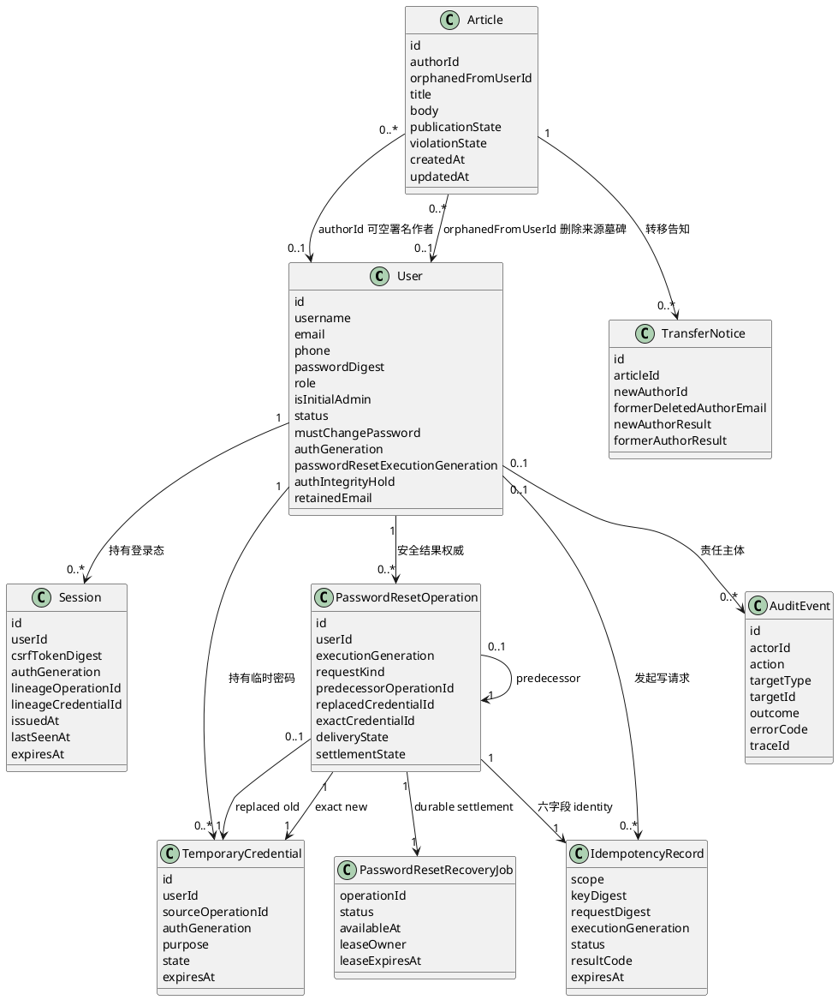

**说明**：PasswordResetOperation 是首次 reset 与普通用户 resend 的安全结果权威；predecessor/replaced/exact-new 关系形成不可猜测的 successor lineage。IdempotencyRecord 只保护高风险请求重放，AuditEvent 提供与业务事务一致的追加式证据；两者都不是 operation 或认证能力真相源。Session 保存 CSRF 绑定摘要与可核验 generation/lineage，不把用户与权限声明放进 Cookie。

#### 6.4.4 数据所有权模型

**表6-4 数据所有权模型**

| 数据实体 | 身份认证模块 | 文章管理模块 | 会话状态 | 幂等/审计 | 邮件投递 |
|---|---|---|---|---|---|
| User | 所有者（读写；含删除标识生命周期） | 读 | 读 | 读主体 ID | 无 |
| Session | 所有者（创建/轮换/删除） | 无 | 读写（校验与 CSRF） | 审计会话动作 | 无 |
| TemporaryCredential | 所有者（读写） | 无 | 无 | 幂等与审计 | 无 |
| PasswordResetOperation / RecoveryJob | 所有者（读写、租约与 settlement） | 无 | 无 | 绑定幂等 identity / 追加审计 | Mailer 只受原请求的一次发送权调用，worker 无发送权 |
| Article | 无 | 所有者（读写） | 无 | 审计治理动作 | 无 |
| TransferNotice | 无 | 所有者（读写） | 无 | 审计投递结果 | 无 |
| DeletionOperation | 无 | 所有者（读写） | 无 | 审计删除阶段 | 无 |
| IdempotencyRecord | 使用 | 无 | 无 | 所有者（读写/清理） | 无 |
| AuditEvent | 追加 | 追加 | 无 | 所有者（仅追加/查询） | 无 |

所有权规则保持业务状态归原模块；共享幂等能力拥有 IdempotencyRecord，共享审计能力拥有 AuditEvent。业务模块通过事务内追加接口写审计，不获得审计更新或删除能力。邮件适配器不读写业务、幂等或审计表。

#### 6.4.5 安全 / 隐私数据模型

口令与临时密码一律只存摘要，不存明文。`User.is_initial_admin` 是权限保护事实，不得由普通账号治理动作修改。`User.retained_email` 由身份认证模块持有，是删除账号墓碑上的隐私敏感字段：它只服务于无归属文章转移后通知已删除原作者，不得用于登录或账号恢复，也不得出现在任何用户可见界面或普通查询结果中。`TransferNotice.former_deleted_author_email` 是该地址在转移时的受控快照，使用范围与最终清理同样受需求 Q2 约束。日志中禁止输出这些字段与任何凭据字段。
## 7 开发视图

### 7.1 代码模型

模块边界在目录上直接可见：`internal/identity` 与 `internal/article` 对应两个业务模块，`internal/session`、`internal/mailer`、`internal/idempotency`、`internal/audit`、`internal/platform` 对应共享能力。

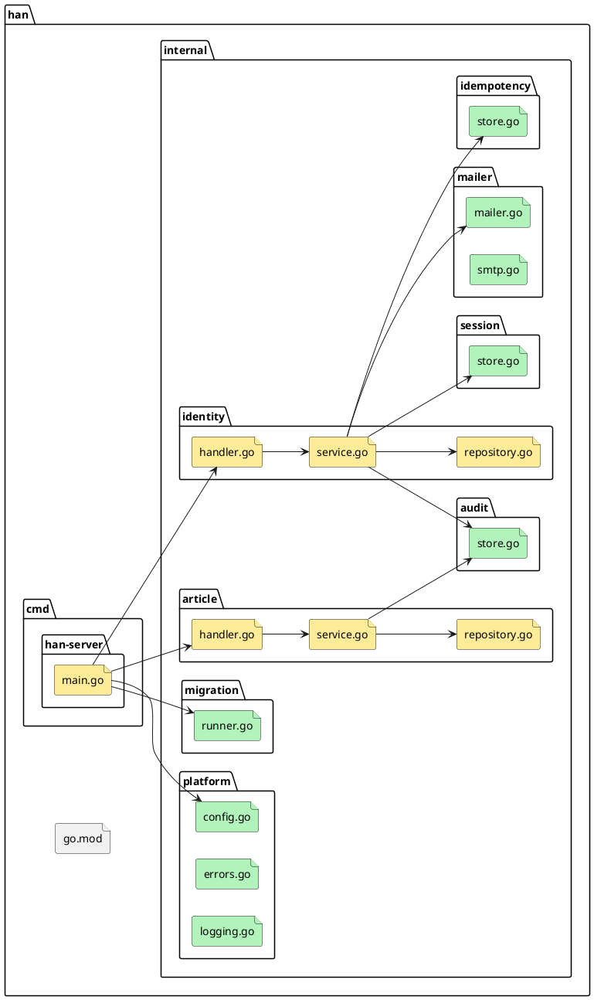

**说明**：`main.go` 只做进程装配与启动编排——先校验 `HAN_DATABASE_DSN`、`HAN_HTTP_ADDR` 与 `HAN_ARTICLE_BACKUP_INVENTORY_PATH` 等全部生产配置，再建立连接池/Ping、调用 migration runner、装配唯一文件 `BackupInventoryReader`、唯一 article-owned `ProductionDeletionReplaySource` 并启动服务；它不含业务判断。恢复能力可延迟打开文件到每次调用，但 production composition 必须只有这一处构造和注入，禁止 global、service locator、第二 source/provider 或 fixture fallback。入口拥有监听/Serve 失败到资源清理和非零退出的映射。`internal/migration/runner.go` 封装迁移执行合同，不拥有进程退出或 HTTP 生命周期。每个业务模块内部按 `handler`（协议适配）、`service`（业务规则）、`repository`（持久化）三分，边界清晰。`mailer` 目录中 `mailer.go` 定义接口、`smtp.go` 提供 SMTP 实现，接口与实现分离使开发与测试可以替换为内存实现。跨模块调用只允许 `service` 之间的显式接口调用，不允许 handler 或 repository 互相引用。

**表7-1 代码元素**

| 逻辑元素 | 代码元素 |
|---|---|
| 接入层 · HTTP 路由与中间件 | `cmd/han-server/main.go`、`internal/platform/` |
| 全局恢复框架与准入（目标增量） | `internal/recovery/runtime.go` 与既有 `coordinator.go/journal.go` 最小扩展；identity `recovery_run_store.go` 只读投影与候选 `recovery_execution.go`；article `deletion_journal.go`/受控适配层的独立Anchor写入、迁移/协调/只读快照及历史关闭port；候选 `internal/platform/recovery_guard.go`、`cmd/han-server/recovery_runtime.go` 与 lifecycle 接缝。root注入同一runtime故障屏障与两namespace独立CAS能力，精确局部文件由FD固定，非本轮源码写权 |
| 业务模块层 · 身份认证模块 | `internal/identity/handler.go`、`service.go`、`repository.go` |
| 业务模块层 · 文章管理模块 | `internal/article/handler.go`、`service.go`、`repository.go` |
| 共享能力层 · 会话状态 | `internal/session/store.go` |
| 共享能力层 · 邮件投递 | `internal/mailer/mailer.go`、`smtp.go` |
| 共享能力层 · 幂等与审计 | `internal/idempotency/store.go`、`internal/audit/store.go` |
| 身份恢复能力层 · Password reset durable safety | identity-owned candidate classifier/atomic repository/dispatch repository、`PasswordResetOperation`/recovery job、purpose router、execution/auth generation、predecessor/replaced/exact-new lineage、delivery/settlement/hold、Login/PasswordChange/Session resolve Gate、caller-owned Session resolve transaction 与数据库租约 worker；worker 无 Mailer port |
| 进程生命周期层 · 双 worker coordinator | production composition 同时保留 Article deletion 与 PasswordReset worker owner，统一 Reconcile/Start/Stop/Wait、shared shutdown deadline、错误优先级/聚合及 Article resource → DB pool 关闭顺序 |
| 恢复能力层 · RecoveryRun 与 Journal | identity-owned `RecoveryRunStore`、`RecoveryCoordinator`、`RecoveryJournal`、provider-neutral `JournalHeadAnchor` port、opaque `KeyRetirementCapability` 验证/单次消费 port 与确定性测试替身；S4.5 仅交付生产 Anchor provider/config/wiring/独立故障域验证；retirement capability 生产闭环由另一独立任务交付；平台专用 OS 锁/支持门禁 |
| Article 恢复输入层 · Backup Inventory | article-owned 严格文件 `BackupInventoryReader` + `ProductionDeletionReplaySource`；唯一在 `cmd/han-server` 由 `HAN_ARTICLE_BACKUP_INVENTORY_PATH` 装配，消费恢复域外签发 manifest，禁止业务 PostgreSQL、远程服务或 fixture 成为 authority |
| 共享能力层 · 数据库迁移执行 | `internal/migration/runner.go` |
| 共享能力层 · 配置与错误语义 | `internal/platform/config.go`、`errors.go`、`logging.go` |

### 7.2 构建模型

单一 Go module（`go.mod`），当前 module path 为 `han`；绑定正式远程并首次对外发布前允许单独变更，不在本轮猜测组织域名。项目只有一个可执行目标 `han-server`，migration runner 编译进该可执行文件，不新增独立迁移命令；Go 版本 1.27。已批准 `golang.org/x/crypto` 用于 Argon2id，并批准 `github.com/jackc/pgx/v5` 原生 API 与 `pgxpool` 用于 PostgreSQL；具体 module 版本由实现批次锁定。无 ORM、数据库抽象层或第三方迁移框架。

**表7-2 构建元素清单**

| 构建元素 | 构建过程/工具链 | 对应代码元素 |
|---|---|---|
| `han-server` 可执行文件 | `go build ./cmd/han-server`（Go 1.27） | `cmd/han-server`、`internal/**` |
| 数据库迁移资产 | 版本序列检查后与 `han-server` 同批次交付；最小执行器随 Go 代码构建 | `migrations/NNNN_name.sql`、项目内迁移执行代码 |
| 单元与集成测试 | `go test ./...` | 各包 `_test.go`、`_integration_test.go` |
| 格式、静态检查、构建与测试 Gate | `add.manifest.yaml` 的现役 `check_commands` 已登记七项，精确命令见 §11；本轮文档复审未执行这些命令 | 全仓 |

实现基线与目标规格的区分：当前工作树已有 migration runner 基线，但 `han-server` 启动接线仍由 B0.1 实现；目标规格保持单一 module、单一可执行文件，后续若拆分需走架构变更。

### 7.3 硬件实现模型

不适用：本项目为纯软件服务，不涉及硬件逻辑模块与器件映射。

## 8 部署视图

### 8.1 交付模型

首期交付单一版本集合：`han-server` 可执行文件、`migrations/NNNN_name.sql` 迁移目录、生产可观测性部署材料、password-reset worker 与 ordinary-user resend settlement 运行手册及配置说明，以及由备份/灾备责任角色在业务 PostgreSQL 恢复域外生成并签发的 `article-backup-inventory/v1` 文件。租约 worker 与 inventory reader 编译进同一可执行文件，不新增独立服务、远程 API或消息中间件。迁移脚本与包含最小执行器的代码同批次交付，不单独发布，也不得只升级其中一侧；配置说明必须登记 `HAN_DATABASE_DSN`、`HAN_HTTP_ADDR`、`HAN_METRICS_ADDR`、`HAN_ARTICLE_BACKUP_INVENTORY_PATH`、四个预算变量、Histogram buckets 及 password-reset worker 的显式 lease/retry/batch/连接池预算，不得提供别名或代码默认值。

**表8-1 交付元素清单**

| 交付元素 | 打包过程/工具链 | 对应构建元素 | 生命周期定义 |
|---|---|---|---|
| `han-server` 可执行文件 | Go 1.27 构建 | `han-server` | 随版本迭代；无独立 EOX 模型 |
| `migrations/NNNN_name.sql` | 随代码仓管理；由项目内最小执行器应用 | 数据库迁移资产 | 与代码同批次发布，不单独升级 |
| 配置说明（环境变量清单） | 随代码仓管理 | 无（文档） | 随版本迭代；生产 DSN、两个监听地址、inventory 绝对路径、四个预算与 duration buckets 使用固定键及合法范围 |
| Article backup inventory manifest | 备份/灾备责任角色从恢复域外备份事实生成 canonical JSON，部署/恢复责任角色以只读单文件挂载 | `article-backup-inventory/v1` | 每次恢复 run 使用精确 backup/cutoff 绑定的签发快照；原子替换发布，不与应用版本或业务 DB 一同回退 |
| 可观测性部署材料 | 随代码仓管理 | scrape 配置、alert rules、Grafana dashboard、Alertmanager route 与 `docs/runbooks/identity-observability.md` | provider-neutral；部署目标绑定实际 backend/receiver 后演练，未完成时生产就绪 Gate 关闭 |
| Password reset 恢复运行材料 | 随代码仓管理 | purpose 分流、execution counter、predecessor/replaced lineage、dispatch ownership、operation/job 状态、租约接管、stale candidate、重试/dead-letter、Gate 排障及升级/回退手册 | purpose router/atomic+dispatch repository/worker/Gate 未装配或未验证时普通用户 reset/resend writer 与受影响认证路由保持关闭；存在新 operation/generation 后禁止旧版本回退 |

首期不采用软件包命名规范类模板格式：该格式面向网元设备与产品线 Release 号体系，本项目无此上下文，不套用。

### 8.2 部署模型

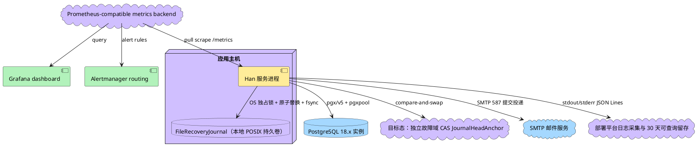

**说明**：业务闭环仍由服务进程、PostgreSQL 与 SMTP 构成；图中的 Anchor 是灾备恢复目标态，不是 S4.2 已交付的生产部署事实。启用生产灾备恢复能力时，FileRecoveryJournal 和独立 CAS Anchor 是额外安全依赖，不能与业务 DB 或 Journal 文件处于同一回退/删除故障域；S4.2 十三文件只提供 Anchor port/协议与确定性测试替身，生产 provider、配置和启动装配须由后续独立任务交付并验证，完成前生产恢复 Gate 关闭。服务进程通过 pgx/v5 原生 API 与 pgxpool 访问 PostgreSQL 18.x。`han-server` 每次启动先校验全部生产配置并构造不依赖数据库的可观测性依赖，再建立并 Ping 数据库连接、构造 Postgres failure auditor 和执行迁移；迁移成功后构造 password-reset purpose router、candidate classifier、atomic/dispatch repository、operation/job store、三个 Gate、caller-owned Session resolver 与数据库租约 worker，并保留现役 Article deletion worker。两个 worker 按固定顺序 Reconcile/Start，两个 listener 也完成绑定后才开放业务服务。配置、依赖构造、连接、迁移、任一 worker 或任一监听失败均非零退出；任一 server/worker 异常或终止信号都进入 shared-deadline 的统一 lifecycle coordinator。日志存储、metrics backend、Dashboard 与 paging 是部署 adapter/config，不进入领域 port。SMTP 端口与地址由环境变量注入，图中端口为常见默认值示意，实际以配置为准。首期不需要负载均衡与多实例。

**S10.5 单次维护路径**：上图及既有启动链描述server/恢复部署；同一han-server另有Windows-only单requeue，与本进程server互斥。pool/permit/operator/audit仅按次构造，无服务活动；“按次”不表示硬进程寿命有上限。D后停止新业务，C前合作取消可取消I/O，所有已开始SDK/native阶段实际join可能越期甚至不返回；完整合同见ADR-0026 r04。其他正常server的原worker可正常领取重排job，普通server生命周期不变。

**表8-2 节点配置表**

| 构建元素 | 部署节点 |
|---|---|
| `han-server` 可执行文件 | 同一binary：server常驻；S10.5 Windows-only按次维护，与本进程server互斥；必须实际join，不承诺所有SDK/进程在K内完成，不新增服务/第二root |
| PostgreSQL 18.x 数据库与迁移脚本 | 独立数据库实例；生产与 CI 使用受支持的最新 18.x patch，开放服务前完成迁移 |
| `HAN_DATABASE_DSN` | 应用主机的进程环境；`han-server` 启动时必填 |
| `HAN_HTTP_ADDR` | 应用主机的进程环境；生产入口必填，单个 IPv4 或方括号 IPv6 `IP:port`，port `1–65535` |
| `HAN_METRICS_ADDR` | 应用主机的进程环境；生产入口必填，独立 listener，仅暴露 `/metrics`，由网络策略限制访问 |
| observer/auditor/shutdown/bucket 配置 | 应用主机的进程环境；`HAN_LOGIN_OBSERVATION_BUDGET=250ms`、`HAN_ORIGIN_OBSERVATION_BUDGET=250ms`、`HAN_LOGIN_FAILURE_AUDIT_BUDGET=2s`、`HAN_SHUTDOWN_BUDGET=10s`、`HAN_LOGIN_DURATION_BUCKETS_SECONDS=0.005,0.01,0.025,0.05,0.1,0.25,0.5,1,2.5,5` 为显式生产基线；合法范围见 ADR-0022 |
| S10.5 维护配置 | ADR-0026 r04 §2七ENV/合法数值/无默认不变；D及K/C改为业务/合作取消截止、不是硬返回上限。parsed primary/全部fallback须数值IPv4/IPv6，hostname/隐式localhost在connect前invalid_config/2且OS lookup=0；15m/30s仍仅显式建议，签名材料仅stdin |
| SMTP 出口配置 | 应用主机的环境变量 |
| 日志采集与留存 | 部署平台采集 stdout/stderr；至少 30 天可查询留存；不替代 PostgreSQL AuditEvent |
| Metrics / Dashboard / 告警 | Prometheus text exposition 0.0.4 scrape backend、`Han / Identity Auth` Grafana dashboard、Alertmanager warning/paging 路由 |
| 值守与 runbook | 生产值守角色 → Han 服务 owner / identity 技术责任角色 → 安全值守角色；稳定入口 `docs/runbooks/identity-observability.md` |
| FileRecoveryJournal | 支持矩阵内的本地 POSIX 持久卷；目录/文件/临时文件/锁入口 owner-only；Windows 生产不支持 |
| JournalHeadAnchor | S4.2 仅交付 provider-neutral port/协议与确定性测试替身；生产 CAS provider、配置、装配和独立故障域验证由后续独立任务交付，未完成前不进入生产恢复节点 |
| Article deletion + Password reset workers | `han-server` 内两个同进程后台运行单元；各自保留领域 owner，PasswordReset 使用 PostgreSQL 租约且只做 settlement，不新增外部队列、不持有 Mailer | migration、purpose router、candidate classifier、atomic/dispatch repository、三个 Gate、显式运行参数与两个 worker Reconcile/Start 全部就绪后才开放对应路由；shutdown 时两个 worker Stop/Wait 完成后关 Article 资源，最后关 pool |

### 8.3 安全部署模型

全局 runtime 目标仍为同一 binary、单部署单运行实例，按 §6.2.4/§9.1.1 消费 ADR-0027；既有图8-1 的 DB、独立 CAS、持久卷、网络边界不变。normal 与受控 recovery 运行互斥，所有普通 server、恢复命令及能写同一部署的维护入口均纳入同一运行独占协议；Journal 单操作锁和 User 行锁不冒跨进程独占。采用恢复域外稳定 OS 锁/等价已验证本地独占设施，持有覆盖证明读取、业务运行或恢复全过程，进程退出由内核释放；锁丢失/不可证明即关闭并停止。首期不提供多主机/分布式保证，设施/权限真实证明未完成前不启用生产 runtime。S10.5 既有软件合同不扩/不重开：恢复期间部署必须禁止其并发启动并排空既有 invocation；未来共用 launcher/锁的接线属全局 runtime 新范围，不借已闭卡授权。

首装 genesis、运行独占设施、Recovery Journal 路径/id/epoch/keyring 与独立 CAS provider 需受控配置，不复用 S10.5 requeue epoch/审批签名。沿用 ENV-only 注入、秘密清理与最小披露；新增配置名、独立 `recovery` 命令族 enter/resume/verify 精确 argv、受控面 allowlist 与元数据编码由 FD 在本合同内固定，无 force-open、自动bootstrap、fallback provider 或第二公共 router。真实部署值、secret、provider 凭据、签发人/权限 unknown 只隔离真实层；standing 授权不包含 GRANT、安装、部署、数据恢复或删除。

article namespace的id/epoch/初始Anchor与可信迁移来源同样纳入§6.2.5受控部署输入。存量升级须停旧未锚定写者，显式迁移后才启用新写者/reader/历史port；normal不自动接受当前链，不补Anchor。独立CAS不可用使新增删除不能确认耐久并触发同一runtime关闭，不能降级回原仅文件sync成功路径；真实迁移/输入/故障域仍未验，软件适配/协议归全局runtime后继。

S10.5部署必须提供与现有TLS验证/SNI规则兼容的数值primary及全部fallback，匹配证书是否具备当前unknown；不得默认关闭校验或新增TLS设置。维护私有Lookup仅本地返回经验证字面量、Dial只数值端点，不启动DefaultResolver/OS GetAddrInfoW；普通server原hostname能力不受影响。撤销排空依赖真实join，不保证D/K内完成；不可取消下层不返回时不能宣告排空结束。CODE cleanup F002的TLS内部额外5s仍须由现有transport owner钳制到共同C并join，不因CPU越期合同获豁免。

S10.5 的 launcher/job、固定 binary/进程 SID、ENV 信任锚及真实 DSN 必须由可信部署渠道和 ACL 保护，普通请求方不能改信任锚或取得直接写库凭据。撤销先关闭新启动、排空旧配置进程及未决 DB 事务，再启用新配置；新 invocation 拒绝已撤销 key/SID/旧 epoch，不承诺即时撤销在途事务。灾备恢复期间禁用 requeue，恢复后换不复用 epoch；数据库审计消费不承诺跨备份回滚防重放。细则仅见 ADR-0026，实际部署/验证 NOT RUN。此 Windows-only requeue 不改变下述 FileRecoveryJournal 的 POSIX 支持矩阵或全局恢复 Gate。

恢复基础设施提供独立 namespace：`recovery/*` 保存恢复凭据防重放，`article-deletion/*` 保存文章删除 tombstone。二者可复用经验证的文件、keyring 与 OS 锁基础能力，但记录、CAS anchor、接口、校验链和语义互不混用；每个 namespace 使用独立 `journal_id/epoch/head`。Deletion Journal 不保存文章内容或 PII。

恢复运行手册固定前置 Gate：必须先证明生产 CAS Anchor provider 已由后续独立任务完成配置、启动装配和真实独立故障域验证；仅存在 S4.2 测试替身时不得开始生产恢复或宣称链路可用。Gate 通过后的固定顺序为：维护模式 → 验证 OS 支持、owner-only 权限、OS 锁、完整 keyring、Journal 与 committed Anchor → `RecoveryJournal.Begin(run_id,backup_ref,recovery_secret)`，绑定当时 active key → 恢复 DB 并由 identity-owned Store 加载/创建同一 run+backup 与 Begin key 绑定的 RecoveryRun → 身份终结与 canonical 删除 → article `ReplayAll(run_id,backup_ref)` → DeletionOperation/Audit 对账 → 生成或重算 DeletionReplayEvidence → identity 通过 `ReadStatus(run_id,backup_ref)` 核版本、摘要、namespace、backup 和 ready → 分别从 Store、Recovery Journal 与 Article evidence 核对相同 `run_id + backup_ref` → RecoveryRun `ready_to_consume` → Recovery Journal `MarkConsumed(run_id)` 沿用 Begin key，即使该 key 已 verify-only → RecoveryRun `journal_consumed` → 最终对账后 `succeeded`/开放。任一证据未知、wrong backup、key 绑定改变或不匹配均保持停服。

支持矩阵：Linux/Unix 本地文件系统只有在同目录原子替换、文件/目录同步与 OS 独占锁均经目标环境验证后才支持生产 FileRecoveryJournal；Windows 当前为 unsupported；共享/NFS 为 unknown/unsupported until proven。未来 Windows provider 无法读取或解释 DACL、安全描述符缺失或存在未批准写 SID 时必须 fail closed，具体 SID allowlist 由部署/安全责任人登记。

ArticleDeletionReplayStatus v1 以 ADR-0020 为唯一 schema。ready variant 完整 20 字段并重算摘要；unavailable variant 只含 6 字段，状态限 `pending|unknown|failed`。`inventory_scope` 固定 string。共享 fixture canonical digest 固定为 `sha256:169e0f30407867083598ab146c950968e1b5f508ed4fd5d5198bb61e788926a7`；生产者与消费者必须嵌入同一 fixture 或生成源。

Article backup inventory 的生产 authority 与业务 PostgreSQL、Article Deletion Journal、article S4.5 synthetic fixture 分离。部署/恢复责任角色只能把已签发 canonical manifest 作为只读单文件挂载，`cmd/han-server` 只能从 `HAN_ARTICLE_BACKUP_INVENTORY_PATH` 构造唯一 reader；不得通过 SQL 表、调用方传入计数/摘要、远程服务、目录中“最新文件”选择或 fixture fallback 形成第二 authority。

## 9 运行视图

### 9.1 运行模型

S10.5在唯一main选维护模式，按ADR-0026完成七ENV/pre-DSN授权后才parse DSN，primary/全部fallback数值校验与MaxConns关系通过后才connect；零listener/Serve/worker/Reconcile/Start/migration/bootstrap。D保持不变，到D不发起新认证、Acquire/Ping/Requeue/业务写或提交核验，不延长TTL。K=D+ShutdownBudget，每次C=min(cleanup_start+ShutdownBudget,K)只用于合作取消可取消I/O，不是硬进程或全SDK完成上限。constructor/stage、借用连接/permit、健康SDK Close→CleanupDone、pool及自有callback/timer必须真实结束/join；不可取消CPU/native阶段可超过C/K，下层永不返回时进程也可能一直等，不能脱离工作后提前return。最终以单调end检查粘性cleanup overrun：原本成功变maintenance.failed/6且stdout空，已有unknown/5优先，其他非零按原主错误规则；保持明确提交及原审计事实，不加timeout Audit/业务写。TLS清理SetDeadline/Read/Write含清空/放宽必须在owner内裁至C，独立修复5s网络窗口。原attempt_count不减/不重置、one enqueue/current worker policy不变；requeue成功不等于认证恢复。下述既有server/全局恢复时序不改，维护细节/旧反例保留与未来验证见ADR-0026 r04。

服务为单一进程，正常生命周期分为启动门禁、请求服务与统一关闭三段。启动门禁先完成全部 production config 校验，包括 `HAN_ARTICLE_BACKUP_INVENTORY_PATH` 的绝对、规范路径语义，并构造 JSON logger、metrics registry/exposition adapter、Login/Origin logger+metrics observer 与四项有界预算，再完成数据库连接/Ping、构造 Postgres failure auditor、迁移、password-reset purpose router/candidate classifier/atomic+dispatch repository/operation/job store/三个 Gate/caller-owned Session resolver，以及唯一文件 `BackupInventoryReader` 和 article-owned `ProductionDeletionReplaySource`，并同时装配 Article deletion 与 PasswordReset 两个 worker及 metrics/业务两个 `net.Listen`。固定先 `ArticleDeletion.Reconcile → PasswordReset.Reconcile`，再按同顺序 Start；两个 listener 与两个 worker 全部就绪后才注册并开放对应业务路由。测试 fake/no-op、fixture inventory、缺失依赖、超范围预算或非法 buckets 均不得进入 production composition。每个后续入站 HTTP 请求由一个 goroutine 处理，请求上下文携带超时与取消信号；observer fan-out 使用同一剩余 deadline，超时不重试且不改变公共响应、主事务或审计结果。任一 Serve/worker loop 异常或终止信号进入同一 lifecycle coordinator：停止新接入/领取，在唯一 shared deadline 内并发关闭两个 server、Stop/Wait 两个 worker，必要时对两 server强制 Close；两个 worker停止后关闭 Article资源，等待Serve loops并关闭listener，最后关闭数据库池。数据库访问经连接池，池上限可配置。恢复维护模式是独占运行路径：Journal 操作在进程生命周期 OS 文件锁下执行，进程退出或句柄关闭由内核释放锁，不依赖删除 `.lock` 文件；inventory 则按每次 replay/freshness 调用打开稳定只读 snapshot，任何路径/文件身份漂移都使本次恢复 fail closed。

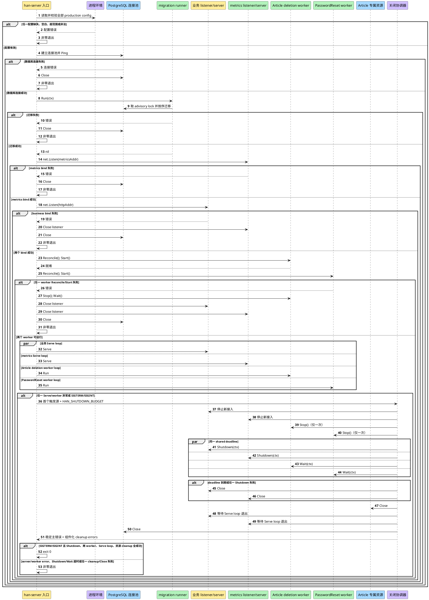

**说明**：启动门禁只有一条成功路径能到达两个 Serve loop 与两个 worker loop：任一 composition 依赖、配置、purpose router、Gate、atomic/dispatch repository、worker Reconcile/Start 或 listener 失败时均不得开放相关业务路由。migration runner 通过错误返回迁移结果，`han-server` 入口拥有两个 `net.Listen`、两个 `http.Server`、双 worker coordinator、进程退出与资源清理责任；runner 不直接退出进程，也不控制 listener。启动阶段 bind 或 worker 启动失败只清理已建立资源，不进入完整 graceful 等待。运行阶段先停止新接入、password-reset 新 claim 与两个 worker 新领取；两个 server Shutdown 和两个 worker Wait 共用一个 deadline。两个 worker都停止后才关闭 Article 专属资源，随后等待两个 Serve loop、关闭 listener，最后关闭数据库池。主错误稳定优先级为 business server → metrics server → PasswordReset worker → Article worker → context/signal；cleanup errors按组件名附加。只在 `SIGTERM`/`SIGINT` 触发且全部关闭与 cleanup 成功时退出 0；任一运行错误、Shutdown/Wait 超时或失败、worker/resource/pool 收敛失败或任一 cleanup/Close 失败均非零退出。`HAN_TEST_BASE_URL` 是客户端测试变量，不参与该服务端启动链。

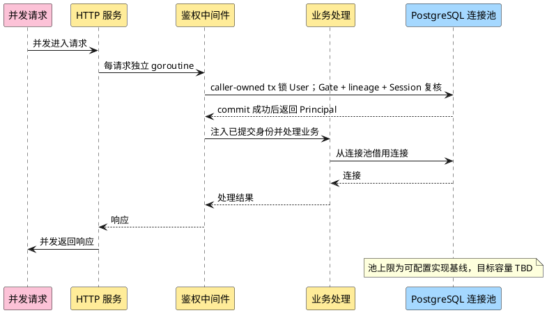

**说明**：并发模型的关键点是**请求间不共享可变状态**。身份信息经请求上下文传递，不放在全局变量中。Session resolve 不是可在事务外授权的一次预读；它必须在 caller-owned transaction 内先锁 User，复核 PasswordReset Gate、generation/lineage 与 Session，执行必要撤销，并且只有 commit 成功后才把 Principal 注入请求。被停用账号或 unresolved/hold 用户在下一次请求即 fail closed。

**关键运行的失败与恢复**：

| 场景 | 已改变的状态 | 恢复方式 |
|---|---|---|
| `HAN_DATABASE_DSN` 缺失 | 未建立数据库资源，未绑定 HTTP 端口 | 记录不含 DSN 的配置错误并非零退出；补齐变量后重新启动 |
| `HAN_HTTP_ADDR` 缺失、空白或非法 | 未建立数据库资源，未执行迁移，未调用 listener | 非零退出；提供单个 IPv4 或方括号 IPv6 `IP:port`（port `1–65535`）后重新启动；不得回退到 `HAN_TEST_BASE_URL` |
| 生产可观测性配置、依赖或预算非法 | 未建立数据库资源，未执行迁移，未绑定任何 listener，未注册业务路由 | 非零退出；补齐 `HAN_METRICS_ADDR`、四个范围内预算、`1..32` 个正数有限且严格递增、最大 `<=60s` 的 buckets 及真实 logger/metrics/observer/auditor 后重新启动；不得使用 fake/no-op 回退 |
| 数据库连接失败 | 可能已创建未验证的连接池，未执行迁移，未绑定 HTTP 端口 | 释放已创建资源并非零退出；数据库恢复后重新启动 |
| 数据库迁移失败 | 已提交的早期迁移保持成功记录；失败迁移事务回滚，后续迁移未执行；未绑定 HTTP 端口 | 修复数据库或迁移后重新启动；runner 从 `schema_migrations` 继续，禁止跳过失败版本开放服务 |
| Password reset purpose router/Gate/worker 或双 worker coordinator 缺失、非法或无法启动 | migration 可能已成功，但普通用户 reset/resend writer、受影响认证路由或 Article deletion 路径尚未开放 | 非零退出或保持相关路由关闭；补齐 purpose router、candidate classifier、atomic/dispatch repository、operation/job、三个 Gate、caller-owned Session resolver、显式 lease/retry/batch 配置及两个 worker Reconcile/Start 后前向启动，不得以 no-op/fake/旧 reader 或覆盖 Article worker 降级 |
| Metrics exposition 编码失败 | 200 尚未提交，完整内存 buffer 不可生成 | 返回固定去敏 500 文本并丢弃 buffer；不得发送部分 200、内部 cause 或不完整 Histogram |
| Metrics 或 HTTP 监听失败 | 迁移已经成功，可能仅一个 listener 已建立，数据库池仍存在 | 直接关闭已绑定 listener 与数据库池并非零退出；启动阶段不进入完整 graceful 等待，不得只开放业务或只开放 metrics |
| 收到 `SIGTERM`/`SIGINT` | 两个 listener/Serve loop、两个 worker、Article 专属资源与数据库池仍存在 | 停止新接入/领取；同一 `HAN_SHUTDOWN_BUDGET` deadline 内并发 Shutdown 两 server、Stop/Wait 两 worker；两 worker停后关Article资源，等待Serve loops并关listener，最后关pool。全部成功时退出0；任一超时/失败或 cleanup/Close 失败时强制收敛后非零退出 |
| 任一 server/worker 运行异常 | 两个 listener/Serve loop、两个 worker与共享资源仍存在 | 按 business server → metrics server → PasswordReset worker → Article worker 稳定优先级选择主错误；执行同一 shared-deadline 关闭合同，cleanup errors按组件名附加且不覆盖主错误；无论 cleanup 是否成功均非零退出 |
| 外部日志采集、scrape、dashboard、Alertmanager receiver、值守或 runbook 未配置/未演练 | 应用可能可以启动，但没有完整生产处置链 | 生产就绪 Gate 关闭，不宣称生产可观测；部署责任角色补齐 30 天留存、规则、receiver、排班、runbook 与演练证据 |
| 停用用户 | 账号状态改为停用、会话记录删除；文章权威状态不改写，成员可见性派生为隐藏 | 恢复账号后文章可见性自动恢复；会话需重新登录建立 |
| 删除用户 | `User.status` 写为不可恢复的 `deleted` 墓碑、会话删除、保留专用 `retained_email`；文章 `author_id` 置空、`orphaned_from_user_id` 指向删除墓碑、`publication_state` 置为 `held`、违规状态保留 | 账号不可恢复；文章保持隐藏并由管理员按无归属规则单独处置 |
| 新管理员创建邮件失败 | 待创建管理员账号与临时密码写入回滚 | 初始 `admin` 可重新发起；失败后不存在管理员账号 |
| 首次密码重置邮件失败 | 本次 operation/pending credential/job 按 ADR-0023 安全失效并保持账号原凭据与 Session 能力不变 | 获授权管理员可重新发起；失败不留下未交付凭据，IdempotencyRecord 不得越过 operation 返回成功 |
| Password reset operation 未终结、未知、不可读、lineage/settlement 不一致、integrity hold 或 `dead_letter` | exact credential、Session、永久密码能力、generation 或幂等/审计一致性尚不可证明 | Login、PasswordChange、Session resolve 与新 reset/resend writer 维持 fail closed；Session resolve 不返回 Principal；受控 worker/审计命令前向收敛，禁止删除 operation、强改幂等/hold 或回退旧版本解锁 |
| Password reset 升级或回退 | 新 schema 含 execution counter、request kind、predecessor/replaced/delivery 字段、FK/UNIQUE/CHECK/索引及 old-active/new-pending 部分唯一；purpose router、atomic/dispatch repository、Gate、双 worker coordinator 与旧 reset/resend writer/reader 不得混跑 | 先停止旧 reset/resend writer/reader，执行 legacy preflight 与前向迁移，装配全部 Gate/repository及两个 worker并 Reconcile，最后开放；写入任何新 operation/generation/lineage/delivery 后禁止回退旧二进制，只允许前向修复 |
| `new_administrator` resend 邮件失败 | ADR-0011 路径回滚本次新临时密码，旧值不失效 | 仅初始 admin 可按同一 purpose 重新发起 |
| 普通用户 `password_reset` resend 邮件失败或 stale candidate | SMTP 明确未受理，或无 durable accepted 证据时只失效 new candidate；old、auth generation、Sessions 不变 | operation/job 终结且无 hold 后 Gate 清除；获授权管理员使用新 key 建立新的 successor operation |
| 普通用户 resend dispatch commit ack-loss | 数据库可能已持久 `dispatching`，调用方无法证明发送权提交 | 原请求不发送，replay/worker/命令均不补发；worker 按无 accepted 证据路径只失效 new candidate |
| 文章转移通知失败 | 无归属文章已转移，新作者归属与发布意图已提交 | 不回滚；分别记录新作者与已删除原作者的投递结果 |
| 幂等键重放 | 首次请求可能处理中或已完成 | 同键同摘要等待或返回原结果；同键不同摘要拒绝冲突 |
| 审计写入失败 | 高风险业务事务尚未提交 | fail closed 并回滚业务写入 |
| 创建管理员或非 password-reset 临时凭据的 SMTP 已受理但数据库提交失败 | 邮件可能已进入投递链路，业务状态未提交 | 返回失败；审计并告警；凭据不可用；允许同幂等键安全重试。Password reset 改由持久 operation/job 单独治理 |
| 数据库备份恢复 | 恢复点可能包含旧会话、活动凭据和不确定幂等记录 | 对外开放前删除全部 Session、失效活动 TemporaryCredential、把 processing/uncertain 幂等记录标为待核或失败，并写恢复审计；任一步失败保持停服 |
| 恢复点账号与永久密码 | 恢复点可能复活旧密码、旧角色、已删除或撤权账号 | 终结事务失效全部永久密码；非初始管理员全部 suspended 且 recovery_required；初始 admin 用独立 recovery secret 重建信任根后逐账号核对恢复 |
| `kept_deleted` 核对 | User 判为 deleted，但文章和标识仍是恢复点旧状态 | 重放完整 canonical 删除事务；任一子步骤失败维持 Gate/停服，不新增文章恢复 |
| Recovery Journal 不一致 | run ID/指纹已消费、Journal 损坏/不可写或与 RecoveryRun 不一致 | fail closed；禁止消费 secret、禁止开放 readiness |
| Recovery Journal backup 绑定不一致 | Journal、RecoveryRunStore 或 Article evidence 的 run 相同但 `backup_ref` 缺失/不同，或 begun/consumed backup 改变 | 从三个独立来源精确比较 `run_id + backup_ref`；wrong backup fail closed，禁止 MarkConsumed/open |
| Journal 删除/完整前缀截断/旧快照回退 | 文件链自身可能仍合法，但与 committed CAS Anchor 头不一致 | fail closed；禁止 bootstrap 覆盖既有 anchor；按 pending 协议仅收敛精确旧头/新头 |
| Anchor pending 时崩溃 | 文件可能仍为旧头、已为新头或处于未知第三状态 | 持 OS 锁重读 revision；旧头清除/完成 pending，新头提交 pending，第三状态停服 |
| Coordinator 在 MarkConsumed 后崩溃 | Journal 已 consumed，DB 仍为 `ready_to_consume` | 精确验证 Journal/Anchor consumed 记录后补写 `journal_consumed`；不得再次 MarkConsumed |
| RecoveryRun 与 Journal 阶段倒挂 | DB 过早或过晚，无法证明同一 run 已安全消费 | 除唯一允许的不对称状态外全部 fail closed，禁止开放 |
| Windows/ACL/锁语义不可证明 | provider 可能无法保证 owner-only 或崩溃释放 | Windows 生产初始化在变更前 unsupported；未来 DACL 不可证明或共享 FS 语义未知时 fail closed |
| Journal 时间精度漂移 | Go 纳秒与 PostgreSQL 微秒比较不一致 | 生成时统一 UTC 微秒并在两侧写同值；非规范存量拒绝静默修正 |
| HMAC key 轮换不完整 | 历史 key 缺失、记录 key 未知、只迁移 active key，或轮换后试图用新 active key 终结旧 run | 无法证明历史 secret 未复用或既有 run 可安全终结，立即停服；补齐 Journal+keyring 后按 Begin key 重试；有未消费 run/保留记录时禁止退役 |
| KeyRetirementCapability 缺失、复制/重放或 fake 被当生产授权 | 静态退出条件看似满足，但没有生产 evidence 核验、签发与单次消费闭环 | retire/delete 必须 fail closed；S4.2 opaque verifier fake 仅用于确定性测试，不得 mint、装配生产或形成生产证据；非 S4.5 独立任务完成并真实验证前 retirement 保持禁用 |
| Anchor 测试替身被误当生产 provider | S4.2 只有确定性 fake，无生产配置、启动装配或真实独立故障域证明 | 恢复链可能在同故障域或无持久 CAS 的情况下被错误开放；生产 Gate 保持关闭，Task-Planner 后续独立任务交付 provider/config/wiring/验证前禁止生产可用声明 |
| 删除 Journal 已写、DB 删除失败 | Article 已是不可见 `deletion_pending`，tombstone 已耐久 | API 返回失败；finalizer 幂等物理删除并写审计，禁止恢复公开 |
| 删除 Journal 失败 | 删除事实未耐久 | 不返回成功；事务回滚或保留不可见可重试状态，不得出现半删除重新可见 |
| 旧备份恢复文章 | 备份可能包含已永久删除 Article | readiness 前重放全部有效 tombstone 并幂等物理删除；Journal/key/operation 不一致则停服 |
| stale replay ready | ready 属于其他 backup，或 Journal head/inventory/operation/audit 已变化 | 旧 evidence 失效并重新重放/对账；缺失、旧版本、摘要不匹配返回 unknown/failed，readiness=false |
| inventory manifest 缺失、不可读、不安全或漂移 | 当前恢复输入无法证明，或旧 Ready 的 `input_digest` 已过期 | 不回退到业务 DB、远程服务、缓存或 fixture；返回 unavailable/错误并保持 Gate 关闭，取得新的稳定签发 snapshot 后重新 ReplayAll/对账 |

#### 9.1.1 全局恢复生产消费与开放（r32 目标合同）

每次 normal 启动/重启先 closed，经 §6.2.4 正向证明后才允许普通业务；empty DB、mode=normal、上一进程 true 均无授权效力。图9-1 保留现役普通启动/双 worker/双 server 与清理顺序，目标在普通 bootstrap、worker Reconcile/Start 和业务处理前加入准入屏障；连接/必要迁移仅可在关闭且取得独占后执行，migration 不得把缺失恢复来源变 fresh。证明不满足时目标 normal 启动失败、去敏报错并归还自有资源，不沿现有 normal 默认开放。当前普通 maintenance 拒启保持，直到完整受控入口被实现、评审、接收；本文不使其自动改变行为。

受控恢复采用同一 root 的独立 `recovery` 入口，普通业务面与受控维护面互斥。公共 listener 存在时，同一 exact router/Trace 对已识别普通业务路由实际返回 HTTP503 `platform.recovery_in_progress`，在 Session/Article 下游前阻断；Case18的 `GET /api/v1/admin/articles` 与 `GET /api/v1/admin/articles/{id}` 必须走真实链返回该503及Trace，Article service/repository/author-reader均零调用。原404/405/Allow、Origin/CSRF、Session/AccessGeneral 及正常开放链保持兼容，未知路径不变恢复动作。受控面只开放恢复信任根登录/首次强制改密、逐账号 review/canonical、幂等核对所需精确动作；root 注入不可由 header/URL 伪造的访问面标识，同一 router registry 选择 allowlist，不挂整个 admin 面、不建第二 router/pool。initial admin 恢复权限仍由 identity 既有合同校验，维护 listener 不免鉴权，普通 Principal 不获恢复 capability。

readiness 只派生该判定：开放才成功，恢复/unknown 返回503；liveness 仅证进程存活，不授业务或恢复许可。现役无通用 probe API 的事实保留，FD 只在同一 router 固定必要路径/最小响应，不披露 run/账号/secret、不把 metrics 当恢复入口。未监听/拒启不能计公开503。配置/信任不足以安全建立维护面时拒启并保留受控面未交付，禁止静默开放业务。

恢复动作严格遵循以下次序：

1. 关闭普通请求及全部普通 worker 新工作 permit，排空在途请求、已领取工作及事务；普通 bootstrap/Reconcile/Start 不运行。取得并持有同部署独占运行权，证明无另一 server/requeue/恢复进程。只停 Article worker 或只等 HTTP Shutdown 均不足。
2. 验真实 CAS 独立故障域、POSIX/锁/权限、完整 keyring、两 namespace 及备份 inventory 等原前置。Recovery Journal Begin 成功且 committed 后才能替换 DB；Begin/写入结果 unknown 时不替换/开放，转受控核验。
3. 恢复 DB，经同一 identity Store 创建/加载精确 run+backup+Begin key/fingerprint/UTC微秒绑定；identity 执行者完成凭据/Session终结、恢复信任根、全部review/canonical kept_deleted与幂等核对，Store 才条件转换 identity_ready。canonical capability 与 CheckRecoveryOpenGate 只在公共关闭、同 run running 时允许恢复写入。
4. identity恢复consumer经recovery机制调用同一 Coordinator.Consume(run_id)，经 article ReplayAndVerify/严格 Ready20 或 Unavailable6 解码、同 run/backup/namespace/版本/摘要校验，持久化 article_deletion_ready。第二次 ReadStatus 必须 fresh 且 ref/digest/completed_at 相同；两 namespace 分别验证、来源前后稳定后才 ready_to_consume；普通请求/worker一直关闭。
5. 外部 I/O 在短事务外，MarkConsumed 沿 Begin key 唯一消费；核精确 consumed 后 Store 转 journal_consumed，最终 Store/Journal/Anchor/article 全等才 succeeded。首次开放仍用本次 fresh 最终对账，不以历史查询替代；normal 后续重启才用历史关闭证明。
6. root 消费同一 runtime 有效准入结论，保持请求屏障关闭执行既有 Article→PasswordReset Reconcile、同序 Start 和资源就绪，全部成功后开放普通请求/readiness。任一启动失败即关闭/Stop/Wait/退出，不把 succeeded 改成“已服务”；run 记录恢复结果，进程就绪仅派生。切普通面前排空维护请求并撤销恢复 capability；若用 normal 重启切换，须重核完整历史关闭证明。

恢复专用 Finalizer/identity 操作只由受控编排显式调用，不启动普通循环；排空与失败复用 worker Stop/Wait、shared deadline、Article resource→pool 清理及原错误优先级，不更改 lease/重试/SQL/邮件策略。未 join 的普通工作均阻止 Begin/DB 替换，取消/超时不证明结束。HTTP503/受控面/listener 仅在安全关闭条件成立时存活，丢失隔离/独占保证即停止服务。

commit unknown先回读各权威来源，不能一概重放。只有下表精确ready_to_consume＋consumed窗口可按原协议补状态；Begin、身份终结、article发布或其他阶段的未知，分别按原幂等/绑定合同受控核验，不能推广该补写窗口。已发布evidence的ref/digest/completed_at及原分项结果不得因回读/重试改写。

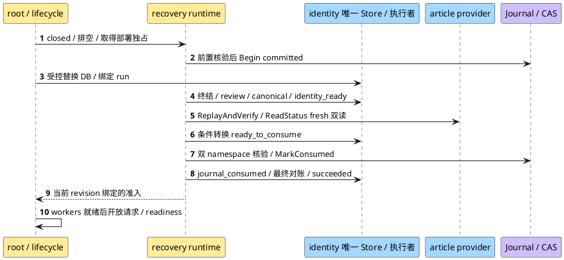

**说明**：Begin 先于 DB 替换；running→identity_ready 前半段不属于现有 Consume。准入仅对当前独占运行与一致证据有效，worker失败/进程退出不留下可跨重启复用的开放标志。

| 场景 | 固定行为 |
|---|---|
| 首装、空库、缺表/Journal/Anchor | 仅显式可验证 genesis 可准入；缺失/半初始化拒绝，不自动建立“从未恢复”事实 |
| normal 重启且 succeeded、日常删除推进 Facts | 核精确历史 published closure、当前连续性和无新 unfinished；不 Consume、不要求 current Facts 等于旧恢复输入 |
| 新 Begin/failed/错绑/旧备份缺run，另有成功记录 | 阻断优先；不选 latest success 覆盖 unknown/failed，无法证明 supersede 保持关闭 |
| Consume 中 input/head/inventory/revision 漂移或 unavailable | 保留 fresh双读/stale拒绝，不 MarkConsumed/open；有界重核失败交受控恢复 |
| MarkConsumed 后、DB journal_consumed 前崩溃 | normal 只读拒绝且不补写；受控入口只允许 DB=ready_to_consume＋精确consumed/Anchor的原崩溃收敛，不重复消费 |
| Journal pending/第三状态/早期DB已consumed | normal不修；受控路径仅按ADR-0019精确pending协议及ADR-0018唯一不对称状态收敛，其余关闭 |
| 并发 normal/recovery/requeue、失锁/取消/停机 | 独占与请求/worker屏障拒绝交叉；未证明真实排空不恢复、来源不明不开流；按现役生命周期归还资源 |

### 9.2 关键治理时序

**创建管理员与非 password-reset 临时凭据交付的 fail-closed 组合**：

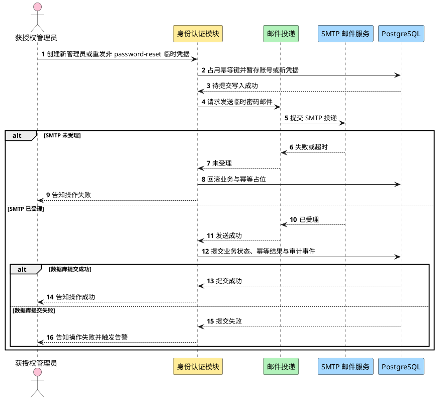

**说明**：本图只描述仍采用 ADR-0011 残余窗口合同的创建管理员与非 password-reset 临时凭据路径。SMTP 未受理时仍可回滚；SMTP 已受理后数据库提交失败是明确保留的残余窗口。此路径返回失败，邮件凭据不可用，并通过幂等、最新凭据、追加式审计、trace 与告警处置。架构不宣称 SMTP 与数据库原子。Password reset 不再使用该请求内 pending-commit 作为安全证明，而采用下述持久 operation 流程。

**Password reset 持久屏障、认证 Gate 与 worker 收敛**：

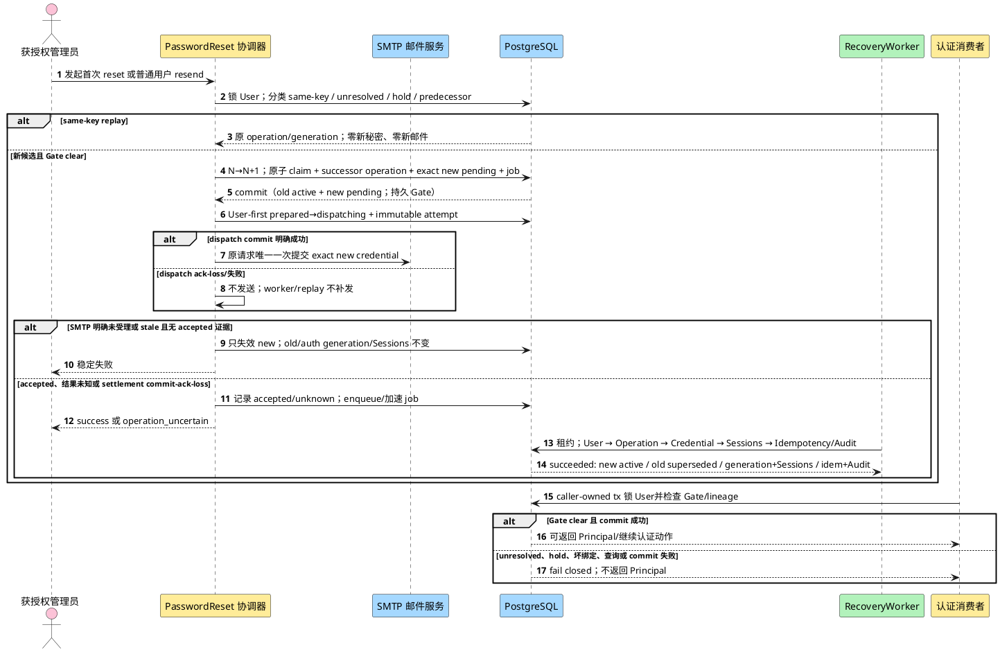

**说明**：首次 reset 与普通用户 resend 的新候选事务提交后即存在 durable barrier，后续进程重启或租约接管不会丢失 Gate。resend predecessor/current old 必须在 User 锁内精确复核；old active 与 new pending 的共存只是一段 fail-closed 中间态。所有 writer、消费者、worker 与受控命令使用同一 User-first 锁序；无 operation 行也由 User 锁阻止并发插入竞态。worker 只做数据库 settlement，不拥有发送权；只在权威 operation、delivery evidence、auth generation、credential/password/Session lineage、settlement、幂等快照和 AuditEvent 一致时终结，证据不足进入或保持 integrity hold，`dead_letter` 不解锁。

**文章转移与双路通知**：

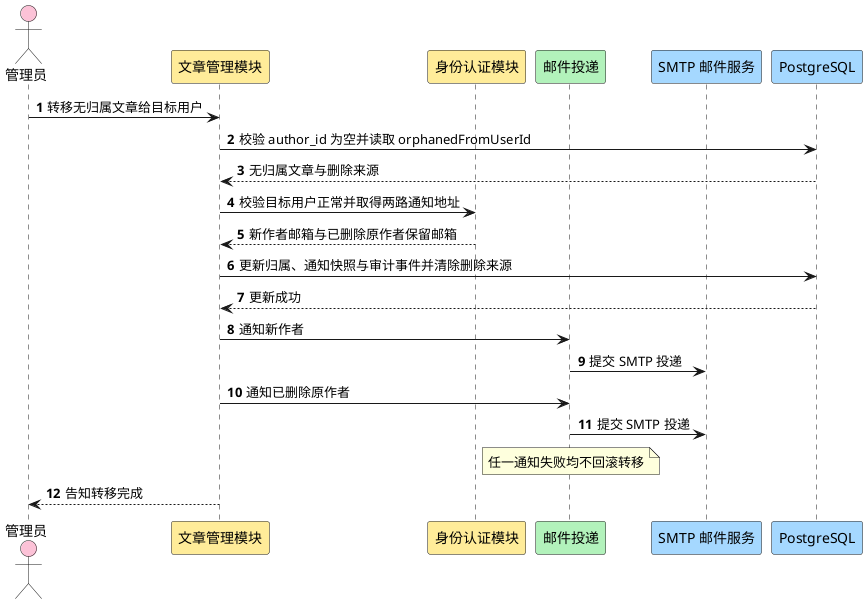

**说明**：入口先证明文章无归属，并用 `orphanedFromUserId` 定位删除账号墓碑；仍有归属的普通文章直接拒绝且不触发通知。事务内先把两路通知地址快照写入 TransferNotice，再更新归属、置为 `published` 并清除删除来源关联。提交后的通知对象固定为新作者与已删除原作者。任一通知失败只记录结果，不改变转移结论——这是需求明确要求的 best-effort 行为，与临时凭据交付的 fail-closed 语义形成对照。

## 10 需求到设计的映射

**表10-1 需求分解分配**

| 需求编号 | 需求名称 | 分配模块 | 关键设计落点 | 验证方式 |
|---|---|---|---|---|
| US-IDENTITY-01.1 | 建立用户身份 | 身份认证模块 | 注册接口 + 删除标识生命周期唯一约束 | 集成测试：用户名永久拒绝复用；邮箱手机号按保留状态校验 |
| US-IDENTITY-01.2 | 设置注册密码 | 身份认证模块 | 口令规则 + Argon2id 编码 | 单元测试 + 目标环境哈希基准 |
| US-IDENTITY-02.1 | 登录社区 | 身份认证模块 + 会话状态 | 统一失败 + 不透明 Cookie + 会话轮换 | 集成测试：失败不可枚举账号；Cookie 属性与旧 ID 失效 |
| US-IDENTITY-03.1 | 建立初始管理员账号 | 身份认证模块 | 首次启动初始化 + 环境变量注入（ADR-0007）+ 初始管理员不可停用、删除、撤权或由他人重置 | 集成测试：凭据不入库为明文；四类受保护操作均被拒绝 |
| US-IDENTITY-03.2 | 删除他人文章 | 文章管理模块 | 角色、If-Match、Deletion Journal 与物理删除 | 204 仅在 tombstone 与 DELETE 完成后返回 |
| US-IDENTITY-03.3 | 创建其他管理员账号 | 身份认证模块 + 邮件投递 | `Idempotency-Key`、标识生命周期、SMTP 残余窗口与审计 | 集成测试：重放不重复创建；受理后提交失败告警 |
| US-IDENTITY-03.4 | 管理其他管理员账号 | 身份认证模块 | 仅初始 `admin` 可查看、停用、恢复、删除、重置密码或撤权其他管理员 | 权限矩阵集成测试：普通管理员与受保护目标均被拒绝 |
| US-IDENTITY-03.5 | 查看用户 | 身份认证模块 | 普通管理员只可查看普通用户；初始 `admin` 可查看其他管理员治理信息 | 集成测试：非管理员及越权目标被拒且不泄露信息 |
| US-IDENTITY-03.6 | 停用与恢复用户 | 身份认证模块 | 目标状态幂等、会话撤销/轮换与同事务审计 | 集成测试：重复请求无重复副作用；旧会话失效 |
| US-IDENTITY-03.7 | 删除用户 | 身份认证模块 + 文章管理模块 | 永久用户名、条件保留邮箱手机号、墓碑与同事务审计 | 集成测试：复用限制、文章 held、账号不可恢复 |
| US-IDENTITY-03.8 | 处置无归属文章 | 文章管理模块 | 恢复、转移及 Journal 保护的永久删除 | 恢复旧备份后删除文章仍不存在 |
| US-IDENTITY-03.9 | 发送文章转移通知 | 文章管理模块 + 身份认证模块 + 邮件投递 | 地址快照、通知 best effort、邮箱清理前置与审计 | 集成测试：清理条件、通知失败不回滚 |
| US-IDENTITY-03.10 | 重置用户密码 | 身份认证模块 + 邮件投递 | User-first 原子 claim、持久 operation/job、auth generation/lineage/settlement/hold、三消费者 Gate 与双 worker lifecycle | 集成测试：原子 crash/no-row barrier、commit-ack-loss、合法 successor、hold、Session commit barrier 与双 worker 收敛 |
| US-IDENTITY-03.11 | 重发临时密码邮件 | 身份认证模块 + 邮件投递 | purpose 分流；`new_administrator` 沿 ADR-0011；普通用户 resend 使用 successor operation/execution generation、predecessor/replaced lineage、dispatch ownership、stale settlement 与三消费者 Gate | 集成测试：两 purpose 零串线、same-key 零副作用、unresolved/hold 零写入、old/new 三阶段、四 commit 点、worker 不发邮件、迁移/混跑/回退 |
| US-IDENTITY-03.12 | 隐藏、解除判定与删除违规文章 | 文章管理模块 | 违规状态转换 + Journal 保护的永久删除 | tombstone 不含内容，恢复后仍删除 |
| US-ARTICLE-01.1 | 创建文章 | 文章管理模块 | 仅标题与正文；创建即发布；无草稿或下线 | 集成测试：无中间状态 |
| US-ARTICLE-02.1 | 发现并阅读文章 | 文章管理模块 | 创建时间倒序分页列表 + 标题正文详情 + 可见性过滤 | 集成测试：排序、分页、详情与未登录拒绝 |
| US-ARTICLE-03.1 | 修改现有文章 | 文章管理模块 | 修改接口仅作者放行，成功后最新内容立即展示 | 集成测试：非作者被拒；下一次读取返回最新内容 |
| US-ARTICLE-04.1 | 删除现有文章 | 文章管理模块 | `deletion_pending`、DeletionOperation、外部 tombstone 与 finalizer | 旧备份恢复不得复活内容 |

## 11 可测试性设计

**r32 恢复追踪与后继责任**：下表分配既有安全合同的实施/验证责任，不新建taskID/requires、不改Tasks。父三卡active及维护拒启接收来自Main交接；关闭仍由原Tasks和同版证据决定，本文不建第二状态台账。

| 来源/约束 | 架构落点与软件后继 | 验证/原卡接收边界 |
|---|---|---|
| ADR-0018/0019、identity r49 §4.2、S13 | §6.2.4/9.1.1；FD形成独立全局runtime实施单元：framework编排/准入、identity执行/Store投影、root/lifecycle/platform接线 | identity S4.4消费联合恢复；S4.5真实CAS硬前置、S4.6 retirement缺真实闭环持续禁用；不扩已闭S4.2/S10.5 |
| ADR-0020、article r22 §8.6/8.7、S16、F001 | article-owned Journal写者/适配层维护独立namespace Anchor，交付正常append/耐久确认、运行中故障屏障、受控协调/可信迁移及只读snapshot/精确历史closure；现有ReplayAndVerify/ReadStatus业务语义、S16/HMAC/tombstone payload与Ready20/Unavailable6不变 | 纳入独立全局runtime软件实施范围；article S4.4仍验旧备份/双namespace/MarkConsumed；S1.5保留16 endpoint/内部契约/ACL；测试卡不获生产写权，不扩已闭S4.2/S10.5 |
| 公开503/零下游、Trace/exactrouter/Session | 唯一root/判定源、互斥受控面、关流/排空/重启及资源归还 | S8.2 Case18保留factory、Trace、Session与两项全局恢复断言；拒启/手造503不可替代，整卡不因本文落档关闭 |
| 正常重启/首装/并发与失败 | 只读ports/genesis、全量阻断优先、revision前后重核、普通worker屏障 | Windows可用真实DB＋受控adapter验软件状态/顺序、真实root503/零下游、历史Facts变化、取消/崩溃/零写入和归还；adapter不进production |

本轮只给架构合同，非作者Review后FD固定局部对象、schema/命令/配置、精确文件与升级兼容；Planner核可复用原卡及缺失独立实施责任，不等实际secret/provider才开始软件设计。可先独立验收closed请求/worker屏障与只读失败路径，完整正向开流仍守同一权威事实和S16，不能仅static flag通过。TE承接测试计划，实施者/Reviewer/QA各留证据，不预记已消费本决定。

F001后继验证必须串起article写者→独立Anchor→只读snapshot/历史closure→准入：首装→一次正常删除→重启仍核可信延伸；合法旧前缀不等于当前committed head而拒绝；append/Anchor各阶段崩溃或unknown按§6.2.5受控协调；normal及其构造器遇pending零修复；服务已开放时故障即时撤销同一permit/新claim且真实join，健康append只解除自有临时屏障；两namespace和Store前后revision/ABA证明不可省略。这里只固定架构场景与证据责任，具体用例由TE后续规划，本轮未执行或新增测试制品。

真实POSIX Journal/fsync/锁、独立CAS故障域、备份/inventory发布批准、应用role/ACL、实际epoch/key/retirement、RPO/RTO与人的接纳分别NOT RUN/TBD，具体人未知不补签。既有ADR-0024/0025范围决定不扩为本次恢复豁免。normal新准入上线前须配置证明并禁止新旧gate混跑，缺证明拒启是预期兼容影响，不回退默认开放版本绕过。

本轮4+1增量：§6.2.4组件图补逻辑/开发接缝，§8.3补单实例部署，§9.1.1时序/场景表补进程与恢复用例；系统上下文/业务能力/原技术栈未变，复用§5图5-1～5-3、§6图6-1～6-3、§7图7-1、§8图8-1，不为未变化视图重画架构。

测试分层：单元测试覆盖业务规则（口令规则、唯一性判定、状态转换），集成测试覆盖数据库约束与事务边界，E2E 覆盖真实 HTTP 入口与真实数据库。

关键验证增加：Cookie 属性、CSRF 绑定、会话轮换、登录统一失败、Argon2id 参数基准、公共错误结构、幂等并发与摘要冲突、审计同事务/不可更新删除、删除标识复用与邮箱清理、ADR-0011 路径的 SMTP 受理后提交失败残余窗口，以及 ADR-0023 普通用户 resend 的 durable candidate/dispatch/settlement。数值型期限、容量、限流、连接池与超时只验证可配置维度，不伪造目标值。

r05 必测：隐私声明版本/时间与双 Gate、缺失部署处理输入 fail closed、SMTP 明文/降级/错证书/错主机失败、跨源 credentialed 登录失败、已有会话再次登录后旧会话失效、真实备份恢复后 Session 和活动临时凭据全部不可用且不确定幂等记录不恢复成功。

r06 恢复演练还必须证明：备份永久密码全部不可登录；非初始管理员在人工核对前无运行权限；删除或撤权账号不会因恢复点状态重新获得访问；recovery secret 缺失或错误时保持停服；`recovery_review_required` 幂等记录不能同键自动重放。

r08 必须覆盖：secret 在 v1 consumed 后以 active v2/v3 再次 Begin 仍被拒绝；不同 secret 可用 active key 正常开始；历史 key 缺失、未知 key ID、候选计算失败、只迁移 Journal 或只迁移 active key均保持停服。性能随 retained key 数线性增长，数量由运行策略控制且数值 TBD。

r09 必须覆盖：备份→永久删除普通/违规/无归属文章→恢复旧备份，开放前 Article 均被 tombstone 重放删除，列表、详情与治理入口无内容；Journal 成功/DB 失败、Journal 失败、finalizer 崩溃重启、重复 tombstone、缺 key、namespace 混淆和 DeletionOperation 不一致均按合同收敛。

r10 必须覆盖：backup A 的 ready 不可用于 backup B；同 run+backup 崩溃续跑读取或幂等重算同一 canonical evidence；Journal head、inventory、DeletionOperation 或 AuditEvent digest 变化使旧 ready 失效；evidence 缺失、旧版本、不可读或摘要不匹配均阻止 MarkConsumed/open。

r12 必须验证 tagged union：ready 缺字段/null、`inventory_scope` object、错误 digest、额外/别名字段均拒绝；unavailable 携带 canonical/digest/ref/time 也拒绝。producer/consumer 共享 fixture 必须独立复算固定 digest `169e0f…26a7`。并发和 completed_at/input_digest 合同保持 r11 不变。

r14 必须验证启动门禁：数据库连接串仅接受 `HAN_DATABASE_DSN`；变量缺失、数据库连接失败和迁移失败时进程均非零退出且正常 HTTP 端口未监听；迁移成功后才允许监听。migration runner 测试验证错误返回与事务/顺序语义，`han-server` 入口测试验证错误到进程退出和监听门禁的映射。

r15 必须验证 HTTP 地址与资源合同：生产入口仅接受必填 `HAN_HTTP_ADDR`，无默认值；有效样例覆盖 IPv4 与方括号 IPv6，port 边界覆盖 1 和 65535；缺失、空白、空 host、域名、port 0/越界、URL scheme、路径和多地址均失败。DSN 或地址校验失败时不得建池/Ping/迁移/监听；连接或迁移失败不得调用 listener；迁移成功后才按原值调用 `net.Listen("tcp", addr)`。监听失败必须关闭数据库池并非零退出；`Serve` 异常返回必须清理 listener 与池并非零退出；重复启动应由迁移幂等性跳过已成功版本。设置 `HAN_TEST_BASE_URL` 不能补足或覆盖缺失/非法的 `HAN_HTTP_ADDR`；B0 最小服务保持无业务路由。

r16 必须验证 S4.2 收敛：删除 Journal、完整合法旧前缀、旧完整快照、anchor 缺失/回退/epoch 不匹配均 fail closed；pending 协议覆盖文件为旧头、新头和第三状态的崩溃恢复；并发 Coordinator 与重复执行不二次消费；DB=`ready_to_consume` 且 Journal=精确 consumed 可补写 `journal_consumed`，其他阶段倒挂均停服。Windows 生产 provider 必须在任何文件/anchor 变更前返回 unsupported；未来 DACL 不可读/不可解释或含未批准写 SID 时 fail closed。时间测试使用同一 UTC 微秒值跨 Journal/Anchor/PostgreSQL 精确比较并拒绝非规范存量；OS 锁测试证明并发互斥、句柄关闭/进程退出释放，遗留 `.lock` 路径不永久阻塞。

r17 必须验证 IA-S4.2-DR-F003/F004：`Begin` 要求非空不可变 `backup_ref`，JournalEntry、disk record 与 MAC payload 都保存并认证该值；begun/consumed 改变 backup 或 Store/Journal/Article evidence 任一 wrong backup 均 fail closed，且测试证明 VerifyAgainst 的 Journal 值来自持久记录、Store 值来自 RecoveryRunStore，不是调用方对象内部自比较。key 轮换必须覆盖 `Begin(v1) → v2 active/v1 verify-only → MarkConsumed` 仍以 v1 写唯一 consumed → 在数据库 `journal_consumed` 前崩溃 → 重载 v2+v1 → 验证 v1 consumed/Anchor → 仅补写数据库状态；另测 verify-only 不可 Begin 新 run、有 begun 未消费 run 或保留/归档记录时 v1 不可退役/删除。

r18 必须验证 IA-S4.2-DR-F005：十三文件内只出现 provider-neutral `JournalHeadAnchor` port/协议、RecoveryJournal 调用边界和确定性测试替身，不新增具体生产 provider、配置、启动装配、依赖或第十四文件。port 合同覆盖 namespace `Load`、expected-revision CAS、pending/committed 转换及 conflict、stale revision、missing/rollback、不可判定的可区分 fail-closed 结果；测试替身确定性覆盖这些分支。验收材料必须明确 fake 不得注册为生产 provider或作为独立故障域证据；S4.5 及真实验证完成前，恢复生产 Gate、生产可用声明和 B3 生产就绪证据均保持关闭。

r19 必须验证 IA-S4.2-CR-002：十三文件只定义 opaque `KeyRetirementCapability`、精确 `key_id/key_version` 请求绑定、验证/单次消费 port、fail-closed 结果和确定性 fake；不得解析 capability、提供 mint、生产 verifier/config/startup wiring、审计后端、新依赖或第十四文件，也不得把值写入日志、审计或持久状态。测试覆盖 capability 缺失/空值/拒绝/不可用/错误 key 绑定/复制或重放/不可判定均禁止 retire/delete，并保持 DR-F004 的 begun 未消费 run 与保留/归档记录阻断语义。范围检查必须证明 fake 只用于测试、S4.5 仍只负责 Anchor、retirement 生产闭环另立独立任务；该任务及真实验证完成前生产 key retirement 持续 disabled，不能形成生产就绪证据。

r20 必须验证 ADR-0022：生产 composition 在任何数据库副作用和业务路由注册前解析全部可观测性配置；缺失/非法 `HAN_METRICS_ADDR`、三个预算、buckets 或任一 logger/metrics/observer/auditor 依赖均启动失败。验证预算分别为 `250ms/250ms/2s`，fan-out 共享同一剩余 deadline，取消后不重试、不切换 sink、不泄漏 goroutine，且不改变公共响应、主事务或审计结果。metrics exposition 只包含现有固定低基数指标，duration buckets 精确为 `0.005,0.01,0.025,0.05,0.1,0.25,0.5,1,2.5,5` 秒；两个 listener 必须全部绑定成功，任一 server 异常均清理两个 listener 与数据库池。部署验收另证明 stdout JSON Lines 被采集并可查询 30 天、Prometheus-compatible scrape、四类告警及 10 分钟恢复、Grafana 最小面板、Alertmanager warning/paging receiver、角色升级链和 `docs/runbooks/identity-observability.md` 已配置与演练；应用单测不能替代该生产 Gate。

r21 关闭 OBS-R01-F001～F003，并在 r20 基线之上增加三组强制验证。其一，`/metrics` 成功响应必须固定 text exposition `0.0.4`、精确 Content-Type、UTF-8/LF/最终 LF、name/HELP/label escaping、有限与特殊浮点格式；Counter 与 classic Histogram 的 HELP/TYPE、累计 buckets、`+Inf == _count`、`_sum/_count` 必须由独立 parser、严格语法 fixture 或等价 conformance 验证。encoder 失败必须在 200 前返回固定 `metrics encoding failed\n` 去敏 500，不能以真实 scrape 作为首次格式 Gate。其二，配置测试必须同时覆盖精确部署基线、至少一个合法非基线值和非法矩阵：Login/Origin `1ms..5s`、failure auditor `10ms..30s`、shutdown `1s..60s`；buckets 数量 `1..32`、每项正数/有限/严格递增/无重复且最大 `<=60s`。其三，使用 deterministic blocking handler/server fake 验证任一 Serve 异常或信号只记录首个根因、停止新接入、两个 Shutdown 在同一 shared deadline 内并发执行、超时/失败后对两 server Close、等待两 Serve loop 后关 DB pool、cleanup errors 不覆盖根因；不得用 sleep 猜测。启动 bind 失败必须只直接清理已绑定资源，不进入完整 graceful 路径。

r22 必须确定性验证退出码分类：`SIGTERM` 与 `SIGINT` 各自触发时，两个 Shutdown 在 shared deadline 内返回成功、两个 Serve loop 退出且 listener/DB pool cleanup 全部成功，进程结果为 0；协调器关闭后 Serve 返回的 `http.ErrServerClosed` 不得把该成功路径变成失败。任一 server 原始错误、任一 Shutdown 超时或失败、任一 Close/listener/pool cleanup 失败，进程结果均为非零。测试还必须证明原始 server error 保持主错误并附加 cleanup errors；信号路径无 server error 时由首个 shutdown/cleanup error 形成失败原因。进入 Close fallback 后即使最终收敛，先前 Shutdown 超时或失败仍不得返回 0。使用 deterministic fake/同步屏障，不用真实 OS sleep 猜测。

r23 只验证文档追溯与验证入口一致性：现役 identity 消费者必须指向 `identity-auth-design-ir01-r20`（SHA256 `2323EE274B343858DA4239F7D1E0CA15F0FB4388062851EB29F3575ABED3AF84`）；Manifest 的现役七项 `check_commands` 必须逐项保持为 `gofmt -l .`、`go mod verify`、`go vet ./...`、`go build ./...`、`go test -tags=contract ./...`、`go test -race ./...`、`go test ./...`。这些命令已经登记，但本轮架构文档复审未执行，不能写成通过证据。r23 不修改 r21/r22 的线协议、配置范围、shutdown、错误优先级或退出码合同。

r26 必须确定性验证 identity design r36 的架构合同：首次 claim/operation/exact pending credential/initial job 在 User-first 单事务中全有或全无；所有相关路径遵守 `User → Operation → Credential → Sessions → Idempotency/Audit`，无 operation 行仍由 User 锁阻止插入，且不存在 Operation-first 死锁路径；Session resolve 的预读不授权，只有 caller-owned transaction commit 成功后才返回 Principal。数据验证覆盖 `auth_generation` 单调、base/target、credential/password/Session root lineage、temporary_active→permanent_successor settlement、合法后续改密/后续 reset/历史 replay、非法竞态失效与 integrity hold 受控清除。生命周期验证同时覆盖 Article deletion 与 PasswordReset worker 的 Reconcile/Start、任一运行失败触发、Stop 各一次、同一 deadline 并发 Wait、稳定主错误优先级/cleanup 聚合、两 worker 停止后关闭 Article 资源且最后关闭 pool，并回归现役 Article 生命周期。上述均是待实施/测试合同；本轮未执行 Go、PostgreSQL、SMTP、部署或 E2E，也不关闭任何 finding。

r27 还必须确定性验证 design r38 / stories r14 的 F006 增量：route/target purpose 零串线；首次 reset 与 ordinary-user resend 的 counter+claim+operation+credential+job 原子 crash；same-key replay 不推进 generation、不生成秘密、不发送；新 key 在 unresolved/hold/predecessor-old 不一致时零写入；old active/new pending 三阶段 Gate；prepared→dispatching、SMTP accepted 记录、succeeded settlement 与响应提交四个 commit 点的 committed/not-committed/ack-loss；stale candidate 只失效 new；worker/replay/命令无 Mailer 调用；PasswordChange consumed 竞态、历史 replay 与后续 resend 不改写当前能力；migration 的 counter、request kind、predecessor/replaced/delivery、FK/UNIQUE/CHECK/索引及部分唯一约束；停止旧 writer、禁止混跑和写新行后不可回退。双 worker lifecycle 与 Session resolve commit barrier 继续回归。以上仍是待原 Reviewer 复审和待实施/测试合同，不关闭 F006、代码 F002 或 B6C/S10.1。

r28 必须验证 ADR-0020 修订后的 production inventory 正向与失败路径：唯一 `cmd/han-server` composition 只接受 `HAN_ARTICLE_BACKUP_INVENTORY_PATH`，拒绝缺失、空白、相对或非规范路径且无默认/别名/fallback；唯一文件 reader 对常规文件、no-symlink、1 MiB 上限、只读 mode/挂载、打开前后身份稳定、原子替换与并发漂移做确定性验证。严格 manifest 测试覆盖固定 version/scope/字段顺序、重复/额外/别名字段、UTC 六位微秒、数组排序/重复、目标 backup 唯一存在且 completed_at=cutoff、generated_at 不早于 cutoff、canonical payload 和小写 SHA-256。有效签发 inventory 必须能进入 ReplayAll→DeletionOperation/AuditEvent 对账→Ready；missing/unreadable/unsafe/wrong backup/cutoff/scope/unknown version/digest mismatch/drift 均 fail closed。`ReadStatus` freshness 不得返回旧 Ready，漂移后必须重新 replay；全仓不得出现 SQL、远程服务、article S4.5 fixture、global/locator 或第二 source/provider authority。article S4.2 实现 provider/wiring/严格解析，article S4.5 只产 synthetic fixture/runbook，article S4.4 用真实旧备份、真实 Journal/keyring/inventory 完成联合 Gate。retention、RPO、RTO 和容量数值不在该验证中伪造。

覆盖率目标、具体测试用例与场景清单由 test-engineer 在 test-plan 阶段产出，本文不展开。项目检查命令以 `add.manifest.yaml` 的现役 `project.check_commands` 为权威；repository root 的 `shared_attributes.check_commands` 当前登记相同七项。

## 12 待确认项

Identity Q1 已由当前用户于 2026-10-23 授权采用建议值，并由现役 identity-auth design r28 固定为可实施合同，不再列为待确认；对应 test-plan r10 仍为 planned-not-executed。历史 identity-auth design r18 提出的生产可观测性 Q13 已由 ADR-0022 给出实现基线，并由后续现役 identity design 继承，不再以 backend、预算、threshold、dashboard、paging、runbook 或值守入口 TBD 阻塞 F005。原 Q12“项目检查命令登记”已由当前 `add.manifest.yaml` 的七项 `check_commands` 关闭；命令是否在具体批次执行及其结果仍由该批次证据记录。以下事项仍保持待确认；其中容量目标与 ADR-0022 的诊断性实现基线分开治理：

| 编号 | 事项 | 来源 | 影响 |
|---|---|---|---|
| Q2 | 已删除账号除专用通知邮箱外的其他保留身份信息何时清理 | 需求 §4 Q2 | 影响邮箱/手机号何时重新进入唯一性校验 |
| Q3 | 会话绝对期限与空闲期限 | 需求 §4 Q3 | 登录失败反馈已确认统一；期限保持 TBD |
| Q4 | 标题和正文的长度与格式规则，以及文章列表每页展示数量 | 需求 §4 Q4 | 影响文章校验、详情契约与分页参数；不预设数值 |
| Q7 | 用户规模、文章规模、响应时间、可用性与采用率目标 | 需求 §4 Q7 | 影响容量设计与指标数值 |
| Q8 | 是否纳入退出登录、用户资料、自助找回凭据或搜索中的任何一项 | 需求 §4 Q8 | 影响接口清单与数据模型；草稿与下线已明确排除 |
| Q9 | 首期是否提供「退出登录」接口 | 本文 §6.2.3 | 当前列出但需求未确认，需按 Q8 一并决定 |
| Q10 | 转移通知的人工重发能力是否提供 | 本文 §9.1 | 当前仅记录投递结果，不提供重发入口 |
| Q11 | 生产部署目标操作系统与本地文件系统 | 本文 §4.8、§8.3 | FileRecoveryJournal 当前仅支持经验证的本地 POSIX 语义；Windows 与共享/NFS 不得用于生产该 provider |
| Q13 | 邮件正文文案与发件人名称 | 本文 §6.3.2 | 影响邮件适配器的模板设计 |
| Q14 | 会话记录与临时密码记录的清理策略 | 本文 §4.2 | 影响数据保留设计 |
| Q15 | Argon2id 参数、幂等保留期、限流、连接池与 SMTP 超时的目标数值 | 已批准技术方向 | 必须经目标环境基准、容量与威胁评估，当前全部 TBD |
| Q16 | 实际适用地区、数据控制者、个人数据处理依据及获批准 SMTP 处理方 | 需求 r16 Q9 | 部署前必须登记；未知时相关能力不得对外开放 |
| Q17 | RPO、RTO、批量终结容量及恢复运行记录保留期 | 灾备恢复合同 | 不改变 fail-closed 机制；数值由运行与容量评估确定 |
| Q18 | Recovery Journal 持久卷、生产 CAS Anchor provider/config/wiring、真实独立故障域验证、目标 POSIX 文件系统证明、备份周期、迁移窗口、未来 Windows SID allowlist 与历史非规范时间迁移方案 | ADR-0019 | S4.2 只交付 provider-neutral Anchor port/协议/fake；具体生产 provider、配置、装配与独立故障域证明由 S4.5 承担，其余介质/批准主体/历史迁移为 unknown；S4.5 完成并独立验证前生产恢复 Gate 关闭 |
| Q19 | Article tombstone 保留周期、备份退役证明、备份周期与 inventory 数值策略 | ADR-0020 | production authority/provider/config/v1 manifest 已固定；tombstone/key 至少保留到所有早于删除时间的可恢复备份退役，具体 retention、备份周期、RPO/RTO 与退役数值仍 TBD |
| Q20 | DeletionReplayEvidence 版本退役、归档和记录保留期 | ADR-0020 | canonical 字段与 fail-closed 机制固定；周期由运行责任人登记 |
| Q21 | Recovery Journal key 保留/归档退出 evidence、retained key 数量上限、`KeyRetirementCapability` 签发/生产验证与单次消费闭环 | ADR-0019、IA-S4.2-CR-002 | S4.2 只交付 opaque capability 验证边界/fake；Task-Planner 须登记一个不并入 S4.5 的独立后续任务，完成真实 evidence 核验、mint、config/wiring、防复制/重放、审计、测试与环境验证前，生产 key retirement 持续禁用 |
| Q22 | 生产负载下的 observer/auditor/shutdown 部署值、duration buckets 与告警阈值调优 | ADR-0022 | 先采用 `250ms/250ms/2s/10s`、既定 buckets 与四类告警基线；容量实测后可在预算与 bucket 固定合法范围内只改部署值，超范围或改变线协议、指标语义、标签、关闭顺序、失败合同或公共响应时必须先修订 ADR/设计 |
| Q23 | S10.5 launcher/ACL/真实主体与签发、数值端点及匹配TLS证书、真实join/越期、TLS截止修复、第二SID与撤销排空验证 | ADR-0026 r04 | 已技术采用合作截止/真实join和数值端点整包；无硬进程返回保证，CODE finding/Root-ready/combined CLI-PG见[正式cleanup复审R02](../../../../.spec/wip/identity-auth/review-code-s10.5-cleanup-r02.md)及[Tasks](../tasks/tasks.md)，不在本表重复维护动态状态。新实现/TE r23/真实PG-CLI/部署/E2E未由本次修订验证，不预签成果接受 |

**r32 已采用与待落实**：全局编排/准入归属、genesis必要性、历史关闭证明、失败优先级和独占/开放顺序已由ADR-0027固定，不再作为“缺owner”待决。FD需落实最小ports、发布来源/DB绑定元数据、命令与配置/allowlist及兼容迁移；实际secret/provider/介质/权限/人仍unknown，仅阻断对应真实层。未实现前不宣称normal正向准入、503或完整恢复可用。

### 12.1 后续 boundary 与 designs 同步影响

| 边界 | 需同步章节 |
|---|---|
| 全局 recovery runtime 详细设计（待交接） | 消费r32/ADR-0027 r02：framework机制＋identity consumer/唯一Store＋article锚定Journal写者/可信迁移/受控协调/历史port＋platform消费＋cmd共享实例。identity r49 §4.2/article r22 §8.6仅在后续写窗承接，旧S10.5候选不得外推；S13/S16/wire不变，新增配置/局部类型由FD落实，不需本轮第4文件 |
| 当前 `article-management-boundary-ir01-r11` | S16 引用 ready/unavailable tagged union、`inventory_scope` string 和共享 fixture digest |
| 当前 `identity-auth-boundary-ir01-r13` | 保持既定边界；S6/S9/US-03.11 由 route/target 固定 purpose，普通用户 resend 消费 ADR-0023，`new_administrator` resend 消费 ADR-0011 |
| 现役 identity design/stories | 最小回引 architecture r27 的 purpose 分流、successor operation/execution generation、predecessor/replaced lineage、dispatch ownership、old/new settlement、migration/混跑/回退与既有双 worker/Gate 合同；design 保持 draft，F006待原 Reviewer，代码F002仍OPEN，B6C/S10.1仍blocked-for-design-revision，B6D不启动 |
| 当前 `article-management-design-ir01-r13` | Feature-Designer 必须消费 architecture r28 / ADR-0020 的 `HAN_ARTICLE_BACKUP_INVENTORY_PATH`、文件 provider、strict v1 manifest、owner/装配/刷新/TOCTOU/fail-closed 与 article S4.2/S4.4/S4.5 分工，并保持 F002/F003 独立整改；不得修改 boundary 或把 fixture 当 production authority |

## 附录 A：颜色 legend

| 颜色 | 含义 |
|---|---|
| 黄 `#ffec99` | 本特性主体（业务模块、接口、代码） |
| 蓝 `#a5d8ff` | 数据源 / 协议依赖 |
| 绿 `#b2f2bb` | 运行时执行依赖 |
| 紫 `#d0bfff` | 基础设施 / 部署底座 |
| 粉 `#fcc2d7` | 用户角色 / 业务特性 |
| 灰 `#e9ecef` | 独立路径 / 隔离域（本文未使用） |

## 附录 B：图目录

| 编号 | 图名 | 所在章节 |
|---|---|---|
| 图5-1 | 系统上下文 | §5.1 |
| 图5-2 | 关键用例模型 | §5.2.1 |
| 图5-3 | 登录、创建、浏览与修改交互 | §5.2.2 |
| 图6-1 | 业务能力地图 | §6.1.1 |
| 图6-2 | 分层逻辑模型 | §6.2.2 |
| 图6-3 | 静态数据结构模型 | §6.4.3 |
| 图6-4 | 全局恢复权威与准入依赖（目标增量） | §6.2.4 |
| 图7-1 | 代码模型 | §7.1 |
| 图8-1 | 部署模型 | §8.2 |
| 图9-1 | 数据库启动门禁 | §9.1 |
| 图9-2 | 并发模型 | §9.1 |
| 图9-3 | 临时凭据交付的 fail-closed 组合 | §9.2 |
| 图9-4 | 文章转移与双路通知 | §9.2 |
| 图9-5 | 全局恢复生产消费与开放（目标增量） | §9.1.1 |

## 附录 C：图渲染校验记录

2026-10-29 r32新增§6.2.4组件图与§9.1.1时序图，复用其他视图。本轮实际尝试定位PlantUML CLI/仓内jar：Java可发现，PlantUML CLI/jar未发现；未安装或联网获取。成对/禁用语法与链接仅静态核验；`-checkonly`与PNG渲染均NOT RUN，不冒充语法或渲染通过。

2026-10-20 r12 未安装或联网获取 PlantUML；仅执行 11 个内嵌块静态成对与禁用语法检查。`-checkonly` 和 PNG 实渲染限制继续保留。

2026-10-21 r13 修改图8-1 的 PostgreSQL 与连接标签后，重新检查 11 个内嵌块均成对，且未出现换行转义标签或禁用线型设置；本机仍无 PlantUML，未执行 `-checkonly` 与 PNG 实渲染。

2026-10-21 r14 新增图9-1 数据库启动门禁后，静态检查 12 个内嵌块均成对，且未出现换行转义标签或禁用线型设置；本机仍无 PlantUML，未执行 `-checkonly` 与 PNG 实渲染。

2026-10-21 r15 原位扩展图9-1 的双配置校验、`net.Listen`、Serve 异常与资源清理分支；静态检查 12 个内嵌块均成对。本机仍无 PlantUML，不声称执行 `-checkonly` 或 PNG 实渲染。

2026-10-22 r16 扩展图8-1 的 FileRecoveryJournal 与独立 CAS Anchor 节点；仅执行内嵌块静态成对检查，未安装 PlantUML，不声称执行 `-checkonly` 或 PNG 实渲染。

2026-10-22 r17 未改动 PlantUML 图形结构；静态检查全部内嵌块成对，且未出现换行转义标签或禁用线型设置。本机仍无 PlantUML，不声称执行 `-checkonly` 或 PNG 实渲染。

2026-10-22 r18 仅把图8-1 的 Anchor 标为目标态，未改变结构；静态检查全部内嵌块成对，且未出现换行转义标签或禁用线型设置。本机仍无 PlantUML，不声称执行 `-checkonly` 或 PNG 实渲染。

2026-10-22 r19 未改动 PlantUML 图形结构；静态检查全部内嵌块成对，且未出现换行转义标签或禁用线型设置。本机仍无 PlantUML，不声称执行 `-checkonly` 或 PNG 实渲染。

2026-10-23 r20 扩展图8-1 的日志采集、Prometheus-compatible metrics、Grafana 与 Alertmanager 部署节点；仅执行内嵌块静态成对检查，未安装 PlantUML，不声称执行 `-checkonly` 或 PNG 实渲染。

2026-10-23 r21 原位扩展图9-1 为双 listener/server 与共享 deadline shutdown 协调；仅执行内嵌块静态成对与禁用项检查，未安装 PlantUML，不声称执行 `-checkonly` 或 PNG 实渲染。

2026-10-23 r22 原位细化图9-1 的退出码分支，固定信号成功关闭退出 0 与任一 server/shutdown/cleanup 失败非零退出；仅执行内嵌块静态成对与禁用项检查，未安装 PlantUML，不声称执行 `-checkonly` 或 PNG 实渲染。

2026-10-23 r23 未修改 PlantUML 图形或 OBS-R01-F001～F003/Q13 技术合同；仅同步现役 identity design r20 追溯和 Manifest 七项检查命令事实，并执行内嵌块静态成对与禁用项检查。本轮未执行 Manifest 命令、PlantUML CLI 或 PNG 实渲染。

2026-10-23 r24 未修改 PlantUML、ADR 或 Q2+；仅把 Identity Q1 从待确认项同步为已确认特性合同，更新接口摘要及 identity design r28/test-plan r10 追溯。本轮只执行目标文件 `git diff --check` 与 SHA256 计算。

2026-10-24 r25 采用 accepted ADR-0023，补充 password-reset operation/job/worker、三消费者 Gate、前向升级、禁止旧版本回退及 worker-before-pool 生命周期；原位扩展图9-1 的 worker 启停顺序，仅执行内嵌块静态成对检查，不宣称 PlantUML 实渲染、实现、测试、部署或 finding 关闭。

2026-10-24 r26 同步 identity design r36/stories r12 的 F001～F004 架构合同：单调 auth generation 与 capability lineage/settlement/integrity hold、统一 User-first/no-operation-row barrier、Session resolve caller-owned transaction commit 后 Principal，以及 Article deletion + PasswordReset 双 worker coordinator 的 shared deadline、错误优先级和资源关闭顺序；新增 password-reset 持久屏障时序并把旧临时凭据时序限定为非 password-reset 路径。identity design/stories 仅最小同步到 r37/r13。未执行 PlantUML CLI/PNG 实渲染、实现、测试、部署或 E2E，不关闭 F001～F005、代码 F002 或 B6C/S10.1。

2026-10-24 r27 同步 identity boundary r13、design r38/stories r14 的 F006：按 purpose 分流两条 resend；普通用户每个新 key 建立 successor operation/execution generation，User-first 原子创建 counter/claim/operation/exact pending credential/job，固定 dispatch ownership、stale candidate、old active/new pending Gate 与 succeeded settlement，并补齐 migration、混跑、回退、4+1、接口、数据、运行、安全、可靠性和需求/验证映射。identity design/stories 只最小回引架构 revision/hash。F006 仍待原 Reviewer，代码 F002 与 B6C/S10.1 状态不变，B6D 不启动；未执行实现、数据库、SMTP、部署或 E2E 验证。

2026-10-25 r28 依据 article design r13 独立评审 F001 与用户“待确认或决策项采用建议值并继续”的明确授权，原位修订 ADR-0020，固定业务 PostgreSQL 恢复域外、只读挂载的严格版本化 JSON inventory 文件，以及 `HAN_ARTICLE_BACKUP_INVENTORY_PATH`、authority/owner、唯一 `cmd/han-server` 装配、manifest/canonical digest、文件安全、快照刷新、TOCTOU、fail-closed 与 article S4.2/S4.4/S4.5 分工。未修改 article design/review/boundary/代码/任务，不关闭 F002/F003，不宣称复审、实现、真实恢复、部署或 E2E 完成；retention/RPO/RTO 数值继续 TBD。
<!-- ADD:CHECKPOINTS -->
## 确认记录

> 本区首先记录 `architecture-ir01-r28`、r27、r26、r25、r24、r23、r22、r21、r20、r19、r18、r17、r16、r15 与 r14 的采用来源，不把当前会话虚构为 checkpoint。r28 登记本轮真实用户授权，但不把架构方向接受扩大为 design/review/实现批准；下方 r13 与历史 accepted checkpoint 仅保留历史追溯。

| 责任角色 | 实际确认人 | 确认内容 | 结论 | 时间 | 备注 |
|---|---|---|---|---|---|
| 项目负责人 | 当前会话用户 | Article `BackupInventoryReader` 采用恢复域外只读文件 provider、严格 `article-backup-inventory/v1` manifest、`HAN_ARTICLE_BACKUP_INVENTORY_PATH` 与唯一 production composition | accepted | 2026-10-25 | 用户明确“待确认或决策项采用建议值并继续”；只确认 F001 架构方向，不扩大到 retention/RPO/RTO 数值，不表示 design/review/实现/测试/部署完成 |
| 项目负责人 | 当前会话用户 | Password reset 采用持久 operation/recovery job、数据库租约 worker 与 Login/PasswordChange/Session resolve fail-closed Gate（ADR-0023 方案 A） | accepted | 2026-10-24 | 用户明确授权“对待确认或决策项采用建议值并继续”并在本轮指定方案 A；只确认架构决定，不表示 F002 关闭、设计批准、实施、测试或部署完成 |
| 项目负责人 | 当前会话用户 | Identity Q1 采用现役 design r28 的统一改密入口、密码规则、主体、错误与 Session 后置合同 | accepted | 2026-10-23 | 用户明确授权待确认/决策项采用建议值；本轮只做架构最小同步，不新增 ADR，不宣称独立 Review、实施或验证完成 |
| 项目负责人 | 当前会话用户 | 按独立复审 r02 关闭 OBS-R02-F001/F002，只修正现役 design r20 追溯与 Manifest 检查命令状态 | accepted | 2026-10-23 | 明确要求不得改变 OBS-R01-F001～F003 技术合同；不宣称检查命令已执行或实现/部署完成 |
| 项目负责人 | 当前会话用户 | `SIGTERM`/`SIGINT` 全部关闭成功退出 0；server error、Shutdown 超时/失败或任一 cleanup/Close 失败非零退出；server error 优先 | accepted | 2026-10-23 | 用户明确要求采用推荐退出语义；本轮只修订合同，不宣称实现或部署完成 |
| 项目负责人 | 当前会话用户 / Lead 固定方案 | OBS-R01-F001～F003 采用 text exposition 0.0.4、范围内可配置值与共享 deadline graceful shutdown 最小方案 | accepted | 2026-10-23 | 方向批准沿用用户“对待确认或决策项采用建议值”；本轮只修订合同，不宣称实现或部署完成 |
| 项目负责人 | 当前会话用户 | 对 identity-auth Q13 与 production observability composition 的待确认/决策项采用最小依赖建议值 | accepted | 2026-10-23 | 用户于 2026-10-23 明确授权“对待确认或决策项采用建议值”；采用 ADR-0022，不虚构自然人、外部账号或容量 SLA |
| 项目负责人 | 当前会话用户 | S4.2 十三文件仅负责 opaque KeyRetirementCapability 验证协议/能力边界；生产无 mint 且持续 fail closed；完整生产闭环另立非 S4.5 独立任务 | accepted | 2026-10-22 | 用户于 2026-10-22 明确确认 IA-S4.2-CR-002 方案 A-补充；未创建任务 ID 或 checkpoint ID |
| 项目负责人 | 当前会话用户 | S4.2 十三文件仅交付 provider-neutral Anchor port/协议/确定性替身；生产 provider/config/wiring/独立故障域验证另立任务，完成前禁止生产可用声明 | accepted | 2026-10-22 | 用户于 2026-10-22 明确确认 IA-S4.2-DR-F005 方案 A；未创建 checkpoint ID |
| 项目负责人 | 当前会话用户 | 不可变 backup 三方绑定、独立来源验证、Begin-key 固定终结与 key 退役前置 | accepted | 2026-10-22 | 用户于 2026-10-22 明确确认 IA-S4.2-DR-F003/F004 按建议整改；未创建 checkpoint ID |
| 项目负责人 | 当前会话用户 | 独立 CAS Journal 头锚点、identity-owned RecoveryRunStore、Windows 生产禁用/DACL fail closed、UTC 微秒与 OS 文件锁 | accepted | 2026-10-22 | 用户于 2026-10-22 明确确认 S4.2 六点推荐组合；未创建 checkpoint ID |
| 项目负责人 | 当前会话项目负责人 | `HAN_HTTP_ADDR` 名称与格式、双配置前置校验、监听/Serve 失败语义、资源清理与测试变量隔离 | accepted | 2026-10-21 | 项目负责人在当前 B0 评审返工中确认 HAN_HTTP_ADDR 推荐方案（2026-10-21）；未创建 checkpoint ID |
| 项目负责人 | 当前会话项目负责人 | `HAN_DATABASE_DSN`、启动时自动迁移、三类失败非零退出、迁移成功后才监听 | accepted | 2026-10-21 | 项目负责人在当前 B0 评审返工中当面确认（2026-10-21）；未创建 checkpoint ID |
| 当前设计负责人 | current-user | r13 PostgreSQL 18、pgx/v5、迁移与 module path 修订 | accepted | 2026-10-21T01:29:16.243Z | 接受 architecture-ir01-r13 |
| 下一任务规划 / 开发责任人或指定技术代表 | current-user | B0 的数据库基线、迁移合同与验证条件能否承接 | accepted | 2026-10-21T01:29:16.243Z | 确认可承接 B0 |

<!-- ADD:CHECKPOINT decision-301296bfbf2f13ce7d8d2c16f32c4275a9fa861d738c1d352445f56b0d41767a -->
- ADD-CHECKPOINT {"conclusion":"accepted:proceed","confirmations":[{"decidedAt":"2026-10-19T08:33:17.257Z","decisionState":"accepted","remark":"确认 architecture-ir01-r01 的设计成果与需求覆盖。","role":"当前设计负责人","scope":["设计成果","需求覆盖","提交依据"],"stableId":"current-user"},{"decidedAt":"2026-10-19T08:33:17.257Z","decisionState":"accepted","remark":"方案、契约与验证条件可承接后续设计与实施。","role":"下一任务规划 / 开发责任人或指定技术代表","scope":["方案","契约","实现及验证条件能否承接"],"stableId":"current-user"}],"decidedAt":"2026-10-19T08:33:17.257Z","decisionId":"decision-301296bfbf2f13ce7d8d2c16f32c4275a9fa861d738c1d352445f56b0d41767a","deliveryUnit":"ir-01-content-community","objectVersion":{"digest":"sha256:f61ec47a3e0795c3cb85588af15aff9cb3db61dfa1ea874716d67168c9c98d9c"},"producer":"current-user","receiver":"current-user","recordedAt":"2026-10-19T09:21:47.796Z","schemaVersion":1,"stage":"design"}

| 角色 | 实际人 | 确认内容 | 结论 | 时间 | 备注 |
| --- | --- | --- | --- | --- | --- |
| 当前设计负责人 | current-user | 设计成果 需求覆盖 提交依据 | accepted | 2026-10-19T08:33:17.257Z | 确认 architecture-ir01-r01 的设计成果与需求覆盖。 |
| 下一任务规划 / 开发责任人或指定技术代表 | current-user | 方案 契约 实现及验证条件能否承接 | accepted | 2026-10-19T08:33:17.257Z | 方案、契约与验证条件可承接后续设计与实施。 |

<!-- /ADD:CHECKPOINT decision-301296bfbf2f13ce7d8d2c16f32c4275a9fa861d738c1d352445f56b0d41767a -->
<!-- ADD:CHECKPOINT decision-78336a00ab1e5f7118c89e04ad299d31c00d6173dfb9bc041f2ed7c2f0bc4998 -->
- ADD-CHECKPOINT {"conclusion":"accepted:proceed","confirmations":[{"decidedAt":"2026-10-20T02:35:58.577Z","decisionState":"accepted","remark":"当前用户接受 architecture-ir01-r03 的设计成果与 requirements-ir01-r14 覆盖。","role":"当前设计负责人","scope":["设计成果","需求覆盖","提交依据"],"stableId":"current-user"},{"decidedAt":"2026-10-20T02:35:58.577Z","decisionState":"accepted","remark":"当前用户确认 architecture-ir01-r03 可承接后续边界、详细设计与实施规划。","role":"下一任务规划 / 开发责任人或指定技术代表","scope":["方案","契约","实现及验证条件能否承接"],"stableId":"current-user"}],"decidedAt":"2026-10-20T02:35:58.577Z","decisionId":"decision-78336a00ab1e5f7118c89e04ad299d31c00d6173dfb9bc041f2ed7c2f0bc4998","deliveryUnit":"ir-01-content-community","objectVersion":{"digest":"sha256:63d0d49decc9b00f0fe5a3d5df7abb3a71474efa06b216823f6abfe88cc40d28"},"producer":"current-user","receiver":"current-user","recordedAt":"2026-10-20T02:35:59.157Z","schemaVersion":1,"stage":"design"}

| 角色 | 实际人 | 确认内容 | 结论 | 时间 | 备注 |
| --- | --- | --- | --- | --- | --- |
| 当前设计负责人 | current-user | 设计成果 需求覆盖 提交依据 | accepted | 2026-10-20T02:35:58.577Z | 当前用户接受 architecture-ir01-r03 的设计成果与 requirements-ir01-r14 覆盖。 |
| 下一任务规划 / 开发责任人或指定技术代表 | current-user | 方案 契约 实现及验证条件能否承接 | accepted | 2026-10-20T02:35:58.577Z | 当前用户确认 architecture-ir01-r03 可承接后续边界、详细设计与实施规划。 |

<!-- /ADD:CHECKPOINT decision-78336a00ab1e5f7118c89e04ad299d31c00d6173dfb9bc041f2ed7c2f0bc4998 -->
<!-- ADD:CHECKPOINT decision-cdf515c281d895662b51efc72057dae12880a44d98ca67568d4aa733c6d9dea7 -->
- ADD-CHECKPOINT {"conclusion":"accepted:proceed","confirmations":[{"decidedAt":"2026-10-20T03:32:13.960Z","decisionState":"accepted","remark":"当前用户接受 architecture-ir01-r04 的设计成果与 requirements-ir01-r15 覆盖。","role":"当前设计负责人","scope":["设计成果","需求覆盖","提交依据"],"stableId":"current-user"},{"decidedAt":"2026-10-20T03:32:13.960Z","decisionState":"accepted","remark":"当前用户确认 architecture-ir01-r04 可承接边界同步和详细设计。","role":"下一任务规划 / 开发责任人或指定技术代表","scope":["方案","契约","实现及验证条件能否承接"],"stableId":"current-user"}],"decidedAt":"2026-10-20T03:32:13.960Z","decisionId":"decision-cdf515c281d895662b51efc72057dae12880a44d98ca67568d4aa733c6d9dea7","deliveryUnit":"ir-01-content-community","objectVersion":{"digest":"sha256:c025d9a5e672a0be010c49d77f8446618412aec2947adbabfe856835f41dcee8"},"producer":"current-user","receiver":"current-user","recordedAt":"2026-10-20T03:32:14.535Z","schemaVersion":1,"stage":"design"}

| 角色 | 实际人 | 确认内容 | 结论 | 时间 | 备注 |
| --- | --- | --- | --- | --- | --- |
| 当前设计负责人 | current-user | 设计成果 需求覆盖 提交依据 | accepted | 2026-10-20T03:32:13.960Z | 当前用户接受 architecture-ir01-r04 的设计成果与 requirements-ir01-r15 覆盖。 |
| 下一任务规划 / 开发责任人或指定技术代表 | current-user | 方案 契约 实现及验证条件能否承接 | accepted | 2026-10-20T03:32:13.960Z | 当前用户确认 architecture-ir01-r04 可承接边界同步和详细设计。 |

<!-- /ADD:CHECKPOINT decision-cdf515c281d895662b51efc72057dae12880a44d98ca67568d4aa733c6d9dea7 -->
<!-- ADD:CHECKPOINT decision-cf4c96a92bdeb8c684308a6fe5432046b4115fdab5d0bd16ccaea7d5b829edbc -->
- ADD-CHECKPOINT {"conclusion":"accepted:proceed","confirmations":[{"decidedAt":"2026-10-20T04:35:56.193Z","decisionState":"accepted","remark":"当前用户接受 architecture-ir01-r05 的设计成果与 requirements-ir01-r16 覆盖。","role":"当前设计负责人","scope":["设计成果","需求覆盖","提交依据"],"stableId":"current-user"},{"decidedAt":"2026-10-20T04:35:56.193Z","decisionState":"accepted","remark":"当前用户确认 architecture-ir01-r05 可承接边界同步和详细设计整改。","role":"下一任务规划 / 开发责任人或指定技术代表","scope":["方案","契约","实现及验证条件能否承接"],"stableId":"current-user"}],"decidedAt":"2026-10-20T04:35:56.193Z","decisionId":"decision-cf4c96a92bdeb8c684308a6fe5432046b4115fdab5d0bd16ccaea7d5b829edbc","deliveryUnit":"ir-01-content-community","objectVersion":{"digest":"sha256:f9117f51a6479923c8beac8d0b56c3d91004730fdc29d264a97c042c7a5fef65"},"producer":"current-user","receiver":"current-user","recordedAt":"2026-10-20T04:35:56.673Z","schemaVersion":1,"stage":"design"}

| 角色 | 实际人 | 确认内容 | 结论 | 时间 | 备注 |
| --- | --- | --- | --- | --- | --- |
| 当前设计负责人 | current-user | 设计成果 需求覆盖 提交依据 | accepted | 2026-10-20T04:35:56.193Z | 当前用户接受 architecture-ir01-r05 的设计成果与 requirements-ir01-r16 覆盖。 |
| 下一任务规划 / 开发责任人或指定技术代表 | current-user | 方案 契约 实现及验证条件能否承接 | accepted | 2026-10-20T04:35:56.193Z | 当前用户确认 architecture-ir01-r05 可承接边界同步和详细设计整改。 |

<!-- /ADD:CHECKPOINT decision-cf4c96a92bdeb8c684308a6fe5432046b4115fdab5d0bd16ccaea7d5b829edbc -->
<!-- ADD:CHECKPOINT decision-07ecc99f3c32dc2c024c9cf33bfd45a7f79ee78fda9b1f70b0930676a6e64bce -->
- ADD-CHECKPOINT {"conclusion":"accepted:proceed","confirmations":[{"decidedAt":"2026-10-20T05:48:53.478Z","decisionState":"accepted","remark":"当前用户接受 architecture-ir01-r06 的灾备恢复设计成果。","role":"当前设计负责人","scope":["设计成果","需求覆盖","提交依据"],"stableId":"current-user"},{"decidedAt":"2026-10-20T05:48:53.478Z","decisionState":"accepted","remark":"当前用户确认 architecture-ir01-r06 可承接边界与详细设计整改。","role":"下一任务规划 / 开发责任人或指定技术代表","scope":["方案","契约","实现及验证条件能否承接"],"stableId":"current-user"}],"decidedAt":"2026-10-20T05:48:53.478Z","decisionId":"decision-07ecc99f3c32dc2c024c9cf33bfd45a7f79ee78fda9b1f70b0930676a6e64bce","deliveryUnit":"ir-01-content-community","objectVersion":{"digest":"sha256:cf53edaba7a44c1fdec047bc36ef43f8bbf91b696fb3eaa184598a788c540658"},"producer":"current-user","receiver":"current-user","recordedAt":"2026-10-20T05:48:54.041Z","schemaVersion":1,"stage":"design"}

| 角色 | 实际人 | 确认内容 | 结论 | 时间 | 备注 |
| --- | --- | --- | --- | --- | --- |
| 当前设计负责人 | current-user | 设计成果 需求覆盖 提交依据 | accepted | 2026-10-20T05:48:53.478Z | 当前用户接受 architecture-ir01-r06 的灾备恢复设计成果。 |
| 下一任务规划 / 开发责任人或指定技术代表 | current-user | 方案 契约 实现及验证条件能否承接 | accepted | 2026-10-20T05:48:53.478Z | 当前用户确认 architecture-ir01-r06 可承接边界与详细设计整改。 |

<!-- /ADD:CHECKPOINT decision-07ecc99f3c32dc2c024c9cf33bfd45a7f79ee78fda9b1f70b0930676a6e64bce -->
<!-- ADD:CHECKPOINT decision-6fbb576c23f29ef490a1067d754e0709622200ee409c047a771476ceb6a6d084 -->
- ADD-CHECKPOINT {"conclusion":"accepted:proceed","confirmations":[{"decidedAt":"2026-10-20T06:38:21.305Z","decisionState":"accepted","remark":"当前用户接受 architecture-ir01-r07 的恢复日志设计成果。","role":"当前设计负责人","scope":["设计成果","需求覆盖","提交依据"],"stableId":"current-user"},{"decidedAt":"2026-10-20T06:38:21.305Z","decisionState":"accepted","remark":"当前用户确认 architecture-ir01-r07 可承接边界与详细设计整改。","role":"下一任务规划 / 开发责任人或指定技术代表","scope":["方案","契约","实现及验证条件能否承接"],"stableId":"current-user"}],"decidedAt":"2026-10-20T06:38:21.305Z","decisionId":"decision-6fbb576c23f29ef490a1067d754e0709622200ee409c047a771476ceb6a6d084","deliveryUnit":"ir-01-content-community","objectVersion":{"digest":"sha256:655ecd6bc0bbe8ca10a363d37ce5e927562cf52f8ccb361675f5aabaecae73ae"},"producer":"current-user","receiver":"current-user","recordedAt":"2026-10-20T06:38:21.915Z","schemaVersion":1,"stage":"design"}

| 角色 | 实际人 | 确认内容 | 结论 | 时间 | 备注 |
| --- | --- | --- | --- | --- | --- |
| 当前设计负责人 | current-user | 设计成果 需求覆盖 提交依据 | accepted | 2026-10-20T06:38:21.305Z | 当前用户接受 architecture-ir01-r07 的恢复日志设计成果。 |
| 下一任务规划 / 开发责任人或指定技术代表 | current-user | 方案 契约 实现及验证条件能否承接 | accepted | 2026-10-20T06:38:21.305Z | 当前用户确认 architecture-ir01-r07 可承接边界与详细设计整改。 |

<!-- /ADD:CHECKPOINT decision-6fbb576c23f29ef490a1067d754e0709622200ee409c047a771476ceb6a6d084 -->
<!-- ADD:CHECKPOINT decision-fb7593a171dc466763f912f0bfc80892c9b3d143827ea5c58dbfb7d16935267b -->
- ADD-CHECKPOINT {"conclusion":"accepted:proceed","confirmations":[{"decidedAt":"2026-10-20T07:11:38.609Z","decisionState":"accepted","remark":"当前用户接受 architecture-ir01-r08 的 keyring 防重放设计成果。","role":"当前设计负责人","scope":["设计成果","需求覆盖","提交依据"],"stableId":"current-user"},{"decidedAt":"2026-10-20T07:11:38.609Z","decisionState":"accepted","remark":"当前用户确认 architecture-ir01-r08 可承接边界与详细设计整改。","role":"下一任务规划 / 开发责任人或指定技术代表","scope":["方案","契约","实现及验证条件能否承接"],"stableId":"current-user"}],"decidedAt":"2026-10-20T07:11:38.609Z","decisionId":"decision-fb7593a171dc466763f912f0bfc80892c9b3d143827ea5c58dbfb7d16935267b","deliveryUnit":"ir-01-content-community","objectVersion":{"digest":"sha256:27d9ca6b275e8080802db4cf16d4cbbd2de3c26661d96015b49f8453ca8b6a62"},"producer":"current-user","receiver":"current-user","recordedAt":"2026-10-20T07:11:39.263Z","schemaVersion":1,"stage":"design"}

| 角色 | 实际人 | 确认内容 | 结论 | 时间 | 备注 |
| --- | --- | --- | --- | --- | --- |
| 当前设计负责人 | current-user | 设计成果 需求覆盖 提交依据 | accepted | 2026-10-20T07:11:38.609Z | 当前用户接受 architecture-ir01-r08 的 keyring 防重放设计成果。 |
| 下一任务规划 / 开发责任人或指定技术代表 | current-user | 方案 契约 实现及验证条件能否承接 | accepted | 2026-10-20T07:11:38.609Z | 当前用户确认 architecture-ir01-r08 可承接边界与详细设计整改。 |

<!-- /ADD:CHECKPOINT decision-fb7593a171dc466763f912f0bfc80892c9b3d143827ea5c58dbfb7d16935267b -->
<!-- ADD:CHECKPOINT decision-203d6b9bf6474bb8b07a04887f65549f306b4072e62e7b5657cef50174f94b39 -->
- ADD-CHECKPOINT {"conclusion":"accepted:proceed","confirmations":[{"decidedAt":"2026-10-20T08:06:49.157Z","decisionState":"accepted","remark":"当前用户接受 architecture-ir01-r09 的文章删除 Journal 设计成果。","role":"当前设计负责人","scope":["设计成果","需求覆盖","提交依据"],"stableId":"current-user"},{"decidedAt":"2026-10-20T08:06:49.157Z","decisionState":"accepted","remark":"当前用户确认 architecture-ir01-r09 可承接边界与 article 详细设计整改。","role":"下一任务规划 / 开发责任人或指定技术代表","scope":["方案","契约","实现及验证条件能否承接"],"stableId":"current-user"}],"decidedAt":"2026-10-20T08:06:49.157Z","decisionId":"decision-203d6b9bf6474bb8b07a04887f65549f306b4072e62e7b5657cef50174f94b39","deliveryUnit":"ir-01-content-community","objectVersion":{"digest":"sha256:a280fd1eec02730fcee10a9ca192be62cd5185dc5ae8a9c449cfbebd182c3db8"},"producer":"current-user","receiver":"current-user","recordedAt":"2026-10-20T08:06:49.673Z","schemaVersion":1,"stage":"design"}

| 角色 | 实际人 | 确认内容 | 结论 | 时间 | 备注 |
| --- | --- | --- | --- | --- | --- |
| 当前设计负责人 | current-user | 设计成果 需求覆盖 提交依据 | accepted | 2026-10-20T08:06:49.157Z | 当前用户接受 architecture-ir01-r09 的文章删除 Journal 设计成果。 |
| 下一任务规划 / 开发责任人或指定技术代表 | current-user | 方案 契约 实现及验证条件能否承接 | accepted | 2026-10-20T08:06:49.157Z | 当前用户确认 architecture-ir01-r09 可承接边界与 article 详细设计整改。 |

<!-- /ADD:CHECKPOINT decision-203d6b9bf6474bb8b07a04887f65549f306b4072e62e7b5657cef50174f94b39 -->
<!-- ADD:CHECKPOINT decision-a4868098c7e9483c946d3ea2e534abfb416356816981912d9be26b3e77fee1f9 -->
- ADD-CHECKPOINT {"conclusion":"accepted:proceed","confirmations":[{"decidedAt":"2026-10-20T09:43:34.213Z","decisionState":"accepted","remark":"当前用户接受 architecture-ir01-r10 的恢复证据设计成果。","role":"当前设计负责人","scope":["设计成果","需求覆盖","提交依据"],"stableId":"current-user"},{"decidedAt":"2026-10-20T09:43:34.213Z","decisionState":"accepted","remark":"当前用户确认 architecture-ir01-r10 可承接边界与详细设计同步。","role":"下一任务规划 / 开发责任人或指定技术代表","scope":["方案","契约","实现及验证条件能否承接"],"stableId":"current-user"}],"decidedAt":"2026-10-20T09:43:34.213Z","decisionId":"decision-a4868098c7e9483c946d3ea2e534abfb416356816981912d9be26b3e77fee1f9","deliveryUnit":"ir-01-content-community","objectVersion":{"digest":"sha256:b3d4d47d26519840df6a77c9f593e9b97008c4c3ed2b09beb6ce21563e044ab3"},"producer":"current-user","receiver":"current-user","recordedAt":"2026-10-20T09:43:34.738Z","schemaVersion":1,"stage":"design"}

| 角色 | 实际人 | 确认内容 | 结论 | 时间 | 备注 |
| --- | --- | --- | --- | --- | --- |
| 当前设计负责人 | current-user | 设计成果 需求覆盖 提交依据 | accepted | 2026-10-20T09:43:34.213Z | 当前用户接受 architecture-ir01-r10 的恢复证据设计成果。 |
| 下一任务规划 / 开发责任人或指定技术代表 | current-user | 方案 契约 实现及验证条件能否承接 | accepted | 2026-10-20T09:43:34.213Z | 当前用户确认 architecture-ir01-r10 可承接边界与详细设计同步。 |

<!-- /ADD:CHECKPOINT decision-a4868098c7e9483c946d3ea2e534abfb416356816981912d9be26b3e77fee1f9 -->
<!-- ADD:CHECKPOINT decision-0485d8f9ac9ce04ce734dfc8bdc6ecf5b96b226f81fa21e781afb4d7717ea3a8 -->
- ADD-CHECKPOINT {"conclusion":"accepted:proceed","confirmations":[{"decidedAt":"2026-10-20T10:30:50.916Z","decisionState":"accepted","remark":"当前用户接受 architecture-ir01-r11 的跨设计schema成果。","role":"当前设计负责人","scope":["设计成果","需求覆盖","提交依据"],"stableId":"current-user"},{"decidedAt":"2026-10-20T10:30:50.916Z","decisionState":"accepted","remark":"当前用户确认 architecture-ir01-r11 可承接边界与双设计同步。","role":"下一任务规划 / 开发责任人或指定技术代表","scope":["方案","契约","实现及验证条件能否承接"],"stableId":"current-user"}],"decidedAt":"2026-10-20T10:30:50.916Z","decisionId":"decision-0485d8f9ac9ce04ce734dfc8bdc6ecf5b96b226f81fa21e781afb4d7717ea3a8","deliveryUnit":"ir-01-content-community","objectVersion":{"digest":"sha256:18a1396c506a1b5b15172406af17095e7312d713e13ddbec339420ca38a85ac3"},"producer":"current-user","receiver":"current-user","recordedAt":"2026-10-20T10:30:51.734Z","schemaVersion":1,"stage":"design"}

| 角色 | 实际人 | 确认内容 | 结论 | 时间 | 备注 |
| --- | --- | --- | --- | --- | --- |
| 当前设计负责人 | current-user | 设计成果 需求覆盖 提交依据 | accepted | 2026-10-20T10:30:50.916Z | 当前用户接受 architecture-ir01-r11 的跨设计schema成果。 |
| 下一任务规划 / 开发责任人或指定技术代表 | current-user | 方案 契约 实现及验证条件能否承接 | accepted | 2026-10-20T10:30:50.916Z | 当前用户确认 architecture-ir01-r11 可承接边界与双设计同步。 |

<!-- /ADD:CHECKPOINT decision-0485d8f9ac9ce04ce734dfc8bdc6ecf5b96b226f81fa21e781afb4d7717ea3a8 -->
<!-- ADD:CHECKPOINT decision-0347e1026fd9148ad16f66750023cb50445a1d7c133db6d82669ea14865b318f -->
- ADD-CHECKPOINT {"conclusion":"accepted:proceed","confirmations":[{"decidedAt":"2026-10-20T11:46:45.441Z","decisionState":"accepted","remark":"当前用户接受 architecture-ir01-r12 的最终 DTO variant 成果。","role":"当前设计负责人","scope":["设计成果","需求覆盖","提交依据"],"stableId":"current-user"},{"decidedAt":"2026-10-20T11:46:45.441Z","decisionState":"accepted","remark":"当前用户确认 architecture-ir01-r12 可承接边界与双设计同步。","role":"下一任务规划 / 开发责任人或指定技术代表","scope":["方案","契约","实现及验证条件能否承接"],"stableId":"current-user"}],"decidedAt":"2026-10-20T11:46:45.441Z","decisionId":"decision-0347e1026fd9148ad16f66750023cb50445a1d7c133db6d82669ea14865b318f","deliveryUnit":"ir-01-content-community","objectVersion":{"digest":"sha256:e2ca9b4edd2b1360288429f47b7589f18ef510e76dcf22dd69325c38687d5aa3"},"producer":"current-user","receiver":"current-user","recordedAt":"2026-10-20T11:46:46.027Z","schemaVersion":1,"stage":"design"}

| 角色 | 实际人 | 确认内容 | 结论 | 时间 | 备注 |
| --- | --- | --- | --- | --- | --- |
| 当前设计负责人 | current-user | 设计成果 需求覆盖 提交依据 | accepted | 2026-10-20T11:46:45.441Z | 当前用户接受 architecture-ir01-r12 的最终 DTO variant 成果。 |
| 下一任务规划 / 开发责任人或指定技术代表 | current-user | 方案 契约 实现及验证条件能否承接 | accepted | 2026-10-20T11:46:45.441Z | 当前用户确认 architecture-ir01-r12 可承接边界与双设计同步。 |

<!-- /ADD:CHECKPOINT decision-0347e1026fd9148ad16f66750023cb50445a1d7c133db6d82669ea14865b318f -->
<!-- ADD:CHECKPOINT decision-5e55881bdc4a7e038b3764d91ff0dfd906a48fe121e93bbb0813ca58173cae40 -->
- ADD-CHECKPOINT {"conclusion":"accepted:proceed","confirmations":[{"decidedAt":"2026-10-21T01:29:16.243Z","decisionState":"accepted","remark":"接受 architecture-ir01-r13。","role":"当前设计负责人","scope":["设计成果","需求覆盖","提交依据"],"stableId":"current-user"},{"decidedAt":"2026-10-21T01:29:16.243Z","decisionState":"accepted","remark":"确认可承接 B0。","role":"下一任务规划 / 开发责任人或指定技术代表","scope":["方案","契约","实现及验证条件能否承接"],"stableId":"current-user"}],"decidedAt":"2026-10-21T01:29:16.243Z","decisionId":"decision-5e55881bdc4a7e038b3764d91ff0dfd906a48fe121e93bbb0813ca58173cae40","deliveryUnit":"ir-01-content-community","objectVersion":{"digest":"sha256:6645abfd3b5f1c2e5ba21a546f1e6aea9625868202a9ca1abcc61385abee9efb"},"producer":"current-user","receiver":"current-user","recordedAt":"2026-10-21T01:31:20.763Z","schemaVersion":1,"stage":"design"}

| 角色 | 实际人 | 确认内容 | 结论 | 时间 | 备注 |
| --- | --- | --- | --- | --- | --- |
| 当前设计负责人 | current-user | 设计成果 需求覆盖 提交依据 | accepted | 2026-10-21T01:29:16.243Z | 接受 architecture-ir01-r13。 |
| 下一任务规划 / 开发责任人或指定技术代表 | current-user | 方案 契约 实现及验证条件能否承接 | accepted | 2026-10-21T01:29:16.243Z | 确认可承接 B0。 |

<!-- /ADD:CHECKPOINT decision-5e55881bdc4a7e038b3764d91ff0dfd906a48fe121e93bbb0813ca58173cae40 -->
