# Han 内容发布社区 系统设计与架构说明

> **产出归属说明**：`architecture-ir01-r12` 已由当前用户接受。当前 `architecture-ir01-r13` 由 Arch-Designer 按数据库版本、驱动、迁移与 module path 决定原位修订，并已由当前用户接受。
>
> **决策依据**：业务来源仍为 accepted requirements r16；继承基线为 accepted r12 checkpoint `decision-0347e1026fd9148ad16f66750023cb50445a1d7c133db6d82669ea14865b318f`。当前用户于 2026-10-21 对明确推荐回复“继续”，由 ADR-0021 固定 PostgreSQL 18、pgx/v5、项目内版本化 SQL 迁移与临时 module path `han`。

## 1 简介

### 1.1 目的

本文确定 Han 内容发布社区首期的系统结构：模块边界与依赖方向、接口契约、数据所有权、部署形态与运行方式。本文是首期特性设计与任务拆解的结构依据；特性内部算法与页面交互由特性设计承担，不在本文展开。

### 1.2 范围

覆盖需求 `requirements-ir01-r16` 的 19 条 US。

不覆盖：评论、收藏、关注、标签（需求 §3.2 明确排除）；首期未确认的用户资料、退出登录、自助找回凭据与搜索等能力（需求 §3.3）。草稿与下线状态已明确不纳入首期，不再作为待确认能力。

### 1.3 文档结构

采用 4+1 视图组织。逻辑视图按「业务能力 → 领域对象 → 代码框架」三层递进；用例视图独立成节说明系统边界；开发、部署、运行三视图各自说明实现、交付与并发行为。需求到设计的映射见 §10。

### 1.4 利益相关人

| 角色 | 关注点 |
|---|---|
| 内容发布社区用户 | 注册、登录、文章浏览与作者自助管理的可用性 |
| 管理员（初始 `admin` 与其他管理员） | 用户治理、内容治理与越权阻断 |
| 项目负责人 | 交付范围、技术选型落地、初始凭据的安全注入 |
| 后续开发与实施者 | 模块边界、接口契约、数据所有权是否可直接实施 |

### 1.5 对已有架构的借鉴与反思

本项目为绿地项目，仓库内无既有代码可继承（`git log` 仅一个初始化提交，`git status` 显示尚无业务代码）。架构从需求推导，未从任何既有实现反推。

## 2 架构目标与关键质量属性

### 2.1 架构目标

首期目标是用最小结构跑通「注册 → 登录 → 创建文章并直接发布 → 按创建时间倒序分页浏览列表与详情 → 修改后立即展示 → 永久删除」的业务闭环，同时承载分级管理员账号治理与内容治理职责。结构上除 r03 的状态与权限约束外，还必须保证：**浏览器会话使用受保护的不透明 Cookie、会话轮换与 CSRF 合同**；**密码使用经基准确定参数的 Argon2id**；**公共错误最小披露**；**高风险写操作可幂等重放并追加审计**；**删除标识按 r15 生命周期清理**；**SMTP 残余窗口被显式监控而非伪装为原子**。

### 2.2 关键架构需求

对架构构成约束的是三类需求：跨模块状态联动、越权阻断、外部依赖的失败语义。权限判定散落在各模块会同时破坏前两类，因此权限与身份的判定位置在 §6.2 明确为单一归属。

**表2-1 关键架构需求列表**

| 需求名称 | 需求描述 | 需求来源 | 需求类别 | 优先级 | 需求编号 | 提出人 | 责任人 | 工作量 |
|---|---|---|---|---|---|---|---|---|
| 登录态即时失效 | 用户被停用或删除后立即结束其登录状态 | 客户痛点 | 功能 / 安全性 | 高 | US-IDENTITY-03.6、US-IDENTITY-03.7 | current-user | 待任务拆解阶段分配 | 待评估 |
| 一次性凭据交付 | 新管理员创建、密码重置、临时密码重发均以邮件受理为成功条件；邮件失败则相关写入整体失败，不留下未交付账号或新凭据 | 客户痛点 | 功能 / 可靠性 | 高 | US-IDENTITY-03.3、US-IDENTITY-03.10、US-IDENTITY-03.11 | current-user | 待任务拆解阶段分配 | 待评估 |
| 违规内容即时隐藏 | 管理员判定违规后文章立即隐藏且仅管理员可见；违规状态可与作者停用、无归属约束叠加 | 客户痛点 | 功能 / 安全性 | 高 | US-IDENTITY-03.6、US-IDENTITY-03.7、US-IDENTITY-03.12 | current-user | 待任务拆解阶段分配 | 待评估 |
| 无归属文章处置 | 删除用户时文章进入 `held` 并保持隐藏、保留违规判定；只有无归属文章可转移，成功后移除无归属约束，非违规公开、违规继续隐藏 | 客户痛点 | 功能 | 高 | US-IDENTITY-03.7、US-IDENTITY-03.8 | current-user | 待任务拆解阶段分配 | 待评估 |
| 分级管理员治理 | 初始 `admin` 不可被停用、删除、撤权或由他人重置；只有初始 `admin` 可查看、创建和治理其他管理员，普通管理员只能治理普通用户且不能治理自己 | 客户痛点 | 功能 / 安全性 | 高 | US-IDENTITY-03.1、US-IDENTITY-03.3、US-IDENTITY-03.4、US-IDENTITY-03.5、US-IDENTITY-03.6、US-IDENTITY-03.7、US-IDENTITY-03.10、US-IDENTITY-03.11 | current-user | 待任务拆解阶段分配 | 待评估 |
| 越权阻断 | 非作者不得修改文章；非管理员不得执行治理；普通管理员不得治理初始 `admin`、其他管理员或自己 | 市场需求 | 功能 / 安全性 | 高 | US-IDENTITY-03.2、US-IDENTITY-03.4、US-IDENTITY-03.5、US-IDENTITY-03.6、US-IDENTITY-03.7、US-IDENTITY-03.8、US-ARTICLE-03.1 | current-user | 待任务拆解阶段分配 | 待评估 |
| 凭据不落盘 | 初始凭据与所有临时密码的具体值不进入项目文件、示例、日志或版本库 | 客户痛点 | 安全性 | 高 | US-IDENTITY-03.1、US-IDENTITY-03.10、US-IDENTITY-03.11 | current-user | 待任务拆解阶段分配 | 待评估 |
| 文章永久删除 | 作者与管理员删除普通文章后对所有用户不可见且不可恢复 | 客户痛点 | 功能 | 中 | US-IDENTITY-03.2、US-ARTICLE-04.1 | current-user | 待任务拆解阶段分配 | 待评估 |
| 文章浏览与即时修改 | 文章仅含标题和正文；创建即发布且无草稿/下线；浏览提供创建时间倒序分页列表与详情，修改后立即展示最新内容 | 客户痛点 | 功能 | 高 | US-ARTICLE-01.1、US-ARTICLE-02.1、US-ARTICLE-03.1 | current-user | 待任务拆解阶段分配 | 待评估 |
| 通知失败不阻断转移 | 只有无归属文章可转移；新作者或已删除原作者邮件通知失败时文章转移结果仍然有效 | 客户痛点 | 韧性 | 中 | US-IDENTITY-03.8、US-IDENTITY-03.9 | current-user | 待任务拆解阶段分配 | 待评估 |
| 会话与登录失败防护 | 不透明 Cookie、CSRF、会话轮换；登录失败统一且不泄露账号存在性或状态 | 客户痛点 / 安全性 | 安全性 | 高 | US-IDENTITY-02.1、US-IDENTITY-03.6、US-IDENTITY-03.7 | current-user | 待任务拆解阶段分配 | 待评估 |
| 删除标识生命周期 | 用户名永久不复用；邮箱手机号按保留数据限制复用；通知邮箱按处置与快照条件清理 | 客户痛点 / 隐私 | 功能 / 隐私 | 高 | US-IDENTITY-01.1、US-IDENTITY-03.3、US-IDENTITY-03.7、US-IDENTITY-03.9 | current-user | 待任务拆解阶段分配 | 待评估 |
| 错误、幂等与审计 | 公共错误稳定且最小披露；高风险写入防重复；治理动作与业务状态同事务审计 | 安全设计 | 安全性 / 可服务性 | 高 | 19 条 US 的公共失败与高风险写入 | current-user | 待任务拆解阶段分配 | 待评估 |

**敏感场景**：删除用户触发文章归属与发布意图变更、停用用户触发派生可见性收缩、违规约束与其他隐藏约束叠加、无归属恢复或转移、密码重置与邮件投递的失败组合。这些场景在 §6.4、§9 与 §10 给出状态来源、转换与验收映射。

**未量化的属性**：并发规模、响应时间、可用性等级与采用率在需求 §2.2 中明确「尚无业务来源」。本文保留指标维度但不填数值，见 §4.2。

### 2.3 假设和约束

- 后端语言为 Go，且仅启用 `go-service` profile；未启用任何前端 profile。
- Go 工具链版本由项目负责人拍板为 **1.27**（本机实测 `go version go1.27.0 windows/amd64`）。
- PostgreSQL major 固定为 **18**；生产与 CI 使用仍受支持的最新 18.x patch，不把本次取证的 18.6 固化为长期补丁合同。
- 首期为单团队、单部署目标，无独立伸缩需求。
- 所有认证信息与临时密码不得进入版本库、示例或日志（`add.manifest.yaml` 的 `security_policy`）。
- 已批准的新增第三方运行依赖为密码哈希使用的 `golang.org/x/crypto/argon2` 与 PostgreSQL 数据访问使用的 `github.com/jackc/pgx/v5`；不引入 ORM 或第三方迁移框架。
- 鉴权、文章所有权与内容安全相关变更必须经过评审。
- 首期不需要多形态支持（无公有云 / 私有云 / 边缘多形态差异），因此不引入形态抽象层。

#### 2.3.1 生命周期约束

首期只有一条产品线：单服务、单 PostgreSQL 18 数据库、单 SMTP 出口。软件版本与数据库结构之间的配套关系由同批次交付的版本化 SQL 维护，不允许只升级代码或只应用迁移。生产与 CI 在 major 18 内跟进仍受支持的最新 patch；跨 major 升级必须重新决策。SMTP 出口由配置注入，更换出口不改变代码。产品级 EOX 与器件寿命约束在本项目不适用。

## 3 架构原则

原则从项目已确认的约束推导，用于裁决后续设计分歧。

**表3-1 架构原则定义表**

| 维度 | 原则 | 来源 | 解读 | 落地方式 |
|---|---|---|---|---|
| 安全 | 授权判定单一归属 | 本项目需求 | 身份、角色与账号状态由身份认证模块唯一裁定，文章管理模块不得自行解释角色 | 【方法4】中间件与模块接口固定调用方向；评审核对是否出现旁路判定 |
| 安全 | 凭据不落盘 | 项目安全策略 | 口令与临时密码一律以摘要存储；明文仅存在于投递路径的瞬时变量 | 【方法3】日志与错误输出专项检查；【方法4】禁止在错误信息中回显凭据 |
| 安全 | 失败默认关闭 | 架构原则 §7 | 权限、账号状态与文章可见性判定在缺证据时按拒绝处理 | 【方法4】默认拒绝的中间件与查询条件 |
| 数据 | 状态单一写入者 | 架构原则 §4 | 用户状态由身份认证模块写；文章发布意图、违规状态与归属由文章管理模块写；有效可见性只派生不持久化 | 【方法2】数据所有权表（§6.4）明确归属，评审核对是否出现重复状态 |
| 数据 | 业务不变量由数据库兜底 | 本项目需求 | 用户名、邮箱、手机号分别唯一由约束保证，不依赖应用层查重 | 【方法3】迁移脚本与集成测试 |
| 交付 | 单一配置来源 | 架构原则 §6 | 配置仅来自环境变量，启动时一次性校验，缺失必需项则启动失败 | 【方法4】启动自检；不在代码或文件内保留第二份配置 |
| 交付 | 结构跟随业务边界 | 抽象原则 §1 | 包按业务模块划分，模块边界与依赖方向在目录上可见 | 【方法4】依赖方向评审；跨模块只走显式接口 |
| 演进 | 单实现不预造抽象 | 抽象原则 §3 | 仅当出现第二个真实实现时才提炼共同契约 | 【方法3】设计评审；邮件与仓储是已有两个真实实现的例外（见 §6.3） |
| 韧性 | 外部依赖显式声明失败语义 | 架构原则 §7 | 每处邮件调用必须明确是整体失败还是不影响主流程 | 【方法1】转换为需求，见 US-IDENTITY-03.3、US-IDENTITY-03.9、US-IDENTITY-03.10、US-IDENTITY-03.11 |

## 4 设计约束

### 4.1 License 约束

首期除 Go 标准库与自研代码外，已批准为 Argon2id 引入 `golang.org/x/crypto`（ADR-0012，依赖批准登记见 ADR-0009），并为 PostgreSQL 数据访问引入 `github.com/jackc/pgx/v5`（ADR-0021）。不引入 ORM 或第三方迁移框架。其他第三方库仍须按技术选型合规规范提出变更请求；具体 module 版本由实现批次锁定并审查许可证与供应链。

### 4.2 性能约束

容量规格尚无业务来源，本文仅固定需测量的指标维度，数值留待容量评估阶段：

| 指标维度 | 目标值 |
|---|---|
| 登录与文章读取的响应时间分位数（P95） | TBD（待容量评估阶段定） |
| 同时在线会话规模 | TBD（待容量评估阶段定） |
| 会话绝对期限与空闲期限 | TBD（待安全与使用场景评估阶段定） |
| 文章列表查询的单次返回上限 | TBD（待容量评估阶段定） |
| 数据库连接池上限 | 实现基线为可配置项，默认值在实现阶段确定；目标容量 TBD（待容量评估阶段定） |
| 会话记录与临时密码记录的清理周期 | TBD（待容量评估阶段定） |
| 登录与高风险接口限流 | TBD（待威胁与容量评估阶段定） |
| 幂等记录保留期与容量 | TBD（待客户端重试窗口与容量评估阶段定） |
| SMTP 连接与投递超时 | TBD（待目标 SMTP 环境测量阶段定） |

### 4.3 可靠性 / 可用性 / Safety

首期无可用性等级的业务来源，不设定 9 的级数。临时凭据业务保持 fail closed，但 SMTP 与 PostgreSQL 不具备真正原子提交：首期接受 SMTP 已受理而数据库最终提交失败的残余窗口，并以幂等、最新凭据语义、追加式审计、trace 与告警治理。文章转移通知仍为 best effort。功能安全约束在本项目不适用。

### 4.4 安全性 / 韧性 / 隐私保护

- 口令与临时密码使用 Argon2id 摘要；参数经目标环境基准测试确定，明文不进入日志、错误信息、审计或版本库。
- 浏览器会话使用不透明随机 Session Cookie，启用 `Secure`、`HttpOnly` 与 `SameSite`；认证成功和权限变化后轮换会话 ID，写请求校验会话绑定的 CSRF Header。
- 浏览器 API 默认 same-origin，禁止跨源 credentialed CORS；登录校验可信 Origin/Fetch Metadata，已有会话再次登录时撤销旧会话。
- 注册记录版本化隐私确认；管理员创建记录信息提供授权声明；新管理员在改密与隐私确认双 Gate 完成前不得使用其他管理员能力。
- 邮件仅用于事务性场景；SMTP 强制隐式 TLS 或 STARTTLS，并校验证书链和主机名，禁止明文、降级与 `InsecureSkipVerify`。
- 上线前登记地区、数据控制者、处理依据及获批准 SMTP 处理方；缺失时注册、管理员创建或邮件能力 fail closed，不声称自动法律合规。
- 公共 REST 错误只暴露稳定 `code`、用户可读 `message`、可选 `field_errors` 与 `trace_id`；登录失败使用统一结果。
- 创建管理员、密码重置与临时密码重发要求 `Idempotency-Key`；停用和恢复采用目标状态幂等。
- 身份治理、凭据操作、文章治理、转移和永久删除写 PostgreSQL 追加式审计事件，并与业务状态同事务提交。
- 初始管理员凭据由环境变量在首次启动时注入，注入后不落盘（见 §6.3 与 ADR-0007）。
- 初始 `admin` 的保护规则在身份认证模块单点执行：任何操作者都不能停用、删除、撤销其管理员权限或重置其密码；初始 `admin` 只能通过正常改密流程修改自己的密码。
- 只有初始 `admin` 可以查看、创建、停用、恢复、删除、重置密码或撤权其他管理员；普通管理员只能治理普通用户，不得治理初始 `admin`、其他管理员或自己。
- 所有文章读写接口要求已认证身份；需求明确禁止匿名浏览。
- 已删除账号用户名永久保留；邮箱与手机号在对应保留数据存在期间不得复用。专用通知邮箱只用于文章转移，并在关联无归属文章全部处置且通知地址已独立留存后清理；其他删除标识清理条件仍待确认。
- 攻击防护量目标与最低服务能力水平无业务来源，不填数值。

### 4.5 易用性

新管理员创建、密码重置与临时密码重发只有在邮件成功受理后才返回成功，避免向管理员展示“成功但收件人没有可用凭据”的结果。除此之外的易用性目标在首期未确认。

### 4.6 可服务性

运维人员可通过配置切换数据库连接与 SMTP 出口，不需要改代码或重新构建。服务不提供独立的运维管理界面。

### 4.7 兼容性

首期无对外已发布接口，无向前兼容负担。内部接口的兼容策略在首个外部消费者出现时再定。

### 4.8 对操作系统的依赖

构建与运行依赖 Go 1.27 支持的操作系统；本机开发环境为 Windows 11，部署目标操作系统未确认（属部署事务，不影响本文结构）。

### 4.9 对数据库的依赖

依赖 PostgreSQL 18 的唯一约束、检查约束、事务与 advisory lock。应用通过 `github.com/jackc/pgx/v5` 原生 API 和 `pgxpool` 访问数据库，不经 ORM 或通用数据库抽象层。用户名永久墓碑、邮箱/手机号条件保留、文章正交状态、幂等记录与追加式审计均以数据库约束兜底；高风险业务状态与 AuditEvent 同事务写入。迁移文件使用 `migrations/NNNN_name.sql`；项目内最小执行器维护 `schema_migrations`，按序把单个迁移与其成功记录放入同一事务，以 PostgreSQL advisory lock 排除并发执行，并在失败时停止。

### 4.10 对网管平台和网管组件的依赖

不适用：本项目无网管平台。

### 4.11 对外部系统的依赖

依赖 SMTP 邮件服务完成两类投递。SMTP 出口、凭据和超时均由环境变量注入，超时数值保持 TBD。临时凭据业务在 SMTP 未受理时 fail closed；SMTP 已受理后数据库提交仍可能失败，该残余窗口按 ADR-0011 记录、告警并允许幂等重试。文章转移通知不影响转移结果。

### 4.12 出口管制需求的设计

需求阶段未提出出口管制要求，本文不引入相关选型约束。

### 4.13 其它

首期不引入消息中间件、缓存与外部身份提供方。这些组件在首期没有真实职责（架构原则 §3：不存在真实职责时不新增组件）。
## 5 用例视图

### 5.1 上下文模型

系统边界是「Han 内容发布社区」这一后端服务：它统一持有用户身份、账号状态、会话与文章数据，并通过配置的外部 SMTP 服务完成邮件投递。访问者、已认证用户、文章作者与管理员都是系统外部的人；SMTP 服务是唯一的外部系统。

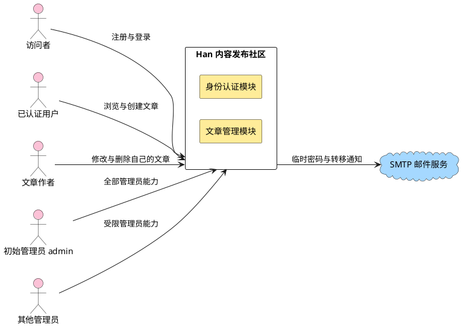

**说明**：图中两类人物通过同一服务入口进入，服务内部只分为身份认证与文章管理两个模块，两者共享同一数据库。系统对外的主动依赖只有一条边——向 SMTP 服务投递邮件，方向是系统发出。这条边是单向的：系统不接收 SMTP 的入站请求，因此邮件通道不构成攻击面入口。

颜色含义见附录 A：粉色为业务角色，黄色为本特性主体，蓝色为协议依赖。

**表5-1 系统对外接口**

| 接口类别 | 部件 | 接口 | 类型 | 功能 | SLA/规格 | 备注 |
|---|---|---|---|---|---|---|
| 软件接口 | 系统 | 对外 HTTP 接口 | REST + JSON over HTTP | 注册、登录、文章增删改查、管理员治理 | 响应时间 TBD（待容量评估阶段定） | 全部接口要求已认证身份，注册与登录除外 |
| 软件接口 | 系统 | SMTP 提交 | SMTP | 发送临时密码邮件与文章转移通知 | 连接与超时 TBD（待容量评估阶段定） | 出口参数由环境变量注入 |
| 软件接口 | 系统 | 数据库连接 | PostgreSQL 协议 | 持久化用户、会话、文章与通知记录 | 连接池上限目标 TBD（待容量评估阶段定） | 数据类型见 §6.4 |

### 5.2 关键用例模型

#### 5.2.1 关键用例

架构强相关的用例集中在三处：登录态与账号状态的联动、文章可见性随治理动作切换、管理员专属能力与普通用户能力的分离。

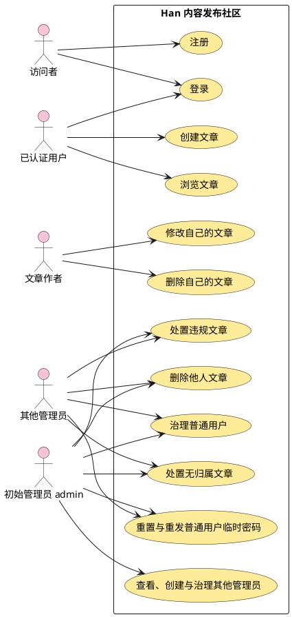

**说明**：初始 `admin` 连接全部管理员能力；其他管理员只连接普通用户治理、普通用户密码重置与重发、文章和内容治理，不连接任何管理员账号治理。初始 `admin` 自身不作为治理目标，只能走正常改密流程。连接关系与下表共同构成系统级权限合同。

**表5-2 管理员权限矩阵**

| 动作与目标 | 初始 `admin` | 其他当前有效管理员 | 普通用户 |
|---|---|---|---|
| 查看、停用、恢复、删除普通用户 | 允许 | 允许 | 拒绝 |
| 重置普通用户密码、重发其密码重置邮件 | 允许 | 允许 | 拒绝 |
| 查看、创建、停用、恢复、删除其他管理员 | 允许 | 拒绝 | 拒绝 |
| 重置其他管理员密码、重发新管理员临时密码邮件、撤销其他管理员权限 | 允许 | 拒绝 | 拒绝 |
| 停用、删除、撤销初始 `admin` 权限或重置其密码 | 拒绝；仅允许自己走正常改密 | 拒绝 | 拒绝 |
| 治理操作者自己 | 初始 `admin` 仅正常改密 | 拒绝停用、恢复、删除、重置或撤权自己 | 不适用 |
| 删除他人文章、处置无归属或违规文章 | 允许 | 允许 | 拒绝 |

权限判定同时检查操作者角色、操作者当前有效状态与目标账号类别；缺少任一证据即拒绝。普通管理员不能通过普通用户治理接口读取其他管理员或自己的受限制治理信息。

#### 5.2.2 交互场景

登录、创建、列表与详情浏览、作者修改构成首期的主链路，全部共享同一会话校验入口。

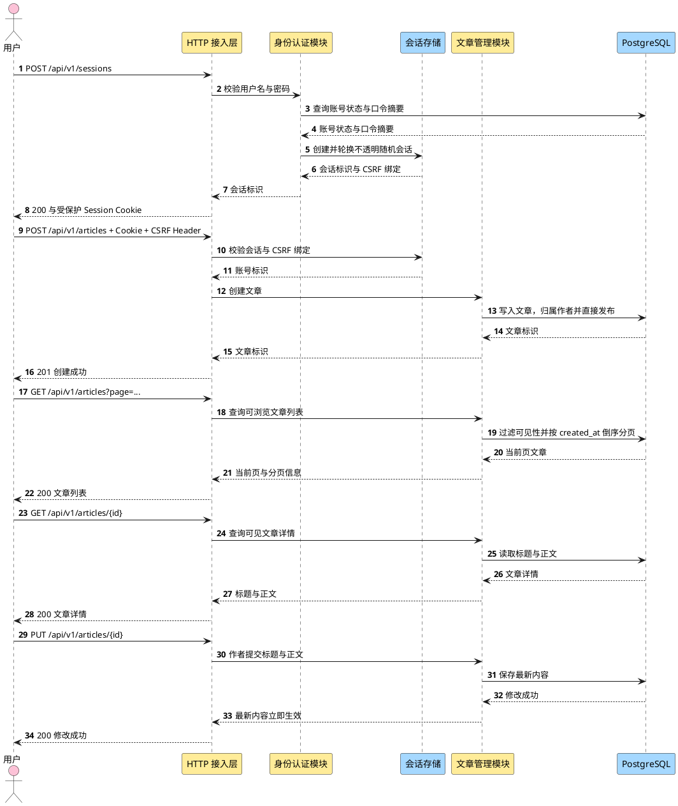

**说明**：会话校验发生在接入层，业务模块不解析 Cookie。登录成功建立不透明随机会话；认证和权限上下文变化会轮换会话 ID。Cookie 自动携带的写请求还必须通过会话绑定 CSRF Header 校验。登录失败对外统一，真实失败原因只进入最小化审计与受控可观测链路。

## 6 逻辑视图

### 6.1 业务模型

业务语言只围绕四类对象：**账号**（可登录的身份，带角色、管理员类别与状态）、**会话**（一次登录的凭据，可被即时撤销）、**文章**（只有标题与正文，并带发布意图、违规事实与作者归属）、**临时密码**（一次性、有期限的替代凭据）。有效可见性不是文章上的独立事实，而是由文章发布意图、违规状态、作者归属与作者账号状态共同派生。停用与恢复只改变 `User.status` 和会话；删除把账号写为不可恢复的 `deleted` 墓碑，由身份认证模块保留专用 `retained_email`，并在同一业务事务中把文章 `author_id` 置空、`publication_state` 置为 `held`、写入 `orphaned_from_user_id`，同时保留违规状态；违规判定只改变文章违规事实。

#### 6.1.1 业务能力地图

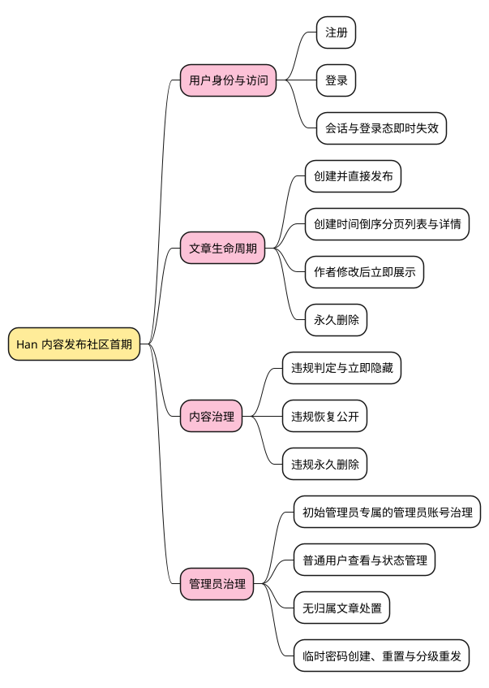

**说明**：四个业务能力分支全部来自已确认需求，未编造能力。前两支是所有用户可见的能力，后两支是管理员专属。**内容治理与管理员治理分开列出**，因为在需求中它们的触发条件与后果不同：内容治理作用于文章本体且由人工判定驱动，管理员治理作用于账号及其连带状态。这张图是逻辑视图的第一层，下一层展开为领域对象（§6.4.3），再下一层展开为实现结构（§7.1）。

### 6.2 逻辑模型

#### 6.2.1 架构模式

采用**模块化单体**：单一部署单元内按业务模块分包，模块之间只通过显式接口调用，共享同一数据库与同一进程内事务边界。选择依据与备选对比见 ADR-0001。

#### 6.2.2 分层逻辑模型

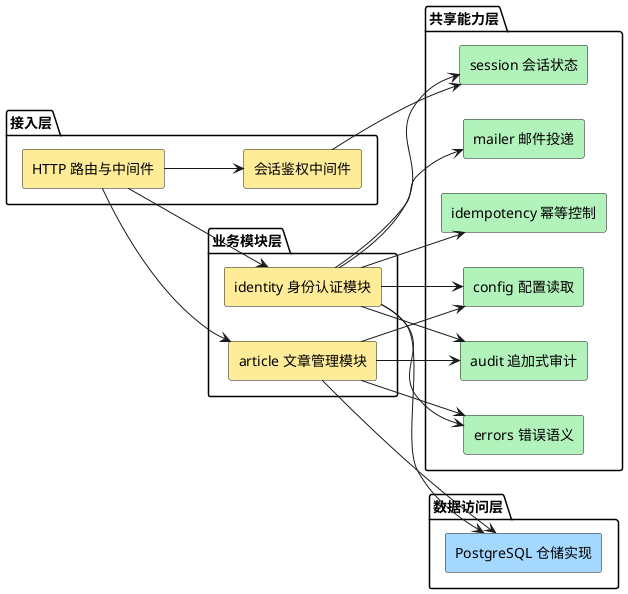

**说明**：依赖方向单向向下。会话、幂等、审计、错误和邮件是共享机制，不成为第三个业务权威模块。幂等入口保存键作用域、请求摘要与原结果；审计入口接受调用方事务并只追加事件。业务模块仍只写自己的权威状态。

这张图没有把 SMTP 与 PostgreSQL 画成业务模块，因为它们是技术部件，按模版要求放在技术模型（§6.3）与部署视图（§8）。

#### 6.2.3 接口设计

**表6-2 接口描述表**

| 接口名称 | 接口类型 | 职责 | 备注 |
|---|---|---|---|
| 注册接口 | HTTP `POST /api/v1/users` | 校验用户名、邮箱、手机号分别唯一与口令规则后建立账号 | 无需认证；失败不产生可用身份 |
| 登录接口 | HTTP `POST /api/v1/sessions` | 校验用户名与口令，创建服务端会话 | 无需认证；账号停用或删除时拒绝 |
| 登出接口 | HTTP `DELETE /api/v1/sessions/current` | 结束当前会话 | 首期是否提供见 §12 待确认项 |
| 当前身份接口 | HTTP `GET /api/v1/users/me` | 返回当前已认证身份与是否需要修改密码 | 用于前端判断强制改密状态 |
| 修改自己的密码接口 | HTTP `PUT /api/v1/users/me/password` | 完成首次登录或临时密码后的强制改密 | 需认证 |
| 创建文章接口 | HTTP `POST /api/v1/articles` | 以当前身份为作者创建仅含标题与正文的文章并直接发布 | 需认证；无草稿或下线状态；长度与格式规则待确认 |
| 文章列表接口 | HTTP `GET /api/v1/articles` | 返回当前身份可见的文章，按 `created_at` 倒序并支持分页 | 需认证；页大小待确认；可见性规则见 §6.4 |
| 文章详情接口 | HTTP `GET /api/v1/articles/{id}` | 返回单篇文章的标题与正文 | 需认证；不可见、已删除或不存在文章返回不可用且不泄露内容 |
| 修改文章接口 | HTTP `PUT /api/v1/articles/{id}` | 仅作者本人可修改标题与正文；修改后立即向符合可见性规则的已认证用户展示最新内容 | 需认证；非作者拒绝；不经草稿或下线状态 |
| 删除文章接口 | HTTP `DELETE /api/v1/articles/{id}` + `If-Match` | 作者删除自己的文章；管理员删除他人文章 | Journal tombstone 与物理 DELETE 均完成后才返回 204 |
| 普通用户查询接口 | HTTP `GET /api/v1/admin/users`、`GET /api/v1/admin/users/{id}` | 查看普通用户列表与详情 | 任一当前有效管理员；普通管理员不得借此查看初始 `admin`、其他管理员或自己的受限制治理信息 |
| 普通用户状态接口 | HTTP `POST /api/v1/admin/users/{id}/suspend`、`/restore` | 停用或恢复普通用户 | 任一当前有效管理员；目标必须是普通用户；停用连带会话失效，文章可见性由账号状态派生 |
| 删除普通用户接口 | HTTP `DELETE /api/v1/admin/users/{id}` | 删除普通用户并触发文章无归属化 | 任一当前有效管理员；目标必须是普通用户；文章进入 `held`、保持隐藏并保留违规状态 |
| 普通用户密码重置接口 | HTTP `POST /api/v1/admin/users/{id}/password-reset` | 生成普通用户临时密码并邮件投递 | 任一当前有效管理员；投递失败则凭据写入整体失败 |
| 普通用户重发接口 | HTTP `POST /api/v1/admin/users/{id}/password-reset/resend` | 为普通用户生成新临时密码并使旧值失效 | 任一当前有效管理员；投递失败则重发整体失败并保留失败前的有效凭据状态 |
| 新管理员创建接口 | HTTP `POST /api/v1/admin/administrators` | 直接创建其他管理员并交付临时密码 | 仅初始 `admin`；邮件未成功受理则账号与临时凭据写入整体失败，不留管理员账号 |
| 管理员查询与状态接口 | HTTP `GET /api/v1/admin/administrators`、`GET /api/v1/admin/administrators/{id}`、`POST /api/v1/admin/administrators/{id}/suspend`、`POST /api/v1/admin/administrators/{id}/restore` | 查看、停用或恢复其他管理员 | 仅初始 `admin`；目标不得是初始 `admin` |
| 管理员删除与撤权接口 | HTTP `DELETE /api/v1/admin/administrators/{id}`、`POST /api/v1/admin/administrators/{id}/revoke` | 删除其他管理员或撤销其管理员权限 | 仅初始 `admin`；目标不得是初始 `admin` |
| 管理员密码重置与重发接口 | HTTP `POST /api/v1/admin/administrators/{id}/password-reset`、`POST /api/v1/admin/administrators/{id}/temporary-password/resend` | 重置其他管理员密码或重发新管理员临时密码邮件 | 仅初始 `admin`；邮件失败则相关凭据写入整体失败 |
| 无归属文章处置接口 | HTTP `POST /api/v1/admin/orphan-articles/{id}/publish`、`/transfer`、`DELETE` | 恢复公开、转移作者或永久删除 | 任一当前有效管理员；作者转移只允许无归属文章，目标用户须正常且未停用；移除无归属约束但保留违规状态 |
| 违规处置接口 | HTTP `POST /api/v1/admin/articles/{id}/violation`、`/restore`、`DELETE` | 判定违规、解除违规判定或永久删除 | 仅管理员；解除违规只移除违规约束 |

所有 REST 错误统一为 `{code, message, field_errors?, trace_id}`，不得暴露内部 cause。创建管理员、密码重置与临时密码重发必须携带 `Idempotency-Key`；键作用域为操作者、操作类型、目标资源与键值的组合，同键同请求摘要返回原结果，同键不同摘要返回冲突。停用与恢复以目标状态幂等，但每次仍重新校验权限与目标资格。

### 6.3 技术模型

#### 6.3.1 架构模式

进程内分层 + 模块化分包（见 §6.2.1）。技术部件集中在两层：接入层的 HTTP 服务与数据访问层的 PostgreSQL 仓储。不引入消息中间件、缓存与外部身份提供方。

#### 6.3.2 技术选型

**表6-3 技术选型**

| 决策点 | 选定 | 备选 | ADR |
|---|---|---|---|
| 架构形态 | 模块化单体 | 多服务 | ADR-0001 |
| HTTP 框架 | Go 标准库 `net/http`（1.22+ 方法路由与路径参数） | Chi / Gin / Echo | ADR-0002 |
| 数据库 | PostgreSQL | MySQL / SQLite | ADR-0003 |
| PostgreSQL 兼容线 | major 18；生产与 CI 跟进受支持的最新 18.x patch | 长期固定单一 patch / 不限制 major | ADR-0021 |
| 数据库驱动与连接池 | `github.com/jackc/pgx/v5` 原生 API + `pgxpool` | `database/sql` 驱动 / ORM | ADR-0021 |
| 数据库迁移 | `migrations/NNNN_name.sql` + 项目内最小执行器 | 第三方迁移框架 / 人工执行 SQL | ADR-0021 |
| 接口形式 | REST + JSON | gRPC / REST + Protobuf | ADR-0004 |
| 认证方式 | 服务端会话，会话记录存 PostgreSQL | 会话存 Redis / JWT / JWT + 撤销黑名单 | ADR-0005 |
| 邮件传输 | SMTP 直连，经邮件适配器接口调用 | 第三方事务性邮件服务 / 开发期内存实现单独使用 | ADR-0006 |
| 初始凭据注入 | 环境变量，仅首次启动生效 | 密钥管理服务 / 首次启动交互式注入 | ADR-0007 |
| 工程结构与配置 | 按业务模块分包，配置仅来自环境变量 | 按技术分层分包 | ADR-0008 |
| Go 版本 | 1.27 | — | ADR-0009 |
| Go module path | `han`，绑定正式远程并首次对外发布前允许单独变更 | 猜测组织域名 | ADR-0021 |
| 密码哈希 | Argon2id（`golang.org/x/crypto`） | bcrypt / scrypt | ADR-0012 |
| 公共错误 | 稳定 JSON 错误结构与最小披露 | 裸字符串 / 统一内部错误 | ADR-0014 |
| 写请求幂等 | 作用域化 `Idempotency-Key` + 请求摘要 | 仅唯一约束 / 客户端去重 | ADR-0015 |
| 审计 | PostgreSQL 追加式 AuditEvent | 普通日志 / 独立审计服务 | ADR-0016 |

选型论证过程与劣势可接受性分析在各 ADR 的「现状 / 痛点 / 改造 / 效果」章节，本文不重复。

#### 6.3.3 关键技术方案

**临时凭据交付的失败组合处理**：SMTP 未受理时回滚相关写入；受理后再提交数据库。SMTP 与数据库不能真正原子，因此存在“邮件已受理但最终提交失败”的残余窗口。此时返回失败，邮件中的凭据不可用；幂等重试、后续最新凭据、追加式审计、trace 与告警共同治理，不能声称零风险。

**幂等与审计**：幂等记录在执行副作用前占位，并绑定规范化请求摘要。高风险业务状态和 AuditEvent 在同一事务提交；审计失败使业务写入 fail closed。审计只保存主体 ID、动作、目标、结果、公共错误码和 `trace_id` 等最小字段。

**文章转移的状态与通知处理**：转移入口只接受 `author_id IS NULL` 的无归属文章；仍有归属的文章必须拒绝且保持作者与可见性不变。转移在事务内写入新 `author_id` 并把 `publication_state` 置为 `published`，从而移除无归属隐藏约束；`violation_state` 原值保留。提交后，非违规文章立即公开，违规文章继续仅管理员可见。系统只通知新作者与已删除的原作者，不保留“现有原作者”分支；已删除原作者地址取自仅为转移通知保留的邮箱。两个通知在提交后独立投递，任一失败只记录结果，不回滚归属、发布意图或派生可见性（需求 US-IDENTITY-03.8、US-IDENTITY-03.9）。

**文章永久删除处理**：授权和强 ETag 校验后，事务把 Article 置为内部 `deletion_pending` 并创建 DeletionOperation，所有查询立即排除该文章。Article Deletion Journal tombstone 原子追加并 fsync 后，finalizer 幂等执行物理 DELETE，并同事务写 AuditEvent 与 operation 完成。只有 tombstone 与物理删除均完成才向 API 返回 204；任何中间失败都不得使文章重新可见。

#### 6.3.4 安全 / 韧性 / 隐私技术模型

**会话安全模型**：Session Cookie 是不透明随机标识，使用 `Secure`、`HttpOnly` 与 `SameSite`。认证成功和角色、权限、强制改密状态变化后轮换 ID，旧 ID 失效。写请求校验会话绑定 CSRF Header。绝对期限、空闲期限和限流数值保持 TBD。

### 6.4 数据模型

#### 6.4.1 架构模式

单一数据库、每类状态一个权威写入者。所有关键状态在同一实例内，跨模块的删除与归属联动使用本地事务，不引入分布式事务或最终一致补偿。有效可见性和隐藏原因是可重建的派生视图，不作为独立权威字段持久化。

#### 6.4.2 关键数据设计

字段与规则：

| 实体 | 关键字段 | 约束 |
|---|---|---|
| User | `id`、`username`、`email`、`phone`、`password_digest`、`role`、`is_initial_admin`、`status`、`must_change_password`、`recovery_required`、`retained_email` | 恢复终结时非初始管理员一律 `suspended` 且 `recovery_required=true`；备份中的 role/status 不直接授权；永久密码全部失效 |
| Session | `id`、`user_id`、`csrf_token_digest`、`issued_at`、`last_seen_at`、`expires_at` | `id` 为不透明随机值；权限变化时轮换；绝对/空闲期限 TBD；用户停用或删除时删除 |
| TemporaryPassword | `id`、`user_id`、`password_digest`、`expires_at` | 有效期 7 天；同一用户仅保留最新成功交付的一条；重置或重发邮件失败时本次替换回滚 |
| Article | `id`、`author_id`、`orphaned_from_user_id`、`title`、`body`、`publication_state`、`violation_state`、`deletion_state`、`version`、时间字段 | `deletion_state=deletion_pending` 是永久删除内部中间态，所有消费者不可见；不是草稿、软删除或可恢复业务状态 |
| TransferNotice | `id`、`article_id`、`new_author_id`、`former_deleted_author_email`、`new_author_result`、`former_author_result` | 只记录无归属文章转移后对新作者与已删除原作者的两路投递结果，不是转移真相源 |
| DeletionOperation | `id`、`article_id`、`article_version`、`status`、`deleted_at`、`journal_key_id/version` | 协调 pending、Journal tombstone、物理 DELETE 与审计完成；不保存内容 |
| DeletionReplayRun | `run_id`、`namespace`、不可变 `backup_ref`、`input_digest`、`current_evidence_ref`、`status` | 唯一键 `(run_id,namespace)`；原子插入/行锁；同 run 不同 backup 稳定失败 |
| ArticleDeletionReplayStatus v1 | ready：前十六 canonical 字段 + `status,evidence_digest,evidence_ref,completed_at`；unavailable：`evidence_version,run_id,backup_ref,namespace,status,reason_code` | `inventory_scope` 为 string；ready 全字段非 null；unavailable 禁止携带伪 canonical/digest/ref/time |
| DeletionReplayEvidence | ready canonical 十六字段、`evidence_digest/evidence_ref/completed_at` | 唯一 `(run_id,namespace,evidence_version,evidence_digest)`；article-owned、不可变、不含内容或 PII |
| IdempotencyRecord | `scope`、`key_digest`、`request_digest`、`status`、`result_code`、`response_snapshot`、`expires_at` | 状态含 `recovery_review_required`；恢复后未经受控核对不得同键重放副作用 |
| AuditEvent | `id`、`occurred_at`、`actor_id`、`action`、`target_type`、`target_id`、`outcome`、`error_code`、`trace_id`、`metadata` | 只追加；与高风险业务状态同事务；敏感数据最小化 |
| RecoveryRun | `run_id`、`journal_key_id`、`journal_key_version`、`journal_fingerprint`、`status`、`backup_ref`、`started_at`、`completed_at` | 位于业务 DB；key 引用和指纹必须与 Recovery Journal 对账 |

四项正交权威状态决定文章对成员是否可见：

1. `Article.publication_state` 表示文章管理模块的发布意图；
2. `Article.violation_state` 表示文章是否仍有有效违规判定；
3. `Article.author_id` 表示当前作者归属，空值表示无归属；
4. `User.status` 表示有归属作者的账号状态。

成员可见当且仅当文章存在、`publication_state = published`、`violation_state = clear`，并且文章无作者或作者 `User.status = active`。管理员可按治理权限查看未永久删除的隐藏文章。API 是否暴露派生原因由详细设计决定，本文只定义内部权威状态与判定语义。

**表6-4 派生隐藏原因**

| 原因 | 派生条件 | 解除动作 |
|---|---|---|
| `violation` | `violation_state = violating` | 管理员解除违规判定 |
| `author_suspended` | `author_id` 非空且作者 `User.status = suspended` | 管理员恢复作者账号 |
| `orphan_hold` | `author_id` 为空且 `publication_state = held` | 管理员恢复公开或成功转移文章 |

隐藏原因可以同时存在，违规在面向用户和管理员的原因排序中优先展示，但优先级不覆盖或删除其他原因。`author_id` 可空继续用于表达无归属；用户删除后文章必须保留，级联删除会违反 `US-IDENTITY-03.7`。删除用户时账号写为不可恢复的 `deleted` 墓碑、全部会话撤销、文章无归属化并进入 `held`；身份认证模块拥有墓碑上的 `retained_email`，文章以 `orphaned_from_user_id` 关联该墓碑，以便转移时取得已删除原作者通知邮箱。该关联不参与有效可见性，邮箱保留期限属需求 Q2。

**十五项关键不变量**：

1. `violation_state` 是文章事实；停用、恢复、删除作者和转移作者均不得自动改变它。
2. `User.status` 只能由身份认证模块写入；文章管理模块只读取状态判定结果。
3. `Article.publication_state`、`Article.violation_state` 与 `Article.author_id` 只能由文章管理模块写入。
4. 解除一个隐藏约束只能移除该约束，不得顺带移除其他约束。
5. 成员可见性必须按上述公式派生；调用方不得提交或覆盖有效可见性。
6. `author_id IS NULL` 不等于必然隐藏；`publication_state = published` 且非违规的无归属文章公开并显示匿名作者。
7. 删除作者时必须在同一业务事务内置空 `author_id`、把 `publication_state` 置为 `held`，并保留 `violation_state`。
8. 永久删除是终态，不能通过任何发布意图、归属或违规状态转换恢复。
9. 初始 `admin` 的 `is_initial_admin` 不可撤销；任何停用、删除、撤权或他人重置请求都必须拒绝。
10. 只有初始 `admin` 可以读取或改变其他管理员的治理状态；普通管理员的账号治理目标只能是普通用户，且不能是自己。
11. 新管理员创建、密码重置和临时密码重发只有在邮件受理成功后才提交相关账号或凭据写入。
12. 文章转移只允许 `author_id IS NULL`；转移不得清除 `violation_state`，通知失败不得回滚转移。
13. 临时密码自成功生成起 7 天有效；邮箱后续变更不改变已发送临时密码的值或原到期时间；新的重置或重发只有成功交付后才使旧临时密码失效。
14. 首期合法状态中，`publication_state = held` 只用于无归属文章待处置，因此必须同时满足 `author_id IS NULL`；`author_id IS NULL` 与 `publication_state = published` 表示已恢复公开的匿名文章。
15. 删除用户产生的隐藏无归属文章必须保存 `orphaned_from_user_id` 并指向对应 `deleted` 账号墓碑；成功转移时先把 `retained_email` 快照写入 `TransferNotice`，再清除该来源关联。`orphaned_from_user_id` 不表示当前作者。

**表6-5 状态转换**

| 动作 | 权威状态变化 | 派生结果 |
|---|---|---|
| 创建文章 | `author_id` 为当前用户；`publication_state = published`；`violation_state = clear` | 作者正常时对已认证用户公开 |
| 停用作者 | `User.status: active → suspended`；文章不改写 | 该作者全部文章隐藏；违规状态继续有效 |
| 恢复作者 | `User.status: suspended → active`；文章不改写 | 仅已发布且非违规文章重新公开 |
| 判定违规 | `violation_state: clear → violating` | 无论其他状态如何，普通用户不可见 |
| 解除违规 | `violation_state: violating → clear` | 按发布意图、归属与作者状态重新派生，不移除其他约束 |
| 删除作者 | `User.status → deleted`；删除会话；保留 `retained_email`；`author_id → NULL`；`orphaned_from_user_id → 已删除用户`；`publication_state → held`；违规状态不变 | 账号不可登录且不可恢复；文章成为隐藏无归属文章 |
| 恢复无归属公开 | 要求非违规；`publication_state: held → published` | 对已认证用户公开并显示匿名作者 |
| 转移无归属文章 | 要求 `author_id IS NULL`；写入正常且未停用的新作者；把已删除原作者通知邮箱快照写入 `TransferNotice` 后清除 `orphaned_from_user_id`；`publication_state → published`；违规状态不变 | 非违规文章立即公开；违规文章继续仅管理员可见 |
| 永久删除 | 删除文章并进入终态 | 所有用户不可见且不可恢复 |

#### 6.4.3 静态数据结构模型

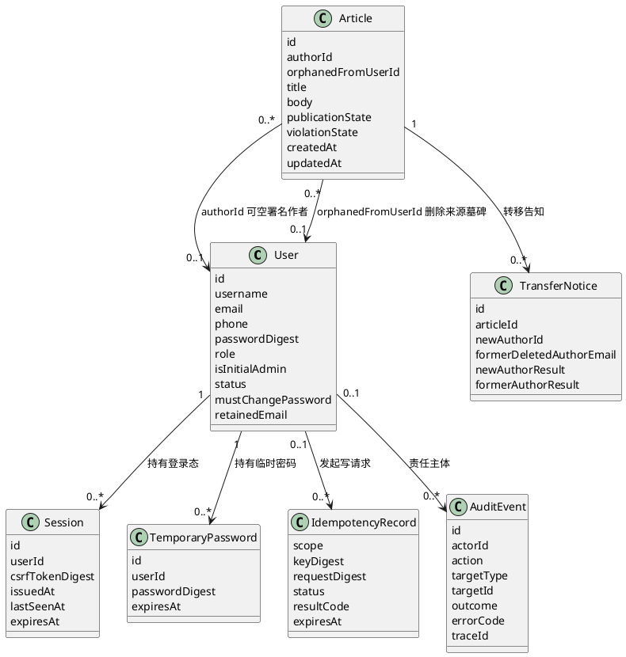

**说明**：业务实体之外，IdempotencyRecord 保护高风险请求重放，AuditEvent 提供与业务事务一致的追加式证据；两者都不是业务对象真相源。Session 保存 CSRF 绑定摘要，不把用户与权限声明放进 Cookie。

#### 6.4.4 数据所有权模型

**表6-4 数据所有权模型**

| 数据实体 | 身份认证模块 | 文章管理模块 | 会话状态 | 幂等/审计 | 邮件投递 |
|---|---|---|---|---|---|
| User | 所有者（读写；含删除标识生命周期） | 读 | 读 | 读主体 ID | 无 |
| Session | 所有者（创建/轮换/删除） | 无 | 读写（校验与 CSRF） | 审计会话动作 | 无 |
| TemporaryPassword | 所有者（读写） | 无 | 无 | 幂等与审计 | 无 |
| Article | 无 | 所有者（读写） | 无 | 审计治理动作 | 无 |
| TransferNotice | 无 | 所有者（读写） | 无 | 审计投递结果 | 无 |
| DeletionOperation | 无 | 所有者（读写） | 无 | 审计删除阶段 | 无 |
| IdempotencyRecord | 使用 | 无 | 无 | 所有者（读写/清理） | 无 |
| AuditEvent | 追加 | 追加 | 无 | 所有者（仅追加/查询） | 无 |

所有权规则保持业务状态归原模块；共享幂等能力拥有 IdempotencyRecord，共享审计能力拥有 AuditEvent。业务模块通过事务内追加接口写审计，不获得审计更新或删除能力。邮件适配器不读写业务、幂等或审计表。

#### 6.4.5 安全 / 隐私数据模型

口令与临时密码一律只存摘要，不存明文。`User.is_initial_admin` 是权限保护事实，不得由普通账号治理动作修改。`User.retained_email` 由身份认证模块持有，是删除账号墓碑上的隐私敏感字段：它只服务于无归属文章转移后通知已删除原作者，不得用于登录或账号恢复，也不得出现在任何用户可见界面或普通查询结果中。`TransferNotice.former_deleted_author_email` 是该地址在转移时的受控快照，使用范围与最终清理同样受需求 Q2 约束。日志中禁止输出这些字段与任何凭据字段。
## 7 开发视图

### 7.1 代码模型

模块边界在目录上直接可见：`internal/identity` 与 `internal/article` 对应两个业务模块，`internal/session`、`internal/mailer`、`internal/idempotency`、`internal/audit`、`internal/platform` 对应共享能力。

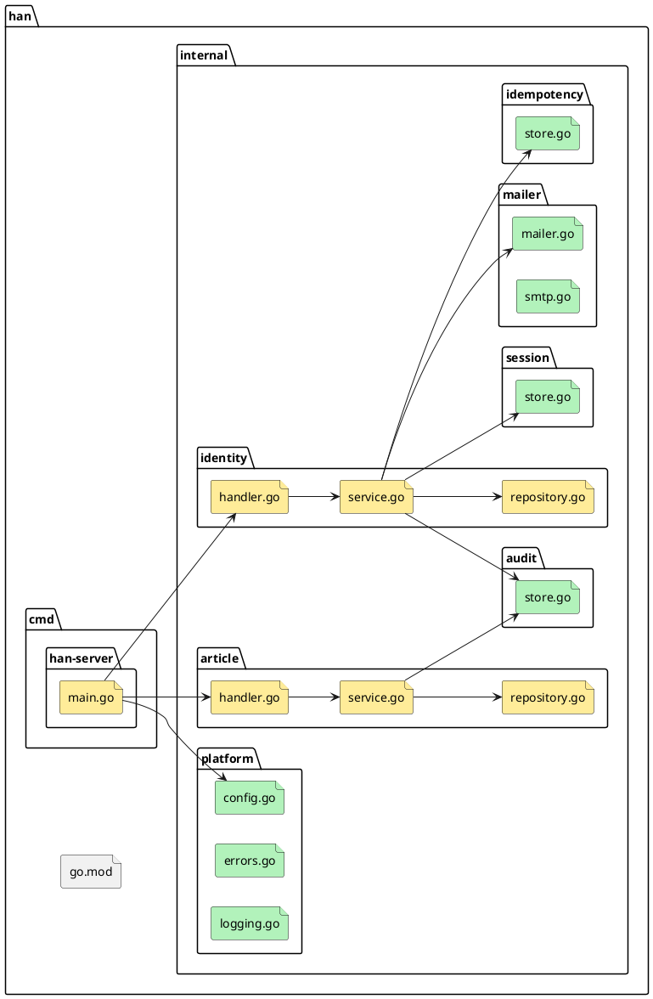

**说明**：`main.go` 只做装配——读配置、建连接池、注册路由，不含业务判断。每个业务模块内部按 `handler`（协议适配）、`service`（业务规则）、`repository`（持久化）三分，边界清晰。`mailer` 目录中 `mailer.go` 定义接口、`smtp.go` 提供 SMTP 实现，接口与实现分离使开发与测试可以替换为内存实现。跨模块调用只允许 `service` 之间的显式接口调用，不允许 handler 或 repository 互相引用。

**表7-1 代码元素**

| 逻辑元素 | 代码元素 |
|---|---|
| 接入层 · HTTP 路由与中间件 | `cmd/han-server/main.go`、`internal/platform/` |
| 业务模块层 · 身份认证模块 | `internal/identity/handler.go`、`service.go`、`repository.go` |
| 业务模块层 · 文章管理模块 | `internal/article/handler.go`、`service.go`、`repository.go` |
| 共享能力层 · 会话状态 | `internal/session/store.go` |
| 共享能力层 · 邮件投递 | `internal/mailer/mailer.go`、`smtp.go` |
| 共享能力层 · 幂等与审计 | `internal/idempotency/store.go`、`internal/audit/store.go` |
| 共享能力层 · 配置与错误语义 | `internal/platform/config.go`、`errors.go`、`logging.go` |

### 7.2 构建模型

单一 Go module（`go.mod`），当前 module path 为 `han`；绑定正式远程并首次对外发布前允许单独变更，不在本轮猜测组织域名。项目只有一个可执行目标 `han-server`，Go 版本 1.27。已批准 `golang.org/x/crypto` 用于 Argon2id，并批准 `github.com/jackc/pgx/v5` 原生 API 与 `pgxpool` 用于 PostgreSQL；具体 module 版本由实现批次锁定。无 ORM、数据库抽象层或第三方迁移框架。

**表7-2 构建元素清单**

| 构建元素 | 构建过程/工具链 | 对应代码元素 |
|---|---|---|
| `han-server` 可执行文件 | `go build ./cmd/han-server`（Go 1.27） | `cmd/han-server`、`internal/**` |
| 数据库迁移资产 | 版本序列检查后与 `han-server` 同批次交付；最小执行器随 Go 代码构建 | `migrations/NNNN_name.sql`、项目内迁移执行代码 |
| 单元与集成测试 | `go test ./...` | 各包 `_test.go`、`_integration_test.go` |
| 格式与静态检查 | 工具链未安装，检查命令待项目登记（见 §12 待确认项） | 全仓 |

实现基线与目标规格的区分：当前无实现，故不存在实现基线；目标规格为单一 module、单一可执行文件，后续若拆分需走架构变更。

### 7.3 硬件实现模型

不适用：本项目为纯软件服务，不涉及硬件逻辑模块与器件映射。

## 8 部署视图

### 8.1 交付模型

首期交付单一版本集合：`han-server` 可执行文件、`migrations/NNNN_name.sql` 迁移目录及配置说明。迁移脚本与包含最小执行器的代码同批次交付，不单独发布，也不得只升级其中一侧。

**表8-1 交付元素清单**

| 交付元素 | 打包过程/工具链 | 对应构建元素 | 生命周期定义 |
|---|---|---|---|
| `han-server` 可执行文件 | Go 1.27 构建 | `han-server` | 随版本迭代；无独立 EOX 模型 |
| `migrations/NNNN_name.sql` | 随代码仓管理；由项目内最小执行器应用 | 数据库迁移资产 | 与代码同批次发布，不单独升级 |
| 配置说明（环境变量清单） | 随代码仓管理 | 无（文档） | 随版本迭代 |

首期不采用软件包命名规范类模板格式：该格式面向网元设备与产品线 Release 号体系，本项目无此上下文，不套用。

### 8.2 部署模型

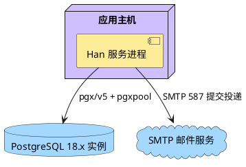

**说明**：三个节点的最小集合即满足首期业务闭环。服务进程通过 pgx/v5 原生 API 与 pgxpool 访问 PostgreSQL 18.x，且无本地业务状态，因此进程可以重启而不丢失会话与文章数据。部署过程必须先由项目内执行器取得 advisory lock，按序完成未应用迁移并更新 `schema_migrations`；任一迁移失败时不得开放正常服务。具体执行命令与启动接线由 B0 实现任务确定。SMTP 端口与地址由环境变量注入，图中端口为常见默认值示意，实际以配置为准。首期不需要负载均衡与多实例：会话与状态集中在数据库，但无容量证据支持多实例部署。

**表8-2 节点配置表**

| 构建元素 | 部署节点 |
|---|---|
| `han-server` 可执行文件 | 应用主机上的单一进程 |
| PostgreSQL 18.x 数据库与迁移脚本 | 独立数据库实例；生产与 CI 使用受支持的最新 18.x patch，开放服务前完成迁移 |
| SMTP 出口配置 | 应用主机的环境变量 |

### 8.3 安全部署模型

恢复基础设施提供独立 namespace：`recovery/*` 保存恢复凭据防重放，`article-deletion/*` 保存文章删除 tombstone。二者可共享持久卷、原子追加和完整 keyring，但记录、接口、校验链和语义互不混用。Deletion Journal 不保存文章内容或 PII。

恢复运行手册固定顺序：维护模式 → Recovery Journal Begin → 恢复 DB/RecoveryRun → 身份终结与 canonical 删除 → article `ReplayAll(run_id,backup_ref)` → DeletionOperation/Audit 对账 → 生成或重算 DeletionReplayEvidence → identity 通过 `ReadStatus(run_id,backup_ref)` 核版本、摘要、namespace、backup 和 ready → 分别验证两个 namespace → Recovery Journal `MarkConsumed` → 开放。任一证据未知或不匹配保持停服。

ArticleDeletionReplayStatus v1 以 ADR-0020 为唯一 schema。ready variant 完整 20 字段并重算摘要；unavailable variant 只含 6 字段，状态限 `pending|unknown|failed`。`inventory_scope` 固定 string。共享 fixture canonical digest 固定为 `sha256:169e0f30407867083598ab146c950968e1b5f508ed4fd5d5198bb61e788926a7`；生产者与消费者必须嵌入同一 fixture 或生成源。

## 9 运行视图

### 9.1 运行模型

服务为单一进程，每个入站 HTTP 请求由一个 goroutine 处理，请求上下文携带超时与取消信号。数据库访问经连接池，池上限可配置。无后台任务、无定时器、无跨进程通信。

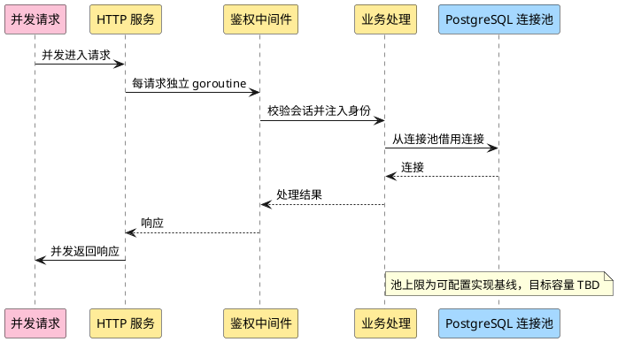

**说明**：并发模型的关键点是**请求间不共享可变状态**。身份信息经请求上下文传递，不放在全局变量中。会话校验是一次数据库读取，被停用的账号在下一次请求即失败，这是「立即退出登录」的实现依据。

**关键运行的失败与恢复**：

| 场景 | 已改变的状态 | 恢复方式 |
|---|---|---|
| 停用用户 | 账号状态改为停用、会话记录删除；文章权威状态不改写，成员可见性派生为隐藏 | 恢复账号后文章可见性自动恢复；会话需重新登录建立 |
| 删除用户 | `User.status` 写为不可恢复的 `deleted` 墓碑、会话删除、保留专用 `retained_email`；文章 `author_id` 置空、`orphaned_from_user_id` 指向删除墓碑、`publication_state` 置为 `held`、违规状态保留 | 账号不可恢复；文章保持隐藏并由管理员按无归属规则单独处置 |
| 新管理员创建邮件失败 | 待创建管理员账号与临时密码写入回滚 | 初始 `admin` 可重新发起；失败后不存在管理员账号 |
| 密码重置邮件失败 | 本次临时密码写入回滚，账号原凭据状态不变 | 获授权管理员可重新发起；失败不留下未交付凭据 |
| 临时密码重发邮件失败 | 本次新临时密码写入回滚，旧临时密码不因失败请求失效 | 按两类重发授权重新发起 |
| 文章转移通知失败 | 无归属文章已转移，新作者归属与发布意图已提交 | 不回滚；分别记录新作者与已删除原作者的投递结果 |
| 幂等键重放 | 首次请求可能处理中或已完成 | 同键同摘要等待或返回原结果；同键不同摘要拒绝冲突 |
| 审计写入失败 | 高风险业务事务尚未提交 | fail closed 并回滚业务写入 |
| SMTP 已受理但数据库提交失败 | 邮件可能已进入投递链路，业务状态未提交 | 返回失败；审计并告警；凭据不可用；允许同幂等键安全重试 |
| 数据库备份恢复 | 恢复点可能包含旧会话、活动凭据和不确定幂等记录 | 对外开放前删除全部 Session、失效活动 TemporaryCredential、把 processing/uncertain 幂等记录标为待核或失败，并写恢复审计；任一步失败保持停服 |
| 恢复点账号与永久密码 | 恢复点可能复活旧密码、旧角色、已删除或撤权账号 | 终结事务失效全部永久密码；非初始管理员全部 suspended 且 recovery_required；初始 admin 用独立 recovery secret 重建信任根后逐账号核对恢复 |
| `kept_deleted` 核对 | User 判为 deleted，但文章和标识仍是恢复点旧状态 | 重放完整 canonical 删除事务；任一子步骤失败维持 Gate/停服，不新增文章恢复 |
| Recovery Journal 不一致 | run ID/指纹已消费、Journal 损坏/不可写或与 RecoveryRun 不一致 | fail closed；禁止消费 secret、禁止开放 readiness |
| HMAC key 轮换不完整 | 历史 key 缺失、记录 key 未知或只迁移 active key | 无法证明历史 secret 未复用，立即停服；补齐 Journal+keyring 后重新核验 |
| 删除 Journal 已写、DB 删除失败 | Article 已是不可见 `deletion_pending`，tombstone 已耐久 | API 返回失败；finalizer 幂等物理删除并写审计，禁止恢复公开 |
| 删除 Journal 失败 | 删除事实未耐久 | 不返回成功；事务回滚或保留不可见可重试状态，不得出现半删除重新可见 |
| 旧备份恢复文章 | 备份可能包含已永久删除 Article | readiness 前重放全部有效 tombstone 并幂等物理删除；Journal/key/operation 不一致则停服 |
| stale replay ready | ready 属于其他 backup，或 Journal head/inventory/operation/audit 已变化 | 旧 evidence 失效并重新重放/对账；缺失、旧版本、摘要不匹配返回 unknown/failed，readiness=false |

### 9.2 关键治理时序

**临时凭据交付的 fail-closed 组合**：

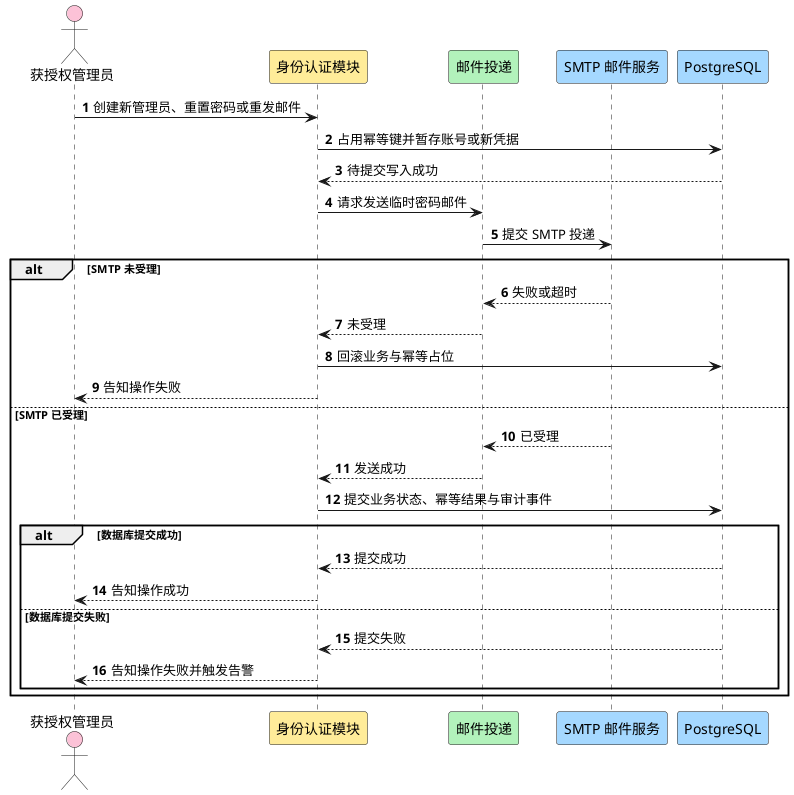

**说明**：SMTP 未受理时仍可回滚；SMTP 已受理后数据库提交失败是明确保留的残余窗口。此路径返回失败，邮件凭据不可用，并通过幂等、最新凭据、追加式审计、trace 与告警处置。架构不宣称 SMTP 与数据库原子。

**文章转移与双路通知**：

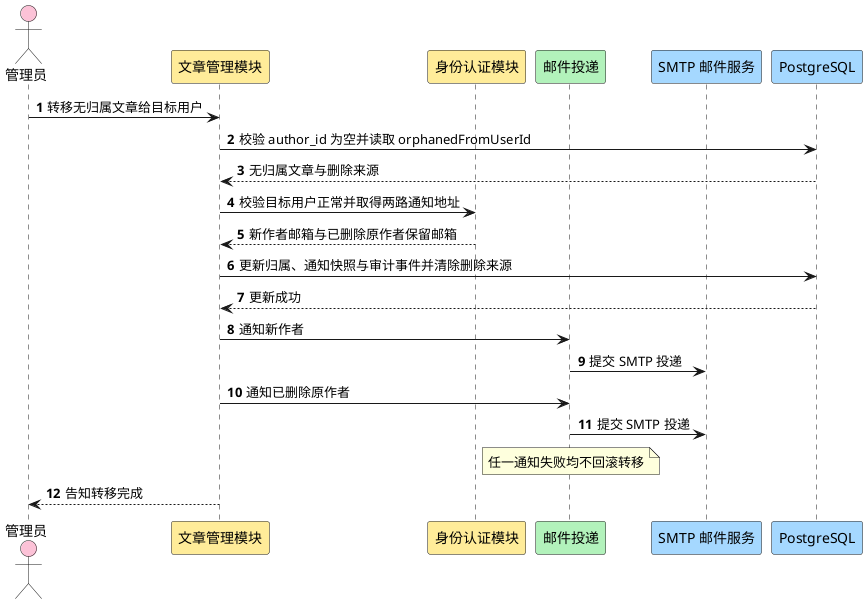

**说明**：入口先证明文章无归属，并用 `orphanedFromUserId` 定位删除账号墓碑；仍有归属的普通文章直接拒绝且不触发通知。事务内先把两路通知地址快照写入 TransferNotice，再更新归属、置为 `published` 并清除删除来源关联。提交后的通知对象固定为新作者与已删除原作者。任一通知失败只记录结果，不改变转移结论——这是需求明确要求的 best-effort 行为，与临时凭据交付的 fail-closed 语义形成对照。

## 10 需求到设计的映射

**表10-1 需求分解分配**

| 需求编号 | 需求名称 | 分配模块 | 关键设计落点 | 验证方式 |
|---|---|---|---|---|
| US-IDENTITY-01.1 | 建立用户身份 | 身份认证模块 | 注册接口 + 删除标识生命周期唯一约束 | 集成测试：用户名永久拒绝复用；邮箱手机号按保留状态校验 |
| US-IDENTITY-01.2 | 设置注册密码 | 身份认证模块 | 口令规则 + Argon2id 编码 | 单元测试 + 目标环境哈希基准 |
| US-IDENTITY-02.1 | 登录社区 | 身份认证模块 + 会话状态 | 统一失败 + 不透明 Cookie + 会话轮换 | 集成测试：失败不可枚举账号；Cookie 属性与旧 ID 失效 |
| US-IDENTITY-03.1 | 建立初始管理员账号 | 身份认证模块 | 首次启动初始化 + 环境变量注入（ADR-0007）+ 初始管理员不可停用、删除、撤权或由他人重置 | 集成测试：凭据不入库为明文；四类受保护操作均被拒绝 |
| US-IDENTITY-03.2 | 删除他人文章 | 文章管理模块 | 角色、If-Match、Deletion Journal 与物理删除 | 204 仅在 tombstone 与 DELETE 完成后返回 |
| US-IDENTITY-03.3 | 创建其他管理员账号 | 身份认证模块 + 邮件投递 | `Idempotency-Key`、标识生命周期、SMTP 残余窗口与审计 | 集成测试：重放不重复创建；受理后提交失败告警 |
| US-IDENTITY-03.4 | 管理其他管理员账号 | 身份认证模块 | 仅初始 `admin` 可查看、停用、恢复、删除、重置密码或撤权其他管理员 | 权限矩阵集成测试：普通管理员与受保护目标均被拒绝 |
| US-IDENTITY-03.5 | 查看用户 | 身份认证模块 | 普通管理员只可查看普通用户；初始 `admin` 可查看其他管理员治理信息 | 集成测试：非管理员及越权目标被拒且不泄露信息 |
| US-IDENTITY-03.6 | 停用与恢复用户 | 身份认证模块 | 目标状态幂等、会话撤销/轮换与同事务审计 | 集成测试：重复请求无重复副作用；旧会话失效 |
| US-IDENTITY-03.7 | 删除用户 | 身份认证模块 + 文章管理模块 | 永久用户名、条件保留邮箱手机号、墓碑与同事务审计 | 集成测试：复用限制、文章 held、账号不可恢复 |
| US-IDENTITY-03.8 | 处置无归属文章 | 文章管理模块 | 恢复、转移及 Journal 保护的永久删除 | 恢复旧备份后删除文章仍不存在 |
| US-IDENTITY-03.9 | 发送文章转移通知 | 文章管理模块 + 身份认证模块 + 邮件投递 | 地址快照、通知 best effort、邮箱清理前置与审计 | 集成测试：清理条件、通知失败不回滚 |
| US-IDENTITY-03.10 | 重置用户密码 | 身份认证模块 + 邮件投递 | `Idempotency-Key`、Argon2id、SMTP 残余窗口与审计 | 集成测试：重放、冲突、最新凭据和告警 |
| US-IDENTITY-03.11 | 重发临时密码邮件 | 身份认证模块 + 邮件投递 | 同上；成功才使旧值失效 | 集成测试：失败时旧值保持，重复键返回原结果 |
| US-IDENTITY-03.12 | 隐藏、解除判定与删除违规文章 | 文章管理模块 | 违规状态转换 + Journal 保护的永久删除 | tombstone 不含内容，恢复后仍删除 |
| US-ARTICLE-01.1 | 创建文章 | 文章管理模块 | 仅标题与正文；创建即发布；无草稿或下线 | 集成测试：无中间状态 |
| US-ARTICLE-02.1 | 发现并阅读文章 | 文章管理模块 | 创建时间倒序分页列表 + 标题正文详情 + 可见性过滤 | 集成测试：排序、分页、详情与未登录拒绝 |
| US-ARTICLE-03.1 | 修改现有文章 | 文章管理模块 | 修改接口仅作者放行，成功后最新内容立即展示 | 集成测试：非作者被拒；下一次读取返回最新内容 |
| US-ARTICLE-04.1 | 删除现有文章 | 文章管理模块 | `deletion_pending`、DeletionOperation、外部 tombstone 与 finalizer | 旧备份恢复不得复活内容 |

## 11 可测试性设计

测试分层：单元测试覆盖业务规则（口令规则、唯一性判定、状态转换），集成测试覆盖数据库约束与事务边界，E2E 覆盖真实 HTTP 入口与真实数据库。

关键验证增加：Cookie 属性、CSRF 绑定、会话轮换、登录统一失败、Argon2id 参数基准、公共错误结构、幂等并发与摘要冲突、审计同事务/不可更新删除、删除标识复用与邮箱清理、SMTP 受理后提交失败残余窗口。数值型期限、容量、限流、连接池与超时只验证可配置维度，不伪造目标值。

r05 必测：隐私声明版本/时间与双 Gate、缺失部署处理输入 fail closed、SMTP 明文/降级/错证书/错主机失败、跨源 credentialed 登录失败、已有会话再次登录后旧会话失效、真实备份恢复后 Session 和活动临时凭据全部不可用且不确定幂等记录不恢复成功。

r06 恢复演练还必须证明：备份永久密码全部不可登录；非初始管理员在人工核对前无运行权限；删除或撤权账号不会因恢复点状态重新获得访问；recovery secret 缺失或错误时保持停服；`recovery_review_required` 幂等记录不能同键自动重放。

r08 必须覆盖：secret 在 v1 consumed 后以 active v2/v3 再次 Begin 仍被拒绝；不同 secret 可用 active key 正常开始；历史 key 缺失、未知 key ID、候选计算失败、只迁移 Journal 或只迁移 active key均保持停服。性能随 retained key 数线性增长，数量由运行策略控制且数值 TBD。

r09 必须覆盖：备份→永久删除普通/违规/无归属文章→恢复旧备份，开放前 Article 均被 tombstone 重放删除，列表、详情与治理入口无内容；Journal 成功/DB 失败、Journal 失败、finalizer 崩溃重启、重复 tombstone、缺 key、namespace 混淆和 DeletionOperation 不一致均按合同收敛。

r10 必须覆盖：backup A 的 ready 不可用于 backup B；同 run+backup 崩溃续跑读取或幂等重算同一 canonical evidence；Journal head、inventory、DeletionOperation 或 AuditEvent digest 变化使旧 ready 失效；evidence 缺失、旧版本、不可读或摘要不匹配均阻止 MarkConsumed/open。

r12 必须验证 tagged union：ready 缺字段/null、`inventory_scope` object、错误 digest、额外/别名字段均拒绝；unavailable 携带 canonical/digest/ref/time 也拒绝。producer/consumer 共享 fixture 必须独立复算固定 digest `169e0f…26a7`。并发和 completed_at/input_digest 合同保持 r11 不变。

覆盖率目标、具体测试用例与场景清单由 test-engineer 在 test-plan 阶段产出，本文不展开。项目检查命令（lint、格式检查）当前未登记在 `add.manifest.yaml` 中，属待确认项。

## 12 待确认项

以下事项在本文中保持待确认，未填默认值：

| 编号 | 事项 | 来源 | 影响 |
|---|---|---|---|
| Q1 | 初始管理员凭据的轮换方式，以及首次修改后的密码是否沿用现有口令规则 | 需求 §4 Q1 | 影响凭据管理设计 |
| Q2 | 已删除账号除专用通知邮箱外的其他保留身份信息何时清理 | 需求 §4 Q2 | 影响邮箱/手机号何时重新进入唯一性校验 |
| Q3 | 会话绝对期限与空闲期限 | 需求 §4 Q3 | 登录失败反馈已确认统一；期限保持 TBD |
| Q4 | 标题和正文的长度与格式规则，以及文章列表每页展示数量 | 需求 §4 Q4 | 影响文章校验、详情契约与分页参数；不预设数值 |
| Q7 | 用户规模、文章规模、响应时间、可用性与采用率目标 | 需求 §4 Q7 | 影响容量设计与指标数值 |
| Q8 | 是否纳入退出登录、用户资料、自助找回凭据或搜索中的任何一项 | 需求 §4 Q8 | 影响接口清单与数据模型；草稿与下线已明确排除 |
| Q9 | 首期是否提供「退出登录」接口 | 本文 §6.2.3 | 当前列出但需求未确认，需按 Q8 一并决定 |
| Q10 | 转移通知的人工重发能力是否提供 | 本文 §9.1 | 当前仅记录投递结果，不提供重发入口 |
| Q11 | 部署目标操作系统 | 本文 §4.8 | 影响部署阶段实现；数据库 major 已由 ADR-0021 固定为 18 |
| Q12 | 项目检查命令（格式检查、静态检查、测试命令的登记） | 本文 §7.2、§11 | 影响实施阶段的验收方式 |
| Q13 | 邮件正文文案与发件人名称 | 本文 §6.3.2 | 影响邮件适配器的模板设计 |
| Q14 | 会话记录与临时密码记录的清理策略 | 本文 §4.2 | 影响数据保留设计 |
| Q15 | Argon2id 参数、幂等保留期、限流、连接池与 SMTP 超时的目标数值 | 已批准技术方向 | 必须经目标环境基准、容量与威胁评估，当前全部 TBD |
| Q16 | 实际适用地区、数据控制者、个人数据处理依据及获批准 SMTP 处理方 | 需求 r16 Q9 | 部署前必须登记；未知时相关能力不得对外开放 |
| Q17 | RPO、RTO、批量终结容量及恢复运行记录保留期 | 灾备恢复合同 | 不改变 fail-closed 机制；数值由运行与容量评估确定 |
| Q18 | Recovery Journal 持久卷备份周期、迁移窗口、key 保留/归档退出条件与 retained key 数量上限 | ADR-0019 | 机制已固定；具体数值和介质由部署/安全责任人登记 |
| Q19 | Article tombstone 保留周期、可恢复备份 inventory 与退役证明 | ADR-0020 | tombstone/key 至少保留到所有早于删除时间的可恢复备份退役；周期与 inventory 为运行输入 TBD |
| Q20 | DeletionReplayEvidence 版本退役、归档和记录保留期 | ADR-0020 | canonical 字段与 fail-closed 机制固定；周期由运行责任人登记 |

### 12.1 后续 boundary 与 designs 同步影响

| 边界 | 需同步章节 |
|---|---|
| 当前 `article-management-boundary-ir01-r11` | S16 引用 ready/unavailable tagged union、`inventory_scope` string 和共享 fixture digest |
| 当前 `identity-auth-boundary-ir01-r10` | consumer 见非 ready 立即 fail closed；ready 严格 20 字段并重算摘要 |
| `identity-auth-design-ir01-r08` | 删除本地近似 fixture，使用同一 ready fixture；unavailable 仅解析 6 字段 variant |
| `article-management-design-ir01-r05` | provider 输出严格 union；禁止 unknown/failed 使用 20 字段零值；fixture/generator 与 ADR 一致 |

## 附录 A：颜色 legend

| 颜色 | 含义 |
|---|---|
| 黄 `#ffec99` | 本特性主体（业务模块、接口、代码） |
| 蓝 `#a5d8ff` | 数据源 / 协议依赖 |
| 绿 `#b2f2bb` | 运行时执行依赖 |
| 紫 `#d0bfff` | 基础设施 / 部署底座 |
| 粉 `#fcc2d7` | 用户角色 / 业务特性 |
| 灰 `#e9ecef` | 独立路径 / 隔离域（本文未使用） |

## 附录 B：图目录

| 编号 | 图名 | 所在章节 |
|---|---|---|
| 图5-1 | 系统上下文 | §5.1 |
| 图5-2 | 关键用例模型 | §5.2.1 |
| 图5-3 | 登录、创建、浏览与修改交互 | §5.2.2 |
| 图6-1 | 业务能力地图 | §6.1.1 |
| 图6-2 | 分层逻辑模型 | §6.2.2 |
| 图6-3 | 静态数据结构模型 | §6.4.3 |
| 图7-1 | 代码模型 | §7.1 |
| 图8-1 | 部署模型 | §8.2 |
| 图9-1 | 并发模型 | §9.1 |
| 图9-2 | 临时凭据交付的 fail-closed 组合 | §9.2 |
| 图9-3 | 文章转移与双路通知 | §9.2 |

## 附录 C：图渲染校验记录

2026-10-20 r12 未安装或联网获取 PlantUML；仅执行 11 个内嵌块静态成对与禁用语法检查。`-checkonly` 和 PNG 实渲染限制继续保留。

2026-10-21 r13 修改图8-1 的 PostgreSQL 与连接标签后，重新检查 11 个内嵌块均成对，且未出现换行转义标签或禁用线型设置；本机仍无 PlantUML，未执行 `-checkonly` 与 PNG 实渲染。
<!-- ADD:CHECKPOINTS -->
## 确认记录

> 本区首先记录 `architecture-ir01-r13` 的设计确认责任。r13 已由当前用户确认；下方历史 accepted checkpoint（含 r12）仅保留历史追溯。

| 责任角色 | 实际确认人 | 确认内容 | 结论 | 时间 | 备注 |
|---|---|---|---|---|---|
| 当前设计负责人 | current-user | r13 PostgreSQL 18、pgx/v5、迁移与 module path 修订 | accepted | 2026-10-21T01:29:16.243Z | 接受 architecture-ir01-r13 |
| 下一任务规划 / 开发责任人或指定技术代表 | current-user | B0 的数据库基线、迁移合同与验证条件能否承接 | accepted | 2026-10-21T01:29:16.243Z | 确认可承接 B0 |

<!-- ADD:CHECKPOINT decision-301296bfbf2f13ce7d8d2c16f32c4275a9fa861d738c1d352445f56b0d41767a -->
- ADD-CHECKPOINT {"conclusion":"accepted:proceed","confirmations":[{"decidedAt":"2026-10-19T08:33:17.257Z","decisionState":"accepted","remark":"确认 architecture-ir01-r01 的设计成果与需求覆盖。","role":"当前设计负责人","scope":["设计成果","需求覆盖","提交依据"],"stableId":"current-user"},{"decidedAt":"2026-10-19T08:33:17.257Z","decisionState":"accepted","remark":"方案、契约与验证条件可承接后续设计与实施。","role":"下一任务规划 / 开发责任人或指定技术代表","scope":["方案","契约","实现及验证条件能否承接"],"stableId":"current-user"}],"decidedAt":"2026-10-19T08:33:17.257Z","decisionId":"decision-301296bfbf2f13ce7d8d2c16f32c4275a9fa861d738c1d352445f56b0d41767a","deliveryUnit":"ir-01-content-community","objectVersion":{"digest":"sha256:f61ec47a3e0795c3cb85588af15aff9cb3db61dfa1ea874716d67168c9c98d9c"},"producer":"current-user","receiver":"current-user","recordedAt":"2026-10-19T09:21:47.796Z","schemaVersion":1,"stage":"design"}

| 角色 | 实际人 | 确认内容 | 结论 | 时间 | 备注 |
| --- | --- | --- | --- | --- | --- |
| 当前设计负责人 | current-user | 设计成果 需求覆盖 提交依据 | accepted | 2026-10-19T08:33:17.257Z | 确认 architecture-ir01-r01 的设计成果与需求覆盖。 |
| 下一任务规划 / 开发责任人或指定技术代表 | current-user | 方案 契约 实现及验证条件能否承接 | accepted | 2026-10-19T08:33:17.257Z | 方案、契约与验证条件可承接后续设计与实施。 |

<!-- /ADD:CHECKPOINT decision-301296bfbf2f13ce7d8d2c16f32c4275a9fa861d738c1d352445f56b0d41767a -->
<!-- ADD:CHECKPOINT decision-78336a00ab1e5f7118c89e04ad299d31c00d6173dfb9bc041f2ed7c2f0bc4998 -->
- ADD-CHECKPOINT {"conclusion":"accepted:proceed","confirmations":[{"decidedAt":"2026-10-20T02:35:58.577Z","decisionState":"accepted","remark":"当前用户接受 architecture-ir01-r03 的设计成果与 requirements-ir01-r14 覆盖。","role":"当前设计负责人","scope":["设计成果","需求覆盖","提交依据"],"stableId":"current-user"},{"decidedAt":"2026-10-20T02:35:58.577Z","decisionState":"accepted","remark":"当前用户确认 architecture-ir01-r03 可承接后续边界、详细设计与实施规划。","role":"下一任务规划 / 开发责任人或指定技术代表","scope":["方案","契约","实现及验证条件能否承接"],"stableId":"current-user"}],"decidedAt":"2026-10-20T02:35:58.577Z","decisionId":"decision-78336a00ab1e5f7118c89e04ad299d31c00d6173dfb9bc041f2ed7c2f0bc4998","deliveryUnit":"ir-01-content-community","objectVersion":{"digest":"sha256:63d0d49decc9b00f0fe5a3d5df7abb3a71474efa06b216823f6abfe88cc40d28"},"producer":"current-user","receiver":"current-user","recordedAt":"2026-10-20T02:35:59.157Z","schemaVersion":1,"stage":"design"}

| 角色 | 实际人 | 确认内容 | 结论 | 时间 | 备注 |
| --- | --- | --- | --- | --- | --- |
| 当前设计负责人 | current-user | 设计成果 需求覆盖 提交依据 | accepted | 2026-10-20T02:35:58.577Z | 当前用户接受 architecture-ir01-r03 的设计成果与 requirements-ir01-r14 覆盖。 |
| 下一任务规划 / 开发责任人或指定技术代表 | current-user | 方案 契约 实现及验证条件能否承接 | accepted | 2026-10-20T02:35:58.577Z | 当前用户确认 architecture-ir01-r03 可承接后续边界、详细设计与实施规划。 |

<!-- /ADD:CHECKPOINT decision-78336a00ab1e5f7118c89e04ad299d31c00d6173dfb9bc041f2ed7c2f0bc4998 -->
<!-- ADD:CHECKPOINT decision-cdf515c281d895662b51efc72057dae12880a44d98ca67568d4aa733c6d9dea7 -->
- ADD-CHECKPOINT {"conclusion":"accepted:proceed","confirmations":[{"decidedAt":"2026-10-20T03:32:13.960Z","decisionState":"accepted","remark":"当前用户接受 architecture-ir01-r04 的设计成果与 requirements-ir01-r15 覆盖。","role":"当前设计负责人","scope":["设计成果","需求覆盖","提交依据"],"stableId":"current-user"},{"decidedAt":"2026-10-20T03:32:13.960Z","decisionState":"accepted","remark":"当前用户确认 architecture-ir01-r04 可承接边界同步和详细设计。","role":"下一任务规划 / 开发责任人或指定技术代表","scope":["方案","契约","实现及验证条件能否承接"],"stableId":"current-user"}],"decidedAt":"2026-10-20T03:32:13.960Z","decisionId":"decision-cdf515c281d895662b51efc72057dae12880a44d98ca67568d4aa733c6d9dea7","deliveryUnit":"ir-01-content-community","objectVersion":{"digest":"sha256:c025d9a5e672a0be010c49d77f8446618412aec2947adbabfe856835f41dcee8"},"producer":"current-user","receiver":"current-user","recordedAt":"2026-10-20T03:32:14.535Z","schemaVersion":1,"stage":"design"}

| 角色 | 实际人 | 确认内容 | 结论 | 时间 | 备注 |
| --- | --- | --- | --- | --- | --- |
| 当前设计负责人 | current-user | 设计成果 需求覆盖 提交依据 | accepted | 2026-10-20T03:32:13.960Z | 当前用户接受 architecture-ir01-r04 的设计成果与 requirements-ir01-r15 覆盖。 |
| 下一任务规划 / 开发责任人或指定技术代表 | current-user | 方案 契约 实现及验证条件能否承接 | accepted | 2026-10-20T03:32:13.960Z | 当前用户确认 architecture-ir01-r04 可承接边界同步和详细设计。 |

<!-- /ADD:CHECKPOINT decision-cdf515c281d895662b51efc72057dae12880a44d98ca67568d4aa733c6d9dea7 -->
<!-- ADD:CHECKPOINT decision-cf4c96a92bdeb8c684308a6fe5432046b4115fdab5d0bd16ccaea7d5b829edbc -->
- ADD-CHECKPOINT {"conclusion":"accepted:proceed","confirmations":[{"decidedAt":"2026-10-20T04:35:56.193Z","decisionState":"accepted","remark":"当前用户接受 architecture-ir01-r05 的设计成果与 requirements-ir01-r16 覆盖。","role":"当前设计负责人","scope":["设计成果","需求覆盖","提交依据"],"stableId":"current-user"},{"decidedAt":"2026-10-20T04:35:56.193Z","decisionState":"accepted","remark":"当前用户确认 architecture-ir01-r05 可承接边界同步和详细设计整改。","role":"下一任务规划 / 开发责任人或指定技术代表","scope":["方案","契约","实现及验证条件能否承接"],"stableId":"current-user"}],"decidedAt":"2026-10-20T04:35:56.193Z","decisionId":"decision-cf4c96a92bdeb8c684308a6fe5432046b4115fdab5d0bd16ccaea7d5b829edbc","deliveryUnit":"ir-01-content-community","objectVersion":{"digest":"sha256:f9117f51a6479923c8beac8d0b56c3d91004730fdc29d264a97c042c7a5fef65"},"producer":"current-user","receiver":"current-user","recordedAt":"2026-10-20T04:35:56.673Z","schemaVersion":1,"stage":"design"}

| 角色 | 实际人 | 确认内容 | 结论 | 时间 | 备注 |
| --- | --- | --- | --- | --- | --- |
| 当前设计负责人 | current-user | 设计成果 需求覆盖 提交依据 | accepted | 2026-10-20T04:35:56.193Z | 当前用户接受 architecture-ir01-r05 的设计成果与 requirements-ir01-r16 覆盖。 |
| 下一任务规划 / 开发责任人或指定技术代表 | current-user | 方案 契约 实现及验证条件能否承接 | accepted | 2026-10-20T04:35:56.193Z | 当前用户确认 architecture-ir01-r05 可承接边界同步和详细设计整改。 |

<!-- /ADD:CHECKPOINT decision-cf4c96a92bdeb8c684308a6fe5432046b4115fdab5d0bd16ccaea7d5b829edbc -->
<!-- ADD:CHECKPOINT decision-07ecc99f3c32dc2c024c9cf33bfd45a7f79ee78fda9b1f70b0930676a6e64bce -->
- ADD-CHECKPOINT {"conclusion":"accepted:proceed","confirmations":[{"decidedAt":"2026-10-20T05:48:53.478Z","decisionState":"accepted","remark":"当前用户接受 architecture-ir01-r06 的灾备恢复设计成果。","role":"当前设计负责人","scope":["设计成果","需求覆盖","提交依据"],"stableId":"current-user"},{"decidedAt":"2026-10-20T05:48:53.478Z","decisionState":"accepted","remark":"当前用户确认 architecture-ir01-r06 可承接边界与详细设计整改。","role":"下一任务规划 / 开发责任人或指定技术代表","scope":["方案","契约","实现及验证条件能否承接"],"stableId":"current-user"}],"decidedAt":"2026-10-20T05:48:53.478Z","decisionId":"decision-07ecc99f3c32dc2c024c9cf33bfd45a7f79ee78fda9b1f70b0930676a6e64bce","deliveryUnit":"ir-01-content-community","objectVersion":{"digest":"sha256:cf53edaba7a44c1fdec047bc36ef43f8bbf91b696fb3eaa184598a788c540658"},"producer":"current-user","receiver":"current-user","recordedAt":"2026-10-20T05:48:54.041Z","schemaVersion":1,"stage":"design"}

| 角色 | 实际人 | 确认内容 | 结论 | 时间 | 备注 |
| --- | --- | --- | --- | --- | --- |
| 当前设计负责人 | current-user | 设计成果 需求覆盖 提交依据 | accepted | 2026-10-20T05:48:53.478Z | 当前用户接受 architecture-ir01-r06 的灾备恢复设计成果。 |
| 下一任务规划 / 开发责任人或指定技术代表 | current-user | 方案 契约 实现及验证条件能否承接 | accepted | 2026-10-20T05:48:53.478Z | 当前用户确认 architecture-ir01-r06 可承接边界与详细设计整改。 |

<!-- /ADD:CHECKPOINT decision-07ecc99f3c32dc2c024c9cf33bfd45a7f79ee78fda9b1f70b0930676a6e64bce -->
<!-- ADD:CHECKPOINT decision-6fbb576c23f29ef490a1067d754e0709622200ee409c047a771476ceb6a6d084 -->
- ADD-CHECKPOINT {"conclusion":"accepted:proceed","confirmations":[{"decidedAt":"2026-10-20T06:38:21.305Z","decisionState":"accepted","remark":"当前用户接受 architecture-ir01-r07 的恢复日志设计成果。","role":"当前设计负责人","scope":["设计成果","需求覆盖","提交依据"],"stableId":"current-user"},{"decidedAt":"2026-10-20T06:38:21.305Z","decisionState":"accepted","remark":"当前用户确认 architecture-ir01-r07 可承接边界与详细设计整改。","role":"下一任务规划 / 开发责任人或指定技术代表","scope":["方案","契约","实现及验证条件能否承接"],"stableId":"current-user"}],"decidedAt":"2026-10-20T06:38:21.305Z","decisionId":"decision-6fbb576c23f29ef490a1067d754e0709622200ee409c047a771476ceb6a6d084","deliveryUnit":"ir-01-content-community","objectVersion":{"digest":"sha256:655ecd6bc0bbe8ca10a363d37ce5e927562cf52f8ccb361675f5aabaecae73ae"},"producer":"current-user","receiver":"current-user","recordedAt":"2026-10-20T06:38:21.915Z","schemaVersion":1,"stage":"design"}

| 角色 | 实际人 | 确认内容 | 结论 | 时间 | 备注 |
| --- | --- | --- | --- | --- | --- |
| 当前设计负责人 | current-user | 设计成果 需求覆盖 提交依据 | accepted | 2026-10-20T06:38:21.305Z | 当前用户接受 architecture-ir01-r07 的恢复日志设计成果。 |
| 下一任务规划 / 开发责任人或指定技术代表 | current-user | 方案 契约 实现及验证条件能否承接 | accepted | 2026-10-20T06:38:21.305Z | 当前用户确认 architecture-ir01-r07 可承接边界与详细设计整改。 |

<!-- /ADD:CHECKPOINT decision-6fbb576c23f29ef490a1067d754e0709622200ee409c047a771476ceb6a6d084 -->
<!-- ADD:CHECKPOINT decision-fb7593a171dc466763f912f0bfc80892c9b3d143827ea5c58dbfb7d16935267b -->
- ADD-CHECKPOINT {"conclusion":"accepted:proceed","confirmations":[{"decidedAt":"2026-10-20T07:11:38.609Z","decisionState":"accepted","remark":"当前用户接受 architecture-ir01-r08 的 keyring 防重放设计成果。","role":"当前设计负责人","scope":["设计成果","需求覆盖","提交依据"],"stableId":"current-user"},{"decidedAt":"2026-10-20T07:11:38.609Z","decisionState":"accepted","remark":"当前用户确认 architecture-ir01-r08 可承接边界与详细设计整改。","role":"下一任务规划 / 开发责任人或指定技术代表","scope":["方案","契约","实现及验证条件能否承接"],"stableId":"current-user"}],"decidedAt":"2026-10-20T07:11:38.609Z","decisionId":"decision-fb7593a171dc466763f912f0bfc80892c9b3d143827ea5c58dbfb7d16935267b","deliveryUnit":"ir-01-content-community","objectVersion":{"digest":"sha256:27d9ca6b275e8080802db4cf16d4cbbd2de3c26661d96015b49f8453ca8b6a62"},"producer":"current-user","receiver":"current-user","recordedAt":"2026-10-20T07:11:39.263Z","schemaVersion":1,"stage":"design"}

| 角色 | 实际人 | 确认内容 | 结论 | 时间 | 备注 |
| --- | --- | --- | --- | --- | --- |
| 当前设计负责人 | current-user | 设计成果 需求覆盖 提交依据 | accepted | 2026-10-20T07:11:38.609Z | 当前用户接受 architecture-ir01-r08 的 keyring 防重放设计成果。 |
| 下一任务规划 / 开发责任人或指定技术代表 | current-user | 方案 契约 实现及验证条件能否承接 | accepted | 2026-10-20T07:11:38.609Z | 当前用户确认 architecture-ir01-r08 可承接边界与详细设计整改。 |

<!-- /ADD:CHECKPOINT decision-fb7593a171dc466763f912f0bfc80892c9b3d143827ea5c58dbfb7d16935267b -->
<!-- ADD:CHECKPOINT decision-203d6b9bf6474bb8b07a04887f65549f306b4072e62e7b5657cef50174f94b39 -->
- ADD-CHECKPOINT {"conclusion":"accepted:proceed","confirmations":[{"decidedAt":"2026-10-20T08:06:49.157Z","decisionState":"accepted","remark":"当前用户接受 architecture-ir01-r09 的文章删除 Journal 设计成果。","role":"当前设计负责人","scope":["设计成果","需求覆盖","提交依据"],"stableId":"current-user"},{"decidedAt":"2026-10-20T08:06:49.157Z","decisionState":"accepted","remark":"当前用户确认 architecture-ir01-r09 可承接边界与 article 详细设计整改。","role":"下一任务规划 / 开发责任人或指定技术代表","scope":["方案","契约","实现及验证条件能否承接"],"stableId":"current-user"}],"decidedAt":"2026-10-20T08:06:49.157Z","decisionId":"decision-203d6b9bf6474bb8b07a04887f65549f306b4072e62e7b5657cef50174f94b39","deliveryUnit":"ir-01-content-community","objectVersion":{"digest":"sha256:a280fd1eec02730fcee10a9ca192be62cd5185dc5ae8a9c449cfbebd182c3db8"},"producer":"current-user","receiver":"current-user","recordedAt":"2026-10-20T08:06:49.673Z","schemaVersion":1,"stage":"design"}

| 角色 | 实际人 | 确认内容 | 结论 | 时间 | 备注 |
| --- | --- | --- | --- | --- | --- |
| 当前设计负责人 | current-user | 设计成果 需求覆盖 提交依据 | accepted | 2026-10-20T08:06:49.157Z | 当前用户接受 architecture-ir01-r09 的文章删除 Journal 设计成果。 |
| 下一任务规划 / 开发责任人或指定技术代表 | current-user | 方案 契约 实现及验证条件能否承接 | accepted | 2026-10-20T08:06:49.157Z | 当前用户确认 architecture-ir01-r09 可承接边界与 article 详细设计整改。 |

<!-- /ADD:CHECKPOINT decision-203d6b9bf6474bb8b07a04887f65549f306b4072e62e7b5657cef50174f94b39 -->
<!-- ADD:CHECKPOINT decision-a4868098c7e9483c946d3ea2e534abfb416356816981912d9be26b3e77fee1f9 -->
- ADD-CHECKPOINT {"conclusion":"accepted:proceed","confirmations":[{"decidedAt":"2026-10-20T09:43:34.213Z","decisionState":"accepted","remark":"当前用户接受 architecture-ir01-r10 的恢复证据设计成果。","role":"当前设计负责人","scope":["设计成果","需求覆盖","提交依据"],"stableId":"current-user"},{"decidedAt":"2026-10-20T09:43:34.213Z","decisionState":"accepted","remark":"当前用户确认 architecture-ir01-r10 可承接边界与详细设计同步。","role":"下一任务规划 / 开发责任人或指定技术代表","scope":["方案","契约","实现及验证条件能否承接"],"stableId":"current-user"}],"decidedAt":"2026-10-20T09:43:34.213Z","decisionId":"decision-a4868098c7e9483c946d3ea2e534abfb416356816981912d9be26b3e77fee1f9","deliveryUnit":"ir-01-content-community","objectVersion":{"digest":"sha256:b3d4d47d26519840df6a77c9f593e9b97008c4c3ed2b09beb6ce21563e044ab3"},"producer":"current-user","receiver":"current-user","recordedAt":"2026-10-20T09:43:34.738Z","schemaVersion":1,"stage":"design"}

| 角色 | 实际人 | 确认内容 | 结论 | 时间 | 备注 |
| --- | --- | --- | --- | --- | --- |
| 当前设计负责人 | current-user | 设计成果 需求覆盖 提交依据 | accepted | 2026-10-20T09:43:34.213Z | 当前用户接受 architecture-ir01-r10 的恢复证据设计成果。 |
| 下一任务规划 / 开发责任人或指定技术代表 | current-user | 方案 契约 实现及验证条件能否承接 | accepted | 2026-10-20T09:43:34.213Z | 当前用户确认 architecture-ir01-r10 可承接边界与详细设计同步。 |

<!-- /ADD:CHECKPOINT decision-a4868098c7e9483c946d3ea2e534abfb416356816981912d9be26b3e77fee1f9 -->
<!-- ADD:CHECKPOINT decision-0485d8f9ac9ce04ce734dfc8bdc6ecf5b96b226f81fa21e781afb4d7717ea3a8 -->
- ADD-CHECKPOINT {"conclusion":"accepted:proceed","confirmations":[{"decidedAt":"2026-10-20T10:30:50.916Z","decisionState":"accepted","remark":"当前用户接受 architecture-ir01-r11 的跨设计schema成果。","role":"当前设计负责人","scope":["设计成果","需求覆盖","提交依据"],"stableId":"current-user"},{"decidedAt":"2026-10-20T10:30:50.916Z","decisionState":"accepted","remark":"当前用户确认 architecture-ir01-r11 可承接边界与双设计同步。","role":"下一任务规划 / 开发责任人或指定技术代表","scope":["方案","契约","实现及验证条件能否承接"],"stableId":"current-user"}],"decidedAt":"2026-10-20T10:30:50.916Z","decisionId":"decision-0485d8f9ac9ce04ce734dfc8bdc6ecf5b96b226f81fa21e781afb4d7717ea3a8","deliveryUnit":"ir-01-content-community","objectVersion":{"digest":"sha256:18a1396c506a1b5b15172406af17095e7312d713e13ddbec339420ca38a85ac3"},"producer":"current-user","receiver":"current-user","recordedAt":"2026-10-20T10:30:51.734Z","schemaVersion":1,"stage":"design"}

| 角色 | 实际人 | 确认内容 | 结论 | 时间 | 备注 |
| --- | --- | --- | --- | --- | --- |
| 当前设计负责人 | current-user | 设计成果 需求覆盖 提交依据 | accepted | 2026-10-20T10:30:50.916Z | 当前用户接受 architecture-ir01-r11 的跨设计schema成果。 |
| 下一任务规划 / 开发责任人或指定技术代表 | current-user | 方案 契约 实现及验证条件能否承接 | accepted | 2026-10-20T10:30:50.916Z | 当前用户确认 architecture-ir01-r11 可承接边界与双设计同步。 |

<!-- /ADD:CHECKPOINT decision-0485d8f9ac9ce04ce734dfc8bdc6ecf5b96b226f81fa21e781afb4d7717ea3a8 -->
<!-- ADD:CHECKPOINT decision-0347e1026fd9148ad16f66750023cb50445a1d7c133db6d82669ea14865b318f -->
- ADD-CHECKPOINT {"conclusion":"accepted:proceed","confirmations":[{"decidedAt":"2026-10-20T11:46:45.441Z","decisionState":"accepted","remark":"当前用户接受 architecture-ir01-r12 的最终 DTO variant 成果。","role":"当前设计负责人","scope":["设计成果","需求覆盖","提交依据"],"stableId":"current-user"},{"decidedAt":"2026-10-20T11:46:45.441Z","decisionState":"accepted","remark":"当前用户确认 architecture-ir01-r12 可承接边界与双设计同步。","role":"下一任务规划 / 开发责任人或指定技术代表","scope":["方案","契约","实现及验证条件能否承接"],"stableId":"current-user"}],"decidedAt":"2026-10-20T11:46:45.441Z","decisionId":"decision-0347e1026fd9148ad16f66750023cb50445a1d7c133db6d82669ea14865b318f","deliveryUnit":"ir-01-content-community","objectVersion":{"digest":"sha256:e2ca9b4edd2b1360288429f47b7589f18ef510e76dcf22dd69325c38687d5aa3"},"producer":"current-user","receiver":"current-user","recordedAt":"2026-10-20T11:46:46.027Z","schemaVersion":1,"stage":"design"}

| 角色 | 实际人 | 确认内容 | 结论 | 时间 | 备注 |
| --- | --- | --- | --- | --- | --- |
| 当前设计负责人 | current-user | 设计成果 需求覆盖 提交依据 | accepted | 2026-10-20T11:46:45.441Z | 当前用户接受 architecture-ir01-r12 的最终 DTO variant 成果。 |
| 下一任务规划 / 开发责任人或指定技术代表 | current-user | 方案 契约 实现及验证条件能否承接 | accepted | 2026-10-20T11:46:45.441Z | 当前用户确认 architecture-ir01-r12 可承接边界与双设计同步。 |

<!-- /ADD:CHECKPOINT decision-0347e1026fd9148ad16f66750023cb50445a1d7c133db6d82669ea14865b318f -->
<!-- ADD:CHECKPOINT decision-5e55881bdc4a7e038b3764d91ff0dfd906a48fe121e93bbb0813ca58173cae40 -->
- ADD-CHECKPOINT {"conclusion":"accepted:proceed","confirmations":[{"decidedAt":"2026-10-21T01:29:16.243Z","decisionState":"accepted","remark":"接受 architecture-ir01-r13。","role":"当前设计负责人","scope":["设计成果","需求覆盖","提交依据"],"stableId":"current-user"},{"decidedAt":"2026-10-21T01:29:16.243Z","decisionState":"accepted","remark":"确认可承接 B0。","role":"下一任务规划 / 开发责任人或指定技术代表","scope":["方案","契约","实现及验证条件能否承接"],"stableId":"current-user"}],"decidedAt":"2026-10-21T01:29:16.243Z","decisionId":"decision-5e55881bdc4a7e038b3764d91ff0dfd906a48fe121e93bbb0813ca58173cae40","deliveryUnit":"ir-01-content-community","objectVersion":{"digest":"sha256:6645abfd3b5f1c2e5ba21a546f1e6aea9625868202a9ca1abcc61385abee9efb"},"producer":"current-user","receiver":"current-user","recordedAt":"2026-10-21T01:31:20.763Z","schemaVersion":1,"stage":"design"}

| 角色 | 实际人 | 确认内容 | 结论 | 时间 | 备注 |
| --- | --- | --- | --- | --- | --- |
| 当前设计负责人 | current-user | 设计成果 需求覆盖 提交依据 | accepted | 2026-10-21T01:29:16.243Z | 接受 architecture-ir01-r13。 |
| 下一任务规划 / 开发责任人或指定技术代表 | current-user | 方案 契约 实现及验证条件能否承接 | accepted | 2026-10-21T01:29:16.243Z | 确认可承接 B0。 |

<!-- /ADD:CHECKPOINT decision-5e55881bdc4a7e038b3764d91ff0dfd906a48fe121e93bbb0813ca58173cae40 -->
