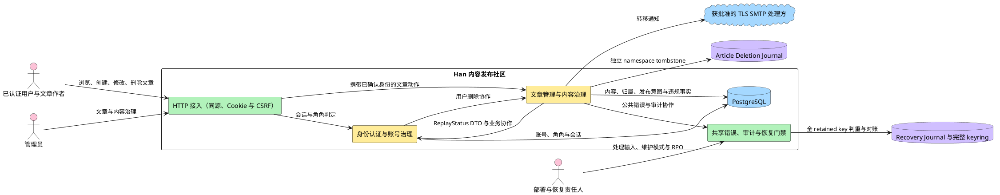

# Han 文章管理与内容治理边界

本边界定义文章管理与内容治理（Article Management and Content Governance）在 Han 首期中拥有什么业务事实、执行哪些文章动作，以及如何为当前恢复批次持久化可验证、不可复用的删除重放证据。`article-management-boundary-ir01-r12` 已于 2026-10-20 由 `current-user` 接受，可供双设计同步消费；该接收不表示独立复审 PASS。r02 至 r11 历史接收继续保留。

## 1. 需求来源与适用依据

边界以 requirements r16、architecture r12 accepted checkpoint 与已接受 ADR-0020 为权威依据。

| 依据 | 精确版本或摘要 | 本边界如何使用 |
|---|---|---|
| 首期需求规格 | `requirements-ir01-r16`；checkpoint `decision-e3af3912166f7287e8324488cad1cf1b87ba1034fca3378d3e0467a23751592d`；确认对象摘要 `sha256:b5f8874a4d90e1226d52ce4c1e87388846c1c15dde264cf2e94a4cfed383189b` | 19 条用户故事、事务性邮件、部署处理门禁、撤回复用删除、隐私用途及 Q1–Q4/Q7–Q9 |
| 当前需求文件读取快照 | `sha256:999cba3c0cd25d2760e400a41d2a373611406854e76e24e453321913d71cbc4f` | 证明本次完整读取了包含 r16 accepted checkpoint 的当前文件 |
| 系统架构 | `architecture-ir01-r12`；checkpoint `decision-0347e1026fd9148ad16f66750023cb50445a1d7c133db6d82669ea14865b318f`；artifact `sha256:e2ca9b4edd2b1360288429f47b7589f18ef510e76dcf22dd69325c38687d5aa3` | ready/unavailable tagged union、`inventory_scope` string、共享 fixture、非 ready 立即 fail closed，并继承 run 唯一、input_digest 与 completed_at 幂等 |
| 当前架构文件读取快照 | `sha256:5cac5b922fbe976640a5617a9a24136abb4283ad7ad866a6ab933498b5bd1dce` | 证明本次从真实文件读取了包含 r12 accepted checkpoint 的当前载体；载体 frontmatter 的 pending 不覆盖 checkpoint 对精确 artifact 的接受 |
| 内容 ADR | ADR-0010、已接受 ADR-0020；当前 `content.md` 快照 `sha256:a0594229fcfda0b8f243a476024bf51825f8dfb12671b41675fc270fa12dbf88` | tagged union 唯一 schema、ready canonical、unavailable 最小字段、共享 fixture、首份 completed_at、run/backup 并发合同 |
| 身份与框架 ADR | 最小同步 ADR-0007、ADR-0019，并继承 ADR-0001 至 ADR-0018 的既有合同 | Recovery Journal/keyring、recovery run/secret 指纹与 namespace 隔离继续有效 |
| identity 独立复审 | `identity-auth` review r08，`IA-DES-R06-N001` still-open；报告 `sha256:5292bb4341b16f7f42e0ab1e92b7d54dafba3c0f2dcd7136d8fdb3e194acd127` | 要求统一 `inventory_scope` 类型、共享 ready fixture/digest 与非 ready variant；architecture r12 已拍板合同，finding 仍待独立复审关闭 |
| article 独立复审 | `article-management` review r05，`AM-DES-R04-N001` still-open、N002/N003 closed；报告 `sha256:40e8a864fcb58ee6ceeacd5d91c3ed4e5aa3ccd848e4aab67f9d9d50f810f6a5` | 要求 producer/consumer 使用同一 tagged union；保留 completed_at/input_digest 幂等和同 run 错 backup 并发合同 |
| 项目采用清单 | 当前读取快照 `sha256:8467771211cddd6295f3cb6724a82c0432090206b22efe3bfa13ad217b6df929` | 只有 `identity-auth` 与 `article-management` 两个首期业务模块 |

### 1.1 上游确认状态

`requirements-ir01-r16` 继续有效；`architecture-ir01-r12` 已由 checkpoint `decision-0347e1026fd9148ad16f66750023cb50445a1d7c133db6d82669ea14865b318f` 接受，artifact 为 `sha256:e2ca9b4edd2b1360288429f47b7589f18ef510e76dcf22dd69325c38687d5aa3`。ADR-0020 是 `ArticleDeletionReplayStatus` v1 的唯一 schema 来源：article-management 拥有 DeletionReplayRun、input_digest、current evidence 指针与不可变 Evidence，并且只能输出唯一 ready 或 unavailable variant；identity 只对 ready 重算并比较 backup/ref/digest，收到 unavailable 立即 fail closed。

## 2. 五段边界叙事

### 2.1 是什么

文章管理与内容治理（Article Management and Content Governance）负责文章从创建、直接发布、浏览、作者修改到永久删除的生命周期，也负责管理员对违规文章和无归属文章的治理。它是文章内容、作者归属、发布意图、违规事实和永久删除终态的唯一业务权威，不拥有用户密码、角色、账号状态或会话。

### 2.2 核心机制

该模块以五项正交事实管理文章：

1. `publication_state` 表达文章管理侧的发布意图；
2. `violation_state` 表达管理员作出的违规事实；
3. 可空 `author_id` 表达当前作者归属；
4. `orphaned_from_user_id` 表达隐藏无归属文章来自哪个删除账号墓碑，但不表示当前作者；
5. identity-auth 的 `User.status` 表达有归属作者的账号状态。

成员可见性由这些事实共同派生。永久删除另使用内部 `deletion_pending` 协议：文章先对所有消费者隐藏，外部 Article Deletion Journal tombstone 耐久后由 finalizer 物理删除。该中间态不是草稿、软删除或可恢复业务状态。

恢复重放完成不是可复用布尔状态。article-management 以 `(run_id,namespace)` 唯一拥有 DeletionReplayRun，`backup_ref` 首次绑定后不可变；同 run+namespace 并发错 backup 必须稳定失败。稳定 `input_digest` 覆盖 Journal head、inventory、operation/audit 以及 run/backup/namespace；输入不变时复用首份 ready evidence 的 `evidence_ref/evidence_digest/completed_at`，只有 covered input 变化时才追加不可变 evidence 并原子更新 current 指针。未 ready 时只输出 6 字段 unavailable variant，不生成带零值的 20 字段 evidence。

### 2.3 端到端流程

**普通文章主路径**：已认证用户提交标题和正文 → 文章管理把当前用户记录为作者并直接发布 → 作者可读取和修改自己仍归属且未物理删除的文章 → 修改只更新内容和版本，不清除违规或其他隐藏约束 → 作者或管理员按各自权限永久删除。

**作者受限文章路径**：作者读取自己仍归属的违规文章 → 平台返回文章内容、编辑所需版本信息以及通用 `moderation_status=restricted`、`editable=true` → 不返回 `violation_category` 或完整 `hidden_reasons` → 作者修改后文章继续保持原违规判定和其他隐藏约束 → 普通成员继续按不可见语义处理。管理员治理接口仍可取得完整违规类别与隐藏原因。

**永久删除路径**：授权和版本前置通过 → 事务把 Article 置为 `deletion_pending` 并立即从成员、作者和管理员查询中隐藏，同时创建 DeletionOperation → 独立 `article-deletion` namespace 原子追加最小 tombstone 并 fsync → finalizer 幂等物理 DELETE，并同事务写 AuditEvent 与 operation 完成 → tombstone 与物理删除均完成后才返回 204。Journal 成功但 DB 删除失败时返回失败并保持不可见，finalizer 继续收敛；Journal 失败不得返回成功。

**违规治理主路径**：管理员经接入层完成 Cookie/CSRF 与身份校验 → 人工判定暴力或色情违规 → 文章管理只改变违规事实并追加审计 → 普通成员立即不可见，作者仅获得通用受限/可编辑语义，管理员治理接口获得完整类别与原因 → 解除违规判定时只清除违规约束 → 永久删除进入不可恢复终态。

**用户停用与恢复协作路径**：identity-auth 改变作者账号状态并撤销会话 → 文章管理不批量改写文章 → 读取时因作者停用而隐藏文章 → 恢复账号后，只有已发布且非违规文章重新公开。

**用户删除与无归属治理路径**：identity-auth 校验治理权限、写入 `deleted` 墓碑并编排业务事务 → 文章管理把作者归属置空、发布意图置为 `held`、写入 `orphaned_from_user_id`、保留违规事实并追加审计 → 管理员恢复、转移或永久删除无归属文章时更新自身状态并追加审计 → 该文章退出对应墓碑的待处置集合 → 全部关联文章处置完成且通知地址已独立留存后，identity-auth 可清理专用 `retained_email`。

**转移通知路径**：文章管理只接受无归属文章 → 从 identity-auth 取得仅为该事务性通知保留的新作者与已删除原作者地址 → 在转移事务中保存两路地址快照、提交新归属、发布意图、删除来源清除和审计事件，同时保留违规事实 → 部署门禁确认处理输入和获批准 SMTP 处理方已登记 → 邮件适配器使用强制 TLS best effort 通知两方。缺少处理方登记或 TLS 失败时不发送；转移结果不回滚。

**失败反馈路径**：文章管理只选择共享公共错误语义，由共享错误能力输出稳定错误标识、用户说明、可选字段错误和 `trace_id`。不可见、已删除、越权和内部故障不得泄露受限制文章内容、内部错误链、数据库或 SMTP 细节。

**恢复核对路径**：`ReplayAndVerify(run_id, backup_ref)` 先按 `(run_id,namespace)` 原子创建或锁定 DeletionReplayRun，首次绑定 backup 后不可变；并发错 backup 稳定失败 → 未完成或失败时只返回 6 字段 unavailable variant → 读取独立 namespace tombstone 与备份 inventory，重放删除并核对 DeletionOperation/AuditEvent → 计算稳定 input_digest → 输入不变时返回 current ready evidence 的同一 ref/digest/completed_at，输入变化时按 S16 canonical 前十六字段追加 Evidence 并原子更新 current 指针 → 成功时返回 20 字段 ready variant → `ReadStatus(run_id, backup_ref)` 返回同一唯一 variant 语义。identity 对 unavailable 立即 fail closed；只对 ready 重算摘要并二次比较 backup/ref/digest。variant 字段越界、ready 缺失/额外/null/类型错误、未知版本、摘要或 namespace/backup/ref 不匹配时保持停服。

### 2.4 接缝图

**说明**：article-management 拥有 DeletionReplayRun、input_digest、current evidence 指针、Evidence 持久化与并发约束；identity 只对 ready variant 重算摘要，unavailable variant 直接关闭 Gate。输入不变复用同一 ref/digest/time，输入变化才追加；ReplayAll、operation/audit 对账、ready evidence 和双 namespace 验证均发生在 Recovery Journal MarkConsumed 之前。

### 2.5 设计含义

该边界把删除事实、恢复运行与跨模块开放证据分开：tombstone 是删除事实，DeletionOperation 是业务库协调状态，DeletionReplayRun 固定 run→backup 所有权，DeletionReplayEvidence 是由稳定 input_digest 决定的不可变 ready 验证结果。unavailable 只表达尚无可验证 evidence；identity 消费 tagged union，不获得文章内部所有权。

## 3. 四栏边界

| 栏 | 边界结论 |
|---|---|
| **管什么** | **对象**：Article、TransferNotice、DeletionOperation、DeletionReplayRun、DeletionReplayEvidence。**属性**：文章状态、删除阶段、run 唯一键、不可变 backup、input_digest、current evidence 指针，以及 S16 v1 DTO/canonical 字段。**动作**：文章业务动作、删除 finalizer、重放与对账、原子 run 绑定、证据持久化/复用/追加和旧证据失效。 |
| **接入形态** | REST 删除仍是原业务入口；内部 finalizer 与恢复重放不是新用户 API。Article Deletion Journal 使用独立 `article-deletion` namespace，位于业务数据库恢复域之外；可复用持久卷/keyring 基础设施但不复用 Recovery Journal 记录。 |
| **消费者** | 既有成员、作者、管理员消费者不变。RecoveryCoordinator 是 v1 tagged union 的只读消费者；article-management 是 DeletionReplayRun、input_digest、current evidence 指针和 Evidence 的唯一 owner。 |
| **接口契约** | `ReplayAndVerify`、`ReadStatus` 均按 run+backup 工作且各自只返回一个 variant。`DeletionReplayRun` 唯一 `(run_id,namespace)`，backup 首次绑定后不可变，并发错 backup 稳定失败。输入不变复用同一 ref/digest/completed_at，covered input 变化才追加 Evidence。ready 返回 20 个必填非 null 字段；unavailable 只返回 6 个字段且禁止 canonical/digest/ref/time。identity 只对 ready canonical 重算并比较 backup/ref/digest。 |

## 4. OO 对象、属性、动作审查

| 类型 | 条目 | 归属与不变量 |
|---|---|---|
| 对象 | 文章 | 内容和治理的权威对象；永久删除后进入不可恢复终态。 |
| 对象 | 文章转移通知记录 | 记录一次已完成转移的两路投递结果；不是当前作者归属的真相源。 |
| 对象 | DeletionOperation | 协调 `deletion_pending`、外部 tombstone、物理 DELETE、AuditEvent 与完成结果；不保存标题、正文或内容副本。 |
| 对象 | DeletionReplayRun | article-owned 恢复运行所有权对象；唯一键 `(run_id,namespace)`，`backup_ref` 首次绑定后不可变，保存稳定 `input_digest` 与 current evidence 指针；并发错 backup 不得产生第二行。 |
| 对象 | DeletionReplayEvidence | article-owned 不可变 ready 恢复证据；字段固定为 S16 v1 的 canonical 前十六项及 ref/digest/completed_at，不含文章内容或 PII；同 input 语义只产生同一 current evidence。unavailable 不是 Evidence，不持久化伪 canonical 字段。 |
| 协作对象 | 审计事件 | 由共享审计能力拥有；文章治理、无归属处置、转移和永久删除只追加最小必要事件，文章模块不能更新或删除。 |
| 协作对象 | 部署处理输入 | 地区、控制者、处理依据与获批准 SMTP 处理方的运行门禁事实；不是 Article 属性，也不是文章消费者。 |
| 协作对象 | 恢复运行记录 | 保存备份标识、RPO 限制、终结结果和告警；供文章状态与永久删除证据核对，不是 Article 真相源。 |
| 协作对象 | Recovery Journal/RecoveryRun | 分别位于业务数据库外与业务数据库内，用于恢复批次防重放和对账；Journal 记录 `key_id/key_version`，均不是 Article 真相源。 |
| 协作对象 | Recovery keyring | active/verify-only HMAC key 的受控集合；文章模块不读取、不轮换，也不据此改变文章状态。 |
| 协作对象 | Article Deletion Journal tombstone | 业务数据库外的最小删除事实，仅含文章/版本/operation/时间/key/阶段信息，不保存内容、摘要、邮箱或其他 PII。 |
| 属性 | 标题与正文 | 首期全部文章内容；具体格式和长度仍待确认，不增加其他内容字段。 |
| 属性 | 作者归属 | 可为空；空值表示无归属，不等于必然隐藏。 |
| 属性 | 无归属删除来源 | `orphaned_from_user_id` 指向 identity-auth 的 `deleted` 墓碑，仅用于取得已删除原作者通知邮箱；不表示当前作者。 |
| 属性 | 发布意图 | 表达文章管理是否允许发布；无归属删除协作进入保持隐藏，恢复或转移可重新进入发布。 |
| 属性 | 违规事实 | 只由管理员治理动作改变；停用、恢复、删除或转移作者都不得清除。 |
| 消费者投影 | 作者受限状态 | 对仍归属作者的违规文章仅派生 `moderation_status=restricted` 与 `editable=true`；不是新的权威状态。 |
| 消费者投影 | 管理员治理详情 | 可包含完整 `violation_category` 和隐藏原因；不得向作者或普通成员投影复用。 |
| 属性 | 作者账号状态 | 不是 Article 的复制属性；由 identity-auth 持有，文章管理只读消费。 |
| 属性 | 创建时间与分页顺序 | 列表按创建时间倒序；具体页大小仍待确认。 |
| 属性 | `deletion_pending` | 永久删除内部不可见中间态；不是软删除、草稿、下线或可恢复状态。 |
| 属性 | v1 tagged union、canonical 与 `evidence_digest` | ready 固定 20 个必填非 null 字段，`inventory_scope` 为 JSON string；canonical 固定为前十六字段并排除 `status/evidence_digest/evidence_ref/completed_at`。unavailable 只含 6 个字段且无 canonical/digest/ref/time。`completed_at` 只记录首份 ready evidence 元数据；重放计数字段统一为 `tombstones_replayed`。 |
| 属性 | `input_digest/current_evidence_ref` | input_digest 覆盖 Journal head、inventory、operation/audit 与 run/backup/namespace；输入不变复用 current evidence，变化才追加并原子更新指针。 |
| 动作 | 创建、浏览、作者受控读取/修改、治理、转移、通知、删除 finalizer、ReplayAndVerify 与 ReadStatus | evidence 由 article-management 持久化或幂等重算；identity 只读消费。 |

**审查结论**：本边界没有把“转移”“恢复公开”“判定违规”等动作伪装成文章类型；没有把账号状态复制成文章属性；没有把通知记录当作归属真相源；没有新增第三个权威业务模块。

## 5. 跨模块关键接缝

两份边界使用以下同一合同。

| 接缝 | 一致合同 |
|---|---|
| S1 · 同源接入与已确认身份 | 浏览器 API 默认 same-origin，禁止跨源 credentialed CORS；登录校验可信 Origin 与 Fetch Metadata 或等价 fail-closed 信号。接入层拥有 Session Cookie、CSRF Header 和 Cookie 安全属性执行；身份认证拥有会话权威状态及 ID 创建/轮换/撤销。已有会话再次登录时新建会话并撤销旧会话；业务模块不得解析 Cookie、CSRF 或密码。 |
| S2 · 作者状态与可见性 | 身份认证唯一写入 `User.status`。文章管理只读消费作者状态，并结合 `publication_state`、`violation_state` 与可空 `author_id` 派生成员可见性；停用或恢复用户不得批量改写文章状态。 |
| S3 · 停用、恢复与会话失效 | 停用和恢复使用目标状态幂等，每次仍重新校验权限与目标资格。身份认证停用账号时撤销全部会话，并与状态变化同事务追加审计；文章管理不接收批量隐藏写命令，而是读取作者状态派生可见性，违规事实继续有效。 |
| S4 · canonical 删除与无归属化 | 日常删除和恢复核对的 `kept_deleted` 结论必须执行同一 canonical 删除协作：身份认证写不可恢复墓碑、标识生命周期并失效 Session/永久及临时凭据；文章管理置空 `author_id`、设置 `publication_state=held`、写入 `orphaned_from_user_id`、保留 `violation_state`，并共同维护 `retained_email`/零文章清理与 AuditEvent。任一子步骤失败时不得只保留 User 删除状态。 |
| S5 · 无归属处置与标识清理 | 文章管理只允许处置无归属文章。恢复公开、成功转移或永久删除后，该文章退出对应墓碑的待处置集合；转移前保存新作者与已删除原作者通知地址快照，再清除 `orphaned_from_user_id`。当关联无归属文章全部处置且所需地址已独立留存时，文章管理提供可核对完成事实，身份认证据此清理专用 `retained_email`；其他邮箱/手机号清理条件仍待确认。 |
| S6 · 事务性邮件、TLS 与残余窗口 | 邮件仅限已确认的新管理员临时凭据、密码重置/重发和无归属文章转移通知，不得用于营销。生产 SMTP 必须使用隐式 TLS 或强制 STARTTLS，验证证书链与主机名，禁止明文、机会式降级和跳过验证；安全配置或获批准 SMTP 处理方登记缺失时相关能力 fail closed。临时凭据业务继续治理 SMTP/数据库残余窗口；文章转移通知继续 best effort 且不得回滚转移。 |
| S7 · 管理员治理与文章治理 | 身份认证拥有角色与管理员目标资格。初始 `admin` 永久受保护，并且是其他管理员账号的唯一查看、创建与治理者；普通管理员只治理普通用户，不能治理自己或任何管理员。文章管理消费已确认管理员身份执行删除他人文章、无归属处置和违规治理，但管理员不能修改他人文章。 |
| S8 · 公共错误 | 共享错误能力拥有公共 REST 错误注册与映射。所有接口只返回稳定错误标识、用户可读说明、可选字段错误和 `trace_id`；登录失败必须统一，内部错误链、账号存在性、敏感状态和基础设施细节不得泄露。业务模块只选择公共错误语义，不各自发明响应结构。 |
| S9 · 幂等记录 | 共享幂等能力拥有幂等记录。创建管理员、密码重置和临时密码重发要求作用域化幂等键与请求摘要；停用和恢复采用目标状态幂等。当前 ADR 未把文章治理、转移或永久删除纳入键式幂等合同，边界不得擅自扩大。业务模块不得把幂等记录当业务真相源。 |
| S10 · 追加式审计与删除证据 | 共享审计能力拥有 `AuditEvent`，只提供追加和查询。隐私/授权确认、身份治理、凭据操作、标识清理、文章治理、无归属恢复/转移、永久删除和数据库恢复必须追加最小必要审计；高风险业务状态与审计同事务，审计失败时业务写入 fail closed。审计保存永久删除证据但不保存可恢复文章内容；业务模块不得更新或删除审计事件。 |
| S11 · Article Deletion Journal 永久删除 | 文章管理拥有永久删除协议。授权与版本前置通过后，先把 Article 置内部 `deletion_pending` 并隐藏，创建 DeletionOperation；独立 `article-deletion` namespace 的外部 tombstone 耐久写入后，finalizer 幂等物理 DELETE，并同事务写 AuditEvent 与完成状态。只有 tombstone 与物理删除均完成才返回 204。Journal 成功而数据库删除失败时文章保持不可见并继续 finalizer；任一失败不得恢复公开。 |
| S12 · 隐私证据与部署处理门禁 | 普通用户注册成功要求当前版本隐私确认证据；初始 `admin` 创建其他管理员要求信息提供声明；新管理员使用其他管理员能力要求改密与当前隐私确认均完成。部署责任人必须在相关能力对外提供前登记适用地区、数据控制者、个人数据处理依据及获批准 SMTP 处理方；任何对应输入缺失时注册、管理员创建或邮件能力 fail closed。登记不构成特定法域或自动合规结论。 |
| S13 · 维护模式与恢复信任根 | 每次恢复使用唯一 `recovery_run_id` 和 recovery secret 的版本化 HMAC 指纹。维护模式关闭 readiness；Recovery Journal 校验 run/指纹未消费后记录 Begin，业务库写 RecoveryRun。终结事务冻结非初始账号、失效全部永久密码/Session/活动临时凭据、收敛不确定幂等状态并追加审计；初始 `admin` 通过独立 recovery secret 重建信任根并首次登录强制改密。 |
| S14 · 逐账号核对、canonical 删除与 RPO | 初始 `admin` 按账号核对角色、状态和删除事实。恢复账号须重置凭据后清除 `recovery_required`；`kept_deleted` 须幂等重放 S4 完整 canonical 删除，不能只改 User。无法按 RPO 重建的事实默认不授权并写运行记录。文章管理只参与 canonical 删除协作，其他文章所有权和状态规则不变。 |
| S15 · Recovery Journal keyring 防重放与开放门禁 | Journal 记录保存稳定 `key_id/key_version`、HMAC 指纹、run ID、阶段和 Consumed；keyring 只有一个 active 写入 key，并保留仍承担历史判重的 verify-only key。Begin 必须使用所有 retained key 计算候选指纹，并只与相同 key ID/version 的历史记录比较；任一命中即拒绝。历史 key 仅在对应记录达到批准退出条件后退役。key 缺失、未知、不可验证，Journal/keyring 迁移不完整、Journal/RecoveryRun 不一致或 Consumed 未确认时均保持停服。 |
| S16 · Article deletion replay evidence Gate | `ArticleDeletionReplayStatus` v1 是两模块唯一 strict tagged union；`ReplayAndVerify` 与 `ReadStatus` 各自必须且只能返回一个 variant。ready variant 按固定顺序完整包含 `evidence_version`、`run_id`、`backup_ref`、`namespace`、`journal_head_sequence`、`journal_head_hash`、`inventory_scope`、`backup_cutoff`、`inventory_digest`、`deletion_operations_digest`、`audit_events_digest`、`tombstones_total`、`tombstones_replayed`、`already_absent`、`deletion_operations_reconciled_count`、`audit_events_verified_count`、`status`、`evidence_digest`、`evidence_ref`、`completed_at` 共 20 个字段；`status=ready`，全部字段必填且非 null，`inventory_scope` 的 JSON 类型固定为 string。只有 ready variant 重算 `evidence_digest`：canonical JSON 固定为前十六字段，明确排除 `status`、`evidence_digest`、`evidence_ref`、`completed_at`；共享 fixture digest 固定为 `sha256:169e0f30407867083598ab146c950968e1b5f508ed4fd5d5198bb61e788926a7`，producer/consumer 必须嵌入同一 fixture 或使用同一生成源。unavailable variant 只允许 `evidence_version`、`run_id`、`backup_ref`、`namespace`、`status`、`reason_code` 六个字段；`status` 只允许 `pending|unknown|failed`，禁止携带任何 canonical、digest、ref 或 time 字段，也禁止用空字符串、零值或 null 伪装 ready。identity 收到 unavailable 必须立即 fail closed，不得重算 digest。article-management 拥有 `DeletionReplayRun` 和不可变 `DeletionReplayEvidence`：run 唯一键为 `(run_id,namespace)`，`backup_ref` 首次绑定后不可变，同 run+namespace 并发错 backup 稳定失败；`input_digest` 覆盖 Journal head、inventory、operation/audit 及 run/backup/namespace，current evidence 指针只在 covered input 变化时原子更新。输入不变且已 ready 时 `ReplayAndVerify`/`ReadStatus` 复用同一 `evidence_ref/evidence_digest/completed_at`，其中 `completed_at` 只记录首份 evidence 的元数据时间；输入变化才追加新 evidence。identity 只对 ready 从 DTO canonical 字段重算摘要，比较 `RecoveryRun.backup_ref`、`evidence_ref` 与 `evidence_digest`，不得读取 article 内部表；二次 ready 读取必须得到同一 ref/digest。任一 variant 字段越界、ready 缺失/额外/null/类型错误、未知版本、摘要或 namespace/backup/ref 不匹配均 fail closed；顺序必须是 ReplayAll → operation/audit 对账 → ready evidence 持久化/验证 → 双 namespace 通过 → Recovery Journal MarkConsumed → 开放 readiness。 |

## 6. 19 条用户故事归属

下表是两份边界的共同追溯矩阵；“主责”表示业务事实和结果的 owner，“协作”只提供合同内输入或共享机制。所有公共接口同时受 S1、S8 约束，表中只重复标出该 Story 的特殊协作。

| 用户故事 | 主责 | 协作归属 |
|---|---|---|
| `US-IDENTITY-01.1` 建立用户身份 | identity-auth | 隐私声明确认与证据、删除标识生命周期、唯一性及部署处理门禁 |
| `US-IDENTITY-01.2` 设置注册密码 | identity-auth | Argon2id 与已批准 `x/crypto` 依赖 |
| `US-IDENTITY-02.1` 登录社区 | identity-auth | same-origin/login CSRF、Cookie/CSRF、旧会话撤销、统一失败与审计 |
| `US-IDENTITY-03.1` 建立初始管理员账号 | identity-auth | bootstrap/recovery secret 独立；初始管理员恢复信任根、强制改密、会话轮换与审计 |
| `US-IDENTITY-03.2` 删除他人文章 | article-management | identity-auth 提供管理员身份；Article Deletion Journal、finalizer 与审计保证跨备份永久删除 |
| `US-IDENTITY-03.3` 创建其他管理员账号 | identity-auth | 信息提供声明、改密/隐私双 Gate、强制 TLS SMTP、处理方门禁、幂等、Argon2id、审计与残余窗口 |
| `US-IDENTITY-03.4` 管理其他管理员账号 | identity-auth | 仅初始 `admin` 可执行；恢复后逐账号核对角色/状态/删除事实并追加审计 |
| `US-IDENTITY-03.5` 查看用户 | identity-auth | 公共错误最小披露；受控审计不得保存认证秘密 |
| `US-IDENTITY-03.6` 停用与恢复用户 | identity-auth | 目标状态幂等、会话撤销/轮换、审计；article-management 派生可见性 |
| `US-IDENTITY-03.7` 删除用户 | identity-auth 负责目标资格、墓碑、标识生命周期、会话与事务编排 | article-management 完成无归属化；恢复 `kept_deleted` 重放相同 canonical 删除；共享审计同事务追加 |
| `US-IDENTITY-03.8` 处置无归属文章 | article-management | identity-auth 提供管理员身份、目标资格和墓碑联系信息；永久删除受 Article Deletion Journal 保护 |
| `US-IDENTITY-03.9` 发送文章转移通知 | article-management | 隐私限定事务性用途；identity-auth 提供通知地址与清理协作；强制 TLS SMTP/处理方门禁；审计记录结果 |
| `US-IDENTITY-03.10` 重置用户密码 | identity-auth | 事务性用途、强制 TLS SMTP/处理方门禁、幂等、Argon2id、审计与残余窗口 |
| `US-IDENTITY-03.11` 重发临时密码邮件 | identity-auth | 事务性用途、强制 TLS SMTP/处理方门禁、幂等、Argon2id、审计与最新凭据语义 |
| `US-IDENTITY-03.12` 隐藏、解除判定与删除违规文章 | article-management | identity-auth 提供管理员身份；违规文章永久删除受外部 tombstone 保护 |
| `US-ARTICLE-01.1` 创建文章 | article-management | identity-auth 提供已确认用户身份 |
| `US-ARTICLE-02.1` 发现并阅读文章 | article-management | identity-auth 提供会话结果及作者账号状态 |
| `US-ARTICLE-03.1` 修改现有文章 | article-management | identity-auth 提供已确认用户身份 |
| `US-ARTICLE-04.1` 删除现有文章 | article-management | identity-auth 提供身份与角色；`deletion_pending`、DeletionOperation、外部 tombstone、finalizer 和审计 |

## 7. 明确排除项

- 不拥有注册、密码、角色、账号状态、会话、强制改密或管理员账号创建与撤销。
- 不直接写用户、角色或会话数据，也不复制 `User.status` 到文章。
- 不解析 Session Cookie 或 CSRF Header，不拥有公共错误注册、幂等记录或审计事件；只消费已确认身份、公共错误语义并追加审计。
- 不允许匿名浏览，不提供公开匿名入口；“匿名作者”只表示无归属文章的展示身份。
- 不提供评论、收藏、关注、标签、搜索、独立草稿、下线、申诉或自动内容审核。
- 不新增营销邮件、用户自助撤回/注销、法律合规声明、文章恢复或其他未确认消费者能力。
- 不允许管理员修改他人文章；管理员只可按已确认治理动作查看、删除或改变治理状态。
- 不把 SMTP 受理、后续送达或通知成功作为文章转移成功条件，不为通知失败回滚归属。
- 不允许明文或可降级 SMTP，不绕过证书链/主机名验证或获批准处理方门禁。
- 不把 ADR-0015 的 `Idempotency-Key` 擅自扩展到文章治理、转移或永久删除；如需扩展必须回到 decision。
- 不定义具体 HTTP endpoint、函数签名、包路径、字段默认值、具体页大小、公共错误码集合或审计字段序列化；列表、详情、倒序和分页本身已经确认。
- 不硬编标题正文格式与长度、容量、SMTP 超时、审计/通知记录保留期等数值，也不决定删除二次确认、隐藏原因展示或人工重发通知能力。
- 不修改账号 `recovery_required`、永久密码、Session、TemporaryCredential 或幂等恢复状态；不参与初始管理员恢复信任根和逐账号授权决定。
- 不把维护模式、恢复运行记录、RPO 声明或永久删除审计解释为新的文章恢复能力。
- 不拥有 Recovery Journal、RecoveryRun、HMAC key 或 recovery secret；不把防重放记录当文章真相源。
- 不管理 active/verify-only keyring，不参与跨 key-version 指纹计算、key 轮换或退役；这些机制只决定恢复开放门禁。
- 不允许 `kept_deleted` 只修改 User 而跳过文章无归属化、`held`、来源关联、违规保留、通知邮箱和审计协作。
- 不把 `deletion_pending` 暴露为草稿、软删除或可恢复状态，不提供撤销删除或文章恢复 API。
- Article Deletion Journal 不保存 title、body、内容摘要、作者邮箱或其他 PII；不与 `recovery/*` namespace 混用。
- 不允许以仅含 run/status 的布尔 ready、近似字段表、混合 variant 或带零值的 20 字段 unavailable 替代 S16 strict tagged union；不得使用其他别名替代 `tombstones_replayed`。
- identity 不得读取 tombstone、DeletionOperation、AuditEvent、inventory、DeletionReplayRun 或 Evidence 内部表；article 不把 evidence、input_digest、current 指针和并发约束所有权上移。
- 不向作者或普通成员返回 `violation_category`、完整 `hidden_reasons` 或其他管理员治理上下文；作者端只使用确认的通用受限/可编辑语义。

## 8. 待澄清清单

| 编号 | 问题 | 影响 | 当前边界假设 | 需谁决定 | 阻塞性 |
|---|---|---|---|---|---|
| AM-Q1 | 标题和正文的长度与格式规则，以及文章列表的具体页大小是什么？ | 影响创建、修改、详情契约与分页参数 | 只承诺标题和正文；列表按创建时间倒序并支持分页，不预设数值 | 需求提出人 | 非阻塞边界；详细设计保留明确 TBD |
| AM-Q2 | `TransferNotice`、投递结果与 `AuditEvent` 的保留、归档和清理周期是什么？ | 影响隐私、容量和审计可追溯时间 | 专用 `retained_email` 清理触发条件已确认；记录对象保留数值不预设 | 项目负责人、指定技术代表 | 非阻塞；部署与详细设计保持 TBD |
| AM-Q3 | 首期用户规模、文章规模、响应时间、可用性、SMTP 超时与审计容量目标是什么？ | 影响列表、详情、治理与通知的容量设计 | 方向已批准，数值无来源 | 项目负责人、指定技术代表 | 非阻塞；数值保持 TBD |
| AM-Q4 | 首期是否纳入搜索？ | 可能扩大文章发现方式、接口与索引边界 | 当前不纳入；草稿与下线已明确排除 | 需求提出人、项目负责人 | 非阻塞；新增时回需求与边界 |
| AM-Q5 | 管理员永久删除普通、违规和无归属文章是否需要二次确认？ | 影响交互，不改变永久删除终态 | 不预设二次确认 | 需求提出人 | 非阻塞交互问题 |
| AM-Q6 | 是否提供文章转移通知人工重发，投递结果向谁展示？ | 影响通知记录消费者和后续动作 | 只记录结果，不提供重发能力 | 需求提出人、项目负责人 | 非阻塞转移主流程 |
| AM-Q9 | 上线时适用地区、数据控制者、个人数据处理依据和获批准的 SMTP 数据处理方分别是什么？ | 缺少对应输入时无归属文章转移通知不得对外提供 | 不编造地区、主体、依据或处理方；由项目负责人指定实际责任人登记 | 项目负责人指定的实际责任人 | 部署前必填；不阻塞 r04 边界交接 |
| AM-Q10 | RPO、RTO、恢复运行记录保留期及文章状态核对责任是什么？ | 影响恢复后文章状态与永久删除证据的可核对范围 | 文章所有权和状态规则不变；无法重建的恢复点后事实由运行记录声明，不由文章模块推断 | 项目负责人、运行责任人、指定技术代表 | 灾备演练前必填；不阻塞 r05 边界交接 |
| AM-Q11 | Recovery Journal 持久卷备份/迁移窗口、记录保留、retained key 数量上限、active/verify-only key 轮换和退役条件是什么？ | 影响 canonical 删除重放前的恢复开放可信度 | 文章模块只消费完整 keyring 判重和 Journal/DB 对账已通过的恢复协调；具体介质、周期和数值不预设 | 项目负责人、运行责任人、安全责任人 | 灾备演练前必填；不阻塞 r07 边界交接 |
| AM-Q12 | Article tombstone 保留周期、可恢复备份 inventory、备份退役证明、DeletionOperation/finalizer 容量及对应 key 保留条件是什么？ | 决定旧备份恢复时永久删除事实能否完整重放 | tombstone/key 至少保留到所有早于删除时间的可恢复备份退役；具体周期、inventory 和容量不预设 | 项目负责人、运行责任人、文章设计责任人 | 上线与灾备演练前必填；不阻塞 r08 边界交接 |
| AM-Q13 | DeletionReplayEvidence v1 退役、归档和记录保留策略是什么？ | 影响崩溃续跑、历史证据验证和 identity 消费兼容性 | v1 tagged union、ready canonical、unavailable 最小字段和 fail-closed 机制已经固定；演进须新版本而非原位改 v1 | 项目负责人、运行责任人、文章设计责任人 | 灾备演练前必填；不阻塞 r12 边界交接 |

作者端隐藏原因披露范围已由当前用户于 2026-10-20 确认，不再作为待澄清：作者可读取/修改自己的未物理删除且仍归属文章；违规文章仅返回 `moderation_status=restricted` 与 `editable=true`，完整类别和隐藏原因仅管理员治理接口可见。

## 9. 已拍板项

- 首期只有 identity-auth 与 article-management 两个权威业务模块，采用模块化单体。
- HTTP 使用 Go 标准库 `net/http`，对外形式为 REST + JSON；PostgreSQL 是唯一持久化存储。
- 接入层拥有 Session Cookie/CSRF 校验，文章模块只消费已确认操作者。
- 浏览器 API 默认 same-origin，登录防护和已有会话轮换由接入层/identity-auth 承担，文章模块不自行解释。
- 公共 REST 错误采用稳定结构与最小披露；文章模块不返回内部错误链、数据库或 SMTP 细节。
- 文章违规治理、无归属恢复/转移和永久删除与追加式审计同事务提交；业务模块不能更新或删除审计事件。
- 永久删除审计保存核对证据但不保存可恢复文章内容；数据库恢复不产生文章恢复动作。
- ADR-0015 的键式幂等只适用于已列身份操作，当前不扩展到文章治理、转移或永久删除。
- 所有文章浏览和写入都要求已认证身份；文章创建后直接发布。
- 作者可读取和修改自己未物理删除且仍归属的违规文章；修改只更新标题、正文和版本，不清除违规或其他隐藏约束。
- 作者端对受限文章仅暴露 `moderation_status=restricted` 与 `editable=true`；不暴露 `violation_category` 或完整 `hidden_reasons`。
- 管理员治理接口继续返回完整违规类别和隐藏原因；普通成员继续获得统一不可用语义。
- `publication_state`、`violation_state` 与可空 `author_id` 由 article-management 唯一写入；`User.status` 由 identity-auth 唯一写入。
- 成员可见当且仅当文章存在、发布意图为已发布、无违规，并且无作者或作者账号正常。
- 停用与恢复作者不批量改写文章；删除作者使文章无归属并 `held`，记录 `orphaned_from_user_id`，违规事实保留。
- 无归属文章可恢复为匿名公开、转移给正常未停用用户或永久删除；违规无归属文章不得直接恢复公开。
- 转移只允许无归属文章；成功前保存新作者与已删除原作者邮箱快照，随后清除删除来源关联。通知只用于告知已完成归属变化，不得营销。
- 转移通知只经强制 TLS、证书链和主机名验证通过的获批准 SMTP 处理方发送；处理门禁缺失时通知能力 fail closed，但不回滚已提交转移。
- 恢复公开、转移或永久删除后文章退出对应墓碑待处置集合；全部关联文章处置且所需通知地址已独立留存后，identity-auth 可清理专用通知邮箱。
- 部署前必须登记地区、数据控制者、处理依据和获批准 SMTP 处理方；登记不构成特定法域或自动合规声明。
- 数据库恢复期间文章服务处于维护模式且 readiness 关闭；文章模块不参与身份信任根重建。
- 恢复终结由 identity-auth/共享恢复能力处理账号 Gate、永久/临时凭据、Session 和幂等状态；全部步骤成功后文章能力才重新开放。
- 文章模块沿恢复后的原权威状态运行；恢复审计、RPO 运行记录和永久删除证据只用于核对，不新增恢复消费者能力。
- `kept_deleted` 必须幂等重放与日常删除相同的跨模块合同，重建文章无归属化、`held`、删除来源关联、违规状态保留、通知邮箱条件与审计。
- Recovery Journal/RecoveryRun 对账和 Consumed 成功是服务开放前置；文章模块不拥有 Journal，但任一 canonical 删除子步骤失败必须保持维护模式。
- Recovery Journal keyring 只有一个 active 写入 key，并保留承担历史判重的 verify-only key；Begin 使用全部 retained key 判重。
- 缺失或未知历史 key、候选指纹无法计算、只迁移 Journal 或只迁移 active key 时保持停服；该门禁不改变文章状态或消费者。
- 永久删除先进入不可见 `deletion_pending` 并创建 DeletionOperation；外部 tombstone 耐久后由 finalizer 幂等物理删除并写审计。
- 只有 tombstone 和物理 DELETE 均完成才返回 204；Journal 成功但数据库删除失败时继续 finalizer，文章不得恢复公开。
- Article Deletion Journal 使用独立 `article-deletion` namespace，不保存内容或 PII；旧备份开放前重放全部有效 tombstone。
- tombstone 和对应 key 至少保留到全部早于删除时间的可恢复备份退役；备份 inventory 与退役证明是运行输入。
- `ArticleDeletionReplayStatus` v1 是 strict tagged union：ready variant 完整 20 字段、全部必填非 null，`inventory_scope` 为 JSON string；unavailable variant 只含 `evidence_version,run_id,backup_ref,namespace,status,reason_code`，状态只允许 `pending|unknown|failed`。
- ready 的 canonical 固定为前十六字段并排除 `status/evidence_digest/evidence_ref/completed_at`；共享 fixture digest 固定为 `sha256:169e0f30407867083598ab146c950968e1b5f508ed4fd5d5198bb61e788926a7`，唯一重放计数字段名为 `tombstones_replayed`。
- article-management 以 `(run_id,namespace)` 唯一拥有 DeletionReplayRun；`backup_ref` 首次绑定后不可变，同 run+namespace 并发错 backup 稳定失败。
- 稳定 `input_digest` 覆盖 Journal head、inventory、operation/audit 与 run/backup/namespace；输入不变必须复用同一 evidence_ref/evidence_digest/completed_at，只有 covered input 变化才追加 Evidence 并更新 current 指针。
- `ReplayAndVerify`、`ReadStatus` 各自只返回一个 variant；identity 只对 ready 重算并比较 backup/ref/digest，收到 unavailable 立即 fail closed。producer/consumer 共享同一 ready fixture 与 canonical digest 契约测试。
- 浏览包括按创建时间倒序、支持分页的列表和标题正文详情；修改成功后最新内容立即展示。
- 首期文章只包含标题和正文，创建即发布，不存在草稿或下线状态。
- 永久删除是终态；管理员不能修改他人文章；首期人工违规判断无申诉。

## 10. 产出责任与下一阶段接收责任

| 责任 | 实际承担 | 内容 | 当前状态 |
|---|---|---|---|
| r01 边界产出责任 | 此前 Boundary-Griller 角色会话 | 形成 r01 基线 | 历史完成；不代表 r02 已接收 |
| r02 边界修订责任 | 此前 Boundary-Griller 角色会话 | 消费 requirements r14、architecture r03 与当时已接受 ADR，形成 r02 | 历史完成并已接收 |
| r02 Lead 现场复核责任 | Lead（主会话） | 核对 r02 revision、确认时 SHA-256、来源、接缝一致性、19 条 US、静态校验和所有权 | 历史完成 |
| r02 下一阶段接收责任 | `current-user` | 接受确认时的 r02 精确 revision/hash | accepted；2026-10-20 |
| r03 边界修订责任 | 当前 Boundary-Griller 角色会话 | 消费 requirements r15、architecture r04 与 ADR-0005/0011/0012–0016，修订接入、错误、审计、生命周期和 SMTP 边界 | 已完成专业修订 |
| r03 Lead 现场复核责任 | Lead（主会话） | 在真实工作树核对 r03 revision、确认时 SHA-256、来源、S1–S11、19 条 US、历史接收和所有权 | 已完成现场复核 |
| r03 下一阶段接收责任 | `current-user` | 接受确认时的 r03 精确 revision/hash，确认可供详细设计消费 | accepted；2026-10-20 |
| r04 边界修订责任 | 当前 Boundary-Griller 角色会话 | 消费 requirements r16、architecture r05、ADR-0005/0006/0017/0018 与 F001/F003/F004/F006，修订事务性邮件、SMTP TLS/门禁、恢复审计和永久删除证据边界 | 已完成专业修订，待 Lead 复核 |
| r04 下一阶段接收责任 | `current-user` | 接受确认时的 r04 精确 revision/hash，确认可供详细设计整改消费 | accepted；2026-10-20 |
| r05 边界修订责任 | 当前 Boundary-Griller 角色会话 | 消费 architecture r06、修订 ADR-0007/0018 与 review r02 F003，同步维护模式、恢复审计、RPO 上游且不改变文章所有权 | 已完成专业修订，待 Lead 复核 |
| r05 下一阶段接收责任 | `current-user` | 接受确认时的 r05 精确 revision/hash，继续担任 identity design 整改接收责任人 | accepted；2026-10-20 |
| r06 边界修订责任 | 当前 Boundary-Griller 角色会话 | 消费 architecture r07、修订 ADR-0007/0018、ADR-0019 与 review r03 N001/N002，同步 canonical 删除重放和 Journal 防重放且不改变文章所有权 | 已完成专业修订，待 Lead 复核 |
| r06 下一阶段接收责任 | `current-user` | 接受确认时的 r06 精确 revision/hash，继续担任 identity design 整改接收责任人 | accepted；2026-10-20 |
| r07 边界修订责任 | 当前 Boundary-Griller 角色会话 | 消费 architecture r08、修订 ADR-0019 与 review r04 N002，最小同步完整 keyring 开放门禁且不改变文章业务 | 已完成专业修订，待 Lead 复核 |
| r07 下一阶段接收责任 | `current-user` | 接受确认时的 r07 精确 revision/hash，继续担任 identity design 整改接收责任人 | accepted；2026-10-20 |
| r08 边界修订责任 | 当前 Boundary-Griller 角色会话 | 消费 architecture r09、ADR-0020 与 article review F001，修订 Article Deletion Journal 永久删除和旧备份重放边界 | 已完成专业修订，待 Lead 复核 |
| r08 下一阶段接收责任 | `current-user` | 接受确认时的 r08 精确 revision/hash，继续担任 article design 整改接收责任人 | accepted；2026-10-20 |
| r09 边界修订责任 | 当前 Boundary-Griller 角色会话 | 消费当前用户确认的作者端最小披露及 article review r02 N001，修订作者受控读取/修改与治理信息披露边界 | 已完成专业修订，待 Lead 复核 |
| r09 下一阶段接收责任 | `current-user` | 接受确认时的 r09 精确 revision/hash，继续担任 article design 整改接收责任人 | accepted；2026-10-20 |
| r10 边界修订责任 | 当前 Boundary-Griller 角色会话 | 消费 architecture r10、修订 ADR-0020、identity review r06 N001 与 article design r03 PASS，修订 article-owned replay evidence 提供边界 | 已完成专业修订，待 Lead 复核 |
| r10 下一阶段接收责任 | `current-user` | 接受确认时的 r10 精确 revision/hash，继续担任双设计同步接收责任人 | accepted；2026-10-20 |
| r11 边界修订责任 | 当前 Boundary-Griller 角色会话 | 消费 accepted architecture r11/ADR-0020、identity review r07 与 article review r04，固定唯一 v1 DTO、run 唯一键、input_digest/current evidence、completed_at 幂等和共享 fixture 边界 | 历史完成并已接收 |
| r11 下一阶段接收责任 | `current-user` | 接受确认时的 r11 精确 revision/hash，继续担任双设计同步接收责任人 | accepted；2026-10-20 |
| r12 边界修订责任 | 当前 Boundary-Griller 角色会话 | 消费 accepted architecture r12/ADR-0020、identity review r08 与 article review r05，固定 ready/unavailable tagged union、`inventory_scope` string、共享 fixture digest 与非 ready 立即 fail closed | 已完成专业修订并获接收 |
| r12 下一阶段接收责任 | `current-user` | 接受 r12 精确 revision/hash，继续担任双设计同步接收责任人 | accepted；2026-10-20 |

### 10.1 r02 历史接收记录

| 决定日期 | 实际接收人 | 接收对象 | 确认时完整 SHA-256 | 结论 |
|---|---|---|---|---|
| 2026-10-20 | `current-user` | `article-management-boundary-ir01-r02` | `1109d26a07bbe4287cf06b91b2178f21432e9e048622d550959fcffb148f986c` | accepted：作为下一阶段接收责任人接受该边界成果 |

该决定只针对表中“确认时 revision/hash”对应的 r02 精确内容。r03 是新的成果对象，r02 历史接收不自动继承为 r03 接收。

### 10.2 r03 接收记录

| 决定日期 | 实际接收人 | 接收对象 | 确认时完整 SHA-256 | 结论 |
|---|---|---|---|---|
| 2026-10-20 | `current-user` | `article-management-boundary-ir01-r03` | `75a4e8960f319aea4ce8a44539a4a65c99db26613a7ce0e2a211d8228d53c34f` | accepted：作为详细设计实际接收责任人接受该边界成果 |

该决定针对表中“确认时 revision/hash”对应的精确内容。补录接收记录会改变文件字节，因此补录后的完整 SHA-256 仅表示加入接收记录后的当前载体版本，不替换、撤销或扩大用户已接受的 r03 对象。

上述 r02、r03 决定均为历史接收证据，不自动接受当前 r04。

### 10.3 r04 接收记录

| 决定日期 | 实际接收人 | 接收对象 | 确认时完整 SHA-256 | 结论 |
|---|---|---|---|---|
| 2026-10-20 | `current-user` | `article-management-boundary-ir01-r04` | `0a025d36c71a78d834290e2469f0835c9358081e6e7cbf67eb031ed57d125c51` | accepted：作为详细设计整改接收责任人接受该边界成果 |

该决定针对表中“确认时 revision/hash”对应的精确内容。补录后文件 SHA-256 仅表示加入接收记录后的载体版本，不替换用户已接受的 r04 对象。

上述 r02、r03、r04 决定均为历史接收证据，不自动接受当前 r05。

### 10.4 r05 接收记录

| 决定日期 | 实际接收人 | 接收对象 | 确认时完整 SHA-256 | 结论 |
|---|---|---|---|---|
| 2026-10-20 | `current-user` | `article-management-boundary-ir01-r05` | `da75f8bf816d7f269a089cf39bae7516bbfca3fe2295e23700913be667b81662` | accepted：接受该边界并继续担任 identity design 整改接收责任人 |

该决定针对表中“确认时 revision/hash”对应的精确内容。补录后文件 SHA-256 仅表示加入接收记录后的载体版本，不替换用户已接受的 r05 对象。

上述 r02 至 r05 决定均为历史接收证据，不自动接受当前 r06。

### 10.5 r06 接收记录

| 决定日期 | 实际接收人 | 接收对象 | 确认时完整 SHA-256 | 结论 |
|---|---|---|---|---|
| 2026-10-20 | `current-user` | `article-management-boundary-ir01-r06` | `6ab2c4e2f49a17b0dd905b9b52411d7f24df72614283f8b0c09487d05ace23b6` | accepted：接受该边界并继续担任 identity design 整改接收责任人 |

该决定针对表中“确认时 revision/hash”对应的精确内容。补录后文件 SHA-256 仅表示加入接收记录后的载体版本，不替换用户已接受的 r06 对象。

上述 r02 至 r06 决定均为历史接收证据，不自动接受当前 r07。

### 10.6 r07 接收记录

| 决定日期 | 实际接收人 | 接收对象 | 确认时完整 SHA-256 | 结论 |
|---|---|---|---|---|
| 2026-10-20 | `current-user` | `article-management-boundary-ir01-r07` | `d652c92370be8d61f0e6bfc592f51a248a1aa1028d6bf8561778498f3262e6b8` | accepted：接受该边界并继续担任 identity design 整改接收责任人 |

该决定针对表中“确认时 revision/hash”对应的精确内容。补录后文件 SHA-256 仅表示加入接收记录后的载体版本，不替换用户已接受的 r07 对象。

上述 r02 至 r07 决定均为历史接收证据，不自动接受当前 r08。

### 10.7 r08 接收记录

| 决定日期 | 实际接收人 | 接收对象 | 确认时完整 SHA-256 | 结论 |
|---|---|---|---|---|
| 2026-10-20 | `current-user` | `article-management-boundary-ir01-r08` | `15ee7f9a40e5e398947147afb5a69e9dd5f919e14ef19e1c9f5830d1eb3ec660` | accepted：接受该边界并继续担任 article design 整改接收责任人 |

该决定针对表中“确认时 revision/hash”对应的精确内容。补录后文件 SHA-256 仅表示加入接收记录后的载体版本，不替换用户已接受的 r08 对象。

上述 r02 至 r08 决定均为历史接收证据，不自动接受当前 r09。

### 10.8 r09 接收记录

| 决定日期 | 实际接收人 | 接收对象 | 确认时完整 SHA-256 | 结论 |
|---|---|---|---|---|
| 2026-10-20 | `current-user` | `article-management-boundary-ir01-r09` | `1f17a933214de5c9ec04aa0977467a9a7aaa07924aea756979587ce217365ba5` | accepted：接受该边界并继续担任 article design 整改接收责任人 |

该决定针对表中“确认时 revision/hash”对应的精确内容。补录后文件 SHA-256 仅表示加入接收记录后的载体版本，不替换用户已接受的 r09 对象。

上述 r02 至 r09 决定均为历史接收证据，不自动接受当前 r10。

### 10.9 r10 接收记录

| 决定日期 | 实际接收人 | 接收对象 | 确认时完整 SHA-256 | 结论 |
|---|---|---|---|---|
| 2026-10-20 | `current-user` | `article-management-boundary-ir01-r10` | `1154028053a0dc3b427883918b7e931f7d44e743ca02d9a51392f0c7491293ed` | accepted：接受该边界并继续担任双设计同步接收责任人 |

该决定针对表中“确认时 revision/hash”对应的精确内容。补录后文件 SHA-256 仅表示加入接收记录后的载体版本，不替换用户已接受的 r10 对象。

r02 至 r10 的全部接收均为历史 accepted 证据；它们不自动接受当前 r11。

### 10.10 r11 接收记录

| 决定日期 | 实际接收人 | 接收对象 | 确认时完整 SHA-256 | 结论 |
|---|---|---|---|---|
| 2026-10-20 | `current-user` | `article-management-boundary-ir01-r11` | `518f4545ebd763b23dad4ad39c4126c62e93aa48977dddcc6a0a379ae8e79427` | accepted：接受该边界并继续担任双设计同步接收责任人 |

该决定只针对表中“确认时 revision/hash”对应的 r11 精确内容。补录接收记录会改变文件完整 SHA-256；补录后的载体摘要不替换、撤销或扩大用户已接受的 r11 对象。r02 至 r10 的历史接收继续保留。

### 10.11 r12 接收记录

| 决定日期 | 实际接收人 | 接收对象 | 确认时完整 SHA-256 | 结论 |
|---|---|---|---|---|
| 2026-10-20 | `current-user` | `article-management-boundary-ir01-r12` | `cdfd77fc0375ecfbd510974a6f01b5d2c011544aa56eeef000a1e235d0c452c7` | accepted：接受该边界并继续担任双设计同步接收责任人 |

该决定只针对表中“确认时 revision/hash”对应的 r12 精确内容。补录接收记录会改变文件完整 SHA-256；补录后的载体摘要不替换、撤销或扩大用户已接受的 r12 对象。r02 至 r11 的历史接收继续保留。

## 11. 进入详细设计前 Gate

**Gate 结论：开放（OPEN）。r12 边界已接收，可供双设计同步消费。**

`current-user` 于 2026-10-20 接受 `article-management-boundary-ir01-r12`，确认时完整 SHA-256 为 `cdfd77fc0375ecfbd510974a6f01b5d2c011544aa56eeef000a1e235d0c452c7`，并继续担任双设计同步接收责任人。Gate 开放只表示该边界可供双设计同步，不表示 identity/article design 已通过，也不表示任何 review finding 已独立复审关闭。AM-Q9 至 AM-Q13 仍是部署/灾备演练前必填。

## 12. 完整性自检

| 自检项 | 结果 |
|---|---|
| 五段叙事、接缝图与图后说明 | 通过：五段齐全；图内嵌且说明 run/evidence 所有权、DTO 消费和开放顺序 |
| 四栏与 OO | 通过：DeletionReplayRun、Evidence、input_digest/current 指针和动作归属明确 |
| 需求与上游 | 通过：requirements r16、accepted architecture r12 checkpoint/artifact、ADR-0020、identity review r08、article review r05 均精确记录 |
| 19 条 US | 通过：共同追溯矩阵仍为 19 条，主责与协作归属未改变 |
| S1–S16 | 通过：与 identity boundary 逐字一致；S16 固定 ready 20 字段与 unavailable 6 字段 strict tagged union |
| schema 与命名 | 通过：唯一字段名为 `tombstones_replayed`；不存在其他字段名替代合同 |
| completed_at 与幂等 | 通过：completed_at 只作首份元数据；输入不变复用同 ref/digest/time，变化才追加 |
| 并发绑定 | 通过：DeletionReplayRun 唯一 `(run_id,namespace)`、backup 首次绑定不可变，并发错 backup 稳定失败 |
| 所有权与消费者 | 通过：article 拥有 Evidence/并发约束；identity 只对 ready 重算并比较 backup/ref/digest，unavailable 立即 fail closed |
| schema 与 fixture | 通过：`inventory_scope` 为 JSON string；共享 ready fixture digest 为 `sha256:169e0f30407867083598ab146c950968e1b5f508ed4fd5d5198bb61e788926a7` |
| variant 唯一性 | 通过：ReplayAndVerify/ReadStatus 各只返回一个 variant；unavailable 禁止 canonical/digest/ref/time |
| 明确排除与待澄清 | 通过：未扩展业务范围；AM-Q13 只保留 v1 退役/归档/保留，不把已拍板 schema 重新列为 unknown |
| 历史接收 | 通过：r02 至 r11 历史记录原样保留；新增 r12 的 current-user/date/确认时 SHA-256 接收记录 |
| 精确 revision 与状态 | 通过：revision 保持 `article-management-boundary-ir01-r12`，状态为 `accepted`，日期 2026-10-20 |
| PlantUML 静态限制 | 通过静态检查：1 个块起止成对、无反斜杠换行标签、无正交线型配置；未执行实渲染 |
| Gate | 通过：明确 OPEN 且可供双设计同步；未写成 identity/article design 或独立复审 PASS |
