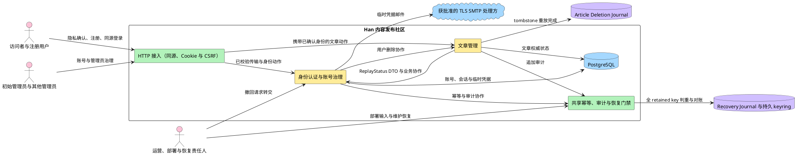

# Han 身份认证与账号治理边界

本边界定义身份认证与账号治理（Identity Authentication and Account Governance）在 Han 首期中拥有什么业务事实、执行哪些动作、向文章管理提供什么合同，以及恢复开放如何验证绑定当前备份的文章删除重放证据。`identity-auth-boundary-ir01-r11` 已于 2026-10-20 由 `current-user` 接受，可供双设计同步消费；该接收不表示独立复审 PASS。r02 至 r10 历史接收继续保留。

## 1. 需求来源与适用依据

边界以 requirements r16、architecture r12 accepted checkpoint 与已接受 ADR-0020 为权威依据。

| 依据 | 精确版本或摘要 | 本边界如何使用 |
|---|---|---|
| 首期需求规格 | `requirements-ir01-r16`；checkpoint `decision-e3af3912166f7287e8324488cad1cf1b87ba1034fca3378d3e0467a23751592d`；确认对象摘要 `sha256:b5f8874a4d90e1226d52ce4c1e87388846c1c15dde264cf2e94a4cfed383189b` | 19 条用户故事、隐私确认、管理员声明与双 Gate、事务性邮件、部署责任、撤回复用删除及 Q1–Q4/Q7–Q9 |
| 当前需求文件读取快照 | `sha256:999cba3c0cd25d2760e400a41d2a373611406854e76e24e453321913d71cbc4f` | 证明本次完整读取了包含 r16 accepted checkpoint 的当前文件 |
| 系统架构 | `architecture-ir01-r12`；checkpoint `decision-0347e1026fd9148ad16f66750023cb50445a1d7c133db6d82669ea14865b318f`；artifact `sha256:e2ca9b4edd2b1360288429f47b7589f18ef510e76dcf22dd69325c38687d5aa3` | ready/unavailable tagged union、`inventory_scope` string、共享 fixture、非 ready 立即 fail closed，并继承 run 唯一、input_digest 与 completed_at 幂等 |
| 当前架构文件读取快照 | `sha256:5cac5b922fbe976640a5617a9a24136abb4283ad7ad866a6ab933498b5bd1dce` | 证明本次从真实文件读取了包含 r12 accepted checkpoint 的当前载体；载体 frontmatter 的 pending 不覆盖 checkpoint 对精确 artifact 的接受 |
| 内容 ADR | ADR-0010、已接受 ADR-0020；当前 `content.md` 快照 `sha256:a0594229fcfda0b8f243a476024bf51825f8dfb12671b41675fc270fa12dbf88` | tagged union 唯一 schema、ready canonical、unavailable 最小字段、共享 fixture、首份 completed_at、run/backup 并发合同 |
| 身份与框架 ADR | 最小同步 ADR-0007、ADR-0019，并继承 ADR-0001 至 ADR-0018 的既有合同 | Recovery Journal/keyring、recovery run/secret 指纹与 namespace 隔离继续有效 |
| identity 独立复审 | `identity-auth` review r08，`IA-DES-R06-N001` still-open；报告 `sha256:5292bb4341b16f7f42e0ab1e92b7d54dafba3c0f2dcd7136d8fdb3e194acd127` | 要求统一 `inventory_scope` 类型、共享 ready fixture/digest 与非 ready variant；architecture r12 已拍板合同，finding 仍待独立复审关闭 |
| article 独立复审 | `article-management` review r05，`AM-DES-R04-N001` still-open、N002/N003 closed；报告 `sha256:40e8a864fcb58ee6ceeacd5d91c3ed4e5aa3ccd848e4aab67f9d9d50f810f6a5` | 要求 producer/consumer 使用同一 tagged union；保留 completed_at/input_digest 幂等和同 run 错 backup 并发合同 |
| 项目采用清单 | 当前读取快照 `sha256:8467771211cddd6295f3cb6724a82c0432090206b22efe3bfa13ad217b6df929` | 只有 `identity-auth` 与 `article-management` 两个首期业务模块 |

### 1.1 上游确认状态

`requirements-ir01-r16` 继续有效；`architecture-ir01-r12` 已由 checkpoint `decision-0347e1026fd9148ad16f66750023cb50445a1d7c133db6d82669ea14865b318f` 接受，artifact 为 `sha256:e2ca9b4edd2b1360288429f47b7589f18ef510e76dcf22dd69325c38687d5aa3`。ADR-0020 是 `ArticleDeletionReplayStatus` v1 的唯一 schema 来源：identity 对 ready variant 才按 canonical 字段重算摘要；收到 unavailable variant 立即 fail closed。identity 比较当前 RecoveryRun 的 backup 与两次 ready 读取的 evidence ref/digest，不得读取 Article Deletion Journal、DeletionOperation、AuditEvent、inventory 或 evidence 内部表。

## 2. 五段边界叙事

### 2.1 是什么

身份认证与账号治理（Identity Authentication and Account Governance）负责建立可登录身份、证明当前操作者、维持和撤销登录状态，并治理用户与管理员账号。它是账号、角色、账号状态、会话和临时凭据的唯一业务权威，不拥有文章内容、文章归属、违规事实或文章发布意图。

### 2.2 核心机制

该模块通过二十一类机制工作：

1. 普通用户注册前展示当前版本隐私声明；未确认不得注册成功，成功时记录主体、声明版本和确认时间；
2. 注册建立用户身份，并保证用户名、邮箱和手机号符合当前唯一性与删除标识生命周期；
3. 密码与临时凭据只保存 Argon2id 摘要；实际参数经目标环境基准确定，明文只在受控瞬时路径存在；
4. 登录统一失败，浏览器 API 默认 same-origin，禁止跨源 credentialed CORS；登录请求必须校验可信 Origin 与 Fetch Metadata 或等价 fail-closed 信号；
5. 登录建立可即时撤销并可轮换的服务端会话；已有会话再次登录时创建新会话并撤销旧会话，写请求继续校验会话绑定 CSRF Header；
6. 账号状态与角色由本模块唯一写入，接入层和文章管理只消费已经判定的身份结果；
7. 用户停用或删除时撤销其全部会话；停用只改变账号状态，删除写入不可恢复墓碑，并通过文章管理合同把文章转为无归属、进入 `held`、记录删除来源且保持隐藏；
8. 已删除用户名永久保留；邮箱和手机号在对应保留数据存续期间阻止复用；专用通知邮箱在关联无归属文章全部处置且转移地址已独立留存后清理；
9. 初始 `admin` 创建新管理员前必须记录其有权提供目标管理员信息的声明；新管理员首次使用临时凭据后必须同时完成改密与当前隐私声明确认，两项完成前不得使用其他管理员能力；
10. 初始 `admin` 永久受保护并且是其他管理员账号的唯一治理者；普通管理员只治理普通用户，不能治理初始 `admin`、其他管理员或自己；
11. 创建管理员、密码重置和临时密码重发消费共享作用域化 `Idempotency-Key` 合同；停用与恢复使用目标状态幂等；
12. 高风险身份治理和凭据动作与追加式审计事件同事务写入；新管理员创建、密码重置和重发在 SMTP 未受理时 fail closed，并显式治理 SMTP 已受理但数据库提交失败的残余窗口；
13. 邮件仅用于已确认事务性场景，并经强制 TLS 的 SMTP 适配器发送；安全配置、证书校验或获批准处理方登记缺失时相关能力 fail closed；
14. 用户撤回个人数据处理请求不新增自助能力，由运营交给具备现有删除权限的管理员复用删除流程；
15. 数据库恢复期间服务进入维护模式；恢复终结事务把全部非初始管理员账号置为 `suspended` 且 `recovery_required=true`，失效所有永久密码、Session 和活动/未完成 TemporaryCredential，并把 `processing`/`uncertain` 幂等记录转为 `recovery_review_required`；
16. 初始 `admin` 只能使用与 bootstrap secret 独立的一次性 recovery secret 重建恢复信任根；该 secret 只在受控恢复流程读取、不落盘、不记录，首次恢复登录后强制改密；
17. 初始 `admin` 按账号核对恢复点中的角色、状态和删除事实并重置凭据后，才能清除 `recovery_required`；无法按 RPO 重建的事实默认不授权；
18. 每次恢复使用唯一 `recovery_run_id`。Recovery Journal keyring 保持一个 active 写入 key 与仍在保留期的 verify-only 历史 key；记录携带 `key_id/key_version`。Begin 对候选 recovery secret 使用全部 retained key 计算指纹，任一历史命中即拒绝；key 缺失、未知、不可验证或迁移不完整时保持停服；
19. 逐账号核对结论为 `kept_deleted` 时，幂等重放完整 canonical 删除事务，重建删除墓碑、标识生命周期、Session/凭据失效、文章无归属化/`held`/来源关联、违规保留、`retained_email` 和 AuditEvent；任一子步骤失败则保持 recovery Gate 和维护模式；
20. 恢复开放还必须等待独立 `article-deletion` namespace 重放所有 Article tombstone 并完成 DeletionOperation/finalizer 对账；该 namespace 与 `recovery/*` 共享基础设施但不得混用记录、接口或语义；
21. identity 只消费 article-owned `ArticleDeletionReplayStatus` v1 tagged union。ready variant 必须完整携带 20 个必填非 null 字段，identity 才重算 canonical digest，并比较 RecoveryRun.backup_ref 与二次读取的 ref/digest；unavailable variant 只能携带 6 个状态字段，identity 收到后立即 fail closed，不重算摘要。缺字段、额外字段、null、未知版本、错 backup、ref/digest 变化或摘要不匹配时同样保持停服。

### 2.3 端到端流程

**普通用户主路径**：访问者提交符合删除标识生命周期且当前唯一的用户名、邮箱、手机号和合规密码 → 平台展示当前隐私声明 → 访问者确认后，identity-auth 在注册成功时记录声明版本和确认时间；未确认则不建立账号 → 用户经 same-origin 登录入口提交凭据 → 接入层校验可信同源信号，identity-auth 统一处理失败 → 成功后建立或轮换服务端会话 → 已有会话再次登录时新建会话并撤销旧会话 → 写请求继续校验会话绑定 CSRF Header。

**初始管理员主路径**：服务首次具备运行条件且不存在 `admin` 账号 → 运行时从环境变量取得初始凭据并建立初始管理员 → 初始管理员首次登录 → 在完成改密前只能完成强制改密 → 改密后才可使用其他管理员能力。初始管理员的管理员身份永久不可撤销。

**普通用户治理主路径**：任一当前有效管理员查看、停用、恢复、删除普通用户或重置其密码。停用与恢复按目标状态幂等，每次仍重新校验权限和目标资格；状态变化同时撤销或轮换会话并追加审计。删除时本模块编排同一业务事务，写入不可恢复的 `deleted` 墓碑、永久保留用户名并保留仍有用途的邮箱和手机号；文章管理把文章归属置空、发布意图置为 `held`、记录 `orphaned_from_user_id` 并保留违规事实。

**管理员治理主路径**：初始 `admin` 声明有权提供目标管理员信息 → 携带作用域化幂等键建立新管理员账号 → 临时凭据仅经获批准处理方的强制 TLS SMTP 投递 → 未受理则业务失败；已受理后数据库提交失败按残余窗口处置 → 新管理员首次使用临时凭据后完成改密和当前隐私声明确认；两项均完成才可使用其他管理员能力 → 身份与权限安全上下文变化时轮换会话。

**临时凭据重发主路径**：初始 `admin` 可以重发新管理员临时密码邮件；任一当前有效管理员可以重发普通用户密码重置邮件。邮件只用于该事务性目的，并通过强制 TLS SMTP 投递；处理方未获批准或 TLS/证书校验失败时能力 fail closed。请求必须消费幂等合同；后续成功重置或重发产生最新凭据并使此前值失效。

**标识清理协作路径**：文章管理完成某删除账号关联的无归属文章恢复、转移或永久删除，并确保转移通知地址已进入独立快照 → identity-auth 判断专用通知邮箱已无剩余业务用途 → 清理 `retained_email` 并追加审计。用户名永久保留；其他邮箱、手机号保留数据的清理条件仍待确认。

**撤回处理路径**：用户向运营提出个人数据处理撤回请求 → 运营把请求交给具备现有账号删除权限的管理员 → identity-auth 继续执行既有角色、目标资格和删除合同。首期不新增自助撤回、注销入口或额外治理权限。

**部署门禁路径**：部署责任人在注册、管理员创建或邮件能力对外提供前登记适用地区、数据控制者、个人数据处理依据和获批准 SMTP 处理方 → 任一对应输入缺失时相关能力保持 fail closed。登记是运行前置，不代表特定法域合规或自动合规。

**数据库恢复路径**：完成身份恢复与 canonical 删除 → 调用 article-owned `ReplayAndVerify(run_id, backup_ref)` → article 以 `(run_id,namespace)` 唯一运行记录首次绑定不可变 backup，按稳定 `input_digest` 重放并核对 operation/audit → 输入不变时复用首份 evidence 的 ref/digest/completed_at，输入变化时追加 evidence 并更新 current 指针 → `ReplayAndVerify` 返回唯一 ready 或 unavailable variant → identity 对 unavailable 立即 fail closed；对 ready 严格校验 20 个必填非 null 字段并从前十六字段重算摘要，比较 RecoveryRun.backup_ref、evidence_ref 与 evidence_digest → `ReadStatus(run_id, backup_ref)` 必须返回同一 variant 语义，二次 ready 仍为同一 ref/digest且双 namespace 分别通过 → Recovery Journal MarkConsumed → 开放 readiness。并发错 backup、缺失/额外/null 字段、未知版本或任何比较失败均保持停服。

### 2.4 接缝图

**说明**：article-management 拥有 DeletionReplayRun、input_digest、current evidence 指针与不可变 evidence；identity-auth 只对 ready variant 重算摘要并比较当前 RecoveryRun backup 与两次读取的 ref/digest，unavailable variant 直接关闭 Gate。identity 不查询 tombstone、inventory、DeletionOperation、AuditEvent、evidence 表或 Article。MarkConsumed 必须晚于 ready evidence、共享 fixture 契约验证和双 namespace 验证。

### 2.5 设计含义

该边界把“完成状态”固定为 tagged union 的 ready 证据，而不是可复用布尔值或带零值的伪 ready。identity 无法用 unavailable 状态、backup A 的 ready 或 input_digest 变化前的旧 ref/digest 打开 backup B；并发绑定、证据生成与 current 指针所有权仍留在 article-management。

## 3. 四栏边界

| 栏 | 边界结论 |
|---|---|
| **管什么** | **对象**：既有身份对象、RecoveryRun、恢复核对结论和 article replay 只读 DTO。**属性**：RecoveryRun.backup_ref、已核验 evidence version/ref/digest/namespace。**动作**：身份恢复终结、canonical 账号删除协调、请求/读取 ReplayStatus、只对 ready 凭 DTO canonical 字段重算摘要，以及比较 backup/ref/digest 后开放 readiness。 |
| **接入形态** | 恢复仍是单实例维护入口。Recovery Journal 与完整 keyring 位于业务数据库恢复域外并整体迁移；一个 active key 用于写入，verify-only key 只用于历史判重。Article replay 通过内部恢复协作接缝提供，不新增用户业务入口。 |
| **消费者** | 日常消费者不变。RecoveryCoordinator 是 `ArticleDeletionReplayStatus` v1 tagged union 的只读消费者；identity 不拥有 DeletionReplayRun、DeletionReplayEvidence、input_digest、current evidence 指针、删除日志或内部对账。 |
| **接口契约** | `ReplayAndVerify`、`ReadStatus` 都以 run+backup 工作且各自只返回一个 variant。identity 对 ready 严格校验 20 个必填非 null 字段、重算 canonical 摘要并比较 `RecoveryRun.backup_ref`；对只含 6 字段的 unavailable 立即 fail closed。二次 ready 的 `evidence_ref/evidence_digest` 必须完全相同。variant 字段越界、缺失/额外/null 字段、未知版本、摘要或 namespace/backup/ref 不匹配时不得 MarkConsumed/open。 |

## 4. OO 对象、属性、动作审查

| 类型 | 条目 | 归属与不变量 |
|---|---|---|
| 对象 | 用户账号 | 可登录身份的权威对象；用户名、邮箱、手机号分别唯一。初始 `admin` 永久受保护。 |
| 对象 | 删除账号墓碑 | 用户删除后的不可恢复事实；状态为 `deleted`，不可登录、不可恢复、不可成为转移目标。 |
| 对象 | 会话 | 已认证状态的服务端记录；账号停用或删除时全部撤销。会话不是用户角色，也不是文章权限。 |
| 对象 | 临时凭据 | 有期限、一次性替代密码；同一用途只有最新值可用；明文不作为持久属性。 |
| 对象 | 隐私确认记录 | 保存主体、声明版本、确认时间与来源；是注册和新管理员双 Gate 的证据，不是账号角色。 |
| 对象 | 管理员信息提供声明 | 初始 `admin` 创建目标管理员前作出的可核对声明；缺失时创建失败，不授予额外权限。 |
| 对象 | 删除后转移通知联系信息 | 删除账号墓碑上的最小联系事实；仅供无归属文章转移通知，不得作为登录身份、普通用户资料或其他用途。文章转移时由文章管理保存受控快照。 |
| 协作对象 | 幂等记录 | 由共享幂等能力拥有；记录作用域、请求摘要、处理状态与原结果，不是账号或凭据真相源。 |
| 协作对象 | 审计事件 | 由共享审计能力拥有；高风险动作只追加，业务模块不能修改或删除，审计也不替代账号与会话真相源。 |
| 协作对象 | 一次性 recovery secret | 与 bootstrap secret 独立，只在维护模式读取以重建既有初始 `admin` 信任根；不落盘、不记录、不进入普通启动。 |
| 协作对象 | 恢复运行记录 | 保存备份标识、终结结果、RPO 限制与告警；不是账号权威状态。 |
| 协作对象 | RecoveryRun | 业务数据库内的恢复运行对象，记录 run ID、Journal 指纹引用、备份和阶段；必须与 Journal 对账。 |
| 协作对象 | Recovery Journal | 业务数据库恢复域外的追加式防重放记录，保存 `key_id/key_version`、HMAC 指纹、阶段和 Consumed，不保存 recovery secret 明文。 |
| 协作对象 | Recovery keyring | 一个 active 写入 key 与 verify-only 历史 key的受控集合；必须与 Journal 整体备份、迁移和恢复。 |
| 协作对象 | Article Deletion Journal 完成信号 | 由 article-management 提供，证明旧备份中的永久删除文章已按 tombstone 重放；不是身份状态。 |
| 协作对象 | DeletionReplayRun 与 current evidence | 均由 article-management 拥有；唯一键为 `(run_id,namespace)`，backup 首次绑定后不可变。identity 不创建、锁定或更新 run、input_digest 或 current evidence 指针。 |
| 协作对象 | ArticleDeletionReplayStatus v1 tagged union | article-owned 只读证据视图。ready variant 固定 20 个必填非 null 字段，前十六项是 canonical digest 输入；unavailable variant 只含 `evidence_version,run_id,backup_ref,namespace,status,reason_code`。identity 只对 ready 重算和比较，不持久化文章内部事实；unavailable 立即 fail closed。 |
| 属性 | 角色与初始管理员标识 | 账号属性；初始 `admin` 与其他管理员的治理权限不同，初始管理员标识不可撤销。它们不是“创建管理员”等动作枚举。 |
| 属性 | 账号状态 | 由身份认证唯一写入；文章管理只读消费。状态不是文章隐藏原因的复制字段。 |
| 属性 | 必须改密 | 限制当前账号可使用的业务能力；完成改密后解除。它不是一种账号角色。 |
| 属性 | 凭据编码与期限 | 密码和临时凭据采用带算法版本、参数、盐与摘要的 Argon2id 编码；临时凭据成功生成起 7 天有效。 |
| 属性 | 删除标识生命周期 | 用户名永久保留；邮箱和手机号在保留数据存在期间阻止复用；专用通知邮箱按已确认处置完成条件清理。 |
| 属性 | `recovery_required` | 恢复后非初始账号的 fail-closed Gate；核对和凭据重置完成前不得登录或获得运行权限。 |
| 属性 | `recovery_review_required` | 恢复后不确定幂等记录的正式状态；未经受控核对不得同键重放副作用。 |
| 属性 | `recovery_run_id`、`key_id/key_version` 与 HMAC 指纹 | run ID 每次唯一；指纹与生成 key 版本绑定。候选 secret 必须接受所有 retained key 的跨版本判重。 |
| 动作 | 注册、登录、会话轮换、改密、停用、恢复、删除、重置、重发、标识清理、创建或治理管理员 | 动作改变对象或属性，不得被建模成账号类型。审计和幂等是动作合同，不是新的业务能力。 |
| 运行动作 | keyring 加载、全版本判重、Journal Begin/Consumed 与迁移 | 由维护流程执行；历史 key 不满足退役条件时不得销毁，任一 key/Journal 校验失败保持停服。 |

**审查结论**：本边界没有把“停用”“删除”“重置密码”“创建管理员”等动作塞入角色或账号类型枚举；没有把会话、临时凭据和通知联系信息误写成 User 的角色取值；没有新增第三个权威业务模块。

## 5. 跨模块关键接缝

两份边界使用以下同一合同。

| 接缝 | 一致合同 |
|---|---|
| S1 · 同源接入与已确认身份 | 浏览器 API 默认 same-origin，禁止跨源 credentialed CORS；登录校验可信 Origin 与 Fetch Metadata 或等价 fail-closed 信号。接入层拥有 Session Cookie、CSRF Header 和 Cookie 安全属性执行；身份认证拥有会话权威状态及 ID 创建/轮换/撤销。已有会话再次登录时新建会话并撤销旧会话；业务模块不得解析 Cookie、CSRF 或密码。 |
| S2 · 作者状态与可见性 | 身份认证唯一写入 `User.status`。文章管理只读消费作者状态，并结合 `publication_state`、`violation_state` 与可空 `author_id` 派生成员可见性；停用或恢复用户不得批量改写文章状态。 |
| S3 · 停用、恢复与会话失效 | 停用和恢复使用目标状态幂等，每次仍重新校验权限与目标资格。身份认证停用账号时撤销全部会话，并与状态变化同事务追加审计；文章管理不接收批量隐藏写命令，而是读取作者状态派生可见性，违规事实继续有效。 |
| S4 · canonical 删除与无归属化 | 日常删除和恢复核对的 `kept_deleted` 结论必须执行同一 canonical 删除协作：身份认证写不可恢复墓碑、标识生命周期并失效 Session/永久及临时凭据；文章管理置空 `author_id`、设置 `publication_state=held`、写入 `orphaned_from_user_id`、保留 `violation_state`，并共同维护 `retained_email`/零文章清理与 AuditEvent。任一子步骤失败时不得只保留 User 删除状态。 |
| S5 · 无归属处置与标识清理 | 文章管理只允许处置无归属文章。恢复公开、成功转移或永久删除后，该文章退出对应墓碑的待处置集合；转移前保存新作者与已删除原作者通知地址快照，再清除 `orphaned_from_user_id`。当关联无归属文章全部处置且所需地址已独立留存时，文章管理提供可核对完成事实，身份认证据此清理专用 `retained_email`；其他邮箱/手机号清理条件仍待确认。 |
| S6 · 事务性邮件、TLS 与残余窗口 | 邮件仅限已确认的新管理员临时凭据、密码重置/重发和无归属文章转移通知，不得用于营销。生产 SMTP 必须使用隐式 TLS 或强制 STARTTLS，验证证书链与主机名，禁止明文、机会式降级和跳过验证；安全配置或获批准 SMTP 处理方登记缺失时相关能力 fail closed。临时凭据业务继续治理 SMTP/数据库残余窗口；文章转移通知继续 best effort 且不得回滚转移。 |
| S7 · 管理员治理与文章治理 | 身份认证拥有角色与管理员目标资格。初始 `admin` 永久受保护，并且是其他管理员账号的唯一查看、创建与治理者；普通管理员只治理普通用户，不能治理自己或任何管理员。文章管理消费已确认管理员身份执行删除他人文章、无归属处置和违规治理，但管理员不能修改他人文章。 |
| S8 · 公共错误 | 共享错误能力拥有公共 REST 错误注册与映射。所有接口只返回稳定错误标识、用户可读说明、可选字段错误和 `trace_id`；登录失败必须统一，内部错误链、账号存在性、敏感状态和基础设施细节不得泄露。业务模块只选择公共错误语义，不各自发明响应结构。 |
| S9 · 幂等记录 | 共享幂等能力拥有幂等记录。创建管理员、密码重置和临时密码重发要求作用域化幂等键与请求摘要；停用和恢复采用目标状态幂等。当前 ADR 未把文章治理、转移或永久删除纳入键式幂等合同，边界不得擅自扩大。业务模块不得把幂等记录当业务真相源。 |
| S10 · 追加式审计与删除证据 | 共享审计能力拥有 `AuditEvent`，只提供追加和查询。隐私/授权确认、身份治理、凭据操作、标识清理、文章治理、无归属恢复/转移、永久删除和数据库恢复必须追加最小必要审计；高风险业务状态与审计同事务，审计失败时业务写入 fail closed。审计保存永久删除证据但不保存可恢复文章内容；业务模块不得更新或删除审计事件。 |
| S11 · Article Deletion Journal 永久删除 | 文章管理拥有永久删除协议。授权与版本前置通过后，先把 Article 置内部 `deletion_pending` 并隐藏，创建 DeletionOperation；独立 `article-deletion` namespace 的外部 tombstone 耐久写入后，finalizer 幂等物理 DELETE，并同事务写 AuditEvent 与完成状态。只有 tombstone 与物理删除均完成才返回 204。Journal 成功而数据库删除失败时文章保持不可见并继续 finalizer；任一失败不得恢复公开。 |
| S12 · 隐私证据与部署处理门禁 | 普通用户注册成功要求当前版本隐私确认证据；初始 `admin` 创建其他管理员要求信息提供声明；新管理员使用其他管理员能力要求改密与当前隐私确认均完成。部署责任人必须在相关能力对外提供前登记适用地区、数据控制者、个人数据处理依据及获批准 SMTP 处理方；任何对应输入缺失时注册、管理员创建或邮件能力 fail closed。登记不构成特定法域或自动合规结论。 |
| S13 · 维护模式与恢复信任根 | 每次恢复使用唯一 `recovery_run_id` 和 recovery secret 的版本化 HMAC 指纹。维护模式关闭 readiness；Recovery Journal 校验 run/指纹未消费后记录 Begin，业务库写 RecoveryRun。终结事务冻结非初始账号、失效全部永久密码/Session/活动临时凭据、收敛不确定幂等状态并追加审计；初始 `admin` 通过独立 recovery secret 重建信任根并首次登录强制改密。 |
| S14 · 逐账号核对、canonical 删除与 RPO | 初始 `admin` 按账号核对角色、状态和删除事实。恢复账号须重置凭据后清除 `recovery_required`；`kept_deleted` 须幂等重放 S4 完整 canonical 删除，不能只改 User。无法按 RPO 重建的事实默认不授权并写运行记录。文章管理只参与 canonical 删除协作，其他文章所有权和状态规则不变。 |
| S15 · Recovery Journal keyring 防重放与开放门禁 | Journal 记录保存稳定 `key_id/key_version`、HMAC 指纹、run ID、阶段和 Consumed；keyring 只有一个 active 写入 key，并保留仍承担历史判重的 verify-only key。Begin 必须使用所有 retained key 计算候选指纹，并只与相同 key ID/version 的历史记录比较；任一命中即拒绝。历史 key 仅在对应记录达到批准退出条件后退役。key 缺失、未知、不可验证，Journal/keyring 迁移不完整、Journal/RecoveryRun 不一致或 Consumed 未确认时均保持停服。 |
| S16 · Article deletion replay evidence Gate | `ArticleDeletionReplayStatus` v1 是两模块唯一 strict tagged union；`ReplayAndVerify` 与 `ReadStatus` 各自必须且只能返回一个 variant。ready variant 按固定顺序完整包含 `evidence_version`、`run_id`、`backup_ref`、`namespace`、`journal_head_sequence`、`journal_head_hash`、`inventory_scope`、`backup_cutoff`、`inventory_digest`、`deletion_operations_digest`、`audit_events_digest`、`tombstones_total`、`tombstones_replayed`、`already_absent`、`deletion_operations_reconciled_count`、`audit_events_verified_count`、`status`、`evidence_digest`、`evidence_ref`、`completed_at` 共 20 个字段；`status=ready`，全部字段必填且非 null，`inventory_scope` 的 JSON 类型固定为 string。只有 ready variant 重算 `evidence_digest`：canonical JSON 固定为前十六字段，明确排除 `status`、`evidence_digest`、`evidence_ref`、`completed_at`；共享 fixture digest 固定为 `sha256:169e0f30407867083598ab146c950968e1b5f508ed4fd5d5198bb61e788926a7`，producer/consumer 必须嵌入同一 fixture 或使用同一生成源。unavailable variant 只允许 `evidence_version`、`run_id`、`backup_ref`、`namespace`、`status`、`reason_code` 六个字段；`status` 只允许 `pending|unknown|failed`，禁止携带任何 canonical、digest、ref 或 time 字段，也禁止用空字符串、零值或 null 伪装 ready。identity 收到 unavailable 必须立即 fail closed，不得重算 digest。article-management 拥有 `DeletionReplayRun` 和不可变 `DeletionReplayEvidence`：run 唯一键为 `(run_id,namespace)`，`backup_ref` 首次绑定后不可变，同 run+namespace 并发错 backup 稳定失败；`input_digest` 覆盖 Journal head、inventory、operation/audit 及 run/backup/namespace，current evidence 指针只在 covered input 变化时原子更新。输入不变且已 ready 时 `ReplayAndVerify`/`ReadStatus` 复用同一 `evidence_ref/evidence_digest/completed_at`，其中 `completed_at` 只记录首份 evidence 的元数据时间；输入变化才追加新 evidence。identity 只对 ready 从 DTO canonical 字段重算摘要，比较 `RecoveryRun.backup_ref`、`evidence_ref` 与 `evidence_digest`，不得读取 article 内部表；二次 ready 读取必须得到同一 ref/digest。任一 variant 字段越界、ready 缺失/额外/null/类型错误、未知版本、摘要或 namespace/backup/ref 不匹配均 fail closed；顺序必须是 ReplayAll → operation/audit 对账 → ready evidence 持久化/验证 → 双 namespace 通过 → Recovery Journal MarkConsumed → 开放 readiness。 |

## 6. 19 条用户故事归属

下表是两份边界的共同追溯矩阵；“主责”表示业务事实和结果的 owner，“协作”只提供合同内输入或共享机制。所有公共接口同时受 S1、S8 约束，表中只重复标出该 Story 的特殊协作。

| 用户故事 | 主责 | 协作归属 |
|---|---|---|
| `US-IDENTITY-01.1` 建立用户身份 | identity-auth | 隐私声明确认与证据、删除标识生命周期、唯一性及部署处理门禁 |
| `US-IDENTITY-01.2` 设置注册密码 | identity-auth | Argon2id 与已批准 `x/crypto` 依赖 |
| `US-IDENTITY-02.1` 登录社区 | identity-auth | same-origin/login CSRF、Cookie/CSRF、旧会话撤销、统一失败与审计 |
| `US-IDENTITY-03.1` 建立初始管理员账号 | identity-auth | bootstrap/recovery secret 独立；初始管理员恢复信任根、强制改密、会话轮换与审计 |
| `US-IDENTITY-03.2` 删除他人文章 | article-management | identity-auth 提供管理员身份；Article Deletion Journal、finalizer 与审计保证跨备份永久删除 |
| `US-IDENTITY-03.3` 创建其他管理员账号 | identity-auth | 信息提供声明、改密/隐私双 Gate、强制 TLS SMTP、处理方门禁、幂等、Argon2id、审计与残余窗口 |
| `US-IDENTITY-03.4` 管理其他管理员账号 | identity-auth | 仅初始 `admin` 可执行；恢复后逐账号核对角色/状态/删除事实并追加审计 |
| `US-IDENTITY-03.5` 查看用户 | identity-auth | 公共错误最小披露；受控审计不得保存认证秘密 |
| `US-IDENTITY-03.6` 停用与恢复用户 | identity-auth | 目标状态幂等、会话撤销/轮换、审计；article-management 派生可见性 |
| `US-IDENTITY-03.7` 删除用户 | identity-auth 负责目标资格、墓碑、标识生命周期、会话与事务编排 | article-management 完成无归属化；恢复 `kept_deleted` 重放相同 canonical 删除；共享审计同事务追加 |
| `US-IDENTITY-03.8` 处置无归属文章 | article-management | identity-auth 提供管理员身份、目标资格和墓碑联系信息；永久删除受 Article Deletion Journal 保护 |
| `US-IDENTITY-03.9` 发送文章转移通知 | article-management | 隐私限定事务性用途；identity-auth 提供通知地址与清理协作；强制 TLS SMTP/处理方门禁；审计记录结果 |
| `US-IDENTITY-03.10` 重置用户密码 | identity-auth | 事务性用途、强制 TLS SMTP/处理方门禁、幂等、Argon2id、审计与残余窗口 |
| `US-IDENTITY-03.11` 重发临时密码邮件 | identity-auth | 事务性用途、强制 TLS SMTP/处理方门禁、幂等、Argon2id、审计与最新凭据语义 |
| `US-IDENTITY-03.12` 隐藏、解除判定与删除违规文章 | article-management | identity-auth 提供管理员身份；违规文章永久删除受外部 tombstone 保护 |
| `US-ARTICLE-01.1` 创建文章 | article-management | identity-auth 提供已确认用户身份 |
| `US-ARTICLE-02.1` 发现并阅读文章 | article-management | identity-auth 提供会话结果及作者账号状态 |
| `US-ARTICLE-03.1` 修改现有文章 | article-management | identity-auth 提供已确认用户身份 |
| `US-ARTICLE-04.1` 删除现有文章 | article-management | identity-auth 提供身份与角色；`deletion_pending`、DeletionOperation、外部 tombstone、finalizer 和审计 |

## 7. 明确排除项

- 不拥有文章标题、正文、当前作者归属、发布意图、违规事实、删除来源关联、通知快照、派生可见性或文章永久删除。
- 不直接修改文章表，也不复制文章隐藏状态。
- 不拥有公共错误注册、幂等记录或审计事件；只通过共享合同选择错误语义、消费幂等结果和追加审计。
- 不提供评论、收藏、关注、标签。
- 不把退出登录、普通用户自助找回凭据、用户资料编辑、第三方登录、多因素认证或邮箱/手机号验证加入首期；搜索也不是本模块能力。
- 不提供用户自助撤回个人数据处理或自助注销入口；撤回只复用既有管理员删除流程，不扩大运营或管理员权限。
- 不发送营销邮件，不把隐私确认、信息提供声明或部署输入登记表述为特定法域合规或自动合规。
- 不允许跨源 credentialed CORS，不允许绕过 login CSRF、SMTP TLS、证书链/主机名验证或获批准处理方门禁。
- 不定义具体 HTTP endpoint、函数签名、包路径、Cookie/Header 名称、公共错误码集合、数据库字段默认值或响应字段序列化细节。
- 不硬编会话期限、Argon2id 参数、幂等/审计保留期、限流、连接池、SMTP 超时、容量或可用性数值。
- 不把数据库恢复、recovery secret 或逐账号核对变成普通用户业务能力；recovery secret 不进入普通启动、登录或日常轮换路径。
- 不允许恢复点中的永久密码、角色、状态或删除事实直接授予运行权限，不引入全局 epoch 或第二套恢复授权机制。
- 不把 recovery secret 明文写入业务数据库、Journal、日志、审计或运行记录；不把 Recovery Journal 当业务审计、账号状态或文章恢复机制。
- 不硬编码 Recovery Journal 的 OS 路径、持久卷类型、retained key 数量或 HMAC key；不允许只迁移 Journal、只迁移 active key、未知 key 引用或跨版本查重失败后开放服务。
- 不拥有 Article Deletion Journal、DeletionOperation 或删除 finalizer；不混用 `recovery/*` 与 `article-deletion/*` namespace。
- 不在文章 tombstone 重放未完成时开放 readiness，也不把删除日志解释为文章恢复能力。
- 不读取 Article Deletion Journal、DeletionOperation、AuditEvent、inventory、DeletionReplayEvidence 或 DeletionReplayRun 内部表；只消费 article-owned v1 tagged union。
- 不接受混合 variant、仅按 run ID、ready 缺少任一字段或含 null/额外字段、unavailable 携带 canonical/digest/ref/time、旧/未知 evidence 版本、不可验证摘要、错 backup 或二次 ref/digest 变化；identity 不自行生成 evidence_ref 或 completed_at。
- 不为未来可能出现的 CLI、消息队列、外部身份提供方或多服务形态预造接口。

## 8. 待澄清清单

| 编号 | 问题 | 影响 | 当前边界假设 | 需谁决定 | 阻塞性 |
|---|---|---|---|---|---|
| IA-Q1 | 初始管理员凭据后续如何轮换，首次改密后的密码是否沿用现有口令规则？ | 影响凭据持续管理与改密校验 | 采用环境变量仅首次注入和强制改密；不填轮换与额外规则默认值 | 项目负责人 | 非阻塞边界；详细设计保留明确 TBD |
| IA-Q2 | 已删除账号除专用通知邮箱外的其他保留身份信息（包括手机号）何时清理？ | 决定邮箱和手机号何时重新进入新账号唯一性校验 | 用户名永久保留；专用 `retained_email` 清理条件已确认；其他数据清理前不得复用 | 需求提出人、项目负责人 | 非阻塞边界；阻塞其他标识清理策略定稿 |
| IA-Q3 | 会话绝对期限与空闲期限是什么？ | 影响会话过期和重复访问验收 | Cookie/CSRF/轮换与登录统一失败已经确定；期限不设默认值 | 需求提出人 | 非阻塞边界；详细设计保留明确 TBD |
| IA-Q4 | 邮箱变更由谁、在什么流程执行？ | 需求只定义变更后的临时密码不变量，但用户资料编辑未纳入首期 | 保留条件性不变量，不新增邮箱编辑动作 | 需求提出人、项目负责人 | 非阻塞 |
| IA-Q5 | 是否纳入退出登录、普通用户自助找回凭据或用户资料？ | 可能扩大身份接口与对象边界 | 当前不纳入；搜索不属于本模块 | 需求提出人、项目负责人 | 非阻塞；新增时回需求与边界 |
| IA-Q6 | 首期用户/会话规模、响应时间、可用性、Argon2id 参数、限流、幂等保留期和 SMTP 超时目标是什么？ | 影响容量、安全基准和残余窗口治理 | 方向已批准，全部数值经目标环境评估后确定 | 项目负责人、指定技术代表 | 非阻塞；数值保持 TBD |
| IA-Q7 | 停用、删除、撤权和重置等管理员动作是否需要二次确认，成功与失败反馈展示到什么程度？ | 影响交互，不改变权限和状态终态 | 不预设二次确认或页面形式 | 需求提出人 | 非阻塞交互问题 |
| IA-Q8 | 幂等记录、会话/临时密码记录和追加式审计的保留、归档与清理周期是什么？ | 影响容量、合规与重放窗口 | 对象和责任已确定，不填保留数值 | 项目负责人、指定技术代表 | 非阻塞；部署与详细设计保持 TBD |
| IA-Q9 | 上线时适用地区、数据控制者、个人数据处理依据和获批准的 SMTP 数据处理方分别是什么？ | 任一对应输入缺失都会阻塞注册、管理员创建或邮件能力对外提供 | 不编造地区、主体、依据或处理方；由项目负责人指定实际责任人登记 | 项目负责人指定的实际责任人 | 部署前必填；不阻塞 r04 边界交接 |
| IA-Q10 | RPO、RTO、恢复终结批量容量、逐账号核对责任分工和恢复运行记录保留期是什么？ | 影响恢复点后事实可重建范围、恢复时长和可追责性 | fail-closed 机制固定；无法重建的角色、删除或撤权事实默认不授权 | 项目负责人、运行责任人、指定技术代表 | 灾备演练前必填；不阻塞 r05 边界交接 |
| IA-Q11 | Recovery Journal 持久卷备份周期、迁移窗口、记录保留期、retained key 数量上限、active/verify-only key 轮换和退役条件是什么？ | 影响跨 key-version 防重放、主机迁移和判重性能 | 只有一个 active key；历史 key在其记录退出可验证范围前保持 verify-only，不预设数量、周期或介质 | 项目负责人、运行责任人、安全责任人 | 灾备演练前必填；不阻塞 r07 边界交接 |
| IA-Q12 | Article tombstone 保留周期、可恢复备份 inventory、备份退役证明及对应 key 保留条件是什么？ | 影响 identity 恢复开放时能否证明全部永久删除文章已被重放 | identity 只等待 article-management 的删除重放完成信号，不决定 tombstone 生命周期 | 项目负责人、运行责任人、文章设计责任人 | 灾备演练前必填；不阻塞 r08 边界交接 |
| IA-Q13 | DeletionReplayEvidence v1 退役、归档和记录保留策略是什么？ | 影响 identity 是否能长期验证历史或续跑证据 | v1 tagged union、ready canonical、unavailable 最小字段和 fail-closed 机制已经固定；identity 不解释未知版本，演进须新版本而非原位改 v1 | 项目负责人、运行责任人、文章设计责任人 | 灾备演练前必填；不阻塞 r11 边界交接 |

## 9. 已拍板项

- 首期只有 identity-auth 与 article-management 两个权威业务模块，采用模块化单体。
- HTTP 使用 Go 标准库 `net/http`，对外形式为 REST + JSON。
- PostgreSQL 是唯一持久化存储；认证采用服务端会话和受保护的不透明 Session Cookie。
- 浏览器 API 默认 same-origin，禁止跨源 credentialed CORS；登录校验可信同源信号，已有会话再次登录时新建会话并撤销旧会话。
- 接入层校验 Cookie 与会话绑定 CSRF Header；认证成功和权限安全上下文变化后轮换会话 ID。
- 密码与临时凭据采用 Argon2id；`golang.org/x/crypto` 是已批准依赖，参数数值保持 TBD。
- 公共 REST 错误使用稳定结构与最小披露；登录失败统一，不泄露账号存在性、凭据正确性或状态。
- 创建管理员、密码重置和临时密码重发采用作用域化 `Idempotency-Key`；停用和恢复采用目标状态幂等。
- 高风险身份治理、凭据操作、标识清理与业务状态同事务追加审计；业务模块不能更新或删除审计事件。
- SMTP 经适配器调用并强制隐式 TLS 或 STARTTLS，校验证书链与主机名，禁止明文、降级和跳过验证。
- 邮件仅用于已确认事务性用途；安全配置或获批准 SMTP 处理方缺失时相关能力 fail closed。
- 临时凭据邮件在未受理时 fail closed，受理后数据库提交失败按残余窗口治理；文章转移通知 best effort。
- 普通用户注册记录当前隐私声明版本和确认时间；初始 `admin` 创建管理员前记录信息提供声明；新管理员完成改密与当前隐私确认双 Gate 后才能使用其他管理员能力。
- 部署前必须登记地区、数据控制者、处理依据与获批准 SMTP 处理方；缺失时注册、管理员创建或邮件能力不得开放，且不声称自动合规。
- 个人数据处理撤回请求由运营转交具备现有删除权限的管理员，复用账号删除流程，不新增系统权限或自助入口。
- bootstrap secret 与 recovery secret 使用独立环境变量和运行门禁；recovery secret 仅在维护模式为既有初始 `admin` 重建信任根，一次性使用、不落盘、不记录。
- 数据库恢复终结事务把全部非初始管理员账号置为 `suspended + recovery_required`，失效全部永久密码、Session 和活动/未完成临时凭据；不确定幂等记录进入 `recovery_review_required`。
- 初始 `admin` 恢复首次登录强制改密，并逐账号核对角色、状态、删除事实和重置凭据后解除 Gate；RPO 无法重建的事实默认不授权。
- 恢复审计、运行记录与全部步骤成功后才开放 readiness；任一步失败服务保持维护模式。
- 每次恢复使用唯一 `recovery_run_id` 和带版本 HMAC 指纹；recovery secret 明文不持久化。
- Recovery Journal 位于业务数据库恢复域之外，采用 Begin/Consumed/RecoveryRun 对账；已消费、损坏、不可读写、部分写入或不一致时保持停服。
- Recovery Journal 记录稳定 `key_id/key_version`；keyring 由一个 active 写入 key 和 verify-only 历史 key组成。
- Begin 使用全部 retained key 对候选 recovery secret 计算指纹，任一历史命中即拒绝；新记录只使用 active key。
- 历史 key 仅在其全部 Journal 记录达到批准退出条件后才能退役；缺 key、未知 key、无法计算候选指纹或 keyring/Journal 迁移不完整时保持停服。
- Article Deletion Journal 使用独立 `article-deletion` namespace；与 `recovery/*` 不混用记录、接口、校验链或语义。
- 恢复开放必须等待全部有效 article tombstone 重放和 DeletionOperation 对账成功；删除日志异常时保持停服，identity 不修改文章。
- `ArticleDeletionReplayStatus` v1 是 strict tagged union：ready variant 完整 20 字段、全部必填非 null，`inventory_scope` 为 JSON string；unavailable variant 只含 `evidence_version,run_id,backup_ref,namespace,status,reason_code`，状态只允许 `pending|unknown|failed`。
- ready 的 canonical 固定为前十六字段并排除 `status/evidence_digest/evidence_ref/completed_at`；共享 fixture digest 固定为 `sha256:169e0f30407867083598ab146c950968e1b5f508ed4fd5d5198bb61e788926a7`，唯一重放计数字段名为 `tombstones_replayed`。
- identity 调用 `ReplayAndVerify(run_id, backup_ref)` 并通过 `ReadStatus(run_id, backup_ref)` 取得唯一 variant；只对 ready 从 DTO 重算摘要并比较 RecoveryRun.backup_ref 与二次读取的 evidence_ref/evidence_digest，不读 article 内部表；unavailable 立即 fail closed。
- `completed_at` 是首份 evidence 的元数据，不参与 digest；输入不变必须复用同一 ref/digest/time，输入变化才由 article 追加 evidence。
- producer/consumer 共享同一 ready fixture 与 canonical digest 契约测试；variant 字段越界、ready 缺失/额外/null/类型错误、unavailable 携带 canonical/digest/ref/time、未知版本、不可读、摘要或 namespace/backup/ref 不匹配时不得 MarkConsumed/open。
- `kept_deleted` 必须幂等重放完整 canonical 删除事务，重建身份、标识、文章无归属化/`held`/来源关联、违规保留、通知邮箱和审计不变量；任一子步骤失败不得开放服务。
- 初始管理员凭据由环境变量注入且仅首次生效；初始 `admin` 不可被停用、删除、撤权或由他人重置密码。
- 只有初始 `admin` 可以查看、创建和治理其他管理员；普通管理员只治理普通用户，不能治理自己或任何管理员。
- 新管理员创建邮件失败时账号创建整体失败；新管理员临时密码邮件仅初始 `admin` 可重发，普通用户密码重置邮件可由任一当前有效管理员重发。
- 已删除用户名永久不复用；邮箱和手机号在保留数据存在期间阻止复用；专用通知邮箱按已确认处置完成与地址快照条件清理。
- 工程按业务模块分包，配置只来自环境变量，Go 版本为 1.27。
- `User.status` 由 identity-auth 唯一写入；文章权威状态由 article-management 唯一写入。
- 停用或恢复账号不批量改写文章；删除账号写入不可恢复墓碑，并与文章无归属化、`held` 和删除来源关联处于同一业务事务。

## 10. 产出责任与下一阶段接收责任

| 责任 | 实际承担 | 内容 | 当前状态 |
|---|---|---|---|
| r01 边界产出责任 | 此前 Boundary-Griller 角色会话 | 形成 r01 基线 | 历史完成；不代表 r02 已接收 |
| r02 边界修订责任 | 此前 Boundary-Griller 角色会话 | 消费 requirements r14、architecture r03 与当时已接受 ADR，形成 r02 | 历史完成并已接收 |
| r02 Lead 现场复核责任 | Lead（主会话） | 核对 r02 revision、确认时 SHA-256、来源、接缝一致性、19 条 US、静态校验和所有权 | 历史完成 |
| r02 下一阶段接收责任 | `current-user` | 接受确认时的 r02 精确 revision/hash | accepted；2026-10-20 |
| r03 边界修订责任 | 当前 Boundary-Griller 角色会话 | 消费 requirements r15、architecture r04 与 ADR-0005/0011/0012–0016，修订接入、安全、失败、幂等、审计与生命周期边界 | 已完成专业修订 |
| r03 Lead 现场复核责任 | Lead（主会话） | 在真实工作树核对 r03 revision、确认时 SHA-256、来源、S1–S11、19 条 US、历史接收和所有权 | 已完成现场复核 |
| r03 下一阶段接收责任 | `current-user` | 接受确认时的 r03 精确 revision/hash，确认可供详细设计消费 | accepted；2026-10-20 |
| r04 边界修订责任 | 当前 Boundary-Griller 角色会话 | 消费 requirements r16、architecture r05、ADR-0005/0006/0017/0018 与 F001/F003/F004/F006，修订隐私、同源登录、SMTP TLS、部署门禁和恢复边界 | 已完成专业修订，待 Lead 复核 |
| r04 下一阶段接收责任 | `current-user` | 接受确认时的 r04 精确 revision/hash，确认可供详细设计整改消费 | accepted；2026-10-20 |
| r05 边界修订责任 | 当前 Boundary-Griller 角色会话 | 消费 architecture r06、修订 ADR-0007/0018 与 review r02 F003，修订恢复信任根、账号 Gate、永久凭据失效、幂等核对和 RPO 边界 | 已完成专业修订，待 Lead 复核 |
| r05 下一阶段接收责任 | `current-user` | 接受确认时的 r05 精确 revision/hash，继续担任 identity design 整改接收责任人 | accepted；2026-10-20 |
| r06 边界修订责任 | 当前 Boundary-Griller 角色会话 | 消费 architecture r07、修订 ADR-0007/0018、ADR-0019 与 review r03 N001/N002，修订 canonical 删除重放和 Recovery Journal 防重放边界 | 已完成专业修订，待 Lead 复核 |
| r06 下一阶段接收责任 | `current-user` | 接受确认时的 r06 精确 revision/hash，继续担任 identity design 整改接收责任人 | accepted；2026-10-20 |
| r07 边界修订责任 | 当前 Boundary-Griller 角色会话 | 消费 architecture r08、修订 ADR-0019 与 review r04 N002，修订完整 keyring 跨 key-version 防重放边界 | 已完成专业修订，待 Lead 复核 |
| r07 下一阶段接收责任 | `current-user` | 接受确认时的 r07 精确 revision/hash，继续担任 identity design 整改接收责任人 | accepted；2026-10-20 |
| r08 边界修订责任 | 当前 Boundary-Griller 角色会话 | 消费 architecture r09、ADR-0020 与 article review F001，最小同步 Article tombstone 重放和 namespace 隔离开放门禁 | 已完成专业修订，待 Lead 复核 |
| r08 下一阶段接收责任 | `current-user` | 接受确认时的 r08 精确 revision/hash，继续担任 article design 整改接收责任人 | accepted；2026-10-20 |
| r09 边界修订责任 | 当前 Boundary-Griller 角色会话 | 消费 architecture r10、修订 ADR-0020、identity review r06 N001 与 article design r03 PASS，修订 run+backup 不可变 evidence 消费边界 | 已完成专业修订，待 Lead 复核 |
| r09 下一阶段接收责任 | `current-user` | 接受确认时的 r09 精确 revision/hash，继续担任双设计同步接收责任人 | accepted；2026-10-20 |
| r10 边界修订责任 | 当前 Boundary-Griller 角色会话 | 消费 accepted architecture r11/ADR-0020、identity review r07 与 article review r04，固定唯一 v1 DTO、canonical digest、DTO-only 重算和 ref/digest 二次比较边界 | 历史完成并已接收 |
| r10 下一阶段接收责任 | `current-user` | 接受确认时的 r10 精确 revision/hash，继续担任双设计同步接收责任人 | accepted；2026-10-20 |
| r11 边界修订责任 | 当前 Boundary-Griller 角色会话 | 消费 accepted architecture r12/ADR-0020、identity review r08 与 article review r05，固定 ready/unavailable tagged union、`inventory_scope` string、共享 fixture digest 与非 ready 立即 fail closed | 已完成专业修订并获接收 |
| r11 下一阶段接收责任 | `current-user` | 接受 r11 精确 revision/hash，继续担任双设计同步接收责任人 | accepted；2026-10-20 |

### 10.1 r02 历史接收记录

| 决定日期 | 实际接收人 | 接收对象 | 确认时完整 SHA-256 | 结论 |
|---|---|---|---|---|
| 2026-10-20 | `current-user` | `identity-auth-boundary-ir01-r02` | `3f67c1dd773daba7ef4ed92ef32529ced2bae4df337d0d1e8571bd387c37694e` | accepted：作为下一阶段接收责任人接受该边界成果 |

该决定只针对表中“确认时 revision/hash”对应的 r02 精确内容。r03 是新的成果对象，r02 历史接收不自动继承为 r03 接收。

### 10.2 r03 接收记录

| 决定日期 | 实际接收人 | 接收对象 | 确认时完整 SHA-256 | 结论 |
|---|---|---|---|---|
| 2026-10-20 | `current-user` | `identity-auth-boundary-ir01-r03` | `de72ea48a01d47caf0225e28f2033d92a6618cce6577f40b5769abbff43e111d` | accepted：作为详细设计实际接收责任人接受该边界成果 |

该决定针对表中“确认时 revision/hash”对应的精确内容。补录接收记录会改变文件字节，因此补录后的完整 SHA-256 仅表示加入接收记录后的当前载体版本，不替换、撤销或扩大用户已接受的 r03 对象。

上述 r02、r03 决定均为历史接收证据，不自动接受当前 r04。

### 10.3 r04 接收记录

| 决定日期 | 实际接收人 | 接收对象 | 确认时完整 SHA-256 | 结论 |
|---|---|---|---|---|
| 2026-10-20 | `current-user` | `identity-auth-boundary-ir01-r04` | `7e9b4f1b7b5878c83f7645775955471b340da0533f905314474dd1d706853c24` | accepted：作为详细设计整改接收责任人接受该边界成果 |

该决定针对表中“确认时 revision/hash”对应的精确内容。补录后文件 SHA-256 仅表示加入接收记录后的载体版本，不替换用户已接受的 r04 对象。

上述 r02、r03、r04 决定均为历史接收证据，不自动接受当前 r05。

### 10.4 r05 接收记录

| 决定日期 | 实际接收人 | 接收对象 | 确认时完整 SHA-256 | 结论 |
|---|---|---|---|---|
| 2026-10-20 | `current-user` | `identity-auth-boundary-ir01-r05` | `1926feb57c47b88b0bc934e0f12eac83f377f000e1230313edcfb93ec8bcc78f` | accepted：接受该边界并继续担任 identity design 整改接收责任人 |

该决定针对表中“确认时 revision/hash”对应的精确内容。补录后文件 SHA-256 仅表示加入接收记录后的载体版本，不替换用户已接受的 r05 对象。

上述 r02 至 r05 决定均为历史接收证据，不自动接受当前 r06。

### 10.5 r06 接收记录

| 决定日期 | 实际接收人 | 接收对象 | 确认时完整 SHA-256 | 结论 |
|---|---|---|---|---|
| 2026-10-20 | `current-user` | `identity-auth-boundary-ir01-r06` | `b7511730614d4d52b34262ef695794b4a9f16774148b6dd2e19e7fb9cc86552d` | accepted：接受该边界并继续担任 identity design 整改接收责任人 |

该决定针对表中“确认时 revision/hash”对应的精确内容。补录后文件 SHA-256 仅表示加入接收记录后的载体版本，不替换用户已接受的 r06 对象。

上述 r02 至 r06 决定均为历史接收证据，不自动接受当前 r07。

### 10.6 r07 接收记录

| 决定日期 | 实际接收人 | 接收对象 | 确认时完整 SHA-256 | 结论 |
|---|---|---|---|---|
| 2026-10-20 | `current-user` | `identity-auth-boundary-ir01-r07` | `ebaae3b64b4dd3004bd5455ee2f65febd073a9cd200d2490f5b18254a3c4c25a` | accepted：接受该边界并继续担任 identity design 整改接收责任人 |

该决定针对表中“确认时 revision/hash”对应的精确内容。补录后文件 SHA-256 仅表示加入接收记录后的载体版本，不替换用户已接受的 r07 对象。

上述 r02 至 r07 决定均为历史接收证据，不自动接受当前 r08。

### 10.7 r08 接收记录

| 决定日期 | 实际接收人 | 接收对象 | 确认时完整 SHA-256 | 结论 |
|---|---|---|---|---|
| 2026-10-20 | `current-user` | `identity-auth-boundary-ir01-r08` | `a29474ba814c09981122d931731f0588f3be5adc929b9ec7be579fd411a5c0fb` | accepted：接受该边界并继续担任 article design 整改接收责任人 |

该决定针对表中“确认时 revision/hash”对应的精确内容。补录后文件 SHA-256 仅表示加入接收记录后的载体版本，不替换用户已接受的 r08 对象。

上述 r02 至 r08 决定均为历史接收证据，不自动接受当前 r09。

### 10.8 r09 接收记录

| 决定日期 | 实际接收人 | 接收对象 | 确认时完整 SHA-256 | 结论 |
|---|---|---|---|---|
| 2026-10-20 | `current-user` | `identity-auth-boundary-ir01-r09` | `d95ae606ee199ba588e2753f2df019073ea706c706d25f80d3aab2314b9bca93` | accepted：接受该边界并继续担任双设计同步接收责任人 |

该决定针对表中“确认时 revision/hash”对应的精确内容。补录后文件 SHA-256 仅表示加入接收记录后的载体版本，不替换用户已接受的 r09 对象。

r02 至 r09 的全部接收均为历史 accepted 证据；它们不自动接受当前 r10。

### 10.9 r10 接收记录

| 决定日期 | 实际接收人 | 接收对象 | 确认时完整 SHA-256 | 结论 |
|---|---|---|---|---|
| 2026-10-20 | `current-user` | `identity-auth-boundary-ir01-r10` | `92382091a20ce30ae597424f163a2f3e962fbc91580aa155b911eb3ac5f7447d` | accepted：接受该边界并继续担任双设计同步接收责任人 |

该决定只针对表中“确认时 revision/hash”对应的 r10 精确内容。补录接收记录会改变文件完整 SHA-256；补录后的载体摘要不替换、撤销或扩大用户已接受的 r10 对象。r02 至 r09 的历史接收继续保留。

### 10.10 r11 接收记录

| 决定日期 | 实际接收人 | 接收对象 | 确认时完整 SHA-256 | 结论 |
|---|---|---|---|---|
| 2026-10-20 | `current-user` | `identity-auth-boundary-ir01-r11` | `10c6eb6884b40adbb6534c1512dea44c41bb96d09c5475b9ee63f94f99c35c7a` | accepted：接受该边界并继续担任双设计同步接收责任人 |

该决定只针对表中“确认时 revision/hash”对应的 r11 精确内容。补录接收记录会改变文件完整 SHA-256；补录后的载体摘要不替换、撤销或扩大用户已接受的 r11 对象。r02 至 r10 的历史接收继续保留。

## 11. 进入详细设计前 Gate

**Gate 结论：开放（OPEN）。r11 边界已接收，可供双设计同步消费。**

`current-user` 于 2026-10-20 接受 `identity-auth-boundary-ir01-r11`，确认时完整 SHA-256 为 `10c6eb6884b40adbb6534c1512dea44c41bb96d09c5475b9ee63f94f99c35c7a`，并继续担任双设计同步接收责任人。Gate 开放只表示该边界可供双设计同步，不表示 identity/article design 已通过，也不表示任何 review finding 已独立复审关闭。IA-Q9 至 IA-Q13 仍是部署/灾备演练前必填。

## 12. 完整性自检

| 自检项 | 结果 |
|---|---|
| 五段叙事、接缝图与图后说明 | 通过：五段齐全；图内嵌且说明调用方向、DTO-only 消费和所有权 |
| 四栏与 OO | 通过：身份侧只拥有消费、重算和比较动作；DeletionReplayRun/Evidence 明确归 article |
| 需求与上游 | 通过：requirements r16、accepted architecture r12 checkpoint/artifact、ADR-0020、identity review r08、article review r05 均精确记录 |
| 19 条 US | 通过：共同追溯矩阵仍为 19 条，主责与协作归属未改变 |
| S1–S16 | 通过：与 article boundary 逐字一致；S16 固定 ready 20 字段与 unavailable 6 字段 strict tagged union |
| DTO-only 重算 | 通过：identity 只对 ready 从 DTO 重算并比较 backup/ref/digest，不读 article 内部表；unavailable 立即 fail closed |
| completed_at 与幂等 | 通过：completed_at 只作首份元数据；输入不变复用同 ref/digest/time，变化才追加 |
| 并发与所有权 | 通过：DeletionReplayRun 唯一 `(run_id,namespace)`、backup 首次绑定不可变；执行约束归 article |
| schema 与 fixture | 通过：`inventory_scope` 为 JSON string；共享 ready fixture digest 为 `sha256:169e0f30407867083598ab146c950968e1b5f508ed4fd5d5198bb61e788926a7` |
| variant 唯一性 | 通过：ReplayAndVerify/ReadStatus 各只返回一个 variant；unavailable 禁止 canonical/digest/ref/time |
| 明确排除与待澄清 | 通过：未扩展业务范围；IA-Q13 只保留 v1 退役/归档/保留，不把已拍板 schema 重新列为 unknown |
| 历史接收 | 通过：r02 至 r10 历史记录原样保留；新增 r11 的 current-user/date/确认时 SHA-256 接收记录 |
| 精确 revision 与状态 | 通过：revision 保持 `identity-auth-boundary-ir01-r11`，状态为 `accepted`，日期 2026-10-20 |
| PlantUML 静态限制 | 通过静态检查：1 个块起止成对、无反斜杠换行标签、无正交线型配置；未执行实渲染 |
| Gate | 通过：明确 OPEN 且可供双设计同步；未写成 identity/article design 或独立复审 PASS |
