# 批次 Plan: IR-01 内容发布社区完整实施地图

> **2026-10-29当前恢复规划补充**：本Plan现在共引用75个原Tasks条目；新增恢复runtime的完整B13A～B13I见[本次安排](#recovery-runtime-batches-r01)。下文原59卡表、旧“本轮不新增/DAG不变/无未安排”等仅描述各自历史切片，不覆盖本次14卡（当时历史切片；当前runtime切片为16卡）/新增依赖。旧批次/原卡责任和真实Gate保留，任务状态只取Tasks，不在本Plan复制checkbox或完成事实。本次仍待非作者PlanningReview/Main同版核收，未实施、未运行或认领。 本次C1新增identity-auth-S4.18及三张原卡技术映射见[当前C1增量](#recovery-runtime-c1-planning-r01)；原14卡/待审/未认领文字保留各自形成时点，本次扩量独立PlanningReview尚待，不能外推已实施或新Gate通过。

> 本 Plan 只消费 [tasks.md](../tasks/tasks.md) 中的 75 个现役任务（`identity-auth-S4.19` 为 2026-10-31 新增登记），其中 B0 为用户直接授权的项目启动初始任务，原 47 个 Story task 来自 G 模式，`identity-auth-S4.6` 来自 identity Story S04 的 R 对账，`identity-auth-S3.5` / `identity-auth-S3.6` 来自 identity Story S03 / F005 的历史对账，`identity-auth-S7.2` 来自 identity Story S07 代码复审发现的既有设计缺口，`article-management-S4.6` 来自 article Story S04 production wiring 的 R 对账，`identity-auth-S10.2`～`identity-auth-S10.4` 来自 identity Story S10/S11 durable password-reset 的既有 R 对账，`identity-auth-S10.5` 是 design r44 / test-plan r20 要求另行登记且待稳定设计的 maintenance 候选；S03/F005 继续复用原 `identity-auth-S3.2`，S5.2 继续复用已关闭的原 `identity-auth-S5.2`，S10.1/S11.1 继续复用原卡，均不重复建卡。任务状态只在原 SSOT 维护；本文件不复制 checkbox，只记录批次责任、依赖、认领来源和执行边界，不自行授予实施、平台选择、部署或发布权限。 前轮article Story1/3生产接线R对账新增article-management-S1.6，唯一进入B9E；本轮Admin2 R对账仅新增article-management-S8.2，唯一进入B9F；原S1.5仍唯一B10并补requires，其他原任务归属不变。

## 背景

- **需求/任务来源**：[requirements r16](../requirements/requirements.md)、[tasks.md](../tasks/tasks.md)。
- **设计依据**：未受 scoped override 影响的范围继续使用 [architecture r15](../design/architecture.md) 与 accepted checkpoint `decision-5e55881bdc4a7e038b3764d91ff0dfd906a48fe121e93bbb0813ca58173cae40`；password-reset durable 继续使用 [architecture r27](../design/architecture.md)（SHA256 `A153AC6DEA7BD725EA9470D2D2933396EE9A2F12399CC11FDEC2CB97B4E443CB`）、[identity boundary r13](../design/identity-auth/boundary.md)（SHA256 `0217349BEAF9C529D0EB01F4451F34E930E5A9682F23326661BEA93CE7119BF3`）、ADR-0023，并以 [identity design r44](../design-workspace/identity-auth/design.md)（revision `identity-auth-design-ir01-r44`，SHA256 `50A83A81E4F521A0740BC220E5E382D6BFEFE18CC316E869A47019C45B1FEE23`）、stories r16（SHA256 `057DE0D716D1583AFB487E152ACEE05F0FAFDAAB7B8FA412501E23F5EE8191F3`）与 planned-not-executed test-plan r20（revision `identity-auth-test-plan-ir01-r20`，SHA256 `F9AD6CE09F5F881534E3B592E863C38FC16D593F3AA82BE9352393A8280A69CB`）作为当前增量来源。S10.2/S10.3/S10.4、B6D/S11.1 的既有关闭链保持有效；B6C-3 integrated R03 继续作为历史证据。B7 G0 后的 S10.1 classification repair 由 R07 记录 finding，R08（SHA256 `30F1C4D2546F6E32BA23FCBECAD22235D49574CE35E66A236A8CCA18712DDC20`）确认 `IDENTITY-S10.1-REV-R07-F001` CLOSED、0 新 finding、Code Review Gate PASS，Lead 于 2026-10-25 完成固定五文件 Gate并关闭 S10.1。S5.2 与 article production wiring 的既有精确依据和关闭证据保持不变。
- **Article S4.2/S4.5 稳定增量依据**：[article design r14](../design-workspace/article-management/design.md)（revision `article-management-design-ir01-r14`，SHA256 `AC52E658247CED89A57C54B38C7F55FA9AA56772406A42F178678B1C1D5108A5`）与 [article test-plan r12](../design-workspace/article-management/test-plan.md)（revision `article-management-test-plan-ir01-r12`，SHA256 `85D8A7CC6ABF01A88B24726EEE3957691AA0B8A7B6235FEB8A31677D77336DDF`）；Design Review R02（SHA256 `85DAC7A66F9555E6DF711472E7F5A9A6448F281EC2496DFDDBD5B7DAC19DE143`）与 Test-plan Review R02（SHA256 `53E85D1A4B6A4519829A04A7B6549E808F00E9BAD6D2F85C11EDE11E531C1D0C`）均 PASS。Planning Review R02 `.spec/wip/article-management/review-tasks-plan-s4.2-s4.5-s9.1-r02.md`（SHA256 `A12062129944D8978D92A9732F255F7F1332DE7324AEA9BD3CF7185A7BC3693B`）确认 `ARTICLE-B7-PLAN-R01-F001` CLOSED、0 新 HIGH/MEDIUM finding、Planning Review Gate PASS。上述 PASS 只固定规划合同，不关闭 S4.2 Code Review R01（SHA256 `777CF2B5029049F86E8B2484DC69C28C11A068A9252F65AB17E8EC97647165C1`）的 3 HIGH + 2 MEDIUM，也不自行构成实施 START。
- **当前活动**：development-delivery / B7。S10.1 classification repair 已由 R08 与 Lead Gate 关闭；S5.3 随后在固定三文件完成 R01→返工→R02/Lead Gate并关闭。article S2.1 的 R01 失败历史保留，R02 与 Lead Gate 已关闭本卡；S4.6 保持 CLOSED。S4.5 已完成固定四文件实施、R01 FAIL→原 owner 返工→R02 PASS 与 Lead 同 revision Gate并关闭，四文件窗口已释放。2026-10-26 identity design r45（revision `identity-auth-design-ir01-r45`，SHA256 `CBE0F64ADB93E1AFD4340D2D3390ACE42EE85F557DDCBA5AEBCF2AA20CE404F1`，Lead 接管产出，无 Feature-Designer Role 产出）把 S9.1 R01 的 F001～F004 转为可实施合同，Design Review `.spec/wip/identity-auth/review-design-r45-s9.1-r01.md`（SHA256 `5905C0D1CF1EF66FAECDF559AC01DD5795A1A2BAA78AAF7874232A2FB13D8D74`）Design Review Gate PASS；S9.1 上游设计阻塞解除并经 Design Review PASS，Lead 已按 r45 在原五文件内实现 F001～F004；2026-10-27 由 Lead 以作者自审口径输出 `.spec/wip/identity-auth/review-code-s9.1-r02.md`（SHA256 `1F1D926EFFE92F4BB0DAEC86FA3037071BF3504CEAB6AE3B623391E223E18E23`），R01 F001～F004 全部 CLOSED、0 新 HIGH/MEDIUM、Code Review Gate PASS，S9.1 已由 Lead 现场 Gate 后 CLOSED（完成@2026-10-27）。article S4.2 在精确 19 文件内完成 R01 F001～F005 返工后，2026-10-27 由 Lead 以作者自审口径输出 `.spec/wip/article-management/review-code-s4.2-r02.md`（SHA256 `9D06B84370E196C4881479701EA0B96D6B991A8DD52FB300F964B6061320F3AA`）：F001～F004 CLOSED；复审初判 F005 仍缺 A-REC-05 真实 PostgreSQL 证据，遂在已登记第 11 项 `deletion_replay_integration_test.go` 内追加 A-REC-05 用例（真实 `FileBackupInventoryReader` + 唯一 source + `os.Rename` 原子替换 + 真实 `ReadCurrent`），`go test -tags=integration ./internal/article -run '^TestDeletionReplayPostgres$' -count=1` → `ok 4.87s`、`-race` → `ok 6.55s`（A-REC-04/05/06/07 全 PASS），F005 转 CLOSED、0 新 HIGH/MEDIUM、Code Review Gate PASS，S4.2 已由 Lead 现场 Gate 后 CLOSED（完成@2026-10-27，写集未越出登记 19 文件）。article S4.3 原受真实 Unix 独立持久卷阻塞；2026-10-27 依据用户明确确认「本项目为测试项目、这版不做真卷韧性验证且后续无需验证」，新增 **ADR-0024** 并以范围决策关闭 S4.3（经决策不验证，非验证通过；三文件未创建、未执行）。S3.3/S3.5 保持 active / `blocked-for-execution`；S10.5 保持 `[ ]`、未启动，S3.6、B8与后继部署/E2E均不启动。四项 PASS（S9.1、article S4.2、article S3.1、identity S1.5）均以作者自审口径成立，弱于非作者独立复审，作为已知限制保留。article S3.1（作者受控详情与强 ETag 修改）随后在固定五文件完成实施、作者自审 Code Review R01（`.spec/wip/article-management/review-code-s3.1-r01.md`，SHA256 `317BE33810150CE99B03DDA04A2A9BE4FB77321B5373128569387879891FA732`，`Code Review Gate: PASS`）、专用命令/race/Manifest 七项与真实 PostgreSQL 18.6 SQL 探针，由 Lead 现场 Gate 后 CLOSED（完成@2026-10-27）。identity S1.5（身份 REST、内部端口与 ReplayStatus 消费契约）随后在固定五文件完成作者自审 Code Review R01（`Code Review Gate: PASS`），专用 contract 命令与 Manifest 七项 PASS，由 Lead 现场 Gate 后 CLOSED（完成@2026-10-27）。B8A 的 `identity-auth-S6.1`（实现其他管理员查询、停用、恢复、删除与撤权）随后在四文件写集 `internal/identity/handler.go`、`administrator_governance.go`、`administrator_governance_test.go` 与登记但无需改动的 `service.go` 内完成：新增 `revoke`（`admin → member` 角色转换 + 同事务撤销全部目标会话 + `identity.role.revoke` 审计），复用既有统一 Policy 与既有 list/get/suspend/restore/delete handler；作者自审 Code Review R01（`.spec/wip/identity-auth/review-code-s6.1-r01.md`，SHA256 `2A612A4B931A5BA4E8B960277D1337AF4477C5CDB6930C5031A91F2A8CD7BCF7`（2026-10-31 脱敏后；原 `B76A590923A6F61F1E9E0085B2EA26B6B7DAAA5340DCB46460AAD06C6B2AF944`），`Code Review Gate: PASS（作者自审口径）`、0 finding）、专用命令/race/Manifest 七项与真实 PostgreSQL 18.6 SQL 探针全部 PASS，由 Lead 现场 Gate 后 CLOSED（完成@2026-10-27）。**未完成项登记**：`/api/v1/admin/administrators...` 整片治理路由（含既有 list/get/suspend/restore/delete）尚未在 `cmd/han-server/main.go` 唯一 composition owner 内注册，不属 S6.1 四文件写集，须由后续卡按所有权认领。B8A 的 `identity-auth-S1.6`（验证身份 PostgreSQL 事务、锁与并发矩阵）随后在登记三文件 `test/integration/identity/postgres_test.go`、`fixtures.sql`、`faults_test.go` 内于真实 PostgreSQL 18.6（`127.0.0.1:5433`）通过 12 组矩阵（唯一性/FK/CHECK、bootstrap 与成功墓碑、会话撤销全量、幂等、审计失败零副作用、治理竞争单写者 55P03、规范化删除回滚/成功、会话解析拒绝已撤销/停用用户、0008 preflight 55000、五对象原子性与 deferred 计数器缺口、lease 单赢家与过期接管、绑定不可变与 generation 不可回退），作者自审 Code Review R01（`.spec/wip/identity-auth/review-code-s1.6-r01.md`，SHA256 `EFBDE5D35FD198888CB4CD40624C5947C1FE9E0486A4E112847BF9D62D40C485`，`Code Review Gate: PASS（作者自审口径）`）由 Lead 现场 Gate 后 CLOSED（完成@2026-10-27）；写集越界（第 4 文件 `matrix_test.go`）已无损并入 `postgres_test.go` 并删除。**本卡在真实 PG 上触发既有 P0 缺陷** `ISSUE-identity-auth-0001`（`internal/identity/password_reset_store.go` 以保留字 `current_user` 作表别名致 42601，使 `session.Store.ResolvePrincipal` 全部已认证请求在生产 PG 失败；历史 S10.2/S10.3 仅 stub 与 `strings.Contains` 验证故长期隐藏），经用户授权按最小修复处置（别名改为 `current_account`，4 文件；`password_reset_store.go` 哈希由 `6C013640...3315F` 漂移至 `D1CB46D5...FB62`），真实 PG 回归通过并登记。当前三态更新为 57 / 37 completed / 2 active / 18 todo，active 精确为 `identity-auth-S3.3`、`identity-auth-S3.5`。
- **涉及仓库/工作区**：`D:/AID/VSCode/Codex/Han`；固定 `main`。
- **工作分支/修订**：`main`，本次 Gate 复核 HEAD `6da8abbceb0fa197364810a92a8fa2d97b38ddca`；工作树含他人未提交的 B0、知识与配置改动，不要求全树干净，不得覆盖或格式化范围外文件。
- **预期收益**：1 个正式 B0 项目启动任务与 19 个 Story 的实现、部署材料、专项验证和部署后 E2E 都有唯一 task、明确依赖、文件所有权与完整批次；application composition、部署材料和真实部署验证三层不再混写。
- **产出负责人 / 接收负责人**：Backend-Dev Kant `01a1716c-b694-71c3-8d72-2a4fc1ab4eb3` 的 S10.1 五文件 repair 与 S5.3 三测试文件窗口均已随任务关闭释放；S5.3 R02/Lead Gate 已在固定 revision PASS。article S2.1 四文件作者为 Hegel；R01 原 Reviewer Agent ID 不可恢复，由 Lead 指定已知非作者 Faraday `01a16940-6120-7021-bd06-eb0089956486` 替代完成 R02并记录原因，Lead 同 revision Gate PASS，四文件窗口已释放。S4.5 唯一实施 owner 为 Backend-Dev Aristotle the 2nd `01a17225-a3d0-7fd1-aeb9-622f7617f436`，非作者 Reviewer Gauss 完成 R01/R02；Lead 同 revision Gate PASS后关闭任务并释放固定四文件窗口。Curie/Copernicus 的 S11.1 历史关闭证据继续有效；S11.1 不重开。S10.5 不启动。
- **确认来源**：S03/F005 当前依据为 architecture r23、ADR-0022、accepted identity design r26、test-plan r08 与 accepted checkpoint `decision-a76cb64cb07a0e37c80b3d22b15034e817e68d7c00a9be1759372e0396e6a56f`，其既有独立 Review PASS 只覆盖对应精确对象。S5.2 与 article S4.1 的 task-level closure 证据继续有效。article production wiring 的设计侧 review SHA256 `1EB2D78179D40747904CCC8F5E975FAB4A5CD4205C754567F6B5C589BAFC001E` 为 PASS；Rawls r04 SHA256 `832ED2262DBF443CA3A172C88E5A904A206296771CA309A44EE68D111909F6EA` 确认固定 test-plan r08 Test-plan Gate PASS；Hypatia r02 SHA256 `5625061C2963AF1CF29C44D2E1DD15A53FA4F911E5F8CD424BE459681755639E` 确认 `ARTICLE-S4.6-PLAN-R01-F001/F002` CLOSED、Planning Review Gate PASS；Faraday r02 SHA256 `A51DA3D4C6EE031DE121310D0332DD228268EE28D1F23F5963951064E982CDEF` 确认 `B6A-G4-R01-F001` CLOSED、无新增 finding、`B6A G4-batch Gate: PASS`。Faraday r03 `.spec/wip/article-management/review-code-s4.6-r03.md`（blob `3dcc43eb076b09f61a770dc87604ef3f69e50464`，SHA256 `007C2D9B04F1DC9381C574A668FB8C513F4B34D2B8224808F0512B623573E7E1`）确认 S4.6 F001～F004 全部 CLOSED、无新增 finding、Code Review Gate PASS。article design r14 与 test-plan r12 的两份 R02 独立 Review PASS已固定 S4.2精确19文件/A-REC-04～07 与 S4.5精确四文件/零测试防假绿合同；S9.1 R01最后确认五文件边界存在上游设计阻塞，该阻塞已由 identity design r45 + r45 Design Review PASS 解除、待Lead START。上述结论不证明真实 PostgreSQL、Unix 持久卷、旧备份恢复、灾备、Host、部署、E2E、容量或 production readiness。
- **Git 约定**：本轮仅落未提交 diff；禁止 add/commit/push/PR/merge、切分支、清理或覆盖他人改动。

## 精确输入与读取依据

| 输入/引用 | 适用范围与修订 | 实际读取或有效复用 / 约束 / 缺项 |
| --- | --- | --- |
| requirements / architecture / boundaries / ADR | IR-01 稳定业务与跨模块合同；未受 scoped override 的范围沿用 architecture r15，S03/F005 使用 architecture r23 / ADR-0022 | 已完整读取；identity boundary r12 SHA256 `335CC44131B542E5E3EEFCCBABBA443160AC8B0B240FE2BBAB0E849D50992591`（draft），article boundary r13 SHA256 `C86CEAF315028C7DBA833E97E5A18F7C80721E9AC5939D1EC53F520CA68FE45E`（accepted）；r23/ADR-0022 既有追溯不变。边界状态不外推为 design/test-plan/实现或独立 Review PASS |
| identity design r26 / stories S03 / test-plan r08 / 独立复审 | S3.2 F005 的 I-F005-01～29、S2.2 target-profile readiness、部署材料与 I-OBS-DEP-01～06；未受影响 Story 沿用既有基线 | design revision `identity-auth-design-ir01-r26`；checkpoint object digest `sha256:42d8d10c37acb55a752c198caef32819d4d73744acd71af6fb1a4fba0366bc3d`；checkpoint `decision-a76cb64cb07a0e37c80b3d22b15034e817e68d7c00a9be1759372e0396e6a56f`；design 文件 SHA256 `04FFC97CA04465C23707604B56E103627663AF432C523F2F0A584B7C39A00217`；r26 design review SHA256 `171E373555357493003EBC99F5704281304E86282EA8A709B14AAB4E4A82DE28`，PASS / 0 finding；test-plan r08 SHA256 `C95518C5AC7C5DAEE56F54D0E6691E999BFB8CF006E0D71956ED8457F97AD23D`；r08 review SHA256 `4D6A1C7844116A15F8EA6E319A82F92CFADF89757E5D1D910EC1FA1D710472DA`，PASS，`TP-R07-F001/F002` CLOSED。r22/r06 仅历史；所有 planning/review PASS 均不授权或证明实施、benchmark、部署、E2E |
| S4.2 已落档并复审 PASS 的修订合同 | `framework.md` `8f977bf259fa6257eaeb9903c84f2eb2211202e4f058c9e9cf41fce0a1a9f9ad`；决策索引 `c2211ef9eae3b722a9b115d1dea558cae0a729a36bd7cbaf7c8a1e504e4ac116`；architecture r19 `1901ee5d80d9400b6e38f01c4a84f64020782d73ee9d6a83213d43f3a076a36c`；identity design r13 `708b8bf7920c2b0825614159911d35500bef2e1fc1089e52b8b0cdfd31ec89cc` | 四份设计文件已正式落档；ADR-0018 引用 5、ADR-0019 引用 11。Mendel 对 `IA-S4.2-CR-002` 设计合同复审 PASS、无 finding；Halley 已按替代授权完成五文件返工，Pasteur 关闭 F001～F004 并给出代码 Gate PASS，Lead 按 §10 关闭 S4.2。Pasteur 已完成 B3→B4 独立批次整体 Review并给出 `B3 G4-batch Gate: PASS`，B3 关闭；用户已另行授权启动且仅启动 B4 三卡 |
| Identity Q1 design r28 / test-plan r11 / review r03 | 已关闭 `identity-auth-S4.1` 的主体资格、统一改密入口、字段/Session 失败后置、成功轮换与 production router 承接；已关闭 `identity-auth-S7.1` / `identity-auth-S7.2` 的治理查询、稳定分页与索引要求 | design r28 SHA256 `977435C8391E4A21C070C359AFBB6F143EC84E4CA3EE19CBEC7FC5FCC9C0E6B0`；test-plan r11 SHA256 `C49D87ED526D897CBF18CDE7E338F44A845E85CC1E0412A90E2A9169367B2D88`；review r03 SHA256 `0F4D7C520F59AAF7580F9C90C66B404B9E8188E90656D3D4590B864B02DE3CC0`，PASS。S7.1 代码复审 r02 SHA256 `53836018C0A4C9C7D374CC3D8ED6CDE651E09D567E8F44A3A0A818BE81AB8E15`，Code Review Gate PASS，并在该历史时点把 F002 转交 S7.2。S7.2 r01 SHA256 `F0CBEC197498E49B8536F2EEF064B3C7D82B94BD55CAA2AC5D5E793940E12997` 后续正式关闭 F002；S7.1 与 S7.2 均已 task-level CLOSED。S7.2 仅证明 migration、PostgreSQL 18 查询计划、局部集成与 Review，不外推生产负载性能、浏览器、部署、E2E 或 production readiness |
| S5.2 identity design r33 / test-plan r13 / design review r05 | `identity-auth-S5.2` 的 I-S52-01～09：immutable response snapshot v1、legacy/v1 双读、SMTP operation budget、effective-at canonical 值流、production composition/router 与 D001 重放顺序 | design revision `identity-auth-design-ir01-r33`，blob `1c6ea6827a18158a9936a4612aac523b258e4e5d`，SHA256 `47FC3598CE2BCA7A1E80032FEC040BCF63344C869B4EF12F9BE5998589563513`；test-plan revision `identity-auth-test-plan-ir01-r13`，blob `c1b7ec4e9c201c2c24a5afe7300532eb7e06e4e3`，SHA256 `F5A3E2CEF38C36E595D8217BDD85BBA7CF55FC0F1DBB311D773E7DDBD1076749`；review `.spec/wip/identity-auth/review-design-r33-s5.2-r05.md` SHA256 `8E3E478BD94D4CF827B2A7E1E5FD31DE052EFC2174172AB2C3191C2AE38F245D`，原 r32 F001 CLOSED、无新增 finding、Design Review Gate PASS。r31/r12/r03 仅历史；F002 的 `HAN_SMTP_OPERATION_BUDGET` 必填无默认、`10s` 基线、`1s..60s` 闭区间与 composition 注入合同不变 |
| S5.2 独立代码评审 r04 | `.spec/wip/identity-auth/review-code-s5.2-r04.md`，blob `e473153c726ee499254bd90c7f42df1cc82a8a97`，SHA256 `B9C1598C2B8CAC42F055E355A6D95F28FBA5B8F459FB94495D72674F9945E075` | `Code Review Gate: PASS`；`R03-F001`、`R01-F002` CLOSED，无新增 finding，其他历史项保持 CLOSED。Volta 完成 I-S52-01～09 与整卡回归，Faraday 完成最终复审，Lead §10 Gate PASS。r01/r02/r03 仅作历史追溯；真实 SMTP/TLS、Host、部署、E2E、容量与 production readiness 未执行 |
| Article AM-Q1 design r09 / stories r06 / test-plan r04 / review r03 | 8 Story、创建/修改的内容、wire-byte、UTF-8、零持久化与 S1.3/S6.1 局部测试分界 | design r09 SHA256 `70EE8FB04196FA78EB925133EC8C796E1B34F5B2060273BCE2A704DE3F797B91`，status=draft；test-plan r04 SHA256 `5A1FE258792CF281B27DE2B9E51131E1C46E738F8B3589A184ACFF383A9DDF3A`，status=planned-not-executed；review r03 SHA256 `C1F380D83D3B00B6B5FBE3CF03B0052B8D3D9B66727333EA472BE49A84FC5AD2`，PASS。S6.1 代码复审 r02 SHA256 `8C60F2F3EA83926DEFD8E9C8B9B149FA2C1E119E4C7A767832E1BFA616C480E1`，PASS、F001 CLOSED、无新 finding；S6.1 已 task-level CLOSED。真实 PostgreSQL 锁/回滚、identity composition、跨模块删除、浏览器、部署与 E2E 仍未验证 |
| Article S4.1 独立代码评审 r03 | `.spec/wip/article-management/review-code-s4.1-r03.md`，blob `41e2c84b67804bf99acd622b876aa7464339575e`，SHA256 `9FE6E887F2D90192CA20DC2FA602DFF1DCF5980EE9107DDE71430315D5401BBC` | Reviewer Turing；`Code Review Gate: PASS`，`ARTICLE-S4.1-R01-F001`～`F005` 全部 CLOSED、无新增 finding。Lead 专用/高重复/包级/race/vet/gofmt、Manifest 七项与 owner hash/status/whitespace 全部 PASS。真实 PostgreSQL 事务/锁/commit outcome、Unix 目标卷 fsync/崩溃/磁盘故障、production composition/router、后台 worker、真实 Host、部署、浏览器/E2E、容量与 production readiness 未验证；Windows 仅证明 fail closed |
| Article production wiring design r10 / stories r07 / test-plan r08 / reviews | `article-management-S4.6` 的单一 R 对账输入、精确 13 文件、双 GOOS 与 integration-tag compile-only Gate、两项直接 requires、后继、规划复审、代码复审与 B6A/B6A-W 关闭边界 | design r10 SHA256 `6785977683CF0F59E277667425F7FEE9714EBBD436FBDFE046E607F2E77CA67E`、stories r07 SHA256 `D5D933E244D3D5E1D5869F19AAFAA8FB67C78BF62882C0883A2C2BDCA50D9B05`；design-side review SHA256 `1EB2D78179D40747904CCC8F5E975FAB4A5CD4205C754567F6B5C589BAFC001E` PASS。test-plan r08 revision `article-management-test-plan-ir01-r08`、blob `9079f7c33d2b56c8439f161a11be6425a5bf1687`、SHA256 `4608502D4B4E9078509651A52589245D6726634053FF8A5E787569C55776EA7E`；Rawls r04 SHA256 `832ED2262DBF443CA3A172C88E5A904A206296771CA309A44EE68D111909F6EA`，Test-plan Gate PASS；Hypatia r02 SHA256 `5625061C2963AF1CF29C44D2E1DD15A53FA4F911E5F8CD424BE459681755639E`，F001/F002 CLOSED、Planning Review Gate PASS；Faraday r02 SHA256 `A51DA3D4C6EE031DE121310D0332DD228268EE28D1F23F5963951064E982CDEF`，`B6A-G4-R01-F001` CLOSED、无新增 finding、`B6A G4-batch Gate: PASS`；Faraday r03 SHA256 `007C2D9B04F1DC9381C574A668FB8C513F4B34D2B8224808F0512B623573E7E1`，S4.6 F001～F004 CLOSED、无新增 finding、Code Review Gate PASS。r06 PASS 与 r07 FAIL 仅为历史链；S4.6 已按自身条件关闭，但真实环境专项仍未完成 |
| Article S4.2/S4.5 design r14 / test-plan r12 / 独立复审 | S4.2 strict production inventory、唯一 source/wiring、attempt authority、UTC微秒、精确19文件与 A-REC-04～07；S4.5四文件测试专用制品、Ready20 digest 与零测试防假绿 | design revision `article-management-design-ir01-r14`，SHA256 `AC52E658247CED89A57C54B38C7F55FA9AA56772406A42F178678B1C1D5108A5`；Design Review R02 SHA256 `85DAC7A66F9555E6DF711472E7F5A9A6448F281EC2496DFDDBD5B7DAC19DE143`，PASS。test-plan revision `article-management-test-plan-ir01-r12`，SHA256 `85D8A7CC6ABF01A88B24726EEE3957691AA0B8A7B6235FEB8A31677D77336DDF`；Test-plan Review R02 SHA256 `53E85D1A4B6A4519829A04A7B6549E808F00E9BAD6D2F85C11EDE11E531C1D0C`，PASS。Planning Review R02 SHA256 `A12062129944D8978D92A9732F255F7F1332DE7324AEA9BD3CF7185A7BC3693B`，F001 CLOSED、Gate PASS；该 PASS 不构成 START。S4.2 Code Review R01 SHA256 `777CF2B5029049F86E8B2484DC69C28C11A068A9252F65AB17E8EC97647165C1` 仍 FAIL（3 HIGH + 2 MEDIUM）且无 Lead START。S4.5 R01 SHA256 `44DE54697DFEA8964E62A9AE2B8196C24E3233A44E177E04410F331AB64E5FF8` 为 FAIL（3 MEDIUM + 1 LOW）；R02 SHA256 `49340355047BFFF8A3F02A531AE20E9D163F65D6167E3190C1BC5FE5BC0E1F48` 确认 F001～F004 CLOSED、无新 HIGH/MEDIUM、Code Review Gate PASS，Lead 同 revision Gate PASS并关闭本卡 |
| Identity S9.1 Code Review R01 | `.spec/wip/identity-auth/review-code-s9.1-r01.md`，SHA256 `813B8B947935101CA5C313DB77432B984994B3F71FED21360C9B3A67D325167B`；固定五文件 | `CHANGES REQUIRED`；F001～F004 均 OPEN。 |
| Identity S9.1 设计增量 r45 | `.add/project/knowledge/design-workspace/identity-auth/design.md`，revision `identity-auth-design-ir01-r45`，SHA256 `CBE0F64ADB93E1AFD4340D2D3390ACE42EE85F557DDCBA5AEBCF2AA20CE404F1`；Design Review `.spec/wip/identity-auth/review-design-r45-s9.1-r01.md`，SHA256 `5905C0D1CF1EF66FAECDF559AC01DD5795A1A2BAA78AAF7874232A2FB13D8D74` | Design Review Gate PASS（依据用户 2026-10-26 明确接受作者自审口径）；§3.3.10/§4.2 新增 3.1 步覆盖 F001～F004，写集仍为原五文件。上游设计阻塞解除并经 Design Review PASS，Lead 已按 r45 在五文件内实现 F001～F004，S9.1 更新为 active / `implementation done pending non-author Code Review`。该 PASS 不关闭实现 finding、不构成 Lead START；仍不得启动 S10.5、S3.6、B8或后继部署/E2E |
| Article S2.1 独立代码评审 R01/R02 | R01 SHA256 `36BB65973CDC5998567B57B8C10AED1F6B65E114DEB5560414B19179540EF129`；R02 `.spec/wip/article-management/review-code-s2.1-r02.md` SHA256 `01373C88B3E706A0EB0573BEEAFB67668E8C6537061EB6BE8F6FCB86D4CA8D4F`；固定四文件 | R01 `CHANGES REQUIRED` 历史保留；Faraday R02 确认 F001/F002 CLOSED、0 新 finding、Code Review Gate PASS，Lead 同 revision Gate PASS并关闭任务。真实 PostgreSQL、部署/E2E、AM-Q2 数值、容量/P95 与 production readiness 未验证。 |
| B0 task / test-plan / Review 证据 | `project-bootstrap-B0.1`、`project-bootstrap-test-plan-b0.1-r05` | tasks SSOT 记录 B0 已完成@2026-10-21；全套验收、PG18 I-01～I-06、独立 Review PASS；I-07 独立未验证，不阻塞 B0 关闭或 B1 启动 |
| Task-Planner Role、task-decompose、batch-plan、delivery plan 合同、Rule/Profile/Git | 本 plan 活动 | 已完整读取或有效复用；项目 profile 为 `go-service`。Lead 的 S3.2 关闭 Gate 已按 Manifest 固定顺序完成 `gofmt -l .`、`go mod verify`、`go vet ./...`、`go build ./...`、`go test -tags=contract ./...`、`go test -race ./...`、`go test ./...` 并全部 PASS，PostgreSQL 18.6 三组 integration 亦 PASS；本次 Task-Planner 只同步这些既有证据，不重新执行。项目仍未登记 Grafana/Alertmanager validator 或 provider-specific 查询/演练命令，不虚构 S3.5/S3.6 通过 |
| S8.1 独立代码评审 r01/r02 | `.spec/wip/identity-auth/review-code-s8.1-r01.md` / `review-code-s8.1-r02.md` 与五个固定 owner 文件 | r01 SHA256 `3E597ED60AA7523EF62B20B2FFE32586726E607C578108EE7762E1C5F4303109`，3 Major + 1 Minor、`CHANGES REQUIRED`；r02 SHA256 `7EA534A0CC7A07EFC0C9883B2E42DDEB012B4F0CB3E8C357EB47D31750BB1EF7`，F001～F004 CLOSED、无新增 finding、`Code Review Gate: PASS`。James 实施、Erdos 复审，Lead §10 Gate PASS；真实 PostgreSQL/Session 下一请求、production wiring、Browser、部署与 E2E 保持后续边界 |
| S10.1 task-level 与 B6C-3 integrated Review | R04～R08、integrated R01～R03 | 历史关闭/重开链保持可追溯；现行 classification repair 关闭证据为 R08 SHA256 `30F1C4D2546F6E32BA23FCBECAD22235D49574CE35E66A236A8CCA18712DDC20`，确认 `IDENTITY-S10.1-REV-R07-F001` CLOSED、0 新 finding、Code Review Gate PASS。Lead 固定五文件哈希、branch/HEAD/staged/越界、mailer/identity 定向普通与 race、两包 vet、五文件 gofmt/diff-check均 PASS。 |
| password-reset durable 当前设计/test-plan 与独立 Gate | architecture r27、identity boundary r13、ADR-0023、design r44、stories r16、test-plan r20、S10.4 Design Review R02 / Code Review R03，以及 S10.3 已关闭的 Design/Code Review R02 | 固定 SHA 已核：design r44 `50A83A81E4F521A0740BC220E5E382D6BFEFE18CC316E869A47019C45B1FEE23`、stories `057DE0D716D1583AFB487E152ACEE05F0FAFDAAB7B8FA412501E23F5EE8191F3`、test-plan r20 `F9AD6CE09F5F881534E3B592E863C38FC16D593F3AA82BE9352393A8280A69CB`、S10.4 Design Review R02 `9A76D7E3C5BC29855043784057C99383844A0B3CC7F14E32F96EDBB5290F0434`、Code Review R03 `6CAC72E65FC85678CB0DAEF371367D4465EAB5ED41A3282A65DCD032E746D37C`。S10.4 八文件/internal-only 规划、实施、Code Review 与 Lead task-level Gate 已 PASS/CLOSED；S10.5 只固定 maintenance 候选边界，仍待稳定设计且不可执行。S10.3 的 r42/r19 与两项 R02 PASS 继续作为其已关闭历史证据。真实环境与 production readiness 不由这些 PASS 证明。 |
| password-reset durable Tasks/Plan、S10.2/S10.3/S10.4 代码复审 | r01/r02 历史 Planning、增量 Planning R03、S10.2 Code Review R05、S10.3 Design/Code Review R02、S10.4 Code Review R01/R02/R03 | Gibbs Planning R03 与 S10.2 Code Review R05 均 PASS；S10.3 Design Review R02、Code Review R02 与 Lead task-level Gate 亦 PASS/CLOSED。Planning Review R02 `.spec/wip/identity-auth/review-tasks-plan-s10.4-s10.5-r02.md`（SHA256 `B0C727A361A87BEE69F0669C1606AC346705BCEBB4DD513F96A572D07E27A7E5`）确认 F001 CLOSED、无新增 finding、Planning Review Gate PASS。Pascal R03 确认 S10.4 的 R01 F001～F005、R02 F001 全部 CLOSED、无新增 finding、Code Review Gate PASS；Lead 同 revision Gate PASS。B6C-3 integrated R03 与 Lead batch 接纳已完成，真实环境专项边界不变。 |
| 仓库事实 / 当前状态登记 | B6C-1/S10.2、B6C-2/S10.3、B6C-3 classification repair、B6D/S11.1 final closure 与 B7 | S10.1～S10.4、S11.1、S5.3、article S2.1 与 article S4.5 保持 CLOSED；S4.5 R01→返工→R02/Lead Gate 固定四文件 closure并释放窗口。当前86 / 75 completed / 2 active / 9 todo，active精确为article S1.5/S8.2（S9.1、article S4.2、article S3.1、identity S1.5、identity S6.1、identity S1.6 与 article S4.3 已于 2026-10-27 关闭；其中 S4.3 按 ADR-0024 以范围决策关闭，非验证通过）；未注册治理路由接线待后续卡认领；S10.5未启动；identity S1.6 在真实 PG 上触发并修复既有 P0 缺陷 ISSUE-identity-auth-0001；article S2.4 于 2026-11-05 按 ADR-0033 以范围决策关闭（真实 PG 容量/性能补测不纳入本版，非验证通过）。 |

## 正式 B0 项目启动 Gate

原外部别名已由 [tasks.md](../tasks/tasks.md) 中唯一原任务 `project-bootstrap-B0.1` 承接。B6C-3 integrated R03 保留历史证据，S10.1 classification repair 已由 R08 与 Lead Gate 再次关闭；S10.4、B6D/S11.1、B7/S5.3 与 article S4.5 保持关闭。B7 六卡已全部闭合（S5.3/S9.1/S2.1/S4.2/S4.5 此前关闭，article S4.3 于 2026-10-27 按 ADR-0024 以范围决策关闭），原三张 active 卡的阻塞已消解；B6C-4/S10.5 仍待稳定设计、测试规划、文件充分性复核与 Lead 授权，B8 以后批次未启动。所有 task 三态仍只在 tasks SSOT 维护。

## 批次外层表

| 批次 | 原任务 ID/引用 | 类型/形态收窄 | 启动与批间 Gate |
| --- | --- | --- | --- |
| B0 项目启动基线 | `project-bootstrap-B0.1` | 项目启动 | tasks SSOT 已记录完成；B0 test-plan CLOSED/PASS，B0→B1 前置已解除。 |
| B1 共享平台与审计根 | `identity-auth-S1.1` | 开发（共享基础，identity-auth 所有） | 11 文件实现、局部及项目检查、PostgreSQL 18.6 审计集成证据与独立复审均可核，B1 已关闭；任务状态只见 SSOT。 |
| B2 身份数据、运行输入与密码基础 | `identity-auth-S1.2`<br>`identity-auth-S1.4`<br>`identity-auth-S2.1` | 开发、运行输入准备 | 三项均已在 tasks SSOT 关闭；B2 G4 已于 2026-10-22 复审 PASS，B2 已关闭。用户已授权校正日期，`B2-G4-REV-F004` CLOSED。 |
| B3 运行时共享基础与首批数据落点 | `identity-auth-S1.3`<br>`identity-auth-S3.1`<br>`identity-auth-S4.2`<br>`identity-auth-S5.1`<br>`article-management-S1.1` | 开发、开发（共享接入）、开发（共享恢复基础）、开发（共享凭据基础） | tasks SSOT 已关闭五张原任务，均完成于 2026-10-22。S4.2 由替代 Backend-Dev Halley 在既有五文件内完成返工，非作者 Reviewer Pasteur 关闭 F001～F004 并给出代码 Gate PASS；Lead 十三文件所有权/哈希与约定检查 PASS，真实目标 POSIX 四项行为保留未实测限制。Pasteur 已完成 B3→B4 独立批次整体 Review，开始/结束固定哈希一致、无阻断 finding，`B3 G4-batch Gate: PASS`，B3 关闭。 |
| B4 登录、恢复样本与 article 公共策略 | `identity-auth-S3.2`<br>`identity-auth-S4.3`<br>`article-management-S1.2` | 开发、运行输入准备、开发（共享 article 基础） | 三卡均已 task-level CLOSED：S4.3 与 article S1.2 完成@2026-10-22，S3.2 完成@2026-10-23。S3.2 F001～F005 全部 CLOSED，Ampere r06 Code Review Gate PASS；Lead 十八文件与全部适用 Gate PASS。Ampere B4 r01 两轮整体评审确认 29 个对象及三份固定证据无漂移、0 finding，`B4 G4-batch Gate: PASS`，B4 CLOSED；不得外推为 S2.2、S3.5、S3.6、真实恢复、部署、E2E 或 production readiness 完成。 |
| B5A 初始管理员、浏览器安全与文章创建 | `identity-auth-S3.3`<br>`identity-auth-S4.1`<br>`article-management-S1.3` | 专项安全测试、开发 | S4.1 与 article S1.3 已 task-level CLOSED；S3.3 已由 Lead 于 2026-10-28 按原变更后条件关闭：R02 Code Review PASS、F001/F002 CLOSED、0 新 finding；双方真实 PG 普通/race 各13 leaf/15主节点+各3 helper、vet及新185源七项已核收，见 [Lead 核收](../../../../.spec/wip/identity-auth/verification-s3.3-lead.md)。真实 browser WAIVED / NOT RUN；仅 task-level close，不关闭 B5A 整批，不外推 HTTPS/factory/E2E。两卡定向/项目检查、非作者代码复审与 Lead Gate PASS；不得外推真实 PostgreSQL 故障注入、真实代理 partial response、浏览器、部署或 E2E。`handler.go` 已顺序移交 B5B 的 S7.1，`command_service.go` 已顺序移交 B5B 的 S6.1。 |
| B5B 查询与 canonical article 端口 | `identity-auth-S7.1`<br>`article-management-S6.1` | 开发、开发（article 共享接缝，Story 6 所有） | 两卡均已于 2026-10-23 task-level CLOSED；最终代码哈希、定向/包级与 Manifest 七项、非作者复审和 Lead Gate PASS。S7.1 r02 在当时把 F002 转交 S7.2，F002 后续已在 B5D 正式 CLOSED；F005 为已接受 LOW 风险。S6.1 的真实 PostgreSQL/identity composition/跨模块验证仍由后续任务承担。 |
| B5C production observability 部署材料 | `identity-auth-S3.5` | 部署材料 | S3.5 已由 Lead 按 ADR-0025 变更后原条件于 2026-10-28 关闭；Bohr 五材料保留，Bernoulli R04 两轮当前静态 Review PASS/0 新 finding；runbook 当前 3DB9B542…、旧 39096395… 为历史。平台/validator 授权豁免 / NOT RUN，same-source 七项本轮 NOT RERUN；见 [Lead 核收](../../../../.spec/wip/identity-auth/verification-s3.5-r04.md)。不倒挂或关闭 S3.3/S3.6，不外推真实部署/production readiness。 |
| B5D 用户治理分页索引 migration | `identity-auth-S7.2` | 开发（数据库 migration） | CLOSED。Newton 仅交付 `migrations/0006_user_governance_indexes.sql` 与 `internal/identity/repository_integration_test.go` 的本次增量；PostgreSQL 18.6 两索引查询计划、分页矩阵、identity integration、migration runner、Manifest 七项、非作者 Aristotle r01 与 Lead §10 Gate 全部 PASS，F002 MEDIUM / CLOSED。关闭范围仅为 migration、PG18 查询计划、局部集成与 Review；不外推生产负载性能、Browser、部署、E2E 或 production readiness。 |
| B6A 管理员创建与文章永久删除核心 | `identity-auth-S5.2`<br>`article-management-S4.1` | 开发 | CLOSED。两卡全部 requires 已关闭，并均于 2026-10-23 task-level CLOSED。S5.2 已完成 I-S52-01～09、Faraday r04 与 Lead §10 Gate；article S4.1 已完成六文件实现、Turing r03（F001～F005 CLOSED、无新增 finding）与 Lead §10 Gate；两卡独占窗口均已释放。Faraday r02（SHA256 `A51DA3D4C6EE031DE121310D0332DD228268EE28D1F23F5963951064E982CDEF`）确认 `B6A-G4-R01-F001` CLOSED、无新增 finding、`B6A G4-batch Gate: PASS`，Lead 已关闭 B6A。 |
| B6A-W Article production wiring | `article-management-S4.6` | 开发 | CLOSED。Avicenna 在精确 13 文件内完成 production composition/router、Journal provider、Article 私有锁适配、三条 DELETE、worker/lifecycle 与确定性测试；Lead 的定向/普通/race/vet/build、双 GOOS compile-only、integration-tag compile-only、gofmt、`go mod verify`、scoped diff-check 与残留检查全部 PASS。Faraday r03 关闭 F001～F004、无新增 finding、Code Review Gate PASS；Lead 于 2026-10-24 按 §10 关闭 S4.6 与 B6A-W。真实 PostgreSQL、Unix 持久卷、Host、部署/E2E、容量与 production readiness 未验证。B6B/B6C/B6D 与本批无业务硬依赖。 |
| B6B 身份停用/恢复 | `identity-auth-S8.1` | 开发 | CLOSED。Backend-Dev James 完成五文件实施与返工；Erdos r02 与 Lead Gate PASS。B6C-1/S10.2 亦已于 2026-10-24 task-level CLOSED；真实 PostgreSQL/Session 下一请求、Browser、部署/E2E 与 production readiness 保持后续边界。 |
| B6C-1 password-reset durable persistence | `identity-auth-S10.2` | 开发（schema/persistence） | CLOSED、开始/完成@2026-10-24。Bacon 完成固定八文件返工；Gibbs Planning R03 与 Code Review R05 PASS，F003/F004 CLOSED；Lead 定向普通/race、Manifest 七项与 scoped diff-check PASS。真实 PG18/多连接/commit-ack-loss/migration 混跑仍归 S1.6。 |
| B6C-2 password-reset 认证消费者 Gate | `identity-auth-S10.3` | 开发（共享认证消费者 + production Gate wiring） | CLOSED、开始/完成@2026-10-24。精确 13 文件完成 non-nil Gate constructor、唯一 production `PasswordResetStore` 实例、三消费者同实例强制注入、全部直接 call-site、fail-fast、错误映射、Session transaction/commit barrier与 Manifest 七项关闭证据；Design Review R02、Code Review R02 与 Lead Gate PASS。 |
| B6C-3 password-reset coordinator 与 production recovery | `identity-auth-S10.1`<br>`identity-auth-S10.4` | classification repair、开发 | CLOSED。S10.4 既有 closure 保持；S10.1 五文件 classification repair 已由 R08（F001 CLOSED、0 新 finding、Code Review Gate PASS）与 Lead 同 revision Gate关闭，五文件窗口释放。 |
| B6C-4 password-reset maintenance 单requeue | `identity-auth-S10.5` | 开发（同卡自测） | 原七路径本开发软件闭环已由Lead技术核收；最终Root/Domain/carrier connected-seven独立Review、作者U/PG/B与限定格式例外见原Tasks卡。任务状态只取原卡；C24/25部署及人的接纳仍独立，不由软件交付冒PASS。 |
| B6D 临时凭据重发 | `identity-auth-S11.1` | 开发 | CLOSED、完成@2026-10-25。六文件最终revision、Copernicus R03与Lead现场Gate均PASS；R02-F001 CLOSED、R01 F001/F002/F003保持CLOSED、0新finding。S10.5不构成业务硬依赖且未启动。 |
| B7 删除/恢复纵切与 article 读取 | `identity-auth-S5.3`<br>`identity-auth-S9.1`<br>`article-management-S2.1`<br>`article-management-S4.2`<br>`article-management-S4.3`<br>`article-management-S4.5` | 专项安全/集成测试、开发（跨模块协调）、开发、专项韧性测试、运行输入准备 | S5.3、article S2.1 与 article S4.5 已由各自 R02/Lead Gate关闭并释放固定窗口；S4.5 保留 R01 FAIL→原 owner 返工→R02 PASS 历史。B7 Planning Review R02已PASS；S9.1 上游设计阻塞已由 identity design r45 + r45 Design Review PASS 解除、Lead 已按 r45 完成五文件实现并待非作者独立 Code Review，S4.2 已在 19 文件内完成返工并由作者自审 R02 关闭，S9.1 亦已由作者自审 R02 关闭；article S4.3 原等待受支持 Unix 独立持久卷，2026-10-27 已按 ADR-0024 以范围决策关闭。B7 六卡至此全部闭合，批次范围与 DAG 不变。 |
| B8A 高级治理与恢复联调前置 | `identity-auth-S1.5`<br>`identity-auth-S6.1`<br>`article-management-S3.1`<br>`article-management-S4.4` | 专项契约测试、开发、专项契约/韧性测试 | 最新current UPDATE回滚子集已交付：原第二测试文件CF1新增一leaf，作者与非作者Curie普通/race各4节点3leaf零fail/skip/extra，tagged vet0，各6schema/92payload保留且互不交叉；成功INSERT后UPDATE23514、完整回滚、同owner新ref重试及稳定Ready获[两轮独立Review](../../../../.spec/wip/article-management/review-code-s4.4-current-update-r01.md)有界PASS/0finding与Lead核收，185 Manifest七项全0/格式空。见[唯一核收](../../../../.spec/wip/article-management/verification-s4.4.md)及[本轮证据](../../../../.spec/wip/article-management/evidence-s4.4/current-update-r01/index.json)。原范围/依赖/[-]/其余恢复门禁保持；以下181/180及两leaf结论为对应历史阶段。article S3.1 已于 2026-10-27 由 Lead 现场 Gate 后 CLOSED（五文件、作者自审 Code Review PASS）；identity S1.5 亦已于 2026-10-27 CLOSED（五契约测试/fixture 文件、作者自审 Code Review PASS）；`identity-auth-S6.1` 亦已于 2026-10-27 由 Lead 现场 Gate 后 CLOSED（四文件写集，`revoke` 角色转换 + 全部目标会话撤销 + `identity.role.revoke` 审计，作者自审 Code Review PASS、真实 PostgreSQL 18.6 SQL 探针 PASS）；其依赖 `article-management-S4.3` 已按 ADR-0024 以范围决策关闭（真卷韧性验证不纳入本版）；`article-management-S4.4` 本轮第二原路径replay_evidence_test.go（BE6）两leaf DifferentBackupFirstBinding/PublishRollback已交付，181 flatD8EB/其他180不变；作者及Erdos普通-race各3pass节点2leaf/零fail-skip/tagvet0，作者4＋Reviewer独立4共8schema全retain。真实两backup首绑blocking、foreign-ref PK23505失败全像不变及同owner新ID重试已由Lead核收；仅INSERT自身失败子集，不含成功INSERT后的current UPDATE失败/fullA-REC-07。独立两轮[CodeReview R01](../../../../.spec/wip/article-management/review-code-s4.4-evidence-r01.md)有界PASS/0finding仅引用正式路径，最终原件/索引统一导航verification；Lead181 Manifest七项全0/gofmt空/前后不漂，当前[Prep/源绑定/Manifest](../../../../.spec/wip/article-management/evidence-s4.4/evidence-followup-prep-r01/index.json)、[PG/Lead核证](../../../../.spec/wip/article-management/evidence-s4.4/evidence-followup-pg-r01/index.json)精确SHA见原卡，新Review durable后续只导航verification、不造未知链接/hash。此前180项计数/Trace修复阶段（以下原运行数字保留为该阶段历史真实证据）：本片计数/Trace四生产＋五既有测试修复和唯一新增article_replay_test.go真实PG子集已交付；Dalton unit普通/race各67节点59leaf、四contract各286节点236leaf原名保留，producer仅六处typed内部联动，三contract与AuditSQL保护；Hegel新PG各24节点16leaf/32schema保留。固定180 flat182700及新B65、[Erdos独立两轮CodeReview R01](../../../../.spec/wip/article-management/review-code-s4.4-issue0001-r01.md)有界PASS/0finding、Lead已核独立raw/180前后/58SQL-Facts/366payload/retained overlay并技术核收；Erdos亲自新16及旧6两mode分别24/7节点、均零fail/skip/tagged vet0，46schema（新32＋旧14含两个unused pool）全retain且非全库盘点。Lead Manifest七项全0/gofmt空/180不漂，详细固定SHA与[PG](../../../../.spec/wip/article-management/evidence-s4.4/pg-execution-r01/index.json)/[修复](../../../../.spec/wip/article-management/evidence-s4.4/repair-nine-r01/index.json)/[Lead检查](../../../../.spec/wip/article-management/evidence-s4.4/lead-checks-r01/index.json)索引见[原卡](../tasks/tasks.md)。原首RED/未授修复/Reviewer准备为点时历史；Issue技术修复核收，人的精确两方结果接收仍pending，不代签closed。原三路径/六requires/fullclose及状态只取Tasks，2026-10-31关闭时原第三路径已存在，旧备份恢复仅模拟fixture子集；历史“未创建”表述见原卡更正；真UnixJournal/HMAC/旧备份/双namespace/MarkConsumed/全局开流/inventory/RPO-RTO-retention/ACL/S8.2/Case18仍hold，非整卡/B8A/production/E2E/full-profile PASS。旧六PG仅授权retention-only overlay运行，原autoDROP harness禁止直跑；S4.2作者自审/Lead历史不改称独立或重开，S4.3 ADR0024不豁免S4.4；用户已明确另一会话结束，但本片无root/identity/架构写权、未释放生产恢复Gate。RCA仅链接[唯一原件](../../../../.spec/wip/article-management/rca-issue0001-r01.md)，不freeze未固定hash；[独立Review durable索引](../../../../.spec/wip/article-management/evidence-s4.4/review-r01/index.json) SHA256 `B6691BAAAA23113EC02A996394B5619B163ECE4371C6FE0A9CB244B6B4D859A4` 已固定，414copies/32新case/46schema记录（旧14无初始inventory文件独立归档，具体层次见原卡）。B8A 内已关闭卡文件互斥不冲突，未注册的治理路由接线须由后续卡独立认领。 |
| B8B 无归属处置 | `article-management-S6.2` | 开发 | r16/r14 与 R02 已闭环，12 文件按三片串行移交；本轮仅 START ① Identity 两新增文件（Turing），② Article/finalizer 与③ GET/production/真实 PG 未开始；详见本 Plan 最新 S6.2 增量及原卡。 |
| B9A 跨模块删除与通知主链 | `identity-auth-S1.6`<br>`identity-auth-S9.2`<br>`article-management-S5.1`<br>`article-management-S7.1` | 专项集成测试、专项集成测试（identity 主责）、开发 | `identity-auth-S9.2` 已由 Lead 按原卡条件于 2026-10-28 关闭：Rawls 作者与 Lovelace 独立普通/race 各 64 leaf/76 节点、专项 vet 及 Lead 七项通过，独立 Code Review PASS/0 finding；见 [Lead 核证记录](../../../../.spec/wip/identity-auth/verification-s9.2.md)。原四 requires/两路径/验收与后续关联不变；只关闭本卡，不代表 B9A 整批或 production/global recovery 通过；测试目录与 article 实现文件互斥，可并行；`identity-auth-S1.6` 已于 2026-10-27 关闭（真实 PostgreSQL 18.6 上 12 组事务/锁/并发矩阵 PASS，三文件写集，作者自审 Code Review PASS；并在真实 PG 上触发既有 P0 缺陷 `ISSUE-identity-auth-0001` 并按最小修复处置、回归通过）；S7.1 已由 Lead 明确授权 START（2026-10-27），九文件总上限，SMTP2/Article3 已作者停写、root4 由 Lorentz 接收且待 Lead 代码信号；其 SMTP2/Article3 契约固定后可并行，root4 按已冻结 API/局部交付/writer 释放接收，可与 CoreReview 并行；SMTP 局部 Review PASS，CoreReview 尚未 PASS；详见下方 S7 准备节。 |
| B9B 违规治理 | `article-management-S8.1` | 开发 | 串行占有 article command/handler/policy；完成违规判定、解除和删除。 |
| B9C 生产 CAS Anchor 与独立故障域 | `identity-auth-S4.5` | 开发（生产恢复基础与真实验证） | 当前仅规划、未认领、未启动。provider、技术栈、配置/凭据、启动 wiring、精确文件、新依赖、部署拓扑和真实独立故障域环境须先由 architecture/ADR 与用户授权确定；未确定前不得实施。完成真实独立故障域 CAS 验证后才可进入依赖它的 S4.4。 |
| B9D 生产 key-retirement capability 闭环 | `identity-auth-S4.6` | 开发（生产恢复安全能力与真实验证） | 当前仅规划、未认领、未启动。真实 retention/archive exit evidence owner/范围、issuer/verifier、单次消费存储、审计、配置/启动 wiring、精确文件、新依赖、部署拓扑和真实环境须先由 architecture/security 与用户授权确定；未确定前不得实施。为规避与 S4.5 尚未知的配置/启动写集冲突，计划上暂排在 B9C 后，但不建立虚假业务 requires；正式文件合同证明可并行或顺序需调整时必须回 Task-Planner 协调。 |
| B9E 文章创建/作者读写生产接线 | `article-management-S1.6` | 开发（Story1/3现役Handler接线） | 原两文件交付已由独立CodeReview R01及Lead同revision核证接收，窗口释放；状态/完整证据只见原卡，下交B10/S1.5。不代表Admin2或全部16端点/部署E2E通过。 |
| B9F 普通管理员文章列表/详情 | `article-management-S8.2` | 开发（五生产+四测试，含局部/真实PG功能验收） | 九文件局部实现/真实PG验证及联合CodeReview R02有界PASS、Lead七项检查已完成，证据取原卡/verification；Case18现有状态：C18-COV-F001/F005/F006 已关，F002 于 2026-11-05 按 ADR-0034 转未验证边界（非验证通过），F003 待原 Reviewer 复审、F004 待复核，真实部署 E2E/双系统于 2026-11-05 按 ADR-0035 转未验证边界（非验证通过）；S8.2 已于 2026-11-05 关闭（`[x]`，完成）；Case18 F001～F007 全部关闭，其中 F002 按 ADR-0034、F007 按 ADR-0035 为范围决策（非验证通过），F003/F004 为非作者复审 CLOSED。作者/Reviewer已stopped，九源码写窗口释放；上游后续修改需协调owner并复核，六requires/九路径/下交S1.5不变。 |
| B10 契约、安全与韧性专项 | `identity-auth-S4.4`<br>`article-management-S1.5`<br>`article-management-S2.2`<br>`article-management-S7.2` | 专项韧性测试、专项契约测试、专项集成测试、专项集成/安全测试 | S1.5原四contract r03/236leaf冻结；r19第五integration真实Audit SQL四leaf已获独立CodeReview有界PASS及Lead接收，普通/race各5节点4leaf零fail/skip、当前179 Manifest七项全0。ACL未跑/载体unknown、十二requires/恢复层与整卡仍blocked，非B10全批或full S1.5/production/E2E PASS。S1.6closed、S8.2九文件局部已交付但完整Case18/整卡blocked，全部12requires/16endpoint及真实层关闭条件保留；细节见本卡B10交接。专项测试文件互斥，仅在各自前置/启动 Gate 满足且环境隔离后可并行。S7.2 原三文件已完成本地PG/loopback TLS/child专项、两项整改和独立R02/Lead核证，证据见下方最终交接；S2.2 已按 Lead 授权登记准备认领，三新文件/三精确顶层及风险命中 Gate 见下方本卡交接，实际测试代码/PG 执行仍待 Lead 信号；其余卡按原前置分别承接，不把该单项闭环当作B10全批通过。真实持久卷/备份/部署等外部Gate保持各卡原边界；三态只读Tasks。 |
| B11 性能与容量基线 | `identity-auth-S2.2`<br>`article-management-S2.3`<br>`article-management-S2.4` | 专项性能测试 | identity S2.2 现有两文件合同承接目标环境 Argon2 profile readiness：候选 tuple、concurrency 1～4、内存/延迟预算与 `profile ID → 报告 → 采用记录`；状态以 Tasks SSOT 为准：该卡已于 2026-11-03 按测试范围关闭（`waived-for-test-scope`），目标 4 vCPU / 512 MiB cgroup、OS RSS、真实 PostgreSQL/SMTP 与 `unresolved age` 仍 NOT RUN。合法 token 不等于 readiness；批准预算已按建议值采用但未在目标环境验证，不宣称性能 Gate 通过。2026-11-03 新增 S2.4；该卡已于 2026-11-05 按 ADR-0033 以范围决策关闭（真实 PG calibration/small/medium 容量与性能补测不纳入本版，非验证通过，未验证边界保留）；B11 三卡各按其变更后合同处理，不宣称性能 Gate 通过或 SLO/容量/production readiness 达标。 |
| B11B production observability 真实部署验证 | `identity-auth-S3.6` | 真实部署验证 | 独立承接 I-OBS-DEP-01～06；requires S3.2 + S3.5，并要求已部署候选、真实日志/Prometheus-compatible/Grafana/Alertmanager、网络、账号/receiver、角色责任与演练窗口。当前 `blocked-for-execution`；不得用 Go 测试或 B12 用户旅程替代。 |
| B12 部署后真实 E2E | `identity-auth-S3.4`<br>`article-management-S1.4` | E2E | 部署/环境/Case及实际责任就绪后执行；identity原S3.4十前置不变，承接r49/r23 I-S105-24/25真实launcher/全部read dup独占/签发/第二SID/撤销恢复，新增数值IP端点/TLS证书部署匹配。状态与证据取原卡；数据隔离可并行，否则共享环境串行，本次不启动。 |

- **全套批次与 DAG**：既有主链保留，前次唯一新增边S10.5→S3.4保留，本轮无新边，B6C 主链仍为 `S10.2 → S10.3 → {S10.1,S10.4}`；历史 Gate `S10.1 classification repair → S5.3 G0 re-entry` 已满足，S5.3 后续三文件返工与关闭也已完成。S10.1～S10.4、B6D/S11.1、B7/S5.3 与 article S4.5 保持 CLOSED。`S10.1 CLOSED + S10.4 CLOSED → B6C-4/S10.5` 现消费r49/r23、独立六对象R03与已登记七路径；实际修订/恢复CODE/组合门禁取原卡，旧G0不冒新实现通过。下行方案B“不改requires/DAG”为原classification repair范围，该历史唯一新增边按本段及S10.5当前Context Pack，本轮仍254边无新增。B7 六卡本已全部闭合（S5.3/S9.1/S2.1/S4.2/S4.5 此前关闭，S4.3 于 2026-10-27 按 ADR-0024 以范围决策关闭），三条 active lane 的 requires 与写集原本亦无交叉。
- **R 对账**：方案 B 的既有范围已闭环；S10.1 与 S5.3 均已关闭，不扩展 S5.3 production 写集、不重开 S11.1、不新增 task、不改 requires、DAG 或公共合同。任务总数不变；三态只在 tasks SSOT 维护，现行值见该文件。
- **未安排范围**：无。tasks.md 中 59 个 task 各安排一次：`project-bootstrap-B0.1` 进入 B0，其余 58 个 task 进入 B1～B12；S10.2 唯一进入 B6C-1，S10.3 唯一进入 B6C-2，S10.1/S10.4 唯一进入 B6C-3，S10.5 唯一进入 B6C-4，S11.1 唯一进入 B6D；其他既有 task 的唯一批次位置不变。 前轮article-management-S1.6唯一进入B9E；本轮article-management-S8.2唯一进入B9F，无遗漏/重复；S1.5仍唯一B10并接其真实交付。
- **范围确认**：规划完成不等于实施授权、独立评审通过、测试执行、E2E 接纳或发布许可。

## B9E/S1.5 生产入口补齐与契约分层 R 对账（2026-10-27）

**最终交接（2026-10-27）**：原S1.6仅main.go/main_test.go完成三个既定入口接线，普通/race各271pass、新增91风险leaf，独立Erdos CodeReview R01（SHA256 `CB6E05DD1741C645F8E1B754582E65DC705C546346D76728AA29E6113D4BBF58`）PASS/0finding。Lead核真实diff/rawJSON/155输入/Manifest七项/branch与范围后接收，作者及Reviewer停写，两文件窗口释放；[原卡](../tasks/tasks.md)为状态唯一源，[Lead证据](../../../../.spec/wip/article-management/verification-s1.6.md)列完整边界。本项只到14/16，S1.5及Admin2继续原责任；以下准备/认领/START为历史，不把待信号措辞视为未完成交接。

**Lead实际CODE WRITE START（2026-10-27）**：已现场接收原认领delta与非作者Planning R02（SHA256 `0463F07DC5F310314D3B9BDE1F88270788172A52917742A39A52C6A24AAE79D2`；LOW CLOSED、无新增finding），核原两root/153依赖及固定工作区后释放窗口，向同一Dalton发送CODE WRITE START。Host submission、精确授权/写集/阶段证据见[原S1.6卡](../tasks/tasks.md)与Temp执行回执；无代码完成、运行或CodeReview PASS。本条是实际授权移交，不另建任务状态；以下保留Planner认领时输入快照，待信号措辞不撤销本次实际发送。

本轮仅消费现役r18接口/Story1、Story3及r01研究，新增最少的原Story派生开发卡 `article-management-S1.6`，由B9E唯一安排；原S1.5仍在B10，补真实requires。当前S1.6已按Lead明确授权认领，Dalton只读G0/prep已completed且Lead已接收；PlanningReview R01 PASS（LOW作者修复待核），代码START仍待Lead现场释放/核scope后另发信号；不重开S1.2/S1.3/S2.1/S3.1，不把contract四文件当生产写权，不减16到11。

### 输入与责任落点

| 范围/四标签 | 实际依据 | 任务/接收 |
| --- | --- | --- |
| 已建成 | exported Handler/Service、三投影、公共错误/ETag、内部端口、Provider/PGStore/source静态入口；旧组件关闭不外推root接通 | S1.5原四文件作分层契约验证，旧关闭卡不动 |
| 需改/补接线责任 | root当前11method/path；POST/articles、作者专用GET、PUT/articles/{id}三个现役Handler缺生产接入 | S1.6两文件开发闭环→S1.5消费真实root证据 |
| 待做 | S1.5四contract文件均不存在，当前未创建未执行；identity integration/旧Manifest PASS不适用于本卡 | S1.5保留完整16endpoint/三投影/公共错误/S1–S16/Ready20/Unavailable6关闭要求 |
| 待做（输入已固定） | 普通admin两个GET：design r20 §3.3.9/§8.6、stories r09/test-plan r16及独立Design R02/TestPlan R01已固定PASS；实现/20Case仍NOT RUN | 新增且仅新增article-management-S8.2（B9F），Dalton只读G0认领，PlanningReview/CODE/LOCALPG待信号；S1.5补实际requires |
| 未发现废弃 | 不砍endpoint，不扩Admin字段或另造authority | AdminArticleView恰12顶层字段 |

研究来源：Arendt r01 `.spec/wip/article-management/research-s1.5-readiness-r01.md` SHA256 `77C32EC9ED2AAA14C2D1D6DBD48E7584715B9976B5C2D66D1339F8F9186B509A`；r02 errata `.spec/wip/article-management/research-s1.5-readiness-r02.md` SHA256 `C6B333DDD649D224EA8DCCAE02BFAFC05D0B00F15ECAE4E0D49D8C329EC9177A`更正为现役Admin12，不新增第13字段。已固定r18 SHA256 `CAC652FE545576AF6F93443681A62FB2362855474AFD86BF4CAE20F9077E0ED3`与r15 SHA256 `71A0A6A5BC75062A50DEAD6BA310531F865B3AD6A4F7A5A1595D9896554A6C7E`只按各自适用切片消费；该句所述r19动态设计为准备时历史；本次Admin2固定r20/r09/r16及独立Review精确hash见S8.2原卡/B9F，不改上列r18/r15旧适用依据。

### B9E唯一实施单元与顺序

`{B0.1, identity S3.2, article S1.3/S2.1/S3.1/S4.6} → article S1.6（B9E）→ article S1.5（B10）`；新卡原六项requires均已关闭。原S1.5十项requires保留，仅新增S1.6；无S2.2业务依赖、无反向依赖/循环。本次后续Admin2已登记S8.2，六项真实业务requires与交接见B9F；不把S1.6/S2.2文件窗口加作其业务依赖。

S1.6写集仅 `cmd/han-server/main.go`、`main_test.go`，复用真实factory/builder/router与同一服务/安全链。Create/Update复用newArticleHandler现NewHandler对象，作者GET用NewAuthorDetailHandler绑定同一ArticleQueryService，不能接成员detail；允许扩root内部数组/test seam，不导出cmd API或另立router/service。main_test:2985旧POST/PUT405与Allow需更新为collection GET,POST及detail GET,PUT,DELETE；:7730同根security/shared测试同步共存/Trace/CSRF/Origin，保留既有Identity/DELETE/通知回归。r15 A-WIRE-RTR02单DELETE历史不当当前完整method表，不改历史S4.6设计或有效关闭。

S1.6唯一Backend-Dev Dalton `01a17dcf-f2ed-7dc2-b7f3-6c72cf771448` 已完成只读G0/prep并由Lead接收，已登记本卡认领，写集仅main.go/main_test.go。代码执行仍待Lead现场释放同root/handler/query冻结窗口、核未知writer/两文件scope及本次固定metadata后另发实际START信号；本Planner不代发。S1.5仍未认领/未START，建议TestEngineer及非作者Reviewer由Lead另指定；S2.2关闭不是自动解冻信号，文件锁/串行移交不改成业务requires。只准备可并行，同root生产写入必须串行；冻结API变化、第三文件/公共导出、新router或未知writer时停止受影响写入并交Lead。

### 局部验证、真实层证据与关闭门禁

- S1.6先通过真实root保留缺口失败证据，再接三入口；原卡定向普通/race命令须真实命中新top TestProductionArticleAuthorRoutes及现役router/query/shared/notice回归，构造器依赖身份检查不能由spy-only路由替代。零命中/skip/删旧测试假绿不通过。开发自测/独立Review随本卡闭环，Lead核适用Manifest七项、实际diff/hash/owner后接收；不借三入口交付关闭Admin2或S1.5全部16项。
- S1.5仍只拥有四contract文件，保留原 `go test -tags=contract ./test/contract/article` 并补count=1/json与race；当前未创建未执行。Handler/Policy/serializer可受控验证，真实root method/path及安全链须引用同包production测试/Review；端口签名/任意URL/手造router不能替代。S1–S16逐接缝映射真实消费者/失败行为，Admin12字段精确allowlist，不能复制DTO/canonical/Guard。
- A-CON-03单列真实PG：审计INSERT失败的同事务回滚、实际应用身份UPDATE/DELETE有效权限及操作结果；trigger拒绝不自动证明ACL，superuser不是应用身份。测试owner对账，Lead/DB环境owner提供隔离授权/真实证据，当前缺权限载体/责任即pending，不自行GRANT或造PASS。
- Producer分层：受控Provider/生产encoder与唯一recovery decoder/canonical只证明组件契约；真实Publish/ReadCurrent/source另消费S4.2当前精确PG证据，Journal/inventory/ReplayAll与旧备份恢复保留S4.4等原专项。禁止复制私有memoryStore/fixture状态机或用合成Ready假称真实恢复；独立运行时Guard仍unknown，不据此新建API。Windows unsupported、真卷/部署E2E缺环境不阻塞纯组件准备，也不能冒充已验。
- Admin2输入现已固定，S8.2实施/本卡PlanningReview及代码/PG信号仍待取得，相关运行证据待做；S1.5完整关闭仍须消费真实Admin2交付，不阻塞已有组件准备。本段余下S1.6认领/统计/信号为前轮历史，当前证据取该段最终交接；不改design/stories/testplan。独立 [PlanningReview R01](../../../../.spec/wip/article-management/review-tasks-plan-s1.6-r01.md) SHA256 `D5796F657B217887896FB744C00D87700C72DD298F2F734D42FDED2B916AA680` 已PASS、无HIGH/MEDIUM；唯一LOW `AM-S16-PLAN-R01-F001` 的article21→22/开发36→37由原作者本轮修复，本次统计修复/认领delta待Lead/原Reviewer核，未代标CLOSED。正式验收前缀TestProductionArticleAuthorRoutes，prep旧TestArticleRootS16_不是验收SSOT；保持真实factory/constructor/shared链、受控真实Handler成功响应和既有业务回归分层，不新增PG/E2E门禁。后续代码/测试START由Lead另核scope；不从规划PASS推断代码、测试或人的签名。

## B9F 普通管理员文章读取实施/局部与真实PG验收交接（2026-10-28）

- **Lead当前局部交接（2026-10-28）**：九文件实现、U/C/R/P局部及真实PG验证、三类行为负控已实核；[联合独立R02](../../../../.spec/wip/article-management/review-code-s8.2-joint-r02.md) SHA256 `F1EE8BF2605C3755835E2A1C0F4DFDA354697BD4EEBE52FE8B8A80E0681B7808` 有界PASS，无material finding；[Lead验证](../../../../.spec/wip/article-management/verification-s8.2.md)含174输入与7项Manifest当前证据。代码/运行局部核证不等于Case18整体或TaskClose；状态仅取Tasks，原范围/依赖/批次不变。
- **上游阻塞及窗口**：全局恢复隔离/完整恢复后生产开流未交付，Case18整体和S8.2接收/关闭仍BLOCKED；恢复主线落实真实owner/实施合同及证据后按r21/r17对齐，不扩S10.5或造requires。作者及Reviewer已stopped，九源码写窗口交回，后续上游修改协调owner且复核受影响证据；不代签人、不关闭S1.5/外部验证。下方早期未START/待审语句均为形成时历史，原文保留。

- **当前依据/Review（2026-10-28同步）**：以[Tasks S8.2当前输入表](../tasks/tasks.md)的design r21/stories r10、Design R03有界PASS、test-plan r17/TestPlan R02有界PASS/0finding及完整hash为准；原r20/r09/r16、F001待审/待澄清/G0文字全部保留为历史。Planning R02 SHA256 `F4174B9A99EF7A4AB94D3CF61EC05806703C4919228DA23F6DD54AE5ADB85D97` 已独立关闭原F001（仅metadata）；本次引用同步未新增Review PASS。范围/六requires/DAG/九路径/四top/20Case38映射/完整验收不变。
- **已发生Phase1/窗口**：Lead在 `2026-10-28T00:40:17+08:00` 向原Dalton发七内层CODE/LOCAL START，[收据](../../../../.spec/wip/article-management/evidence-s8.2/pre-start-r01/lead-inner-code-start-r01.json) SHA256 `899E86F550490F561341EBB03E1A29CEB60E45E9C02522CB5F88B09F567D3863`：四article生产＋U/C/P三个测试；仅U/C定向普通/race/相关回归及P编译，不读DSN、不运行P。正在实施未最终交回，main2/真实PG仍未授权。codec行为RED及UC首轮普通/race局部GREEN只引用[verification](../../../../.spec/wip/article-management/verification-s8.2.md)/[原证据](../../../../.spec/wip/article-management/evidence-s8.2/)，不是最终修订/完整Case或交付，不复制另一结果台账。
- **当前分项门禁/恢复主线**：r21/r17允许Lead以后分别给main2局部factory/共享实例、真实Trace＋Session/AccessGeneral/两GET接线及P真实PG窗口；不将全局上游缺口扩大成所有main局部实现禁令，本次不发任何新信号。Case18五分项之后两项“全局恢复请求隔离/完整恢复后开流”仍未交付，相关恢复子断言、Case18整体及S8.2接收/关闭保持blocked；全部恢复503/零下游/完整恢复/S16/二次核验/MarkConsumed与失败隔离要求保留，不skip/删断言/fake PASS、不在九路径内补authority或放流。[Pascal咨询原文](../../../../.spec/wip/article-management/architecture-admin2-recovery-handoff-r01.md) SHA256 `22810DC285A3905BC71C996026F909C37DDDDB986B22CCDF0D2C502CA3B0DB5B` 仅供恢复主线落实缺失的生产联动归属，未形成实际owner/实施卡，不凭S10.5候选添requires。Hubble/Ohm澄清已固定停写；系统上游承载与真实证据仍待交付，适用独立评审/Ohm映射/Planner有界对账/Lead同版核证后才解除对应阻塞，人的accepted/checkpoint不代签。

以下固定输入、认领及F001往返段落为前轮原文；其“仅G0/未START/待澄清/待复审”等按上列当前记录与实际收据解释，旧失败链/前像/关闭标准不覆盖或删除。
- **唯一原任务/类型**：`article-management-S8.2`，开发（一有界实现+局部/真实PG功能验收），精确五生产/四测试见[原卡](../tasks/tasks.md)；不按Case/文件拆卡，不另建状态库。
- **固定输入**：原卡列design r20 §3.3.9/§8.6、stories r09、Design R02 PASS/F001仅设计CLOSED与test-plan r16 §4.3.1/§7.7/§9.6、独立TestPlan R01两轮PASS/0finding的精确hash；Lead已核并沿用户建议采用授权继续。r16正文待审/未登记系形成时历史，由后续固定Review与本次Tasks登记补齐，不改testplan；新20Case全NOT RUN，人的accepted/checkpoint仍pending。
- **DAG/全量归属**：`{project-bootstrap-B0.1, identity-auth-S3.2, article-management-S1.2/S2.1/S8.1/S4.6} → article-management-S8.2（B9F）→ article-management-S1.5（B10）`。六项均真实closed；S1.5原requires及S1.6保留，仅补实际S8.2。没有S1.6/S2.2业务requires、占位ID或反向依赖；其他任务/批次归属不变。
- **真实责任/串行**：Lead正式选择Dalton `01a17dcf-f2ed-7dc2-b7f3-6c72cf771448` 并实际发只读G0 PREP，本次按该来源认领；当前G0进行、无代码/测试/PG执行或已接收交付可填。S1.6两文件已独立CodeReview/Lead关闭且窗口明确释放，不再等待该旧门禁；只读准备可并行，未来九文件唯一writer，其他会话身份改动保留，同root/source重叠由Lead串行协调。PlanningReview R01 CHANGES REQUIRED（仅F001，本次修订待Pauli复审），CODE/LOCAL及LOCALPG信号由Lead在PlanningReview与现场scope核后单独给，Planner不发。
- **四层成功命中**：U `TestAdminQuery`、C `TestAdminCursor`、P `TestAdminQueryPostgres`、R `TestProductionAdminArticleQuery`，路径/精确命令只引用原卡与r16 §9.6。全部20Case逐层leaf普通/race真实run/pass、0fail/skip；RawQuery整体422零下游、五view/20有向互拒、跨时间复合分页/内部扫描与公开cursor、严格身份后批整503、当前事实屏障、SQL/rows/cancel资源、12字段/同源ETag、零业务写及真实factory/共享安全链均不可省。负控须可编译行为FAIL→当前源GREEN，不以计数/spy/旧结果替代。
- **PG前像/fixture约束**：九路径存在性/hash与metadata首前像由本次交接保留Temp；两个admin_query_test.go尚不存在。P新文件自承先提交并记录随机schema、再完整0001～0009迁移，失败同样retain；旧noticeHarness同tx迁移不能原样证明此前置，只读复用安全片段，不改S2.2/S7文件或新增第十文件。无LOCALPG信号不读DSN/连接；获准后仅进程注入、真实SQL/reader/Handler、独立数据/快照/资源证据，全部schema保留、不DROP。
- **Planning R01 F001/已核Guard事实**：[Pauli Planning R01](../../../../.spec/wip/article-management/review-tasks-plan-s8.2-r01.md) SHA256 `87E2FC11526456C89723E61EF1DA065FD671FF80A844E3B1C8921ACA14835746` 为CHANGES REQUIRED，仅MEDIUM `AM-S82-PLAN-R01-F001`；本次原作者补承接待原Reviewer复审，未代标CLOSED/PASS。[Harvey调查原文](../../../../.spec/wip/article-management/research-admin2-guard-r01.md) SHA256 `213653A8A07EEDFFC65F07B834D5F78E6E66EB27C8FCE7C5EA2D2CB774FC2E4A` 由真实只读Role返回、Lead保存：固定生产HTTP链没有接入独立通用readiness/recovery Guard；startup/lifecycle、每用户password-reset Gate、Login mode、恢复删除OpenGate及ProcessingGate均不能替代，组件存在不证明HTTP恢复开放联动，外部设施仍unknown。不是运行或Review PASS；Dalton prep §8精确路径/hash见原卡，已completed/stopped不构成执行G0通过，原“G0进行”属登记时历史。
- **受影响Root/Case18/关闭门禁与接收**：原r20/r16合同保留；暂停受影响Root恢复承接、A-ADM2-18 readiness/recovery子断言和整卡接收/关闭，原全Case/关闭约定以此专门门禁为前提，不删断言、不以专用Gate/spy换通用Guard、不自行加全局authority或豁免。内层U/C/P只读准备继续，CODE/LOCAL、LOCALPG仍须Lead独立明确授权。Lead已保管调查结果，本次交其转原设计owner Hubble澄清含义/真实上游依赖（不编造已承接），必要时由恢复主线/架构owner核authority与装配责任；原Test-Engineer Ohm随后确认/按需修订Case18分层。必要上游修订及适用独立Review固定、真实链/状态/失败行为/两GET接入证据载体明确后，Planner仅对实际依赖/写集变化再对账，Lead核证并另发信号才恢复受影响R；当前均未据此放行。原Pauli复审本次metadata，代码/PG/人的签名不由Planner代发；不新增task/requires/文件或重开旧卡。
- **交付/停止/接收**：本卡局部和PG验收均在开发闭环，非作者CodeReview/finding复审与Lead同revision当前源/测试/raw/hash/diff/七项Manifest核证齐全才关闭，状态只取Tasks。第十文件/旧API或权限变更/未知writer/固定输入漂移停受影响范围交Lead；不重开旧卡，不将部署E2E/ACL/producer倒挂本地验收，不以本卡代替S1.5全部16endpoint与四contract文件。Planner本次metadata写完即stopped，交独立PlanningReview，未发CODE/PG START。

## B10 S1.5 原卡组件交接与真实审计SQL子集（2026-10-28）

- **最新S1.5 r19真实Audit SQL局部接收（Lead交接，非B10全批PASS）**：固定第五文件 SHA256 `468964647524860CEEF0167EC56A9C0033FBB40CFF340A5021FBCE66F2C89CD5`、原178不变/当前179；唯一 `TestArticleAuditInsertRollbackContract` 四leaf，作者/独立Reviewer普通及race分别各5节点run/pass、4leaf、0fail/skip，tagged vet0。真实23505/同tx写入见证/独立PID完整像/NOWAIT/fresh-ID提交已核；Finalizer只回滚completion、独立claim合法保留，Journal仅controlled普通匿名分支。[Erdos独立R01](../../../../.spec/wip/article-management/review-code-s1.5-audit-sql-r01.md) SHA256 `DF4D48296BF532401DB1B26B2F0BBB78486FF943DB6E01BFE93F7EAF8C99587A` 两轮有界PASS/0finding/stopped，Lead实读固定源码/报告/raw/179并接收SQL子集；[当前179 Manifest七项](../../../../.spec/wip/article-management/evidence-s1.5/audit-sql-implementation-r01/lead/lead-manifest-audit-r01-results.json) SHA256 `B6570C3E41B639BB36A2366182B9CBDA2D0B99FFC439264663B9C7C968067931` 全0/gofmt空/前后不漂。来源见[实施索引](../../../../.spec/wip/article-management/evidence-s1.5/audit-sql-implementation-r01/index.json)、[独立评审/Lead接收索引](../../../../.spec/wip/article-management/evidence-s1.5/audit-sql-review-r01/index.json)及[Lead receipt/runner说明](../../../../.spec/wip/article-management/verification-s1.5.md)，精确SHA见原卡。复跑须预建保留父目录、设置 `HAN_AUDIT_EVIDENCE_DIR` 加批准User DSN；缺目录/缺DSN及错误链负控实际FAIL均保留、非产品RED。16作者/9Reviewer schema retain/资源close/children ended，非全库或全机普查。原四contract/236leaf冻结；ACL未跑/载体unknown、真实producer/source/Journal/旧备份/全局恢复及S8.2/Case18/full S1.5/十二requires均不解除，不称production/E2E/full-profile PASS、不代签人、不扩identity S10.5、不推断root写窗释放。以下规划待CODE/LOCALPG、r03 SQL/ACL两top未跑均是点时历史，SQL当前由本段接续，ACL仍未验；Task状态只取原卡，不关卡或全批。
- **r19真实Audit INSERT子集登记（规划点时历史；当前交付见上）**：Lead本轮交接并授权原卡metadata，固定[test-plan r19](../design-workspace/article-management/test-plan.md) SHA256 `88296F772A19600A237CCA9F47A16D4B673828EF41E5C1D0C2D88924BE2C6F66` §4.7.2及[Pauli两轮独立R01](../../../../.spec/wip/article-management/review-test-plan-r19-audit-sql-r01.md) SHA256 `A89FF3A126980C7DC1CB85F9468084ACAD716FE47F33F9C80619DE0278013F1B` 有界PASS/0finding/stopped，仅规划可实施，非代码/SQL/race或任务PASS。原r03四contract冻结/既有局部接收不重开；唯一新增第五路径`test/integration/article/audit_insert_rollback_test.go`（integration、articleintegration包），top `TestArticleAuditInsertRollbackContract`及Mark/Restore/Transfer/FinalizerSQLRollbackAndRetry四leaf精确名见原卡/r19，新增helpers内承该文件。真实同tx业务写前置观测→真实audit INSERT `23505/audit_events/audit_events_pkey`→独立backend完整像/NOWAIT→fresh-ID合法重试；Finalizer只回滚completion，claim独立提交owner/lease允许保留，按真实locked_until过期后公开Finalize重claim，Journal seam仅证此PG子集。独立CREATE/commit/立即log retained schema后完整0001～0009迁移，成功失败均retain/资源Close/rollback/cancel/join；主/fallback literal loopback5433及连接版本180006/身份核查均在CREATE前且只在未来Lead执行窗口进行。原Dalton本片G0/CODE/LOCALPG由Lead另发，旧四文件START不扩权，当前新file/四leaf均NOT RUN；独立四leaf未齐不可称整体SQL PASS，seam缺口只停相关leaf，禁skip/假PgError/trigger/synthetic error/私有proof。A-CON-03 ACL载体unknown另保留，不定其新路径；完整12requires/原关闭条件、S8.2/Case18/真实恢复门禁和[-]/类型/统计不变，不扩S10.5或共享identity/root，不称B10全批START/PASS。后文原四文件唯一载体/授权/待审文字按其点时历史保留；唯一事实/命令及验收范围只取原卡与r19。
- **最新S1.5 r03组件局部接收（任务未闭）**：Lead本轮核固定178/保护177/contract目录恰四Go、报告与实际raw后，明确接收原四文件组件子集；rest最终 `CEBA105C2CBF70B91CB5DFF93D9D4FC37077153A7EDB4F9C2806C29E650E9533`、actual +3/-2，生产/API不改，[fix-r03索引](../../../../.spec/wip/article-management/evidence-s1.5/fix-r03/index.json) SHA256 `6F0A6D5D86CF10B7A384DC1621086D1F4424050F54E1ACAC6AD0834D649F856A`。原R01 CHANGES REQUIRED/D88与旧r02/旧0DC Manifest保留；[原Erdos R02](../../../../.spec/wip/article-management/review-code-s1.5-components-r02.md) SHA256 `52298FEDD5F13E9A9017334C1FEA72A1BD72C9A9658A2384660D9075D6F59933` 独立CLOSED唯一F001、有界组件PASS/无新finding，[复审/Lead证据索引](../../../../.spec/wip/article-management/evidence-s1.5/review-r02/index.json) SHA256 `486764B054A92AB3A6B39F23FA39C89EB66B2922539315314EEDB7341D619AD5`。带contract标签普通/race作者及Reviewer各286测试节点/236leaf、23组/16个Handler分支、目标0fail/skip，非286业务验收/全生产root；独立wire负控24run20leaf仅两Nplus1实际FAIL/两N PASS。[Lead新七项Manifest](../../../../.spec/wip/article-management/evidence-s1.5/fix-r03/lead/lead-manifest-r03-results.json) SHA256 `8904DA4630D4441B7EBE06C15A86FD24C49190CBE46AFCC3CFE7B06F37E61047` 仅同r03 178输入七项exit0/format空，默认全仓race不含contract、不外推全仓0skip或未跑goimports/golangci-lint的full-profile PASS；最新事实见[Lead receipt](../../../../.spec/wip/article-management/verification-s1.5.md)。旧pending/START文字保留为点时历史。状态仅原卡[-]，十二requires/原完整关闭条件及真实层blockers不变：Publish/Transfer旧root raw未本片逐项消费、S14/S15无新组件测试/旧层未重签；r03时点真实Audit INSERT/应用ACL两top未实施未跑无skip；当前SQL子集已交付，应用ACL仍未跑/载体unknown，受控Provider非真实Store/Source，真Journal/旧备份/全局恢复隔离和成功开流、Case18/S8.2/full S1.5仍blocked。作者/Reviewer均stopped、本片写窗回Lead，后续另协调，root writer事实仍unknown；非整卡/B10 fullPASS，不套身份豁免或代签人。
- **Lead已实发组件CODE/LOCAL START（2026-10-28最新）**：固定r18的[Pauli R01](../../../../.spec/wip/article-management/review-test-plan-r18-s1.5-r01.md)最终SHA256 `85A9E111677DAC31E4A99A31D07F1FB8CFBB3E263CF1574196BFF9EA30D50A9E` 有界PASS/0finding，来源措辞最小纠正不构成新评审。Lead于02:47:13+08启动核对后，已向唯一Dalton实发CODE WRITE＋LOCAL TEST START（submission `01a17eb0-1fd2-7293-bc61-8b581fe05510`）：只原四文件/四top及r18必要leaf/16Endpoints，局部普通/race/vet与Temp可编译负控；无PG/root/production/identity/extra路径或API权限。[准备证据索引](../../../../.spec/wip/article-management/evidence-s1.5/pre-start-r01/index.json)/[Lead收据](../../../../.spec/wip/article-management/verification-s1.5.md)承接真实来源，旧pending/未创建/NOT RUN为准备时点历史。自测尚未回，Manifest七项待source freeze，不填业务/CodeReview/全卡PASS；十二requires/全关闭及真实层阻塞不变，不称B10全批START。
- **当前范围/唯一归属**：只消费原 `article-management-S1.5`，不建竞争task或新批次；四新增contract文件/四精确top与完整分层明细见[原卡](../tasks/tasks.md)及[test-plan r18](../design-workspace/article-management/test-plan.md) §4.7.1，SHA256 `BCBCFDD8CD1747540726A46C35D565FF1CC211AAB43F6059145474568841DE42`。裸[P]取消，只允许独立组件子集并行，十二requires（含未闭S8.2）及完整关闭标准不变；本交接不称B10全批START。
- **真实认领来源/时间**：Lead本轮已核Dalton `01a17dcf-f2ed-7dc2-b7f3-6c72cf771448` G0 ready/stopped、174原输入无漂移与四文件可行，明确授Planner登记组件准备认领；登记本地时刻 `2026-10-28T02:40:53+08:00`，原卡状态/日期仅在Tasks维护。G0原文/readset精确Temp路径及hash见原卡，不将其早期“待映射/认领”当当前状态；未代发CODE WRITE START。Ohm r18固定已给实际Backend，Dalton已完整刷新§4.7.1/四top、确认无额外路径资源并ready/stopped（绑定/feasibility精确hash见原卡），独立TestPlanReview尚pending，代码/测试启动须Lead待Review后另发；当前四文件仍未创建、命令全NOT RUN。非作者代码Review由Lead续定，未编造承接/PASS。
- **独立组件与保留全责任**：原四文件内承REST公开Handler、端口行为、真实Policy→JSON投影、公开Provider.ReadStatus→真实encoder/共享decoder；四top为TestArticleRESTContract/TestArticleInternalPortsContract/TestArticleProjectionContract/TestArticleReplayStatusProducerContract，风险leaf/命令/源绑定只引用原卡/r18。组件普通/race/行为负控将按实际集合取证，零命中/缺leaf/只签名/skip不合格；局部GREEN不代表16endpoint生产root/Session/CSRF/Guard、真实PG、ACL或producer/source恢复全链通过。
- **已交付前置/仍blocked**：S1.6closed、S8.2九文件局部/真实PG＋联合CodeR02有界PASS/七项Manifest固定引用见原卡；S8.2仍未全闭，Case18全局隔离/完成后开流未交付，因此S1.5完整requires/接收关闭仍blocked。真实Audit INSERT失败与应用角色有效ACL分开取证，角色/注入载体unknown；S2.2成功INSERT后wrapper故障不代真正INSERT失败。真实Publish/ReadCurrent/source、Journal/旧备份与全局恢复按原责任；共享root writer待用户事实，不碰identity/main或造Guard/authority/新requires。
- **接收/停止边界**：Lead核固定四文件diff/raw/实际命中与适用独立Review；其余全合同证据及十二requires完成前不关闭S1.5。未来CODE/PG/应用角色/现役root的新运行分别需Lead明确窗口；额外文件/契约变更/未知writer/固定映射漂移停相关部分，不清理/回滚他人。原B9E/S1.5准备表与旧B10叙述按其历史时点保留，当前本卡以此交接为准；S2.2/S7及其他任务原文不改。

## B10 S2.2 PostgreSQL 状态/分页/ETag 专项验证交接（2026-10-27）

**最终交接（2026-10-27）**：原S2.2三文件已完成固定R02普通/race各3顶层、18风险组、77 run/pass节点、60 leaf，0 fail/skip；两项测试缺口经原作者真实负控/修复和原Reviewer Erdos R02（SHA256 1D5A570A84986383D235FD3BF65F7394C079F4C13DFAD4777236632D6BE8FEC1）关闭，0新finding。Lead核实际source/diff/157冻结值/原始JSON、最终Manifest R02七项与真实PG回读及范围后接收，原卡状态只读Tasks；[验证记录](../../../../.spec/wip/article-management/verification-s2.2.md)保管完整证据。作者/Reviewer均停写，三文件独占窗口释放；不外推B10整批、production router/Host/部署E2E，不改变其他卡或并行身份支线。以下准备/START描述保留为历史交接来源。

**Lead 实际执行 START（2026-10-27）**：原 Planner 两文件交付已停写，Ohm 只读 Prep 已真实返回；Lead 核原固定 Tasks `52C9AD0D8A477712AD9BA7879EA3E30FF88E1932338DC6D9DB01CAB4879ABF93` / Plan `52B1BFC5FD4BC2C8075DAEEA777A95F50AE25643839134F47034403E0741BA12`、899文件范围与原三路径未创建后，授予 Ohm 本卡三文件代码与既有 loopback PG 本地执行。当前尚无专项执行或 Review PASS，以下准备叙述为实际 START 前的依据；不扩写集/依赖，不更改其他卡或 S7 证据。

本节仅消费原 `article-management-S2.2`，不新建任务或改 requires/DAG。Lead 已选择下一可执行卡并按持续建议采用授权要求 R 对账/准备认领；三态只在 [原卡](../tasks/tasks.md) 维护。Ohm 已真实完成本卡只读 Prep（Lead 回传 Host completed，0写/0测试/0PG连接），本次记录准备承接与实际映射，不代表已实现/运行测试；测试代码/PG 执行信号仍由 Lead 核本次固定卡/hash/scope 后单独发送。

### 实际依据、R 对账与三文件充分性

- **方法/G0**：复用已实际取得完整有效正文的 `add-task-planner.toml`、`add-task-decompose` R 模式、`add-batch-plan`、delivery Workflow 与 task-execution/multi-agent 约束，不重新 Route。本轮定点核 tasks/Plan/hash/main/HEAD、Story 2/3/8、固定 design/test-plan、query/policy/command/handler/model/repository 的实际接缝、identity reader/AuditStore、现有 query/update/moderation/repository 测试及 retained noticeHarness；未跑测试/PG，未委派。
- **固定输入**：[article design r18](../design-workspace/article-management/design.md) SHA256 `CAC652FE545576AF6F93443681A62FB2362855474AFD86BF4CAE20F9077E0ED3`，§2.4.1/2、§3.3.3/4/9、§3.4.1 及事务责任；[test-plan r15](../design-workspace/article-management/test-plan.md) SHA256 `71A0A6A5BC75062A50DEAD6BA310531F865B3AD6A4F7A5A1595D9896554A6C7E`，§4.1～4.3、§6/§7 仅适用 PG 子集。通知增量的 Design/TestPlan Review 不外推为本卡覆盖或 Code Review PASS。
- **R 结论**：Story 2 查询/投影、Story 3 作者修改/ETag、Story 8 mark/restore 生产接缝已有实现，静态可承接独立 PG 验证；原关闭卡不重开。三个新专项文件均不存在，验证均待做，未发现必须修改设计/API 的缺口，无需改/废弃的确证。旧 identity integration、notice 单项 PASS 或测试名称都不能代替本卡断言与执行。

| 唯一三文件写集 | 现役只读接缝 | 本文件主责/精确顶层 |
| --- | --- | --- |
| `test/integration/article/postgres_state_test.go` 新增 | Repository/CommandService、VisibilityPolicy、identity reader、audit.Store 与只读 noticeHarness | 内承最小 fixture/helpers；`TestArticleState`：合法正交状态/三投影、identity缺失/故障、mark/restore约束、作者内容更新、无效输入零写、真实更新/审计回滚 |
| `test/integration/article/pagination_test.go` 新增 | PostgresArticleQueryRepository/ListArticles 当前 keyset SQL 与真实作者状态 | `TestArticlePagination`：同时间戳/连续隐藏、limit+1与最后返回项cursor、空末页、不漏不重、跨请求新增/内容/作者状态变化和故障无半页 |
| `test/integration/article/etag_concurrency_test.go` 新增 | ReplaceContent/Moderate、SELECT FOR UPDATE、version条件更新/强ETag | `TestArticleETag`：独立连接同版本内容/内容、内容/mark、内容/restore、治理/治理竞争单赢，重读重试，审计回滚释放锁 |

现包 `notice_dispatcher_test.go:34/87/110` 的 retained harness、随机预提交 schema/完整 0001～0009 migration 按真实 Prep 只读复用 `newNoticeHarness(t,true)`，不写四项 ProcessingGate 登记；保留既有 `han_s72_` 随机前缀，以本次日志区分 S2.2，不改 notice 三文件；其余最小 fixture/adapter 全在首文件、S2.2 专属命名，无第四文件/新依赖/另起 DB。QueryConfig 使用合法隔离 fixture，不生成生产容量默认。三文件足够承接当前验收；需要生产修复、更多文件或新契约时只暂停受影响子集并交 Lead，不借本计划越界。

### 原依赖、准备责任与执行边界

`{project-bootstrap-B0.1, article-management-S1.3, article-management-S2.1, article-management-S3.1, article-management-S8.1} → article-management-S2.2（B10）→ 原 S2.3 / S1.4`；原五项均已核 checkbox 完成，不增加 S7.2 或外部 Host Gate 为业务前置。S7.1/S7.2 现已关闭且无代码 writer，十二文件和既有迁移只读保护；S7.2 最终证据仍在原卡及 `.spec/wip/article-management/evidence-s7.2/lead-close-r02.json`，不重写或搬迁。B10 的 S1.5 等卡保持原条目。

- **准备认领**：实际 owner 为既有 TestEngineer Ohm `01a17c83-60f4-7803-b0cc-9b19c0b81fa3`；Lead 已回传只读 Prep Host completed、0写/0测试/0PG连接、无已确认 API hard gap，实际承接已记录，仍无代码/PG 执行信号。Planner 不新建 Agent；三文件同一 owner 管理，不能并发修改 protected notice/helper。Lead 接收实际 diff/原始结果并核证关闭；非作者 Reviewer 待 Lead 指定，独立 Review 尚未发生。
- **运行边界**：沿现有 User-scope `HAN_TEST_POSTGRES_DSN` 安全 process 注入，不打印值；目标是 Lead 已验证的 `127.0.0.1:5433 PostgreSQL18.6`，本轮未连接。独立预提交 schema、合成数据和失败样本全部 retain；不使用旧 identity 自动 DROP helper，不删除/移动材料。所有 tx/rows/pool/context/goroutine 实际 rollback/close/join；channel/barrier 控制真实锁窗口，不用 sleep 推断竞争。
- **分层收窄**：A-READ-01～06、A-ETAG-01～04、A-MOD-01～08、A-MODR-03～06 只消费 PG 状态/隐藏分页/多 writer 与适用回滚责任。纯 HTTP/parser/fuzz 全矩阵仍由原 S1.2/S3.1/S1.5 承接；必要 handler/DTO 对账可在本三文件完成，不另造生产入口。Journal/finalizer 真实删除、Unix 真卷、恢复、性能/容量和部署 E2E 保留各自原范围，本卡不宣称跨层 Case 全覆盖，不倒挂外部 Gate。
- **故障与停止**：允许事务/identity 端口故障 wrapper，不替换目标 SQL、行锁或真实审计；SQL fixture/oracle 独立于被测扫描算法，commit unknown 不当作已回滚。产品 bug 保留失败 schema及触发/预期/实际/DB/审计证据交 Lead 原作者，不放宽断言、不越界修生产。第四文件/依赖、改 notice/迁移/API、未知 writer、错误目标、缺符号/skip 或资源无法退出时停相关子集，说明精确证据；不新建任务、清理、Git写或发布。

- **真实 Prep 断言与载体**：原卡三精确顶层保留；State 采用 VisibilityMatrix/ThreeProjections/CurrentAuthorState/AuthorStateFailureClosed/ContentFieldIsolation/InvalidContentRollback/WireBoundaryPersistence/ModerationStateAndAuditRollback；Pagination 采用 HiddenAcrossBatches/SameTimestampNoMissingDuplicates/LookaheadCursorBoundary/EmptyAndLastPage/InsertEditAndAuthorStateBetweenPages；ETag 采用 SameVersionTwoWriters/EditVersusModeration/MarkRestoreCompetition/RefreshAndRetry/HeaderVersionConsistency。每个 leaf 以原卡风险断言和实际 PG 证据核验，不靠名称报覆盖；mark/restore 按真实 state/version 合法性区分 stale 与 invalid_state，不一概要求412。
- **fixture/调用细化**：合法 CHECK/FK，pending 前先有 DeletionOperation；作者缺失/故障在真实 ArticleIdentityReader 后受控注入，不能破坏 FK。Admin 第三视图由真实 SQL+现役 AdminProjection 对账，不虚构读取端点；N/N+1/非法 UTF-8 直调现役 Handler 配真实 PG 全快照，spy 仅补充，不新增 router/API。同 tx identity reader 与真实 audit.Store 保留。纯 cursor fuzz/If-Match 语法/16 endpoint 及 A-MODR-06 Journal/finalizer/真卷继续原分层边界，不用 fixture 冒充。
- **安全证据根**：Lead 指定 `C:\Users\J00010385\AppData\Local\Temp\han-s22-bca6db0ff5314f56ab830d68b42e881f`，已存899file起始hash；除两 metadata 外其余保护，当前无代码 writer。本次只登记载体；后续 retained schema 清单与普通/race 原始证据按该载体保管，不复制 DSN/secret，不清理。

### 交付与命中 Gate

先静态核三文件 integration tag/package、原卡三个精确顶层和全部风险 leaf，再执行原卡 `-list`、专用普通/race `-count=1 -json` 与 tagged vet；全部命令当前 NOT RUN。普通/race 必须分别命中三顶层及原卡每个风险 leaf，逐项核入口结果/错误、真实 PG 锁/数据流、最终 row/适用审计三层符合性；零测试、缺关键 leaf、skip、`[no tests to run]`、仅 helper/旧 notice 命中均不能通过。

专用结果稳定后，Lead 依 Manifest 顺序单独执行 `gofmt -l .`、`go mod verify`、`go vet ./...`、`go build ./...`、`go test -tags=contract ./...`、`go test -race ./...`、`go test ./...`；普通全包不覆盖 integration tag，不能替代本专项。独立非作者 Review/修复复审、Lead 同 revision 的 diff/hash/owner/运行证据及实际接收均为本卡关闭条件；准备认领或旧 PASS 不等于已交付。原 S2.3/S1.4 后续关联不变。

## B9A/B10 通知范围 R 对账准备（S7；2026-10-27）

本节只消费原 `article-management-S7.1` / `S7.2`，不创建任务或状态库，三态以 [原两卡](../tasks/tasks.md) 为准。**最终交接（2026-10-27）**：Lead 已按 S7.1 自身条件接收并关闭，最终九源码索引/原始验证见 `.spec/wip/article-management/verification-s7.1.md`；Joint R02 SHA256 `0C160DF795F72B9CB1DE6C84D09317D0E71BF83C80C9E5C02924B67D513269EC` PASS，三项代码 finding 均关闭，最终 Manifest R02 顺序七项全 PASS。随后原 B10/S7.2 由 Test-Engineer Ohm `01a17c83-60f4-7803-b0cc-9b19c0b81fa3` 完成原三文件真实PG/loopback TLS/child crash专项及两项测试断言整改：最终普通/race各3顶层、99 leaf、112 run/pass节点、0 fail/skip，两项真实mutant检错成功。原非作者 Tesla R02 SHA256 `D4563D87D2C5C62CCEA5DF077DB5DB00DC4E8A923F98692CB33CA077E1EBC680` 确认 F001/F002 CLOSED、0新finding、PASS。Lead核实际源码/diff/原始JSON/数据库回读/固定十二文件及最终Manifest R03七项后关闭本卡；[S7.2验证记录](../../../../.spec/wip/article-management/verification-s7.2.md)保管完整证据、R01历史和格式证据修正链。两卡作者/Reviewer均明确停写，原独占窗口释放，未暂存、提交、部署或清理。S7.1九文件始终未变，S7.2未扩大生产写集；不外推B10整批、生产Host、部署E2E或人的accepted/checkpoint。以下启动前门禁、原并行调度和待接收描述是当时规划来源，不覆盖本最终交接。

### 固定输入与待接收门禁

| 输入/门禁 | 精确依据与当前范围 |
| --- | --- |
| 设计 | [article design r18](../design-workspace/article-management/design.md) §3.3.8/§3.4.8/§6.1/§8.5；SHA256 `CAC652FE545576AF6F93443681A62FB2362855474AFD86BF4CAE20F9077E0ED3` |
| 独立设计复审 | `.spec/wip/article-management/review-design-r18-notice-r02.md`；SHA256 `115289B8216BD5CB0AD49CB9B82B748E84555FD58C307AAFA272213F387B13E7`；DesignReviewGate PASS，原 HIGH `AM-DES-R17-NOTICE-R01-F001` 仅设计层 CLOSED，0 新 finding；不代表代码或测试执行通过 |
| 测试规划 | [固定 test-plan r15](../design-workspace/article-management/test-plan.md) §4.6/§7.6/§9.5；SHA256 `71A0A6A5BC75062A50DEAD6BA310531F865B3AD6A4F7A5A1595D9896554A6C7E`；A-NOT-01～09 及细化、A-NOT-09f～09h 承接 r18 §6.1 F001 四时序，全部 planned-not-executed |
| 独立测试规划评审 | `.spec/wip/article-management/review-test-plan-r15-notice-r01.md`；SHA256 `29BC5E15647A2BB0C853A59B205080DE4114FAD2134F8D82F4FDD7111474E1EE`；TestPlanGate PASS、0 finding，仅限固定 r15 规划充分性。r15 内较早待复审注记以本次 Design R02/TestPlan R01 为准；test-plan 仍归 Ohm，不回填该文件 |
| 实施/专项启动 | 原 SMTP2/Article3 START 历史保留；当前两作者停写，实际 API 冻结、局部实现/自测交付、共享 writer 释放均经 Lead 核证。Lead 本轮明确授权 Lorentz root4 交接，Planner 落盘/停写/hash返回并由 Lead 核 scope 后，Lead 才发实际代码信号；允许与 CoreReview/不改 API 的具体 finding 修复并行。S7.2 未 START，CoreReview 未 PASS，父卡未关闭 |
| 未变外部边界 | 真实部署参数、SMTP/处理登记、容量/留存、受支持 Host 全量 production 启动及部署 E2E 未证明；Windows FileJournal unsupported 和 S3.3/S3.5 等原 Gate 保留 |

### 原批次依赖与文件所有权

`{project-bootstrap-B0.1, identity-auth-S1.4, identity-auth-S5.1, article-management-S6.2} → S7.1（B9A）→ S7.2（B10）`；S7.1 四项原 requires 已关闭，S7.2 另保留 B0.1/S1.4，所有原 requires/DAG 不变。文件范围、命令与关闭条件在原卡，以下仅安排子切片交接：

| 原任务内建议切片 | 精确写集/动作 | 前后关系 |
| --- | --- | --- |
| S7.1 SMTP2 | 修改 `internal/mailer/smtp.go`、`smtp_test.go` | Franklin 已停写保护；固定独立 SMTP2 Review PASS/0 finding，实际 API/局部交付与 writer 释放经 Lead 核证；仅局部结论 |
| S7.1 Article3（Nash） | 新增 `internal/article/notice_dispatcher.go`、`notice_dispatcher_test.go`，修改 `repository.go` | 作者已停写，固定 hash/普通与 race 局部自测交付；Tesla CoreReview 进行中、未 PASS。后续仅具体 finding 授权在原三文件且不改冻结 API 下返工，可与 root 并行 |
| S7.1 root4（Lorentz，待 Lead 代码信号） | 修改 `cmd/han-server/main.go`、`main_test.go`、`lifecycle.go`、`lifecycle_test.go` | G0 已只读核对实际落地 API 匹配；现行前置为两片 API 冻结、实现/局部自测交付、writer 释放（均已核证），不再等 CoreReview PASS 才启动；本次交接后由 Lead 发信号。复用同 pool/Mailer/Audit/privacy config，禁止 stub-only 假成功 |
| S7.2 独立专项 | 新增 `test/integration/article/notice_dispatcher_test.go`、`notice_smtp_test.go`、`notice_crash_test.go` | S7.1 自身闭环交付且专项获 START 后执行；PG harness/TLS多会话/合成CA/child 入口三文件内承，无第四文件 |

实际写者与保护：Franklin `01a17cba-38cd-7433-b36e-4adfb1cf7d05` 的 SMTP2、Nash `01a17cba-3bab-7ff2-817c-1611df62a19a` 的 Article3 均已作者停写；Nash 后续仅具体 finding 授权原三文件返工。Lorentz `01a17cbd-1bdc-71f1-94c0-b0ab7ea558ea` 为 root4 唯一 writer，本轮获 Lead 实际交接授权，代码写入待 Planner 落盘/停写/hash返回、Lead 现场核差异/scope 后发信号。root 可与独立 CoreReview 及不改冻结 API 的授权 core 修复并行；2/3/4 写集互斥，冻结 API 变化、跨写集或未知 writer 时暂停受影响 root 推进并交 Lead。S7.1 九文件上限、S7.2 三文件上限；model/command_service/privacy/Mailer接口/audit/identity消费者/迁移只读复用，不重开 S6.2 或其他已关闭卡。未知 writer、额外路径或公共契约变化先停受影响范围；共享 root 与任何其他任务串行分配。B10 中 S1.5 仍依赖 S7.1，S7.2 与 S2.2 虽文件不同但同 package/helper 及 PG 环境须核稳定性/隔离，不靠批次号推定可同时运行。

### 验收与批次闭环

- **启动 Gate**：固定 Design R02/TestPlan R01 与原四项 requires 不变；原 2026-10-27 SMTP2+Article3 START 登记时全部命令/测试 NOT RUN 的记录仅为当时历史。当前 SMTP2 独立局部 PASS、Article3 局部自测交付且 CoreReview 进行中未 PASS，均不可等同父卡交付；root 在本次限定交接后待 Lead 实际代码信号，S7.2 不启动。安全日志继续保管于 `C:\Users\J00010385\AppData\Local\Temp\han-s71-1a90c49b44f5450a82add4222dfd1672`，不得复制 secret，后续仓内保管由 Lead 安排。
- **S7.1 开发 Gate**：按原卡定向 article/mailer/root/identity 普通与 race 命令核逐包、顶层与必需 leaf 命中；先建立必要失败证据，再实现。F001 覆盖首次调谐前已有停止、首个 Send 阻塞、accepted 未保存、下一 recipient 未 claim 四时序；断言共享截止不重置、零后继 claim/Send/Start/Serve、至多一次有界 fenced 保存/必要回读、活动初次调用与 Wait/Done 实际 join 后关闭依赖，以及原错误优先序/退出码和五结果收集。
- **S7.2 专项 Gate**：原 `TestNotice` 筛选收窄到 r15 三个精确顶层，普通/race 均加 `-count=1 -json`；真实 PG 多连接/lease/ABA/耗尽/审计/commit unknown、本地 TLS 安全正反例与真实 child crash 的 DB/发送/审计证据分别核对。User-scope DSN 仅为环境线索，获执行授权后安全注入进程；本轮不读取值、不运行。局部内承 retained harness，不调用自动 DROP 的旧 identity harness，不删除 schema/fixture，不发外部邮件。
- **共同命中/检查 Gate**：零用例、缺必需 leaf、skip、`[no tests to run]` 均不通过；helper 退出码不代替父测试断言。最终由 Lead 在九文件稳定后按 Manifest 顺序单独执行 `gofmt -l .`、`go mod verify`、`go vet ./...`、`go build ./...`、`go test -tags=contract ./...`、`go test -race ./...`、`go test ./...`；普通全包不覆盖 integration tag，七项不能替代专项或独立 Review。身份 PG 与旧 Manifest PASS 只是历史，不证明通知；原证据保留。
- **关闭分界**：本轮只收窄原卡内部 root 启动前置；父卡必须全部 finding 修复并独立复审通过、九文件稳定、最终 joint Review 与 Lead 顺序 Manifest 齐全。CoreReview 未 PASS 不阻塞限定 root 调度，也不能绕过关闭门禁。S7.1 每片局部闭环后，仍须九文件联合消费者/配置/lifecycle 验证、非作者代码/批次整体 Review 和 Lead 同 revision 的 hash/diff/命中/所有权核证，不能拼接局部 PASS 冒充整体通过。S7.1 自身条件满足即可关闭，不等待 S7.2 或部署后 E2E；S7.2 自身专项与独立 Review 另闭环。原 S1.5/S2.3、identity S3.4/article S1.4 的后续关系保留，不改统计或其他任务状态。

- **顺序修订来源与局部证据（2026-10-27）**：原安排为 SMTP2/Article3 均局部独立 Review 后串行移交 root；Lead 本轮按用户持续建议采用与继续授权，以两片实际 API 冻结、实现/局部自测交付、writer 释放的已核事实采用最小调度修订，旧等待条件仅保留为历史来源。SMTP 报告 `.spec/wip/article-management/review-code-s7.1-smtp-r01.md` SHA256 `4762EFC4ED1F312835B70A8D4B8C3BE2BB4C73982DB069755D414FEC1BD7D018`，独立局部 PASS/0 finding。Article3 固定三文件 SHA256 见原卡，Planner 已只读核对；Lead 核最终普通/race 各 33 top/90 nodes、0 fail/skip，vet/build 退出0；Tesla CoreReview 仍进行中，未给 PASS。r18/r15 与已得报告 hash、九文件总上限、requires/DAG/业务设计/API 均不变，TaskPlanner 本轮未运行测试或发送代码信号。

## B1 `identity-auth-S1.1` 实施 Context Pack

### 启动与完成口径

- **目标角色 / 原因**：由 Backend-Dev 实施共享 Go/PostgreSQL 基础；Agent `01a15d88-1e39-7503-8237-8292667d7d1d`（Bernoulli）已于 2026-10-21 真实启动。Lead 已复核目标文件无人占用，Task-Planner 已在 tasks SSOT 完成认领同步。
- **Goal**：建立共享 REST、环境配置、ProcessingGate、隐私证据与追加式审计底座，供 identity-auth 和 article-management 后续任务消费。
- **Done**：只在本卡 11 个文件内完成最小实现与失败证据；ProcessingGate 缺值 fail closed、公共错误 envelope/trace 映射、AuditEvent 只追加及事务失败回滚均有局部测试；任务命令与适用项目检查通过；独立 Reviewer PASS，Lead 核 status/diff/所有权后再由指定关闭责任更新 tasks SSOT。
- **固定现场**：worktree `D:/AID/VSCode/Codex/Han`，分支 `main`，交接复核 HEAD `6da8abbceb0fa197364810a92a8fa2d97b38ddca`。工作树含他人未提交改动；不得要求全树干净，不得回滚、覆盖、格式化或提交他人文件。
- **唯一任务 / 依赖**：仅 `identity-auth-S1.1`；唯一前置 `project-bootstrap-B0.1` 已完成。B0 的 I-07 独立未验证不阻塞 B1，但不能替代 B1 自身审计集成证据。此处保留的是 B1 执行时“不得提前启动 B2”的历史边界；B2 已由本轮用户另行授权。

### 文件所有权

以下 11 个目标文件在启动前复核时均不存在且无未知写者；启动后由 Agent `01a15d88-1e39-7503-8237-8292667d7d1d` 对应的 Backend-Dev 唯一拥有：

| 类型 | 文件 |
| --- | --- |
| migration | `migrations/0001_shared.sql` |
| 共享平台实现 | `internal/platform/config.go`、`internal/platform/errors.go`、`internal/platform/logging.go`、`internal/platform/http.go` |
| 隐私与审计实现 | `internal/privacy/store.go`、`internal/audit/store.go` |
| 局部测试 | `internal/platform/config_test.go`、`internal/platform/errors_test.go`、`internal/privacy/store_test.go`、`internal/audit/store_integration_test.go` |

- **只读消费者与后续**：`identity-auth-S1.5`、`identity-auth-S1.6`、`article-management-S1.2`。article 侧只消费共享平台、隐私与审计合同，不复制实现。
- **边界外处理**：`go.mod`、`go.sum`、`cmd/`、`internal/migration/`、`internal/testenv/`、`docs/`、`add.manifest.yaml` 及其他设计/任务文件只读。若实现必须修改这些文件、增加依赖或新增第 12 个文件，立即停止并交 Lead，不自行扩界。

### 精确依据与 Read Set

- 原任务卡：[tasks.md](../tasks/tasks.md) 的 `identity-auth-S1.1`；不得在 Plan 重写任务状态。
- identity 设计：[design.md](../design-workspace/identity-auth/design.md) r09 §3.3.1、§3.4.2；[stories.md](../design-workspace/identity-auth/stories.md) K1 与 S01。
- identity 测试：[test-plan.md](../design-workspace/identity-auth/test-plan.md) r01 的 I-AUD-01～03、I-CON-01～02；I-CON-03 的完整跨端口契约由后续 `identity-auth-S1.5` 主承接，不得把全部 S1–S16 契约测试扩入 B1。
- 架构：[architecture.md](../design/architecture.md) r15 §4.9、§7.1、§7.2。
- 决策：[ADR-0001、ADR-0002、ADR-0008、ADR-0014、ADR-0016、ADR-0017、ADR-0021](../decisions/README.md)；正文均位于现役 `framework.md`。
- B0 代码与运行约定：`go.mod`、`go.sum`、`cmd/han-server/main.go`、`internal/migration/runner.go`、`internal/testenv/env.go`、`migrations/README.md`、`docs/testing.md`、`docs/dependencies.md`、`add.manifest.yaml`。
- 实施方法与规则：`.codex/agents/add-backend-dev.toml`、`.codex/skills/add-task-implementation/SKILL.md`、`.codex/guidance/task-execution-workflow.md`、`.codex/guidance/coding-standards.md`、`.codex/guidance/no-hardcode-policy.md` 及已启用 `.codex/profiles/go-service/`。

### 已确认决策、允许与禁止

- **已确认**：模块化单体、单 Go module、`net/http`、环境变量唯一配置源且缺失 fail closed、公共 REST 错误体 `{code,message,field_errors?,trace_id}`、PostgreSQL 追加式同事务审计且禁止 UPDATE/DELETE、隐私 ProcessingGate、`migrations/NNNN_name.sql` 与 B0 migration runner。
- **允许**：只创建/修改上述 11 个文件；先建立失败证据，再做最小实现；使用 B0 已批准依赖与测试环境；运行本卡和项目检查命令。
- **禁止**：不得修改 tasks/Plan/设计/ADR/Manifest/B0 文件，不得创建额外抽象、业务身份/文章行为或第二套迁移机制，不得写入凭据、PII、真实邮件或生产数据，不得 add/commit/push/PR/merge。B1 作者不得借 B1 权限提前写 B2 文件；B2 仅按本轮新 Context Pack 分配。

### 验收、Review 与 E2E 分界

任务局部命令（仓库根目录）：

```text
go test ./internal/platform ./internal/privacy ./internal/audit
go test ./...
```

Manifest 已登记的项目检查：

```text
gofmt -l .
go mod verify
go vet ./...
go build ./...
go test -tags=contract ./...
go test -race ./...
go test ./...
```

- `gofmt -l .` 若报告范围外文件，只记录并交 Lead，不格式化他人文件；本卡拥有的 Go 文件必须无输出。
- 开发与局部测试在 B1 内闭环；开发者不得自评关闭。完成后另行启动非作者独立 Reviewer，Reviewer finding 由同一任务返工并复审。
- B1 不承担部署后真实 E2E，也不以 B12 结果替代本卡局部测试。完整身份契约、真实跨模块事务/并发与部署后 E2E 分别由 `identity-auth-S1.5`、`identity-auth-S1.6` 和 B12 原任务承接。

### 停止条件与交付

- **立即停止**：任务卡与设计/ADR 冲突；需要第 12 个文件、修改边界外文件或新增依赖；目标文件出现未知在途写者；公共契约需结构性设计决定；发现漏 task/新依赖；真实 PostgreSQL 或其他必要环境缺失导致本卡关闭证据不能取得。
- **交付物**：11 个文件的最小 diff；失败到通过的测试证据；上述命令的逐项结果与未通过原因；status/diff/所有权核对；给独立 Reviewer 的精确 handoff。不得声称已评审、已关闭、已 E2E 或已发布。

## B2 启动与三个 Backend-Dev Context Pack

### B2 共同现场、授权与并行边界

- **批次授权**：用户于 2026-10-21 明确授权启动且仅启动 B2；原任务为 `identity-auth-S1.2`、`identity-auth-S1.4`、`identity-auth-S2.1`。B2 执行时不得创建新 task、提前启动 B3 或把后续专项/E2E 塞入本批；B3 后续已由用户于 2026-10-22 另行授权。
- **实际责任**：S1.2 Backend-Dev 为 Averroes `01a15dd1-4baa-7e60-ac6f-ad3d93002dec`，Reviewer 为 Copernicus `01a15deb-15d2-7662-b233-a56147d298c1`；S1.4 Backend-Dev 为 Newton `01a15dd1-4dc6-7250-bfcc-a0521445967c`，Reviewer 为 Aquinas `01a15deb-1823-7950-b793-9a67ffc3dd08`；S2.1 Backend-Dev 为 Planck `01a15dd1-50c2-75c2-b39b-7ca186df0a23`，Reviewer 为 Faraday `01a15e01-f325-70b0-9ced-56fb6ca98a08`。
- **固定现场**：worktree `D:/AID/VSCode/Codex/Han`，分支 `main`，启动基线 HEAD `6da8abbceb0fa197364810a92a8fa2d97b38ddca`。共享工作树含 B0/B1/知识未提交改动，不要求全树干净，不得回滚、覆盖、格式化或提交他人文件。
- **依赖**：三卡共同依赖 `project-bootstrap-B0.1` 与 `identity-auth-S1.1`，均已按 tasks SSOT 关闭；B0 I-07 独立未验证不替代本批证据，也不阻塞本批启动。
- **现有文件事实**：三卡原目标文件均已存在；S2.1 额外授权的 `go.sum`、`docs/dependencies.md` 已含 `golang.org/x/sys v0.49.0`，`go.mod` 也已出现获准的 indirect require 行。不得只用文件存在性推断关闭，实际关闭证据与后续边界见各 Context Pack。
- **实际文件边界**：三卡均已按 tasks SSOT 关闭；S1.4 实际交付包含四个 Go 文件，以及用户在实施中追加授权修订的 `deploy/processing-gate.env.example`、`docs/runbooks/processing-gate.md`。六文件实现/文档与 Review 已完成；该授权不延伸为后续通用修改权，也不允许扩大到其他实现。
- **统一禁止**：B2 实施权限不得修改 tasks/Plan/设计/ADR/Manifest 或无关 B0/B1 实现；不得运行 `go mod tidy`、新增/升级依赖。S1.4 的批准严格限于本机 local-dev，不得外推为生产、外部 SMTP、法律结论或后续消费者启用；不得把已批准值写入空 env 模板。不得写凭据/完整 DSN/真实 PII、发真实邮件、stage/commit/push/PR/merge、切分支、清理/删除或凭 B2 权限启动后续批次。

### Context Pack A：`identity-auth-S1.2`

#### Goal、文件与精确 Read Set

- **实际执行/复审**：Backend-Dev Averroes `01a15dd1-4baa-7e60-ac6f-ad3d93002dec` 已实施；Reviewer Copernicus `01a15deb-15d2-7662-b233-a56147d298c1` 已关闭四个 finding，复审 PASS。Lead 已取得真实 PostgreSQL integration PASS，并已按 `task-execution-workflow` §10 在 tasks SSOT 关闭本卡；本 Plan 不复制任务状态。
- **Goal**：在现役 PostgreSQL 18 schema 合同下建立 identity-owned 账号、标识、Session、临时凭据、隐私证据、登录桶和恢复核对数据模型，并以真实 PostgreSQL 约束证据证明不变量。
- **唯一写集**：`migrations/0002_identity.sql`、`internal/identity/model.go`、`internal/identity/repository.go`、`internal/identity/repository_integration_test.go`。
- **任务与设计**：[tasks.md](../tasks/tasks.md) 的 `identity-auth-S1.2` 完整卡；[identity design r09](../design-workspace/identity-auth/design.md) §3.4.1 全部身份侧表/索引/约束、§3.4.2 中共享表消费与所有权边界、§5.5 隐私字段用途；不得把 article-owned 表写进本迁移。
- **测试**：[identity test-plan r01](../design-workspace/identity-auth/test-plan.md) I-REG-01、I-REG-03～04、I-REG-06，I-AUTH-04～07，I-ADM-01、I-ADM-05，以及 §7 的 PostgreSQL 隔离/并发数据约定。后续完整跨流程事务矩阵仍由 `identity-auth-S1.6`/`identity-auth-S9.2` 承接。
- **架构**：[architecture r15](../design/architecture.md) §4.9、§6.4.1～§6.4.5、§7.1～§7.2、§11。
- **ADR**：[ADR-0003、ADR-0013、ADR-0016、ADR-0017、ADR-0018、ADR-0021](../decisions/README.md)；正文分别位于现役 `framework.md`/`identity.md`。
- **代码基线**：`migrations/0001_shared.sql`、`migrations/README.md`、`internal/migration/runner.go`、`internal/testenv/env.go`、`docs/testing.md`、`internal/audit/store.go`、`internal/privacy/store.go`、`go.mod`、`go.sum`、`add.manifest.yaml`。
- **方法/规则**：Backend-Dev Role、`add-task-implementation`、`add-tdd-go`、`task-execution-workflow`、Go profile 的 coding/no-hardcode/security 规则；只消费已确认设计，不重选 schema 或迁移机制。

#### 允许、失败证据与验收

- **允许**：只在四文件内建立最小 model/repository 与 migration；复用 pgx/v5、B0 migration/testenv 合同和 B1 shared schema；用合成数据验证数据库 `CHECK`、唯一、部分唯一、FK、NOT NULL 与索引支持。
- **先红后绿**：先在 `repository_integration_test.go` 表达至少标识唯一、单 initial admin、Session token 唯一/按用户撤销索引、临时凭据 current 部分唯一、隐私确认唯一、登录桶键/状态约束，以及非法枚举被拒绝；再加入迁移与最小仓储使其通过。不要用应用层查重冒充数据库约束。
- **真实 PostgreSQL Gate**：Lead 已取得 PostgreSQL 18.6 integration PASS，原运行输入阻塞已解除；不得反向记录或泄露用于验证的完整 DSN。
- **数据/清理边界**：不得打印、写入文档或持久化完整 DSN；不得 DROP 既有 `audit_c3acc625934f8413` 或任何非本卡对象。本轮未授权清理/删除；测试应采用不残留的事务/隔离策略，若必须执行 DROP 或其他清理，先停止并由 Lead 取得精确清单授权。
- **局部命令**：

```text
go test ./internal/identity
go test -tags=integration ./internal/identity
```

- **完成证据**：四文件最小 diff、四 finding closed、Copernicus 复审 PASS、Lead PostgreSQL integration PASS 已记录；Lead 已按 §10 在 tasks SSOT 关闭本卡。真实并发业务流程、部署后 HTTP/E2E 不在本卡关闭范围。

#### 停止条件

- 需要修改 `migrations/0001_shared.sql`、migration runner、testenv、shared store、其他 identity 文件或新增第 5 个文件；
- 设计字段/约束无法在 PostgreSQL 18 表达，或 migration 与已应用 `0001_shared.sql` 冲突；
- 需要决定未确认 retention/期限/阈值、删除 article-owned 数据或改变公共契约；
- DSN、数据库权限或无残留测试策略不足以取得真实约束证据。保留失败输出并交 Lead，不改认证、不重置密码、不删 schema。

### Context Pack B：`identity-auth-S1.4`

#### Goal、文件与精确 Read Set

- **实际执行/复审**：Backend-Dev Newton `01a15dd1-4dc6-7250-bfcc-a0521445967c` 已完成 reader/启动链与追加授权的文档修订；Reviewer Aquinas `01a15deb-1823-7950-b793-9a67ffc3dd08` 分别 CLOSED `S1.4-REV2-F001`、`S1.4-REV2-F002`，无新增 finding。用户于 2026-10-22 以本次部署、隐私与安全责任人身份批准当前参考值作为本机 local-dev 登记值；tasks SSOT 已记录 S1.4 关闭。
- **Goal / 实际结果**：10 个已确认非秘密键已有真实 reader，`han-server` 在数据库连接和监听前加载、验证并 fail closed；启动链只启用配置加载能力，未实现 mailer、Origin middleware、代理 Header 消费、SMTP 连接或外部发送。
- **实际写集**：`internal/platform/config.go`、`internal/platform/config_test.go`、`cmd/han-server/main.go`、`cmd/han-server/main_test.go`，以及用户追加授权的 `deploy/processing-gate.env.example`、`docs/runbooks/processing-gate.md`。当前状态同步不授予任何文件的新实施修改权。
- **任务与设计**：[tasks.md](../tasks/tasks.md) 的 `identity-auth-S1.4` 完整卡；[identity design r09](../design-workspace/identity-auth/design.md) §3.3.1 的 same-origin/ProcessingGate/SMTP 合同，§3.4.2 的“安全与部署配置维度”表，§5.5 隐私风险，§10 信息需求。
- **测试**：[identity test-plan r01](../design-workspace/identity-auth/test-plan.md) I-REG-05、I-AUTH-03、I-AUTH-07、I-CRED-05，§7 数据/环境，§8 自动化与人工边界，§11 执行前 Gate；SMTP/TLS 故障注入与浏览器安全分别由后续 `identity-auth-S5.3`、`identity-auth-S3.3` 承接。
- **架构**：[architecture r15](../design/architecture.md) §4.4、§4.6、§4.11、§8.2～§8.3、§11、§12 的 Q15/Q16。
- **ADR**：[ADR-0006、ADR-0008、ADR-0017](../decisions/README.md)；正文位于现役 `identity.md`/`framework.md`。
- **代码/文档事实**：四个 Go 文件已包含 10 键 reader、规范化/校验和启动顺序测试；示例与 runbook 已按追加授权同步合同。B0/B1 启动链与 ProcessingGate 测试保留。
- **方法/规则**：Backend-Dev Role、`add-task-implementation`、`add-tdd-go`、`task-execution-workflow`、Go profile 的 coding/no-hardcode/security 规则；先保留失败证据，再做四文件最小实现，不修改只读文档来迁就代码。

#### 允许、失败证据与验收

- **10 个键**：四个 ProcessingGate refs，以及 `HAN_PUBLIC_ORIGIN`、`HAN_TRUSTED_PROXY_CIDRS`、`HAN_SMTP_TLS_MODE`、`HAN_SMTP_HOST`、`HAN_SMTP_SERVER_NAME`、`HAN_SMTP_CA_BUNDLE`。User scope 的九个必填键已设置且与参考值一致，用户已批准其仅用于本机 local-dev；可选 `HAN_SMTP_CA_BUNDLE` 未设置并使用系统信任根。`deploy/processing-gate.env.example` 的十键继续全部留空，只表达键与 fail-closed 合同；已批准的非秘密 local-dev 参考占位值可以登记在受控 runbook，但不得写入空 env 模板、日志或错误。DSN、密码及其他凭据不得记录、打印、复制或持久化。该登记不改变生产、外部 SMTP、法律结论或后续消费者边界。
- **ProcessingGate 与启动顺序**：除可选 CA 路径外，必填值缺失、空白或非法均失败；`main.go` 必须在数据库连接和 listener 创建前完成配置加载与验证。`main_test.go` 使用依赖替身证明失败时数据库连接与监听调用次数均为零，不连接真实数据库、不占用端口。
- **PUBLIC_ORIGIN**：只接受 canonical HTTP(S) origin；拒绝 userinfo、query、fragment，路径只能为空或 `/`，保存并返回规范化的无尾斜杠值。不得在本卡实现 Origin middleware。
- **TRUSTED_PROXY_CIDRS**：必填、逗号分隔、至少一个合法 CIDR；trim 后解析并保存规范 CIDR，拒绝空项/非法项。只建立配置值，不读取或信任任何代理 Header。
- **SMTP**：`HAN_SMTP_TLS_MODE` 只允许 `implicit_tls`、`starttls_required`；host 与 server name 必填。`HAN_SMTP_CA_BUNDLE` 仅为可选受控 CA 路径，空值表示使用系统信任根；不得读取 CA 内容、硬编码 CA、把路径当凭据，也不得新增端口/用户名/密码键或实现 mailer、SMTP 连接和外部发送。
- **实施证据**：`config_test.go` 已覆盖 10 键的缺失/空白/非法、规范化与错误不泄露原值；`main_test.go` 已覆盖配置失败先于数据库/监听。实现保持为 reader、验证和启动装配，没有扩展到未授权消费者。
- **局部与项目命令**：

```text
go test ./internal/platform -count=1
go test ./cmd/han-server -run "^TestRun_StartupGate$" -count=1
go test ./internal/platform ./cmd/han-server -count=1
go test -race ./internal/platform ./cmd/han-server
go vet ./internal/platform ./cmd/han-server
go build ./cmd/han-server
gofmt -l internal/platform/config.go internal/platform/config_test.go cmd/han-server/main.go cmd/han-server/main_test.go
git diff --check -- internal/platform/config.go internal/platform/config_test.go cmd/han-server/main.go cmd/han-server/main_test.go
gofmt -l .
go mod verify
go vet ./...
go build ./...
go test -tags=contract ./...
go test -race ./...
go test ./...
```

- **验证与 Review**：Aquinas 已关闭两项 REV2 finding 且无新增 finding。Lead 定向 test、race、vet、临时 build、`go mod verify`、格式与定向 diff-check 均 PASS；真实 User-scope 环境下 PostgreSQL 18.6（端口 5433）连接、Ping、迁移及 HTTP listener 均 PASS。验证进程已停止、临时 binary 已删除，PostgreSQL 16 已停止，仓库根目录不存在 `han-server.exe`。
- **当前状态**：实现、验证、非作者 Review、local-dev 责任确认与登记均已完成；tasks SSOT 已关闭 S1.4，当前无剩余单卡阻塞。该批准不延伸到生产、外部 SMTP、法律结论、SMTP 处理方实际批准、Origin/Proxy/SMTP 后续消费者或后续 Test/E2E 责任。

#### 停止条件

- 后续需要再次修改六个实际交付文件或其他实现，且没有新的精确授权；
- 需要选择/发明 canonical origin、代理网段、地区、控制者、处理依据、SMTP 供应商、主机、CA/TLS 实际值或任何凭据；
- 需要新增 SMTP 端口/用户名/密码键，或实现 mailer、Origin middleware、代理 Header 消费、SMTP 连接/发送；
- 设计/ADR 与 10 键合同冲突，或验收只能靠删减旧测试、弱化 fail-closed、数据库连接或监听先发生来通过；
- 目标文件出现未知在途写者。保留现有基线，不覆盖、不格式化范围外内容。

### Context Pack C：`identity-auth-S2.1`

#### Goal、文件与精确 Read Set

- **实际执行/Review**：Backend-Dev Planck `01a15dd1-50c2-75c2-b39b-7ca186df0a23` 已实施；非作者 Reviewer Faraday `01a15e01-f325-70b0-9ced-56fb6ca98a08` 完成两轮独立 Review，均为 PASS，无 CRITICAL/HIGH/MEDIUM/LOW finding，七文件开始/结束哈希无漂移。Lead 已完成关闭复核，tasks SSOT 已记录本卡关闭。
- **Goal**：实现已确认的密码策略与 Argon2id 自描述编码/验证底座；所有生产参数必须显式提供，缺失 fail closed，旧参数只产生 `needs_rehash` 信号而不降低强度。
- **唯一写集**：`internal/security/password.go`、`internal/security/password_test.go`、`internal/security/argon2.go`、`internal/security/argon2_test.go`；仅用于补 `golang.org/x/sys v0.49.0` 校验和/依赖记录的 `go.sum`、`docs/dependencies.md` 最小增量；以及仅在 `go.mod` 现有 indirect require 块增加 `golang.org/x/sys v0.49.0 // indirect` 一行。
- **任务/Story/设计**：[tasks.md](../tasks/tasks.md) 的 `identity-auth-S2.1` 完整卡；[identity stories r09](../design-workspace/identity-auth/stories.md) S02；[identity design r09](../design-workspace/identity-auth/design.md) §3.3.3、§3.3.1 中 `CredentialHasher` 合同、§3.4.1 的密码摘要字段、§5.5 敏感数据边界。
- **测试**：[identity test-plan r01](../design-workspace/identity-auth/test-plan.md) I-REG-06、I-AUTH-06 以及 §2 的 R-I01/R-I08；本卡只关闭规则、编码、错误与重哈希信号，资源容量/信号量目标和目标环境参数基准由 `identity-auth-S2.2` 承接。
- **架构**：[architecture r15](../design/architecture.md) §2.3、§4.1、§4.4、§6.3.2～§6.3.4、§7.2、§11、§12 Q15。
- **ADR**：[ADR-0009、ADR-0012](../decisions/README.md)；正文位于现役 `framework.md`/`identity.md`。
- **代码/依赖基线**：`go.sum`、`docs/dependencies.md` 与 `go.mod` 已获上述精确最小增量授权；现场可见 `go.mod` 唯一获准行。既有 `golang.org/x/crypto v0.58.0` 的 Argon2id 依赖图补记 `golang.org/x/sys v0.49.0`，不得增加或升级其他依赖。
- **方法/规则**：Backend-Dev Role、`add-task-implementation`、`add-tdd-go`、`task-execution-workflow`、Go profile 的 coding/no-hardcode/security 规则。

#### 允许、失败证据与验收

- **允许**：在四文件内实现至少 8 位、同时含字母与数字的 `PasswordPolicy`；Argon2id 编码包含算法标识、版本、显式内存/迭代/并行参数、逐条随机盐与摘要；验证安全比较并区分 malformed/unsupported/资源错误/`needs_rehash`。
- **先红后绿**：先覆盖长度边界、缺字母、缺数字、合法密码；参数缺失/零值、非法或截断编码、随机源错误、Argon2 资源/配置错误、相同明文产生不同盐、正确/错误密码、旧参数成功验证后 `needs_rehash=true`、不允许参数降级；失败信息、日志与测试输出不得回显明文或摘要。
- **参数边界**：生产内存、迭代、并行参数全部 TBD。实现必须要求调用方显式注入并在缺失时失败；单元测试可使用明确标注为“仅测试”的受控参数，但不得形成代码默认值、部署建议或性能通过结论。
- **历史失败证据与当前授权边界**：授权前，Go 1.27 下 `GOFLAGS=-mod=readonly go test ./internal/security` 失败，输出为 `updates to go.mod needed`。用户于 2026-10-21 随后仅授权增加所需 indirect 行；Faraday 与 Lead 的 readonly 复核均已 PASS，先前权限阻塞和实现验证待办均已解除。仍不得运行 `go mod tidy`、改动 `go.mod` 其他内容、升级依赖或用非 readonly 命令掩盖结果。
- **历史失败命令 / 当前首要复验命令**：

```text
GOFLAGS=-mod=readonly go test ./internal/security
```

- **完成证据**：七个授权文件的最小 diff、历史 readonly 失败及精确单行授权可核；Faraday 两轮独立 Review PASS，readonly test/vet/build/race、`go mod verify`、coverage 88.5%、gofmt、定向 diff-check 均 PASS，七文件哈希无漂移；Lead 再核五条 readonly 命令、gofmt、定向 diff-check 与固定哈希均 PASS。生产 Argon2id 参数、容量、并发和性能由 `identity-auth-S2.2` 承接；当前无生产消费者，后续接线须独立评审，均不阻塞本卡关闭。Faraday 对 `docs/dependencies.md:10` 历史阶段措辞的建议为非阻断项，由对应 owner 另行维护。

#### 停止条件

- 需要修改 `go.mod` 中除 `golang.org/x/sys v0.49.0 // indirect` 外的任何内容、运行 `go mod tidy`、升级依赖、修改 identity handler/service/repository、启动配置，或对 `go.sum`、`docs/dependencies.md` 做超出 `golang.org/x/sys v0.49.0` 校验和/依赖记录的改动；
- 需要为生产选择 Argon2id 数值、信号量/容量目标或重哈希事务策略；
- 现役 ADR/设计无法决定编码合同或错误语义，需要结构性设计变更；
- 目标文件出现未知在途写者。

### B2 统一检查、Reviewer 闭环与批次 Gate

通常关闭条件要求每张卡在自己的局部命令后运行 Manifest 已登记项目检查；S2.1 已完成独立 Reviewer 与 Lead 的 readonly 复核并由 tasks SSOT 关闭。下列适用检查仍是各卡证据边界，不构成 B2 整体通过：

```text
gofmt -l .
go mod verify
go vet ./...
go build ./...
go test -tags=contract ./...
go test -race ./...
go test ./...
```

- `gofmt -l .` 或其他全仓命令若报告他人文件，只记录精确路径交 Lead；Backend-Dev 只能修复自己拥有的文件。共享脏树不是跳过检查的理由，也不是格式化全仓的授权。
- 当前 Reviewer 闭环：S1.2 的 Copernicus、S2.1 的 Faraday 与 S1.4 的 Aquinas 均已完成各自当前实现范围的独立评审；Aquinas 已关闭 `S1.4-REV2-F001/F002` 且无新增 finding。单卡 Reviewer 结果不替代 B2 G4 独立整体评审。
- 三张原任务均已由 Lead 在 tasks SSOT 关闭。用户于 2026-10-22 以本次部署、隐私与安全责任人身份批准九个必填参考值仅作为本机 local-dev 登记值；可选 `HAN_SMTP_CA_BUNDLE` 未设置并使用系统信任根。空 env 模板不承载这些 User-scope 值；该批准不延伸到生产、外部 SMTP、法律结论、SMTP 处理方实际批准、后续消费者或 Test/E2E 责任。
- **B2 整体核对**：Lead 在固定工作树逐卡核 status、精确 diff、文件所有权、失败→通过证据、Manifest 检查和独立复审；再核三卡零交叉、`0001_shared.sql → 0002_identity.sql` 顺序、配置键命名与密码字段/编码合同无漂移。Plan 只引用 tasks SSOT，不复制三态。
- **B2→B3 Gate**：三张原任务及其单卡关闭条件已完成；Reviewer Aquinas `01a15deb-1823-7950-b793-9a67ffc3dd08` 已于 2026-10-22 关闭 `B2-G4-REV-F001`～`F003` 并给出 G4 PASS，B2 已关闭。用户于 2026-10-22 授权把 tasks SSOT 中 S1.4 批准日期校正为权威日期，`B2-G4-REV-F004` CLOSED；同日用户另行正式授权启动且仅启动 B3。该授权不延伸到 B4。
- **E2E 分界**：B2 不启动服务做真实用户旅程，不发送外部邮件，不承担浏览器/SMTP/跨模块/部署后 E2E。相关原任务仍为 `identity-auth-S3.3`、`identity-auth-S5.3`、`identity-auth-S1.6`、`identity-auth-S3.4` 等既有卡，不创建替代 task。

## B3 执行与五卡 Context Packs

### B3 共同现场、Gate、所有权与编排

- **授权与状态来源**：用户于 2026-10-22 正式授权启动且仅启动 B3。B3 只消费 `identity-auth-S1.3`、`identity-auth-S3.1`、`identity-auth-S4.2`、`identity-auth-S5.1`、`article-management-S1.1` 五张既有任务；Lead 已按 §10 在 tasks SSOT 将五卡全部关闭，均完成于 2026-10-22。S4.2 的原 owner 仍为 Bacon；Bacon 与原 Reviewer Dirac 恢复均因 `401 TOKENOPS_GATEWAY_UNAUTHORIZED` 失败后，用户授权 Halley 替代实施，Pasteur 完成非作者复审并关闭 F001～F004，Lead 关闭主卡。Pasteur 随后完成 B3→B4 独立批次整体 Review并给出 `B3 G4-batch Gate: PASS`，B3 关闭。任务三态与完成日期仍只由 tasks SSOT 维护；`identity-auth-S4.5` 与 `identity-auth-S4.6` 均为 B3 外后续独立任务，未认领、未启动。
- **固定现场**：worktree `D:/AID/VSCode/Codex/Han`，分支 `main`，启动基线 HEAD `6da8abbceb0fa197364810a92a8fa2d97b38ddca`。共享工作树含大量未提交改动；不得要求全树干净，不得回滚、覆盖、格式化或提交他人文件。
- **依赖 Gate**：五卡在 tasks SSOT 中列出的 B0、S1.1、S1.2、S1.4、S2.1 前置均已关闭；B2 G4 PASS，B2 的 F004 已按授权修复并关闭。S4.2 设计合同、替代实施、代码复审和 task-level 关闭均已完成；B3→B4 独立批次整体 Review已由 Pasteur 完成并 PASS，B3 关闭。用户已另行授权启动且仅启动 B4 三卡，具体交接见下节。S4.2 只交付 provider-neutral `JournalHeadAnchor` port/协议/fake 与 opaque `KeyRetirementCapability` 验证/单次消费 port/fake；生产 Anchor 由 S4.5 承接，生产 retirement evidence/签发/verifier/wiring/真实验证由 S4.6 承接。会话期限、SMTP 超时、容量、RPO/RTO、retention 等 TBD 值不得由实现者补默认。
- **现场文件事实**：S4.2 十三文件与 S5.1 八文件当前均已存在；B3 五卡唯一写集仍为 33 个文件。Lead 已核 S4.2 十三文件所有权与哈希：Halley 仅在授权的既有五文件内完成返工，其余八文件不漂移；Pasteur 已关闭 `IA-S4.2-CR-002-F001`～`F004`，代码 Gate PASS、无新 finding。PostgreSQL 18 integration/integration-race、局部与全仓 test/race、contract、Windows unsupported、Windows/Linux cross-build、`go mod verify`、vet、build、gofmt 与 diff-check 均 PASS；真实目标 POSIX owner-only、atomic replace、file/directory fsync 与 flock 未实测。对 S4.2，现役 `internal/identity/model.go`、`repository.go`、security、privacy、audit、platform、migration/testenv、`go.mod/go.sum`、`cmd/`、配置与 `migrations/0001_shared.sql`～`0004_idempotency.sql` 全部只读；`0005_recovery_runs.sql` 只可作为排在 `0004` 之后的新 migration。发现目标文件由非登记 owner 写入、或实现必须修改只读基线时，暂停受影响 lane 并交 Lead。
- **文件唯一所有权**：

| 任务 | 唯一写集 |
| --- | --- |
| `identity-auth-S1.3` | `internal/identity/handler.go`、`internal/identity/service.go`、`internal/identity/registration.go`、`internal/identity/registration_test.go` |
| `identity-auth-S3.1` | `internal/session/store.go`、`internal/session/store_test.go`、`internal/platform/http_security.go`、`internal/platform/http_security_test.go` |
| `identity-auth-S4.2` | `internal/recovery/journal.go`、`internal/recovery/keyring.go`、`internal/recovery/coordinator.go`、`internal/recovery/replay_status_v1.go`、`internal/recovery/journal_test.go`、`internal/recovery/replay_status_v1_test.go`、`migrations/0005_recovery_runs.sql`、`internal/identity/recovery_run_store.go`、`internal/identity/recovery_run_store_integration_test.go`、`internal/recovery/filelock_flock.go`、`internal/recovery/filelock_unsupported.go`、`internal/recovery/filelock_flock_test.go`、`internal/recovery/journal_windows_test.go` |
| `identity-auth-S5.1` | `migrations/0004_idempotency.sql`、`internal/idempotency/store.go`、`internal/idempotency/store_test.go`、`internal/mailer/mailer.go`、`internal/mailer/smtp.go`、`internal/mailer/smtp_test.go`、`internal/identity/temporary_credential.go`、`internal/identity/temporary_credential_test.go` |
| `article-management-S1.1` | `migrations/0003_article.sql`、`internal/article/model.go`、`internal/article/repository.go`、`internal/article/repository_integration_test.go` |

- **并发结构**：B3 五卡均已完成单卡闭环并由 Lead 关闭，当前没有 B3 task-level 实施 lane。S4.2 原十三文件 owner 仍为 Bacon；Halley 的替代实施严格限制在既有五文件，Pasteur 非作者复审 PASS。migration 序号必须保持已关闭 S5.1 的 `0004` 在前、S4.2 的 `0005` 在后，双方均不得修改对方 migration。Pasteur 已完成独立批次整体 Review并给出 `B3 G4-batch Gate: PASS`，B3 关闭；S4.5/S4.6 均不属于 B3，且不得借用 S4.2 十三文件授权或互相吞并职责。
- **统一允许**：实际分派后只在各卡唯一写集内按失败证据→最小实现→局部测试闭环；读取现役设计、ADR 与代码；运行本卡局部命令、race/vet/build 及现有 Go 验收基线；完成后交非作者独立 Reviewer。
- **统一禁止**：B3 当时的实施授权不得被用于提前启动 B4、实施真实外部 SMTP、生产部署或部署后 E2E；当前 B4 的独立授权与交接见下节。不得新增/升级依赖、运行 `go mod tidy`、修改 `go.mod/go.sum`、Manifest、设计、ADR、tasks/Plan 或其他卡文件；不得写入/打印/持久化 DSN、密码、临时凭据、Cookie/CSRF、recovery secret、真实 PII；不得 stage/commit/push/PR/merge、切分支、清理或删除。
- **运行输入事实**：规划时进程级 `HAN_TEST_POSTGRES_DSN` 未设置，User scope 有值，`127.0.0.1:5433` 可达；这些只证明当前可准备 article PostgreSQL 集成，不保证实施时仍可用。实施者只可在不输出完整 DSN 的前提下显式导入既有 User-scope 值，不得重置密码、修改认证或删除未知 schema。SMTP、持久卷、备份和生产输入仍不用于本批真实 E2E。

### Context Pack D：`identity-auth-S1.3`

- **实际责任 / 关闭证据**：Backend-Dev Cicero `01a16123-8194-70b0-85e8-0136d892a880` 完成实施与返工；非作者 Reviewer Erdos `01a1612d-6254-7070-89d2-cc9f14b8349f` 关闭 `IA-S1.3-REV-001` 并复审 PASS。Lead 定向测试、全包、race、vet、build、gofmt、diff-check 与固定四文件哈希核对均 PASS；tasks SSOT 记录完成于 2026-10-22。
- **Goal**：原子创建 active member、三个标识、当前隐私确认与注册审计；旧 notice、ProcessingGate 关闭、并发标识冲突、密码哈希或审计失败均不留下部分账号；成功返回 201 且不创建 Session。
- **精确 Read Set**：原任务卡；identity stories r09 的 K1、S01；identity design r09 §3.3.1、§3.3.2、§3.4.1、§3.4.2；identity test-plan r01 的 I-REG-01～05；architecture r15 §4.4、§4.9、§6.4、§7.1～7.2、§11；ADR-0003、0012、0013、0014、0016、0017、0021；现役 identity model/repository、security、privacy、audit、platform HTTP/error。
- **失败证据 / 最小实现**：先用事务替身和故障注入证明过期声明、未确认、Gate 关闭、三类唯一冲突、哈希/审计失败均回滚，且不调用 Session；再实现最小 handler/service/registration 编排。不得复制 schema 约束、另造隐私门禁或在 handler 中直接提交部分写入。
- **局部验收**：

```text
go test ./internal/identity -run "TestRegister" -count=1
go test ./internal/identity -count=1
go test -race ./internal/identity
go vet ./internal/identity
go build ./internal/identity
```

- **停止条件**：需要修改 identity model/repository、security/privacy/audit/platform、迁移或新增第 5 个文件；需要真实 HTTP 路由/Session、未确认 validator 数值或设计外公共错误；同包出现未知写者。真实 PostgreSQL 并发/事务矩阵继续由 `identity-auth-S1.6` 承接，不以本卡替代。

### Context Pack E：`identity-auth-S3.1`

- **实际责任 / 关闭证据**：Backend-Dev Hegel `01a16123-8371-7023-bea7-f6f03926893f` 完成实施与返工；非作者 Reviewer Jason `01a1612e-5ea9-7ad1-8fd6-7d632f8e564a` 关闭 `S3.1-CR-001`、`S3.1-CR-002`、`S3.1-RR-001` 并复审 PASS。Lead 核 `Rotate` 的 caller-owned `pgx.Tx` 合同、固定文件哈希与范围，定向测试、全包、race、vet、build、gofmt、diff-check 均 PASS；tasks SSOT 记录完成于 2026-10-22。
- **Goal**：建立只存 token/CSRF 摘要的 SessionStore，以及 same-origin、login CSRF、受保护 Cookie/CSRF 和受限 Principal 接入边界；恶意或缺失 Origin、跨源 credentialed CORS、伪造 CSRF、旧 Cookie 均 fail closed。
- **精确 Read Set**：原任务卡；identity stories r09 的 K1、S03；identity design r09 §3.3.1、§3.3.4、§3.4.4、§3.4.7 S1、§3.4.8 `ResolvePrincipal`；identity test-plan r01 的 I-AUTH-01、I-AUTH-03、I-AUTH-04；architecture r15 §4.4、§6.3.4、§7.1、§11；ADR-0005、0014、0016、0018；现役 platform HTTP/error/config 与 identity model/repository。
- **失败证据 / 最小实现**：先覆盖不可信/缺失 Origin、cross-site Fetch Metadata、credentialed CORS、CSRF 缺失/错摘要、过期/撤销/轮换旧 Session 和受限 Principal 越权；再实现最小 store 与 middleware。Cookie/CSRF 原值只存在必要边界，库中只保存摘要；期限全部由调用方显式提供，不写 TBD 默认值。
- **局部验收**：

```text
go test ./internal/session ./internal/platform -run "TestSession|TestOrigin|TestCSRF|TestCORS" -count=1
go test ./internal/session ./internal/platform -count=1
go test -race ./internal/session ./internal/platform
go vet ./internal/session ./internal/platform
go build ./internal/session ./internal/platform
```

- **停止条件**：需要修改现役 platform/identity 基线、增加代理 Header 信任或登录业务、决定 Session 期限/容量数值、开放跨源 credentialed CORS、增加依赖或文件。浏览器专项、登录状态矩阵与真实入口分别由 S3.3、S3.2、S3.4 承接。

### Context Pack F：`identity-auth-S4.2`

- **实际责任 / 当前状态**：原 owner 仍为 Backend-Dev Bacon `01a16123-8647-7082-abab-bec6da4fb38f`（Bacon）。Bacon 与原代码 Reviewer Dirac `01a16159-10ef-7453-a83b-b7688c3b6319` 恢复均因 `401 TOKENOPS_GATEWAY_UNAUTHORIZED` 失败；用户明确授权替代实施后，Backend-Dev Halley `01a16251-3c0c-7a02-b303-98d8f1febbe8` 仅修改既有五文件关闭返工，非作者 Reviewer Pasteur `01a16234-08d6-7270-8f0a-f1db30f18e1d` 将 `IA-S4.2-CR-002-F001`～`F004` 全部 CLOSED，代码 Gate PASS、无新 finding。Lead 已核十三文件所有权/哈希、范围与验证并按 §10 关闭本卡，完成@2026-10-22。
- **Goal**：在十三文件内实现 Recovery Journal、一个 active 加 verify-only retained keys 的完整 keyring、identity-owned `recovery_runs` Store、跨进程文件锁与恢复协调边界、严格的 Ready20/Unavailable6 v1 consumer，以及 provider-neutral `JournalHeadAnchor` port/协议/fake 与 opaque `KeyRetirementCapability` 验证/单次消费 port/fake；Coordinator 只接收 `run_id`，`MarkConsumed` 是唯一自动收敛窗口。本卡不选择或实现任何生产 provider、issuer/verifier、配置或 wiring。
- **精确 Read Set**：原任务卡；identity stories r09 的 K1、S04；identity design r13；architecture r19；ADR-0018/0019 正文与决策索引；identity test-plan r01 的 I-REC-02～10；ADR-0020；用户于 2026-10-22 确认的十三文件合同、F004 双前置、F005 方案 A 与 CR-002 方案 A-补充。四份设计成果的 SHA-256 见本 Plan「精确输入与读取依据」；Task-Planner 只同步执行合同与 Gate，不重新设计。
- **文件合同**：原六个 recovery 文件保留；新增 `migrations/0005_recovery_runs.sql`、`internal/identity/recovery_run_store.go`、`internal/identity/recovery_run_store_integration_test.go`、`internal/recovery/filelock_flock.go`、`internal/recovery/filelock_unsupported.go`、`internal/recovery/filelock_flock_test.go`、`internal/recovery/journal_windows_test.go`。`0005` 必须位于已授权 S5.1 `0004_idempotency.sql` 之后且不得修改 `0001`～`0004`。禁止修改 `go.mod/go.sum`、现有 identity repository/model、`cmd/`、配置及其他文件；需要第十四文件即停止并重新申请。
- **失败证据 / 最小实现**：先覆盖跨 active key 版本 secret 重放、缺/未知 retained key、只迁 Journal 或 active key、部分写/HMAC/链损坏、重复 sequence、namespace 混用、Unavailable 与坏 Ready、backup/ref/digest 漂移、并发 CAS、跨进程锁竞争，以及 key 退役两个并列前置中任一不满足时失败：无 begun 未消费 run，且该 key 的所有记录均已退出批准的保留/归档可验证范围。capability 不能绕过任一前置；缺失、空值、拒绝、verifier 不可用、错误 key/version 绑定、复制/重放或不可判定均禁止 retire/delete。verify-only key 可使用 Begin 时绑定的 key 完成既有 run 的唯一 consumed 转换，但不得 Begin 新 run。`backup_ref` 必须精确绑定 Begin、Journal、HMAC、Store 与 Article evidence。时间统一为 UTC 微秒。Windows unsupported 必须零外部状态变更；遗留 `.lock` 不阻塞，互斥由 OS handle 保证并在 handle close/进程退出时释放。目标支持 POSIX 上实现并验证 owner-only、原子替换、fsync 与 OS 锁。两类 deterministic fake 只用于确定性测试，不得作为生产 provider、生产 verifier、授权或 evidence；capability 不得解析、mint、记录或持久化。测试只能使用临时目录、合成 key 与固定 fixture，不写真实 secret。
- **局部验收**：

```text
go test ./internal/recovery -count=1
go test -race ./internal/recovery
go test -tags=integration ./internal/identity -run "TestRecoveryRunStore" -count=1
go test -race -tags=integration ./internal/identity -run "TestRecoveryRunStore" -count=1
go test ./internal/recovery -run "Test.*Windows.*Unsupported" -count=1
& { $old=$env:GOOS; try { $env:GOOS='windows'; go build ./internal/recovery } finally { $env:GOOS=$old } }
& { $old=$env:GOOS; try { $env:GOOS='linux'; go build ./internal/recovery } finally { $env:GOOS=$old } }
go vet ./internal/recovery ./internal/identity
go build ./internal/recovery ./internal/identity
```

- **环境口径**：Windows unsupported、Windows/Linux cross-build、PostgreSQL 18 integration/integration-race、局部与全仓 test/race、contract、`go mod verify`、vet、build、gofmt 与 diff-check 均由 Lead 确认 PASS。GOOS 命令只证明 cross-build；目标支持 POSIX 的 owner-only、atomic replace、file/directory fsync 与 flock 尚未在真实目标 POSIX 环境实测，保留为明确限制，不得冒充生产通过。
- **停止条件**：需要硬编码持久卷路径、key、RPO/RTO/retention 或读取 article 内部表；需要选择/实现生产 `JournalHeadAnchor` provider、retention/archive evidence 来源、capability issuer/verifier、生产 mint、配置/启动 wiring、审计后端、新依赖、第十四文件，或修改十三文件外的恢复运行输入、identity/article 文件、现有 migration、`cmd/`/配置；均立即停止并分别转交 S4.5、S4.6 或架构/安全授权。缺失真实持久卷/备份时不得把 S4.4 专项或 E2E 写成已通过。S4.2 已 task-level 关闭，B3 已通过独立批次整体 Review并关闭；二者均不授权继续修改或启动 B4。即使 B3 关闭，在 S4.5/S4.6 各自真实验证完成前，对应生产 Gate 仍关闭，不得把 S4.2/B3 外推为生产就绪。

### Context Pack G：`identity-auth-S5.1`

- **实际责任 / 关闭证据**：Backend-Dev Tesla `01a16158-c2dd-72e0-bf35-0580dc25e149` 完成八文件实施及返工；非作者 Reviewer Dirac `01a16159-10ef-7453-a83b-b7688c3b6319` 关闭 retained-key 原子验证、安全 snapshot allowlist、临时凭据七天期限与 Argon2id 三项 MEDIUM finding，最终复审 PASS。Lead 核八文件哈希无漂移，PostgreSQL 18 integration、定向/范围/全仓 test、integration-race、范围/全仓 race、vet、build、gofmt 与 diff-check 均 PASS；tasks SSOT 记录完成于 2026-10-22。`migrations/0001_shared.sql`、`0002_identity.sql`、`0003_article.sql` 未修改。
- **Goal**：建立作用域化幂等状态机、TemporaryCredential purpose/generation/current 状态机和强制 TLS Mailer 适配器；同键异摘要、uncertain/recovery_review_required、旧 generation、SMTP 降级与错证书全部 fail closed。
- **精确 Read Set**：原任务卡；identity stories r09 的 K3，并只读理解 S05/S10/S11 消费语义；identity design r09 §3.3.1 的 IdempotencyStore/Mailer、§3.4.2、§3.4.4、§4.1；identity test-plan r01 的 I-CRED-01～06；architecture r15 §4.4、§4.11、§6.3.2～§6.3.4、§6.4、§7.1、§8.3、§11；ADR-0006、0011、0012、0015、0017、0018；现役 identity model/repository、security、S1.4 deployment config、`migrations/0001_shared.sql`、`0002_identity.sql`、`0003_article.sql`、migration runner/testenv 与 `migrations/README.md` 只读。
- **失败证据 / 最小实现**：先覆盖同作用域同键同摘要只执行一次、异摘要冲突、processing/uncertain/recovery_review_required 不盲目重放、generation 替换与旧值失效、SMTP 无 TLS/STARTTLS 降级/错链/错主机失败；再以 `0004_idempotency.sql` 仅建立本卡所需 `idempotency_records` 及约束/索引，并实现最小 store、状态机和 Mailer/SMTP adapter。迁移验证必须复用现役 migration runner，不得直接执行 SQL 或另造迁移机制；SMTP 测试只用本地可控替身与测试证书，不发外部邮件。
- **局部验收**：

```text
go test ./internal/idempotency ./internal/mailer ./internal/identity -run "TestIdempotency|TestTemporaryCredential|TestSMTP" -count=1
go test ./internal/idempotency ./internal/mailer ./internal/identity -count=1
go test -tags=integration ./internal/idempotency -count=1
go test -race ./internal/idempotency ./internal/mailer ./internal/identity
go vet ./internal/idempotency ./internal/mailer ./internal/identity
go build ./internal/idempotency ./internal/mailer ./internal/identity
```

- **PostgreSQL 18 Gate**：Lead 已在隔离 schema 中以现役 migration runner 验证 `0001 → 0002 → 0003 → 0004`，并取得 `idempotency_records` 状态、作用域/键/摘要唯一性及必要约束/索引证据；Dirac 复审与范围/全仓检查均 PASS。本卡已关闭，不把该证据外推为真实外部 SMTP、后续消费者或 E2E 通过。
- **关闭后边界**：不得借已关闭任务新增 SMTP 端口/用户名/密码环境键、修改 platform config/启动接线、identity model/repository、`migrations/0001_shared.sql`～`0003_article.sql`、migration runner/testenv、`go.mod/go.sum`、第九个文件或生产发送；SMTP 超时/凭据/外部处理方及 S05/S10/S11 业务消费者仍由后续任务承接。

### Context Pack H：`article-management-S1.1`

- **实际责任 / 关闭证据**：Backend-Dev Lagrange `01a16123-899c-7d33-938f-ebc43c3a8ca7` 完成实施与返工；非作者 Reviewer Mendel `01a16132-31b6-7363-b1f4-96939990a115` 关闭 F001～F005 并复审 PASS。Lead 的 PostgreSQL 18.6 integration、integration-race、migration integration、vet、build、gofmt、diff-check 与固定四文件哈希核对均 PASS；tasks SSOT 记录完成于 2026-10-22。
- **Goal**：以 `0003_article.sql` 建立 Article 正交状态、TransferNotice/Recipient、DeletionOperation、DeletionReplayRun/Evidence 等 article-owned 数据模型与最小仓储，并用真实 PostgreSQL 18 证明约束和索引。
- **精确 Read Set**：原任务卡；article stories r06 的共享依赖、Story 1/4/7 及其数据消费者；article design r06 §3.3.1、§3.4.1、§3.4.5～§3.4.8；article test-plan r01 的 A-CREATE-01～03、A-DEL-01～10、A-REC-01～08 中数据模型/约束切片；architecture r15 §4.4、§4.9、§6.4、§7.1～§7.2、§8.2～§8.3、§11；ADR-0010、0016、0020、0021；现役 `0001/0002`、migration runner/testenv 与 identity schema 只读。
- **失败证据 / 最小实现**：先在真实 PostgreSQL 集成测试表达 publication/violation/deletion 正交约束、author/orphan 来源关系、recipient 状态、operation/run/evidence 唯一与不可变、run+namespace 的 backup 首绑和必要索引；再增加 migration/model/repository。不得把有效可见性持久化为第二真相源，不在 tombstone/evidence 保存正文、内容摘要、邮箱或 PII。
- **局部验收**：

```text
go test ./internal/article -count=1
go test -tags=integration ./internal/article -count=1
go test -race ./internal/article
go vet ./internal/article
go build ./internal/article
```

- **PostgreSQL / 停止条件**：关闭必须有 PostgreSQL 18 真实约束/索引证据，不能以纯单元测试替代。实施时若进程未获 DSN，只能从既有 User scope 安全导入且不得输出值；不得修改认证、重置密码或 DROP 未授权 schema。需要改 `0001/0002`、runner/testenv、identity 文件、设计字段或新增第 5 个文件时立即停止。真实 Journal/备份恢复继续由 article S4.3/S4.4 与 identity S4.4 承接。

### B3 统一项目检查、Review 与 B3→B4 Gate

每卡局部命令通过后，按现役 `add.manifest.yaml` 的固定顺序执行以下七项项目检查；本轮仅同步事实，未执行这些命令。各卡专用命令与七项项目检查不得互相替代：

```text
gofmt -l .
go mod verify
go vet ./...
go build ./...
go test -tags=contract ./...
go test -race ./...
go test ./...
```

- 全仓命令若报告他人文件或其他并行 lane 的在途失败，只记录命令、路径、时间与输出并交 Lead；不得格式化或修复非本卡文件。项目检查应由 Lead 在各 lane 局部收敛后串行复核，避免共享 worktree 的包级中间态被误判为本卡结果。
- 每卡开发与局部测试同卡闭环，但作者不得自评关闭。B3 五卡均已完成非作者 Review/复审与 Lead task-level 关闭；S4.2 由 Halley 替代实施、Pasteur 关闭 F001～F004，代码 Gate PASS。Pasteur 已完成独立批次整体 Review并给出 `B3 G4-batch Gate: PASS`，B3 关闭。
- **B3→B4 Gate**：Pasteur `01a16234-08d6-7270-8f0a-f1db30f18e1d` 已完成 B3 独立批次整体 Review；开始/结束固定哈希一致，无漂移。Review 覆盖五卡 33 文件、`0001 → 0002 → 0003 → 0004 → 0005` 迁移、`recovery_runs` Store、Session/Principal、RecoveryStatus、idempotency/TemporaryCredential/Mailer/article schema 及 S4.2/S4.5/S4.6 边界，无阻断 finding，正式结论 `B3 G4-batch Gate: PASS`，B3 关闭。现有 idempotency integration 使用现役 runner 与生产 migrations 目录，当前 PostgreSQL integration PASS 已隐式证明同一隔离 schema 可执行 `0001→0005`；尚无生产 runner 版本 1～5/关键表的专用断言，且 `0001`～`0003` untracked、无 Git 历史基线重建。S4.2 的真实目标 POSIX owner-only、atomic replace、file/directory fsync 与 flock 仍未实测；生产 Anchor 与生产 retirement 闭环均不在 B3。用户于 2026-10-22 已另行授权启动且仅启动 B4 三卡。
- **Review/E2E 分界**：B3 不发送真实外部邮件，不做生产/浏览器/真实备份/跨模块旅程或部署后 E2E。生产 CAS Anchor provider、配置、启动装配与真实独立故障域验证由 S4.5 独立承接；生产 retention/archive evidence、capability 签发、verifier/wiring、单次消费、防复制/重放、最小化审计和真实环境验证由 S4.6 独立承接。两任务均完成前，对应生产 Gate 保持关闭。SMTP/TLS、浏览器安全、PostgreSQL 全事务矩阵、Journal/备份恢复和 E2E 仍由既有 S5.3、S3.3、S1.6、S4.4、article S4.3/S4.4 与 B12 原任务承接。

## B4 启动与三个 Backend-Dev Context Pack

### B4 共同现场、依赖、所有权与并行边界

- **授权与任务状态**：B4 的历史授权与关闭证据保持；此后 B6A、B6A-W、B6B、B6C-1/S10.2、B6C-2/S10.3、B6C-3/S10.1/S10.4 与 B6D/S11.1 保持关闭。S2.2、S3.6、S3.4、S10.5 与其他后继任务仍未启动。
- **固定现场**：worktree `D:/AID/VSCode/Codex/Han`，分支 `main`，启动基线 HEAD `6da8abbceb0fa197364810a92a8fa2d97b38ddca`。共享工作树含他人未提交内容，不要求全树干净；不得回滚、覆盖、格式化、清理或提交他人文件。
- **依赖 Gate**：`project-bootstrap-B0.1`、`identity-auth-S1.1`、`identity-auth-S1.2`、`identity-auth-S2.1`、`identity-auth-S3.1`、`identity-auth-S4.2`、`article-management-S1.1` 在 tasks SSOT 中均为 `[x]`。三张 B4 卡之间无相互 requires，不改 DAG。
- **当前文件事实**：r26 精确十八个 S3.2 目标文件内已完成 production composition、单一 process Argon2 Gate、typed capacity/Header/source、recovery-bootstrap、router 与 observability/lifecycle 合同；未新增第十九文件、依赖、schema/migration、ADR 或公共契约。`internal/security/argon2.go/_test.go` 保留已关闭 S2.1 的历史成果归属，`internal/platform/errors.go/_test.go` 保留已关闭 S1.1 的历史成果归属。S3.2 已关闭，不再产生在途写权；后续改动必须由新的已授权任务取得独立文件所有权。
- **文件唯一所有权**：

| 任务 | 唯一写集 |
| --- | --- |
| `identity-auth-S3.2` | 已关闭：F005 application composition 在 identity 五文件、platform 六文件、security 两文件、audit 一个集成测试文件、composition 四文件的精确十八文件上限内完成；其中 security 两文件和 platform errors 两文件保留 S2.1/S1.1 历史归属。`internal/platform/logging.go` 与 `internal/audit/store.go` 仅只读复用，`internal/identity/repository_integration_test.go` 未修改；未新增第十九文件。关闭后不再授权继续写入 |
| `identity-auth-S4.3` | 已关闭：Volta 完成 `test/integration/recovery/fixtures_test.go`，与原四成果组成固定五文件；Lead 检查与 Mill 独立复审 PASS，完成@2026-10-22 |
| `article-management-S1.2` | 已关闭：`internal/article/policy.go`、`internal/article/model.go`、`internal/article/handler.go`、`internal/article/policy_test.go`、`internal/article/cursor_test.go`、`internal/article/etag_test.go` |

- **并发结构**：B4 三条开发 lane 均已 task-level 关闭，当前没有 B4 active 实施 lane。S3.2 已按失败证据/23 项配置 → 单一 Argon2 Gate → production factory/recovery → strict proxy/router/error mapping → metrics/lifecycle 回归 → 适用 PG18/Manifest → 独立 Review 串行完成；B4 独立 `G4-batch` 整体 Review 与 Lead Gate 亦已 PASS，B4 CLOSED。B5A 仅余受阻的 S3.3；B5B/B5D 已关闭；B5C/S3.5 五文件已实施并完成材料静态 Review，但平台关闭 Gate 仍受阻。S3.6 仍依赖 S3.5 关闭与真实环境，未启动。
- **后续禁止**：B4 task-level closure 本身不授权继续修改十八文件，也不包含 S2.2、S3.6、B6A、B9C、B9D、S4.5、S4.6、生产 Anchor、生产 key-retirement、真实 E2E、Git add/commit/push/PR/merge 或发布。后续对 B5C/S3.5 与 B6A 两卡的启动均来自各自独立用户授权，不由 B4 closure 推导；其范围分别受对应五文件与两张任务卡的既有写集约束。不得选择真实 provider/receiver、账号、secret、网络、费用、自然人排班或演练窗口，不得跨卡修改 Go application，也不得写入真实 secret、备份、Cookie/CSRF、PII。

### Context Pack I：`identity-auth-S3.2`

- **实际 owner / 状态**：Backend-Dev Popper `01a1628f-2f61-7970-af72-31eef3bfc594` 保持原 owner；tasks SSOT 记录本卡 `[x]`，开始@2026-10-22、完成@2026-10-23。原 `IDENTITY-S3.2-REV-F001`～`F004` 保持 CLOSED；Ampere r06 关闭 F005 r04 F001～F004，`IDENTITY-S3.2-REV-F005` CLOSED，Code Review Gate PASS。任务关闭后不授予 Popper 或其他实现者继续写权。
- **Goal**：保留 I-F005-01～12 已实现合同与既有 PostgreSQL 18 证据，按 accepted r26 / test-plan r08 / ADR-0022 在同一卡内完成 I-F005-13～29：既有 observability/lifecycle，加 23 项一次性无默认配置校验、真实 production factory、单一 process Argon2 Gate、recovery-bootstrap 矩阵、strict RemoteAddr/XFF、精确 router/OriginGuard 和 typed capacity error/Header/source。
- **精确 Read Set**：原任务卡；stories S03；architecture r23；ADR-0016/0022；accepted identity design r26 revision `identity-auth-design-ir01-r26` / checkpoint object digest `sha256:42d8d10c37acb55a752c198caef32819d4d73744acd71af6fb1a4fba0366bc3d` / checkpoint `decision-a76cb64cb07a0e37c80b3d22b15034e817e68d7c00a9be1759372e0396e6a56f` / 当前文件 SHA256 `04FFC97CA04465C23707604B56E103627663AF432C523F2F0A584B7C39A00217`；r26 design review SHA256 `171E373555357493003EBC99F5704281304E86282EA8A709B14AAB4E4A82DE28`（PASS / 0 finding）；test-plan r08 SHA256 `C95518C5AC7C5DAEE56F54D0E6691E999BFB8CF006E0D71956ED8457F97AD23D` 的 I-F005-01～29 与 §9.1/§10/§11；r08 review SHA256 `4D6A1C7844116A15F8EA6E319A82F92CFADF89757E5D1D910EC1FA1D710472DA`（PASS，`TP-R07-F001/F002` CLOSED）；F005 独立代码复审 r06 SHA256 `0739133B9674B9B03EE76F0E4D0D0D3F81F6BA3D3AA1A40F7A7DEA057DB6EE67`；Manifest、`docs/testing.md`、go-service profile；现役十八文件代码与测试。r22/test-plan r06 仅作历史；上述证据仅支撑 S3.2 task-level closure，不授权后续实施、部署、commit 或 push。
- **Review 结果与 R 对账**：S3.2 F001～F005 全部 CLOSED。I-F005-01～29 已在精确十八文件内完成；Ampere r06 无新 finding并给出 Code Review Gate PASS，Lead 已完成十八文件 SHA、局部/全仓普通与 race、Manifest 七项、PostgreSQL 18.6 三组 integration、逐文件 diff-check。当前 gap-map 为“已建成 4 / 待做 2 / 需改 0 / 废弃 0”、总体“待做”；application composition 已由原 S3.2 关闭，S2.2/S3.5/S3.6/S3.4 分别保持 benchmark、部署材料、真实 observability 验证、用户旅程独立且未完成。
- **允许文件与停止边界**：精确十八个既有文件为：`internal/identity/handler.go`、`service.go`、`login.go`、`login_test.go`、`login_integration_test.go`；`internal/platform/http_security.go`、`http_security_test.go`、`metrics.go`、`metrics_test.go`、`errors.go`、`errors_test.go`；`internal/security/argon2.go`、`argon2_test.go`；`internal/audit/store_integration_test.go`；`cmd/han-server/main.go`、`main_test.go`、`lifecycle.go`、`lifecycle_test.go`。security 两文件和 platform errors 两文件只新增到卡片写集，保留 S2.1/S1.1 历史完成事实。`internal/platform/logging.go`、`internal/audit/store.go` 只读复用；`internal/identity/repository_integration_test.go` 禁止修改。需要第十九文件、新依赖、schema/migration、ADR、公共契约变化，或发现未知写者时停止。
- **开发闭环与串行顺序**：① 固定 I-F005-01～12 与历史 PG18 证据，建立 I-F005-13～29 失败证据；② I-F005-23：23 项配置一次性无默认校验，任一失败前 `connect/Ping/migrate/compose/listen=0`，并校验 `memory*concurrency<=524288KiB`；③ 完成 I-F005-25 与 I-F005-29：在 `internal/security/argon2.go/_test.go` 建立单一 process、non-blocking Argon2 Gate，覆盖 startup fake、真实/未知用户 Verify、temporary/permanent rehash；max concurrency 只允许 `1..4`，成功、错误与 panic 均释放 permit。I-F005-29 继续承接 Gate typed capacity error、identity `429 request.rate_limited` carrier/Header 与动态 abuse 回归：capacity 固定严格正 `1s` / `Retry-After: 1`，startup capacity 在 listener 前失败且无 HTTP，abuse bucket 独立计算动态 `Retry-After`；不得用 I-F005-29 替代 I-F005-28 route errors；④ 完成 I-F005-24：实现真实 production factory，单实例注入 router、Handler、IDs、Clock 与上述 Gate，失败时逆序清理。完成 I-F005-26：由 identity `service.go`、`login.go`、`login_test.go`、`login_integration_test.go` 承担 recovery-bootstrap 状态机，前三项任一不成立时 adapter=0/Verify=0；三项全成立时 adapter 恰好 1；normal/error/unknown 模式 Verify=0 且 fail closed；仅 maintenance 模式允许 Verify；`main.go/main_test.go` 只保留 production wiring/装配证据；⑤ 完成 I-F005-27：由 `internal/identity/handler.go` 实现 strict `RemoteAddr` host:port、canonical/`Unmap`、zone/歧义拒绝、XFF wire order 最多 16 hops、右向可信代理剥离、trust-all/等价前缀拒绝，并只用十八文件内既定 identity/composition 测试消费者；`internal/platform/http_security.go/_test.go` 只保留 OriginGuard/router 隔离回归，不承担 source provider。完成 I-F005-28：由 `main.go/main_test.go`、`internal/platform/http_security.go/_test.go`、`internal/platform/errors.go/_test.go` 承担 `Trace → local router → {JSON 404/405 | OriginGuard → exact POST}`、405 `Allow: POST` 与公共 route error 注册；identity Handler/Service 只作为可计数下游/零调用消费者，不承担 local router 或公共错误注册；⑥回归 I-F005-13～22、适用 PG18 与 Manifest 七项；⑦非作者代码 Review 与 F005 复审。所有并发测试使用同步屏障/通道和资源计数，不得 sleep。
- **场景—文件映射**：I-F005-13、I-F005-14、I-F005-23、I-F005-24 → `cmd/han-server/main.go` / `main_test.go`（I-F005-24 同时消费 `lifecycle.go/_test.go`）；I-F005-15、I-F005-16、I-F005-19、I-F005-20 → `internal/platform/metrics.go` / `metrics_test.go` 并由 composition 接线；I-F005-17、I-F005-18、I-F005-21、I-F005-22 → `cmd/han-server/lifecycle.go` / `lifecycle_test.go`；I-F005-25 → `internal/security/argon2.go` / `argon2_test.go`、`internal/identity/login.go` / `login_test.go` / `login_integration_test.go` 与 composition 测试；I-F005-26 → `internal/identity/service.go`、`login.go`、`login_test.go`、`login_integration_test.go` 承担 recovery-bootstrap 前三项、adapter 恰好一次、normal/error/unknown fail closed 与 maintenance 才 Verify，`cmd/han-server/main.go` / `main_test.go` 只保留 production wiring/装配证据；I-F005-27 → `internal/identity/handler.go` 与十八文件内既定 `login_test.go`、`login_integration_test.go`、`cmd/han-server/main_test.go` identity/composition 测试消费者承担 strict RemoteAddr/XFF source provider，`internal/platform/http_security.go` / `http_security_test.go` 只保留 OriginGuard/router 隔离回归且不承担 source provider；I-F005-28 → `cmd/han-server/main.go` / `main_test.go`、`internal/platform/http_security.go` / `http_security_test.go`、`internal/platform/errors.go` / `errors_test.go` 承担 local router、OriginGuard 分支与公共 route error 注册，identity Handler/Service 只作为可计数下游/零调用消费者，不承担 local router 或公共错误注册；I-F005-29 → `internal/security/argon2.go` / `argon2_test.go`、`internal/identity/handler.go` / `service.go` / `login.go` / `login_test.go` / `login_integration_test.go` 与 `cmd/han-server/main_test.go` 承担 Argon2 Gate、typed capacity error、identity 429 carrier/Header 与动态 abuse 回归，不替代 I-F005-28 route errors。`internal/audit/store_integration_test.go` 只承接受影响审计回归。完整路径与唯一写集以 tasks SSOT 的十八文件清单为准。
- **验收命令**：

```text
go test ./internal/identity -run "TestLogin|TestCredentialMode|TestLoginAbuse"
go test ./internal/identity
go test ./cmd/han-server ./internal/platform ./internal/security ./internal/identity -count=1
go test -race ./cmd/han-server ./internal/platform ./internal/security ./internal/identity -count=1
go test -tags=integration ./internal/identity -run "^(TestLoginCommitUnknownVerifiesActualPreparedAuditState|TestLoginRollbackUnknownAfterAppendVerifiesActualPreparedAuditState|TestLoginPreparedAuditPostgresRoundTripPreservesExactImmutableFields)$" -count=3
go test -tags=integration ./internal/identity -run "^TestLoginUserRowLockSerializesConcurrentFailures$" -count=1
go test -tags=integration ./internal/identity ./internal/audit -count=1
gofmt -l .
go mod verify
go vet ./...
go build ./...
go test -tags=contract ./...
go test -race ./...
go test ./...
```

- **命令执行结果与限制**：Lead 已从固定工作区核十八文件 SHA，并完成局部/全仓普通与 race、Manifest 七项、PostgreSQL 18.6 三组 integration及逐文件 diff-check，全部 PASS；Ampere r06 另完成其报告登记的定向、包级、race、gofmt 与扫描命令。Task-Planner 本次只同步既有结果，不将这些证据外推为 S2.2 benchmark、S3.5/S3.6、部署或 E2E 通过。
- **当前 Gate、关闭与停止条件**：accepted r26/r08、十八文件实现、Ampere r06 与 Lead Gate 共同支撑 S3.2 task-level CLOSED；合法 profile token 与 application Gate 不等于 S2.2 target-profile readiness，S3.2 关闭也不宣称 production readiness。B4 三卡均 task-level CLOSED，Ampere B4 r01 给出 `B4 G4-batch Gate: PASS`，Lead Gate 复核 PASS，故 B4 CLOSED；B5C/S3.5 已于 2026-10-23 获最新单独授权启动，但只能写五个 provider-neutral 材料文件，关闭仍受实际平台 Gate 阻塞。任何后续修改十八文件、新增文件/依赖/schema/migration/ADR 或改变公共契约，均须由新任务与新授权承接。

### Context Pack J：`identity-auth-S4.3`

- **实际 owner / 状态**：Backend-Dev Volta `01a1628f-31fd-7de0-9ae1-9224fdb2a760`，开始@2026-10-22、完成@2026-10-22，tasks SSOT 为 `[x]`；五文件固定哈希已由 Lead 复核。
- **Goal**：仅以合成数据准备恢复 runbook、备份 manifest 与 keyring fixture，明确 `backup_ref`、run、keyring、清理责任与恢复步骤；RPO/RTO、容量、retention 和运行责任 unknown 时保留 unknown，不编造数值。
- **精确 Read Set**：原任务卡；identity test-plan r01 §7 数据与环境；identity design r13 的 Q9/Q10/Q11；ADR-0007、ADR-0018、ADR-0019；现役 Recovery Journal/keyring/RecoveryRun 与 fixture 消费合同只读。
- **完成事实与唯一最小方案**：原四个成果与新增 `test/integration/recovery/fixtures_test.go` 已组成固定五文件；三选一结论保持为扩展原任务 `identity-auth-S4.3`，未新增 task、未重拆 B4、未改 requires，且已消除 S4.4 反向依赖环。
- **第五文件交付**：deterministic `TestRecoveryFixtures` 已纳入第五文件；五文件 SHA-256 依次为 `73D3E03B2C5CCD0922142413E4CE742973DCB5F370DC3EF0A756148C4340F69F`、`38C3171B96BECBB09384400D695F8F3F85A5D7F042C031D7D34CEF33E47BB744`、`CB398B9E736694FEC77AA21BB08E056933591774BB3842046E63D710DD9212F0`、`2F267BD497FC90D7B6D1B28F36F8E7B8B253F8E36153E5F50400BB2AC6DF856E`、`0CD7471AD1574D05465CA3F29C8B967B631F520A2F3BA94E91BE5E346A485ACB`。
- **验收命令**：

```text
go test -tags=integration ./test/integration/recovery -run "TestRecoveryFixtures" -count=1
```

- **关闭证据与限制**：Lead 普通、`-trimpath`、race、vet、build、gofmt 与 scoped diff-check 均 PASS；原 Reviewer Mill 将 `IA-S4.3-NEW-REV-F001`～`F003` 全部 CLOSED、无新增 HIGH/MEDIUM finding，给出 `G4-task: PASS`。该结论仅关闭 S4.3 task-level Gate，不包含真实恢复、真实 E2E、B5、B9C/B9D、S4.5/S4.6、Git 集成、发布或生产就绪。

### Context Pack K：`article-management-S1.2`

- **实际 owner / 状态**：Backend-Dev Herschel `01a1628f-360b-75d1-bb0d-7894c4385f64`，开始@2026-10-22、完成@2026-10-22，tasks SSOT 为 `[x]`；唯一写集为本 Pack 登记六文件。原 Reviewer Avicenna `01a1629a-70f1-7800-89f5-31bc94171fe3` 已复审 `ARTICLE-S1.2-REV-F001`～`F003` 全部 CLOSED、无新增 HIGH/MEDIUM finding，`G4-task: PASS`；Lead 已核固定哈希及定向/包级 test、race、vet、全仓 build、gofmt、scoped diff-check PASS。
- **Goal**：建立文章可见性策略、稳定 cursor、强 ETag 和公共 REST 错误合同；先证明非法状态组合、投影泄露、非法 cursor、weak/multi/`*` ETag 与错误映射 fail closed。
- **精确 Read Set**：原任务卡；article design r06 §3.3.1、§3.4.1；article stories r06 的共享基础；article test-plan r01 的 A-ETAG-01～04、A-CON-01～04；ADR-0004、ADR-0014；现役 article model/repository 与共享 platform REST/error 合同只读。
- **失败证据 / 最小实现**：先覆盖成员/作者/管理员投影隔离、状态组合、cursor 编解码及强 ETag 前置条件，再只在六文件内实现最小 policy/handler/model 接缝；不得复制 identity Principal 或另造公共错误 envelope。
- **验收命令**：

```text
go test ./internal/article -run "TestVisibility|TestCursor|TestETag|TestArticleErrors"
```

- **停止条件**：需要修改 repository、migration、identity、platform 文件，改变已确认 REST/错误/投影合同，新增依赖或第 7 个文件，或六文件任一出现非登记 owner 写入；立即停止并交 Lead。

### B4 统一检查、Review 与 B4→B5 Gate

- 三张 B4 卡均已在各自唯一写集内完成开发、适用测试、非作者 Review 与 Lead task-level closure。S3.2 保留 I-F005-01～12 历史证据并完成 I-F005-13～29、受影响回归、PostgreSQL 18.6 三组 integration 与 Manifest 七项；Ampere r06 关闭 F005，Lead 已按 §10 更新 tasks SSOT。
- 三卡 task-level CLOSED 后，Ampere 已完成 B4 独立批次整体 Review并给出 `B4 G4-batch Gate: PASS`，Lead Gate 复核 PASS，B4 CLOSED。用户于 2026-10-23 曾授权启动 B5A+B5B、暂缓 B5C；该暂缓历史保留，但已被同日后续明确授权覆盖，B5C/S3.5 已启动并保持受阻。用户又于 2026-10-23 独立授权启动且仅启动 B6A 的 S5.2 与 article S4.1；该授权不延伸到 S3.6、B6B、S2.2、其他后续批次、真实平台选择、生产能力、发布或 E2E。

## B5A+B5B 启动、认领与执行 lane

- **S3.3 当前有界接续（2026-10-28）**：Lead 已明确仅关闭 S3.3（开始@2026-10-23、完成@2026-10-28），见 [最终核收](../../../../.spec/wip/identity-auth/verification-s3.3-lead.md)。source185 `CC86009A6350314DA549D81F551B85ADEB1CA9AFA83F7298E860BAD80D8D75C7`、原183保持；作者与原非作者独立普通/race各13 leaf/15主节点+各3新进程helper、vet及本轮185新七项已通过；R02 PASS、F001/F002 CLOSED、0 finding。原normal包装器false/WORK纠正与R01 coverage失败历史保留，非产品Bug修复。四路径/三requires/[P]/原fullclose/S3.4不变，browser WAIVED/NOTRUN、controlled seam/pair-only/HTTPS/factory/E2E边界保留；S3.6/全局恢复/容量不变。仅单卡关闭，不代表B5A batch review；其他lane/成员历史原文逐字节不改。

- **授权与三态**：S10.1～S10.4 的单卡开发闭环与 B6D/S11.1 关闭保持有效；S10.1 classification repair、S5.3、article S2.1 与 article S4.5 均已由各自 Review/Lead Gate关闭。B7 Planning Review R02已PASS但不自行授予START；S9.1 设计修订（r45）+ r45 Design Review PASS 已完成、Lead 接管实施完成，article S4.2 亦已完成返工；两者均于 2026-10-27 由作者自审 R02 关闭。S4.3 原等待受支持 Unix 独立持久卷，同日按 ADR-0024 以范围决策关闭。三态只在 tasks SSOT 维护；现行 active 精确为 `identity-auth-S3.3`、`identity-auth-S3.5`（`identity-auth-S9.1`、`article-management-S4.2`、`article-management-S3.1`、`identity-auth-S1.5`、`identity-auth-S1.6` 与 `article-management-S4.3` 已于 2026-10-27 关闭）。S10.5保持`[ ]`未启动，S3.6、S2.2与B8以后任务仍未启动。
- **依赖核对**：五卡登记的全部 requires 均已在 tasks SSOT 关闭；B4 CLOSED 且 `B4 G4-batch Gate: PASS`。S4.1/S1.3 的 task-level closure 已解除各自共享文件的顺序交接 Gate。
- **三条 lane**：① `identity-auth-S3.3` 独占浏览器专项两文件，保持 active；② `identity-auth-S4.1 → identity-auth-S7.1` 已完成顺序交接和 S7.1 task-level 关闭；③ `article-management-S1.3 → article-management-S6.1` 已完成顺序交接和 S6.1 task-level 关闭。两条开发 lane 的文件所有权随关闭释放，后续任务须按自身依赖与授权重新认领。
- **production router 责任**：S4.1 已完成 `PUT /api/v1/users/me/password` production registration 并 task-level CLOSED；S3.2 不重开且不得继续占有两文件。唯一 composition root 的顺序固定为 `TraceMiddleware（最外层） → local router exact path/method → Origin/same-origin 检查 → Session 解析与认证 → X-CSRF-Token 校验 → 主体授权/Password Handler`。local router 先判 path/method，未知 path 与错误 method 保持 `platform.WriteError` JSON 404/405，405 `Allow` 与登记 method 一致；既有登录 JSON 404/405、`Allow: POST`、trace 与零错误分支下游调用合同不得回退。
- **责任与阻塞**：S4.1、S1.3、S7.1、S6.1、S7.2 与 S5.2 均已取得适用代码复审 PASS 和 Lead Gate；浏览器专项 S3.3 继续 active 且 `blocked-for-execution`。S3.5 保持 active，Bohr 已实施五文件、Arendt 已给出仅限材料静态质量的 Code Review Gate PASS；但实际适用 validator、Grafana 导入/查询、Alertmanager warning/paging route test 与真实平台配置未确认且未执行，关闭 Gate 继续 `blocked-for-execution` / NOT PASS。S5.2 由 Volta 完成 I-S52-01～09 与整卡回归，Faraday r04 为 Gate PASS，Lead §10 Gate PASS；该关闭释放独占窗口，但不授权或启动 article S4.1 的后续实施、B6B、S3.6、S2.2 或其他任务。真实 SMTP/TLS、Host、部署、E2E、容量与 production readiness 未执行。
- **闭环与停止条件**：开发卡自带失败证据、最小实现、局部测试和非作者 Review；浏览器专项与后续真实 E2E 分开闭环。发现未知写者、需修改卡外文件、依赖回退、需新增任务或结构性设计变更时停止并交 Lead。

## B5C production observability 部署材料 Context Pack

- **当前适用性（2026-10-28）**：Lead 已明确仅关闭 S3.5（完成@2026-10-28），见 [本轮核收](../../../../.spec/wip/identity-auth/verification-s3.5-r04.md)；Bernoulli R04 对当前五材料及新增范围段静态 Review PASS/0 新 finding。runbook 当前 `3DB9B5421E98040B194832377B960EED9C701DB05638AF8F7E70CB9346632887`；下文 active、旧 `390963951DB1A4225E957375F3C2A2790D64D09AC224423B8CE5D433C08FB0DF`、platform-blocked 及 validators 作为关闭前提均为 2026-10-23 对应历史，不倒改原四 finding/作者与 Reviewer 链。现行按原卡 ADR-0025“变更后”条件：平台/工具为授权豁免 / NOT RUN、不是 PASS；同源码七项仅复用旧结果，本轮 NOT RERUN。S3.3 保持原状、S3.6 的外部配置责任及真实部署/采集/receiver/演练完全不变，不由本关闭取得执行或发布授权。

- **任务与启动 Gate**：只消费 `identity-auth-S3.5`。`identity-auth-S3.2` 已关闭、B4 三张 task 均已关闭、B4 独立整体 Review 的 `B4 G4-batch Gate: PASS` 均已满足；用户于 2026-10-23 授权启动且仅启动 B5C。S3.5 保持 active、开始@2026-10-23；五文件已实施并完成材料静态 Review，但平台关闭 Gate 尚未通过，不填完成日期、不关闭。不得与 S3.2 同批闭环；五文件与现有 active S3.3 零交叉。
- **Pack 边界**：本 Pack 不覆盖外层完整 DAG/批次 Gate，单独摘取不得弱化前置。实施者为 Backend-Dev Bohr `01a1690c-8fcd-7cc3-ac1b-e089901eb47c`，非作者 Reviewer 为 Arendt `01a16912-e9a3-7371-a4d6-9b5fda7c29ec`；两者成果只覆盖五份 provider-neutral 材料及其静态质量。
- **Goal**：交付 provider-neutral 的四类 Prometheus-compatible rules/rule tests、Grafana `Han / Identity Auth` dashboard、Alertmanager warning/paging routing 与统一 runbook SSOT，完整覆盖 accepted design r26 / test-plan r08 I-OBS-DEP-01～06 的部署材料前置；真实执行仍只属于 S3.6。
- **唯一写集**：
  - `deploy/observability/identity-alerts.yaml`
  - `deploy/observability/identity-alerts.test.yaml`
  - `deploy/observability/identity-grafana-dashboard.json`
  - `deploy/observability/identity-alertmanager-routing.yaml`
  - `docs/runbooks/identity-observability.md`
- **材料所有权**：四个 deploy 文件分别唯一拥有 rules/tests/dashboard/routing 的机器可读配置；runbook 是环境变量/合法范围/无默认 fail-closed、stdout JSON Lines 与至少 30 天查询、`HAN_METRICS_ADDR` 网络限制与真实 scrape/0.0.4、`HAN_SHUTDOWN_BUDGET` 与双 server shutdown/退出结果、Dashboard/四类 alerts/稳定 10m 恢复/routing/角色升级链/处置回滚/证据索引的统一 SSOT，并引用四个 deploy 文件。
- **最终对象与 Review**：五文件最终 SHA256 依次为 `A341B8651CF3A37DCDECEF58AA061D2F5AD243103D18C59CD2FBCBF336738422`、`DCE00924EC9993CC5DB017D0B924242FEB87AC18F82C50DE77EBE3EF2CA7C213`、`4736FAF82DFE82B28C658BACDEE0C9A8EB1EA61CCE28DC982AF6FE336C665015`、`C2177891552E9797EDE767AA7AA420828C7F666C349951AD483CB36DE3B42EC2`、`390963951DB1A4225E957375F3C2A2790D64D09AC224423B8CE5D433C08FB0DF`。Arendt r01 `E9D0822E20E9A55C012F58B7A0D681F895058BA9BD6BAB1536EAAFEBBD7CF241` 为 4 MEDIUM / NOT PASS；r02 `43C0B18850540CC405F269B26E19A032D4BBA478FFF32CEDDAC6EB0E1DACF9F5` 关闭 F001～F003、F004 OPEN；r03 `96C395621E87C4A35700A6F9C11DE68B53EFA92C254FA106D3461EA1EE25A805` 关闭 F004、无新 finding，材料静态 Code Review Gate PASS。
- **Lead 静态证据**：JSON/PyYAML parse、重复键/格式、job selector、9 rule cases 静态边界、runbook 合同与五文件 diff-check PASS，暂存区为空；这些结果不等于平台 validator、真实部署或 production readiness PASS。
- **Read Set 与禁止**：只读 S3.2 的固定指标/标签/buckets/`/metrics`/JSON Lines/预算/lifecycle 合同、architecture r23、ADR-0022、accepted design r26、test-plan r08；r22/r06 仅作历史。禁止修改 Go application、Manifest、设计/ADR、依赖、S3.6 台账或其他 deploy/docs 文件；禁止选择或虚构 provider、receiver 账号、自然人、排班、付费方案、secret。
- **验证与 Gate**：provider-neutral 五文件材料与静态 Review 已完成；若目标平台正式采用 Prometheus toolchain，仍须执行 `promtool check rules deploy/observability/identity-alerts.yaml` 与 `promtool test rules deploy/observability/identity-alerts.test.yaml`，或执行实际平台适用 validator。Grafana 导入/查询和 Alertmanager config/route test 必须在目标平台执行；真实 scrape/log/receiver/runbook 演练仍归后续真实验证。当前 promtool/amtool/Grafana/Docker/Podman/yq/jq 不可用，上述平台操作均 NOT RUN，关闭 Gate 为 `blocked-for-execution` / NOT PASS；YAML/JSON 可解析、静态 Review PASS 或文件存在不能替代平台 Gate。
- **外部配置索引**：真实平台配置不入仓时，runbook 必须登记外部配置 owner 类型、仓内可复核索引、validator/评审责任类型及交给 S3.6 的部署前置；未确认项保持 `blocked-for-execution`，不得虚构 provider、账号、secret、费用或自然人排班。
- **关闭条件**：五文件逐项覆盖 I-OBS-DEP-01～06 的材料前置；四类告警与稳定 10m resolve、Dashboard 最小面板、warning/paging 角色路由、升级链、runbook 处置/恢复/演练/证据步骤及外部配置索引完整一致；实际适用 validators PASS；非作者 Review PASS。关闭 S3.5 不宣称真实部署、采集、告警、Dashboard、receiver 或演练通过。任一新文件路径、平台合同或 validator 需改变时回 Task-Planner/设计 owner，不在实施中静默扩权。

## B5D 用户治理分页索引 migration Context Pack

- **任务、状态与批次位置**：只消费且仅消费 `identity-auth-S7.2`；任务已由 `[-]` 转为 `[x]`，保留开始@2026-10-23并记录完成@2026-10-23，B5D CLOSED。批次路径仍为 `B5B → B5D → B6A`；B5D 关闭不是 B5C 或 B6A 的启动授权来源，二者均由后续独立用户授权启动。
- **依赖与转交 Gate**：requires `project-bootstrap-B0.1`、`identity-auth-S1.2`、`identity-auth-S7.1`，三项均已关闭；B5B 已关闭，S7.1 最终 SQL与 r02 转交历史保留。`IDENTITY-S7.1-REV-R01-F002` 已由 S7.2 r01 正式复审为 MEDIUM / CLOSED，不改写 S7.1 r02 在转交时的 OPEN 历史。
- **Goal**：以单向 `0006` migration 为 users 补齐 design r28 §3.3.8 指定的 `(role,status,created_at,id)` 与 `(created_at,id)` 分页索引，并以 PostgreSQL 18 证明其与最终 S7.1 role/status 过滤、排除自身及 `created_at DESC, id DESC` keyset 遍历一致。
- **唯一写集**：
  - `migrations/0006_user_governance_indexes.sql（新增）`
  - `internal/identity/repository_integration_test.go（修改）`
- **实施、Review 与 Lead 证据**：Backend-Dev Newton `01a168f4-af27-7a11-bd44-5641a1a26efa` 仅修改上述两文件；最终 SHA256 分别为 `6F93D99F6DFA0DE46DF8D891F8979039F679493932C28326EEB2AF28E2F24660` 与 `89E6284C41937C13BC2EECBFD509061A0FB5D7DB04EE0DC1E303C65F36A6B8EA`。接手前 repository test 的 Lead 真实 SHA256 为 `FE6F63FF1C89E68CD61EA24B94D51D7FDED8947BEDA6FDB3CCEB7837F3A07448`；反向剔除本轮 import 与连续测试块后恢复 1069 行、32092 bytes 及该 SHA，既有内容字节级未改。非作者 Reviewer Aristotle `01a168fb-9111-7f32-b542-64270559e9c1` 的唯一报告 `.spec/wip/identity-auth/review-code-s7.2-r01.md` SHA256 `F0CBEC197498E49B8536F2EEF064B3C7D82B94BD55CAA2AC5D5E793940E12997`，0 finding、F002 CLOSED、`Code Review Gate: PASS`。Lead 已现场复核报告、哈希、测试、范围与暂存区。
- **所有权与禁止**：不得扩大 S7.1 的五文件边界；不得修改 `migrations/0001_shared.sql`～`0005_recovery_runs.sql`、设计、test-plan、Review 报告或其他测试文件。发现需要第三个写文件、修改既有 migration、改变公共查询契约或未知在途 owner 时停止并回 Task-Planner/设计活动。
- **验证命令**（workdir：仓库根目录 `.`）：
  - `go test -tags=integration ./internal/identity -run "TestIdentityRepository_UserGovernancePaginationIndexes" -count=1`
  - `go test -tags=integration ./internal/identity -count=1`
  - `go test -tags=integration ./internal/migration -run "TestRunner_(AppliesInOrder_RecordsOnlyOnce|FailingMigration_RollsBackAndStops)" -count=1`
  - PostgreSQL 18.6 目标测试、identity integration 包与 migration runner 两用例均 PASS；role/status 使用 `(role,status,created_at DESC,id DESC)`，无过滤与最终 S7.1 SQL 使用 `(created_at DESC,id DESC)`，同时间戳多页、无漏无重、deleted/self/角色范围均通过。Lead 按固定顺序运行 Manifest 七项并全部 PASS；两 owner 文件及 Review 报告 diff-check PASS，暂存区为空，S7.1 五文件哈希与 r02 固定值一致。
- **开发闭环、Review 与关闭 Gate**：两索引定义、PostgreSQL 18.6 专项/包级与完整分页计划证据、migration runner 正向/幂等/失败回滚、Manifest 七项、非作者 Review、F002 正式关闭及 Lead §10 核证已全部 PASS，B5D CLOSED。项目无 down migration 合同，未虚构反向迁移。该关闭本身不构成 B6A 启动授权；B6A 已由 2026-10-23 的后续独立用户授权启动。
- **E2E 分界**：本 Pack 关闭只证明 migration、PostgreSQL 18 查询计划与数据库访问路径、局部集成测试及 Review；不替代生产负载性能、Browser、部署、真实用户旅程、跨系统 E2E 或 production readiness。

## B6A 管理员创建与文章永久删除 Context Pack

- **任务、状态与责任**：只消费既有 `identity-auth-S5.2` 与 `article-management-S4.1`，不新建 task。两卡 requires 均已关闭，均保留开始@2026-10-23并记录完成@2026-10-23，现均 task-level CLOSED。S5.2 由 Backend-Dev Volta `01a1692f-c228-7fd2-881f-953e638053f3` 完成返工与整卡回归，独立 Reviewer Faraday `01a16940-6120-7021-bd06-eb0089956486` 完成 r04；article S4.1 的最终独立 Reviewer 为 Turing，r03 PASS；两卡 Lead §10 Gate 均 PASS。Faraday r02（SHA256 `A51DA3D4C6EE031DE121310D0332DD228268EE28D1F23F5963951064E982CDEF`）确认 `B6A-G4-R01-F001` CLOSED、无新增 finding、`B6A G4-batch Gate: PASS`，Lead 已关闭 B6A。该关闭只支持进入后续独立授权判断；当时仅 B6A-W/S4.6 获启动授权，B6B/S3.6/S2.2 尚未启动；B6B/S8.1 后于 2026-10-24 经独立授权启动并关闭。
- **当前输入**：S5.2 使用 design revision `identity-auth-design-ir01-r33`（blob `1c6ea6827a18158a9936a4612aac523b258e4e5d`，SHA256 `47FC3598CE2BCA7A1E80032FEC040BCF63344C869B4EF12F9BE5998589563513`）、test-plan revision `identity-auth-test-plan-ir01-r13`（blob `c1b7ec4e9c201c2c24a5afe7300532eb7e06e4e3`，SHA256 `F5A3E2CEF38C36E595D8217BDD85BBA7CF55FC0F1DBB311D773E7DDBD1076749`）及 design review r05（SHA256 `8E3E478BD94D4CF827B2A7E1E5FD31DE052EFC2174172AB2C3191C2AE38F245D`，原 r32 finding CLOSED、Design Review Gate PASS）。r31/r12/r03 仅保留历史追溯。
- **R gap-map / 闭环结果**：初始分布为已建成 3 / 待做 1 / 需改 1 / 废弃 0；现 I-S52-01～09 已在本 task 内全部闭环。`0007`、strict legacy/v1、canonical snapshots、当前 trace、D001、SMTP budget/deadline/cancel、三条 production route、共享 lifecycle、effective-at loader→reader→Handler 与启动拒绝矩阵均已完成；未新建 task、未修改 requires/DAG。
- **Article S4.1 关闭证据**：六文件最终 SHA256 为 `deletion_coordinator.go` `51B720A6ACFBDE81966AA959BF38898C68EB61622D7D428D3344DEE2D4CA0D1D`、`deletion_finalizer.go` `9ABEEE4D1314F52E44B25553C19B3E9989FFC396C738ED43375C3AA5CC319B17`、`deletion_journal.go` `E2539017B9C88EC6C60E3BBC0DA6DFF581EE885AE337E7B17E368129F7193343`、`command_service.go` `58A1FFDFD19C7C7214C07C28F90CF99F50A172B9AD054787A16C90BF08CC0603`、`handler.go` `874A2BAE6AE69C1C96A888E80AC1E35FE94452398B2CABE5F38C81696CE60F0A`、`deletion_test.go` `7D8841D39647EB0AE22E051B89FDE8C30917CF1732EEC6B7F337E5D4517F297B`。Turing r03（blob `41e2c84b67804bf99acd622b876aa7464339575e`，SHA256 `9FE6E887F2D90192CA20DC2FA602DFF1DCF5980EE9107DDE71430315D5401BBC`）确认 F001～F005 全部 CLOSED、无新增 finding、`Code Review Gate: PASS`。
- **Article S4.1 已实施与已执行边界**：Lead 专用 permanent deletion/Journal/finalizer、directory fsync ×100、并发 reconciliation ×1000、article package、scoped race、article vet、六文件 gofmt 与 Manifest 七项全部 PASS。未运行真实 PostgreSQL，事务/锁/lease/commit outcome unknown；未在受支持 Unix 目标卷验证 directory fsync、崩溃/断电/磁盘故障；production composition/router 与后台 worker 未接线/未运行，真实 Host、部署、浏览器/E2E、容量与 production readiness 未验证。Windows 仅证明 fail closed。
- **已实施与已执行边界**：Lead 最终修订现场的 SMTP/identity 定向、mailer/identity 普通与 race、四包普通/race/vet、安全 PostgreSQL 18 integration、Manifest 七项、owner hash/status/whitespace 与暂存区核对全部 PASS。Faraday r04（blob `e473153c726ee499254bd90c7f42df1cc82a8a97`，SHA256 `B9C1598C2B8CAC42F055E355A6D95F28FBA5B8F459FB94495D72674F9945E075`）为 `Code Review Gate: PASS`，`R03-F001`、`R01-F002` CLOSED，无新增 finding，其他历史项保持 CLOSED。真实 SMTP/TLS、Host、部署、E2E、容量与 production readiness 均未执行。
- **固定写集与停止条件**：现有十文件足够：`internal/identity/administrator_create.go`、`administrator_create_test.go`、`migrations/0007_idempotency_response_snapshot_v1.sql`、`internal/idempotency/store.go`、`store_test.go`、`store_integration_test.go`、`internal/identity/handler.go`、`handler_test.go`、`cmd/han-server/main.go`、`main_test.go`。`internal/mailer/smtp.go` / `smtp_test.go` 仅在确定性失败证据下条件性修改；`internal/identity/service.go`、`0004`、其他 migration、`internal/platform` 与其他文件只读。若必须新增文件、改变公共契约/列/依赖，或发现共享 owner 漂移，立即停止受影响 lane 并交 Lead。
- **I-S52-09 effective-at Gate**：必填值 `HAN_ADMINISTRATOR_INFORMATION_NOTICE_EFFECTIVE_AT=2026-10-24T00:00:00Z` 必须沿 config → RFC3339 parse + canonical 字节检查 → UTC 整秒 `time.Time` → `StaticAdministratorInformationNoticeReader` → Handler `time.RFC3339` 传播，HTTP fixture 与原始值逐字节一致。`.1Z`、`.123Z`、`.000Z`、任意小数秒、非 `Z`、非零 offset、非规范等价值、零值和解析失败必须在 DB parse/connect/Ping/migrate、prepare/factory、listener、route registration、reader 与 Handler 前 fail closed，各调用数为 0，错误去敏；Handler 不截断、不舍入、不补 `Z`、不修正输入且不引入 `time.RFC3339Nano`。
- **I-S52-08/F003 production composition Gate**：唯一 production composition 必须真实登记 `GET /api/v1/admin/administrator-information-provision-notices/current`、`POST /api/v1/admin/administrators`、`POST /api/v1/users/me/privacy-acknowledgements`。验证 exact method/path、稳定 JSON 404/405、route-specific `Allow`、Trace/local router → Origin → Session → CSRF → Principal/授权 → Gate/Handler 顺序、失败零业务调用、共享 notice reader/coordinator/mailer/session/authorizer 实例、factory nil、构造失败逆序 unwind 与正常关闭；三路由必须从 `newProductionBusinessHandler` 真实可达，不得另建 router/composition。
- **串行顺序与窗口**：S5.2 的 Volta 实施与整卡回归 → Faraday r04 → Lead §10，以及 article S4.1 的六文件实施/返工 → Turing r03 → Lead §10 均已完成。两卡独占窗口随各自 task-level closure 释放；后续写入必须由 Lead 按既有任务边界和新授权重新认领；当次 B6A 同步未自动启动 B6B，B6B/S8.1 后于 2026-10-24 经独立授权启动并关闭。
- **验证**：与 tasks SSOT 使用同一命令和证据边界：
  - `go test ./cmd/han-server -run "Test.*(AdministratorInformationNotice|EffectiveAt|Notice|Administrator|Privacy|Router|Production|Composition|StartupConfig|Startup)" -count=1`
  - `go test ./internal/identity -run "Test.*(AdministratorInformationNotice|EffectiveAt|CurrentAdministratorInformationNotice|CreateAdministrator|AdministratorOnboarding|ResponseMaterializer|Replay|Trace)" -count=1`
  - `go test ./internal/idempotency -count=1`
  - `go test -tags=integration ./internal/idempotency -count=1`
  - `go test -race ./internal/idempotency -count=1`
  - `go test ./internal/mailer -run "TestSMTPMailer" -count=1`
  - `go test ./internal/identity ./internal/idempotency ./internal/mailer ./cmd/han-server -count=1`
  - `go test -race ./internal/identity ./internal/idempotency ./internal/mailer ./cmd/han-server -count=1`
  - `go vet ./internal/identity ./internal/idempotency ./internal/mailer ./cmd/han-server`
  - Manifest 固定七项：`gofmt -l .`、`go mod verify`、`go vet ./...`、`go build ./...`、`go test -tags=contract ./...`、`go test -race ./...`、`go test ./...`
  - owner 核对须覆盖固定十文件与条件性 Mailer 的 scoped `git status --short --`、scoped diff、`git diff --check -- ...`、最终 SHA256、失败证据及无范围外写入；未跟踪新增文件不得只靠 `git diff --check` 冒充内容检查。
  - Article S4.1：`go test ./internal/article -run 'TestPermanentDeletion|TestDeletionJournal|TestDeletionFinalizer' -count=1`、directory fsync ×100、并发 reconciliation ×1000、`go test ./internal/article -count=1`、scoped race、`go vet ./internal/article`、六文件 `gofmt -l` 与 Manifest 七项均由 Lead 现场核为 PASS。
- **关闭与 E2E 分界**：S5.2 与 article S4.1 均已满足各自 task-level 关闭条件并由 tasks SSOT 关闭；Faraday r02 已给出 `B6A G4-batch Gate: PASS`，Lead 已关闭 B6A。S5.2 的真实 SMTP/TLS 与凭据残余窗口由 S5.3 后续验证；article S4.1 的真实 PostgreSQL/Unix 持久卷/生产接线与 worker 由后续专项和集成任务验证；Host/浏览器/部署/E2E、容量和 production readiness 均未执行。B6A 关闭不证明这些范围完成。

## B6A-W Article production wiring Context Pack

- **任务 / 状态 / owner**：本批专属且仅承载 `article-management-S4.6`，现已 CLOSED；Article Backend-Dev Avicenna `01a16ab8-96a8-7bf3-b2e8-2cf7753dd434` 完成实施及返工，非作者 Reviewer Faraday `01a16940-6120-7021-bd06-eb0089956486` 完成独立复审，Lead 于 2026-10-24 核真实命令输出、最终对象、文件所有权与未测范围后按 §10 关闭。
- **R gap-map**：已建成——S4.1 删除协调、Deletion Journal 与 finalizer 核心，以及 S4.6 的 production config、Journal provider、Article 私有平台锁适配、三条 DELETE、worker 与 lifecycle 接线均已关闭；待做 0；需改 0；废弃 0。真实 PostgreSQL/Unix 持久卷/Host/部署/E2E/容量继续由独立后继承担，不创建第二个 production wiring task。
- **直接 requires / DAG**：仅 `identity-auth-S5.2`、`article-management-S4.1`，两者及 S4.6 均已关闭；B6B/S8.1、S10.1～S10.4 与B6D/S11.1也保持关闭，且与本卡精确13文件无在途交叉。B6C 后续 task DAG 固定为 `S10.3 → {S10.1, S10.4}`，再由 `{S10.1 CLOSED, S10.4 CLOSED, 稳定设计/测试规划/Lead 启动授权} → S10.5`；S10.5仍未启动。
- **精确且唯一 13 文件写集**：
  1. `cmd/han-server/main.go`
  2. `cmd/han-server/main_test.go`
  3. `cmd/han-server/lifecycle.go`
  4. `cmd/han-server/lifecycle_test.go`
  5. `internal/article/deletion_worker.go`（新增）
  6. `internal/article/deletion_worker_test.go`（新增）
  7. `internal/article/deletion_finalizer.go`
  8. `internal/article/deletion_journal.go`
  9. `internal/article/deletion_test.go`
  10. `internal/article/repository.go`
  11. `internal/article/repository_integration_test.go`
  12. `internal/article/deletion_filelock_flock.go`（新增；linux/amd64 等受支持 Unix build tags 下提供可靠排他 flock）
  13. `internal/article/deletion_filelock_unsupported.go`（新增；windows/amd64 等 unsupported 平台保持可编译并 fail closed）
- **只读/禁止**：`internal/article/deletion_coordinator.go`、`command_service.go`、`handler.go`、`model.go`、`article_port.go`、`internal/identity/**`、现役共享 Session/Origin/Audit/platform、migrations、`go.mod`、`go.sum`、deploy 与 E2E 文件均只读。禁止新 migration、新第三方依赖、第二 composition/router、修改/导出/复制 `internal/recovery` 私有锁原语或公共合同，或使用第 14 个文件；任一触发即停止并返回 Task-Planner/设计对齐。
- **开发与局部测试闭环**：Backend-Dev 先建立适用失败证据，再在本卡内完成 A-WIRE-CFG-01～06、A-WIRE-JRN-01～07 的组件/fake 与所有平台编译闭环、A-WIRE-RTR-01～06、A-WIRE-WKR-01～10 的确定性部分与 A-WIRE-LIFE-01～08 的局部自动化。开发者不得自评关闭；完成后由非作者 Reviewer 复核设计/测试映射、三条路由与安全链、transient/no-op/terminal 分类、并发与资源生命周期、精确写集、双 GOOS 文件选择、临时输出清理及无越界。
- **验证命令**（workdir：仓库根目录 `.`；本次状态同步未执行）：
  - `gofmt -l cmd/han-server/main.go cmd/han-server/main_test.go cmd/han-server/lifecycle.go cmd/han-server/lifecycle_test.go internal/article/deletion_worker.go internal/article/deletion_worker_test.go internal/article/deletion_finalizer.go internal/article/deletion_journal.go internal/article/deletion_test.go internal/article/repository.go internal/article/repository_integration_test.go internal/article/deletion_filelock_flock.go internal/article/deletion_filelock_unsupported.go`
  - `go test ./internal/article ./cmd/han-server -count=1`
  - `go test -race ./internal/article ./cmd/han-server -count=1`
  - `go vet ./internal/article ./cmd/han-server`
  - `go build ./cmd/han-server`
  - `powershell -NoProfile -Command '$ErrorActionPreference = "Stop"; $tmp = Join-Path ([System.IO.Path]::GetTempPath()) ("han-article-s46-compile-" + [guid]::NewGuid().ToString("N")); try { New-Item -ItemType Directory -Path $tmp | Out-Null; $env:CGO_ENABLED = "0"; $env:GOOS = "linux"; $env:GOARCH = "amd64"; $linuxOut = Join-Path $tmp "article-linux-amd64.test"; & go test -c -o $linuxOut ./internal/article; $code = $LASTEXITCODE; if ($code -ne 0) { throw "linux/amd64 compile-only gate failed: exit $code" }; $env:GOOS = "windows"; $windowsOut = Join-Path $tmp "article-windows-amd64.test.exe"; & go test -c -o $windowsOut ./internal/article; $code = $LASTEXITCODE; if ($code -ne 0) { throw "windows/amd64 compile-only gate failed: exit $code" } } finally { if (Test-Path -LiteralPath $tmp) { Remove-Item -LiteralPath $tmp -Recurse -Force -ErrorAction Stop } }'`
    - compile-only 子进程固定 `CGO_ENABLED=0`，以唯一临时目录分别编译 linux/amd64 flock 分支与 windows/amd64 unsupported 分支；不执行生成物，任一失败非零，`finally` 清理输出，不污染父环境且不访问 DSN。
  - `go test -tags=integration ./internal/article -run '^$' -count=1`
    - 仅编译 integration-tag owner 文件，不执行真实 PostgreSQL 用例，不冒充 S4.3 或真实数据库验证。
  - `go mod verify`
  - `git diff --check -- cmd/han-server/main.go cmd/han-server/main_test.go cmd/han-server/lifecycle.go cmd/han-server/lifecycle_test.go internal/article/deletion_worker.go internal/article/deletion_worker_test.go internal/article/deletion_finalizer.go internal/article/deletion_journal.go internal/article/deletion_test.go internal/article/repository.go internal/article/repository_integration_test.go internal/article/deletion_filelock_flock.go internal/article/deletion_filelock_unsupported.go`
- **关闭与 E2E 分界**：精确 13 文件实现、所有平台编译与组件/fake 局部自动化、linux/amd64 flock 与 windows/amd64 unsupported 双 GOOS compile-only、integration-tag compile-only、其他全部指定命令、非作者代码 Review 与 Lead §10 核证全部通过后，S4.6 才具备 task-level 关闭条件。真实 PostgreSQL discovery/claim/lease/事务/锁、受支持 Unix 持久卷真实 `flock`/file/directory fsync/崩溃/跨进程竞争、运行输入、真实 Host、部署、signal/exit E2E、容量与 production readiness 继续由 S4.3/S4.5/S1.4 等独立闭环，不作为 S4.6 关闭前置，也不得在本批宣称已通过。
- **planning finding 边界**：Rawls r04 已确认固定 test-plan r08 的 Test-plan Gate PASS；Hypatia r02（SHA256 `5625061C2963AF1CF29C44D2E1DD15A53FA4F911E5F8CD424BE459681755639E`）确认 `ARTICLE-S4.6-PLAN-R01-F001/F002` CLOSED、Planning Review Gate PASS；Faraday r02（SHA256 `A51DA3D4C6EE031DE121310D0332DD228268EE28D1F23F5963951064E982CDEF`）确认 `B6A-G4-R01-F001` CLOSED、无新增 finding、`B6A G4-batch Gate: PASS`，Lead 已关闭 B6A。上述 planning/B6A Gate 解除后，S4.6 已完成实施、全部命令、非作者 Review 与 Lead §10 核证，并于 2026-10-24 task-level CLOSED。

## B6B 身份停用/恢复 Context Pack

- **任务 / 状态 / 选择理由**：只消费既有 `identity-auth-S8.1`，不创建任务、不改 requires/DAG；B6B 已完成实现、测试、非作者复审与 Lead §10 核证，并于 2026-10-24 从 `[-]` 更新为 `[x]`、登记完成@2026-10-24。
- **前置与责任**：直接 requires `project-bootstrap-B0.1`、`identity-auth-S3.2`、`identity-auth-S7.1` 均已关闭。唯一实现 owner 为 Backend-Dev James `01a16dc2-80e8-7603-b685-ea20cfe4887d`；非作者 Reviewer Erdos `01a16dcb-0ccc-79d1-be80-ed4624b5724e`；Lead 已完成最终 Gate。
- **固定对象**：`handler.go`=`40E4D8D6D4BE5497B3DDD7C513DA144AB105EDC0A5DADF068BDFDF06020450C6`、`account_status.go`=`C03B8D155580CECE26707863D24062FC54B6C3707F2C006F38C3DAB408C00FA0`、`article_reader.go`=`D9315AFA411CB8C4612459C8E97979BD2274780A7B7B32D78F3AB735C3F82B6B`、`account_status_test.go`=`5E349230E58FE6F8EF1C899559B10DB9AD47050D9BD54660EA31B65599F26CCA`、`article_reader_test.go`=`C6D2B246236D24FC27C9E2C66413DE03999EA98D61CD61B2054D0152206C28AC`。
- **验证与 Review**：Lead 定向 `go test ./internal/identity -run "TestAccountStatus|TestGetAuthorStates" -count=1`、定向 race与返工后 Manifest 固定顺序七项全部 PASS；owner + r01/r02 scoped diff-check PASS，暂存区为空。r01 SHA256 `3E597ED60AA7523EF62B20B2FFE32586726E607C578108EE7762E1C5F4303109` 为 3 Major + 1 Minor / `CHANGES REQUIRED`；r02 SHA256 `7EA534A0CC7A07EFC0C9883B2E42DDEB012B4F0CB3E8C357EB47D31750BB1EF7` 确认 F001～F004 CLOSED、无新 finding、`Code Review Gate: PASS`。
- **串行与关闭边界**：B6B、S10.1～S10.4 与 B6D/S11.1 保持关闭；S10.1 五文件 classification repair 窗口已释放，S11.1 未重开。S10.5 仍待稳定设计、测试规划、文件充分性复核与 Lead 授权。真实 PostgreSQL、Browser、SMTP、部署、E2E 与 production readiness 未因局部关闭而完成。

## B6C-1～B6C-4 password-reset durable Context Pack

- **规划状态 / Gate**：design r40 §3.3.11/12、stories r16 与 test-plan r18 I-PRD-07 已充分固定 accepted / 明确未受理 / unknown 三分流，无需改变公共 REST、schema、migration、architecture 或 ADR。S10.1 五文件 classification repair 已由 R08 与 Lead Gate关闭；S5.3 后续三文件、article S2.1 与 article S4.5 已由各自 R02/Lead Gate关闭；B6D/S11.1 保持关闭。article S4.3 后继按 ADR-0024 以范围决策关闭；当前三态见 tasks SSOT。
- **B6C-1 / S10.2 durable persistence**：CLOSED。Bacon 完成固定八文件实施与返工，Gibbs R05 关闭 F003/F004；Lead 的定向普通/race、Manifest 七项与 scoped diff-check PASS。最终八文件 SHA256 依次为 `37FB...980`、`4D17...5C7`、`66F1...DF5`、`6591...79D`、`9FAE...2CE`、`B316...A40`、`AA04...657`、`3A6E...9BE7`。真实 PG18/多连接/commit-ack-loss/migration 混跑仍归 S1.6。
- **B6C-2 / S10.3 consumers + production Gate wiring**：CLOSED、开始/完成@2026-10-24。精确 13 文件完成 non-nil Gate constructor、唯一 production `identity.PasswordResetStore` 实例及其 construction/wiring、Login/PasswordChange/Session 同实例强制注入、全部直接 call-site、fail-fast、错误映射、Session caller-owned transaction/commit barrier、三处 test fake 限制与 Manifest 七项；Design Review R02、Code Review R02 和 Lead Gate PASS，13 个最终 SHA 与 R02/工作区一致。
- **B6C-3 / S10.1 coordinator classification repair**：CLOSED、完成@2026-10-25。R07 finding `IDENTITY-S10.1-REV-R07-F001` 已由 R08（SHA256 `30F1C4D2546F6E32BA23FCBECAD22235D49574CE35E66A236A8CCA18712DDC20`）确认 CLOSED、0 新 finding、Code Review Gate PASS；Lead 同 revision Gate PASS。最终五文件 SHA256：`mailer.go`=`A2F103D6AF3664288D0C4F460EC5733E33FA6461FB8554A189FBC3194C5B4D0D`、`smtp.go`=`0C64C229B7EE8101B0DCAD95C14431DCAF8ED55809C9FBFD50AEE75AF0221199`、`smtp_test.go`=`656E12CB62C113C60AB074AE5374F9E206D226CCEE5B194BB1F0F8AA12B96D15`、`password_reset.go`=`5F2D0E1B534E1A4F47AF25675FB94AA3B2830A01C408F6C615E41FAB74A81575`、`password_reset_test.go`=`59AAC51742A61ADD318D8ADE5527231D4D5A198790687B101A35A5A843666E2A`。五文件窗口已释放；S11.1 未重开。
- **B6C-3 / S10.4 worker/operator/lifecycle**：CLOSED、开始@2026-10-24、完成@2026-10-25；唯一实施 owner 为 Backend-Dev Tesla `01a17046-ead9-7223-8ae3-df73ae37ed8b`，非作者 Reviewer Pascal `01a17063-3cc5-73d3-8967-49995bb4d054` 的 R03 确认全部既有 finding CLOSED、无新增 finding、Code Review Gate PASS，Lead 同 revision task-level Gate PASS。精确八文件保持：`internal/identity/password_reset_worker.go`、`password_reset_worker_test.go`、`password_reset_operator.go`、`password_reset_operator_test.go`、`cmd/han-server/main.go`、`main_test.go`、`lifecycle.go`、`lifecycle_test.go`。本卡只交付 internal `PasswordResetOperator` port/实现、自动 worker、五项显式必填无默认配置、唯一 connection-permit owner 与 Article/PasswordReset 双 worker production wiring/lifecycle；复用 S10.3 同一 `*identity.PasswordResetStore`/Gate，未引入第二 Store/Gate、第二 composition root、隐藏全局、lifecycle 内 production dependency 或 production maintenance 入口。运行配置责任人与五项生产实际值仍为 TBD。
- **B6C-4 / S10.5 当前软件交回（2026-10-28）**：复用原[identity-auth-S10.5](../tasks/tasks.md)/七路径，按r49/r23完成开发验收；Lead[技术关闭决定](../../../../.spec/wip/identity-auth/evidence-s10.5/lead-technical-close-r49-r01/decision.json) SHA256 `FCFCAF1F19018488027D2D0F6E8CF27E028106C41D81F88427BE3FFD06037D31`及最终Review/PG/范围/格式收据均取原卡。carrier D4B0的新114leaf证据、F001/C18/C16补验与connected-seven软件独立结论已核；全仓gofmt仍FAILED2于immutable证据、交付7源码净，采用限定例外，非所有七命令PASS。S3.4/B12 C24/25部署NOT RUN、人的accepted/checkpoint不代签。以下旧规划“需改/F001 OPEN/未恢复CODE/未PG”等保留其时点，由本段与原卡关闭证据统领，不改其他lane/批次/依赖或另复制任务状态。
- **B6C-4 输入与确认边界**：当前[六对象contracts-fixed-six](../../../../.spec/wip/identity-auth/evidence-s10.5/design-r03/contracts-fixed-six.json) SHA256 `478E11DB183DB40B53BF3980BF897753FD8E50331992A4B468455A8A0A4E5BF5`与[165payload索引](../../../../.spec/wip/identity-auth/evidence-s10.5/design-r03/index.json) `BC909641BA3E07EDE3F70BA8ABCCA903367480A9822509D3AB9253BA81E97D2D`；[Dewey两轮FINAL R03](../../../../.spec/wip/identity-auth/review-design-s10.5-r03.md) `103407164E0DFF2ADE132DF6CA321A38CB3BFCAA742C6925DBC5719F786CD66A`为Design/ADR/TestPlan PASS、0finding，仅该层。[Lead实际采用](../../../../.spec/wip/identity-auth/evidence-s10.5/cleanup-contract-adoption-r01/lead-adoption.json) `3ED915618A722E910835FB39D990DAF932786A4131EE6E87B131F8238ED5B84A`改变预算语义及维护DSN支持面，非waiver或旧r48已修复。历史r48/最终r22 E431/[R02输入](../../../../.spec/wip/identity-auth/evidence-s10.5/design-r02/inputs-final.json)/原R02 Review保持原件，不冒新输入。本次WRITE START仅Tasks/Plan，非人的accepted/checkpoint或Code/Run PASS；新合同摘要与完整hash取原卡。
- **B6C-4 作者与文件分界**：主责Dalton `01a18135-18b1-7431-b0d9-4e225d0f19d7`仅operator.go、operator_test.go、integration carrier三完整路径；协作Wegener `01a181a4-16ec-7df1-b3c7-c78cb2ac9bed`仅main.go、main_test.go、maintenance_stdin_windows.go、maintenance_stdin_other.go四完整路径，见原卡。各路径单写者，不是全七锁。原4修改＋3新增均存在，当前188源码含6个testdata JSON；原四外181/旧exe/mod/sum/Manifest控制保持，仅边界核对不作CodeGate。当前作者已STOP，是否恢复只取Lead实际新信号；本轮无源码写权。
- **B6C-4 流水启动/整体Gate**：原185源码binary路由行为RED及Lead核证后的CODE启动保留历史；新r49 domain overlay行为RED为实际U修复输入，不冒独立Code finding/PG。Lead现场核本轮两diff/CAS/命令/所有权/DAG后实际CODE恢复→Root4与Identity2＋carrier按原分界修订→API-ready冻结＋Root-ready＋实际Lead combined信号后CLI/PG（仅Dalton条件权限，Root无PG）→原卡同版测试/七检查、F001及新修订独立Code复查与Lead核证。当前门禁只取Tasks，不预记已恢复/ready；无额外独立Planning PASS门禁。内部流水不加Task requires，旧exe非默认基线、缺符号编译失败不算RED；整体另核root/输入/operator/Audit/worker跨接缝，局部PASS不相加，S3.4不倒挂软件关闭。
- **B6C-4→B12接力与覆盖回填**：原TE已完成r22 §9.5四处登记元数据，原registration证明及受审E431不改；当前r23保留已登记S10.5/B6C-4与S3.4/B12关联，实际映射已核，无需重复回填或改冻结r23。r23沿用25Case/三top/五命令，两项前缀改为positive_bytes_no_eof及numeric_endpoints，精确Peek窗口归Root U，全部实际层次见r23，不空叶/skip/必失败占位造数。原S3.4继续承接C24/25的launcher/跨dup sole-consumer/签发/第二SID/撤销恢复及numeric IP/TLS证书部署匹配；D仍NOT RUN，未触及全局RecoveryGate/CAS/Journal或S3.3/S3.5窄豁免/S3.6。
- **DAG 与 task-level close**：历史主链 `S10.2 → S10.3 → {S10.1,S10.4}`及原关闭证据不变；S10.5仍只requires S10.1/S10.4，S3.4原九前置＋S10.5共十不变，sole新增边S10.5→S3.4是前轮登记历史，本轮无新边、仍59nodes/254edges/无环。不加部署/恢复反向前置；状态、Code finding与本task关闭只取Tasks。该R不启动新CODE/数据/B12，也不因R03设计PASS关闭F001或整卡。
- **B6C-3 batch Gate**：classification repair task-level Gate 已由 R08 与 Lead PASS并关闭 S10.1；历史 integrated R03 继续保留，不外推真实环境专项。
- **局部命令责任**：Lead 已在固定五文件 revision 上核哈希/branch/HEAD/staged/越界，执行 mailer/identity 定向普通与 race、`go vet ./internal/mailer ./internal/identity`、五文件 gofmt/diff-check并全部 PASS。未读取/使用 `HAN_TEST_POSTGRES_DSN`；未运行真实 PostgreSQL/SMTP/部署/E2E。
- **专项分界**：S1.5 承接公共 REST/内部端口契约；S1.6 承接真实 PostgreSQL 18、锁/多连接/lease/commit-ack-loss、migration/混跑/回退；S5.3 承接 local real-protocol SMTP；S3.4 承接 approved-provider/external-receipt/真实 Host E2E；S2.2 承接性能容量。均不并入 B6C 开发卡关闭条件，也不标为已执行。 本次S10.5原卡的I-S105-01～23适用U/真实CLI/PG为该开发自身闭环，不能用此旧B6C-3专项分界省略；24/25真实运维与部署另由S3.4承接，未运行不填PASS。
- **显式运行输入与停止条件**：本次五文件 repair 已在不改变 Mailer 方法签名、公共 REST/schema/错误码的前提下关闭，未引入第六文件、新依赖、字符串匹配、第二 authority/root/global、worker/operator/store/composition、schema/migration 或 architecture/ADR 变化。未来若出现这些需求，须重新停止并返回对应设计活动。
- **B6D 边界**：S11.1六文件已按既定边界完成并关闭：`internal/identity/password_reset.go`、`internal/identity/handler.go`、`internal/identity/temporary_credential_resend.go`、`internal/identity/temporary_credential_resend_test.go`、`cmd/han-server/main.go`、`cmd/han-server/main_test.go`。`password_reset.go`仅承接resend敏感准备前权威校验与可持久重放expiry事实，未改变首次reset公共合同、worker/operator/Store/schema/migration/composition；复用现有唯一PasswordReset coordinator与唯一`AdministratorCreateCoordinator`，未引入第二authority/root/global。

## B6D 临时凭据重发 Context Pack

- **任务 / 状态 / owner**：只消费既有`identity-auth-S11.1`，未新增task、未改requires/DAG；任务已从`[-]`更新为`[x]`，开始@2026-10-25、完成@2026-10-25，B6D CLOSED。唯一实施owner为Curie `01a17092-626f-76d1-93fd-768c305674f1`；原非作者代码Reviewer Copernicus `01a170a5-0cce-76f3-8354-22090be689a3`完成最终定点复审。
- **关闭 Gate**：`project-bootstrap-B0.1`、`identity-auth-S1.4`、`identity-auth-S4.1`、`identity-auth-S5.1`、`identity-auth-S10.1`～`S10.4`全部CLOSED；Design/Test-plan依据与B6C-3 integrated R03/Lead batch接纳保持有效。R03（SHA256 `A61827BEA22419D9D6CB7C64571C29F9E569D4E0BF29F845B477A8E38168D72A`）确认R02-F001 CLOSED、R01 F001/F002/F003保持CLOSED、0新finding、Code Review Gate PASS；Lead最终Gate PASS并关闭任务与批次。
- **finding闭环**：R01曾指出敏感准备早于权威校验、same-key succeeded replay expiry跨秒漂移和production安全测试绕过业务授权/缺body purpose串改；R02/R03返工与定点复审已关闭全部finding。修复未要求migration、公共合同、architecture或ADR变化。
- **精确且唯一写集**：
  - `internal/identity/password_reset.go（修改；仅承接本卡resend权威前置校验与可持久重放expiry事实）`
  - `internal/identity/handler.go（修改）`
  - `internal/identity/temporary_credential_resend.go（新增）`
  - `internal/identity/temporary_credential_resend_test.go（新增）`
  - `cmd/han-server/main.go（修改）`
  - `cmd/han-server/main_test.go（修改）`
- **目标 / 消费者**：`password_reset.go`的授权严格限于resend：在secret/ID/hash前完成writer Gate、current predecessor、stale与hold权威校验，并让首次成功与same-key replay使用唯一可持久重放的expiry事实；不得改变首次password-reset公共合同、worker/operator/Store、schema、migration或composition。其余三个identity文件承接purpose router、successor generation、predecessor/replaced、same-key replay与stale candidate收敛；`main.go`只注册两条设计既定exact POST route，并把现有唯一PasswordReset coordinator与现有唯一`AdministratorCreateCoordinator`注入purpose router/handler。复用同一`PasswordResetStore`/Gate/operator/worker及既有Mailer/Audit/IDs/Clock/Hasher/Policy/Idempotency配置；`new_administrator`保持ADR-0011 residual-window。禁止第二authority/coordinator/Store/Gate/operator/composition root/隐藏全局。
- **finding失败证据**：F001须对missing/stale/consumed/unresolved/hold断言零secret、零ID、零hash、零持久写、零邮件且old capability不变；F002须使用可前进Clock证明两purpose首次成功与same-key succeeded replay逐字节返回同一公共expiry，replay仍零敏感准备和业务写；F003须保留router/wiring seam测试，同时经真实`TemporaryCredentialResendService`/coordinator覆盖member、普通admin、initial/current admin角色矩阵，并分别验证body/header/query不能串改route-derived purpose、稳定403/错误envelope与零业务下游调用。既有两条exact route、middleware、Idempotency、404/405与同一依赖复用回归不得削弱。
- **验收命令**（workdir：仓库根目录 `.`）：
  - `go test ./internal/identity ./cmd/han-server -run "TestPasswordReset|TestTemporaryCredentialResend|TestProductionTemporaryCredentialResend" -count=1`
  - `go test -race ./internal/identity ./cmd/han-server -run "TestPasswordReset|TestTemporaryCredentialResend|TestProductionTemporaryCredentialResend" -count=1`
  - `go build ./cmd/han-server`
  - `gofmt -l internal/identity/password_reset.go internal/identity/handler.go internal/identity/temporary_credential_resend.go internal/identity/temporary_credential_resend_test.go cmd/han-server/main.go cmd/han-server/main_test.go`
  - `git diff --check -- internal/identity/password_reset.go internal/identity/handler.go internal/identity/temporary_credential_resend.go internal/identity/temporary_credential_resend_test.go cmd/han-server/main.go cmd/han-server/main_test.go`
  - 同一 revision 按固定顺序执行 Manifest 七项：`gofmt -l .`、`go mod verify`、`go vet ./...`、`go build ./...`、`go test -tags=contract ./...`、`go test -race ./...`、`go test ./...`。
- **验证与关闭证据**：Lead在最终六文件哈希上完成专项普通`-count=10`、专项race、identity/server专项普通/race、identity/server完整普通/race、`go build ./cmd/han-server`、六文件gofmt/whitespace与Manifest七项固定顺序并全部PASS；staged为空、无第七实现文件，`han-server.exe`保留。R03与Lead §10 Gate均PASS，关闭条件已满足。
- **最终六文件 SHA256**：`password_reset.go`=`F1BB31B3726E19F100184C80AC517243584F6A9299995C682DAB64285D80C439`；`handler.go`=`29961F44AD74A8380C5DF8187359456066EF729666F7DF4ED5AE776D5AAFCD18`；`temporary_credential_resend.go`=`EF7F9CBC121A18040BAA937E9217C53CE961C7072166019AB6863B4B1E9AD50C`；`temporary_credential_resend_test.go`=`B579E97953DD258E5B98B75778879C092206053A65609595BFBF33C859372E68`；`main.go`=`1895BAE07E222004CE5191779A0880C008B6B00A53C039826B58AA331D2241C8`；`main_test.go`=`4EA1BDE6B6FAF4B79028CE0816130AE2E92545570C3A6C4790E29AA2353EF861`。
- **未验证边界**：未运行真实PostgreSQL/SMTP/部署/E2E，未读取或使用`HAN_TEST_POSTGRES_DSN`；本关闭不声明production readiness。

## B7 删除/恢复纵切与 article 读取启动 Context Pack

- **启动结论**：B7 仍只消费既有 `identity-auth-S5.3`、`identity-auth-S9.1`、`article-management-S2.1`、`article-management-S4.2`、`article-management-S4.3`、`article-management-S4.5`，不新增task、不改requires/DAG/批次范围或公共合同。S5.3 已在原卡保留 G0 阻断历史并完成 R01→返工→R02/Lead Gate closure；article S2.1 也已在原卡完成 R01→R02 返工并关闭；article S4.5 已完成 R01 FAIL→原 owner 返工→R02/Lead Gate PASS并关闭。其余三卡当时仍 active：S9.1 上游设计阻塞已由 identity design r45 + r45 Design Review PASS 解除、Lead 已按 r45 完成五文件实现；S4.2 当时继续暂停；S4.3 当时受真实 Unix 独立持久卷阻塞。**后续状态（2026-10-27）**：S9.1 与 S4.2 已由作者自审 R02 关闭；S4.3 已按 ADR-0024 以范围决策关闭。故原文的三卡 active 表述已不成立，保留为该时点规划记录。
- **READY 理由**：
  - `identity-auth-S5.3`：S1.4、S5.2、S10.1、S11.1 均已关闭；S10.1 classification repair 的 R08 与 Lead Gate PASS后，固定三文件完成返工。R01 F001～F004 曾 OPEN，R02 全部确认 CLOSED、0 新 HIGH/MEDIUM finding、Code Review Gate PASS，Lead 同 revision Gate PASS并关闭任务。
  - `identity-auth-S9.1`：Story-level R gap-map 唯一标签为 **需改（返工）**；desired 见 `.add/project/knowledge/design-workspace/identity-auth/stories.md:298,417`、`.add/project/knowledge/design-workspace/identity-auth/design.md:705` 与 design r45 §3.3.10/§4.2 新增 3.1 步，当前缺口见 `internal/identity/deletion.go:183-203,221-225,343-379,446-485,488-533` 与 R01 F001～F004 OPEN。启动时 S3.2、S7.1、S8.1 与 article S6.1 等全部 direct requires 已关闭；现五文件候选虽存在、R01 为 `CHANGES REQUIRED`，其上游设计阻塞已由 identity design r45（revision `identity-auth-design-ir01-r45`，SHA256 `CBE0F64ADB93E1AFD4340D2D3390ACE42EE85F557DDCBA5AEBCF2AA20CE404F1`）解除，Design Review `.spec/wip/identity-auth/review-design-r45-s9.1-r01.md`（SHA256 `5905C0D1CF1EF66FAECDF559AC01DD5795A1A2BAA78AAF7874232A2FB13D8D74`）Gate PASS；写集仍为原五文件。实施 owner 为 Lead 接管、非作者 Reviewer 待定，状态为 `implementation done pending non-author Code Review`；不得把自实现或规划当作符合现役设计的最终确认。用户已授权采用 r45 §6 残余限制建议值（保持现状、不新增 migration、「新增 retained_phone 列」列为需单独授权后续候选）。
  - `article-management-S2.1`：R01 F001/F002 的失败历史保留；R02 已确认两项 CLOSED、0 新 finding、Code Review Gate PASS，Lead 同 revision Gate PASS并关闭任务。三个 QueryConfig 键必填、无默认且结构校验通过；AM-Q2 具体数值、容量/P95 仍为后续专项边界。
  - `article-management-S4.2`：Story-level R gap-map 唯一标签为 **需改**；desired 见 `.add/project/knowledge/design-workspace/article-management/stories.md:94-121`、`.add/project/knowledge/design-workspace/article-management/design.md:87-91,494,554,560-567,1974,2212-2217`、`.add/project/knowledge/design-workspace/article-management/test-plan.md:52,60,62,87,292-295`，当前不符合证据见 `internal/article/replay_evidence.go:38-41,135-176,424-499,627-631`、`internal/article/deletion_replay.go:54-83`、`internal/article/replay_status_v1.go:66-73,110-149`、`internal/article/deletion_replay_test.go:15-209,238-477`，且 `internal/article/deletion_replay_source.go`、`internal/article/backup_inventory.go`、`internal/article/deletion_replay_integration_test.go` 与 `migrations/0009_article_replay_attempt.sql` 等目标制品尚不存在。启动时 identity S4.2 与 article S4.1 等全部 direct requires 已关闭；Code Review R01 仍 FAIL（3 HIGH + 2 MEDIUM）。design r14/Design Review R02、test-plan r12/Test-plan Review R02与B7 Planning Review R02均PASS，但只固定返工规划合同；本卡未获Lead START，状态为 `implementation paused pending Lead START`，不得恢复实施。
  - `article-management-S4.3`：article S4.1/S4.6 等全部 direct requires 已关闭；Journal/finalizer韧性合同与三个专项测试文件明确。启动不表示真实独立持久卷已可用；缺真实环境时不得关闭。
  - `article-management-S4.5`：Story-level R gap-map 唯一标签为 **已建成**；desired 见 `.add/project/knowledge/design-workspace/article-management/stories.md:94-121` 与 `.add/project/knowledge/design-workspace/article-management/test-plan.md:119,598,717-722`。Aristotle the 2nd `01a17225-a3d0-7fd1-aeb9-622f7617f436` 在固定四文件完成实施；Gauss R01（SHA256 `44DE54697DFEA8964E62A9AE2B8196C24E3233A44E177E04410F331AB64E5FF8`）为 FAIL（3 MEDIUM + 1 LOW），原 owner 在同边界返工且实际仅修改 Go 测试文件；Gauss R02（SHA256 `49340355047BFFF8A3F02A531AE20E9D163F65D6167E3190C1BC5FE5BC0E1F48`）确认 F001～F004 CLOSED、无新 HIGH/MEDIUM、Code Review Gate PASS，Lead 同 revision Gate PASS并关闭本卡。
- **精确 write/read set 与验收**：
  - S5.3 final write：`test/integration/identity/smtp_credentials_test.go`、`smtp_test_server.go`、`testdata/certificates/README.md`；最终 SHA256 依次为 `9CB60DE64DB1B00B3AA92EB32788CA042A3390FE583D60709FA1F295CA4C8826`、`FEFF245A580D7D848A780EB63C5AD1D0E2B13582ADDCC3BE6C9506C9F82DFB26`、`B9CE292F5A8701756646170C128825E6D955BF302D422E928B6664FE4847F73F`。R01 SHA256 `78835EC544357CFB6BD970DF5F59EC5E20C9FD3CFCFA00AC3495B82EE0E7049B`；R02 SHA256 `57FC85996662492B35AC78F6BCB25F262EFBA35C0DD2B053822765DEB5453ABA`。三文件窗口已释放。
  - S9.1 登记 write：`internal/identity/deletion.go`、`article_port.go`、`deletion_test.go`、`service.go`、`handler.go`；五文件 SHA256 依次为 `87F697959265240EE303B3BE4E2A9A5B49644A84B6ED58D83E3433685B5E9821`、`F12DB7648F36CD530879434A9B0D0E4231E955253614ADFA5F3999AF40A1ED10`、`A3E2F1871A88455149805B1F0B9B798D1E67F39599C2508BD5E41617570E1663`、`7E5064E40447A35EFC4F6537ED845E6EBD4A7199169208302B63C5905643C70D`、`FC4B1711F8B25DB8508DAA8DE1ACD87AB38C7B0F1655679768FD64C80304C8FC`。R01 SHA256 `813B8B947935101CA5C313DB77432B984994B3F71FED21360C9B3A67D325167B`，F001～F004 OPEN。上游设计阻塞已由 identity design r45（SHA256 `CBE0F64ADB93E1AFD4340D2D3390ACE42EE85F557DDCBA5AEBCF2AA20CE404F1`）+ r45 Design Review PASS 解除，Lead 已按 r45 在五文件内实现 F001～F004，写集仍为原五文件，状态为 `implementation done pending non-author Code Review`。
  - article S2.1 R01→R02 最终写集为 `internal/article/query_service.go`、`internal/article/query_test.go`、`cmd/han-server/main.go`、`cmd/han-server/main_test.go`；R02/Lead Gate 已在该四文件同 revision PASS并释放窗口。未修改只读 `internal/article/handler.go`、Identity reader、S4.6 其余文件、requires/DAG、migration、依赖或公共合同。
  - article S4.2 精确 write（19）：`internal/article/deletion_replay.go`、`replay_evidence.go`、`replay_status_v1.go`、`deletion_replay_test.go`、`replay_status_v1_test.go`、`model.go`、`deletion_replay_source.go`、`deletion_replay_source_test.go`、`backup_inventory.go`、`backup_inventory_test.go`、`deletion_replay_integration_test.go`、`migrations/0009_article_replay_attempt.sql`、`internal/article/deletion_journal.go`、`deletion_finalizer.go`、`deletion_test.go`、`repository.go`、`repository_integration_test.go`、`cmd/han-server/main.go`、`main_test.go`。只读 authority/consumer为`internal/recovery/replay_status_v1.go`与identity consumer；第18～19文件与已关闭S4.6唯一composition owner串行，禁止第二root。`0009`只前向增加generation/token与一致性约束，禁止修改`0001`～`0008`。原五文件SHA与R01 FAIL证据保持；memory路径PASS不替代合同或Review。
  - article S4.3 write：`test/integration/article/deletion_journal_test.go`、`deletion_finalizer_test.go`、`journal_faults_test.go`；read：本卡、已关闭 S4.1/S4.6、A-DEL与Journal/finalizer韧性合同；验收：`go test -tags=integration ./test/integration/article -run "TestDeletionJournal|TestDeletionFinalizer"`。
  - article S4.5 final write（4）：`docs/runbooks/article-deletion-recovery.md`=`41ECB0CF593511119A1BBC910C3B707D094282D1D06875134F531D58F6DD4A09`、`testdata/recovery/article-backup-inventory.json`=`1355094A5A6751E6E479F4769C9D6E41C993F2A054D23ACF948D3F7E5C4E9B8C`、`testdata/recovery/article-deletion-fixtures.json`=`E86F32A1731E04F3B1590A87282F71F4332B488F2B6040E74AAF7F5876CF7D81`、`test/integration/recovery/article_fixtures_test.go`=`88FD408A466CAF208E780112F82B6EB82BCCDB58D5CB1E848C07B52DFDC3C4F6`。唯一专用命令、精确符号前置 Gate、专用 race/scoped vet/package目录目标测试、gofmt、`go mod verify`、全仓 vet/build/contract/race/all 已由 Lead 在同 revision 核证 PASS且无 `[no tests to run]`；四文件窗口已释放。
- **S4.2 零测试前置 Gate**（逐字消费 test-plan r12 §9.3；任一文件、符号或 tag 缺失即 FAIL）：
  ```powershell
  $checks = @(
      @{ Path = 'internal/article/backup_inventory_test.go'; Pattern = '^func TestFileBackupInventoryReader\(t \*testing\.T\) \{$' },
      @{ Path = 'internal/article/deletion_replay_source_test.go'; Pattern = '^func TestProductionDeletionReplaySource\(t \*testing\.T\) \{$' },
      @{ Path = 'cmd/han-server/main_test.go'; Pattern = '^func TestArticleReplayProductionWiring\(t \*testing\.T\) \{$' },
      @{ Path = 'internal/article/deletion_replay_integration_test.go'; Pattern = '^func TestDeletionReplayPostgres\(t \*testing\.T\) \{$' }
  )
  foreach ($check in $checks) {
      if (-not (Test-Path -LiteralPath $check.Path -PathType Leaf)) { throw "missing $($check.Path)" }
      if (-not (Select-String -LiteralPath $check.Path -CaseSensitive -Quiet -Pattern $check.Pattern)) { throw "missing exact test symbol in $($check.Path)" }
  }
  if ((Get-Content -LiteralPath 'internal/article/deletion_replay_integration_test.go' -TotalCount 1) -ne '//go:build integration') { throw 'missing exact integration build tag' }
  ```
- **S4.5 零测试前置 Gate**（逐字消费 test-plan r12 §9.2；任一缺失即 FAIL）：
  ```powershell
  $path = 'test/integration/recovery/article_fixtures_test.go'
  if (-not (Test-Path -LiteralPath $path -PathType Leaf)) {
      throw "missing $path"
  }
  if ((Get-Content -LiteralPath $path -TotalCount 1) -ne '//go:build integration') {
      throw 'missing exact integration build tag'
  }
  if (-not (Select-String -LiteralPath $path -CaseSensitive -Quiet -Pattern '^func TestArticleRecoveryFixtures\(t \*testing\.T\) \{$')) {
      throw 'missing exact TestArticleRecoveryFixtures symbol'
  }
  ```
- **共同检查与禁止动作**：S5.3 固定 revision 的定向 `-count=10`、race、scoped vet、gofmt、diff-check、错误文本扫描与 Manifest 七项已由 Reviewer/Lead核证 PASS。B7 Planning Review R02已PASS但不自行授权实施；S9.1 曾须先修订设计，S4.2 曾须 Lead 明确 START，S4.3 曾等待真实环境。**后续状态（2026-10-27）**：S9.1 与 S4.2 已由作者自审 R02 关闭；S4.3 已按 ADR-0024 以范围决策关闭（真卷韧性不验证）。S4.2验收精确消费test-plan r12 §9.3：四符号/tag前置Gate、article+server普通/race、真实PostgreSQL `^TestDeletionReplayPostgres$`普通/race、vet/build/verify/Manifest/diff；A-REC-04～07覆盖多连接/多事务、三类Begin commit unknown、CAS、UTC微秒、TOCTOU/freshness，任一第2～5项出现`[no tests to run]`即FAIL。S4.5 专用race、`go vet -tags=integration ./test/integration/recovery`、Manifest七项与四文件diff/格式/敏感信息检查已由 Reviewer/Lead核证 PASS；Ready20只重算canonical/evidence digest，inventory仅与固定合成引用`sha256:bbbb`逐字比对，未定义production inventory digest算法。
- **并行、共享文件顺序与关闭边界**：三条 active lane 的登记写集仍互斥；S9.1 上游设计阻塞已由 identity design r45 解除并经 Design Review PASS，Lead 已按 r45 在原五文件内实现 F001～F004、写集仍为原五文件，状态更新为 `implementation done pending non-author Code Review`，与 S4.2（19 文件，含 `cmd/han-server` 两文件）、S4.3（`test/integration/article` 三文件）、S3.3（browser 写集）、S3.5（deploy/docs 写集）零交叉；S4.2 已获用户 Lead START（Host 委派不可用，Lead 接管），在原 19 文件内完成 F001～F005：唯一 `ProductionDeletionReplaySource` + `FileBackupInventoryReader` + `cmd/han-server` 唯一 wiring、`0009_article_replay_attempt.sql` generation/token CAS、内部 `LoadAttempt/AttemptSnapshot/BeginResult`、UTC 微秒与单一 authority，并在真实 PostgreSQL 通过 A-REC-04～07 普通/race；状态更新为 `implementation done pending non-author Code Review`，R01 FAIL 待非作者复审关闭。S4.3 原按环境 Gate 等待，2026-10-27 已按 ADR-0024 以范围决策关闭（真卷韧性不验证，三文件未创建未执行）；S9.1 与 S4.2 亦已于同日由作者自审 R02 关闭。S4.5 已在固定四文件完成 R01 FAIL→原 owner 返工→R02/Lead Gate PASS并关闭，Aristotle the 2nd 的独占写窗口已释放；G0 READY与Planning Review PASS仅保留为实施前历史，不单独表示实施完成。S5.3 与 S2.1 的独占窗口也已释放，S4.6 历史窗口保持释放且不重开。S4.2需要第20文件、新provider/协议/依赖、第二source/Journal parser/inventory reader/provider/root、global/service locator、修改`0001`～`0008`、公共合同或architecture/ADR变化时立即停止；S9.1 不得扩张为第六文件或新增 migration/第二 authority；S4.5不得无新授权重开或扩大固定四文件合同。S3.3/S3.5保持各自blocked，S10.5、S3.6、B8以后任务及部署/E2E不启动。

## B11 identity Argon2 target-profile readiness Context Pack

- **任务与状态**：只消费既有 `identity-auth-S2.2`，保持 `[ ]`、未认领、未执行；现有 `test/performance/identity/benchmark_test.go` 与 `docs/benchmarks/identity.md` 两文件合同足够，不新增 task 或第三文件。
- **Goal**：在真实目标部署环境记录 CPU 型号/配额、内存限制、Go 版本与运行参数，对候选 tuple `64MiB/t=3/p=4/salt=16/key=32` 执行 concurrency `1..4` 的受控 benchmark，形成工作负载、吞吐、p50/p95/p99、峰值/稳态内存、失败率与批准内存/延迟预算对账。
- **证据链**：必须形成唯一 `profile ID → benchmark 报告 → 采用记录`；合法 profile token 或应用配置测试只证明格式/约束合法，不能证明目标环境 readiness。S3.2 的 `memory*concurrency<=524288KiB` 是应用硬上限，不替代目标环境内存与延迟预算。
- **执行与 Gate**：在目标环境运行 `go test -run "^$" -bench . -benchmem ./test/performance/identity`，并分别执行适用 Manifest 七项；当前目标环境、工作负载与批准预算未确认，故为 `blocked-for-execution`。不得用本机临时结果、历史 PG18、application test 或人工估算写 PASS。
- **关闭条件**：两文件完整记录目标环境、候选 tuple、concurrency 1～4、工作负载、内存/延迟结果与采用决定，适用命令和非作者 Review PASS；有权责任人完成 profile 采用记录。该关闭不替代 S3.2 application、S3.5/S3.6 observability 或 S3.4 用户旅程。

## B11 article 真实 PostgreSQL 容量/性能补测 Context Pack（2026-11-03）

- **当前续接指针（2026-11-04，R10源码接收；执行证据仍待补）**：沿Tasks原S2.4，证据根 `.spec/wip/article-management/evidence-pg-perf-r04/continuation-20261104/`。`code-review-growth-r09/verdict.md`、`code-review-leak-r09/verdict.md`独立局部PASS/F005闭；`lead/semantics-r09-reception.md`接收R09 N9真实8PASS/1 seed120 FAIL（10k未进drain），F015/F016闭，累计9C9P，F011/F012仍缺SEM-R09-EV001双方返回/同ID行/op/audit实际保存物证。R10 H-only正常10k seed240/root300、defaultSmall120不变，正常E02/D02补物证接口；作者最终6项offline/编译及Main同源7checks全0，`code-review-semantics-r10/verdict.md`最终Source PASS/no finding/STOP，`lead/r10-source-acceptance.json`已采用，仅源码+离线/构建，SOURCE/LOCAL STOP、PG=false，不核销N/EV001、不称完整性能或整卡PASS。`lead/r10-normal-revalidation-not-run.md`确认全9最迟12:15:37.932710Z门已失、本attempt永久NRU；完整calibration/small/medium/full/large/canonical及旧batch永久NRU保持，R09原混合结果不洗绿。唯一Tnew18:22:37.932710+08、145min停新20:47:37.932710/150min硬停20:52:37.932710、caps/资源origin不变，不重开；S2.4 active、86=74completed/3active/9todo、DAG/requires/owner不变。核证：`planner/probe-followup-checkpoint-r10-final/`。
- **当前接手指针（2026-11-04）**：仅消费既有 `article-management-S2.4`，状态/责任/统计以 [Tasks 原卡](../tasks/tasks.md) 为准，不新增task/写集/requires/DAG。Backend Feynman `01a1a485-c974-70a1-abc4-5737ed05526d` 继续Lead已开的SOURCE/LOCAL/PG精确窗口；当前规划依据为 `.spec/wip/article-management/evidence-pg-perf-r04/continuation-20261104/test-plan-addendum.md`（15,122 B / `2C3F874B43653D4E31C4FD65AA21AAB91CA795386413235E829AD4057B96C774`）及同目录 `scenario-schema-map.json`（25,810 B / `383215FA893DC9AC0A8CD8777B4B71C22C1BA411DD79DEF864FBC03B4CE95AD7`）；Halley `01a1a495-be38-7201-a1d7-5c251cf16900` 的 `test-plan-review-r01/report.md` / `verdict.md` 为限定预算/timeout/计数delta的PASS、0 finding，Lead已实读接受并授权本对账，不是实施/执行/性能PASS。medium80m只增收尾余量；本轮上限1/5.5/8.5/15 GiB（1073741824/5905580032/9126805504/16106127360 bytes）；A/B/C为41逻辑/42展开schema场景单元，校准K实际调用实物另记、归small资源账，按逐scene与实际inventory/库内清单对账，失败/重试全保留，不硬凑43或其他固定总数。large D8与canonical本轮NOT RUN，原因是优先small/medium准确闭环和非作者独立Review、避免额外60min；共同small+medium145min/8700s（显式接续原90min）、large历史独立60min不叠加、145min停新op/150min取消在途硬停、全部采样/正确性/安全及独立代码执行Review/Lead Gate不减。原r04仍76,409 B / `EEB026E5FEE5AB0FE207BD9ABC66C3E2F9227EF5112F226286BF5E6EAEB6FC17`，原r04/旧评审/旧证据与 `planner/handoff.md` 保持原字节；下列2026-11-03 Context Pack旧75m/43/0.5与14 GB等仅为当时规划，当前以原卡、受审补充及 `planner/addendum-reconcile-r01/` 为准。PGPERF-A～G仍为原卡切片，不用局部GREEN关闭本卡或B11。 当前执行治理以 `test-plan-execution-addendum-r02.md`（`3667D1356B031FD616AEB0A58A841129E58C2ADF69B4F31C583DA7AACAEC5BC0`）、Halley `test-plan-execution-review-r02/` 限定PASS/0finding及 `lead/execution-policy-r02-adoption.md` 为准（均在continuation-20261104/）；原11:29:04.586115起点不动，失败/返工/复审/重验全累计，12:32:04.586115最迟齐备完整重验条件，13:54:04.586115停新op、13:59:04.586115硬停（2026-11-04 UTC+08:00）。TIMED显式改为名义活跃120s+整点累计非活跃尾部≤1s/wall≤121s，三次10/30下限不减；SINGLE≤60s含尾部，unknown不计成功、业务错/截断/超限真FAIL。条件不足余项NOT RUN/PENDING。当前R01静态18finding CHANGES REQUIRED、执行PENDING；旧校准exit0仅局部，small r01自然exit1、medium未启，Backend仅原四文件返工/定向RED/GREEN，详见Tasks当前事实。旧5400s窗口及原r04/map/旧评审不回写，不追溯洗绿、不把规划PASS当修复或执行PASS；新增登记证据 `planner/execution-policy-r02/`。
- **2026-11-04 S2.4 R03最终证据接收（追加；非任务关闭）**：当前以Tasks原S2.4本轮接收、`continuation-20261104/code-review-r03-evidence-r01/report.md` / `verdict.md`及 `lead/final-reception-r03.md` / `final-scope-r03.json` 为准（路径均在 `.spec/wip/article-management/evidence-pg-perf-r04/` 下）。静态修复18/18，finding仅6 CLOSED（F001/F003/F004/F008/F010/F018）/12 PARTIAL-PENDING，R03-E001另CLOSED，最终CodeReview/执行Review仍PARTIAL/PENDING；measurement混合失败不算干净负例PASS，F001仅实际错误拒绝分支核销。safety27.188s exit0仅局部；semantics13.235s exit1在首DDL前SQL5003ms阻断、后8分支NRU，leak前置SQL5000ms未到注入；Lead7checks exit0/五hash无漂移不替完整性能。作者13:35:47.482879 LOCAL/PG STOP；保存probe覆盖6run/backend0/4schema/同基线累计586055680bytes；Lead本机进程过滤0、268范围仅原5文件改动无新增/删除及freeze后漂移。完整calibration/small/medium/large/canonical本轮NRU，原11:29:04.586115起点和13:54/13:59截止不变；后续只先查probe环境事实，不新开窗口或放宽门。active、74/3/9、DAG/owner/批次不变，F005 sidecar及S1.5/S8.2/Case18不动；旧B11各时点记录原样保留，新登记证据见 `continuation-20261104/planner/final-reception-r03/`。
- **Goal**：在真实 PostgreSQL 18.6（`127.0.0.1:5433`）上补测 article 创建/修改、会员列表与作者详情、删除 T1、审计事务、通知 claim/lease/backlog 的容量与性能观测，同时保持可见序列/ETag/T1/审计/notice 正确性断言；只产出观测与原始证据，不判定 SLO、目标容量或 production readiness。
- **Read Set**：`.add/project/knowledge/tasks/tasks.md`（`article-management-S2.2`、`S2.3`、`S2.4` 卡面）；`.spec/wip/article-management/test-plan-pg-perf-r04.md`（唯一测试设计输入，76,409 B，SHA256 `EEB026E5FEE5AB0FE207BD9ABC66C3E2F9227EF5112F226286BF5E6EAEB6FC17`）与 `.spec/wip/article-management/review-test-plan-pg-perf-r04/report.md`（`Test Plan Review Gate: PASS`）；`.add/project/knowledge/design-workspace/article-management/design.md:190`、`:961-984`；`docs/benchmarks/article.md:189-192`；`test/integration/article/` 的 `admin_query_test.go`、`postgres_state_test.go`、`pagination_test.go`、`etag_concurrency_test.go`、`notice_dispatcher_test.go`、`notice_smtp_test.go`、`notice_crash_test.go`、`audit_insert_rollback_test.go`（全部只读）；`test/performance/article/benchmark_test.go`（只读对照）；`migrations/0001_shared.sql`～`0009_article_replay_attempt.sql`（只读）。
- **唯一写集**：新增 `test/integration/article/pg_perf_harness_test.go`、`pg_perf_write_test.go`、`pg_perf_read_test.go`、`pg_perf_notice_delete_test.go`（均 `//go:build integration`、package `articleintegration`，固定 4 个新增文件、不得改名、不得重新定义既有 helper）；修改 `docs/benchmarks/article.md`，仅校正 :189/:190/:192 的 AM-Q2 过期表述并在结论边界注明真实 PG 补测尚未执行；执行时新增 `.spec/wip/article-management/evidence-pg-perf-r04/`。禁止改生产代码、`migrations/0001`～`0011`、既有 8 个测试文件、既有断言、Go 依赖，禁止 `DROP`/`TRUNCATE`/`DELETE` 或清理 schema。
- **数据档位与预算**：small 1,000 篇/100 用户、medium 10,000 篇/1,000 用户、large 100,000 篇/10,000 用户（对齐 AM-Q2 首期规模，属测试假设，非目标容量承诺）；每档 seed 预算 <120s/<600s/<1800s、场景 context 300s/780s/1980s；schema 计数 43（41 场景 + 1 校准 + 1 canonical 100k 克隆源，L01～L07 由同一 canonical 克隆），前缀 `han_pgperf_r04_*` 唯一且保留不 DROP；磁盘上限 small ≤0.5 GB、medium ≤5.5 GB、large ≤8.5 GB、总 ≤14 GB；预算 small+medium 90min（40 TIMED-3REP + 12 seed + 15 SINGLE-RUN + 10 正确性 + 5 环境/校准 + 3 汇总 + 5 缓冲）、large 60min（8 点 + 30 克隆 + 17 汇总 + 5 缓冲），总 150min，145min 停止启动新点、150min 硬停。
- **指标口径**：P50/P95/P99（nearest-rank）、QPS/吞吐、错误率（412/404 与性能失败分开统计）、`EXPLAIN (ANALYZE, BUFFERS)` 实际扫描行、索引命中、buffers、连接池/并发（含 EmptyAcquireCount/CanceledAcquireCount）、事务提交/回滚、锁等待；采样为 `TIMED-3REP` 20 点（warm-up=min(30s,20%×测量窗)且≥10s、测量窗≥30s、3 次重复、单点≤120s）、`SINGLE-RUN` 15 点（warm-up≥10s、测量窗≥30s、单次、≤60s、exploratory）、`CORRECTNESS-ONLY` 6 场景，共 41 场景；W02 只设 c1/c16，c4 仅在 c16 点内作中间观测、不计点、不单独报 P95；500 样本为软目标，N<500 标 `exploratory (N<500)`；测量点 `statement_timeout=30s`、seed/克隆 `=0`、负例 `lock_timeout=5s`、默认 `lock_timeout=0`；记录环境指纹，共享开发机噪声不可比，S2.3 进程内数字不可横向比较。
- **执行顺序**：只读预检（HEAD/写者/DSN 存在性不打印/PG 版本/磁盘余量/迁移 SHA）→ `BenchmarkPgPerfHarness` 计时校准（独立 minimal schema，3×30s，不计入场景分位）→ small（表 A 5 个 `TIMED-3REP` + 表 B 2 个 `SINGLE-RUN`，每点独立 schema/context）→ medium（表 A 15 个 `TIMED-3REP` + 表 B 其余 `SINGLE-RUN`，N02-c4 为同 schema correctness-only 子断言）→ 任一档正确性失败即停 → large 独立窗口（需 Lead 启动，先 `L00-harness-gate`，再由同一 canonical 100k 源 schema 克隆执行 L01～L07，≤8 点）→ 汇总 `checksums.txt`/`summary.md`/`seed-manifest.json`/`migrations/sha256.json`/`blocked.md` 交 Lead/独立 Reviewer。
- **停止条件**：DSN 缺失/目标非 loopback:5433/非 18.6/迁移 SHA 不符/schema 名超 63 字节；schema/迁移失败或需 `0010/0011`；需新增依赖/改生产代码或既有测试/越界 schema；正确性断言失败；事务/行/连接/goroutine 泄漏；单点超上限（`TIMED-3REP` >120s、`SINGLE-RUN` >60s）、档位窗口超时、累计 145min 停止启动新点或 150min 硬停；任一档 `pg_database_size` 增量超上限（small 0.5 GB / medium 5.5 GB / large 8.5 GB、总 14 GB）或当前 DB 大小加预留超实测磁盘余量；关键指标无法采集（标 unavailable）；发现其他写者冲突或证据无法保留；需要真实 SMTP/外网/生产数据/备份恢复/Journal 介质。
- **证据落盘**：`.spec/wip/article-management/evidence-pg-perf-r04/` 下 `environment/fingerprint.json`（HEAD、PG 18.6、档位、并发、MaxConns、context、`-timeout`/benchtime/count、statement_timeout/lock_timeout、schema 数 43、磁盘基线/余量/分档上限）、`environment/schema-inventory.json`（41 场景 + 1 校准 + 1 canonical，共 43）、`migrations/sha256.json`、`seed-manifest.json`、`raw/<scenario>/<repetition>.jsonl`、`plans/<scenario>.explain.json`、`blocked.md`、`checksums.txt`、`summary.md`（含 NOT RUN 与预算占用）；不写 DSN/密码/token/真实 PII；本轮不创建该目录。
- **关闭条件与 Gate**：4 个新增文件编译且 `-list` 精确命中 `^TestPgPerf(Small|Medium|Large)$`；small/medium 在 90min 预算内真实执行并留原始证据，large 在独立 60min/≤8 点预算内执行或标 NOT RUN 并说明；正确性断言真实 PASS 或如实 FAIL；资源关闭、retained schema 清单（43）与分档磁盘上限可核；`docs/benchmarks/article.md` 过期表述已校正；非作者独立 Review PASS + Lead 同 revision Gate；不得宣称 SLO/容量/production readiness。
- **与 S2.2/S2.3 的边界**：S2.2 只提供真实 schema/`0001`～`0009`/资源关闭 harness 事实，不重开、不复用其正确性 PASS 作性能结论；S2.3 只提供进程内基线，不重开、不复用其数字作 PG 容量结论；本卡不冒充 S1.5/S8.2，不顶替 E2E/部署/备份恢复/RPO-RTO，真实 SMTP/Journal fsync/HTTP wire/retention 仍不在范围。

- **2026-11-05 范围决策关闭（ADR-0033）**：S2.4 真实 PG 容量/性能补测不纳入本版，按「经决策不验证」关闭；R09 八项 PASS、R10 源码/离线检查与组件测试不作为整组通过；未验证边界（完整 calibration、small/medium/large 三档、并发/QPS、数据分布、目标部署 P95/容量、large/canonical、旧 backup/restore 关联）保留；不宣称 SLO/容量/P95/production readiness。原 18 finding 执行层复审与 12:32 启动门随范围变更归档；`pg_perf_*` 四文件与全部 evidence 保留原字节。B11 无新增写集/requires/DAG。

## B11B production observability 真实部署验证 Pack

- **任务与启动 Gate**：只消费 `identity-auth-S3.6`。task requires 为 `identity-auth-S3.2` + `identity-auth-S3.5`；批次另要求已部署候选版本、真实日志后端、Prometheus-compatible scraper、Grafana、Alertmanager、生产等价网络策略、获准账号/receiver、运行/identity/安全角色责任、演练窗口与证据保存位置。任一缺失即 `blocked-for-execution`。本 Pack 不覆盖外层完整 DAG/批次 Gate，单独摘取不得弱化前置。
- **Read Set**：accepted identity design r26、test-plan r08、S3.2 application conformance 与 S3.5 五份材料；r22/r06 只保留历史，不把历史 PASS 当作当前部署验证结果。
- **Goal**：独立执行 I-OBS-DEP-01～06，形成交互、后端数据流、数据符合性三层证据；不得并入 Go 单测、in-memory registry、mock receiver 或 B12 用户旅程，也不得越权补造或改写 S3.5 部署材料。
- **唯一写集**：
  - `.add/project/knowledge/e2e/identity-auth/production-observability-cases.md`
  - `.add/project/knowledge/e2e/identity-auth/production-observability-runs.md`
- **执行顺序**：Case 先经人评审；随后验证至少 30 天日志查询与 denylist、应用 conformance 后的真实 scrape/网络策略、四类告警与退出后稳定 10m resolve、Grafana 同窗原始查询、真实 warning/paging receiver 与升级链、非作者 runbook 演练；失败进入 issues 闭环。外部证据只登记索引，不落凭据、receiver secret、PII 或生产数据。
- **命令与责任边界**：当前没有可安全登记的 provider-specific 查询/scrape/import/route-test/告警触发命令；实际平台责任必须在启动前把真实命令写入 Case 并经评审，Task-Planner 不代选。执行时再做两台账 scoped `git diff --check`。账号开通、费用、自然人排班、演练窗口和业务/发布验收均须外部明确决定。
- **关闭条件与 B12 Gate**：I-OBS-DEP-01～06 全部取得三层可复核 PASS、问题单闭环、Test-Engineer 与运行/业务验收责任确认。B11B 完成后才可把 production observability readiness 作为 B12 的前置证据之一；不新增或暗改既有 S3.4 task requires，也不自动关闭 S3.4。

## 依赖图与关键链

```text
project-bootstrap-B0.1
  → identity-auth-S1.1
  → {identity-auth-S1.2 | identity-auth-S1.4 | identity-auth-S2.1}
  → {identity-auth-S1.3 | identity-auth-S3.1 | identity-auth-S4.2 | identity-auth-S5.1 | article-management-S1.1}
  → identity-auth-S3.2 → identity-auth-S4.1 → identity-auth-S7.1 → {identity-auth-S7.2 | identity-auth-S8.1}
  → article-management-S2.1（B7 CLOSED） → article-management-S3.1
    R01 内部 Gate：F002 错误映射 TDD → 已批准 QueryConfig 输入 → F001 唯一 router 接线 → 非作者复审 → Lead Gate

identity-auth-S3.2 → identity-auth-S3.5 → identity-auth-S3.6
identity-auth-S2.2 → identity-auth-S3.4（既有 task requires；target-profile readiness 独立）
{identity-auth-S1.2 + identity-auth-S5.1 + identity-auth-S5.2} → identity-auth-S10.2
identity-auth-S10.2 → identity-auth-S10.3
{identity-auth-S10.2 + identity-auth-S10.3} → identity-auth-S10.1（classification repair CLOSED）
{identity-auth-S10.2 + identity-auth-S10.3 + identity-auth-S5.2 + article-management-S4.6} → identity-auth-S10.4
{identity-auth-S10.1 + identity-auth-S10.4} → identity-auth-S10.5（r48/r22/R02输入通过；实施与数据须Lead另授）
identity-auth-S10.5 → identity-auth-S3.4（唯一新增requires；S3.4原九前置及真实部署/人员Gate保留）
{identity-auth-S10.1 + identity-auth-S10.2 + identity-auth-S10.3 + identity-auth-S10.4} → identity-auth-S11.1（CLOSED；R03与Lead最终Gate PASS）
{identity-auth-S1.4 + identity-auth-S5.2 + identity-auth-S10.1 + identity-auth-S11.1} → identity-auth-S5.3（B7 CLOSED；R02与Lead Gate PASS）
identity-auth-S10.1 classification repair → identity-auth-S5.3 G0 re-entry（历史 Gate 已满足；后续 S5.3 已关闭）
{identity-auth-S3.2 + identity-auth-S7.1 + identity-auth-S8.1 + article-management-S6.1} → identity-auth-S9.1（B7 active）
{identity-auth-S4.2 + article-management-S4.1} → article-management-S4.2（B7 active）
{article-management-S4.1 + article-management-S4.6} → {article-management-S4.3 | article-management-S4.5}（S4.3 CLOSED：ADR-0024 范围决策关闭，真卷韧性不验证；S4.5 CLOSED）
article-management-S1.1 → article-management-S1.2 → article-management-S1.3 → article-management-S4.1
article-management-S1.3 → article-management-S6.1（B5 共享文件串行 lane）
{identity-auth-S5.2 + article-management-S4.1} → article-management-S4.6
article-management-S4.6 → {article-management-S4.3 | article-management-S4.5 | article-management-S1.4}
article-management-S6.1 → identity-auth-S9.1 → article-management-S6.2 → identity-auth-S9.2
article-management-S4.1 → article-management-S4.2 → article-management-S4.4 → identity-auth-S4.4
{project-bootstrap-B0.1 + identity-auth-S4.2} → identity-auth-S4.3（五文件 task-level PASS） → identity-auth-S4.4
identity-auth-S4.3 → {identity-auth-S4.5 | identity-auth-S4.6}
identity-auth-S4.2 → identity-auth-S4.5 → identity-auth-S4.4 → identity-auth-S3.4
identity-auth-S4.2 → identity-auth-S4.6 → identity-auth-S4.4
article-management-S6.2 → article-management-S7.1 → article-management-S7.2

{全部开发/契约/集成/安全/韧性专项}
  → {identity-auth-S2.2 | article-management-S2.3}
  → identity-auth-S3.6（另需 S3.2 + S3.5 + 已部署候选与真实平台/责任）
  → {identity-auth-S3.4 | article-management-S1.4}
```

B3 五卡之间没有新增业务 requires；共享 worktree 的历史串行 Gate 保持。当前active精确为S3.3、S3.5、S9.1、article S4.2/S4.3；S5.3、article S2.1与article S4.5均已关闭。S10.1/S10.4/S11.1保持CLOSED，S10.5未启动。

## 文件所有权与并行边界

| 所有权/冲突面 | 规则 |
| --- | --- |
| `internal/platform`、`internal/privacy`、`internal/audit` | `identity-auth-S1.1` 唯一共享 owner；article 只消费 |
| B6C-1 schema/persistence | CLOSED `identity-auth-S10.2` 已交付固定八文件；Bacon/Gibbs 与 Lead Gate 均 PASS，F003/F004 CLOSED。已关闭历史成果只顺序移交，不重开；不得修改 `0001`～`0007` |
| B6C-2 三消费者 Gate + production wiring | `identity-auth-S10.3` 唯一拥有 13 文件：`internal/identity/password_reset_store.go`、`password_reset_store_test.go`、`login.go`、`login_test.go`、`login_integration_test.go`、`service.go`、`bootstrap.go`、`bootstrap_test.go`、`administrator_create_test.go`、`internal/session/store.go`、`store_test.go`、`cmd/han-server/main.go`、`main_test.go`。该卡唯一拥有 non-nil constructor、唯一 production Store/Gate construction/wiring、三消费者共享注入与全部直接 call-site；S3.2/S4.1/S8.1 保持 CLOSED，只提供回归基线 |
| B6C-3 coordinator delivery classification | CLOSED `identity-auth-S10.1`；R08 与 Lead Gate PASS，五文件最终哈希已固定，独占窗口释放。历史关闭/重开链保留；后续不得借已关闭卡继续写入。 |
| B6C-3 worker/operator/lifecycle | CLOSED `identity-auth-S10.4` 已在精确八文件完成 internal operator、自动 worker、五项无默认配置、唯一 permit owner与双 worker production lifecycle：`internal/identity/password_reset_worker.go`、`password_reset_worker_test.go`、`password_reset_operator.go`、`password_reset_operator_test.go`、`cmd/han-server/main.go`、`main_test.go`、`lifecycle.go`、`lifecycle_test.go`。Tesla 实施，Pascal R03 与 Lead Gate PASS；复用 S10.3 同一 Store/Gate，未引入第二 Store/Gate、第二 composition root、隐藏全局、lifecycle production dependency或 production maintenance 入口。独占窗口已释放 |
| B6C-4 maintenance mode 候选 | `identity-auth-S10.5` 的 S10.1/S10.4 前置已关闭；仍须稳定设计、测试规划、文件充分性复核与 Lead 启动授权，当前不可执行。 |
| B6D resend | CLOSED的`identity-auth-S11.1`；Curie已完成六文件返工，Copernicus R03关闭R02-F001并确认R01 F001～F003保持CLOSED、0新finding、Gate PASS，Lead最终Gate PASS。六文件独占窗口已释放；未新增migration、第七文件、第二authority/coordinator/Store/Gate/composition root/global。 |
| F005 application composition / metrics / Argon2 Gate / error mapping | `identity-auth-S3.2` 已在精确十八个既有文件上限内完成并关闭；`internal/security/argon2.go/_test.go` 保留 S2.1 历史成果，`internal/platform/errors.go/_test.go` 保留 S1.1 历史成果。S3.2 不重开且不得继续占有或写入；其中 `cmd/han-server/main.go` / `main_test.go` 已先以历史成果身份顺序移交给 closed S4.1，再由现已关闭的 S5.2 完成三路由、SMTP budget 与 effective-at composition 增量。不得借任一已关闭卡继续写入，也不得把 S2.2 两文件、五个 deploy/docs 文件或 E2E 台账并入已关闭范围 |
| S5.2 immutable idempotency snapshot / migration | `identity-auth-S5.2` 已完成前向 `migrations/0007_idempotency_response_snapshot_v1.sql`、现有 `internal/idempotency/store.go` / `store_test.go` / `store_integration_test.go` 及 `administrator_create.go/_test.go` 的本次增量并 task-level CLOSED；严格 legacy/v1 双读，管理员新写只写 v1，不改 `0004`、列或旧行，不影响其他 purpose/outcome 的既有快照合同。PostgreSQL 18 与最终 Gate PASS；独占写权已释放，后续写入须重新核授权与所有权 |
| production business router / composition / SMTP budget | closed S4.1 已交付 exact `PUT /api/v1/users/me/password`；现已关闭的 S5.2 在 `cmd/han-server/main.go` / `main_test.go` 完成三条真实 HTTP 入口、唯一 production composition、必填无默认的 `HAN_SMTP_OPERATION_BUDGET`（基线 `10s`，合法闭区间 `1s..60s`）及 canonical effective-at 值流。Trace、路由、中间件顺序、JSON 404/405、`Allow` 与失败零下游调用均已通过本卡 Gate；后续不得借已关闭卡建立第二个 composition root或修改 `internal/platform` |
| S5.2 Mailer adapter 接缝 | `internal/mailer/smtp.go` / `smtp_test.go` 的本卡增量已完成并纳入最终 Gate；S5.2 已关闭且不再保留写权。后续修改须由新的已授权任务提供失败证据并重新认领，不得新增未设计的 Mailer 文件或依赖 |
| identity Argon2 target-profile readiness | `identity-auth-S2.2` 独立拥有 `test/performance/identity/benchmark_test.go` 与 `docs/benchmarks/identity.md`；记录目标环境、候选 tuple、concurrency 1～4、内存/延迟预算及 `profile ID → 报告 → 采用记录`。合法 token 或 S3.2 application tests 不替代 readiness |
| production observability 部署材料 | `identity-auth-S3.5` 唯一拥有 `deploy/observability/identity-alerts.yaml`、`deploy/observability/identity-alerts.test.yaml`、`deploy/observability/identity-grafana-dashboard.json`、`deploy/observability/identity-alertmanager-routing.yaml`、`docs/runbooks/identity-observability.md`；requires S3.2 |
| production observability 真实验证证据 | `identity-auth-S3.6` 唯一拥有 `.add/project/knowledge/e2e/identity-auth/production-observability-cases.md` 与 `production-observability-runs.md`；requires S3.2 + S3.5，外部平台证据只登记索引 |
| 用户治理分页索引 migration | 已关闭的 `identity-auth-S7.2` 独立交付 `migrations/0006_user_governance_indexes.sql` 与 `internal/identity/repository_integration_test.go` 的本次增量；requires B0 + S1.2 + S7.1。`0001`～`0005` 与 S7.1 五文件边界未修改；F002 已由 S7.2 r01 正式 CLOSED。后续写入须重新核授权与所有权 |
| `internal/article/handler.go`、`command_service.go`、`policy.go` | B5 article lane 的 `article-management-S1.3 → article-management-S6.1` 串行交接已消费并释放；B6A / article S4.1 对 `deletion_coordinator.go`、`deletion_finalizer.go`、`deletion_journal.go`、`command_service.go`、`handler.go`、`deletion_test.go` 的本次增量也已 task-level CLOSED 并释放独占窗口。不得借已关闭卡继续写入；后续 article 创建/修改/删除/无归属/违规任务须按原 DAG、依赖与新授权重新认领 |
| B7 当前 lane | S5.3、article S2.1 与 article S4.5 已关闭并释放窗口；S4.5 保留 R01 FAIL→原 owner 返工→R02/Lead Gate PASS 历史，关闭仅覆盖 synthetic fixture/runbook 与机械验证。B7 Planning Review R02已PASS。S9.1五文件候选/R01 `CHANGES REQUIRED`；上游设计阻塞已由 identity design r45（SHA256 `CBE0F64ADB93E1AFD4340D2D3390ACE42EE85F557DDCBA5AEBCF2AA20CE404F1`）+ r45 Design Review PASS 解除，Lead 已按 r45 在五文件内实现 F001～F004，写集仍为原五文件，状态更新为`implementation done pending non-author Code Review`；article S4.2已登记精确19文件、R01仍FAIL，`implementation paused pending Lead START`；B7 六卡全部闭合；article S4.3 原缺受支持 Unix 独立持久卷，2026-10-27 已按 ADR-0024 以范围决策关闭（真卷韧性验证不纳入本版，三文件未创建未执行）。S4.2的`cmd/han-server`两文件与已关闭S4.6唯一composition owner串行；未知写者、额外文件或交叉即停止受影响lane |
| Article production wiring | 已关闭的 `article-management-S4.6` 唯一交付 `cmd/han-server/main.go`、`main_test.go`、`lifecycle.go`、`lifecycle_test.go`、`internal/article/deletion_worker.go`、`deletion_worker_test.go`、`deletion_finalizer.go`、`deletion_journal.go`、`deletion_test.go`、`repository.go`、`repository_integration_test.go`、`deletion_filelock_flock.go`、`deletion_filelock_unsupported.go` 的本卡增量；共且仅 13 文件。未新增 migration、依赖、第二 composition/router，未修改/导出/复制 `internal/recovery` 私有锁原语或公共合同，也未使用第 14 文件。独占窗口已释放；后续写入须由新任务按依赖和授权重新认领 |
| canonical 用户删除 | identity 编排文件归 `identity-auth-S9.1`；article 端口归 `article-management-S6.1`；真实事务专项归 `identity-auth-S9.2` |
| ReplayStatus/恢复 | S4.2 的十三文件由 Bacon 唯一拥有，含 identity-owned recovery run Store、`0005_recovery_runs.sql`、recovery file-lock 平台文件、provider-neutral `JournalHeadAnchor` port/fake，以及 opaque `KeyRetirementCapability` 验证/单次消费 port/fake；现有 identity repository/model、article producer/evidence、生产 provider/issuer/verifier、配置/wiring 与 `0001`～`0004` 均不在其写权。生产 Anchor provider/config/wiring/独立故障域验证只由未认领的 S4.5 承接；生产 retirement evidence/签发/verifier/wiring/单次消费/审计/真实验证只由未认领的 S4.6 承接。S4.5 与 S4.6 的精确文件均待后续设计/授权，不能复用 S4.2 十三文件或互相吞并；identity consumer/Recovery Journal 与 article producer/Deletion Journal 通过 `run_id`、`backup_ref`、fixture/端口依赖串行对齐，不共享实现文件 |
| 专项测试与 E2E | 各自独立测试/证据目录；S3.6 不得使用 S3.4 的文件或结果。若共用同一数据库、SMTP、持久卷或部署环境，执行时按环境租约串行 |

规划只能降低当前可见冲突，不能充当跨会话实时锁。发现未知写者或文件范围变化时暂停受影响批次并协调，不覆盖。

## 开发闭环与 E2E 分界

- 每个开发 task 在本卡内先建立适用失败证据、完成最小实现、运行局部 Go 测试并取得非作者独立 Review；满足自身条件即可由指定关闭责任更新原 task，不等待需求整体 E2E。
- S5.2 已完成同一卡开发/测试/Reviewer 闭环：Volta 以失败证据和最小实现完成 I-S52-01～09，Faraday r04 关闭剩余 finding并给出 Gate PASS，Lead 核固定 SHA/status/diff/所有权及全部适用 Gate 后关闭任务。该闭环不替代真实 SMTP/TLS、Host、部署、E2E、容量或 production readiness。
- article S4.1 也已完成同一卡开发/测试/Reviewer 闭环：六文件实现与返工、Turing r03（F001～F005 CLOSED、无新增 finding、Gate PASS）及 Lead 专用/高重复/包级/race/vet/gofmt/Manifest 七项核证均 PASS。该闭环不替代真实 PostgreSQL、受支持 Unix 持久卷故障注入、生产 composition/router、后台 worker、Host/部署/E2E、容量或 production readiness。
- article S4.6、B6B/S8.1、S10.1～S10.4、B6D/S11.1 与 S5.3 的闭环保持关闭；S5.3 R01失败历史、R02四项CLOSED/0新HIGH或MEDIUM/Code Review Gate PASS及Lead同revision Gate均已登记，三文件窗口已释放。S10.5仍待稳定设计、测试规划、文件充分性复核与Lead启动授权。真实PG18、外部SMTP、Browser、部署、E2E、真实provider、容量与production readiness保持专项边界。
- article S2.1 的同一卡开发闭环已完成：R01 F001/F002 失败历史保留；Faraday R02 关闭两项 finding、0 新 finding并给出 Code Review Gate PASS，Lead 在同 revision 核固定四文件 SHA、branch/HEAD/staged/越界及普通/race/vet/build/gofmt/diff-check全部PASS后关闭任务。真实 PostgreSQL、部署后 E2E 与 AM-Q2 容量/P95仍分别属于后续专项。
- PostgreSQL、SMTP/TLS、浏览器、双 worker、Recovery Journal、Article Deletion Journal、旧备份恢复、安全和性能由独立专项 task 承接。
- S3.2 application composition、S2.2 target-profile readiness、S3.5 部署材料、S3.6 真实平台验证、S3.4 用户旅程是五个独立闭环；合法 token/Go 单测不能证明目标环境 readiness，Go 单测不能验证 30 天留存/真实 scrape/receiver，部署材料存在不能证明真实部署，S3.6 也不能替代 B12 用户旅程。
- 已关闭的 S7.2 是独立 migration 开发闭环，只证明分页索引、PostgreSQL 18 查询计划与访问路径、局部集成及 Review；不替代 S7.1 查询实现复审、生产负载性能、Browser、部署、用户旅程 E2E 或 production readiness。
- B11 benchmark 只在真实目标环境和预算齐备后执行；B11B 只在已部署候选、真实平台/网络、Case 审核、账号/receiver、角色责任和演练窗口齐备后执行；B12 再按其自身用户旅程前置执行。任一应用、benchmark 或部署成功都不能代替其他 E2E/演练 Gate。

## 批次 Gate

1. **B0→B1**：tasks SSOT 已记录 `project-bootstrap-B0.1` 完成@2026-10-21；B0 test-plan CLOSED/PASS，全套验收、PG18 I-01～I-06 和独立 Review 可核，I-07 独立未验证不阻塞本 Gate。
2. **B1 关闭**：Backend-Dev Agent `01a15d88-1e39-7503-8237-8292667d7d1d`（Bernoulli）完成 11 文件实现与返工；Reviewer Agent `01a15d96-93cd-7fc1-aa85-c743745c3236`（Godel）关闭 `B1-REV-F001`～`F006` 并给出 PASS。Lead 已核固定工作树、哈希、范围及局部/项目检查；B2 前置已满足。
3. **B3 与 B4 关闭、B5A+B5B/B5D/B5C/B6A 当前 Gate**：B2～B4 已关闭；identity S4.1、article S1.3、identity S7.1、article S6.1、S7.2、S5.2 与 article S4.1 均已 task-level CLOSED，B5D CLOSED。Faraday r02 确认 `B6A-G4-R01-F001` CLOSED、`B6A G4-batch Gate: PASS`，Lead 已关闭 B6A。S3.3、S3.5 继续 `blocked-for-execution`。
4. **B6A-W/B6B/B6C/B6D 当前 Gate**：S4.6/B6A-W、S8.1/B6B、S10.1～S10.4 与 B6D/S11.1 保持关闭。S10.1 classification repair 已由 R08/Lead Gate PASS；S5.3 后续三文件 R02/Lead Gate也已 PASS并关闭。S10.5另属B6C-4，仍待稳定设计、测试规划、文件充分性复核与Lead启动授权。
5. **每个开发批次**：批内 task 各自局部测试通过、独立 Review/复审完成，Lead 核固定工作区的 status/diff/所有权；不得用整体验收替代。
6. **跨模块 Gate**：S1–S16 端口 fixture、canonical 删除事务、ReplayStatus strict variant 与共享 digest 无漂移。
7. **专项 Gate**：真实 PostgreSQL/SMTP/浏览器/持久卷/备份环境存在；未运行不算通过。
8. **生产恢复 Anchor Gate**：S4.2 关闭不等于生产就绪；必须由 S4.5 在架构/ADR、精确文件与依赖授权后完成生产 CAS Anchor provider、配置、启动装配和真实独立故障域验证，再由依赖它的 S4.4 完成联合恢复专项。S4.5 未完成前 Gate 保持关闭，deterministic fake 不得替代生产证据。
9. **生产 key-retirement Gate**：S4.2 的 opaque capability port/fake 不是生产授权。必须由 identity 的 S4.6 在 architecture/security、精确文件与依赖授权后完成真实 retention/archive exit evidence 核验、签发、生产 verifier/config/startup wiring、原子单次消费、防复制/重放、最小化审计和真实环境验证；再由依赖它的 S4.4 完成联合恢复专项。该 identity S4.6 未完成前 retire/delete 持续 disabled/fail closed，不得声称生产 key retirement 或 B3/S4.2 生产就绪。
10. **性能 Gate**：S2.2 在真实目标环境覆盖候选 `64MiB/t=3/p=4/salt=16/key=32` 与 concurrency 1～4，记录工作负载、峰值/稳态内存、延迟预算并形成 `profile ID → benchmark 报告 → 采用记录`；合法 token、application tests 或 PG18 不能替代。目标环境和批准预算未确认时保持 `blocked-for-execution`。
11. **production observability 材料 Gate**：S3.2/B4/用户授权前置已满足；S3.5 五文件、四类告警/rule tests、Dashboard、routing、runbook 已实施，非作者材料静态 Review 与 Lead 静态核证 PASS。但实际适用的 promtool/platform validator、Grafana 导入/查询、Alertmanager config/route test 与真实平台配置未确认且均未执行，关闭 Gate仍为 `blocked-for-execution` / NOT PASS。文件存在、YAML/JSON 可解析或静态 Code Review PASS 不算平台通过。
12. **production observability 真实验证 Gate**：S3.6 必须在已部署候选和真实日志/scraper/Grafana/Alertmanager/网络上完成 I-OBS-DEP-01～06 三层证据、问题闭环与责任确认；Go 测试、mock receiver、S3.5 Review 或 B12 用户旅程均不能替代。
13. **用户旅程 E2E Gate**：B11B 的 observability readiness 可作为 B12 前置证据之一，但不暗改既有 task requires。B12 仍须部署版本、Case、人工/业务验收责任人与真实输入齐备；失败进入 Issue，不自动把全部开发 task 回退。
14. **B5D 分页索引 migration Gate**：S7.2 的两索引定义、PostgreSQL 18.6 专项/包级与完整分页计划证据、migration runner 正向/幂等/失败回滚、Manifest 七项、非作者 Aristotle r01、F002 正式 CLOSED 及 Lead §10 核证均已 PASS，B5D CLOSED。关闭范围仅为 migration、PostgreSQL 18.6 查询计划、局部集成与 Review；不外推生产负载性能、Browser、部署、E2E 或 production readiness，也不自动授权 B6A。B6A 的实际启动来自 2026-10-23 的后续独立用户授权。
15. **B7 / S5.3 关闭 Gate**：S10.1 五文件 classification repair 的 R08/Lead Gate PASS后，S5.3 在固定三文件完成返工。R01（SHA256 `78835EC544357CFB6BD970DF5F59EC5E20C9FD3CFCFA00AC3495B82EE0E7049B`）曾为 `CHANGES REQUIRED`；R02（SHA256 `57FC85996662492B35AC78F6BCB25F262EFBA35C0DD2B053822765DEB5453ABA`）确认 F001～F004 CLOSED、0 新 HIGH/MEDIUM finding、Code Review Gate PASS，Lead 固定 branch/HEAD/staged/哈希/唯一写集/`han-server.exe`及定向命令、Manifest七项全部PASS并关闭任务。不得把本地合成证据外推为真实provider、外部SMTP、真实PostgreSQL、部署/E2E、容量或production readiness。
16. **B7 / article S2.1 R01→R02 Gate**：PASS / CLOSED。新增 task=0、requires/DAG不变。R02（SHA256 `01373C88B3E706A0EB0573BEEAFB67668E8C6537061EB6BE8F6FCB86D4CA8D4F`）确认 F001/F002 CLOSED、0 新 finding、Code Review Gate PASS；R01 原 Reviewer Agent ID 不可恢复，Lead 指定已知非作者 Faraday `01a16940-6120-7021-bd06-eb0089956486` 替代并记录原因。Lead 同 revision 四文件哈希/branch/HEAD/staged/越界、article/server 普通/race、vet、build、gofmt/diff-check均PASS。
17. **B7 剩余三卡 R 对账 Gate**：Planning Review R02已确认F001 CLOSED且Gate PASS，但该PASS不自行授予实施。S9.1 R01为`CHANGES REQUIRED`（F001～F004 OPEN），上游设计阻塞已由 identity design r45（SHA256 `CBE0F64ADB93E1AFD4340D2D3390ACE42EE85F557DDCBA5AEBCF2AA20CE404F1`）+ r45 Design Review PASS 解除，Lead 已按 r45 在五文件内实现 F001～F004，写集仍为原五文件，状态更新为`implementation done pending non-author Code Review`；article S4.2 的 Code Review R01 当时仍 FAIL，精确 19 文件虽已通过规划复审但当时未获 Lead START；S4.3 当时受真实 Unix 独立持久卷 Gate 约束。**后续状态（2026-10-27）**：S4.2 已完成 F001～F005 返工并由作者自审 R02 关闭；S4.3 已按 ADR-0024 以范围决策关闭。article S4.5 已经四文件实施、R01 FAIL、原 owner 返工、R02 PASS 与 Lead 同 revision Gate关闭，窗口已释放；Planning Review PASS、G0 READY或START仅为历史前置，不替代实施与关闭证据。S10.5、S3.6、B8及部署/E2E不启动。

## 阻塞与待协调

| 范围 | 当前影响 | 继续条件 |
| --- | --- | --- |
| 项目启动骨架 | 对 B2 的阻塞已解除；I-07 仍是独立未验证项 | 不得把 I-07 写成已验证，也不得以其回退已关闭 B0/B1 |
| 设计 checkpoint `deferred:reorder` | S10.1～S10.4、S11.1、S5.3、article S2.1与article S4.5保持CLOSED；S10.1 classification repair R08/Lead Gate PASS；S5.3、article S2.1与article S4.5各自R02/Lead Gate PASS；B7 Planning Review R02 PASS；identity design r45 + r45 Design Review PASS 解除 S9.1 上游设计阻塞；S3.5材料静态Review PASS但平台Gate受阻 | active 精确为 S3.3、S3.5；S9.1、article S4.2 与 article S4.3 均已关闭（S9.1/S4.2 作者自审口径，S4.3 按 ADR-0024 范围决策关闭，非验证通过）。S4.5四文件窗口已释放，关闭不得外推真实inventory、旧备份恢复、retirement/cleanup授权、灾备、Host、部署、E2E或production readiness。S10.5、S3.6、B8与部署/E2E不启动 |
| `ARTICLE-S4.6-PLAN-R01-F001/F002`、`B6A-G4-R01-F001`、`ARTICLE-S4.6-R01-F001`～`F004` | CLOSED；不得外推真实 PostgreSQL/Unix 卷、Host、部署、E2E、容量或 production readiness。B6C-1/S10.2与B6D/S11.1也已CLOSED |
| S3.3 浏览器认证安全专项 | active 且 `blocked-for-execution`；Browser/可信 HTTPS/隔离数据输入仍未满足，专项未执行 | 恢复真实浏览器链路后再验证。B6C-1/S10.2及B6D/S11.1的关闭不解除或替代本Browser阻塞，S2.2、S3.6与其他任务仍不得据此启动 |
| S1.2 关闭结果 | 四 finding closed、Copernicus 复审 PASS、Lead PostgreSQL integration PASS；Lead 已按 `task-execution-workflow` §10 在 tasks SSOT 关闭 | 保留证据引用；本 Plan 不复制或代改任务状态 |
| S1.4 关闭结果 | Newton 已完成四个 Go 文件和追加授权的示例/runbook；Aquinas CLOSED `S1.4-REV2-F001/F002`，Lead 检查与 PostgreSQL 18.6/HTTP 真实启动链 PASS。用户已批准九个必填参考值仅作为本机 local-dev 登记值；可选 CA 未设置并使用系统信任根，tasks SSOT 已关闭 | 保留 local-dev 限定与证据引用；空 env 模板不得承载 User-scope 值，本 Plan 不复制或代改任务状态 |
| S2.1 关闭结果 | 历史 readonly 失败与精确单行授权保留；Faraday 两轮 Review、Reviewer/Lead readonly 验证、gofmt、定向 diff-check 和七文件固定哈希均 PASS，tasks SSOT 已关闭 | 保留证据引用；不得 `go mod tidy`、改其他 `go.mod` 内容或升级依赖，本 Plan 不复制任务状态 |
| B2 G4 独立整体评审与 F004 | Aquinas `01a15deb-1823-7950-b793-9a67ffc3dd08` 于 2026-10-22 复审 PASS；F001～F003 CLOSED。用户已授权把 tasks SSOT 的 S1.4 批准日期校正为权威日期 2026-10-22，F004 CLOSED，B2 保持关闭 | 保留 Reviewer 与用户授权证据；本 Plan 不维护第二份 task 状态 |
| S4.2 task-level 关闭结果 | 原 owner 仍为 Bacon；Bacon 与 Dirac 恢复均因 `401 TOKENOPS_GATEWAY_UNAUTHORIZED` 失败，用户授权 Halley 在既有五文件内替代实施，Pasteur 关闭 F001～F004 并给出代码 Gate PASS；Lead 核十三文件仅五文件变化、八文件不漂移并按 §10 关闭任务 | 保留真实目标 POSIX 四项未实测限制；需要生产 Anchor 转 S4.5，需要生产 retirement 闭环转 S4.6，需要第十四文件或修改禁止项则重新申请。B3 G4-batch 已 PASS；B4 三卡虽已授权，但不得外推为生产就绪或 S4.5/S4.6 授权 |
| B4 当前状态 | B4 CLOSED，历史证据保持 | S10.1～S10.4与B6D/S11.1保持CLOSED；S10.1 classification repair Gate 已 PASS。S10.5 todo/not started，仍待稳定设计/测试规划/文件充分性复核/Lead授权。不得外推真实恢复、benchmark、部署、E2E、发布或生产就绪 |
| S3.2 Review F001～F005 | Ampere r06 SHA256 `0739133B9674B9B03EE76F0E4D0D0D3F81F6BA3D3AA1A40F7A7DEA057DB6EE67` 确认 F005 r04 F001～F004 全部 CLOSED、无新 finding、Code Review Gate PASS，`IDENTITY-S3.2-REV-F005` CLOSED；原 F001～F004 保持 CLOSED。当前 gap-map 为已建成 4 / 待做 2 / 需改 0 / 废弃 0 | S3.2 已按自身 Gate task-level CLOSED；Review PASS 不替代 B4 `G4-batch`、S2.2、S3.5、S3.6、部署、E2E 或 production readiness |
| S3.2 PostgreSQL 18 / application composition | 十八个目标文件内已完成 I-F005-13～29 与 r26 factory/Gate/Header/source/recovery/router；Lead 已核十八文件 SHA、局部/全仓普通与 race、Manifest 七项、PostgreSQL 18.6 三组 integration、逐文件 diff-check 全部 PASS | 证据仅绑定 S3.2 task-level closure。不得继续借本卡写入、选择实际 provider/receiver/账号/排班，或外推 S2.2 target-profile readiness、S3.5/S3.6、部署/E2E 与 production readiness |
| S2.2 Argon2 target-profile readiness | 两文件合同足够；目标环境、候选 tuple 的 concurrency 1～4 benchmark、内存/延迟预算和 `profile ID → 报告 → 采用记录` 均未执行 | 保持 `[ ]` 与 `blocked-for-execution`；目标环境和批准预算齐备后执行。合法 profile token、application test、PG18 或本机临时 benchmark 不替代 readiness，不新增 task |
| S3.5 observability 部署材料 | active；Bohr 已实施五个 deploy/docs 文件，Arendt r03 材料静态 Code Review Gate PASS，Lead 静态检查 PASS。授权仍只覆盖 provider-neutral 材料，不覆盖 provider、账号/receiver/secret、网络、费用、自然人排班或演练窗口 | promtool/amtool/Grafana/Docker/Podman/yq/jq 不可用；promtool check/test、Grafana import/query、Alertmanager config/route、真实 scrape/log/receiver/runbook 演练均 NOT RUN。关闭 Gate 为 `blocked-for-execution` / NOT PASS，不得用文件存在、YAML/JSON 可解析、静态 Review 或 mock 冒充平台 PASS |
| S3.6 I-OBS-DEP-01～06 | 无已部署 r26 composition、真实日志/scraper/Grafana/Alertmanager/网络、账号/receiver、角色责任、演练窗口或已执行 Case/Run | requires S3.2 + S3.5，并满足全部外部前置后授权 B11B；Case 先评审，再做三层证据、问题闭环和责任确认。不得并入 Go 单测或用 S3.4 替代 |
| `IDENTITY-S7.1-REV-R01-F002` / S7.2 | MEDIUM / CLOSED。design r28 §3.3.8 要求的 users `(role,status,created_at DESC,id DESC)` 与 `(created_at DESC,id DESC)` 两索引已由 `0006_user_governance_indexes.sql` 交付；S7.1 五文件与既有 `0002_identity.sql` 均未扩界 | Backend-Dev Newton 仅实施 migration 与 identity repository integration test；PostgreSQL 18.6 查询计划、分页矩阵、migration runner、Manifest 七项均 PASS。非作者 Aristotle r01 为 0 finding、F002 CLOSED、Code Review Gate PASS；Lead 已完成 §10 核证，S7.2 与 B5D CLOSED。关闭不外推生产负载性能、Browser、部署、E2E 或 production readiness |
| S5.2 task-level 关闭结果 | Volta `01a1692f-c228-7fd2-881f-953e638053f3` 已完成 I-S52-01～09 与整卡回归；Faraday `01a16940-6120-7021-bd06-eb0089956486` 的 r04（SHA256 `B9C1598C2B8CAC42F055E355A6D95F28FBA5B8F459FB94495D72674F9945E075`）为 `Code Review Gate: PASS`，`R03-F001`、`R01-F002` CLOSED，无新增 finding，其他历史项保持 CLOSED；Lead 最终 Gate PASS，tasks SSOT 已关闭 S5.2 | 独占窗口已释放；真实 SMTP/TLS、Host、部署、E2E、容量与 production readiness 未执行。article S4.1 也已 task-level CLOSED；Faraday r02 已给出 B6A G4-batch PASS，Lead 已关闭 B6A。当次仅 B6A-W/S4.6 获启动授权；B6B/S8.1 后于 2026-10-24 经独立授权启动并关闭，S3.6/S2.2 仍未启动 |
| article S4.1 task-level 关闭结果 | 六文件 SHA256 与 Turing r03 固定对象一致；r03（blob `41e2c84b67804bf99acd622b876aa7464339575e`，SHA256 `9FE6E887F2D90192CA20DC2FA602DFF1DCF5980EE9107DDE71430315D5401BBC`）确认 F001～F005 全部 CLOSED、无新增 finding、`Code Review Gate: PASS`；Lead 专用/高重复/包级/race/vet/gofmt、Manifest 七项、owner hash/status/whitespace 与暂存区核对 PASS，tasks SSOT 已关闭本卡 | 独占窗口已释放；真实 PostgreSQL事务/锁/commit outcome、Unix 目标卷 fsync/崩溃/磁盘故障、production composition/router、后台 worker、Host、部署、浏览器/E2E、容量与 production readiness 未验证，Windows 仅证明 fail closed。Faraday r02 已确认 B6A G4-batch PASS，Lead 已关闭 B6A |
| `PLAN-R03-F001` | LOW / CLOSED / 非阻断。旧 planning Review r03 曾发现 tasks/Plan 中“Manifest 未登记/未配置项目检查命令”的当前时态漂移；planning review r04 时仍为 OPEN | 2026-10-23 的 r05 独立复审（SHA256 `7315F6BB34F1C99620929F64986C449606780D58E3B693E30D48900C61524DE2`）判定 `TP-S03-R04-F004` CLOSED，并明确原 `PLAN-R03-F001` 可关闭；现役 Manifest 七项已逐项引用，PostgreSQL 18 与平台专用命令继续独立治理。该 finding closure 在当时只同步规划状态；此后 S3.2 的 Manifest/PG18 等 Gate 已由 Lead 独立执行并 PASS，部署、E2E、S3.5 与 S3.6 仍未完成 |
| `B3-G4-REV-F001` | LOW / CLOSED / 非阻断；Reviewer 评审时在仓库根目录发现 `$null` 未跟踪 Go coverage profile，24067 bytes，SHA-256 前缀 `86094F`、后缀 `33A4`；无敏感信息或运行时影响，但后续 `git add -A` 或打包可能误纳入 | 用户于 2026-10-22 明确授权删除且仅删除仓库根目录 `$null`；Lead 验证绝对路径位于 `D:\AID\VSCode\Codex\Han`，执行 `Remove-Item -LiteralPath` 后复核 `Test-Path=False`，finding CLOSED，不回退 B3 G4-batch PASS |
| S5.1 关闭结果 | Tesla 完成八文件实施及返工；Dirac 关闭三项 MEDIUM finding 并复审 PASS；Lead PostgreSQL 18 integration、定向/范围/全仓 test、integration/race、vet、build、gofmt、diff-check PASS；tasks SSOT 已记录完成@2026-10-22 | 保留证据引用；不得借已关闭任务修改 `0001/0002/0003`、新增第九文件或外推为真实 SMTP/后续消费者/E2E 通过 |
| S4.5 生产 CAS Anchor provider | 任务已登记于 B9C，但未认领、未启动；生产 provider、技术栈、配置/凭据、启动 wiring、精确文件、新依赖、部署拓扑、真实独立故障域环境及责任人均 unknown | 先由 architecture/ADR 和用户确定 provider/拓扑/文件/依赖授权，再执行实现、集成、真实独立故障域验证与非作者 Review。未确定前不得选型或实施；完成前生产恢复 Gate 关闭 |
| S4.6 生产 key-retirement capability 闭环 | 任务已登记于 B9D，但未认领、未启动；真实 retention/archive evidence owner/范围、issuer/verifier、单次消费存储、审计、provider/技术栈、配置/凭据、精确文件、新依赖、部署拓扑、真实环境及责任人均 unknown | 先由 architecture/security 和用户确定信任边界、文件/依赖授权及环境，再执行失败证据、实现、真实验证与非作者 Review。未确定前不得选型或实施；完成前生产 key retirement/delete 持续禁用 |
| S2.1 Argon2id 历史成果 / S3.2 后继范围 | S2.1 已关闭；`internal/security/argon2.go/_test.go` 的历史完成事实保留。S3.2 已在 r26 Gate 的有界十八文件范围内完成后继修改/回归并关闭，生产参数 readiness 未执行 | 不回退 S2.1、不制造并行 owner；S3.2 application Gate 已完成，S2.2 仍须以两文件取得目标环境 benchmark/profile 采用证据 |
| Q1 初始 admin 改密/轮换 | boundary r12、draft design r28 与 planned-not-executed test-plan r11 保留；设计 review r03 PASS。S4.1 已按 exact `PUT /api/v1/users/me/password`、Trace/local router/Origin/Session/CSRF/授权顺序及 Session 轮换合同完成并 task-level CLOSED | 代码 review r02 PASS，F001～F003 CLOSED；`handler.go` 已顺序移交并由现已关闭的 S7.1 消费。真实 PostgreSQL 故障注入、真实代理 partial response、浏览器、部署与 E2E 仍未验证 |
| AM-Q1 文章内容/wire 合同 | boundary r13、draft design r09 与 planned-not-executed test-plan r04 保留；设计 review r03 PASS。S1.3 已按纯文本、不 trim、Unicode 空白、200/20000 rune、wire-byte/UTF-8 与零 repository/持久化合同完成并 task-level CLOSED | 代码 review r02 PASS，F001/F002 CLOSED；`command_service.go` 已顺序移交并由现已关闭的 S6.1 消费。真实 PostgreSQL 故障注入、浏览器、部署与 E2E 仍未验证 |
| AM-Q2、会话/限流/SMTP/连接池等 | article S2.1 R02 已确认 QueryConfig 三个外部键必填、无默认且结构性校验通过，F001 不再阻塞本卡关闭；具体 limit/批次/P95 数值、目标规模与 production readiness 仍为 TBD | 容量责任人另提供工作负载与批准目标；不得把本卡 PASS 外推为容量/性能通过 |
| 生产/外部 SMTP/法律与后续消费者 | 本机 local-dev 登记已批准，但不构成生产或外部 SMTP 批准，不形成法律结论，也不证明 SMTP 处理方实际批准或 Origin/Proxy/SMTP 后续消费者已启用 | 由相应后续任务和实际责任人另行确认；这些范围不回退或阻塞已关闭的 S1.4 |
| RPO/RTO、key/Journal/tombstone/evidence retention | fail-closed 合同可实现；key 退役要求无 begun 未消费 run，且该 key 的所有记录均已退出批准的保留/归档可验证范围；capability 不能绕过任一条件，真实恢复、退役和性能结论阻塞 | 灾备/运行责任人提供批准值与真实可验证退出 evidence；S4.6 完成签发/单次消费/防重放/审计与真实验证前持续禁用 retire/delete |
| 真实 PostgreSQL/外部 SMTP/浏览器/持久卷/备份环境 | 对应后续专项仍 blocked 或未执行；S5.3 的 loopback 本地合成 SMTP/TLS/AUTH 专项已关闭 | 环境、合成数据、证书、inventory 与清理责任就绪后执行各自未完成专项；不得用 S5.3 局部 PASS 外推外部 SMTP/provider、部署/E2E、容量或 production readiness |
| B7 启动 Gate | S5.3、article S2.1 与 article S4.5 已由各自 R02/Lead Gate关闭；B7 Planning Review R02确认F001 CLOSED、Gate PASS；S9.1 上游设计阻塞已由 identity design r45 + r45 Design Review PASS 解除；S9.1、S4.2、S4.3 的 direct requires 均仍满足，且三卡已于 2026-10-27 关闭（S9.1/S4.2 作者自审口径，S4.3 按 ADR-0024 范围决策关闭） | S5.3三文件、S2.1四文件与S4.5四文件窗口均已释放；S9.1 与 S4.2 已由作者自审 R02 关闭，S4.3 已按 ADR-0024 以范围决策关闭（真卷韧性不验证，未验证边界保留）；S4.5 closure不得外推真实inventory/旧备份恢复/retirement/cleanup/灾备/Host/部署/E2E/readiness |
| 实施/Review/Test/E2E 责任 | Bacon/Gibbs已完成S10.2，S10.3 Design/Code Review R02与Lead Gate已PASS/CLOSED；Tesla/Pascal已完成S10.4；S10.1 classification repair R08与Lead Gate已PASS/CLOSED | Kant `01a1716c-b694-71c3-8d72-2a4fc1ab4eb3`已完成S5.3固定三文件返工，R02与Lead Gate PASS并释放窗口。article S2.1 原四文件作者Hegel；因R01原Reviewer Agent ID不可恢复，Lead指定非作者Faraday `01a16940-6120-7021-bd06-eb0089956486`完成R02，Lead关闭Gate PASS，窗口释放。S9.1报告作者线索为Poincare；S9.1 设计修订由 Lead 接管产出（r45，无 Feature-Designer Role 产出）、Design Review PASS，随后 Lead 接管实施 F001～F004（无 Backend-Dev Role 产出）；S4.2报告作者线索为Pasteur，权威owner/Reviewer均unknown，S9.1 待非作者独立 Code Review、S4.2 实施无Lead START。S4.5作者Aristotle the 2nd `01a17225-a3d0-7fd1-aeb9-622f7617f436`、非作者Reviewer Gauss的R01/R02与Lead同revision Gate均已完成，四文件窗口释放。S11.1保持CLOSED；S10.5不启动。真实PG18、外部SMTP、Browser、旧备份恢复、灾备、Host、部署、E2E、真实provider、容量与production readiness仍由专项闭环 |

## 批次整体核对与交回

- **跨任务依赖/契约**：以 tasks.md 的 requires 和本 Plan DAG 为准；批次发现漏项必须回 Step A 补 task，不在 Plan 新建。
- **适用集成/性能/覆盖测试**：S1.2、S2.1 的既有关闭证据不变；S1.4 定向 test、race、vet、临时 build、`go mod verify`、格式/diff-check、Aquinas REV2 和 PostgreSQL 18.6/HTTP 真实启动链均 PASS，用户已完成仅限本机 local-dev 的责任确认与登记。三卡证据与 G4 整体复审共同支撑 B2 关闭，任何单卡结果都不能单独替代整体 Gate。
- **G4-batch 整体评审**：Reviewer Aquinas `01a15deb-1823-7950-b793-9a67ffc3dd08` 已于 2026-10-22 完成 B2 复审：F001、F002、F003 CLOSED，无新增 finding，B2 G4 PASS；用户随后授权校正权威日期，F004 CLOSED。Reviewer Pasteur `01a16234-08d6-7270-8f0a-f1db30f18e1d` 已完成 B3 独立批次整体 Review，开始/结束固定哈希一致，覆盖五卡 33 文件、迁移 `0001→0005`、recovery_runs Store、Session/Principal、RecoveryStatus、idempotency/TemporaryCredential/Mailer/article schema 和 S4.2/S4.5/S4.6 边界；无阻断 finding，正式结论 `B3 G4-batch Gate: PASS`，B3 关闭。用户于 2026-10-22 精确授权删除根目录 `$null`，Lead 删除并复核 `Test-Path=False`，`B3-G4-REV-F001` LOW / CLOSED。非作者 Reviewer Ampere `01a162a3-e30a-7211-9cb5-6175637ada02` 于 2026-10-23 完成 B4 两轮整体评审；报告 `.spec/wip/review-b4-g4-r01.md` SHA256 `3019B269744CF512F81ECFF380234249D781FB45333159442CC5D701FD040274`，29 个对象及 Tasks/Plan/r06 三份固定证据开始/结束无漂移，0 CRITICAL/HIGH/MEDIUM/LOW finding，S3.2 F001～F005 保持 CLOSED，正式结论 `B4 G4-batch Gate: PASS`；Lead 复核全部 PASS，B4 CLOSED。B6A 两卡均已 task-level CLOSED；Faraday r02（SHA256 `A51DA3D4C6EE031DE121310D0332DD228268EE28D1F23F5963951064E982CDEF`）确认 `B6A-G4-R01-F001` CLOSED、无新增 finding、`B6A G4-batch Gate: PASS`，Lead 已关闭 B6A。
- **B3 单卡关闭证据**：S1.3 的 Erdos 已关闭 `IA-S1.3-REV-001`，S3.1 的 Jason 已关闭 `S3.1-CR-001/002` 与 `S3.1-RR-001`，S5.1 的 Dirac 已关闭 retained-key 原子验证、安全 snapshot allowlist、临时凭据七天期限与 Argon2id 三项 MEDIUM finding，article S1.1 的 Mendel 已关闭 F001～F005，S4.2 的 Pasteur 已关闭 `IA-S4.2-CR-002-F001`～`F004`；五卡 Reviewer 均为 PASS，Lead checks 均 PASS。S4.2 另有 PostgreSQL 18 integration/integration-race、局部与全仓 test/race、contract、Windows unsupported、Windows/Linux cross-build、`go mod verify`、vet、build、gofmt、diff-check PASS；真实目标 POSIX 四项行为未实测。S5.1 与 article S1.1 的既有集成证据保持不变。
- **整体接纳与未完事项**：B0～B4、B5D、B6A、B6A-W、B6B、S10.1～S10.4、B6D/S11.1、S5.3、article S2.1以及article S4.5保持task-level关闭；S4.5 的 R01 FAIL、原 owner 返工、R02与Lead同revision Gate均已登记，四文件窗口释放。2026-10-26 identity design r45 + r45 Design Review PASS 解除 S9.1 上游设计阻塞（写集仍原五文件）。三态只在 tasks SSOT 维护；本节后续已登记 S9.1/S4.2/S4.3 的关闭。其中S9.1与article S4.2已于2026-10-27由Lead以作者自审口径关闭（S9.1 `.spec/wip/identity-auth/review-code-s9.1-r02.md`、article S4.2 `.spec/wip/article-management/review-code-s4.2-r02.md`，均0新HIGH/MEDIUM、Code Review Gate PASS；S4.2 A-REC-04～07真实PostgreSQL已执行并PASS）；S4.3 原等待受支持 Unix 独立持久卷，已于 2026-10-27 按 ADR-0024 以范围决策关闭（真卷韧性不验证，未验证边界保留）。S10.5保持`[ ]`未启动，S3.6、B8及后继部署/E2E不启动。S3.3/S3.5继续`blocked-for-execution`；S4.5关闭只覆盖synthetic fixture/runbook与机械验证，不宣称真实inventory、真实旧备份恢复、retirement/cleanup授权、灾备、Host、部署、E2E、容量或production readiness通过。
- **真实验证/E2E**：S2.2 独立验证 target-profile readiness；S3.6 独立验证 production observability，引用 I-OBS-DEP-01～06；`identity-auth-S3.4` 与 `article-management-S1.4` 承接用户旅程 E2E。各者互不替代，当前均未执行；S1.4 本机启动链 PASS 不是这些后续验证。
- **任务/日期对账**：以原 tasks SSOT 为准；本 Plan 不复制状态或日期。
- **集成/发布交接**：未授权 Git add/commit/push/PR/merge/发布。

## 风险与注意事项

- migration 规划目标路径扩为 `migrations/0001～0009`；`0004_idempotency.sql` 仅属已关闭 S5.1，`0005_recovery_runs.sql` 仅属已关闭 identity S4.2，`0006_user_governance_indexes.sql` 仅属已关闭 S7.2，S5.2 只新增前向 `0007_idempotency_response_snapshot_v1.sql`，S10.2 只新增前向 `0008_password_reset_durable.sql`，article S4.2 规划新增且仅新增前向 `0009_article_replay_attempt.sql`，只增加generation/token与一致性约束。保持 `0004 → 0005 → 0006 → 0007 → 0008 → 0009`，不得修改`0001`～`0008`或重写无法解释的旧行；真实 PostgreSQL 18、preflight、混跑与回退阻断证据归各自专项，S4.2的A-REC-04～07另在批准隔离环境闭环。
- S4.2 的 Anchor/capability deterministic fake 只证明 provider-neutral 协议与调用边界，不是生产 provider/verifier、生产授权、retention/archive exit evidence 或独立故障域证据。生产 Anchor 的精确文件/依赖仍由 S4.5 决定；生产 retirement evidence/issuer/verifier/单次消费/审计的精确文件/依赖仍由 S4.6 决定。二者均未经对应设计和用户授权不得启动。
- 共享`password_reset.go`/`handler.go`/`service.go`/`cmd/han-server`是identity冲突面；S10.1～S10.4与S11.1保持关闭。S10.1五文件 classification repair 窗口已释放；S11.1未重开。S10.5仍待稳定设计、测试规划、文件充分性复核与Lead启动授权，当前不可执行。
- production observability 的实际 provider、receiver 账号、网络、费用、自然人排班与平台命令未确认；它们只阻塞 B5C 平台校验和 B11B 真实验证，不得反向改写 ADR-0022 的 provider-neutral application 合同，也不得由 Task-Planner虚构。
- 设计 checkpoint 的对象摘要与当前整文件 SHA-256 语义不同；复核时以 checkpoint `objectVersion.digest` 识别接受对象，以当前文件 hash 识别交付载体。
- 凭据、PII、真实邮件和生产数据不得进入仓库、测试 fixture、日志或审计。

## 变更记录

- 2026-10-20：Task-Planner 以 G 模式登记 46 个 task，完成全套批次、DAG、Gate 与 test-plan task 引用回填；未实施、未认领、未执行测试。
- 2026-10-21：按用户项目启动授权新增唯一原任务 `project-bootstrap-B0.1`，总数更新为 47；原 46 个 Story task 仅将外部前置别名对账为 B0，批次状态仍只在 tasks SSOT。
- 2026-10-21：按真实现场首次刷新 B0→B1 Gate：tasks SSOT 已记录 B0 完成，B0 test-plan CLOSED/PASS，I-07 保持独立未验证；用户已授权进入 B1，当时 Backend-Dev 尚未启动，新增唯一 `identity-auth-S1.1` 实施 Context Pack。
- 2026-10-21：Backend-Dev Agent `01a15d88-1e39-7503-8237-8292667d7d1d`（Bernoulli）真实启动；Lead 复核 11 个目标文件启动前不存在且无未知写者，tasks SSOT 将唯一任务 `identity-auth-S1.1` 认领为进行中。此条记录 B1 当时的边界，不代表当前 B2 授权状态。
- 2026-10-21：`identity-auth-S1.1` 完成 11 文件实现及严格 JSON 返工；Lead 复跑局部与 Manifest 项目检查全部通过，既有 PostgreSQL 18.6 审计集成继续适用于未变化的 migration/audit 对象。Reviewer Agent `01a15d96-93cd-7fc1-aa85-c743745c3236`（Godel）关闭 `B1-REV-F001`～`F006` 并给出 PASS；tasks SSOT 记录 B1 完成。未 stage/commit/push。
- 2026-10-21：用户明确授权正式启动 B2；Task-Planner 核三张原任务与 identity design/stories/test-plan、architecture r15、ADR-0003/0006/0008/0009/0012/0013/0016/0017/0018/0021 及真实代码现场，新增三个可独立交接的 Backend-Dev Context Pack。三卡文件互斥可并行；此条记录启动当时尚待分配的事实，实际分配见下一条；B3 未授权。
- 2026-10-21：回填 B2 当时的真实执行：S1.2 Averroes 实施、Copernicus 关闭四 finding 并复审 PASS、Lead PostgreSQL integration PASS，状态关闭留给 Lead §10；S1.4 Newton 实施、Aquinas finding closed，但在该时点实际部署值/readers 仍 unknown；S2.1 Planck 已实施，在该时点尚未独立 Review。用户额外授权 S2.1 仅修改 `go.sum`、`docs/dependencies.md` 补 `golang.org/x/sys v0.49.0`，明确禁止修改 `go.mod` 或运行 `go mod tidy`；Go 1.27 readonly 测试因 `updates to go.mod needed` blocked。
- 2026-10-21：用户进一步确认 S2.1 最小新增授权：允许仅在 `go.mod` 现有 indirect require 块增加 `golang.org/x/sys v0.49.0 // indirect`；现场已存在该行。保留授权前 readonly 失败证据，但不再将其记为权限阻塞；在该授权时点，S2.1 转为待/正在实现验证并仍待独立 Review。继续禁止 `go mod tidy`、其他 `go.mod` 变化、依赖升级及任何 B3/Git 写动作。
- 2026-10-21：Lead 已按 `task-execution-workflow` §10 在 tasks SSOT 关闭 S1.2；本 Plan 仅同步关闭事实与证据引用，不维护第二套任务状态。在该时点 S1.4、S2.1 仍未关闭，B3 仍未授权。
- 2026-10-21：Faraday `01a15e01-f325-70b0-9ced-56fb6ca98a08` 完成 S2.1 两轮非作者独立 Review PASS，无分级 finding，七文件哈希无漂移；Reviewer 与 Lead 的 readonly test/vet/build/race、`go mod verify`、gofmt、定向 diff-check 均 PASS，Reviewer coverage 为 88.5%。Lead 已在 tasks SSOT 关闭 S2.1；生产参数/容量/并发/性能及后续消费者接线不阻塞本卡，继续由 S2.2/后续接线评审承接。在该时点 S1.4 仍进行中，因此 B2 未关闭，B3 未启动也未授权。
- 2026-10-21：用户明确确认 S1.4 有界扩展；在该授权时点只允许四个 Go 文件，示例/runbook 为只读，reader/启动链尚未实施和 Review。该条保留当时边界，后续追加授权与实际结果见下一条。
- 2026-10-21：Newton `01a15dd1-4dc6-7250-bfcc-a0521445967c` 完成四个 Go 文件及用户追加授权的示例/runbook 修订；Aquinas `01a15deb-1823-7950-b793-9a67ffc3dd08` CLOSED `S1.4-REV2-F001/F002`，无新增 finding。Lead 定向检查、临时 build、`go mod verify`、格式/diff-check 与 PostgreSQL 18.6/HTTP 真实启动链均 PASS，验证资源已停止/清理。截至该时点，九个必填值仍与 local-dev/参考占位值一致、可选 CA 未设置，实际责任归属及正式部署登记值未确认；S1.4 保持进行中，B2 未关闭，B3 未启动也未授权。
- 2026-10-22：用户明确以本次部署、隐私与安全责任人身份批准九个必填参考值仅作为本机 local-dev 登记值；`HAN_SMTP_CA_BUNDLE` 未设置并使用系统信任根，空 env 模板不承载 User-scope 已批准值。tasks SSOT 已关闭 S1.4，B2 三卡至此均已关闭；该批准不延伸到生产、外部 SMTP、法律结论、SMTP 处理方实际批准、后续消费者、Test/E2E 责任或 B3 授权。在该次 G4 复审完成前的时点，B2 G4 独立整体评审为 NOT PASS，`B2-G4-REV-F001` 的 Plan 同步部分仍待原 Reviewer 复审，因此当时 B2 未关闭、B3 未启动。
- 2026-10-22：Reviewer Aquinas `01a15deb-1823-7950-b793-9a67ffc3dd08` 完成 B2 G4 复审：F001、F002、F003 CLOSED，F004 OPEN / LOW / 非阻断，无新增 finding，最终结论 PASS；B2 已关闭。此条保留复审当时尚未取得 F004 修复与 B3 启动授权的历史时点事实。
- 2026-10-22：用户明确授权修复 `B2-G4-REV-F004`，tasks SSOT 的 S1.4 批准日期仅从 2026-10-21 校正为权威日期 2026-10-22，批准范围与任务状态不变，F004 CLOSED。用户同日正式授权启动且仅启动 B3；Task-Planner 为五张既有任务建立 Context Pack，确认 25 个目标文件在该准备时点不存在，并按三个独立 lane 加一个 `S1.3 → S5.1` identity 串行 lane 准备交接。当时五卡尚未产生 Backend-Dev ID，仍保持 `[ ]`；B4 未授权、未启动。
- 2026-10-22：Host 真实启动四个 B3 Backend-Dev：Cicero `01a16123-8194-70b0-85e8-0136d892a880` 认领 S1.3，Hegel `01a16123-8371-7023-bea7-f6f03926893f` 认领 S3.1，Bacon `01a16123-8647-7082-abab-bec6da4fb38f` 认领 S4.2，Lagrange `01a16123-899c-7d33-938f-ebc43c3a8ca7` 认领 article S1.1；四卡在 tasks SSOT 更新为 `[-]` 并登记开始日期与唯一文件所有权。S5.1 保持 `[ ]`，等待 S1.3 identity lane 交接后再分派；未启动 B4。
- 2026-10-22：S1.3 单卡通过 Lead 与原 Reviewer 复审，`S1.3 → S5.1` identity lane Gate 解除；任务依用户约束保持 `[-]`、未关闭。Backend-Dev Tesla `01a16158-c2dd-72e0-bf35-0580dc25e149` 随后真实启动 S5.1 并取得当时七文件唯一所有权，但边界检查发现设计要求的 PostgreSQL `idempotency_records` 不在 `0001_shared.sql` 或 `0002_identity.sql` 中；完成需要新增迁移文件或由原迁移 owner 补表，超出当时七文件授权。Tesla 已停止，七文件均未创建、零代码改动、未运行测试；S5.1 在 tasks SSOT 保持 `[-]`。该条仅保留最小扩展授权前的时点事实，后续范围授权见下方记录；未启动 B4。
- 2026-10-22：Lead 已按 `task-execution-workflow` §10 在 tasks SSOT 正式关闭三张 B3 任务并记录完成日期：S1.3 由 Cicero 实施、Erdos 关闭 `IA-S1.3-REV-001` 并复审 PASS，Lead checks PASS；S3.1 由 Hegel 实施、Jason 关闭 `S3.1-CR-001/002` 与 `S3.1-RR-001` 并复审 PASS，Lead checks PASS；article S1.1 由 Lagrange 实施、Mendel 关闭 F001～F005 并复审 PASS，PostgreSQL 18.6 integration、integration-race、migration integration、vet、build、gofmt、diff-check 与 Lead checks PASS。此条记录的是 architecture r17 / identity design r11 落档前历史时点：当时 S4.2 仍待设计返工，S5.1 仍因迁移缺口停止；B3 整体未通过，B4 未授权、未启动。
- 2026-10-22：用户明确授权 S5.1 最小扩展，新增 `migrations/0004_idempotency.sql` 为 Tesla `01a16158-c2dd-72e0-bf35-0580dc25e149` 的第八个唯一写文件，并禁止修改 `0001_shared.sql`、`0002_identity.sql`、`0003_article.sql`。迁移所有权与范围 Gate 已解除，当前等待 Host 恢复原 Tesla 实施 Agent；八文件均无 S5.1 新改动，`0004` 不存在，未运行测试、未 Review，S5.1 保持未关闭。此条记录的是 architecture r17 / identity design r11 落档前历史时点：当时 S4.2 仍待设计返工；B3 整体未通过，B4 未授权、未启动。
- 2026-10-22：用户确认 S4.2 全部按建议扩权。唯一 owner 保持 Bacon `01a16123-8647-7082-abab-bec6da4fb38f`，文件合同由原六文件扩为十三文件：新增 `0005_recovery_runs.sql`、identity-owned RecoveryRun Store/integration test、POSIX flock/unsupported 平台文件及测试；明确 `0005` 位于 S5.1 `0004` 之后且 `go.mod/go.sum`、`0001`～`0004`、现有 identity repository/model、cmd/config 等均禁止修改。architecture r17、identity design r11、ADR-0018/0019 正文与决策索引随后正式落档；下一 Gate 为原 Reviewer Mendel `01a16132-31b6-7363-b1f4-96939990a115` 对四份设计成果、tasks 与 Plan 复审并关闭 `IA-S4.2-DR-F001`～`IA-S4.2-DR-F004`。S4.2 状态保持进行中，复审 PASS 前不得恢复 Bacon；B3 未通过，B4 未授权、未启动。
- 2026-10-22：Lead 正式关闭 S5.1：Tesla 完成八文件实施及返工，Dirac `01a16159-10ef-7453-a83b-b7688c3b6319` 关闭三项 MEDIUM finding 并复审 PASS；Lead PostgreSQL 18 integration、定向/范围/全仓 test、integration/race、vet、build、gofmt、diff-check 均 PASS，tasks SSOT 记录完成@2026-10-22。B3 至此仅 S4.2 未关闭，整体仍未通过；B4 未授权、未启动。
- 2026-10-22：architecture r18、identity design r12 与配套 ADR/索引正式落档，补齐 F004 key 退役双前置与 F005 方案 A。Task-Planner 保持 S4.2 十三文件及进行中状态，只允许 provider-neutral `JournalHeadAnchor` port/协议、RecoveryJournal 调用边界和 deterministic fake；生产 provider/config/wiring/新依赖不在 S4.2。新增唯一 `[ ]` 任务 `identity-auth-S4.5` 并安排至 B9C，承接生产 CAS Anchor provider 与真实独立故障域验证；任务未认领、未启动，provider 与精确文件仍待架构/ADR 和用户授权。Mendel 关闭 `IA-S4.2-DR-F001`～`F005` 并 PASS 前不得恢复 Bacon；S4.5/S4.4 完成前生产恢复 Gate 关闭，B4 仍未授权、未启动。
- 2026-10-22：architecture r19、identity design r13 与 ADR-0019 修订正式落档，固定 S4.2 十三文件只负责 opaque `KeyRetirementCapability` 验证/单次消费协议、能力边界与 deterministic fake，生产无 mint/verifier wiring 且默认 fail closed。Mendel 对四份设计文件的 `IA-S4.2-CR-002` 合同复审 PASS、无 finding；Task-Planner 按 R 对账将 identity Story S04 标为“需改”，保持 S4.2 `[-]`，新增且仅新增 `[ ]` 任务 `identity-auth-S4.6` 并安排至 B9D，独立承接 retention/archive exit evidence 核验、签发、生产 verifier/config/startup wiring、单次消费、防复制/重放、最小化审计与真实环境验证。S4.5 仍只负责 Anchor。当前下一 Gate 为 tasks/Plan 独立复审后由 Dirac 复审十三文件 `IA-S4.2-CR-002`；明确返工授权前不得恢复 Bacon。S4.6 未认领、未启动，B3 未关闭，B4/B9C/B9D 未授权、未启动。
- 2026-10-22：Lead 已按 `task-execution-workflow` §10 将 `identity-auth-S4.2` 在 tasks SSOT 关闭为 `[x]`、完成@2026-10-22。原 owner 仍为 Bacon；Bacon 与原 Reviewer Dirac 恢复均因 `401 TOKENOPS_GATEWAY_UNAUTHORIZED` 失败后，用户授权 Halley `01a16251-3c0c-7a02-b303-98d8f1febbe8` 仅修改既有五文件完成返工，Pasteur `01a16234-08d6-7270-8f0a-f1db30f18e1d` 将 `IA-S4.2-CR-002-F001`～`F004` 全部 CLOSED，代码 Gate PASS、无新 finding。Lead 核十三文件仅五文件变化、其余八文件不漂移，并确认 PostgreSQL 18 integration/integration-race、局部与全仓 test/race、contract、Windows unsupported、Windows/Linux cross-build、`go mod verify`、vet、build、gofmt 与 diff-check 均 PASS；真实目标 POSIX owner-only、atomic replace、file/directory fsync 与 flock 未实测。B3 五卡至此均已 task-level 关闭，但独立批次整体 Review 尚未执行，故 B3 整体仍非 PASS；B4/B9C/B9D 未授权、未启动，S4.5/S4.6 未认领、未启动，生产 Anchor 与生产 key-retirement Gate 保持关闭。
- 2026-10-22：非作者 Reviewer Pasteur `01a16234-08d6-7270-8f0a-f1db30f18e1d` 完成 B3 独立批次整体 Review；开始/结束固定哈希一致，无漂移。Review 覆盖 B3 五卡 33 文件、迁移 `0001→0005`、recovery_runs Store、Session/Principal、RecoveryStatus、idempotency/TemporaryCredential/Mailer/article schema 与 S4.2/S4.5/S4.6 边界，无阻断 finding，正式结论 `B3 G4-batch Gate: PASS`，B3 关闭。现有 idempotency integration 使用现役 runner 与生产 migrations 目录，当前 PostgreSQL integration PASS 隐式证明同一隔离 schema 可执行 `0001→0005`；尚无专用版本/关键表断言，`0001`～`0003` untracked、无 Git 历史基线重建，真实目标 POSIX 四项行为仍未实测。`B3-G4-REV-F001` 为 LOW / OPEN：Reviewer 评审时仓库根目录 `$null` 是 24067 bytes 的未跟踪 Go coverage profile，SHA-256 前缀 `86094F`、后缀 `33A4`，无敏感信息或运行时影响，但可能被 `git add -A`/打包误纳入；该评审时点未获删除授权且 finding 未关闭。B4/B9C/B9D 未授权、未启动，S4.5/S4.6 未认领、未启动，生产 Gate 保持关闭。
- 2026-10-22：用户明确授权删除且仅删除仓库根目录 `$null`；Lead 验证绝对路径位于 `D:\AID\VSCode\Codex\Han`，执行 `Remove-Item -LiteralPath` 后复核 `Test-Path=False`。`B3-G4-REV-F001` LOW / CLOSED；B3 G4-batch PASS 与关闭状态不变，B4/B9C/B9D 仍未授权。
- 2026-10-22：用户以“请继续推进”明确授权启动且仅启动下一既定批次 B4。Task-Planner 核 `identity-auth-S3.2`、`identity-auth-S4.3`、`article-management-S1.2` 的全部 requires 已关闭，14 个登记路径写集零交叉；三个现存基线文件哈希已记录，其余 11 个任务内新增路径不存在，未发现未知在途 owner。三张 Backend-Dev Context Pack 已准备，但尚未实际分配 owner，tasks SSOT 保持 10 completed / 0 active / 39 todo。S4.3 的登记验收包当前不存在，执行时若仍不可运行须停止该 lane且不得越权补文件。B5/B9C/B9D、S4.5/S4.6、Git 集成、发布与真实 E2E 均未授权。
- 2026-10-22：B4 三个 Backend-Dev 已真实启动：Popper `01a1628f-2f61-7970-af72-31eef3bfc594` 认领 `identity-auth-S3.2`，Volta `01a1628f-31fd-7de0-9ae1-9224fdb2a760` 认领 `identity-auth-S4.3`，Herschel `01a1628f-360b-75d1-bb0d-7894c4385f64` 认领 `article-management-S1.2`；三卡在 tasks SSOT 更新为 `[-]`、开始@2026-10-22，并分别取得四、四、六文件唯一所有权，三路并行实际启动。禁止范围、S4.3 验收包停止点及 B5/B9C/B9D、S4.5/S4.6 未授权边界不变。
- 2026-10-22：Task-Planner 对 S4.3 唯一验证缺口执行 task-decompose R 对账与 batch-plan 消环核对。原四成果内容 Review 的 F001～F003 已 CLOSED，但 `test/integration/recovery` 不存在，登记命令无法执行。三选一后唯一最小方案是保持原 task ID、requires、B4 与状态不变，仅待用户精确授权 Volta 增加第五文件 `test/integration/recovery/fixtures_test.go`；复用 requires S4.3 的 S4.4 会形成依赖环，新增独立验证 task 不是最小方案。该第五文件当前未授权、未创建、未实施、未验证；B5/B9C/B9D、S4.5/S4.6 仍未授权。
- 2026-10-22：Herschel 完成 article S1.2 的三项 Review finding 修复；原 Reviewer Avicenna 复审 `ARTICLE-S1.2-REV-F001`～`F003` 全部 CLOSED、无新增 HIGH/MEDIUM finding，给出 `G4-task: PASS`。Lead 核六文件固定哈希及定向/包级 test、race、vet、全仓 build、gofmt、scoped diff-check PASS，按 §10 将 `article-management-S1.2` 关闭；该关闭不等同于 B4 G4-batch PASS，也不授权 B5、Git 集成、发布或 E2E。
- 2026-10-22：Popper 在 S3.2 原四文件内完成 `IDENTITY-S3.2-REV-F002`～`F004` 最小修复；Lead 核新固定哈希及定向/包级 test、race、vet、全仓 build、gofmt、scoped diff-check PASS。原 Reviewer Ampere 复审三项均 CLOSED、无新增 HIGH/MEDIUM；`F001` HIGH 与 `F005` MEDIUM 仍 OPEN，因此 S3.2 与 B4 均保持未关闭。
- 2026-10-22：Reviewer Ampere `01a162a3-e30a-7211-9cb5-6175637ada02` 对 S3.2 固定四文件给出 FAIL：F001 HIGH、F002～F005 MEDIUM。Task-Planner 以 R 对账确认 F002～F004 可留在原四文件返工；F001 保持原 task/B4/requires/status，只登记待授权第五文件 `internal/identity/login_integration_test.go` 与 PostgreSQL 18 双连接 deterministic barrier 命令，且禁止修改已关闭 S1.2 的 `repository_integration_test.go`。F005 选择作为 S3.2 返工内的上游 identity design + test-plan 回退，设计稳定前不新增实施 task；须经用户授权 Feature-Designer/Test-Engineer、成果确认与独立 Review 后再由 Task-Planner 精确化。当前 `HAN_TEST_POSTGRES_DSN` 未设置，F001 无实证；B4 未关闭，B5/B9C/B9D/S4.5/S4.6 未授权。
- 2026-10-22：用户明确确认三项 Gate：① Volta 获准仅新增 `test/integration/recovery/fixtures_test.go` 作为 S4.3 第五个唯一写文件，原四成果只读；② Popper 获准为 F001 仅修改 `internal/identity/login.go` 并新增 `internal/identity/login_integration_test.go`，本轮其他 S3.2 文件只读，F002～F004 保持 CLOSED；③获准先由 Feature-Designer 仅修订 identity design，设计稳定后再由 Test-Engineer 仅修订 identity test-plan 解决 F005，随后独立 Review、用户设计确认及 Task-Planner R 对账，设计确认前不得实施 F005。S3.2/S4.3 保持 `[-]`，article S1.2 保持 `[x]`，B4 未关闭；B5/B9C/B9D、S4.5/S4.6 仍未授权。
- 2026-10-22：Lead 依据五文件固定 SHA-256、普通/`-trimpath`/race/vet/build/gofmt/scoped diff-check PASS，以及原 Reviewer Mill 将 `IA-S4.3-NEW-REV-F001`～`F003` 全部 CLOSED、无新增 HIGH/MEDIUM、`G4-task: PASS` 的结论，关闭 `identity-auth-S4.3` 为 `[x]`、完成@2026-10-22；该关闭仅为 task-level，不代表真实恢复、E2E、B5、发布或生产就绪。Ampere 同日关闭 `IDENTITY-S3.2-REV-F001`，S3.2 的 F001～F004 至此均 CLOSED；F005 仍 OPEN，identity design r14 经 Kant 独立 Review 为 0 HIGH / 3 MEDIUM、NOT PASS，已返回 Feature-Designer 修订，因此 S3.2 保持 `[-]`、B4 未关闭。B5/B9C/B9D、S4.5/S4.6、Git 集成与 E2E 仍未授权。
- 2026-10-22：用户确认 Task-Planner Step R 产出的 S03 四标签分布“已建成 1 / 待做 0 / 需改 3 / 废弃 0”及 Story 总体“需改”，并仅授权继续 add-task-decompose R Step 2～6 与紧接的 batch-plan 同步。Task-Planner 复用原 `identity-auth-S3.2`，未新增 F005 task；在 tasks SSOT 登记十个允许文件、两个只读复用文件、一个禁止文件，按 identity→platform→PostgreSQL 18→production composition→独立 Review 串行，并逐条登记 I-F005-01～12 的局部/集成/项目命令。正式 r17 checkpoint 仍只接受测试规划输入；test-plan r02 独立 Review PASS / 0 findings，但仓内缺 r17 独立设计 Review 报告。F005 编码与测试执行未授权，PostgreSQL 18 环境未确认，production logger/metrics/wiring 未交付，Q13 backend/阈值/dashboard/值守入口 TBD；B4 未关闭，B5/B9C/B9D、S4.5/S4.6、Git、发布与 E2E 均未授权。
- 2026-10-22：identity design r18（revision `identity-auth-design-ir01-r18`，object digest `sha256:384f797b71c39df7dffcdadc2f08406e3c70a1b131b55654f7ac2b70a54baacd`）独立 Review PASS、原 F001～F003 CLOSED；test-plan r03（revision `identity-auth-test-plan-ir01-r03`，SHA256 `7B82FA42C0FA65EAE6FBFBB1764946B251421BFC338D0468490DF492B7E893AF`）独立 Review PASS。accepted checkpoint `decision-e139a121ce302e24c33066fe3ac8849426ad173cb07fecac75e937e6ddb04706` 取代 r17 checkpoint并接受 r18/r03 进入 tasks/Plan 同步与独立规划评审。Task-Planner 保持 49 tasks、S3.2 唯一 active、F005 复用原卡、十写二只读一禁止文件合同及 identity→platform→PostgreSQL 18→production composition→独立 Review 串行顺序不变，仅同步两类 observer/adapter 的 context cancellation/deadline、production 正数有限预算、请求更早 deadline、阻塞 sink 有界返回与 goroutine/timer/连接/临时资源释放要求。F005 编码/测试执行、PostgreSQL 18、production composition、B5/B9C/B9D、S4.5/S4.6、Git、发布与 E2E 均未授权；Q13 backend/具体预算值/阈值/dashboard/paging/runbook/值守入口仍 TBD，B4 未关闭。
- 2026-10-23：Task-Planner 消费 architecture r23、ADR-0022、identity design r21、test-plan r06 与独立 observability decision Review r03，对 S03/F005 重新执行 R 对账并紧接 batch-plan。最新 gap-map 为已建成 3 / 待做 2 / 需改 1 / 废弃 0，总体“需改”；I-F005-13～22 扩入原且唯一 active `identity-auth-S3.2`，写集由十文件扩为十四文件；新增且仅新增 `[ ]` `identity-auth-S3.5` 部署材料与 `[ ]` `identity-auth-S3.6` I-OBS-DEP-01～06 真实部署验证，总数为 51（12 completed / 1 active / 38 todo）。Plan 新增 B5C/B11B，依赖为 `S3.2 → S3.5 → S3.6`，application/deploy/real validation 文件零交叉。实际平台 validator、provider/receiver 账号、费用、自然人排班与演练责任保持 `blocked-for-execution`；`PLAN-R03-F001` LOW 保持 OPEN。本轮未执行 Go/部署/E2E/Manifest 命令，不关闭 F005、S3.2 或 B4。
- 2026-10-23：accepted checkpoint `decision-1f1c1d250d737c03e387c8748a1bcab9fbb5111259e309c3e8f0ec21b1104d18` / record digest `sha256:755e8ae967dfed78037fe013a571ba2ca1a03da3eb9f2a94aef76578416a4318` 作为本次规划输入；add status applicability 仍为 `unknown / decision-chain-conflict`。本轮按 `proceed-with-known-tool-limitation` 继续，不声称 CLI current，不修改、删除或桥接历史 checkpoint。
- 2026-10-23：按 planning review r04 返工并同步 design r22：S3.2 以自身代码/适用测试/非作者 Review/Lead Gate 独立关闭，B4 仍以三卡关闭及独立 `G4-batch Gate: PASS` 关闭；S3.5 固定五个 provider-neutral 文件并以 runbook 作为统一 SSOT，S3.6 只做真实 I-OBS-DEP-01～06 验证且不得补造材料。B5C 启动条件统一为 S3.2 关闭、B4 三卡关闭、B4 G4-batch PASS、用户另行授权；B5C/B11B Pack 均不得弱化外层 DAG/Gate。两个 owner 内 Manifest 当前事实已同步，`PLAN-R03-F001` 仍为 LOW / OPEN，待原 Reviewer 复审。F005、S3.2、B4、S3.5、S3.6 及任何部署/E2E task 均未关闭。
- 2026-10-23：r05 独立复审（SHA256 `7315F6BB34F1C99620929F64986C449606780D58E3B693E30D48900C61524DE2`）判定 `TP-S03-R04-F004` CLOSED，并确认原 `PLAN-R03-F001` 可关闭；据用户采用建议值的授权，将该 finding 同步为 LOW / CLOSED。r04 时 OPEN 的历史状态保留；本次未运行 Go、Manifest 七项、部署或 E2E，不关闭 F005、S3.2、B4、S3.5、S3.6，也不授权实施或 Git。
- 2026-10-23：Task-Planner 以 accepted identity design r26 / test-plan r08 对 S03/F005 再执行 R 对账并在同一 pass 同步全套批次。design checkpoint object digest 为 `sha256:42d8d10c37acb55a752c198caef32819d4d73744acd71af6fb1a4fba0366bc3d`，checkpoint 为 `decision-a76cb64cb07a0e37c80b3d22b15034e817e68d7c00a9be1759372e0396e6a56f`；r26 review SHA256 `171E373555357493003EBC99F5704281304E86282EA8A709B14AAB4E4A82DE28` PASS / 0 finding，test-plan r08 SHA256 `C95518C5AC7C5DAEE56F54D0E6691E999BFB8CF006E0D71956ED8457F97AD23D`，r08 review SHA256 `4D6A1C7844116A15F8EA6E319A82F92CFADF89757E5D1D910EC1FA1D710472DA` PASS。复用唯一 active S3.2，I-F005-13～29 与精确十八文件上限纳入原卡；S2.2 两文件承接 target-profile readiness，不新增 task；S3.5/S3.6/S3.4 保持独立，外层 `S3.2 → S3.5 → S3.6`、B4 `G4-batch` 与另行授权 Gate 不变。总数/三态保持 51 / 12 completed / 1 active / 38 todo；本轮未运行 Go、PG18、benchmark、部署、E2E 或 Manifest，不关闭 F005、S3.2、B4 或任何后续 task。
- 2026-10-23：Lead 按 §10 将 `identity-auth-S3.2` 在 tasks SSOT 关闭为 `[x]`，保留原 owner Popper、开始@2026-10-22并记录完成@2026-10-23。Ampere r06（SHA256 `0739133B9674B9B03EE76F0E4D0D0D3F81F6BA3D3AA1A40F7A7DEA057DB6EE67`）确认 F005 r04 F001～F004 全部 CLOSED、无新 finding、Code Review Gate PASS，`IDENTITY-S3.2-REV-F005` CLOSED；Lead 十八文件 SHA、局部/全仓普通与 race、Manifest 七项、PostgreSQL 18.6 三组 integration、逐文件 diff-check 全部 PASS。任务总数/三态更新为 51 / 13 completed / 0 active / 38 todo；B4 三卡至此均 task-level CLOSED，但 B4 仍 OPEN，独立 `G4-batch` pending。S2.2、S3.5、S3.6、S3.4、部署、E2E 与 production readiness 均未完成；本次不启动后续批次。
- 2026-10-23：非作者 Reviewer Ampere `01a162a3-e30a-7211-9cb5-6175637ada02` 完成 B4 两轮独立整体 Review；报告 `.spec/wip/review-b4-g4-r01.md` SHA256 `3019B269744CF512F81ECFF380234249D781FB45333159442CC5D701FD040274`，29 个交付对象及 Tasks（`F34832660D3175321E6C54FBCBAAB9825629C91A10F47362980228E7ADB55D04`）/Plan pre-sync（`252D07F78E2F931C48AF026D7B584B10CA3B64186C35FF577582DF6603FEADA8`）/S3.2 r06 三份固定证据开始/结束无漂移，0 CRITICAL/HIGH/MEDIUM/LOW finding，S3.2 F001～F005 保持 CLOSED，正式结论 `B4 G4-batch Gate: PASS`。Lead 现场复核报告、29 文件、Tasks、Plan、r06 哈希及 `main` / HEAD `6da8abbceb0fa197364810a92a8fa2d97b38ddca` 匹配；报告与 29 文件 diff-check、Go 1.27.0、gofmt、`go mod verify`、vet、build、contract、全仓普通/race、recovery fixtures、article 定向/包/race、S3.2 精确定向/四包/race及 PostgreSQL 18.6（`server_version_num=180006`）三组 integration 全部 PASS。B4 CLOSED；任务总数/三态保持 51 / 13 completed / 0 active / 38 todo。S2.2、S3.5、S3.6、S3.4、真实恢复、目标环境 benchmark、部署、E2E 与 production readiness 均未完成；B5A/B5B/B5C 及后续批次仍须用户另行授权，本次不启动。
- 2026-10-23：用户明确采用建议的批次范围并授权启动 B5A+B5B、暂缓 B5C。Task-Planner 未创建任务，将 `identity-auth-S3.3`、`identity-auth-S4.1`、`article-management-S1.3`、`identity-auth-S7.1`、`article-management-S6.1` 同步为 active；三态为 51 / 13 completed / 5 active / 33 todo。执行按浏览器独立、identity `S4.1 → S7.1`、article `S1.3 → S6.1` 三条 lane；具体执行/Reviewer Agent ID 待 Lead 在代码写入前分配。B5C 的 `identity-auth-S3.5` 保持 todo/未授权。
- 2026-10-23：有界 planning 返工同步用户已采用的 Identity Q1 与 Article AM-Q1。只更新 tasks SSOT 与本 Plan：当前依据同步为 identity boundary r12/design r28/test-plan r10、article boundary r13/design r09/test-plan r03；移除 S4.1/S1.3 的历史决策阻塞并固定关闭合同。未新增、关闭或改态任务，三态保持 51 / 13 completed / 5 active / 33 todo；五张 active、`S4.1 → S7.1`、`S1.3 → S6.1` 与 B5C todo/暂缓不变。design 仍为 draft、test-plan 仍为 planned-not-executed，本轮未声明 Review PASS，未执行 Go、部署或 E2E。
- 2026-10-23：返工同步现有 B5A+B5B planning 制品，不新增、关闭、重开或改态任务。Identity 来源更新为 draft design r28 + planned-not-executed test-plan r11（SHA256 `C49D87ED526D897CBF18CDE7E338F44A845E85CC1E0412A90E2A9169367B2D88`），Article 来源更新为 draft design r09 + planned-not-executed test-plan r04（SHA256 `5A1FE258792CF281B27DE2B9E51131E1C46E738F8B3589A184ACFF383A9DDF3A`）。`cmd/han-server/main.go` / `main_test.go` 从 closed S3.2 顺序移交给 active S4.1，固定 exact `PUT /api/v1/users/me/password`、Trace 最外层、local router 先判 exact path/method、Origin → Session → CSRF → 授权/Handler 及 JSON 404/405 不回退责任；S3.2 不重开、不继续占有。两条 lane 保持 `identity-auth-S4.1 → identity-auth-S7.1` 与 `article-management-S1.3 → article-management-S6.1`，B5C 的 `identity-auth-S3.5` 保持 todo/暂缓。三态保持 51 / 13 completed / 5 active / 33 todo；identity/article Design Review Gate 仍 NOT PASS，待原 Reviewer r03。本轮未运行 Go、部署、浏览器或 E2E。
- 2026-10-23：Lead 按 §10 将 `identity-auth-S4.1` 与 `article-management-S1.3` task-level CLOSED；两卡定向测试、gofmt、`go mod verify`、vet、build、contract、race、全仓 `go test`、九个 owner 文件 scoped diff-check 全部 PASS，暂存区为空。Identity/Article design review r03 与两卡 code review r02 均 PASS，既有 finding 全部 CLOSED、无新 finding；任务三态更新为 51 / 15 completed / 3 active / 33 todo，唯一 active 为 `identity-auth-S3.3`、`identity-auth-S7.1`、`article-management-S6.1`。`internal/identity/handler.go` 与 `internal/article/command_service.go` 已分别从关闭卡顺序移交 S7.1、S6.1；真实 PostgreSQL 故障注入、真实代理 partial response、浏览器、部署与 E2E 未执行，不据此外推。
- 2026-10-23：Task-Planner 因 S7.1 代码复审 `IDENTITY-S7.1-REV-R01-F002` 发现 design r28 §3.3.8 的 users 分页索引未由现有任务拥有，新增且仅新增 `[ ]` `identity-auth-S7.2`，固定唯一写集 `migrations/0006_user_governance_indexes.sql` 与 `internal/identity/repository_integration_test.go`，requires B0/S1.2/S7.1，并安排未来 B5D（`B5B → B5D → B6A`）。任务总数/三态更新为 52 / 15 completed / 3 active / 34 todo，唯一 active 集合不变；S7.2 未认领、未启动，F002 仍为 MEDIUM / OPEN，不声称索引已修复或 S7.1 Review PASS。本轮未执行 Go、PostgreSQL、Manifest、部署或 E2E 命令。
- 2026-10-23：Lead 按 §10 将 `identity-auth-S7.1` 与 `article-management-S6.1` task-level CLOSED。S7.1 最终五文件及 S6.1 最终三文件哈希与复审固定对象一致；定向/包级测试、适用 race、`gofmt`、`go mod verify`、vet、build、contract、全仓普通/race 与 scoped diff-check 全部 PASS，暂存区为空。S7.1 r02（SHA256 `53836018C0A4C9C7D374CC3D8ED6CDE651E09D567E8F44A3A0A818BE81AB8E15`）Code Review Gate PASS，F001/F003/F004 CLOSED、F002 转交 S7.2 后仍 OPEN、F005 LOW 风险已接受但未代码关闭；S6.1 r02（SHA256 `8C60F2F3EA83926DEFD8E9C8B9B149FA2C1E119E4C7A767832E1BFA616C480E1`）PASS、F001 CLOSED、无新 finding。任务总数/三态更新为 52 / 17 completed / 1 active / 34 todo，唯一 active 为 `identity-auth-S3.3`；S7.2/B5D、B5C、真实 PostgreSQL、浏览器、部署与 E2E 均未启动或完成。
- 2026-10-23：有界同步 `identity-auth-S3.3` 的真实外部阻塞状态，并按 Lead 最新核实结果校正环境变量事实。任务保持唯一 active，三态保持 52 / 17 completed / 1 active / 34 todo；Browser backend 无可用浏览器，Codex Chrome Extension 与 Native Host 缺失；`HAN_TEST_BASE_URL` 在 Process/User scope 均未配置，`HAN_TEST_POSTGRES_DSN` 在 Process scope 未配置、Windows User scope 已配置，可解析为 loopback 主机，数据库名存在且目标端口当前可达。上述 DSN 事实不证明隔离测试库、迁移、合成数据或专项验证通过，也未解决当前进程安全注入与凭据防泄露。浏览器专项目录及计划中的两个文件未创建，专用命令只到 setup FAIL，专项测试未执行、未 PASS、未 SKIP。恢复条件为 Browser 插件链路、可信 HTTPS 入口、验证现有 User-scope DSN 指向隔离测试库并准备合成数据、执行时仅向目标测试进程安全注入且禁止打印或持久化凭据，以及 Browser+Go test 协同方式就绪；未创建 task、未重新分批，未启动 B5C、B5D、S7.2 或其他任务。
- 2026-10-23：用户连续明确要求对待确认或决策项采用建议值并继续，Lead 已采用建议值：在 Browser 阻塞期间启动不依赖 Browser、用于关闭 MEDIUM finding 的 B5D / `identity-auth-S7.2`。Task-Planner 未创建新 task、未重新设计，将既有 S7.2 更新为 `[-]`、登记开始@2026-10-23并完成认领准备；当前三态为 52 / 17 completed / 2 active / 33 todo，active 仅 S3.3 与 S7.2。S3.3 继续 `blocked-for-execution`；B5D 唯一 task 为 S7.2，B5B/S7.1 前置已满足，唯一写集固定为 `migrations/0006_user_governance_indexes.sql` 与 `internal/identity/repository_integration_test.go`。本轮未实施、未运行 PostgreSQL 18/Go/Manifest/Browser/E2E、未关闭 `IDENTITY-S7.1-REV-R01-F002`，也未启动 B5C、B6A 或其他 task；Git 仍仅未提交 diff，禁止 stage/commit/push。
- 2026-10-23：Lead 已按 §10 关闭 `identity-auth-S7.2` / B5D。Backend-Dev Newton `01a168f4-af27-7a11-bd44-5641a1a26efa` 仅实施 `migrations/0006_user_governance_indexes.sql` 与 `internal/identity/repository_integration_test.go`；最终 SHA256 分别为 `6F93D99F6DFA0DE46DF8D891F8979039F679493932C28326EEB2AF28E2F24660`、`89E6284C41937C13BC2EECBFD509061A0FB5D7DB04EE0DC1E303C65F36A6B8EA`，接手前 repository test Lead 真实 SHA256 为 `FE6F63FF1C89E68CD61EA24B94D51D7FDED8947BEDA6FDB3CCEB7837F3A07448`。PostgreSQL 18.6 专项/包级、分页矩阵、migration runner、Manifest 七项、owner 文件与 Review 报告 diff-check 均 PASS，暂存区为空；非作者 Aristotle `01a168fb-9111-7f32-b542-64270559e9c1` 的唯一报告 `.spec/wip/identity-auth/review-code-s7.2-r01.md`（SHA256 `F0CBEC197498E49B8536F2EEF064B3C7D82B94BD55CAA2AC5D5E793940E12997`）为 0 finding、F002 CLOSED、`Code Review Gate: PASS`。三态更新为 52 / 18 completed / 1 active / 33 todo，唯一 active 为继续 `blocked-for-execution` 的 S3.3；B5C todo/暂缓/未授权，B6A 与其他 task 未启动。该关闭仅覆盖 migration、PostgreSQL 18.6 查询计划、局部集成与 Review，不外推生产负载性能、Browser、部署、E2E 或 production readiness；未 stage/commit/push。
- 2026-10-23：用户最新明确“对待确认或决策项采用建议值并继续”，覆盖同日对 B5C 的旧“暂缓”决定，授权启动且仅启动 B5C / `identity-auth-S3.5`。Task-Planner 未创建 task、未重新设计、未修改 DAG/requires，将 S3.5 从 `[ ]` 更新为 `[-]` 并登记开始@2026-10-23；三态更新为 52 / 18 completed / 2 active / 32 todo，active 仅继续 `blocked-for-execution` 的 S3.3 与新启动但关闭 Gate 外部阻塞的 S3.5。S3.2、B4 三卡与 `B4 G4-batch Gate: PASS` 前置均已满足；S3.5 唯一写集仍为四个 `deploy/observability` 文件与 `docs/runbooks/identity-observability.md`，只允许 provider-neutral 材料，不得选择或虚构 provider、账号、receiver、secret、费用、网络、自然人排班或演练窗口，不得修改 Go application。五个目标文件当前不存在，本轮仅完成认领准备，实施者与非作者 Reviewer 待 Lead 在写入前分配；尚未实施、验证或关闭。实际适用的 promtool/platform validator、Grafana 导入/查询、Alertmanager warning/paging route test 与真实平台配置未确认，关闭 Gate 保持 `blocked-for-execution`，JSON/YAML 解析或文件存在不能冒充平台 Gate。S3.6、B6A、S2.2 与其他任务保持未启动，S7.2/B5D 保持 CLOSED；未 stage/commit/push。
- 2026-10-23：B5C / `identity-auth-S3.5` 实施后状态同步。Backend-Dev Bohr `01a1690c-8fcd-7cc3-ac1b-e089901eb47c` 已完成五份 provider-neutral 材料；最终 SHA256 为 `identity-alerts.yaml` `A341B8651CF3A37DCDECEF58AA061D2F5AD243103D18C59CD2FBCBF336738422`、`identity-alerts.test.yaml` `DCE00924EC9993CC5DB017D0B924242FEB87AC18F82C50DE77EBE3EF2CA7C213`、`identity-grafana-dashboard.json` `4736FAF82DFE82B28C658BACDEE0C9A8EB1EA61CCE28DC982AF6FE336C665015`、`identity-alertmanager-routing.yaml` `C2177891552E9797EDE767AA7AA420828C7F666C349951AD483CB36DE3B42EC2`、`identity-observability.md` `390963951DB1A4225E957375F3C2A2790D64D09AC224423B8CE5D433C08FB0DF`。非作者 Reviewer Arendt `01a16912-e9a3-7371-a4d6-9b5fda7c29ec` 的 r01（SHA256 `E9D0822E20E9A55C012F58B7A0D681F895058BA9BD6BAB1536EAAFEBBD7CF241`）为 4 MEDIUM / NOT PASS；r02（SHA256 `43C0B18850540CC405F269B26E19A032D4BBA478FFF32CEDDAC6EB0E1DACF9F5`）关闭 F001～F003、F004 OPEN；r03（SHA256 `96C395621E87C4A35700A6F9C11DE68B53EFA92C254FA106D3461EA1EE25A805`）关闭 F004、无新 finding，最终材料静态 `Code Review Gate: PASS`。Lead 核五文件 JSON/PyYAML parse、重复键/格式、job selector、9 rule cases 静态边界、runbook 合同、scoped diff-check PASS，暂存区为空。promtool/amtool/Grafana/Docker/Podman/yq/jq 不可用；promtool check/test、Grafana import/query、Alertmanager config/route、真实 scrape/log/receiver/runbook 演练均 NOT RUN。S3.5 Platform Gate 仍 `blocked-for-execution` / NOT PASS，故任务保持 `[-]`、开始@2026-10-23，不填完成日期、不关闭；三态保持 52 / 18 completed / 2 active / 32 todo，active 仅 S3.3 与 S3.5。S3.3 继续 blocked；S3.6、B6A、S2.2 与其他 task 不启动，S7.2/B5D 保持 CLOSED；静态 parse、Review PASS 或材料存在均不构成 validator、真实部署或 production readiness PASS。
- 2026-10-23：用户明确授权启动且仅启动 B6A。Task-Planner 未创建任务、未重新设计、未修改 requires/DAG，仅将既有 `identity-auth-S5.2` 与 `article-management-S4.1` 从 `[ ]` 更新为 `[-]`，登记开始@2026-10-23与认领准备；两卡全部 requires 已关闭，写集跨模块互斥，实施者待 Lead 分配且未生成 Agent ID。三态更新为 52 / 18 completed / 4 active / 30 todo，active 精确为继续 `blocked-for-execution` 的 `identity-auth-S3.3`、`identity-auth-S3.5`，以及 B6A 的 `identity-auth-S5.2`、`article-management-S4.1`。S3.6、S2.2、B6B 与其他任务未启动；本轮未实施代码、未执行测试、未 stage/commit/push。
- 2026-10-23：历史 r28 规划记录（已由下一条 r31/r12 R 对账取代，不作为当前写集或阻塞边界）：依据 `.spec/wip/identity-auth/review-code-s5.2-r01.md` 的 F001～F003 与用户采用的 D001，Task-Planner 当时只更新既有 active `identity-auth-S5.2` 及 B6A 说明，不新建 task、不修改 checkbox/完成日期/requires/DAG/active 集合，不启动 B6B/S3.6/S2.2；当时仅登记 `administrator_create.go/_test.go`、`internal/idempotency/store.go/_test.go`、唯一 `cmd/han-server/main.go/_test.go`，把 `handler.go`/`service.go` 记为只读，并因 r28 未给 SMTP 配置合同而停止 F002。该六文件/F002 设计停止点已失效，仅保留历史追溯。
- 2026-10-23：历史 r31/r12/r03 R 对账记录（已由下一条 r33/r13/r05 对账取代，不作为当前来源或阻塞事实）：Task-Planner 当时只更新既有 active `identity-auth-S5.2` 与 B6A Context Pack，写集扩为前向 `0007`、idempotency 单元/PG18 integration、identity Handler/test、唯一 production composition，并保留 Mailer 两文件的证据驱动条件性边界；当时记录 PostgreSQL 18 为范围内执行阻塞。该阻塞事实已被后续 `0007`/PG18 fixture 实施及 Lead integration PASS 解除，仅保留历史追溯。
- 2026-10-23：Task-Planner 消费 identity design r33、design review r05 PASS 与 test-plan r13，对既有 active `identity-auth-S5.2` 执行 R 对账并在同一 planning pass 同步 B6A，不新建 task、不改 checkbox/日期/requires/DAG/active 集合。gap-map 为已建成 3 / 待做 1 / 需改 1 / 废弃 0；F001/F002/D001/`0007`/PG18 fixture 已实施，Lead 三个 idempotency 命令 PASS 仅覆盖该包，当前无 PG18 执行阻塞。唯一剩余 implementation slice 固定为 F003 三条 production route 与 I-S52-09 effective-at loader→reader→Handler 接线/完整启动矩阵；十文件写集足够，Mailer 两文件保持证据驱动条件性边界。原作者 Volta `01a1692f-c228-7fd2-881f-953e638053f3` 与原 Reviewer Faraday `01a16940-6120-7021-bd06-eb0089956486` 已登记；r01 仍 FAIL，须待实现、完整 Gate、定点复审与 Lead 核证。article S4.1 保持 active 并等待独占窗口释放；B6B/S3.6/S2.2 未启动，本轮未运行实现测试、未 stage/commit/push。
- 2026-10-23：`identity-auth-S5.2` task-level CLOSED。Backend-Dev Volta `01a1692f-c228-7fd2-881f-953e638053f3` 完成 I-S52-01～09 与整卡回归；Reviewer Faraday `01a16940-6120-7021-bd06-eb0089956486` 的最终 r04 `.spec/wip/identity-auth/review-code-s5.2-r04.md`（blob `e473153c726ee499254bd90c7f42df1cc82a8a97`，SHA256 `B9C1598C2B8CAC42F055E355A6D95F28FBA5B8F459FB94495D72674F9945E075`）为 `Code Review Gate: PASS`，`R03-F001`、`R01-F002` CLOSED，无新增 finding，其他历史项保持 CLOSED；Lead 最终修订现场的 SMTP/identity 定向、mailer/identity 普通与 race、四包普通/race/vet、安全 PostgreSQL 18 integration、Manifest 七项、owner hash/status/whitespace 与暂存区核对全部 PASS，并按 §10 关闭任务。三态更新为 52 / 19 completed / 3 active / 30 todo，active 精确为继续 `blocked-for-execution` 的 `identity-auth-S3.3`、`identity-auth-S3.5` 与 `article-management-S4.1`；S5.2 独占窗口已释放，但 article S4.1 仍 active，故 B6A 不整体关闭。真实 SMTP/TLS、Host、部署、E2E、容量与 production readiness 未执行；本次不新建任务、不修改 requires/DAG、不启动 B6B/S3.6/S2.2 或其他任务，未 stage/commit/push。
- 2026-10-23：`article-management-S4.1` task-level CLOSED。六文件最终 SHA256 与 Turing r03 固定对象一致：`deletion_coordinator.go` `51B720A6ACFBDE81966AA959BF38898C68EB61622D7D428D3344DEE2D4CA0D1D`、`deletion_finalizer.go` `9ABEEE4D1314F52E44B25553C19B3E9989FFC396C738ED43375C3AA5CC319B17`、`deletion_journal.go` `E2539017B9C88EC6C60E3BBC0DA6DFF581EE885AE337E7B17E368129F7193343`、`command_service.go` `58A1FFDFD19C7C7214C07C28F90CF99F50A172B9AD054787A16C90BF08CC0603`、`handler.go` `874A2BAE6AE69C1C96A888E80AC1E35FE94452398B2CABE5F38C81696CE60F0A`、`deletion_test.go` `7D8841D39647EB0AE22E051B89FDE8C30917CF1732EEC6B7F337E5D4517F297B`。最终报告 `.spec/wip/article-management/review-code-s4.1-r03.md`（blob `41e2c84b67804bf99acd622b876aa7464339575e`，SHA256 `9FE6E887F2D90192CA20DC2FA602DFF1DCF5980EE9107DDE71430315D5401BBC`）为 `Code Review Gate: PASS`，F001～F005 全部 CLOSED、无新增 finding；Lead 专用测试、directory fsync ×100、并发 reconciliation ×1000、article package、scoped race、article vet、六文件 gofmt、Manifest 七项、owner hash/status/whitespace 与暂存区核对全部 PASS，并按 §10 关闭任务。三态更新为 52 / 20 completed / 2 active / 30 todo，active 精确仅为继续 `blocked-for-execution` 的 `identity-auth-S3.3`、`identity-auth-S3.5`。B6A 两卡至此均 task-level CLOSED并释放独占窗口，但仍待 `G4-batch` 整体独立评审与 Lead 核证，不得提前写为整体 CLOSED；B6B/S3.6/S2.2 与其他任务未启动。真实 PostgreSQL事务/锁/commit outcome、Unix 目标卷 fsync/崩溃/磁盘故障、production composition/router、后台 worker、真实 Host、部署、浏览器/E2E、容量与 production readiness 未验证，Windows 仅证明 fail closed；本次未 stage/commit/push。
- 2026-10-23：历史 r06 planning 记录（已由下一条 r08 同步取代，不作为当前写集、Gate 或阻塞合同）：Task-Planner 当时消费 article design r10、stories r07、test-plan r06 及其 Test-plan Gate PASS，对 production wiring 执行 R 对账并在同一 pass 同步 Tasks/Plan；当时新增且仅新增 `[ ] article-management-S4.6`，固定 Article Backend-Dev、精确 11 文件、直接 requires 仅 S5.2 与 article S4.1，并新增唯一批次 `B6A-W Article production wiring`，后继为 article S4.3/S4.5/S1.4。任务总数/三态更新为 53 / 20 completed / 2 active / 31 todo，article-management 为 21，active 集合不变。`B6A-G4-R01-F001` 保持 OPEN；未启动/认领/实施 S4.6 或 B6A-W/B6B/B6C/B6D，未运行 Go/PostgreSQL/部署/E2E，未 stage/commit/push。
- 2026-10-23：Task-Planner 消费固定 article test-plan r08 与 Rawls r04 Test-plan Gate PASS，整改既有且唯一 `[ ] article-management-S4.6` / `B6A-W Article production wiring` 的 planning review F001/F002。当前合同为精确 13 文件，新增且仅新增 Article 私有 `deletion_filelock_flock.go` / `deletion_filelock_unsupported.go`，禁止第 14 个文件、migration、新依赖、第二 composition/router 或修改/导出/复制 `internal/recovery` 私有锁原语与公共合同；同步双 GOOS PowerShell compile-only 与 integration-tag compile-only Gate。直接 requires 仍仅 S5.2 与 article S4.1，后继仍为 article S4.3/S4.5/S1.4；B6A-W 仍只含 S4.6，B6B/B6C/B6D 与其无业务硬依赖。任务总数/三态保持 53 / 20 completed / 2 active / 31 todo，article-management 为 21，active 仅 S3.3/S3.5；S4.6 todo、未认领、未启动。`ARTICLE-S4.6-PLAN-R01-F001/F002` 与 `B6A-G4-R01-F001` 均保持 OPEN，待 Hypatia/原 Reviewer 与 Lead 复审；本轮未运行 Go/PostgreSQL/部署/E2E，未 stage/commit/push。
- 2026-10-23：B6A 关闭与 B6A-W 启动状态同步。Hypatia r02 `.spec/wip/article-management/review-tasks-plan-s4.6-r02.md`（SHA256 `5625061C2963AF1CF29C44D2E1DD15A53FA4F911E5F8CD424BE459681755639E`）确认 `ARTICLE-S4.6-PLAN-R01-F001/F002` CLOSED、Planning Review Gate PASS；Faraday r02 `.spec/wip/review-b6a-g4-r02.md`（SHA256 `A51DA3D4C6EE031DE121310D0332DD228268EE28D1F23F5963951064E982CDEF`）确认 `B6A-G4-R01-F001` CLOSED、无新增 finding、`B6A G4-batch Gate: PASS`，Lead 已关闭 B6A。用户仅授权启动 B6A-W / `article-management-S4.6`；tasks SSOT 将该唯一任务更新为 active、开始@2026-10-23，唯一 owner 仍为 Article Backend-Dev，实际 Agent ID 待 Lead 分配。当前仅完成认领准备，尚未实施、未运行命令、未 Review；13 文件、两项直接 requires、三个后继与全部验证合同不变。任务总数/三态为 53 / 20 completed / 3 active / 30 todo，article-management 为 21，active 精确为 S3.3/S3.5/S4.6。B6B/B6C/B6D、S3.6、S2.2 与其他任务仍未启动；真实 PostgreSQL、受支持 Unix 持久卷、Host、部署、E2E、容量与 production readiness 未验证，本轮未 stage/commit/push。
- 2026-10-24：Lead 按 §10 关闭 `article-management-S4.6` / B6A-W。Backend-Dev Avicenna `01a16ab8-96a8-7bf3-b2e8-2cf7753dd434` 在精确 13 文件内完成实施及两轮返工；最终 13 文件 SHA256 与非作者 Reviewer Faraday `01a16940-6120-7021-bd06-eb0089956486` 的 r03 固定对象一致。r03 `.spec/wip/article-management/review-code-s4.6-r03.md`（blob `3dcc43eb076b09f61a770dc87604ef3f69e50464`，SHA256 `007C2D9B04F1DC9381C574A668FB8C513F4B34D2B8224808F0512B623573E7E1`）确认 F001～F004 全部 CLOSED、无新增 finding、`Code Review Gate: PASS`。Lead 的定向/普通/race/vet/build、linux/amd64 与 windows/amd64 compile-only、integration-tag compile-only、13 文件 gofmt、`go mod verify`、scoped diff-check、暂存区与残留生成物核对全部 PASS。任务三态更新为 53 / 21 completed / 2 active / 30 todo，active 仅继续 `blocked-for-execution` 的 S3.3 与 S3.5；B6B/B6C/B6D、S3.6、S2.2 与其他任务未启动。真实 PostgreSQL、受支持 Unix 持久卷上的真实 flock/fsync/崩溃/跨进程竞争、真实 Host、部署、signal/exit E2E、容量与 production readiness 未验证；未 stage/commit/push。
- 2026-10-24：用户采用建议值并授权启动且仅启动 B6B / `identity-auth-S8.1`。Task-Planner 核 `project-bootstrap-B0.1`、`identity-auth-S3.2`、`identity-auth-S7.1` 均已关闭，当前 active S3.3/S3.5 的浏览器及 deploy/docs 写集不与 S8.1 五文件重叠；未创建任务、未修改 requires/DAG 或扩大批次。tasks SSOT 将 S8.1 从 `[ ]` 更新为 `[-]`、登记开始@2026-10-24并完成认领准备；唯一实现 owner 为 Identity Backend-Dev、具体 Agent/人员待 Lead 分配，非作者 Reviewer 待 Lead 分配。三态更新为 53 / 21 completed / 3 active / 29 todo，active 精确为 S3.3、S3.5、S8.1。B6C/S10.1 与 B6D/S11.1 因共享 `internal/identity/handler.go` 保持 todo、未认领、未启动；S3.6、S2.2 与其他任务也未启动。本轮未实施代码、未运行测试、未 Review、未 stage/commit/push。
- 2026-10-24：Lead 按 §10 关闭且仅关闭 B6B / `identity-auth-S8.1`。Backend-Dev James `01a16dc2-80e8-7603-b685-ea20cfe4887d` 完成五文件实施与返工；非作者 Reviewer Erdos `01a16dcb-0ccc-79d1-be80-ed4624b5724e` 的 r02（SHA256 `7EA534A0CC7A07EFC0C9883B2E42DDEB012B4F0CB3E8C357EB47D31750BB1EF7`）确认 r01 F001～F004 CLOSED、无新增 finding、`Code Review Gate: PASS`。五文件 SHA256 与固定对象一致；Lead 定向普通/race、返工后 Manifest 七项、owner + r01/r02 scoped diff-check、暂存区与范围核对全部 PASS。tasks SSOT 登记完成@2026-10-24，三态更新为 53 / 22 completed / 2 active / 29 todo，active 精确仅为 S3.3、S3.5。B6C/S10.1、B6D/S11.1 保持 todo、未认领、未启动；真实 PostgreSQL `FOR UPDATE`/物理回滚/旧 Session 下一请求、production composition/route、Article 消费、Browser、部署、E2E 与 production readiness 未因此完成；未 stage/commit/push，未读取或使用 `HAN_TEST_POSTGRES_DSN`。
- 2026-10-24：用户授权启动且仅启动 B6C / `identity-auth-S10.1`。Task-Planner 核 `project-bootstrap-B0.1`、`identity-auth-S1.4`、`identity-auth-S2.1`、`identity-auth-S3.2`、`identity-auth-S4.1`、`identity-auth-S5.1`、`identity-auth-S7.1` 七项直接 requires 均已关闭；B6B/S8.1 已关闭并释放 `internal/identity/handler.go`，当前 active S3.3/S3.5 的 browser 与 deploy/docs 写集不与 S10.1 三文件重叠。未创建任务、未修改 requires/DAG 或扩大批次；tasks SSOT 将 S10.1 从 `[ ]` 更新为 `[-]`、登记开始@2026-10-24并完成认领准备，Identity Backend-Dev 实施 Agent 与非作者 Reviewer 均待 Lead 分配。三态更新为 53 / 22 completed / 3 active / 28 todo，active 精确为 S3.3、S3.5、S10.1。B6D/S11.1 因共享 handler 保持 todo、未认领、未启动；S3.6、S2.2 与其他任务也未启动。本轮未实施代码、未运行测试、未 Review、未 stage/commit/push，未读取、输出或使用 `HAN_TEST_POSTGRES_DSN`。
- 2026-10-24：历史结构性阻塞同步（已由下一条 R 对账取代，不作为当前阻塞原因、task 数量或批次合同）：B6C / `identity-auth-S10.1` 当时由 Backend-Dev Cicero `01a16de0-8446-7b12-8c86-86dfc5e8aca1` 完成三文件首轮实现及一次返工；Hubble r01（SHA256 `322D9963EF8CE7A2CD64CECBE5A4C67C218D3187BEFF2CEC67CAFCEA09B5E663`）记录 3 Major + 1 Minor，r02（SHA256 `02CBAA4A336858ED76D83953BDE988CD2F6378D0B6FB26180E8082A222CBDCFC`）确认 F001/F003/F004 CLOSED、F002 Major OPEN、`Code Review Gate: CHANGES REQUIRED`。当时三文件内无法闭环 commit unknown 的 durable fail-closed invariant，需要持久 password-reset recovery/outbox/operation record、Login/PasswordChange/Session unresolved-operation Gate、Idempotency 状态或伴生权威记录、migration 与 production composition；Cicero 已按停止条件停止第二轮返工。S10.1 保持 `[-]`、开始@2026-10-24、无完成日期，当时状态为 `blocked-for-design-revision` / implementation stopped；B6C 不关闭，专用与 Manifest 全量 Gate 尚不能形成关闭证据。未新建 task、未改 requires/DAG；设计修订后由 Task-Planner R 对账。当时三态为 53 / 22 completed / 3 active / 28 todo，active 精确为 S3.3、S3.5、S10.1；B6D/S11.1 保持 todo、未认领、未启动。本次仅同步 Tasks/Plan，未运行新测试，未 stage/commit/push，未读取、输出或使用 `HAN_TEST_POSTGRES_DSN`。
- 2026-10-24：Task-Planner 消费 architecture r27、identity boundary r13、design r39/stories r15、test-plan r16 及两份 R03 PASS，以 R 模式完成 password-reset durable gap-map、task 对账与批次重排。保留 active `identity-auth-S10.1` 与 todo `identity-auth-S11.1`，新增且仅新增 todo `identity-auth-S10.2`～`S10.4`，分别承接 durable schema/persistence、三消费者 Gate、worker/受控命令/双 worker composition；B6C 重排为 `B6C-1 → B6C-2 → B6C-3`，B6D 继续未启动。任务总数/三态更新为 56 / 22 completed / 3 active / 31 todo，active 仍精确为 S3.3/S3.5/S10.1。design/test-plan 阻塞已解除，但全部规划待非作者 Planning Review 与 Lead 实施授权；S10.1 继续 implementation stopped，F002 Major OPEN，不启动新增卡或 B6D，不执行 Go/PG/SMTP/E2E，不读取 DSN，不 stage/commit/push。
- 2026-10-24：Task-Planner 作者针对 Gibbs planning r01（SHA256 `B4435639F8B420F29D93A80854BFC7D17941122965B39B7E13EE90AF10E6B35D`）最小修订 F001/F002：新增且仅新增 S10=`需改`、S11=`待做` 两条 Story-level 唯一四标签结论，把 1/4/5/1 明确降为 11 行能力切片计数并为已建成共享能力补 design/current code `file:line`；保持 `S10.2 → S10.3 → S10.1 → S10.4` 单向交接，S10.1/S10.4 分别按自身 task-level 条件关闭，跨卡 integrated Review、Hubble 代码 F002 定点复审与 Lead 接纳仅在两卡关闭后作为 B6C-3 batch Gate 执行。B6D 启动条件固定为四卡 task-level 均关闭 + batch Gate PASS + F002 CLOSED。Planning findings 在 Gibbs 定点复审前保持 OPEN，不自判 PASS；任务数、三态、active、写集、requires 与未验证边界不变，未启动实施或 B6D，未运行 Go/PG/SMTP/部署/E2E，未读取 DSN，未 stage/commit/push。
- 2026-10-24：Gibbs r02 `.spec/wip/identity-auth/review-tasks-plan-s10.1-r02.md`（SHA256 `210AAED75029CB76DF30DA30F0D4DB165B555BF97D6F52CAA4CED63E17DC0118`）确认 `IDENTITY-S10.1-PLAN-R01-F001/F002` CLOSED、无新增 finding、`Planning Review Gate: PASS`。用户持续授权待确认项采用建议值，Lead 采用既有串行顺序并仅授权启动 B6C-1 / `identity-auth-S10.2`；tasks SSOT 将且仅将 S10.2 从 `[ ]` 更新为 `[-]`、登记开始@2026-10-24。当前只完成认领/启动准备，实际 Identity Backend-Dev 与非作者 Reviewer 待 Lead 分配，尚未实施、未运行命令、未 Review、未关闭。三态更新为 56 / 22 completed / 4 active / 30 todo，active 精确为 S3.3、S3.5、S10.1、S10.2；S10.1 继续 implementation stopped，S10.3/S10.4/S11.1 保持 todo、未认领、未启动，代码 F002 Major OPEN，B6D 不启动。requires/DAG、八文件写集、TDD/命令、专项/E2E 与显式 runtime 输入均未改变；未运行 Go/PG/SMTP/部署/E2E，未读取 DSN，未 stage/commit/push。
- 2026-10-24：Task-Planner 消费固定 design r40/stories r16、Design R01 PASS、test-plan r18 与 Test-plan R02 PASS，对 password-reset durable 执行 R 模式增量影响对账并同步 Tasks/Plan。Story 四标签保持 S10=需改、S11=待做；复用 S10.1～S10.4/S11.1 共 5 张既有卡，新增 task=0，不改 checkbox、日期、requires、DAG `S10.2 → S10.3 → S10.1 → S10.4`、B6C/B6D Gate、owner 或写集。S10.1 继续 implementation stopped；S10.2 active 但 implementation paused / must not close；S10.3/S10.4/S11.1 todo/not started；代码 F003/F002 保持 OPEN。S10.2 task-level TDD/关闭证据新增 A 后正常改密、A→B、A→B→temporary C、same-key 原终态、new-key `legal_history_stale`、`I-PRD-05.CP-*` current projection 逐字段 drift/hold、`CP-N01` 合法非 drift 与 `CP-F01` 瞬时故障零新 hold；后继卡只同步消费影响。三态保持 56 / 22 completed / 4 active / 30 todo，active 精确为 S3.3/S3.5/S10.1/S10.2。未运行 Go/PG/SMTP/部署/E2E，未读取或使用 DSN，未 stage/commit/push。
- 2026-10-24：Lead 按 §10 关闭且仅关闭 B6C-1 / `identity-auth-S10.2`。Backend-Dev Bacon `01a16ec3-1d9a-7920-b014-4d38a44b5b31` 完成固定八文件实施与返工；Gibbs 增量 Planning R03（SHA256 `B0839C80C59B1761D33F362207D496F0E8E7D419D36CD0EA28FDAA4DC1E981E1`）PASS，代码 R05（SHA256 `8B904EEDA7B3DF93AA6E1B3D632A9970F0CEAACDDF3E3BB0B83C37F728ABC724`）确认 F003/F004 CLOSED、无新增 finding、Code Review Gate PASS。Lead 定向普通/race、Manifest 七项与 scoped diff-check 全部 PASS；tasks SSOT 登记完成@2026-10-24，三态更新为 56 / 23 completed / 3 active / 30 todo，active 精确为 S3.3、S3.5、S10.1。真实 PG18、多连接、commit-ack-loss、migration 混跑、SMTP、部署、E2E 与 production readiness 未验证；S10.3/S10.4/S11.1 未启动，S10.1/F002 状态不变，未 stage/commit/push，未读取或使用 `HAN_TEST_POSTGRES_DSN`。
- 2026-10-24：用户授权启动且仅启动 B6C-2 / `identity-auth-S10.3`。Task-Planner 核 S10.2 已 task-level CLOSED，Design R01、Test-plan R02 与增量 Planning R03 均 PASS；未创建任务、未修改 requires、DAG、七文件写集或 TDD/验收合同。tasks SSOT 将且仅将 S10.3 从 `[ ]` 更新为 `[-]`、登记开始@2026-10-24；当前仅完成启动状态同步，Identity Backend-Dev 与非作者 Reviewer 待 Lead 分配，尚未实施、未运行命令、未 Review、未关闭。三态更新为 56 / 23 completed / 4 active / 29 todo，active 精确为 S3.3、S3.5、S10.1、S10.3；S10.1 继续 implementation stopped、F002 Major OPEN，S10.4/S11.1 保持 todo/not started。本轮未运行 Go/PostgreSQL/SMTP/部署/E2E，未读取、输出或使用 `HAN_TEST_POSTGRES_DSN`，未 stage/commit/push。
- 2026-10-24：Task-Planner 消费 identity design r42（SHA256 `CEF17810A42DECF35F0B9A0585877B6FDFEEF77557E2A314D6BF536D2940D176`）、planned-not-executed test-plan r19（SHA256 `0381614EA06B34756C430989D04BAF0F8A55C5FAB24C713711535EB1D78AD0DE`）与 r41 Design Review R01（SHA256 `83687AEA52489869DA0DB4945C820EC0AE6E0E167460212E6D2A57FF3CAB2C35`，唯一 HIGH F001 仍 OPEN），以 R 模式最小对账既有 S10.3/S10.4。新增 task=0，Story 四标签、56 个任务、23/4/29 三态、active 集合、checkbox/日期、requires、task owner及 DAG `S10.2 → S10.3 → {S10.1,S10.4}` 均不变。S10.3 从旧七文件纠正为精确 13 文件，唯一拥有 non-nil Gate constructor、唯一 production PasswordResetStore 实例、三消费者共享注入、全部直接 call-site、fail-fast、错误映射、Session commit barrier与 Manifest 七项关闭证据；S10.4 从旧八文件收窄为六文件，只拥有 worker/operator、受控命令、双 worker lifecycle/config，删除 Gate wiring及 `main.go/_test.go` 所有权。上一条 S10.3 启动记录中的“七文件写集不变”仅保留历史时点语义，现役合同由本条 r42/r19 对账取代。S10.3 仍 active / G0 blocked，须待原 Reviewer 复审 r42；S10.1 implementation stopped/F002 OPEN，S10.4/S11.1 todo/not started。本轮未运行 Go、Manifest、PostgreSQL、SMTP、部署或 E2E，未读取或使用 `HAN_TEST_POSTGRES_DSN`，未 stage/commit/push。

- 2026-10-24：Lead 按 §10 关闭 B6C-2 / `identity-auth-S10.3`。Design Review R02 `.spec/wip/identity-auth/review-design-r42-s10.3-r02.md`（SHA256 `94E8C180D4961C6EB141806DFA9662566C8BEC07CB968D3ACCD8F6EAE7D868A2`）确认 design F001 CLOSED、PASS；Code Review R02 `.spec/wip/identity-auth/review-code-s10.3-r02.md`（SHA256 `40D264C2E694E9CD5596DAD3FC1C574385F4CC37B08A22CA3D3127AB4769287F`）确认代码 F001/F002 CLOSED、无新增 finding、PASS；13 文件 SHA、Lead 专项/普通/race/vet/Manifest/gofmt/diff-check 均 PASS，获授权清理的 `han-server.exe` 已删除并确认不存在。随后现场核得 `main.go` 仅有 Article 单 worker/runtime/config seam，S10.4 六文件且禁止 `main.go/_test.go` 的合同无法完成 PasswordReset worker/config production construction/wiring，触发 Task-Planner 停止条件。因此 tasks SSOT 仅将 S10.3 更新为 `[x]`、完成@2026-10-24；S10.4 保持 `[ ]`、todo/not started。三态为 56 / 24 completed / 3 active / 29 todo，active 精确为 S3.3、S3.5、S10.1；requires/DAG不变，新增 task=0。须先回 design/Task-Planner 修订 production seam 与精确写集；未运行 Go/PG/SMTP/部署/E2E，未读取或使用 `HAN_TEST_POSTGRES_DSN`，未 stage/commit/push。
- 2026-10-24：Task-Planner 消费固定 identity design r44（SHA256 `50A83A81E4F521A0740BC220E5E382D6BFEFE18CC316E869A47019C45B1FEE23`）、planned-not-executed test-plan r20（SHA256 `F9AD6CE09F5F881534E3B592E863C38FC16D593F3AA82BE9352393A8280A69CB`）与 S10.4 Design Review R02 PASS（SHA256 `9A76D7E3C5BC29855043784057C99383844A0B3CC7F14E32F96EDBB5290F0434`），对账 S10.4/S10.5 与批次计划。S10.4 保持 `[ ]`，现役合同纠正为精确八文件、internal operator/自动 worker、五项必填无默认配置、唯一 permit owner、同一 Store/Gate 复用与双 worker production lifecycle；删除 production maintenance command/runbook 所有权。新增且仅新增 `[ ] identity-auth-S10.5` 并安排至 B6C-4，requires S10.4，设计稳定后只顺序拥有 `main.go/main_test.go`；当前待稳定设计、无命令/runbook/Case/Run且不可执行，完成前 dead-letter 持续 Gate/hold、不可运维恢复。DAG 更新为 `S10.2 → S10.3 → {S10.1, S10.4 → S10.5}`；B6D 仍只依赖 S10.1～S10.4 四卡关闭、B6C-3 Gate PASS 与 F002 CLOSED。任务三态更新为 57 / 24 completed / 3 active / 30 todo，active 仍精确为 S3.3、S3.5、S10.1；本轮未启动/认领任何 task，未运行 Go/PG/SMTP/部署/E2E，未 stage/commit/push。
- 2026-10-24：Planning Review R02 `.spec/wip/identity-auth/review-tasks-plan-s10.4-s10.5-r02.md`（SHA256 `B0C727A361A87BEE69F0669C1606AC346705BCEBB4DD513F96A572D07E27A7E5`）确认 F001 CLOSED、无新增 finding、`Planning Review Gate: PASS`。用户继续采用建议值并授权启动且仅启动 B6C-3 / `identity-auth-S10.4`；Task-Planner 将 S10.4 从 `[ ]` 更新为 `[-]`、登记开始@2026-10-24，唯一实施 owner 为 Backend-Dev Tesla `01a17046-ead9-7223-8ae3-df73ae37ed8b`，其 G0 READY并已获 Lead START。当前仅完成认领与批次状态同步，尚未写代码、未运行命令、未 Review或关闭；非作者 Reviewer和运行配置责任人待分配，五项生产实际值保持 TBD。任务三态为 57 / 24 completed / 4 active / 29 todo，active 精确为 S3.3、S3.5、S10.1、S10.4。S10.1 继续 implementation stopped/F002 OPEN；S10.5 继续 `[ ]`、待稳定设计且不可执行；八文件、requires/DAG、B6C-3/B6D Gate、S10.5/B6D 边界与专项分界均未改变，未 stage/commit/push。
- 2026-10-25：Lead 按 §10 关闭且仅关闭 B6C-3 的 `identity-auth-S10.4`。Backend-Dev Tesla `01a17046-ead9-7223-8ae3-df73ae37ed8b` 完成精确八文件实施与返工；非作者 Reviewer Pascal `01a17063-3cc5-73d3-8967-49995bb4d054` 的 R03 `.spec/wip/identity-auth/review-code-s10.4-r03.md`（SHA256 `6CAC72E65FC85678CB0DAEF371367D4465EAB5ED41A3282A65DCD032E746D37C`）确认 R01 F001～F005、R02 F001 全部 CLOSED、无新增 finding、`Code Review Gate: PASS`。Lead 同 revision 的专项普通/race、整卡定向普通/race、Reviewer 专项 `-count=20`、scoped diff-check、`gofmt -l .`、Manifest 七项、staged 与残留二进制核对全部 PASS；tasks SSOT 登记完成@2026-10-25，三态更新为 57 / 25 completed / 3 active / 29 todo，active 精确为 S3.3、S3.5、S10.1。S10.1 继续 implementation stopped/F002 OPEN，B6C-3 batch Gate 尚未执行；S10.5 继续 `[ ]`、待稳定设计且不可执行，B6D/S11.1 仍不依赖 S10.5且不得启动。真实 PG18、多连接、commit-ack-loss、migration 混跑、SMTP、真实 Host/部署/E2E、容量与 production readiness 未验证；五项生产实际值仍为 TBD，本轮未运行代码测试、未 stage/commit/push。
- 2026-10-25：Task-Planner 消费固定 identity design r44/stories r16/test-plan r20、S10.1 Code Review R04（SHA256 `CA0AE21ED8A4B2AC61144CC165597BF3ED6DB3DFDD4D1054E7AF791EF0D8D3DE`）与 R05（SHA256 `B313C68492B2C0CFC8459372363FCC2DFEBB5B9295179DA8DBAA1E6FB71EB299`），以 R 模式对账唯一 OPEN `IDENTITY-S10.1-REV-R04-F002`。新增 task=0；S10.1 保持 `[-]` / implementation stopped，剩余写集从三文件扩为五文件并顺序接管 `cmd/han-server/main.go` / `main_test.go`，S10.4 保持 CLOSED且不重开；S10.5 保持 `[ ]`、须等待S10.1关闭及稳定设计/授权。Curie仅在规划落盘且Lead现场复核后获五文件实施授权；Copernicus做task-level F002定点复审，S10.1关闭后才执行B6C-3 integrated Review、Hubble定点复审和Lead batch接纳；B6D不得启动。任务总数/三态保持57 / 25 completed / 3 active / 29 todo；本轮未修改代码、未运行代码测试、未stage/commit/push。
- 2026-10-25：Lead 按 §10 关闭 `identity-auth-S10.1`。Backend-Dev Curie `01a17092-626f-76d1-93fd-768c305674f1` 完成五文件返工；非作者 Reviewer Copernicus `01a170a5-0cce-76f3-8354-22090be689a3` 的 R06 `.spec/wip/identity-auth/review-code-s10.1-r06.md`（SHA256 `2EA7503C7F33DEED7D697ECEC26ECFBA6BB7E0CD5995EF52BA12936A3D4117FC`）确认 `IDENTITY-S10.1-REV-R04-F002` CLOSED、无新增 finding、Code Review Gate PASS；Lead 的 route、identity、三消费者专项普通/race、`go build ./cmd/han-server`、五文件 gofmt/diff-check与 Manifest 七项均 PASS。tasks SSOT 登记完成@2026-10-25，三态更新为 57 / 26 completed / 2 active / 29 todo，active 精确为 S3.3、S3.5。原计划 Hubble 当前不可用，采用建议值由同一非作者 Reviewer Copernicus 替代执行 B6C-3 integrated Review；在 integrated Review 与 Lead batch Gate PASS 前 B6D/S11.1 不启动。S10.5 保持 `[ ]`、待稳定设计/测试规划/文件充分性复核与启动授权；真实 PG18、SMTP、Host、部署、E2E、容量与 production readiness 未验证，未 stage/commit/push。

- 2026-10-25：Task-Planner 以 R 模式对账 B6C-3 integrated Review R01（SHA256 `BFBD0E6F669D816A28F00B3262D4D9A7BCFCF9A7DE7822E6E355096A0226D0A5`）唯一 HIGH `IDENTITY-B6C3-REV-R01-F001`。不新增 task；S10.1 从 `[x]` 重开为 `[-]`，保留同日既有 task-level 关闭历史，当前返工唯一写集收窄为 `internal/identity/password_reset.go`、`password_reset_test.go`；Curie 实施、Copernicus 定点复审。S10.4 保持 CLOSED，S10.5/B6D 不启动。三态更新为 57 / 25 completed / 3 active / 29 todo，active 精确 S3.3/S3.5/S10.1。本轮未修改代码、未运行 Go/PG/SMTP/E2E、未读取 DSN、未 stage/commit/push。
- 2026-10-25：Lead 在固定 `password_reset.go` SHA256 `8DE34FA4BDB7181893AB297FE3A316325DE93DB7C6B9348DDA0E482E4F4DCD1A` 与 `password_reset_test.go` SHA256 `FC5C69B6D1F07FBD48C8CA437AFA3DD4C7BADBC6393F482F6906E86AF878B29F` 上完成新增状态化测试普通/race、全部 PasswordReset 普通/race、两文件 gofmt/whitespace及 Manifest 七项固定顺序并全部 PASS；Copernicus integrated R03（SHA256 `B2E9CCF05A3D009436194BDCCFDA2064046BC13130E0BE85DD399703C99A5C4A`）确认 R01-F001、R02 residual MEDIUM 与 R04-F002 CLOSED、0 新 finding、B6C-3 integrated Gate PASS，Lead 接纳该批次。Task-Planner 将 S10.1 再次关闭并登记完成@2026-10-25；随后核 S11.1 全部 requires、Design/Test-plan/Planning Gate、三文件充分性及与 active S3.3/S3.5 写集无冲突，仅启动 B6D / `identity-auth-S11.1`，owner Curie、Reviewer Copernicus，开始@2026-10-25。最终三态 57 / 26 completed / 3 active / 28 todo，active 精确 S3.3/S3.5/S11.1；S10.5 与其他任务未启动。本轮未运行 Go/PG/SMTP/部署/E2E，未读取 DSN，未 stage/commit/push。
- 2026-10-25：Task-Planner 对 B6D / `identity-auth-S11.1` 做最小 R 对账。G0 证据确认 Curie 未改文件、未进入 RED；production router 当前只匹配 `.../password-reset`，而 design r44 已固定两条 resend route，现有 builder 又分别持有唯一 PasswordReset coordinator 与 `AdministratorCreateCoordinator`，原三文件无法完成 production reachability与同一依赖复用。S11.1 保持 `[-]` / 开始@2026-10-25，但 implementation paused / G0 blocked pending non-author Planning Review；唯一写集从三文件最小扩为五文件，新增 `cmd/han-server/main.go`、`main_test.go`。不新增task、不改requires/DAG/公共合同；三态保持57 / 26 completed / 3 active / 28 todo，active精确S3.3/S3.5/S11.1。建议Gibbs定点评审五文件充分性、唯一composition/coordinator复用与停止条件；PASS且Lead现场复核后才恢复Curie START。S10.5不启动；本轮未改代码/设计/报告，未运行Go/PG/SMTP/部署/E2E，未stage/commit/push。
- 2026-10-25：Task-Planner 对 S11.1 Code Review R01（SHA256 `BE60E271B0A294199E4D3F8DC378F3FD3E218F6BB8EE03A89636C38A89C12103`）三个 MEDIUM 做第二次最小 R 对账。F001/F002 根因涉及既有 `internal/identity/password_reset.go`，故不新增task、不改requires/DAG/公共合同，将S11.1唯一写集从五文件扩为六文件且仅新增该文件；其授权严格限于resend敏感准备前的writer Gate/current predecessor/stale/hold权威校验与首次/same-key replay唯一可持久重放expiry事实，S10.1历史关闭不重开。F003仍在既有handler/resend/main测试文件内关闭真实业务授权矩阵与body/header/query purpose串改缺口。S11.1保持`[-]`、implementation paused pending新的非作者Planning Review；建议Gibbs复审六文件合同，PASS且Lead现场复核后才恢复Curie START，Copernicus随后定点复审F001～F003。三态保持57 / 26 completed / 3 active / 28 todo，active精确S3.3/S3.5/S11.1；S10.4 CLOSED、S10.5不启动。第七文件、migration、公共合同/architecture/ADR变化或第二authority/root/global均触发停止；本轮未改代码/设计/报告，未运行Go/PG/SMTP/部署/E2E，未stage/commit/push。
- 2026-10-25：Lead按最终六文件关闭B6D / `identity-auth-S11.1`。Copernicus R03 `.spec/wip/identity-auth/review-code-s11.1-r03.md`（SHA256 `A61827BEA22419D9D6CB7C64571C29F9E569D4E0BF29F845B477A8E38168D72A`）确认R02-F001 CLOSED、R01 F001/F002/F003保持CLOSED、0新finding、Code Review Gate PASS。最终SHA256为`password_reset.go`=`F1BB31B3726E19F100184C80AC517243584F6A9299995C682DAB64285D80C439`、`handler.go`=`29961F44AD74A8380C5DF8187359456066EF729666F7DF4ED5AE776D5AAFCD18`、`temporary_credential_resend.go`=`EF7F9CBC121A18040BAA937E9217C53CE961C7072166019AB6863B4B1E9AD50C`、`temporary_credential_resend_test.go`=`B579E97953DD258E5B98B75778879C092206053A65609595BFBF33C859372E68`、`main.go`=`1895BAE07E222004CE5191779A0880C008B6B00A53C039826B58AA331D2241C8`、`main_test.go`=`4EA1BDE6B6FAF4B79028CE0816130AE2E92545570C3A6C4790E29AA2353EF861`。Lead现场专项普通`-count=10`、专项race、identity/server专项普通/race、identity/server完整普通/race、`go build ./cmd/han-server`、六文件gofmt/whitespace、Manifest七项固定顺序均PASS；staged为空、无第七实现文件，`han-server.exe`保留。tasks SSOT将S11.1更新为`[x]`、完成@2026-10-25，B6D CLOSED；三态更新为57 / 27 completed / 2 active / 28 todo，active精确仅S3.3/S3.5。S10.1～S10.4与B6C-3保持关闭，S10.5保持`[ ]`未启动。未运行真实PostgreSQL/SMTP/部署/E2E，未读取或使用`HAN_TEST_POSTGRES_DSN`，不声明production readiness；未stage/commit/push。
- 2026-10-25：Task-Planner 执行 B7 启动 R 对账。候选仅限 `identity-auth-S5.3`、`identity-auth-S9.1`、`article-management-S2.1`、`article-management-S4.2`、`article-management-S4.3`、`article-management-S4.5`；逐卡确认 direct requires 均 CLOSED，设计/test-plan/既有 task 合同足够，精确写集彼此及与 active S3.3/S3.5 零交叉，故六卡全部从 `[ ]` 更新为 `[-]`、登记开始@2026-10-25。仅完成认领准备，实施 Agent与非作者Reviewer待Lead分配，未实施、未测试、未Review；AM-Q2仅阻塞容量结论，S4.3缺真实独立持久卷不得关闭，S4.5禁止填未知retention/RPO/RTO。三态更新为57 / 27 completed / 8 active / 22 todo，active精确为S3.3/S3.5/S5.3/S9.1/article S2.1/S4.2/S4.3/S4.5；S10.5与B8以后任务未启动。本轮未运行Go/PG/SMTP/Browser/部署/E2E，未读取或使用`HAN_TEST_POSTGRES_DSN`，未stage/commit/push。
- 2026-10-25：Task-Planner 对 B7 / `identity-auth-S5.3` G0 阻断做最小 R 对账。Kant `01a1716c-b694-71c3-8d72-2a4fc1ab4eb3` G0 停止且三测试文件零写入；现场代码证明所有 `Mailer.Send` error 统一进入 unknown、既有 `RecordRejectedDelivery` 无 coordinator 调用路径，无法满足 design r40 §3.3.11/12 与 test-plan r18 I-PRD-07。采用方案 B，仅重开既有 `identity-auth-S10.1` 并由 Kant 顺序独占五文件 classification repair；不扩展 S5.3 production 写集、不重开 S11.1、不新增 task、不改 requires/公共合同。S5.3 保持 active / implementation paused，其他 B7 五 lane 可继续；DAG 增加现役 Gate `S10.1 classification repair → S5.3 G0 re-entry`，三态更新为57 / 26 completed / 9 active / 22 todo。恢复须经 S10.1 五文件 TDD、非作者 Review、Lead 同 revision哈希/status/diff/命令/越界 Gate并再次关闭，随后核 staged/未知写者/三测试文件零写入并重新G0。本轮未改代码、设计、test-plan、Review或Manifest，未运行Go/PG/SMTP/Browser/部署/E2E，未stage/commit/push/切分支/清理，`han-server.exe`保留。
- 2026-10-25：Task-Planner 消费 article S2.1 独立代码评审 R01（SHA256 `36BB65973CDC5998567B57B8C10AED1F6B65E114DEB5560414B19179540EF129`，Gate=`CHANGES REQUIRED`），以 R 模式最小对账既有 `article-management-S2.1`。Story S02 唯一标签为需改，新增task=0，checkbox/日期/requires/DAG及57 / 26 completed / 9 active / 22 todo三态不变。R01返工固定四文件：`internal/article/query_service.go`、`query_test.go`、`cmd/han-server/main.go`、`main_test.go`；`handler.go`与Identity reader只读，S4.6保持CLOSED且不重开。F002可先做两类503 TDD；F001等待design owner/Lead批准的QueryConfig来源、键名与校验合同，禁止把fixture `2/2/3`变生产默认或虚构AM-Q2。后续由原作者实施、非作者Reviewer关闭F001/F002、Lead核同revision命令/哈希/status/diff/staged/越界Gate；第五文件、新依赖/migration/公共合同/第二root触发停止。本轮仅更新Tasks/Plan，未改代码/设计/test-plan/Review，未运行Go/PG/部署/E2E，未读取或使用`HAN_TEST_POSTGRES_DSN`，未stage/commit/push。

- 2026-10-25：Lead 按固定五文件关闭 `identity-auth-S10.1` classification repair。R08 `.spec/wip/identity-auth/review-code-s10.1-r08.md`（SHA256 `30F1C4D2546F6E32BA23FCBECAD22235D49574CE35E66A236A8CCA18712DDC20`）确认 `IDENTITY-S10.1-REV-R07-F001` CLOSED、0 新 finding、Code Review Gate PASS；最终五文件 SHA256 与 Tasks SSOT 固定值一致。Lead 现场哈希/branch/HEAD/staged/越界、mailer/identity 定向普通与 race、`go vet ./internal/mailer ./internal/identity`、五文件 gofmt/diff-check均PASS；未读取/使用`HAN_TEST_POSTGRES_DSN`，未运行真实PostgreSQL/SMTP/部署/E2E，`han-server.exe`保留。三态更新为57 / 27 completed / 8 active / 22 todo，active精确移除S10.1；`S10.1 classification repair → S5.3 G0 re-entry` Gate已满足，但S5.3仍active / `implementation paused`，尚未恢复实施、测试或关闭。
- 2026-10-25：Lead 按固定四文件关闭 `article-management-S2.1`。R01 SHA256 `36BB65973CDC5998567B57B8C10AED1F6B65E114DEB5560414B19179540EF129` 的失败历史保留；R02 `.spec/wip/article-management/review-code-s2.1-r02.md`（SHA256 `01373C88B3E706A0EB0573BEEAFB67668E8C6537061EB6BE8F6FCB86D4CA8D4F`）确认F001/F002 CLOSED、0新finding、Code Review Gate PASS。R01原Reviewer Agent ID不可恢复，由Lead指定已知非作者Faraday `01a16940-6120-7021-bd06-eb0089956486`替代并记录原因；最终四文件SHA256与Tasks SSOT固定值一致，Lead同revision哈希/branch/HEAD/staged/越界、article/server普通与race、vet、build、gofmt/diff-check均PASS。未连接真实PostgreSQL、未部署/E2E；AM-Q2数值、容量/P95仍TBD，不声明production readiness。三态更新为57 / 28 completed / 7 active / 22 todo，active精确移除article S2.1；S5.3保持active，本轮不声明已恢复实施、已测试或已关闭。
- 2026-10-25：Lead 按固定三文件关闭 `identity-auth-S5.3`。R01 `.spec/wip/identity-auth/review-code-s5.3-r01.md`（SHA256 `78835EC544357CFB6BD970DF5F59EC5E20C9FD3CFCFA00AC3495B82EE0E7049B`）为 `CHANGES REQUIRED`，F001 HIGH、F002～F004 MEDIUM；最小返工后 R02（SHA256 `57FC85996662492B35AC78F6BCB25F262EFBA35C0DD2B053822765DEB5453ABA`）确认四项全部 CLOSED、0 新 HIGH/MEDIUM finding、Code Review Gate PASS。最终三文件 SHA256 与本 Plan 固定值一致；Lead 同 revision 核 branch/HEAD/staged/哈希/唯一写集/`han-server.exe`，定向 `-count=10`、race、scoped vet、gofmt、diff-check、错误文本扫描与 Manifest 七项全部 PASS。tasks SSOT 登记完成@2026-10-25，三态更新为57 / 29 completed / 6 active / 22 todo，active精确移除S5.3。仅证明loopback本地合成SMTP/TLS/AUTH、accepted/rejected/unknown与凭据残余窗口；未连接真实PostgreSQL或外部SMTP，未部署/E2E，不外推真实provider、容量或production readiness。
- 2026-10-25：Task-Planner 对 B7 三卡做最小 R 对账：S9.1 R01 `CHANGES REQUIRED`、S4.2 R01 FAIL、S4.5 产物缺失/测试假绿/合同不足均已同步到现役 Context Pack、lane、Gate、阻塞与整体接纳；S4.3 的 Unix 独立持久卷阻断保持不变。新增task=0，不改 checkbox/日期/requires/DAG/批次范围；统计仍为57 / 29 completed / 6 active / 22 todo，active仍精确为S3.3、S3.5、S9.1、article S4.2/S4.3/S4.5。
- 2026-10-25：Task-Planner 消费 S9.1 R01、article design r14/Design Review R02 PASS、test-plan r12/Test-plan Review R02 PASS 与 S4.2 Code Review R01 FAIL，对 B7 三卡完成第二次最小 R 对账。S9.1 保持 `[-]` / `implementation paused / blocked-for-design-revision`，现有五文件无法安全实现 RecoveryRun authority locking 与 maintenance/readiness Gate；S4.2 保持 `[-]`，现役写集为精确19文件、`0009`前向 generation/token、四符号/tag前置Gate及A-REC-04～07真实PostgreSQL普通/race，状态为`implementation paused pending Planning Review`；S4.5 保持`[-]`，现役写集为精确四文件、唯一锚定命令、专用race/vet/Manifest与零测试防假绿，状态为`planning/implementation paused pending Planning Review`。design/test-plan PASS不关闭S4.2的3 HIGH + 2 MEDIUM。新增task=0，不改checkbox/日期/requires/DAG/批次范围；三态仍为57 / 29 completed / 6 active / 22 todo，active集合不变；S10.5、S3.6、B8及部署/E2E均未启动，未运行Go/PostgreSQL/网络/部署/E2E，未读取或使用`HAN_TEST_POSTGRES_DSN`。
- 2026-10-25：Planning Review R02 `.spec/wip/article-management/review-tasks-plan-s4.2-s4.5-s9.1-r02.md`（SHA256 `A12062129944D8978D92A9732F255F7F1332DE7324AEA9BD3CF7185A7BC3693B`）确认 `ARTICLE-B7-PLAN-R01-F001` CLOSED、0新HIGH/MEDIUM finding、Planning Review Gate PASS；PASS本身不构成实施START。Lead仅授权`article-management-S4.5` START，唯一owner为Backend-Dev Aristotle the 2nd `01a17225-a3d0-7fd1-aeb9-622f7617f436`；其实施前只读G0 READY只证明固定四文件足够且当前均不存在，不表示实施、测试、Review或关闭完成。`article-management-S4.2`继续`implementation paused pending Lead START`且本轮不START；`identity-auth-S9.1`继续`blocked-for-design-revision`。新增task=0，不改checkbox/日期/requires/DAG/统计/active集合；S10.5、S3.6、B8及部署/E2E不启动。本轮仅同步Tasks/Plan，未运行测试、数据库、网络、部署或E2E，未stage/commit/push。
- 2026-10-25：Lead 按最终四文件关闭且仅关闭 `article-management-S4.5`。Aristotle the 2nd `01a17225-a3d0-7fd1-aeb9-622f7617f436` 完成固定四文件实施；Gauss R01（SHA256 `44DE54697DFEA8964E62A9AE2B8196C24E3233A44E177E04410F331AB64E5FF8`）为 `CHANGES REQUIRED / FAIL`（3 MEDIUM + 1 LOW），原 owner 在原边界返工且实际仅修改 Go 测试文件；Gauss R02（SHA256 `49340355047BFFF8A3F02A531AE20E9D163F65D6167E3190C1BC5FE5BC0E1F48`）确认 F001～F004 全部 CLOSED、无新 HIGH/MEDIUM、Code Review Gate PASS。最终 SHA256 为 runbook=`41ECB0CF593511119A1BBC910C3B707D094282D1D06875134F531D58F6DD4A09`、inventory=`1355094A5A6751E6E479F4769C9D6E41C993F2A054D23ACF948D3F7E5C4E9B8C`、fixtures=`E86F32A1731E04F3B1590A87282F71F4332B488F2B6040E74AAF7F5876CF7D81`、Go test=`88FD408A466CAF208E780112F82B6EB82BCCDB58D5CB1E848C07B52DFDC3C4F6`。Lead 同 revision 的专用普通/race/vet、package目录目标测试、gofmt、`go mod verify`、全仓vet/build/contract/race/all、diff-check与范围核对均PASS且无`[no tests to run]`，四文件窗口释放。tasks SSOT登记完成@2026-10-25，三态更新为57 / 30 completed / 5 active / 22 todo，active精确为S3.3/S3.5/S9.1/article S4.2/S4.3；S4.2、S9.1、S4.3原阻塞保持，S4.4、S10.5、S3.6、B8、部署/E2E均不启动。本关闭只覆盖synthetic fixture/runbook与机械验证，不证明真实inventory、真实旧备份恢复、retirement/cleanup授权、灾备、Host、部署、E2E或production readiness。
- 2026-10-26：S9.1 设计增量最小 R 对账（Lead 接管执行；Host 无委派能力，无 Task-Planner Role 产出；依据用户 2026-10-26「对待确认或决策项采用建议值并继续」授权）。消费 identity design r45（revision `identity-auth-design-ir01-r45`，SHA256 `CBE0F64ADB93E1AFD4340D2D3390ACE42EE85F557DDCBA5AEBCF2AA20CE404F1`）与 Design Review `.spec/wip/identity-auth/review-design-r45-s9.1-r01.md`（SHA256 `5905C0D1CF1EF66FAECDF559AC01DD5795A1A2BAA78AAF7874232A2FB13D8D74`，Design Review Gate PASS，依据用户明确接受作者自审口径），以及上游 S9.1 Code Review R01（SHA256 `813B8B947935101CA5C313DB77432B984994B3F71FED21360C9B3A67D325167B`，`CHANGES REQUIRED`，F001～F004 OPEN）。逐卡核对：r45 §3.3.10 覆盖 F001（标识墓碑全行加锁 + 路径 A/B 值级绑定 + lifecycle + phone 保守永久 `reserved`）与 F003（trace 单一 ctx 权威、显式字段降为一致性断言），§4.2 新增 3.1 步覆盖 F002（同一 identity-owned RecoveryRunStore + maintenance/readiness Gate 双重证明，无第二 authority/Gate/global/可伪造 capability），F004 为行为保持拆分限 50 行；四项均达可实施程度。写集仍为原五文件，未扩第六文件；与 active lane S3.3/S3.5/article S4.2/S4.3 写集零交叉。S9.1 状态由 `blocked-for-design-revision` 更新为 `implementation paused pending Lead START`（后经同日实施记录转为 `implementation done pending non-author Code Review`），保持 `[-]` 与开始@2026-10-25；不新增/关闭/重开 task，不改 requires/DAG/批次范围/公共合同。用户已授权采用 r45 §6 残余限制建议值：保持现状（路径 A 为正常重放权威路径，路径 B 对 phone 仅做存在性/未释放校验），不新增 migration、不扩张写集，「新增 retained_phone 列」登记为需单独授权的后续候选。R01 F001～F004 代码侧仍 OPEN，设计 PASS 不关闭实现 finding、不构成实施 START。任务总数/三态保持 57 / 30 completed / 5 active / 22 todo，active 精确为 S3.3/S3.5/S9.1/article S4.2/S4.3；S10.5、S3.6、B8 与部署/E2E 不启动。本轮仅同步 Tasks/Plan，未修改代码/schema/design/ADR/boundary/architecture/test-plan/Review/Manifest/checkpoint，未运行 Go/PG/SMTP/Browser/部署/E2E，未读取或使用 `HAN_TEST_POSTGRES_DSN`，未 stage/commit/push/切分支/清理，`han-server.exe` 保留。

- 2026-10-26：article S4.2 完整返工（Lead 接管执行；Host 委派不可用，无 Backend-Dev / Reviewer Role 产出；依据用户 2026-10-26「确认授权；对待确认或决策项采用建议值；继续推进」的 Lead START）。在精确 19 文件内实现 R01 F001～F005：新增唯一 ProductionDeletionReplaySource（真实 Journal/keyring verified read、FileBackupInventoryReader、ReplayAll、DeletionOperation/AuditEvent 读取）与 FileBackupInventoryReader（strict article-backup-inventory/v1、1 MiB 上限、no-symlink/regular/只读、lstat→open→fstat→bounded read→fstat→lstat freshness 重读、canonical digest、UTC 六位小数时间），在唯一 cmd/han-server composition root 从必填 HAN_ARTICLE_BACKUP_INVENTORY_PATH 显式装配 reader/source/provider，缺依赖 fail closed；新增 migrations/0009_article_replay_attempt.sql 前向增加 attempt_generation/attempt_token 与一致性 CHECK（不改 0001～0008）；store 改为 LoadAttempt/Begin/Ready(Publish)/Fail/ReadCurrent + 内部 AttemptSnapshot/BeginResult 与 generation/token CAS，旧 generation/token 的 Fail 永不覆盖较新 Ready；provider 固定 ReadCurrent 复用→LoadAttempt/Begin→source 事务外 ReplayAll/refresh→Ready 顺序，单 candidate token、三类 commit-unknown 重试与 drift fail-closed；所有 cutoff/completed 时间在 digest/持久化/响应前 UTC 微秒规范化。验证证据（本轮真实执行）：符号前置 Gate PASS；go test ./internal/article ./cmd/han-server（普通与 race，含 TestDeletionReplay*/TestReplayStatus*/TestFileBackupInventoryReader/TestProductionDeletionReplaySource/TestArticleReplayProductionWiring）PASS；真实 PostgreSQL 18（用户 User scope DSN，127.0.0.1:5433）go test -tags=integration ./internal/article -run '^TestDeletionReplayPostgres$' 普通与 race PASS（A-REC-04 稳定 ref/digest/微秒时间、A-REC-06 并发收敛与旧 Fail 不覆盖、A-REC-07 三类 Begin commit-unknown / join running / Ready-stale 推进）；gofmt -l、go mod verify、go vet ./...、go build ./...、go test ./...、go test -race ./...、go test -tags=contract ./... 均 PASS。副作用与需知：为让新增 0009 通过 runner scanner，最小修正 identity 既有测试 internal/identity/password_reset_store_test.go 的“0008 是最后一版迁移”硬断言为“0008 存在”（该文件在 S4.2 19 文件写集之外，属发现即时的必要对账，非扩大 S4.2 写集）。已知与本轮无关的既有失败：internal/identity 的 TestLoginUserRowLockSerializesConcurrentFailures 集成测试因测试 schema 只应用 0001+0002 而 session store 需要 0008 引入的 sessions.auth_generation 列而失败；该失败不涉及本轮改动，记录为既有问题。R01 FAIL 待非作者独立 Code Review 关闭，S4.2 保持 active、未关闭。
- 2026-10-26：S9.1 实施（Lead 接管实施；Host 无委派能力，无 Backend-Dev Role 产出；依据用户 2026-10-26「确认授权；对待确认或决策项采用建议值；继续推进」）。在原五文件边界内按 identity design r45 实现 F001～F004：`deletion.go` 新增 `RecoveryDeleteCapability`（不可由 HTTP/普通内部调用构造）+ `RecoveryRunLocker`/`RecoveryOpenGate` 依赖与 `authorizeCanonicalDeleteRecovery` 双重证明（同一 identity-owned RecoveryRunStore 只读锁定 + maintenance/readiness Gate；`outcome` 必须 `running`、`backup_ref` 逐字节一致；缺失/不一致/Gate 非 open 一律写前 fail closed）；新增 `LockIdentifiers` 与 `validateCanonicalDeleteIdentifierTombstones`（路径 A/B 逐 kind 存在性/值/lifecycle 校验，孤儿行与值漂移 fail closed）；`canonicalDeleteTrace` 使 ctx 成为唯一 trace 权威、`request.TraceID` 降为一致性断言；`canonicalDeleteInTransaction` 拆为 `prepareCanonicalDelete`/`applyCanonicalDeleteIdentity`/`appendCanonicalDeleteAudits`/`completeCanonicalDeleteRecoveryReview`（主函数 43 行满足 profile ≤50）。`RecoveryRunStore.LockRecoveryRunForDeletion` 定义在 `deletion.go`（保持单一 authority、不扩写集）。`deletion_test.go` 补齐 fake 与 F001/F002/F003 失败注入回归。验证：`go test ./internal/identity`、`go test -race ./internal/identity -run "TestCanonicalDelete|TestIdentifierLifecycle"`、`go build ./...`、`go vet ./internal/identity ./cmd/han-server`、`gofmt` 全部 PASS；`internal/article` 与 `cmd/han-server` 测试 PASS。最终 SHA256：`deletion.go`=`119D378C3508A790FFC6E7371C5AFC0D8CE100A33C2F47AFACD305F7683A2721`、`deletion_test.go`=`2F5975867E74EC6B6E8A0AD1DFD128382EC5123FB308A7924A5B6D4294ED6687`（`article_port.go`/`service.go`/`handler.go` 未改）。S9.1 保持 active / `implementation done pending non-author Code Review`；R01 F001～F004 代码侧仍 OPEN，须非作者独立 Code Review 与 Lead Gate PASS 才可关闭。任务总数/三态保持 57 / 30 completed / 5 active / 22 todo，active 精确为 S3.3/S3.5/S9.1/article S4.2/S4.3；S10.5、S3.6、B8 与部署/E2E 不启动。本轮未修改 design/ADR/boundary/architecture/schema/migration/公共合同/Manifest/checkpoint，未运行真实 PostgreSQL/SMTP/Browser/部署/E2E，未读取或使用 `HAN_TEST_POSTGRES_DSN`，未 stage/commit/push/切分支/清理，`han-server.exe` 保留。
- 2026-10-27：Lead 以作者自审口径关闭 `identity-auth-S9.1` 与 `article-management-S4.2`（Host 无委派能力，无 Reviewer / Backend-Dev Role 产出；依据用户 2026-10-26 明确授权「由作者自审 Code Review」与「对待确认或决策项采用建议值并继续推进」）。（1）`identity-auth-S9.1`：复审 `.spec/wip/identity-auth/review-code-s9.1-r02.md`（SHA256 `1F1D926EFFE92F4BB0DAEC86FA3037071BF3504CEAB6AE3B623391E223E18E23`）确认 R01 F001（phone identifier 逐 kind 存在性/值/lifecycle 前置校验 + 零行/孤儿行 fail closed）、F002（同一 identity-owned RecoveryRunStore 只读锁定 + maintenance/readiness Gate 双重证明，capability 不可伪造）、F003（ctx 单一 trace 权威）、F004（事务拆分 ≤50 行）全部 CLOSED、0 新 HIGH/MEDIUM、Code Review Gate PASS；固定五文件 `deletion.go`=`119D378C…A2721`、`deletion_test.go`=`2F597586…D6687`，`article_port.go`/`service.go`/`handler.go` 未改。（2）`article-management-S4.2`：复审 `.spec/wip/article-management/review-code-s4.2-r02.md`（SHA256 `9D06B84370E196C4881479701EA0B96D6B991A8DD52FB300F964B6061320F3AA`）确认 R01 F001（唯一 `ProductionDeletionReplaySource` + `FileBackupInventoryReader` + 唯一 composition wiring）～F004（复用 `internal/recovery` authority）CLOSED；复审初判 F005 仍缺 A-REC-05 真实 PostgreSQL 证据，遂在已登记的第 11 项 `deletion_replay_integration_test.go`（唯一写集内，未扩第 20 文件）追加 A-REC-05 用例（真实 `FileBackupInventoryReader` + 唯一 source + `os.Rename` 原子替换 + 真实 `PostgresReplayEvidenceStore.ReadCurrent`），`go test -tags=integration ./internal/article -run '^TestDeletionReplayPostgres$' -count=1` → `ok 4.87s`、`-race` → `ok 6.55s`（A-REC-04/05/06/07 全 PASS），F005 转 CLOSED、0 新 HIGH/MEDIUM、Code Review Gate PASS；最终 `deletion_replay_integration_test.go`=`F132361840952A2B4111FDC5289807DB993737F72D536C86D01423C21C8EFA0B`，`repository_integration_test.go` 对账更正为 `3A15B7635D97D66AB4DE5CE69155C37E414F75BC3DBB0AD4F14D869019A0DCF4`（先前 `EE9A68CC…269355` 滞后）。两项均由 Lead 现场核 branch/HEAD/staged/哈希/唯一写集后 CLOSED（完成@2026-10-27）。三态更新为 57 / 32 completed / 3 active / 22 todo，active 精确为 `identity-auth-S3.3`、`identity-auth-S3.5`、`article-management-S4.3`。两项 PASS 均以作者自审口径成立，弱于非作者独立复审，作为已知限制保留；不启动 S10.5、S3.6、B8 与部署/E2E，不证明真实旧备份恢复、manifest 真实签发/挂载授权、retention/cleanup、灾备、Host、部署、E2E 或 production readiness。
- 2026-10-27：B7 批次整体核对（Lead 自审口径；`.spec/wip/review-b7-g4-r01.md` 报告）：S5.3、S9.1、article S2.1/S4.2/S4.5 五卡 task-level CLOSED 且最终对象 SHA256 与登记一致、0 漂移；跨任务 writer 隔离与接口（ReplayStatus v1 单一 authority、canonical 删除经 article-owned port）一致；相关回归 `go test ./internal/article ./internal/identity`、`-tags=integration ./test/integration/recovery -run '^TestArticleRecoveryFixtures$'`、`-tags=integration ./test/integration/identity -run 'TestCredentialSMTP|TestSMTPResidualWindow'`、`-tags=contract ./...` 全部 PASS。**B7 G4-batch Gate：PARTIAL / OPEN**——`article-management-S4.3` 仍 active 且受真实 Unix 独立持久卷阻塞（本机 Windows，无受支持平台），批次整体未闭合；不得据此启动依赖 B7 整体结果的后续批次或部署/E2E。5 张单卡 PASS 不相当于整体接纳。**（本时点结论已被同日后续条目取代）**：用户随后明确本项目为测试项目、这版不做真卷韧性验证且后续无需验证，Lead 据此落 ADR-0024 并将 S4.3 以范围决策关闭，B7 六卡闭合；`.spec/wip/review-b7-g4-r01.md` 已补记 Gate 为 PASS（不含 S4.3 真卷证据）。
- 2026-10-27：Lead 以作者自审口径关闭 `article-management-S3.1`（Host 无委派能力，无 Reviewer / Backend-Dev Role 产出；依据用户 2026-10-27 明确授权「由作者自审 Code Review」与「对待确认或决策项采用建议值并继续推进」）。在精确五文件 `internal/article/command_service.go`（修改）、`internal/article/query_service.go`（修改）、`internal/article/handler.go`（修改）、`internal/article/update_test.go`（新增）、`internal/article/author_projection_test.go`（新增）内按 article design r14 §3.3.4 / test-plan r12 A-ETAG-01～04、A-MOD-01～08 实现作者受控详情与强 ETag 修改：`ArticleQueryService.GetAuthorArticle`（`VisibilityPolicy.AuthorProjection` 最小披露 `title,body,moderation_status,editable` + 强 ETag，不采用成员可见性）、`CommandService.ReplaceContent`（Begin → `Repository.LockArticleForUpdate` SELECT FOR UPDATE → 作者/`deletion_state=active`/版本校验 → 守卫式 CAS `UpdateArticleContent`（`WHERE id=$1 AND version=$4-1`，仅改 title/body/version/updated_at）→ Commit，失败回滚）、`handler.UpdateArticle`（`requestIfMatch` 前置：缺失 428、weak/多值/`*`/语法错误/跨资源 ETag 400；统一 262144-byte `decodeArticleWriteJSON`；权限矩阵 非作者成员 404 / 管理员非作者 403 / 管理员作为作者按作者处理）与 `NewAuthorDetailHandler`/`Handler.GetAuthorArticle`。未扩第六实现文件（Repository 方法按 S4.1 先例置于 `command_service.go`，复用既有 `AuthorArticleView` 等价设计 `AuthorEditView`，未新增 model）。作者自审 Code Review `.spec/wip/article-management/review-code-s3.1-r01.md`（SHA256 `317BE33810150CE99B03DDA04A2A9BE4FB77321B5373128569387879891FA732`）为 `Code Review Gate: PASS（作者自审口径）`、无 HIGH/MEDIUM finding；最终 SHA256 `command_service.go`=`B61ABD12ADD7AF43C7D677A89C097F44FFBB818A85D2D674CD218A81340DB6E4`、`query_service.go`=`D969C1171E81889ABFC0D9CDB44DCD74466BD501828E5EDDB63073CEB1E6160B`、`handler.go`=`B2E3F68995AEC9FA63C5E9F04EF0CCC458A4262045279D7A7DD794C2DD25DD00`、`update_test.go`=`D6EF18BF78C12DC438C03CDC05C6DEAF4D6CF6157718BFF92C0DA4EF29366EAA`、`author_projection_test.go`=`47314C84B79B53A6476F91A6F728CBC521CD78DE36AF61D68DA7298C1B0192F7`。Lead 现场核：专用命令 `go test ./internal/article -run 'TestAuthorArticle|TestUpdateArticle' -count=1`（16 用例）与 `-race` 均 PASS；Manifest 七项（`gofmt -l .`、`go mod verify`、`go vet ./...`、`go build ./...`、`go test -tags=contract ./...`、`go test -race ./...`、`go test ./...`）全部 PASS；另以临时 integration probe（已删除、不在写集内）在真实 PostgreSQL 18.6（本机 5433）验证 `LockArticleForUpdate`/`UpdateArticleContent` 的锁定/CAS/状态保持/stale 拒绝/缺失行语义 PASS。任务由 Lead 现场 Gate 后 CLOSED（完成@2026-10-27）；三态更新为 57 / 33 completed / 3 active / 21 todo，active 精确为 `identity-auth-S3.3`、`identity-auth-S3.5`、`article-management-S4.3`。本关闭只覆盖五文件代码与本地/真实 PostgreSQL SQL 级验证；production `cmd/han-server` 路由接线（GET `/api/v1/users/me/articles/{id}`、PUT `/api/v1/articles/{id}`）、A-ETAG-02 PostgreSQL 双 writer 并发、A-MOD-04 三视图跨模块契约、A-MOD-06/07/08 精确 N/N+1 前后快照、部署、浏览器/E2E、容量/P95 与 production readiness 均未验证，由 `article-management-S2.2`、`article-management-S1.5`、`article-management-S1.4` 独立闭环。作者自审弱于非作者独立复审，作为已知限制保留；不启动 S10.5、S3.6、B8 与部署/E2E。
- 2026-10-27：Lead 以作者自审口径关闭 `identity-auth-S1.5`（Host 无委派能力，无 Reviewer Role 产出；依据用户 2026-10-27 明确授权「由作者自审 Code Review」与「对待确认或决策项采用建议值并继续推进」）。在精确五文件 `test/contract/identity/rest_contract_test.go`、`internal_ports_test.go`、`replay_status_consumer_test.go` 与 `testdata/contracts/article-deletion-replay/ready-v1.json`、`unavailable-v1.json`（全部新增、`//go:build contract`、无外部依赖）内按 identity test-plan r18 I-CON-01～03/I-REC-06～08/I-PRD-01/05/11～14/19 与 design r40 §3.3.11/12、§9.4 验证身份 REST 严格 JSON 与稳定错误 envelope、S1–S16 内部端口方向/签名与公共 code registry、password-reset durable 中性 Gate/原子 candidate writer/闭合分类/三消费者共享 Gate、ReplayStatus Ready20/Unavailable6 严格消费者（20 字段、前 16 字段 canonical digest 三处一致、metadata 不影响 digest、Unavailable 零 digest、闭合 schema fail closed、cross-run/namespace 拒绝）。作者自审 Code Review `.spec/wip/identity-auth/review-code-s1.5-r01.md`（SHA256 `6CF841EC84CDF57AF6B19637B7B56E4E2AC5716B85854C4715AB76F7DA9F421A`）为 `Code Review Gate: PASS（作者自审口径）`、无 HIGH/MEDIUM finding；最终 SHA256 `rest_contract_test.go`=`86133EF48C35F704628100AE72C865D8526142791C3F7AE10FF1725230C994A5`、`internal_ports_test.go`=`F749E7185D660CBFEC481CB5C83B30BA730003383354F622C6128123F12BBB1D`、`replay_status_consumer_test.go`=`9E9495C24D3212ADB34AEC199D90650CF99FA1E59C035CEA6ABB7DEC32C49752`、`ready-v1.json`=`586A0B8F76ADE8B720E44094A0D13163C827D231AC9CBC786C6D4AF92E90F0F2`、`unavailable-v1.json`=`929193CD06BA566402F3F3C1D6321E57BDA95D0270DED666B5C951D97B21AC1B`。Lead 现场专用命令 `go test -tags=contract ./test/contract/identity -count=1`（19 顶层测试）与 `-race -tags=contract ./test/contract/...` 均 PASS；Manifest 七项（`gofmt -l .`、`go mod verify`、`go vet ./...`、`go build ./...`、`go test -tags=contract ./...`、`go test -race ./...`、`go test ./...`）全部 PASS；写集仅新增五文件。任务由 Lead 现场 Gate 后 CLOSED（完成@2026-10-27）；三态更新为 57 / 34 completed / 3 active / 20 todo，active 精确为 `identity-auth-S3.3`、`identity-auth-S3.5`、`article-management-S4.3`。本关闭只覆盖契约测试五文件与本地/`contract` 标签验证；真实 PostgreSQL 多连接/commit-ack-loss/迁移混跑（I-PRD-04/05/08～17）由 `identity-auth-S1.6` 承接，真实 router 组装由既有已关闭 router 证据承接，部署、浏览器/E2E、容量/P95 与 production readiness 均未验证。作者自审弱于非作者独立复审，作为已知限制保留；不启动 S10.5、S3.6、B8 与部署/E2E。
- 2026-10-27 identity S6.1 作者自审 Code Review 关闭变更记录：Lead 以作者自审口径关闭 `identity-auth-S6.1`（Host 无委派能力，无 Reviewer / Backend-Dev Role 产出；依据用户 2026-10-27 明确授权「由作者自审 Code Review」与「对待确认或决策项采用建议值并继续推进」）。真实缺口判定：`ListAdministrators`/`GetAdministrator`/`SuspendAdministrator`/`RestoreAdministrator`/`DeleteAdministrator` 五个 handler 卡前已存在并归 S7.1/S8.1/S9.1 关闭链，S6.1 的真实缺口是 design §3.3.7 的 `revoke`（`admin → member` 角色转换）。在四文件写集（`internal/identity/handler.go` 修改、`administrator_governance.go` 新增、`administrator_governance_test.go` 新增、`service.go` 登记但无需改动故未修改）内实现：`AdministratorGovernanceCoordinator.RevokeAdministrator`（`Begin` → 锁 actor → 复用既有 `authorizeAccountStatusActor(..., RoleAdmin)` 统一 Policy（仅初始 admin）→ 锁 target → initial admin 保护/角色与终态前置判定 → 取 now/auditID → `UpdateRole(admin→member)` → `RevokeSessions(reason=role_revoked)` → `Append(identity.role.revoke)` → `Commit`）；新增 `AdministratorGovernanceRepository` 接口、`PostgresAdministratorGovernanceRepository`（`UpdateRole` 使用 `WHERE id=$1 AND role=$2 AND deleted_at IS NULL` 期望旧角色条件，`LockUser`/`RevokeSessions` 复用既有 `PostgresAccountStatusRepository` SQL 不复制）、`Handler.RevokeAdministrator` + `parseAdministratorRevokePath`（严格 prefix+uuid+suffix）与 `NewAdministratorGovernanceHandler`。公共 error 全部为既有 `platform.DefaultRegistry` code（`auth.forbidden`/`identity.initial_admin_protected`/`identity.user_not_found`/`identity.invalid_state`/`platform.internal_error`），未新增公共 code、HTTP 合同、schema、migration 或依赖。验证：RED（先 `undefined: administratorGovernanceAuditOutcomeChanged` 编译失败，再 missing target 返回 `identity.invalid_state` 与 malformed target 未开事务两处行为失败）→ GREEN；专用命令 `go test ./internal/identity -run "TestAdministratorGovernance" -count=1` → `ok 0.088s`、`-race` → `ok 1.105s`，`go test ./internal/identity -count=1` → `ok 0.187s`；Manifest 七项（`gofmt -l .`、`go mod verify`、`go vet ./...`、`go build ./...`、`go test -tags=contract ./...`、`go test -race ./...`、`go test ./...`）按固定顺序全部 PASS，另 `go vet -tags=integration ./...` PASS；真实 PostgreSQL 18.6（本机 5433，`HAN_TEST_POSTGRES_DSN`）临时 integration 探针（`internal/identity/zz_temp_s61_probe_test.go`，不在写集内、验证后已删除）证明 `UpdateRole`/`RevokeSessions` 落库为 `role='member'` 与 `revoke_reason='role_revoked'`、重复撤权影响 0 行报错，`--- PASS (0.33s)`。作者自审 Code Review `.spec/wip/identity-auth/review-code-s6.1-r01.md`（SHA256 `2A612A4B931A5BA4E8B960277D1337AF4477C5CDB6930C5031A91F2A8CD7BCF7`（2026-10-31 脱敏后；原 `B76A590923A6F61F1E9E0085B2EA26B6B7DAAA5340DCB46460AAD06C6B2AF944`））为 `Code Review Gate: PASS（作者自审口径）`、0 CRITICAL/HIGH/MEDIUM/LOW；最终 SHA256 `handler.go`=`EC4533A6CAA6819255BF9FC7D19EEE3AEEAA90B9E3A9128A5D24B5017D1F1EA3`、`administrator_governance.go`=`DC43A60525D1A4B7E40587A40EB5EE85183FE4E46F79FE13020DA48AB0C5DBA3`、`administrator_governance_test.go`=`E64924FF592F1CA25F5158BB248A47530DF1C59E2AB5960B79F6C09C4902A122`、未改动的 `service.go`=`7E5064E40447A35EFC4F6537ED845E6EBD4A7199169208302B63C5905643C70D`。Lead 现场核 `main`/HEAD `6da8abbceb0fa197364810a92a8fa2d97b38ddca`/staged 为空/哈希/写集越界后关闭本卡（完成@2026-10-27），未 stage/commit/push/切分支/清理，`han-server.exe` 保留。**未完成项**：`/api/v1/admin/administrators...` 整片治理路由（含既有 list/get/suspend/restore/delete）尚未在 `cmd/han-server/main.go` 唯一 composition owner 内注册，不属 S6.1 四文件写集，须由后续卡按所有权认领；本卡不宣称生产可达。三态由 57 / 34 completed / 3 active / 20 todo 更新为 57 / 35 completed / 3 active / 19 todo，active 精确为 `identity-auth-S3.3`、`identity-auth-S3.5`、`article-management-S4.3`。PASS 以作者自审口径成立，弱于 add-code-review 的非作者独立复审，作为已知限制保留；不关闭/不重开其他卡，不启动 S10.5、S3.6、B8 与部署/E2E，不证明真实 HTTP/浏览器/E2E、部署、容量或 production readiness。
- 2026-10-27：用户明确确认「本项目为测试项目、非真实交付项目，这版不做真卷韧性验证，后续也无需验证」，授权按变更后的新合同关闭 `article-management-S4.3`。Lead 接管产出永久决定 **ADR-0024**（`.add/project/knowledge/decisions/content.md`，`内容` 领域）并同步 `.add/project/knowledge/decisions/README.md` 的全局索引、领域文件表与场景查询表；ADR-0024 只变更 S4.3 的验证范围，不改变 ADR-0020 产品合同、tombstone/evidence 语义、Journal/finalizer 实现或 S4.6 已完成的 13 文件组件与 linux/amd64、windows/amd64 双 build-tag 编译闭环。tasks SSOT 将 S4.3 更新为 `[x]`、完成@2026-10-27，`**阻塞注记**` 改为 `**范围变更与关闭注记**`、`**本任务关闭条件**` 改为变更后版本，并修正卡内 `当前状态` 原错贴的 S1.6 证据（本卡三文件 `test/integration/article/deletion_journal_test.go`、`deletion_finalizer_test.go`、`journal_faults_test.go` 未创建、未执行，专用命令与 Manifest 七项均 NOT RUN）。本 Plan 同步更新 B7 批次表、B7 lane、B7 Gate、DAG 表示与三态引用。**关闭性质**：以「经决策不验证」关闭，不是验证通过。**未验证边界（保留）**：真实跨进程 `flock`、file/directory `fsync` 耐久性、崩溃/断电、磁盘空间与介质故障、真实 journal provider/root/keyring 均无实测证据；S4.6 组件/fake 与双平台编译证据不等于真卷结论。**后续边界**：article S4.4 与 article S1.4 其余未验证边界不变，不因本决定获得证据；不宣称 production readiness、灾备就绪、容量或 P95。三态由 57 / 36 completed / 3 active / 18 todo 更新为 57 / 37 completed / 2 active / 18 todo，active 精确为 `identity-auth-S3.3`、`identity-auth-S3.5`。本 Host 无委派能力，无 Arch-Designer / Task-Planner Role 产出；未新增 task、未改 requires、DAG 业务链或公共合同。未运行 Go/PG/SMTP/浏览器/部署/E2E，未 stage/commit/push/切分支/清理，`han-server.exe` 保留。
- 2026-10-27 identity S1.6 作者自审 Code Review 关闭变更记录：Lead 以作者自审口径关闭 `identity-auth-S1.6`（Host 无委派能力，无 Reviewer Role 产出；依据用户 2026-10-27 明确授权「由作者自审 Code Review」与「对待确认或决策项采用建议值并继续推进」）。登记三文件 `test/integration/identity/postgres_test.go`（含 harness 与 12 组 S1.6 矩阵）、`fixtures.sql`、`faults_test.go` 全部新增，在真实 PostgreSQL 18.6（`127.0.0.1:5433`，`HAN_TEST_POSTGRES_DSN`）通过：唯一性/FK/CHECK 与 session 绑定、user-first 锁锚与全量会话撤销、单写者治理竞争（`SET LOCAL lock_timeout` + 55P03）、审计失败零副作用、commit-ack-loss/never-reached 真值回读、规范化删除回滚无半墓碑与成功墓碑/email 释放、会话解析拒绝已撤销/停用用户、`0008` preflight（55000）、五对象原子性与 deferred 计数器缺口全无残留、lease 单赢家与过期接管、绑定不可变与 generation 不可回退（旧 binary 回退阻断）。写集越界（第 4 文件 `matrix_test.go`）已无损并入 `postgres_test.go` 并删除，最终写集严格为登记三文件。**本卡在真实 PG 上触发既有 P0 缺陷 `ISSUE-identity-auth-0001`**：`internal/identity/password_reset_store.go` 的 `passwordResetGateSQL`/`passwordResetResendLineageStatusSQL` 以 PostgreSQL 保留字 `current_user` 作表别名，真实 PG 恒报 42601，导致 `session.Store.ResolvePrincipal` 全部已认证请求（登录后）在生产 PG 失败；历史 S10.2/S10.3 仅用 stub 与 `strings.Contains` 验证故长期隐藏。经用户授权按最小修复处置（别名改为 `current_account`，同步 3 处测试断言；4 文件 `password_reset_store.go` `D1CB46D5BF038FCB8A7908FF06BA5FDAD6CB31903DCC66D9DBBF286D54D1FB62`、`password_reset_store_test.go` `CEE5617805058F9204FF5F45DC0F03B90A006C1CC987CF2C52A3BDDFD69BC777`、`temporary_credential_resend_test.go` `592D00E1CC28FE81B3E2362A4461654D60C1142A5B99A9DBC13D4DD252CD5465`、`smtp_credentials_test.go` `C9AED4062DB032DAE67A9F0AA683FC46184E91FBEA7386E6D68D473CE0F67EC1`）；`password_reset_store.go` 哈希由 `6C013640...3315F` 漂移至 `D1CB46D5...FB62`，属已关闭 S10.3 固定哈希的显式漂移，已登记。作者自审 Code Review 报告 `.spec/wip/identity-auth/review-code-s1.6-r01.md`（SHA256 `EFBDE5D35FD198888CB4CD40624C5947C1FE9E0486A4E112847BF9D62D40C485`）`Code Review Gate: PASS（作者自审口径）`、本卡三文件 0 finding；Lead 现场核 3+4 文件哈希、专用命令 `go test -tags=integration ./test/integration/identity -count=1`（`ok`）与 `-race`（`ok`）、Manifest 七项、`go vet -tags=integration ./test/integration/identity`；暂存区为空，未 add/commit/push，`main`/HEAD `6da8abbceb0fa197364810a92a8fa2d97b38ddca` 未变，`han-server.exe` 保留。三态更新为 57 / 36 completed / 3 active / 18 todo。未验证边界：真实 SMTP provider/外部 SMTP、部署/E2E/浏览器、容量/P95 与 production readiness 均未验证；`FOR UPDATE` 并发经 `lock_timeout` 确定性化，非压力测试；作者自审弱于非作者独立复审，作为已知限制保留；不启动 S10.5、S3.6、B8 与部署/E2E。
- 2026-11-03：登记 `article-management-S2.4` 补测 article 真实 PostgreSQL 容量与性能（`[ ]`）。新增 1 张卡，任务总量由 85（74 completed / 2 active / 9 todo）变为 86（74 / 2 / 10）；唯一进入 B11，未改任何既有卡三态与 requires。
- 2026-11-03：按 `.spec/wip/article-management/test-plan-pg-perf-r04.md`（76,409 B，SHA256 `EEB026E5FEE5AB0FE207BD9ABC66C3E2F9227EF5112F226286BF5E6EAEB6FC17`，`Test Plan Review Gate: PASS`）同步 S2.4 卡面与 B11 Context Pack：r01→r04 命名/SHA、schema 前缀 `han_pgperf_r04_*`、证据目录 `evidence-pg-perf-r04/`、分层预算 90/60/150min、41 场景/43 schema 与文件命名 `pg_perf_notice_delete_test.go`；未改任务三态、卡计数与 requires。
- 2026-11-05：项目负责人确认并授权「经决策不验证：像 ADR-0024 那样落一条 ADR，按变更后合同关闭 `article-management-S2.4`」。Lead 追加 ADR-0033（`decisions/content.md`）并同步 `decisions/README.md` 全局索引/领域文件表/场景查询表；S2.4 由 `[-]` 改为 `[x]`（完成@2026-11-05），阻塞注记改为范围变更与关闭注记，关闭条件改为变更后五条；三态由 74/3/9 更新为 75/2/9，active 为 `article-management-S1.5`、`article-management-S8.2`。只改变 S2.4 验证范围，不改 S2.2/S2.3 结论、AM-Q2 参数、产品合同与生产代码；不宣称 SLO/容量/P95/production readiness。Lead 直接执行，无 Backend-Dev / Reviewer / Task-Planner Role 产出。
- 2026-11-05：项目负责人确认「不需要这项门禁」（测试项目、经决策不验证）。Lead 追加 ADR-0034（`decisions/content.md`）并同步 `decisions/README.md` 四处索引，将 `C18-COV-F002` 的「failed/expired/undetermined 三状态 + 真实 runtime/PG」验证要求转为未验证边界；依据是本轮实测 admission `Verify` 不读取 `recovery_runs.outcome`（temporary=`internal_ready`、live=`public_ready`、改 outcome 无影响），三状态门禁若需强制应落在 coordinator `Resume`/start。不改 runtime/coordinator/admission/guard 或任何生产代码；S8.2 仍 `[-]`（F003 待复审、F004 待复核、真实部署 E2E/双系统未验证），S1.5 仍 `[-]`；三态 75/2/9 不变。Lead 直接执行，无 Backend-Dev / Reviewer / Task-Planner Role 产出。
- 2026-11-05：项目负责人确认「经决策不验证」。Lead 追加 ADR-0035（`decisions/content.md`）并同步 `decisions/README.md` 四处索引，将 Case18 第 5 项「真实部署 E2E / 双系统」转为未验证边界（非验证通过），不以本机模拟或单机证据冒充部署结论。不改变 `C18-COV-F003`/`C18-COV-F004` 复审链、S8.2 与 S1.5 的 `[-]` 状态与三态 75/2/9；不改生产代码或部署材料。Lead 直接执行，无 Backend-Dev / Reviewer / Task-Planner Role 产出。
- 2026-11-05：Lead 按 §10.3 关闭 `article-management-S8.2`（`[-]`→`[x]`，完成@2026-11-05）。Case18 F003/F004 由非作者 Reviewer（Copernicus `01a1abdf-853e-7593-a6a5-330a1972dd43`）复审 CLOSED，F002/F007 按 ADR-0034/0035 范围决策关闭；Lead 现场核评审哈希/字节、独立复跑 `EXIT=0`（12.292s）、源码未变。保留边界：production Enter/Install closed、simulated journal/keyring、F004 仅 store 层、真实部署 E2E/双系统未验证。三态 76/1/9，active 仅 `article-management-S1.5`；B9F 批次收口。

## 2026-10-27 当前增量：article-management-S5.1 单卡推进

- **Lead 收口（2026-10-27）**：本卡已由 Tesla `01a17b91-6d78-7b60-8d2e-0163dafc8205` 完成，实际修改 `deletion_finalizer.go`、新增 `admin_delete_test.go`，保留 command_service/handler。专项先暴露 authority 缺失 RED，再完成 GREEN；5 测试/17 子例、专项 race、article 包普通/race/vet PASS。非作者 Reviewer Godel `01a17b95-5469-7313-acd2-75081eac0b8b` 两轮独立评审 `.spec/wip/article-management/review-code-s5.1-r01.md` PASS、0 finding。Lead 现场复跑专项及 Manifest 七项固定顺序全部 PASS，核四文件固定哈希、内容、main/HEAD 与空暂存区后关闭；当前三态以 tasks SSOT 为准。下列启动时 NOT RUN 等保留为历史，不代表最终状态。作者未采集修改前哈希、共享树代码未跟踪的取证限制如实保留；未验证真实 PG/持久卷、部署/E2E，旧备份缺少 operation 时不推测原管理员 authority。不据此关闭 B9A 整体或其他任务，未 stage/commit/push/部署/清理。

- **授权与来源**：Lead 采用保持原设计补 finalizer 的建议；用户本轮明确授权待确认/决策项采用有依据建议值并继续，且授权本次仅更新 Tasks/Plan。消费 article design §3.3.6、stories Story 5 与 test-plan A-MODR-01～02；保持原设计、API、schema、requires 与 DAG 业务依赖。历史“不启动 B8”仅保留当时事实，不否定本轮继续授权；本次不启动其他卡、部署或 E2E。
- **原任务与 R 对账**：[article-management-S5.1](../tasks/tasks.md) 复用 B9A 关联；共享普通 DELETE handler、CommandService 委托、coordinator 的 admin 授权和部分删除测试已存在，需补的是原合同 `metadata.authority=administrator` 的唯一 finalizer 完成审计与本卡专项验证，不重复创建 task 或另建授权/删除/审计链。状态与开始日期只以 tasks SSOT 为准；Lead 已实际启动 Backend-Dev Tesla，Agent ID `01a17b91-6d78-7b60-8d2e-0163dafc8205`，实施进行中，拥有本卡四代码文件。
- **固定工作区与四文件**：`D:\AID\VSCode\Codex\Han` / `main` / HEAD `6da8abbceb0fa197364810a92a8fa2d97b38ddca`。唯一写集为 `internal/article/command_service.go`、`internal/article/handler.go`、新增 `internal/article/admin_delete_test.go`、`internal/article/deletion_finalizer.go`；finalizer 从现已关闭 S4.1 顺序接管，Lead 确认无其他并行 writer。原三文件无必要不改，保留所有已有未提交内容；与共享文件任务串行，不借 B9A 允许实现任务并发。
- **依赖与接线归属**：`project-bootstrap-B0.1` + `identity-auth-S3.2` + `article-management-S3.1` + `article-management-S4.1` → `article-management-S5.1` → 原后续验证 `article-management-S1.5`。四项直接 requires 已关闭。普通 `DELETE /api/v1/articles/{id}` 的生产注入、Origin/Session 保护和路由已由 S4.6 唯一 composition owner 承接并可复用，本卡不修改 `cmd/han-server/main.go`，不认领 identity 管理员治理路由。
- **实施与 Gate**：先在本卡测试文件保留 authority 缺失的失败证据，再由唯一 finalizer 补原审计字段；不保存正文、不改变 pending/tombstone/finalizer、强 If-Match 或双完成才 204。覆盖管理员普通删除、违规/无归属/held 拒绝、普通非作者 404、受限或停用管理员拒绝、If-Match 失败、管理员不可编辑他人、pending 安全重试和完成审计。根目录依次执行 `go test ./internal/article -run '^TestAdminDeleteOrdinaryArticle' -count=1 -v`、`go test -race ./internal/article -run '^TestAdminDeleteOrdinaryArticle' -count=1`，确认非零目标测试，再按 Manifest 七项顺序检查；随后 Review 与 Lead 同 revision status/diff/所有权核对。真实 E2E 独立承接，不以本卡或局部 PASS 关闭批次整体。
- **证据与停止点**：S5.1 卡中误贴 S1.6 PG PASS 已纠正；本卡专项、race 和修复后项目检查为 NOT RUN / pending 实测。Lead 报告修复前包级与全仓测试 PASS 只作为基线。需要第五文件、改变设计/API/schema/依赖、重复审计权威或发现未知重叠 writer 时停止受影响写入并交 Lead；本轮未实施代码、未运行测试、未委派、未提交或清理。当前任务计数引用 tasks SSOT 的真实 checkbox 重算结果，不复用历史计数。

## 2026-10-27 当前增量：先串行推进 article-management-S8.1

- **最终 Lead 收口（2026-10-27）**：Noether `01a17bb6-cc2c-70a1-8cc6-0954d04ca887` 完成原六文件实施后，非作者 Ramanujan `01a17bc1-6827-7240-8a93-cdf49c9f5ddc` R01 发现 HIGH `AM-S81-R01-F001`：匿名公开文章判违后无法走违规删除。Lead 有界追加 `internal/article/deletion_coordinator.go`，原作者先以匿名 clear→mark→新 ETag DELETE=409 保留 RED，再最小修复条件并完成两 category 双完成 204、stale/clear 拒绝、pending 隐藏与重试、held/source 入口隔离、审计失败回滚等回归。原 Reviewer R02 `.spec/wip/article-management/review-code-s8.1-r02.md`（SHA256 `4D42EF13A62C978E6DAC8BE68101A22C60B92321307B1FE7C2C5CCC963C651C7`）确认 F001 CLOSED、0 新增 finding、CodeReviewGate PASS；R01 FAIL 保留。Lead 最终修订专项 article 70/server 33 个通过节点、Manifest 七项固定顺序全部 PASS，核七文件哈希/真实 diff、起始 664 文件对账、main/HEAD/空暂存区后在 tasks SSOT 关闭本卡并释放写窗口；下列 NOT RUN、待修复等为当时历史。未验证真实 PG 并发/回滚/commit ack loss、生产成功请求 DB 链或 E2E，不将组件测试及局部关闭等同整体交付。S6.2 仍保留原任务及设计缺口，B9B 整体不由本卡自动关闭；未 stage/commit/push/部署/清理。

- **授权、顺序与原任务**：Lead 已采用本轮有依据建议，复用 B9B 的 [article-management-S8.1](../tasks/tasks.md)，先完成违规治理的实现、局部测试、唯一 production router 接线与回归、独立 Review 及 Lead 现场闭环，再回 S6.2；不创建新 task，不改原设计/API/schema/requires 或业务 DAG，仅调整本轮执行顺序。S8.1 五项直接 requires 已关闭；其状态、开始日期及任务统计仅以 tasks SSOT 为准，不在 Plan 另建状态表。
- **实际 owner 与固定写集**：Lead 已真实启动 Backend-Dev Noether `01a17bb6-cc2c-70a1-8cc6-0954d04ca887`，尚未完成，唯一占有 `internal/article/command_service.go`、`internal/article/handler.go`、`internal/article/policy.go`、新增 `internal/article/moderation_test.go`、`cmd/han-server/main.go`、`cmd/han-server/main_test.go` 六文件。固定 `D:\AID\VSCode\Codex\Han` / `main` / HEAD `6da8abbceb0fa197364810a92a8fa2d97b38ddca`；保留他人未提交内容。共享文件任务全部串行，S6.2 不与本卡并行写。Task-Planner 本轮唯一写集为 tasks.md 与本 Plan，不实施代码、不运行测试、不执行 Git 写操作、不委派。
- **建议依据与 production 责任**：消费 article Story 8、design §3.3.9 与 A-MODR-03～06。现役 command_service 已承载 `Repository.LockArticleForUpdate/UpdateArticleContent`，可沿用落点增加违规字段更新；既有 `GetAuthorStates`、`AdminProjection`、violating DELETE 与 coordinator/finalizer 可复用，无需重做设计或另建 Repository/审计链。原四文件缺两条 POST 的生产接线及其回归，因此仅补 main/main_test；生产依赖必须真实注入，不以新接口和 stub 替代生产完成。
- **验证、证据与停止点**：按原任务卡先保留非法类别、重复状态、错入口、并发 ETag、审计失败的失败证据；根目录执行 `go test ./internal/article -run '^TestModeration' -count=1 -v`、`go test -race ./internal/article -run '^TestModeration' -count=1`、`go test ./cmd/han-server -count=1`、`go test -race ./cmd/han-server -count=1`，确认非零目标测试，再依 Manifest 七项固定顺序检查。Review 与 Lead 同 revision 的成果/测试/diff/哈希/所有权核对独立闭环；Lead 已报告保存 664 文件起始 hash 和五个现存目标原文，能核本轮真正 diff。当前本卡专项、production 回归及本卡版本检查均 NOT RUN，原误贴 S1.6 PG PASS 已排除；真实 PG、多视图集成、部署/E2E 未验范围如实保留。需要第七文件、改变合同/依赖、另建权威、零测试命中或未知重叠 writer 即停止受影响推进并交 Lead。
- **S6.2 保留与设计接手条件**：[article-management-S6.2](../tasks/tasks.md) 保持 todo、不认领、不扩原三文件写集，仅纠正误贴证据并登记两项设计缺口：Article→Identity 与现役 canonical User/Identifier→Article 的锁序兼容（含 finalizer 最终事务）；`ClearRetainedEmailIfEligible` 完成事实的精确字段、article 计算/identity 校验责任、active/pending 计数、转移快照同事务持久化及清理审计/幂等。现役 Identity reader 只有 GetAuthorStates、Repository 已支持 InsertTransferNotice 但缺处置 update、finalizer 缺条件清理调用、main 缺 publish/transfer，是恢复本卡前重新核文件充分性的依据；本轮不补设计、不以接口/stub 宣称 production 完成。

## 2026-10-27 当前增量：S8.1 R01 FAIL 后七文件串行修复

- **依据、阶段与证据**：原六文件完成自测，Lead 报告 Manifest 七项 PASS；非作者 Reviewer Ramanujan `01a17bc1-6827-7240-8a93-cdf49c9f5ddc` 的 [.spec/wip/article-management/review-code-s8.1-r01.md](../../../../.spec/wip/article-management/review-code-s8.1-r01.md) 为 CodeReviewGate FAIL，HIGH `AM-S81-R01-F001` OPEN。合法 anonymous/published/source=NULL/violating/active 文章因既有 DeleteViolating 的 AuthorID=nil 条件被拒绝，违反原 design §3.3.9/§3.4.1。当前回原作者修复；原 R01 及修复前 PASS 历史保留，不以测试全绿替代评审，也不关闭任务或批次。前节六文件、NOT RUN 和第七文件停止点仅为当时启动合同，本增量将当前上限更新为七文件；修复后验证与复审待真实证据。
- **授权与唯一 owner**：Lead 基于用户持续授权采用有依据建议值，仅增加 `internal/article/deletion_coordinator.go`；Backend-Dev Noether `01a17bb6-cc2c-70a1-8cc6-0954d04ca887` 仍为七文件唯一 owner。新增文件从已关闭 S4.1 顺序接管共享删除授权，不重开 S4.1；Lead 确认无其他代码 writer。固定工作区/分支/HEAD、其余六文件范围、原设计/API/schema/requires 均不变，保留已有未提交内容，与共享文件任务串行。
- **精确七文件与最小修复**：`internal/article/command_service.go`、`internal/article/handler.go`、`internal/article/policy.go`、`internal/article/moderation_test.go`、`cmd/han-server/main.go`、`cmd/han-server/main_test.go`、`internal/article/deletion_coordinator.go`。只调整原违规删除授权并在既有测试文件覆盖合法匿名路径，不以禁止匿名判违、另建删除路径、改变 held/source 专用入口或扩第八文件绕过原合同。
- **返工/复审 Gate 与停止点**：针对 F001 先保留匿名 clear→mark→新强 ETag 违规 DELETE 的失败证据，再验证共享 Journal/finalizer、`article.violation.delete` 审计及双完成 204；回归 stale 412、clear 409、pending 隐藏、held/source 路径隔离和审计失败不提交物理删除。修复后的本卡专项普通/race、生产路由回归及适用 Manifest 检查须有新修订证据；再由原 Reviewer Ramanujan 针对原 finding、七文件 hash/真实 diff 复审，Lead 现场核证后才可考虑关闭。需第八文件、合同/依赖变化、新增删除/审计/router 权威、未知重叠 writer 或零测试命中即停止受影响推进并交 Lead。
- **状态与本轮写入边界**：仅更新 tasks SSOT 中 S8.1 本卡与追加本 Plan；S8.1 保持进行中、开始日期不变，统计仍引用 tasks 的实际 checkbox，S6.2 与其他卡不动。Task-Planner 未修改代码/评审报告、未测试、未执行 Git 写操作、未委派；本次登记不声称原作者已修复或原 Reviewer 已复审通过。

## 2026-10-27 当前增量：S6.2 r16 R 对账与切片① START

- **最终移交（2026-10-27）**：原[S6.2](../tasks/tasks.md)已由Lead按本卡条件关闭，状态/统计只以tasks实际checkbox为准。Avicenna完整joint R02 SHA256 `15ABA346F5C3024A43697BCCF47A83CD25E3CB3FB495EB168F5B7781F85A165F` 确认AM-S62-JR01-F001 CLOSED、0新finding、S6.2JointCodeReviewGate PASS；历史R01保留。Lead核最终13代码hash，完整PG普通/race各10组/181节点/0fail/skip，亲跑原失败叶子GREEN并核原始日志，修复后Manifest七项按序全PASS；固定main/HEAD/空暂存区与全树对账无越界或删除。作者/Reviewer停写，写窗口释放，日志/清单/验证记录在仓内`.spec/wip/article-management/evidence-s6.2/`与`verification-s6.2.md`。未提交、部署或清理；独立必填通知max_attempts无默认。SMTP、支持Host的Journal/fsync/部署E2E、旧Journal/旧备份恢复Gate仍留原后续范围。以下START/NOT RUN/FAIL为历史，不覆盖本最终结果。

- **当前HIGH返工START（2026-10-27）**：Avicenna joint-r01 SHA256 `4F53F6603E9F4411463992AED49A707AF64388BB4650F8509F6FB4F1C28D331B` 独立确认 AM-S62-JR01-F001 HIGH OPEN、joint FAIL；提前有界审查限制明示，未宣称全部矩阵CodeReview通过。Lead仅把原13路径中finalizer/局部orphan测试/新PG测试三路径交Turing定向返工，其他10冻结；不猜历史actor/source、不改kind/source/Journal/schema/API/DAG。局部RED→系统replay审计GREEN→原PG失败子例→完整PG ordinary/race→最终Manifest与原Reviewer R02完整joint复审/Lead核证，完成前原卡保持进行中，无清理。

- **当前PG回归与返工入口（2026-10-27）**：③接口/root六文件已停写，Avicenna review-code-s6.2-slice3-root-r01 SHA256 `2D7E0B86C179C2C88F600CBFABED2ED73F08FD477FEF61D7381B359D296B85F8` 局部PASS；Lead专项22/72与11/67、0skip及同revision Manifest7 PASS。PG作者James连接中断，Lead已明确关闭并核进程/hash；不推测其结果。PG源E21A2A4BCA4389BFAE466DF0BEC90EE8976E6CA6248D515D6268998CE9CDF9DC后续交Turing只读，Lead全矩阵143.92秒得9/10组与178节点PASS、唯一无actor/source replay因ActorUser审计被真实DB23514拒绝，0skip，163隔离schema保留（JSON原日志在本轮temp证据根）。已交原Reviewer独立定finding，待在原13文件内定向修复系统replay审计并重跑受影响用例/完整必要checks/复审，不用旧PASS掩盖新失败。父卡保持进行中；细节与实际owner/证据以原任务当前记录为准。

- **当前③分工与13文件有界采用（2026-10-27）**：Turing明确释放PG文件（SHA256 `2E4B9A90776EAC812A87C7573537515BE70533578D31DBEFBACCB25C37D4EAB7`），PG进程/事务已退出；Lead将该文件唯一写权交Backend-Dev James `01a17c2a-3f74-7001-a180-ebd56a9648a4`，原Turing继续其余五路径，均保留他人改动。PG两次真实纳秒DELETE RED：journal_corrupt，时间仅UTC微秒相等，operation journaled、Article pending、零完成审计；原Reviewer只读核因一致。Lead按持续建议采用授权将原卡扩一个coordinator路径，仅T1创建operation归一UTC微秒，相关回归留原局部/PG测试路径；原②其他文件冻结，需第14文件再交Lead，不改API/schema/Journal格式/旧记录/DAG。原十二文件上限为历史，当前精确边界与原卡一致。保留两RED schema `han_s62_3cff71eb4b1f09dd`、`han_s62_40ea3b9a7261f60a`，无清理；旧纳秒Journal恢复兼容不作通过声明。James完成后另做独立整体评审，原局部PASS不覆盖此新返工。

- **当前增量：② PASS、③ START（2026-10-27）**：原作者 Turing `01a17bee-3f62-7be0-90cb-73942b865bf1` 已停写；原非作者 Avicenna `.spec/wip/article-management/review-code-s6.2-slice2-r01.md` SHA256 `44E228B4305E0E07FC7AD4F028BD8A85155BECD8AEA0AC2A166D8B09F3C1E5C3` 两轮零 finding、局部 PASS。Lead 实核报告、source/SQL与before-image diff、五文件hash、14顶层/51节点专项和按序Manifest七项PASS；起始667文件对账无删除或越界。①和②前四文件冻结；仅③登记六路径顺序交同一作者，复用②局部测试文件，其余新五路径不扩整体十二文件。父卡不关闭，真实PG/root/HTTP尚未验证。采用独立必填 HAN_ARTICLE_TRANSFER_NOTICE_MAX_ATTEMPTS 正bigint配置；PG包映射DTO、native provider回读不重写权威，root单测独立核production factory。既有newSchemaHarness注册自动DROP，故在新integration文件内最小构造同schemaHarness、复用完整migration/helpers/begin但不注册删除，记录并保留隔离schema；事务/goroutine/连接正常退出，不清理项目或数据库schema。新transactor不预读PID，允许生产事务先设READ COMMITTED。具体固定hash/运行责任见原任务当前移交记录，以下START/NOT RUN为历史。

- **切片①收口与②串行移交（2026-10-27）**：Turing 完成两个新增 Identity 文件及原 MEDIUM `AM-S62-S1-R01-F001` 的 RED→修复→GREEN；原非作者 Avicenna R02 `.spec/wip/article-management/review-code-s6.2-slice1-r02.md`（SHA256 `429762F6886C7F4C4A6E28ED548E93E9B438B566E8B3FF5704C958D5F643D17B`）确认 CLOSED、0 新 finding、slice1CodeReviewGate PASS，R01 保留。Lead 同修订专项 26 顶层/168 节点及修改后 Manifest 七项固定顺序全部 PASS，实际全文/哈希/所有权/空暂存区复核后接纳局部交付；Identity 双文件冻结。Lead 仅将切片②五文件顺序移交同一 Turing `01a17bee-3f62-7be0-90cb-73942b865bf1`，③未启动，父任务保持进行中。真实 Article/provider/root、PG 多连接及整体 S6.2 仍未验证；未提交、部署或清理。以下原始 START/NOT RUN 是当时历史，不覆盖本增量结果。

- **范围与授权**：复用 B8B 原 [article-management-S6.2](../tasks/tasks.md)，仅局部更新原卡和本 Plan；不新增 task/Story/requires，不改原业务 DAG。原卡开始日期、三态及计数只以 tasks SSOT 为准。前节 S6.2 todo/设计待补及 S8.1 进行中的文字保留为当时历史，当前以其后真实关闭记录及本增量为准；不改写历史 FAIL 或借旧 PASS 充当新实现证据。
- **固定输入与 Gate**：`D:\AID\VSCode\Codex\Han` / `main` / HEAD `6da8abbceb0fa197364810a92a8fa2d97b38ddca`。design r16 SHA256 `CB3CFA97CC1E4D7404B2DFD5E2A70B78B2FB790B79A3D64233F56355B3F22DCC`，仅消费 §3.3.7/§3.4.4/§3.4.5 与 Story 6；稳定 test-plan r14 SHA256 `AA17CF63E5C05425FB59E5492048C8594DD563D23AF63AE97538EA5B72C5143C`，消费 A-ORP-03～07、§4.5.1 十组 PG/§9.4。Avicenna R02 [.spec/wip/article-management/review-design-r16-s6.2-r02.md](../../../../.spec/wip/article-management/review-design-r16-s6.2-r02.md) SHA256 `EC970BE1538233B8D9A5E226515D4C16E9BDAB119C0202B003797D3F95D306F3` 已现场核读并匹配：DesignReviewGate PASS，历史 r15 R01 HIGH F001 在设计层 CLOSED，N001/N002 CLOSED，0 新阻断；TestPlanReviewGate PASS（planned-not-executed）。不外推 CodeReview/执行/生产通过。
- **R 对账与消费者**：Story 6 为需改、含待做能力：canonical、Notice 插入、Journal/删除基础复用；缺 lifecycle、可信当前 tx 完成引用/回读、处置 SQL/finalizer 条件清理及 GET/production 接线。原三文件不足。GET 列表/详情是原 Story 的必要交付，详情供强 ETag，不能丢；finalizer 新锁内读取接口与 deletion_test.go stub 同片适配。worker 既有通用错误 transient 可复用，必须用实际调用链证明 55P03 未落 ErrDeletionInProgress no-op，暂不增 worker 两文件。成员查询采用窄能力避免无关 stub 扩张。
- **当前 START 与真实执行责任**：依据 Lead 本轮提供的真实启动结果，Backend-Dev Turing `01a17bee-3f62-7be0-90cb-73942b865bf1` 仅为切片① `internal/identity/article_disposition.go`、`internal/identity/article_disposition_test.go` 两新增文件唯一 owner，当前待实现/返回，无完成或测试结论。②/③只是登记后续合同，未 START、未写；实际 owner/ID 和启动由 Lead 逐片分配，不预造。Task-Planner 未调用该 Agent，不把 Lead 报告写成自身委派或现场代码验收。

| 原卡内串行切片（不是新 task） | 精确文件与移交边界 | 验收与出口 |
|---|---|---|
| ① Identity 协作能力；本轮唯一 START | 新增 `internal/identity/article_disposition.go`、`internal/identity/article_disposition_test.go`；Turing 独占两文件 | LockTransferParties/LockDeletionCandidate、固定 verifier 调用、条件清理/最小释放审计；先失败证据，再 `go test ./internal/identity -run '^TestArticleDisposition' -count=1` 及同范围 -race；资格/绑定/漂移/幂等/失败回滚局部断言，独立 Review、Lead 核证后移交②。局部 fake 不证明 production/PG 已完成。 |
| ② Article 事务与 finalizer；待 Lead 分配/START | 修改 `internal/article/command_service.go`、`internal/article/repository.go`、`internal/article/deletion_finalizer.go`、`internal/article/deletion_test.go`；新增 `internal/article/orphan_disposition_test.go` | 处置/可信 verifier、NOWAIT、同快照计数、两来源 T2、权威微秒 lease/fresh clock及 stub 同片闭合；`go test ./internal/article -run 'TestOrphanDisposition|TestDeletion' -count=1` 与同范围 -race，回归 replay/worker；独立 Review 和 Lead 核证后释放本片窗口，局部测试文件顺序移交③。 |
| ③ 完整入口与必要 PG；待 Lead 分配/START | 修改 `internal/article/query_service.go`、`internal/article/handler.go`、`cmd/han-server/main.go`、`cmd/han-server/main_test.go`；新增 `test/integration/identity/orphan_disposition_test.go`；顺序接管②的局部测试文件补 GET 断言（不另增文件） | 五个 orphan endpoint/管理员保护、唯一 production verifier/Identity 注入；`go test ./internal/article -run '^TestOrphanDisposition' -count=1`、`go test ./cmd/han-server -count=1` 及各自 -race；PG 专项普通/race、Manifest 七项、非作者代码及整体评审、Lead 同 revision 核证。 |

- **顺序与所有权**：①→②→③仅为原 S6.2 内部移交，不新增 requires/DAG；每片单一实际写者，前片实现/局部测试/独立 Review/Lead 核证后，Lead 才能登记下一片 owner 与 START。12 文件是整体上限，不表示同时持有全部写权。原 S8.1 已关闭，但共享 command/handler/main/finalizer 窗口仍须逐次核 writer，保留他人未提交内容。
- **PG 承载采用说明**：r14 §9.4 的 `internal/article/orphan_disposition_integration_test.go` 只是未登记候选，本次改采用原卡第 12 文件 `test/integration/identity/orphan_disposition_test.go`（integration tag），顶层候选仍 `TestOrphanDispositionPostgres`。同 package 直接复用 `postgres_test.go` 已存在的 newSchemaHarness/schemaHarness.begin（完整 0001～0009、已提交 schema、每 tx search_path），不跨目录 import 包内 helper、不重构共享 harness。所有实际 provider/pool/各连接绑定同一隔离 schema，fixture 预先提交；现有 article 未提交 schema 或 replay 部分迁移不得冒充本矩阵。此承接不修改冻结 test-plan，原卡记录其候选路径的采用差异。
- **PG 最低充分证据**：逐组对应 r14 §4.5.1 十组：canonical/transfer 身份争锁；coordinator/finalizer operation↔Article 反序；55P03 真实 HTTP/worker 分类与原 lease/退避；last-of-two/第三 pending/异常关联及同快照计数；CompletionRef 每字段/异 tx/结束 tx/错误前像；Notice 双地址快照/零行/漂移；verifier/完成与释放 Audit 失败整体 rollback、commit unknown；N001 transfer-only 邮箱前置及无来源 replay 不猜；F001 ordinary/violating T1 pending→canonical→T2 自动清理、active 作者不清/另有 pending 保留、Article→User/Identifier NOWAIT；N002 PG 返回 UTC 微秒 lease、fresh clock、claim 过期/丢失零副作用。真实成功对照须走 production provider/SQL，保留连接/tx、barrier、SQLSTATE、提交前后快照和审计去重证据；lock_timeout、死锁检测、stub verified 布尔不替代 NOWAIT/事务证据。
- **命令与环境**：所有命令 workdir 为仓库根目录。PG 执行 `go test -tags=integration ./test/integration/identity -run '^TestOrphanDispositionPostgres$' -count=1 -v` 和 `go test -race -tags=integration ./test/integration/identity -run '^TestOrphanDispositionPostgres$' -count=1`；静态核 tag/顶层符号/十组子例后才执行，缺失、skip、零用例不通过。随后按 Manifest 顺序执行 gofmt、mod verify、vet、build、contract、race、普通测试七项（原卡列明精确命令）。当前全部 NOT RUN，无本卡代码或 PG 结果。User-scope DSN/5433 可用沿用 Lead 已核事实；owner 安全注入进程 HAN_TEST_POSTGRES_DSN，不输出秘密/PII。运行/隔离 fixture/回收责任由 Lead 明确，回收须具体清单授权；本轮不运行 harness/cleanup。
- **关闭与后续分界**：每片先实现/自测和独立 Reviewer 闭环；原卡必须三片全部完成、必要 PG/Manifest/production 消费者/独立代码及整体评审、Lead 现场 diff/所有权/证据核证后才关闭，不以①或②完成提前 close。跨模块专项继续关联原 identity S9.2、article S1.5；S7.1/S7.2 通知投递、部署后 E2E 独立，不把本卡或计划 Gate 当整体验收，也不重开其他卡。
- **决定与停止条件**：Lead 已现场读报告并采用建议，用户持续授权建议值继续；draft 不伪改 accepted、不补客户精确逐角色确认/签字/checkpoint。需第 13 文件、修改稳定 mode/kind/schema/API/requires/DAG、新 authority、第二 tx/pool 代替当前 tx、固定 verifier 被替换、provider/tx 不可证明、未知 writer、未交接切片写入、零用例或运行隔离责任不明时停受影响推进并交 Lead；恢复缺口不发布 Ready。计数只引用本次 tasks SSOT 实际 checkbox 复算，不另建 Plan 状态库。本轮只 apply_patch 两份文档，未实施/测试/Git 写/清理/委派。


<a id="recovery-runtime-batches-r01"></a>

## 2026-10-29 恢复runtime：B13A～B13I全套依赖安排

本节由add-batch-plan在Task-Decompose已实际登记后消费原Tasks，不创建或重复Task。实际消费阶段A Tasks SHA `35548C23265DFBE8FBDCF829FD3FFADC4A8889A6072367C3BA74E55E132E7628`（登记73卡时点；本pass随后仅补原卡批次关联，不是要求本Plan持有Tasks最终自引用hash）。全部14新卡和本范围存量接收关联已看全，未只挑首批。

### 稳定输入、确认来源与采用边界

Main依据用户standing采用建议授权，正式授予本次规划WRITE START，接收原R预对账状态并登记稳定软件切片；不再次要求用户拍状态，不代人的设计签字。仅Han/main/HEAD `6da8abbceb0fa197364810a92a8fa2d97b38ddca`，任务/批次规划和TP mapping/meta写权；无源码、DDL、运行或Git写权。全部新任务未认领，代码/测试符号待实施，所有未来命令NOT RUN；PlanningReview/实际接收仍pending，不能称实施START。

| 技术输入（当时固定版本） | SHA256 / 适用范围 |
|---|---|
| identity design r50 / Story r17 | `6634BED32EDE264F6DA6F47C9A7E8152ADD0B19C2DDCBCF3ED4708AE4BA4109D` / `8B5EBCD5A78A20769FAF3D31492562C271F0DFB3B770E38383B87DF250559616`；S04、共享恢复及必要Session/Reset接缝 |
| article design r23 / Story r11 | `2223BE4D005753FBF8D8AE0116F6926A7E8C044482BCBB0FADAB811677066350` / `F2AB369EE2259F043ADD608A013660904B201AB5F4066D76747A81348D65998C`；Story4/8及必要root依赖 |
| framework ADR-0027 r02 / decision index | `36F4B49FD5C9B6FC0B351BAF326E03CF74889A5FA91CD052516D4B2542708B79` / `157A549AD375B650479900A350464FCB842E828EFD296F3A50FA406A996FBAA1`；六对象中的历史技术输入，不跟随后继引用账hash循环刷新 |
| architecture r32 / boundaries | architecture `89605FAF5D0C7C663791086112E6BD1A33FC5C309A01E6DBCAA2C91795B0A27E`；identity boundary r13仍draft，仅原已接收S13–S16；article boundary r13 accepted，不外推实现通过 |
| identity TP r24 受审技术稿 | `E6906617E51CC349B783896A3A1D828DA4AA8A03716D0C104E77E9AB40680CF6`；§4.7.1 `recovery-runtime-r24` |
| article TP r21 R02修复后技术稿 | `E39C980C041CAC0C0A5441A9DDC52E51024C75E1911A7EE22B5332EDE66B9EDE`；§4.8.2 `recovery-runtime-r21`；786行合法oracle保留 |

Design R02仅设计层关闭F001/F002，R03只核最终元数据。TP R01原报告 `A4C5D32A0E7BDF03FD9F2F492355AFDE0ED22F2A3A67D2E3B7F61590470D8503` 保留CHANGES REQUIRED及唯一MEDIUM失败链；Kuhn [TP R02](../../../../.spec/wip/recovery-runtime/evidence-testplan-r01/review-r02/review-report.md) SHA `0EDF27B970273137B24EC25C8370E78CBFACBBAA36B3E06794338697782723A1`、[receipt.json](../../../../.spec/wip/recovery-runtime/evidence-testplan-r01/review-r02/receipt.json) SHA `A50D584547AC2D255F007781C8BAFE5873DC54B0D4532694B6815379889F6B7D`，仅定点关闭该规划oracle修复、新增0；Main已全文技术接收。它覆盖上表E690/E39技术稿，不预签本次Task/Plan与TP mapping/meta的PlanningReview。

framework/README历史技术输入的immutable副本位于 `.spec/wip/recovery-runtime/evidence-design-r01/adoption-r02/frozen/.add/project/knowledge/decisions/`。Main已采纳Pascal有界计数建议：两正式TP各实质采用1、本Tasks+Plan同pass联合1，派生mapping不重复。当前ADR引用账仍3；本规划不预记3→6，不改ADR/index，不以未来引用账hash改写技术source。后继Arch在四稿冻结/Main接收后另授仅metadata登记，最终六对象由Main/非作者核证。


<a id="recovery-runtime-c1-planning-r01"></a>

### C1本次任务消费、设计来源与规划边界

Main按用户standing采用建议授权正式授本次Tasks/Plan增量窗口。Step A已实际登记identity-auth-S4.18（Story S04，原最大seq17→18），本Step B只消费该原任务及三张原卡更新；实际消费Tasks SHA `EF531475A3F7F8C593FC65FA05F5848B4643AE4C83345BD017C54A86FD7C1071`，不是Plan造任务或循环追最终hash。新卡状态/认领只见原Tasks，无SOURCE/LOCAL/PG授权。

固定技术源：identity r53 `DD61F4B89C94CE91F1E1317056ACAC1D7F8F464B2963DFDC59FF9C358590A6F0` / article r25 `1D1CEE350E4FD93B3B8700FD2D48F00BA2E70561FDCD8D0630B2741CF7A45F31`；[Dirac R01](../../../../.spec/wip/recovery-runtime/evidence-b13c-r01/c1-design-review-r01/review-report.md)失败链及[R02](../../../../.spec/wip/recovery-runtime/evidence-b13c-r01/c1-design-review-r02/review-report.md)/[receipt](../../../../.spec/wip/recovery-runtime/evidence-b13c-r01/c1-design-review-r02/receipt.json)仅设计F001 CLOSED/new0，Main已明确接收技术差量。原Zeno [Runtime两源G0](../../../../.spec/wip/recovery-runtime/evidence-b13c-r01/c1-runtime-g0-r01/g0receipt.md)及[候选验证计划](../../../../.spec/wip/recovery-runtime/evidence-b13c-r01/c1-runtime-g0-r01/validationplan.md)由Main全文核收并STOP/Hostclosed；实际源码读取归Backend，Planner未读/hash代码。正式新top统一TestRecoveryRuntimeInstall和原卡所列六组，G0旧top子组未采用；原RuntimeAdmission写前271所有leaf/八组必须保留，不用旧230数。

原S4.7整卡[x]/日期/关闭链和S49原六源技术/状态逐字节保持，旧Gate仅原精确对象有效。当前runtime切片由14卡变15卡，仍B13A～B13I九批；本次只在B13C加两源有序前置和Article原卡的一个requires，S4.13/16补port映射，不倒置完整安装/root前置。两TP/Story/ADR未改，不宣称新TE批准；r50/E690/E39保留历史输入。新增规划映射独立Review/Main同revision核收仍待，design draft/人的精确接纳unknown，所有新增执行NOT RUN。

### 固定工作区、职责与前置

- 工作区/分支/HEAD：Han / `D:\AID\VSCode\Codex\Han` / `main` / `6da8abbceb0fa197364810a92a8fa2d97b38ddca`；单仓单形态go-service，不创建或切换分支/worktree。
- 规划产出责任：本次用户指定的add-task-planner实际会话，无下级委派，不编造新Agent ID；接收责任为Main，技术接收和非作者PlanningReview尚待本四稿交回，人的设计接纳unknown。
- 开发批角色：add-backend-dev按recovery/identity/session/article/root授权边界承接；每卡同卡局部验证，非作者add-reviewer。专项批角色add-test-engineer＋非作者add-reviewer。均未实际派发，现无新开发认领；角色表不表示已spawn。
- Git/运行约定：仅四份文档diff交付；无Git写、Go/PG/HTTP/SMTP/服务/restore、环境秘密或清理权限。后继实施另行G0精确读取方法/Rule/Profile/设计、实际writer与运行前置，不预加载未来实施/Git库。

### 全套批次外层表

| 批次 | 原任务引用/本批单一目标群 | 角色/实际认领来源 | 前置与交接Gate | 预计唯一文件数/并行边界 |
|---|---|---|---|---|
| [B13A](#b13a) | [identity-auth-S4.7](../tasks/tasks.md#task-identity-auth-s4-7) 机制 | Backend-Dev（相应模块）＋非作者Reviewer；未派发/未认领；来源仅Main本轮规划授权，非实施认领 | 原已闭基础组件可核、PlanningReview/Main接收及各卡实际START后；所有精确requires见原卡 | 5；单任务完整行为闭环；与其他批只按DAG及窗口交接 |
| [B13B](#b13b) | [identity-auth-S4.8](../tasks/tasks.md#task-identity-auth-s4-8) 只读Journal<br>[article-management-S8.3](../tasks/tasks.md#task-article-management-s8-3) HTTP屏障 | Backend-Dev（相应模块）＋非作者Reviewer；未派发/未认领；来源仅Main本轮规划授权，非实施认领 | 前置批 B13A 的相应原任务按自身条件交付；接口/文件窗口实际释放后；所有精确requires见原卡 | 13；同批任务无文件重叠、无相互requires，冻结前置契约后仅U/C或隔离资源可并行 |
| [B13C](#b13c) | [identity-auth-S4.9](../tasks/tasks.md#task-identity-auth-s4-9) Store元数据<br>[identity-auth-S4.18](../tasks/tasks.md#task-identity-auth-s4-18) Install producer<br>[article-management-S4.7](../tasks/tasks.md#task-article-management-s4-7) 文章锚定/C1/C2 | Backend-Dev＋非作者Reviewer；新producer未认领，原两卡实际责任/窗口只见Tasks与Main信号 | 原B13A/B13B对应前置；identity-auth-S4.18先交付冻结接缝，Article C1后消费；S49不requires新卡；原卡精确requires为准 | 16（6+2+8）唯一源；新producer→Article C1有内部硬依赖，不宣称全并行；S49仅在文件/契约/构建运行/资源窗口独立时并行 |
| [B13D](#b13d) | [identity-auth-S4.10](../tasks/tasks.md#task-identity-auth-s4-10) 身份执行<br>[article-management-S4.8](../tasks/tasks.md#task-article-management-s4-8) 发布历史<br>[identity-auth-S4.14](../tasks/tasks.md#task-identity-auth-s4-14) 恢复工具 | Backend-Dev（相应模块）＋非作者Reviewer；未派发/未认领；来源仅Main本轮规划授权，非实施认领 | 前置批 B13A、B13C 的相应原任务按自身条件交付；接口/文件窗口实际释放后；所有精确requires见原卡 | 18；同批任务无文件重叠、无相互requires，冻结前置契约后仅U/C或隔离资源可并行 |
| [B13E](#b13e) | [identity-auth-S4.11](../tasks/tasks.md#task-identity-auth-s4-11) 维护认证<br>[identity-auth-S4.13](../tasks/tasks.md#task-identity-auth-s4-13) 安装 | Backend-Dev（相应模块）＋非作者Reviewer；未派发/未认领；来源仅Main本轮规划授权，非实施认领 | 前置批 B13A、B13B、B13C、B13D 的相应原任务按自身条件交付；接口/文件窗口实际释放后；所有精确requires见原卡 | 17；同批任务无文件重叠、无相互requires，冻结前置契约后仅U/C或隔离资源可并行 |
| [B13F](#b13f) | [identity-auth-S4.12](../tasks/tasks.md#task-identity-auth-s4-12) 恢复重置 | Backend-Dev（相应模块）＋非作者Reviewer；未派发/未认领；来源仅Main本轮规划授权，非实施认领 | 前置批 B13C、B13D、B13E 的相应原任务按自身条件交付；接口/文件窗口实际释放后；所有精确requires见原卡 | 10；单任务完整行为闭环；与其他批只按DAG及窗口交接 |
| [B13G](#b13g) | [identity-auth-S4.15](../tasks/tasks.md#task-identity-auth-s4-15) 三worker | Backend-Dev（相应模块）＋非作者Reviewer；未派发/未认领；来源仅Main本轮规划授权，非实施认领 | 前置批 B13A、B13B、B13C、B13F 的相应原任务按自身条件交付；接口/文件窗口实际释放后；所有精确requires见原卡 | 10；单任务完整行为闭环；与其他批只按DAG及窗口交接 |
| [B13H](#b13h) | [identity-auth-S4.16](../tasks/tasks.md#task-identity-auth-s4-16) 唯一root<br>[identity-auth-S4.19](../tasks/tasks.md#task-identity-auth-s4-19) production dispatcher guard/probes<br>[identity-auth-S4.20](../tasks/tasks.md#task-identity-auth-s4-20) resume 恢复运行完整完成<br>[identity-auth-S4.21](../tasks/tasks.md#task-identity-auth-s4-21) enter/install 显式 closed 端口清单与装配 seam（production 仍 closed） | Backend-Dev（相应模块）＋非作者Reviewer；未派发/未认领；来源仅Main本轮规划授权，非实施认领 | 前置批 B13A、B13B、B13C、B13D、B13E、B13F、B13G 的相应原任务按自身条件交付；接口/文件窗口实际释放后；所有精确requires见原卡 | 18个唯一文件/24个声明槽（`cmd/han-server/main.go` 由S4.16/S4.19/S4.20/S4.21共享；`cmd/han-server/recovery_runtime.go` 由S4.16/S4.20/S4.21共享；既有`cmd/han-server/recovery_runtime_integration_test.go` 由S4.16/S4.20共享；S4.21另新增`cmd/han-server/recovery_enter_install_integration_test.go`；均串行；同批各卡按原卡条件关闭）；与其他批只按DAG及窗口交接 |
| [B13I](#b13i) | [identity-auth-S4.17](../tasks/tasks.md#task-identity-auth-s4-17) 联合软件验证 | Test-Engineer＋非作者Reviewer；未派发/未认领；来源仅Main本轮规划授权，非实施认领 | 前置批 B13H 的相应原任务按自身条件交付；接口/文件窗口实际释放后；所有精确requires见原卡 | 3；单任务完整行为闭环；与其他批只按DAG及窗口交接 |
| [B13J](#b13j) | [identity-auth-D05](../tasks/tasks.md#task-identity-auth-d05) ADR-0030 最新修订（当前 r12，登记时以 framework.md 实测修订串为准）决策（已关闭 2026-11-02；review-arch-r07 PASS WITH CONDITIONS / review-sec-r07 PASS WITH MINOR）<br>[identity-auth-D06](../tasks/tasks.md#task-identity-auth-d06) ADR-0031 r06 决策（已关闭 2026-11-02；review-arch-r02 PASS WITH CONDITIONS / review-sec-r02 PASS WITH CONDITIONS）<br>[identity-auth-D07](../tasks/tasks.md#task-identity-auth-d07) ADR-0032 r05 解除顺序决策（已关闭 2026-11-02；review-arch-r07 PASS WITH CONDITIONS / review-sec-r07 PASS WITH MINOR）<br>[identity-auth-D08](../tasks/tasks.md#task-identity-auth-d08) ADR-0031 r07 回填四项判据/验签信任锚/状态修正/两级三级映射（已关闭 2026-11-02；review-arch-r01 PASS WITH CONDITIONS / review-sec-r01 PASS WITH CONDITIONS）<br>[identity-auth-S4.23](../tasks/tasks.md#task-identity-auth-s4-23) anchor/CAS adapter bundle<br>[identity-auth-S4.24a](../tasks/tasks.md#task-identity-auth-s4-24a) restore source/target/tool 接线<br>[identity-auth-S4.24b](../tasks/tasks.md#task-identity-auth-s4-24b) 部署独占 POSIX 锁<br>[identity-auth-S4.22](../tasks/tasks.md#task-identity-auth-s4-22) production root 装配 + recovery secret candidate | Arch-Designer（决策卡）+ Backend-Dev + 非作者 Reviewer；S4.24a 已于 2026-11-02 派发并 BLOCKED/未关闭，其余未派发/未认领；来源仅本轮规划授权，非实施认领 | 决策卡无前置；S4.23 须 ADR-0030 最新修订（当前 r12，含 r05 四项结论与后续处置）被架构与安全独立评审接受（约束 9(b)）；S4.24a 须 ADR-0031 现行修订（当前 `adr-0031-r12`，`framework.md` 2026-11-02 实测）被接受（ADR-0031「后续阶段前置节点」段；r12 已于 2026-11-02 取得架构 `review-arch-r06` PASS 与安全 `review-sec-r06` PASS，接受登记见 `tasks.md:3240`；仅解除启动限制，不解除生产 closed；r07 的两路 r01 接受只作历史）；r72 设计已于 2026-11-02 取得架构/安全双复审闭环（`NEW-R12-01` CLOSED，安全开放项 0），但设计闭环不等于设计签字、不等于 G0、不等于实施授权；负向 (d)(e)(f) 在 Windows 结构性不可达，生产仍 closed，重启须先取得 Linux 环境与可信外部锚决策；S4.24b 须 S4.23 交付且 bundle 四端口齐备（`Exclusive` 仍可为 closed），并须 D07 的 `adr-0032-r05` 修订被架构与安全独立评审接受；S4.22 登记按 ADR-0030 约束 9(c) 不受约束 7 阻挡，硬 requires S4.24b；所有精确 requires 见原卡 | 55 个唯一文件 / 65 个声明槽（D05 2、D06 2、D07 2、D08 2、S4.23 4、S4.24a 42、S4.24b 7、S4.22 4；D05/D06/D07 的 2 文件含各自作者证据；四张实施卡的 `.spec` 证据报告不计入声明槽，另在证据落点声明；`cmd/han-server/main.go`、`cmd/han-server/recovery_runtime.go`、`cmd/han-server/recovery_sources.go` 由多卡共享，串行；卡间硬依赖见 DAG，不宣称全并行） |
### 新任务唯一批次与所有权索引

| 原Task / 目标 | 唯一批次 | 文件数/精确所有权 | 当前状态与验证事实来源 |
|---|---|---|---|
| [identity-auth-S4.7](../tasks/tasks.md#task-identity-auth-s4-7) / 机制 | B13A | 5；仅原卡逐文件清单，无其他写权 | 只见原Tasks；本Plan不维护状态，未来命令NOT RUN |
| [identity-auth-S4.8](../tasks/tasks.md#task-identity-auth-s4-8) / 只读Journal | B13B | 11；仅原卡逐文件清单，无其他写权 | 只见原Tasks；本Plan不维护状态，未来命令NOT RUN |
| [identity-auth-S4.9](../tasks/tasks.md#task-identity-auth-s4-9) / Store元数据 | B13C | 6；仅原卡逐文件清单，无其他写权 | 只见原Tasks；本Plan不维护状态，未来命令NOT RUN |
| [identity-auth-S4.18](../tasks/tasks.md#task-identity-auth-s4-18) / Install producer与精确checker | B13C | 2；仅原卡runtime.go/runtime_test.go修改，无第3源 | 状态/认领只见原Tasks，本Plan不复制状态；新增执行NOT RUN |
| [identity-auth-S4.10](../tasks/tasks.md#task-identity-auth-s4-10) / 身份执行 | B13D | 3；仅原卡逐文件清单，无其他写权 | 只见原Tasks；本Plan不维护状态，未来命令NOT RUN |
| [identity-auth-S4.11](../tasks/tasks.md#task-identity-auth-s4-11) / 维护认证 | B13E | 12；仅原卡逐文件清单，无其他写权 | 只见原Tasks；本Plan不维护状态，未来命令NOT RUN |
| [identity-auth-S4.12](../tasks/tasks.md#task-identity-auth-s4-12) / 恢复重置 | B13F | 10；仅原卡逐文件清单，无其他写权 | 只见原Tasks；本Plan不维护状态，未来命令NOT RUN |
| [article-management-S4.7](../tasks/tasks.md#task-article-management-s4-7) / 文章锚定 | B13C | 8；仅原卡逐文件清单，无其他写权 | 只见原Tasks；本Plan不维护状态，未来命令NOT RUN |
| [article-management-S4.8](../tasks/tasks.md#task-article-management-s4-8) / 发布历史 | B13D | 10；仅原卡逐文件清单，无其他写权 | 只见原Tasks；本Plan不维护状态，未来命令NOT RUN |
| [identity-auth-S4.13](../tasks/tasks.md#task-identity-auth-s4-13) / 安装 | B13E | 5；仅原卡逐文件清单，无其他写权 | 只见原Tasks；本Plan不维护状态，未来命令NOT RUN |
| [article-management-S8.3](../tasks/tasks.md#task-article-management-s8-3) / HTTP屏障 | B13B | 2；仅原卡逐文件清单，无其他写权 | 只见原Tasks；本Plan不维护状态，未来命令NOT RUN |
| [identity-auth-S4.14](../tasks/tasks.md#task-identity-auth-s4-14) / 恢复工具 | B13D | 5；仅原卡逐文件清单，无其他写权 | 只见原Tasks；本Plan不维护状态，未来命令NOT RUN |
| [identity-auth-S4.15](../tasks/tasks.md#task-identity-auth-s4-15) / 三worker | B13G | 10；仅原卡逐文件清单，无其他写权 | 只见原Tasks；本Plan不维护状态，未来命令NOT RUN |
| [identity-auth-S4.16](../tasks/tasks.md#task-identity-auth-s4-16) / 唯一root | B13H | 13（历史登记；实际关闭时15，含lifecycle两项support）；仅原卡逐文件清单，无其他写权 | 只见原Tasks；本Plan不维护状态，未来命令NOT RUN |
| [identity-auth-S4.17](../tasks/tasks.md#task-identity-auth-s4-17) / 联合软件验证 | B13I | 3；仅原卡逐文件清单，无其他写权 | 只见原Tasks；本Plan不维护状态，未来命令NOT RUN |
| [identity-auth-S4.19](../tasks/tasks.md#task-identity-auth-s4-19) / production dispatcher guard与probes | B13H | 2 写；4 只读（2 关键依赖 + 2 既有测试文件，不占用其写窗）；仅原卡逐文件清单，无其他写权 | 状态只见原Tasks；本Plan不复制状态；新增执行NOT RUN |
| [identity-auth-S4.20](../tasks/tasks.md#task-identity-auth-s4-20) / resume 恢复运行完整完成（不含 enter/install/secret candidate） | B13H | 4 写（`cmd/han-server/main.go`、`cmd/han-server/recovery_runtime.go`、既有`cmd/han-server/recovery_runtime_integration_test.go`仅测试承载迁移且既有`TestRecoveryRuntimeProductionChain`保持原名/断言/语义、新增`cmd/han-server/recovery_production_chain_integration_test.go`顶层`TestRecoveryProductionChainComplete`）；仅原卡逐文件清单，无其他写权 | 状态只见原Tasks；本Plan不复制状态；新增执行NOT RUN |
| [identity-auth-S4.21](../tasks/tasks.md#task-identity-auth-s4-21) / enter/install 显式 closed 端口清单与装配 seam（production 仍 closed；不含 resume 主线） | B13H | 3 写（`cmd/han-server/recovery_runtime.go`、`cmd/han-server/main.go`、新增`cmd/han-server/recovery_enter_install_integration_test.go`顶层`TestRecoveryEnterInstallAssemblyWiring`与`TestRecoveryEnterInstallConfigCommandMatrix`）；仅原卡逐文件清单，无其他写权 | 只见原Tasks；本Plan不维护状态，未来命令NOT RUN |
| [identity-auth-D05](../tasks/tasks.md#task-identity-auth-d05) / ADR-0030 最新修订（当前 r12，登记时以 framework.md 实测修订串为准）生产 CAS provider 决策（文档型） | B13J | 2；`.add/project/knowledge/decisions/framework.md`（ADR-0030 最新修订（当前 r12，登记时以 framework.md 实测修订串为准）与引用记录）＋`.spec/wip/recovery-runtime/evidence-b13j-d05/report.md`（新增）；仅原卡逐文件清单，无其他写权 | 只见原Tasks；本Plan不维护状态，未来命令NOT RUN |
| [identity-auth-D06](../tasks/tasks.md#task-identity-auth-d06) / ADR-0031 r06 批准/执行/隔离/回执决策（文档型） | B13J | 2；`.add/project/knowledge/decisions/framework.md`（ADR-0031 r06 与引用记录）＋`.spec/wip/recovery-runtime/evidence-b13j-d06/report.md`（新增）；仅原卡逐文件清单，无其他写权 | 只见原Tasks；本Plan不维护状态，未来命令NOT RUN |
| [identity-auth-D07](../tasks/tasks.md#task-identity-auth-d07) / ADR-0032 r05 解除顺序决策（文档型） | B13J | 2；`.add/project/knowledge/decisions/framework.md`（ADR-0032 r05 修订行、解除顺序第 8 条两候选节点与无环说明）＋`.spec/wip/recovery-runtime/evidence-b13j-d07/report.md`（新增）；仅原卡逐文件清单，无其他写权 | 只见原Tasks；本Plan不维护状态，未来命令NOT RUN |
| [identity-auth-D08](../tasks/tasks.md#task-identity-auth-d08) / ADR-0031 r07 回填决策（文档型） | B13J | 2；`.add/project/knowledge/decisions/framework.md`（ADR-0031 r07 修订行、不变量 2/5/6、解除条件 2/4/6、状态段、两级/三级门禁映射与追溯行标注）＋`.spec/wip/recovery-runtime/evidence-b13j-d08/report.md`（新增）；仅原卡逐文件清单，无其他写权 | 只见原Tasks；本Plan不维护状态，未来命令NOT RUN |
| [identity-auth-S4.23](../tasks/tasks.md#task-identity-auth-s4-23) / anchor/CAS adapter bundle 四端口生产实现 | B13J | 4；`cmd/han-server/recovery_sources.go`、`cmd/han-server/recovery_runtime.go`、`cmd/han-server/main.go`、新增`cmd/han-server/recovery_anchor_production_integration_test.go`顶层`TestRecoveryAnchorAdapterProductionBundle`；仅原卡逐文件清单，无其他写权 | 只见原Tasks；本Plan不维护状态，未来命令NOT RUN |
| [identity-auth-S4.24a](../tasks/tasks.md#task-identity-auth-s4-24a) / 生产 restore source/target/tool 与批准主体接线 | B13J | 42；逐文件见原卡 `tasks.md:3191`–`:3238`（23 修改＋19 新增）：修改 `cmd/han-server/recovery_restore.go`、`cmd/han-server/recovery_runtime.go`、`cmd/han-server/main.go`、`internal/recovery/runtime.go` 等 23 项；新增 host／exec 四个平台文件、`cmd/han-server/recovery_restore_production_integration_test.go` 顶层 `TestRecoveryRestoreProductionWiring`，以及 `F017-R1` 扩写的 6 个生产文件与 10 个配套测试等 19 项；其中 `cmd/han-server/recovery_runtime.go`、`cmd/han-server/main.go` 与本批 S4.23／S4.24b／S4.22 共享，其余 40 文件仅原卡有写权 | 状态只见原Tasks（S4.24a 2026-11-02 BLOCKED/未关闭，报告 10670 B / `815CC215…`；设计 r72 双复审闭环但未过 G0、未获实施授权）；本Plan不复制状态；未来命令NOT RUN |
| [identity-auth-S4.24b](../tasks/tasks.md#task-identity-auth-s4-24b) / 部署独占 POSIX 锁后端与 `exclusive` 接线 | B13J | 7；`cmd/han-server/recovery_exclusive.go`、`cmd/han-server/recovery_runtime.go`、`cmd/han-server/main.go`、`internal/recovery/filelock_flock.go`、`internal/recovery/filelock_unsupported.go`、新增`cmd/han-server/recovery_exclusive_posix_integration_test.go`顶层`TestRecoveryDeploymentExclusivePosix`、新增`cmd/han-server/recovery_exclusive_unsupported_integration_test.go`顶层`TestRecoveryDeploymentExclusiveUnsupportedPlatform`；仅原卡逐文件清单，无其他写权 | 只见原Tasks；本Plan不维护状态，未来命令NOT RUN |
| [identity-auth-S4.22](../tasks/tasks.md#task-identity-auth-s4-22) / production root 装配与 recovery secret candidate | B13J | 4；`cmd/han-server/main.go`、`cmd/han-server/recovery_runtime.go`、`cmd/han-server/recovery_sources.go`、新增`cmd/han-server/recovery_root_production_integration_test.go`顶层`TestRecoveryProductionRootAssembly`；仅原卡逐文件清单，无其他写权 | 只见原Tasks；本Plan不维护状态，未来命令NOT RUN |
### 完整新增DAG与原依赖接入

以下图逐条列出当前26张新增runtime卡的所有81条requires边（含已闭基础接入）；这是本runtime增量切片边数（requires-only口径），不是全repo Task图总数。S4.18扩量前像14卡/62边，S4.19登记前像15卡/65边，S4.20登记前像16卡/67边，S4.21登记前像17卡/70边，S4.21登记时18卡/75边；本轮B13J新增6卡/4边后为24卡/79边，D07登记（+1卡/1边）后为25卡/80边，D08登记（+1卡/1边）后为26卡/81边，全图77节点/329条requires边→85节点/335条requires边，由原Tasks机械核验，refs有效/无重复/无环。新增边算式：18卡/75边＋4＝24卡/79边（D05→S4.23、D06→S4.24a、S4.23→S4.24b、S4.24b→S4.22）；24卡/79边＋1卡/1边＝25卡/80边（D07→S4.24b；D07为文档卡无前置，图仍无环）；25卡/80边＋1卡/1边＝26卡/81边（D06→D08；D08硬requires D06，文档卡无其它前置，图仍无环）；D05/D06不直连S4.22，ADR-0030「启动前置 (i)–(v) 建议值」段与 ADR-0032「解除顺序」段的依赖经S4.23/S4.24b传递（ADR-0032 引按版本无关表述，段名锚：ADR-0032 第 8 条候选 S4.23/S4.24b/S4.24a/S4.22 节点）；D05→S4.24b 不登记为硬边，S4.24b 的 ADR-0032 修订门禁改由 D07→S4.24b 承接。全图77节点/329边＋8节点/6边＝85节点/335边。原59内部依赖继续原字节，原测试卡不加反向依赖。

```mermaid
flowchart TD
  n0["article-management-S1.2"]
  n1["article-management-S4.1"]
  n2["article-management-S4.2"]
  n3["article-management-S4.6"]
  n4["article-management-S4.7"]
  n5["article-management-S4.8"]
  n6["article-management-S6.1"]
  n7["article-management-S7.1"]
  n8["article-management-S8.3"]
  n9["identity-auth-S1.6"]
  n10["identity-auth-S10.1"]
  n11["identity-auth-S10.2"]
  n12["identity-auth-S10.3"]
  n13["identity-auth-S10.4"]
  n14["identity-auth-S11.1"]
  n15["identity-auth-S3.2"]
  n16["identity-auth-S4.1"]
  n17["identity-auth-S4.10"]
  n18["identity-auth-S4.11"]
  n19["identity-auth-S4.12"]
  n20["identity-auth-S4.13"]
  n21["identity-auth-S4.14"]
  n22["identity-auth-S4.15"]
  n23["identity-auth-S4.16"]
  n24["identity-auth-S4.17"]
  n25["identity-auth-S4.2"]
  n26["identity-auth-S4.7"]
  n27["identity-auth-S4.8"]
  n28["identity-auth-S4.9"]
  n29["identity-auth-S9.1"]
  n30["project-bootstrap-B0.1"]
  n30 --> n26
  n25 --> n26
  n2 --> n26
  n26 --> n27
  n25 --> n27
  n26 --> n28
  n27 --> n28
  n9 --> n28
  n26 --> n17
  n28 --> n17
  n29 --> n17
  n6 --> n17
  n17 --> n18
  n28 --> n18
  n26 --> n18
  n16 --> n18
  n12 --> n18
  n18 --> n19
  n17 --> n19
  n28 --> n19
  n10 --> n19
  n11 --> n19
  n12 --> n19
  n13 --> n19
  n14 --> n19
  n26 --> n4
  n27 --> n4
  n1 --> n4
  n3 --> n4
  n4 --> n5
  n26 --> n5
  n2 --> n5
  n26 --> n20
  n27 --> n20
  n28 --> n20
  n4 --> n20
  n5 --> n20
  n26 --> n8
  n15 --> n8
  n0 --> n8
  n26 --> n21
  n28 --> n21
  n26 --> n22
  n27 --> n22
  n4 --> n22
  n19 --> n22
  n13 --> n22
  n7 --> n22
  n3 --> n22
  n26 --> n23
  n27 --> n23
  n28 --> n23
  n17 --> n23
  n18 --> n23
  n19 --> n23
  n4 --> n23
  n5 --> n23
  n20 --> n23
  n8 --> n23
  n21 --> n23
  n22 --> n23
  n23 --> n24
  n31["identity-auth-S4.18"]
  n26 --> n31
  n27 --> n31
  n31 --> n4
  n32["identity-auth-S4.19"]
  n23 --> n32
  n8 --> n32
  n33["identity-auth-S4.20"]
  n23 --> n33
  n32 --> n33
  n8 --> n33
  n34["identity-auth-S4.21"]
  n20 --> n34
  n23 --> n34
  n31 --> n34
  n32 --> n34
  n33 --> n34
  n35["identity-auth-D05"]
  n36["identity-auth-D06"]
  n37["identity-auth-S4.23"]
  n38["identity-auth-S4.24a"]
  n39["identity-auth-S4.24b"]
  n40["identity-auth-S4.22"]
  n41["identity-auth-D07"]
  n42["identity-auth-D08"]
  n35 --> n37
  n36 --> n38
  n37 --> n39
  n39 --> n40
  n41 --> n39
  n36 --> n42
```



图表示完成依赖，不表示已认领或已运行。模块P/R最低层和后继专项分界以原卡为准，S4.17从S4.16后继，不反向阻止S4.16本卡P/R关闭。

### 共享seams的串行交接

| 文件/契约 | 唯一writer顺序 | 真实启动条件/停止边界 |
|---|---|---|
| `internal/recovery/runtime.go`、`runtime_test.go` | 原closed identity S4.7冻结/释放 → identity-auth-S4.18唯一writer → Article C1只消费冻结输出 | 不重开S4.7/旧HIGH；Noether不加第9源，S49原6不混写；先协调会读取Runtime包的构建/测试窗口，SOURCE/LOCAL另授，新producer STOP/Review/Main接收后才供Article |
| `internal/recovery/journal.go` | identity S4.7 → S4.8 | 先中性port再ctx/reader/Consume；前卡冻结及窗口释放，不并发改同文件 |
| `internal/identity/recovery_run_store_integration_test.go` | identity S4.8 → S4.9 | 前者仅ctx消费者适配，后者完整snapshot/metadata兼容；旧断言保留，不直接运行autoDROP harness |
| 0010 / Store metadata | identity S4.9单owner；S4.10/11/12/13消费 | 一次含F001/F002完整DDL设计；确需DDL变更交原owner串行，不让多卡同时改migration |
| article Journal/锁与publication/source/replay | article S4.7 → S4.8 → 安装/最终root | 原S4.4/Issue作者窗口及受影响契约由Main重核；新卡不继承旧closed写权 |
| Session/login/bootstrap与Reset/operator | identity S4.11后S4.12，后S4.15消费 | User→Store锁序及ordinary拒绝不放宽；原S10.5签名/SID/epoch保持 |
| lifecycle/三worker | identity S4.15单owner → S4.16装配 | 三actual started/Done及全claim屏障；notice真实join，不以Start返回判就绪 |
| `cmd/han-server/main.go/main_test.go`及registry | identity S4.16唯一新writer | 其他新卡只写原卡辅助文件；先核S8.2当时释放及当前writer，`[-]`不作实时锁 |
| driver目标PG与root完整P/R载体 | S4.14自有`recovery_restore_integration_test.go`；S4.16自有`recovery_runtime_integration_test.go` | 与后继S4.17三路径不重叠；真实目标/环境另授，不将自身必要P/R推后继形成循环 |

同批多卡仅在文件、契约、未完成依赖和实际资源均独立后可并行；共享PG target/schema/进程锁/port未隔离时，同批P/R运行也串行。只读并行不自动授代码窗口；文件摘要相同不证明没有writer。任何未知writer/依赖接口漂移先停受影响卡，其他已授权无冲突准备继续。

### 存量R待验/未完成责任对账（只引用原有效批次）

原8 todo与3 active均有有效批次，本范围没有需另排的无批次已建成待验项。原已建成组件保留原已闭卡，不重新创建验证task或认领。以下只导航实际未完成责任，不改变原卡checkbox、原requires、三路径/十二项等关闭标准，不据旧历史文字猜当前writer。

| 原任务 | 原有效批次（不重分配） | 未完责任/当前证据归属与继续条件 |
|---|---|---|
| [identity-auth-S2.2](../tasks/tasks.md) | B11 | 目标Argon2/profile/容量等由原性能卡及实际批准输入；不外推本runtime软件结果。 |
| [identity-auth-S3.4](../tasks/tasks.md) | B12 | 原部署E2E责任及I-S105-24/25；实际版本/审批/身份/环境另具，非本次软件task关闭前置。 |
| [identity-auth-S3.6](../tasks/tasks.md) | B11B | 原真实观测部署链、receiver/工具/演练/人接纳不变，未被S3.3/S3.5豁免替代。 |
| [identity-auth-S4.4](../tasks/tasks.md) | B10 | 原三路径/八requires/真恢复关闭合同；需原S4.5/S4.6真实前置，新S4.17软件证据仅关联。 |
| [identity-auth-S4.5](../tasks/tasks.md) | B9C | 具体production CAS/provider、独立故障域/配置/精确文件/人unknown；原门槛不缩。 |
| [identity-auth-S4.6](../tasks/tasks.md) | B9D | 真实evidence/issuer/verifier/单次消费/retirement unknown，无verifier持续禁退役，不凭软件fixture开。 |
| [article-management-S1.4](../tasks/tasks.md) | B12 | 原部署后真实旅程；批准数据/入口/实际人及环境另具，不是本专项ServeHTTP结论。 |
| [article-management-S1.5](../tasks/tasks.md) | B10 | 原12requires/16endpoint/三投影/S1–S16/AuditSQL及应用ACL；原有界接收归原作者/Reviewer/Main，ACL与完整恢复仍未闭。 |
| [article-management-S2.3](../tasks/tasks.md) | B11 | 原性能容量/RPO等输入和真实目标，不由race/Windows软件时延填默认。 |
| [article-management-S4.4](../tasks/tasks.md) | B8A | 原三路径/六requires；前两路径有界PG/Issue接收保持，old_backup_restore_test.go/真Journal/旧备份/开流等仍原责任。 |
| [article-management-S8.2](../tasks/tasks.md) | B9F | 原九路径局部交付保持；Case18两个全局分项/整卡仍待新root同revision证据、非作者Review/Main接收。 |

上述当前执行者是否重新开窗、PG/工具/审批具体owner均须Main实际交接，历史Agent名/checkbox不推新认领。新规划无未安排的软件任务；真实provider/锁后端/批准源/ACL/tool/native receipt/backup/inventory/issuer/target/RPO-RTO等未落实部分仍列对应真实Gate/待协调，不能称生产可执行，也不据此无差别阻塞U/C/合法合成权威软件准备。

### 每批启动、局部关闭及批次Gate

<a id="b13a"></a>

#### B13A — 机制

- 输入/所有权/命令：只消费 [identity-auth-S4.7](../tasks/tasks.md#task-identity-auth-s4-7) 的精确清单/技术来源/必要风险leaf/最低层，不复制新TDD或另给代码默认。 r52本次正式责任映射（独立规划技术Review已核收，见原卡最新接收记录）：本批原S4.7新增r52中性Enter/Resume producer、按mode副作用前依赖检查与VerifyBeginSecret调用/写前来源门槛，仍只用explicit U/C fixture；实际Journal/同Store退出SQL/root join分别归后继S4.8/10/16，不反向等它们关本卡。
- 启动（历史发窗来源，当前以本批接收为准）：PlanningReview/Main接收、对应requires的真实交付、文件/契约/资源窗口释放及本卡SOURCE/LOCAL/PG/进程授权分别核实；未满足只停相应范围。实际责任引用[identity-auth-S4.7原卡](../tasks/tasks.md#task-identity-auth-s4-7)：Main已实际spawn Zeno / add-backend-dev（实际Agent ID `01a18486-3e11-7852-9723-ad380e0bb392`）；认领登记时仅只读G0 PREP、无G0结果/SOURCE-LOCAL信号是当时时点；后续G0/精确五源窗口及代码评审失败链只引用原卡Main补记。r52设计R02有界PASS及Main接收、另授原owner F001 SOURCE/LOCAL并正在修复的事实只引用原卡r52承接记录与其canonical信号；代码四finding均未独立关闭。本次metadata同步不扩源码窗口或启动下一卡，新增规划映射仍待独立Review。
- task关闭：开发实现与局部失败证据/所需P/R/非作者Review、Main同revision范围核证按原卡；自身满足即可，不等需求整体E2E。专项按本专项完整覆盖关闭，不能把原真实恢复/Case18整卡签字一并假定。
- batch Gate：核本批跨卡接口/来源/迁移/资源、所有权串行、必要集成/性能维度/覆盖及非作者整体Review；单卡PASS不能相加成G4-batch。本批当前原作者及Main普通/race各230叶已执行，独立Reviewer定点普通/race各29叶PASS；七项Manifest退出2/0/0/0/0/0/0，根fmt仍FAIL且仅适用Main精确旧23证据处置。Main以原R01完整范围＋R02/R03修复复审、当前中性接口/来源/许可/生命周期与owned操作组件集成、全部必要风险覆盖和现场范围核验，决定接收本单卡B13A中性U/C机制批次（G4-task及G4-batch有界技术接收），不是从Task标签自动推导。本卡未要求真实吞吐/Host容量达标，race/取消/有界证明证据不冒性能或真实环境PASS；后继Journal/SQL/restore/root/两S4.4/Case18/E2E保持各自未完成责任。依据与精确接收见[Main最终接收](../../../../.spec/wip/recovery-runtime/evidence-b13a-r01/main-final-reception.json)、[同Ptolemy R03](../../../../.spec/wip/recovery-runtime/evidence-b13a-r01/review-r03/review-report.md)及[原S4.7](../tasks/tasks.md#task-identity-auth-s4-7)；Git不提交/不推送，其他批次未因此启动。

<a id="b13b"></a>

#### B13B — 只读Journal / HTTP屏障

- 输入/所有权/命令：只消费 [identity-auth-S4.8](../tasks/tasks.md#task-identity-auth-s4-8)、[article-management-S8.3](../tasks/tasks.md#task-article-management-s8-3) 的精确清单/技术来源/必要风险leaf/最低层，不复制新TDD或另给代码默认。 r52本次正式责任映射（独立规划技术Review已核收，见原卡最新接收记录）：本批原S4.8在原11文件补Journal-owned VerifyBeginSecret真实retained-key/HMAC/constant-time及零写组件验收；不向S4.7/root转key或算法，不需后继SQL/root即可局部关闭。
- 启动：PlanningReview/Main接收、对应requires的真实交付、文件/契约/资源窗口释放及本卡SOURCE/LOCAL/PG/进程授权分别核实；未满足只停相应范围。实际责任只引用原Tasks：identity-auth-S4.8由Main实际resume Zeno / add-backend-dev（`01a18486-3e11-7852-9723-ad380e0bb392`），article-management-S8.3由Main实际spawn Pauli / add-backend-dev（`01a1854a-0e79-7f02-abfd-632b91c4fb04`）；各卡认领/G0及后续窗口以原卡和Main精确信号为准。本次认领登记时Main尚未接收两卡G0结果或源码/LOCAL信号，当时均仅只读G0；本metadata登记不授SOURCE/LOCAL，不由B13A接收或旧格式例外推定实施/测试许可。
- task关闭：开发实现与局部失败证据/所需P/R/非作者Review、Main同revision范围核证按原卡；自身满足即可，不等需求整体E2E。专项按本专项完整覆盖关闭，不能把原真实恢复/Case18整卡签字一并假定。
- batch Gate：核本批跨卡接口/来源/迁移/资源、所有权串行、必要集成/性能维度/覆盖及非作者整体Review；单卡PASS不能相加成G4-batch。原登记时命令及接收待执行；本版实际批次核证见本节最终接收引用，状态仅见原Tasks。

- Main当前窗口：原两卡认领已实际接收，见[认领核收](../../../../.spec/wip/recovery-runtime/evidence-b13b-r01/claim-main-reception.json)及各原卡。Pauli两文件G0及精确SOURCE/LOCAL已开放；Journal G0发现HMAC编码消费缺口，原11文件暂未开窗，原Zeno先按[有界兼容修复](../../../../.spec/wip/recovery-runtime/evidence-b13b-r01/compat-start-r01.json)只改admission两文件并独立复审。本批不新增任务/依赖/批次，不把认领或修复中当测试/Review/批次通过；根格式旧FAIL后续按本批精确新对象另核，不继承S4.7例外。

- Main实施/评审进展：兼容两源已由原Ptolemy独立有界PASS并实际核收，原Zeno原11文件SOURCE/LOCAL已开放实施；Pauli HTTP两源已冻结并由Curie独立组件PASS，Main实际核收。精确窗口与结论只引用两原Task最新记录及[本批交接](../../../../.spec/wip/recovery-runtime/verification-b13b-r01.md)。两卡仍执行中，全仓七项/当前格式处置/最终Task及跨卡批次接收待真实证据，不把两组件结论相加为整批通过。

- Main最新受理：S4.8单卡R01唯一失锁HIGH F001仍OPEN，原Zeno仅四源定点返工，原Ptolemy待复审；Curie跨卡R01明确partial/CHANGES_REQUIRED并已STOP无待join，见[本批交接](../../../../.spec/wip/recovery-runtime/verification-b13b-r01.md)。HTTP两源代码Review/局部验证已取得，但原S8.3规划映射未被r52四卡评审覆盖，Main另交原Kuhn有界核对。本记录不新增任务、requires或生产权限，不关闭两卡或批次；源码新SHA的联合实测/格式适用性须重核。

- Main规划覆盖核实：原Planning R01:46已明确S8.3，R02:3沿用未受影响范围；旧卡待审措辞为历史，不能据此认定从未受审。原Kuhn现对S8.3/B13B相应映射另有界PASS/新增0，Main已全文核收六文档/历史精确行，见[规划现场接收](../../../../.spec/wip/recovery-runtime/evidence-b13b-r01/s83-planning-main-r01.json)。该结论不关闭S4.8失锁HIGH，不改原四源返工/代码复审/跨卡剩余验证和新SHA实测门槛。

- **Main代码R02接收及两源返工（2026-10-29）**：[原Ptolemy复审](../../../../.spec/wip/recovery-runtime/evidence-b13b-r01/s48-review-r02/review-report.md)已独立确认R01失锁F001 CLOSED；新增HIGH `RECOVERY-B13B-S48-CR-R02-F001` OPEN：Anchor及retirement真实端口panic时跳过operation失效与锁释放，普通/race各2行为FAIL，原panic保持但Close=0、逃逸ctx仍可用。Main全文核报告/探针及实际raw，见[现场核收](../../../../.spec/wip/recovery-runtime/evidence-b13b-r01/s48-review-main-r02.json)。R02当版[联合实测](../../../../.spec/wip/recovery-runtime/evidence-b13b-r01/main-joint-evidence-r02/index.json)四top普通/race各423叶PASS、全仓六项PASS、根fmt仍FAIL2且另有有限处置，不关闭代码HIGH。Main已向原Zeno发[精确两源R03 SOURCE/LOCAL](../../../../.spec/wip/recovery-runtime/evidence-b13b-r01/s48-r03-source-local-start.json)，只改原11内journal.go/journal_snapshot_test.go，其他13源冻结；修复后仍由原Ptolemy复审、Curie补批次剩余评审，并对新SHA重核适用检查。两Task保持[-]、73/49/5/19不变，尚无本卡或批次最终接收。

- **Main批次R02阻断与R04返工（2026-10-29）**：原Ptolemy R03已独立关闭writer两项HIGH、各90叶普通/race全PASS，Main[现场核收](../../../../.spec/wip/recovery-runtime/evidence-b13b-r01/s48-review-main-r03.json)。[Curie完整跨卡R02](../../../../.spec/wip/recovery-runtime/evidence-b13b-r01/batch-review-r02/review-report.md)新增HIGH `B13B-BATCH-CR-R02-F001` OPEN：纯reader withLock在实际Anchor.Load panic后跳过Close，Snapshot/VerifyBeginSecret各calls1/Close0；每模式自有9叶7PASS/2FAIL，非Root/SQL/E2E缺失。Main全文核报告/探针和实际raw，见[批次现场核收](../../../../.spec/wip/recovery-runtime/evidence-b13b-r01/batch-review-main-r02.json)。所有15源匹配且Reviewer STOP/Hostclosed后，Main向原Zeno发[仅原reader两源R04 SOURCE/LOCAL](../../../../.spec/wip/recovery-runtime/evidence-b13b-r01/s48-r04-source-local-start.json)，其余13源冻结；修后由发现者原Curie复审，不重开未受影响writer关闭链。原R03全仓六项/428叶及有限fmt处置不关闭此新HIGH、不自动覆盖新SHA。两卡仍[-]，73/49/5/19不变，无最终Task/batch接收。

- **Main最终批次接收（2026-10-29）**：仅B13B两原开发卡及单独有界compat补丁。[Curie批次最终报告](../../../../.spec/wip/recovery-runtime/evidence-b13b-r01/batch-review-r03/review-report.md)与[Main批次现场核收](../../../../.spec/wip/recovery-runtime/evidence-b13b-r01/batch-review-main-r03.json)另完成跨任务机制/最小合成验证及覆盖、必要性能边界检查；不由两卡PASS相加推定整批。[本版Main联合实测](../../../../.spec/wip/recovery-runtime/evidence-b13b-r01/main-joint-evidence-r04/index.json)四top count1普通/race各446叶全PASS（77/42/271/56），原叶逐名保留、全仓六项PASS、15源fmt空输出PASS。根fmt仍FAIL2，旧23哈希/两raw同写前；[当版精确有限格式处置](../../../../.spec/wip/recovery-runtime/evidence-b13b-r01/format-disposition-main-r04.json)不改FAIL、不豁免代码/真实环境。Main核固定main/HEAD、staged0、完整差量/所有权/适用原requires及受保护基线无越界后，依用户standing建议值继续授权按本开发卡自身条件关闭，完成@2026-10-29。无Git提交约定或本轮Git写操作；不是人的业务签字、PG/SQL/nativePOSIX/真实provider/root/Case18/部署/E2E通过，后继原任务保持。以上旧NOT RUN/待Review/OPEN/窗口文字均为当时历史，当前以本条和证据精确范围为准。任务状态仅引用原Tasks，不在Plan另设checkbox或复制统计；原九批DAG/requires不变。

<a id="b13c"></a>

#### B13C — Store元数据 / 文章锚定

- 输入/所有权/命令：只消费 [identity-auth-S4.9](../tasks/tasks.md#task-identity-auth-s4-9)、[article-management-S4.7](../tasks/tasks.md#task-article-management-s4-7) 的精确清单/技术来源/必要风险leaf/最低层，不复制新TDD或另给代码默认。 本次另消费 [identity-auth-S4.18](../tasks/tasks.md#task-identity-auth-s4-18) 两源公开Install/checker，先注册原Task再安排；原S49六源与Article八源不扩。
- C2资源生命周期增量：消费原[Article S4.7](../tasks/tasks.md#task-article-management-s4-7)的r54/r26/Dirac两轮设计PASS0及Main技术接收来源、私有WaitReleased与原8文件/原tops风险映射。Close unknown先Fault再真join，任何WaitReleased返回均terminal；原Append/reader/startup-action/WorkLease仍在途挡同一drain/重复Stop，一次Close、owned+error、取消/panic/错代际及真实heldfile终结前后双侧证据由Article本卡U/C/race自闭环，原最低P与PG13/old39不减。S4.18 C1技术/实际认领、S49及旧S4.7闭链保持；不增加第9源/Runtime债API、S4.13/root反向前置或批次/依赖边。旧EF531/358BE Planning PASS0及L-C2-OWNERSHIP-01保留历史；本次映射另待独立PlanningReview，设计PASS不记C2实现通过，native终结不可证则retained pending。当前Noether只读C2 G0，实际源码/运行许可仅Main后续精确窗口，本Plan不发SOURCE。
- 启动：PlanningReview/Main接收、对应requires的真实交付、文件/契约/资源窗口释放及本卡SOURCE/LOCAL/PG/进程授权分别核实；未满足只停相应范围。实际责任只引用原Tasks：identity-auth-S4.9由Main实际恢复Zeno / add-backend-dev（`01a18486-3e11-7852-9723-ad380e0bb392`），article-management-S4.7由Main实际Host spawn Noether / add-backend-dev（`01a1861b-9405-7942-8dd2-2db8b8d39eb2`）；本次认领登记时两者仅只读G0，未获SOURCE/LOCAL/PG。认领与后续窗口以各原卡和Main精确信号为准，本metadata登记不表示实施启动、G0/测试通过或SQL准入，不新增人的设计接纳事实。
- 本次C1有序接续：identity-auth-S4.18在原B13C内独立U/C/race与CodeReview/Main局部闭合 → Article原8实际公开Runtime.Install/pc/checker→与具名native wrapper共享全部共同校验/协议的同一实际controlled-open core（portable外部设施）→真实Coordinate/parser→同handle本地纯snapshot先供→Runtime实际独立后证C，并续原C2/最低P。新卡不反向等Article/完整S4.13/root；S49原6无此新增requires，不随本producer统一阻塞。当前Noether PG1+C2two为Main已知active、S49六源Review冻结由Main协调，本Plan不回填其状态或覆盖写者；Runtime两源仍待Main实际源码窗。
- ENTRY-MAP验收取值：只消费原[Article S4.7](../tasks/tasks.md#task-article-management-s4-7)本次风险叶/关闭条件及平台边界、[Main实际采用](../../../../.spec/wip/recovery-runtime/evidence-b13c-r01/entry-map-main-adoption-r01.json)与原Dirac memo。该测试项目当前组件U/C正控必须为实际公开Runtime及与具名wrapper共用全部共同校验的实际core/真实Coordinate/parser；最终独立核wrapper/core调用位置及检查覆盖，无影子算法/production fallback。Windows native wrapper真实unsupported负控、Linux compile-only分别实证；具名native wrapper正控NOT RUN/未验证单列，不记PASS/套旧豁免。组件按原卡明确范围及其余自身条件关闭，native正控未来窗口须明环境/owner/接收映射，当前不分配Task/日期。S4.16长期idle/postexecutor/postproof失败handle的root Close/join-before-deployment/pool责任不变、不反向挂成本组件；本次映射待独立PlanningReview，实际实现/CodeReview/currentSHA/globalfmt仍pending，四源及原PG13仅依Main另行精确信号，不由Plan发Source。
- task关闭：开发实现与局部失败证据/所需P/R/非作者Review、Main同revision范围核证按原卡；自身满足即可，不等需求整体E2E。专项按本专项完整覆盖关闭，不能把原真实恢复/Case18整卡签字一并假定。
- batch Gate：核本批跨卡接口/来源/迁移/资源、所有权串行、必要集成/性能维度/覆盖及非作者整体Review；单卡PASS不能相加成G4-batch。全部命令当前NOT RUN、G4-task/G4-batch/接收均pending。

- Main当前G0受理：仅引用两原Task与[现场核收](../../../../.spec/wip/recovery-runtime/evidence-b13c-r01/g0-main-reception-r01.json)。身份另有明确三测试源历史迁移兼容窗口，六源业务SOURCE仍closed；文章C1需原Banach只读核真实coordinate/install许可producer，八源仍closed。原Kuhn规划覆盖与当前两卡技术字节一致已现场核实，不重审旧Gate；隔离PG18.6就绪不是各卡LOCAL/PG或测试PASS。

- Main最新实施窗口：三历史fixture兼容经非作者Ptolemy24叶普通/race独立PASS并实际核收后，S4.9原六源与身份隔离PG新top已START；article S4.7原八源仅独立core/U-C START，C1协调/文章PG仍closed。见[交接](../../../../.spec/wip/recovery-runtime/verification-b13c-r01.md)及两原Task最新精确信号；前文G0/closed/NOT RUN是当时时点，无本卡代码Review或批次接收，状态仍只见Tasks。

- **Main本批最终技术接收（2026-10-29）**：仅原B13C身份Store六源、公开Install/checker两源、Article原八源及另授历史fixture三测试源兼容范围，SSOT状态只见原Tasks。S49/S4.18已按其独立Review与Main当前证据先局部关闭；Article原Noether C2真实namespace终结及C1实际公开Runtime→同core/Coordinate/parser→本地先供→独立后证最终交付，原Ptolemy[代码R01 HIGH→R02 CLOSED/new0及完整组件CODEPASS](../../../../.spec/wip/recovery-runtime/evidence-b13c-r01/a47-review-r02/review-report.md)与[Main原像/raw接收](../../../../.spec/wip/recovery-runtime/evidence-b13c-r01/a47-review-main-reception-r02.json)保持。Main[当前冻结19源联合实测](../../../../.spec/wip/recovery-runtime/evidence-b13c-r01/main-final-joint-r01/receipt.json)普通/race各757叶全PASS、原/新名称逐一保留、84新schema经实际SELECT核存在且保留；真实PGStore→当前D404 Verify及Article真实SQLFinalizer/unknown-Commit接缝已执行，设施替身边界不冒完整安装。Manifest六项PASS，rootfmt仍FAIL2/旧23两raw及字节精确保持、18Go源格式空；[当前精确19源有限处置](../../../../.spec/wip/recovery-runtime/evidence-b13c-r01/root-format-disposition-final-r01.json)不继承旧例外、不标全七PASS。原Dirac[最终跨卡独立Review](../../../../.spec/wip/recovery-runtime/evidence-b13c-r01/batch-review-final-r01/final-review-report.md)与[Main实际接收](../../../../.spec/wip/recovery-runtime/evidence-b13c-r01/batch-final-main-reception-r01.json)另核producer/consumer/来源/依赖/当前覆盖及functional成本适用性，非单卡标签求和；Main据实际成果/status/diff/HEAD/staged/范围保护与用户standing授权接收本批组件G4-task/G4-batch并关闭Article原卡。无capacity/P95/大历史性能PASS或人的签字，具名native wrapper正控NOT RUN、Windows实际unsupported负控/Linuxcompile-only分开；完整S4.13/rootS4.16长期handle/provider/迁移/E2E/原专项与Case18责任不变、不倒挂组件。旧linkerHostjoin未证实分列，Main自有PG收尾stop/join及全部数据保留只引用[本批最终交接](../../../../.spec/wip/recovery-runtime/verification-b13c-r01.md)。本节前文NOT RUN/OPEN/认领/待审窗口均为各自形成时点，本段为当前有界接收；不新增Task/requires/批次重排或其他卡源码权限，Git不提交/不推送，业务全需求尚未验收。

<a id="b13d"></a>

#### B13D — 身份执行 / 发布历史 / 恢复工具

- 输入/所有权/命令：只消费 [identity-auth-S4.10](../tasks/tasks.md#task-identity-auth-s4-10)、[article-management-S4.8](../tasks/tasks.md#task-article-management-s4-8)、[identity-auth-S4.14](../tasks/tasks.md#task-identity-auth-s4-14) 的精确清单/技术来源/必要风险leaf/最低层，不复制新TDD或另给代码默认。 r52本次正式责任映射（独立规划技术Review已核收，见原卡最新接收记录）：本批原S4.10在原3文件的同executor/Store补succeeded+replay撤维护会话SQL/审计及独立ACKreadback最低P，原running职责保留；合法同域fixture局部闭环，不等后继S4.11/12/16真实complete/root。 Article publication仍requires原article S4.7，新增producer经其传递；不重复加新边，不把C1等待扩成B13D全部任务统一阻断。
- r56本次稳定输入补充（2026-10-30，Asia/Shanghai）：identity r56 SHA75AA4C5D449E2CABEF6C1F66D731CB98BF679693B6AE4CD0E6D8BA0494B200BF原Dirac两轮DesignPASS/new0/Main采用，实际消费Jason冻结TP26 SHA34826759C79A58EB0B4A296D2DD5C9157014406859153DC6CA0FA6E2BD921DAB六行增量；来源/原件/精确Review与冻结见[S4.10](../tasks/tasks.md#task-identity-auth-s4-10)和[S4.16](../tasks/tasks.md#task-identity-auth-s4-16)本次依据。仅S4.10原3源/6组内Finalize/锁序/Idempotency三组承接ReadFailed source-wrapper/原域failed、原cohort同终结tx、事务外核源/原Recover＋Audit、独立物理ACK/terminal与Complete全集合；S4.16原13源/10组仅后继typed reader/strict原body/同executor委派回引，不复制root业务SQL，不选provider产品或新增authority/DTO/retry。真实provider/ACL未知只闭对应源分支，不反挂Article/S4.10软件或要求normal/verify配置未用来源。按Main本次交接，原r55/r27/joint4mapping独立PASS/Main核收保留旧范围，前文pending是原时点；r56增量另待原Dirac联合TP26＋Tasks/Plan独立mappingReview/Main接收，不增TP前审Gate，不授SOURCE或记codeReady/测试PASS/Taskclose。原74状态/claims/日期/319边/九批及B13H等其他8批正文逐字保留。
- 本次正式稳定输入映射（2026-10-29）：identity r55 SHA419B800DE82405CE0D24ED0E9FCE3788D112E298F14C89220F49C4D313029DE2与Article r27 SHA4D2321D4A2D9514EA1AC2A4812E11AA6A83CA8046202F596B2F99F1DE39C7CEE均原Dirac两轮DesignPASS/new0/Main已采用；实际消费Jason冻结identity TP r25 SHA5AEA4284B0E903A3E12FE4065E53778A252B0EC006F8E91E854870AF156FAD57的9行新增风险、Article TP r21+r27scope SHA24786C1A584ACF5277DD2DBD43E053CB7679F2867CD42937EDC7F722FD435036的7行新增场景，精确来源/Review/冻结记录见各原卡新增技术依据。仅[S4.10](../tasks/tasks.md#task-identity-auth-s4-10)原3源/6组中3组承接D0/ND0、完整canonical与共同C逐P/混合Complete；[S4.12](../tasks/tasks.md#task-identity-auth-s4-12)原资格与terminal whole-readback组回引原/当前非deleted及合法只读重放，原B13F不改；[Article S4.8](../tasks/tasks.md#task-article-management-s4-8)原10源/5组补sameStore/同Source.journal/一次seal、构造零I/O、历史必需读正记账与禁止动作各0、Import-only精确LegacyPublicationVerifier/独立checkpoint/前后核权及真join。原P、17canonical/三表实际postcommitACK、source/provider未知真实Gate和S4.13后继NULL绑定分界不减；不把完整S4.12/S4.13/root反向作为本批局部关闭前置。此为Main本次两SSOT正式登记，冻结TP可作作者输入；两TP＋Tasks/Plan统一后继独立mapping Review/Main接收当前PENDING，不增单独TP前审Gate，不记实现/新测试PASS或发SOURCE/LOCAL/PG。原claims/日期/319边/九批/其他卡及B13C核收不变，旧输入/Review保留其历史适用范围。
- 启动：PlanningReview/Main接收、对应requires的真实交付、文件/契约/资源窗口释放及本卡SOURCE/LOCAL/PG/进程授权分别核实；未满足只停相应范围。Main已实际派发下列三名Backend并登记原卡认领，当前仅只读G0准备；本次登记时Main尚未接收三卡G0结果，SOURCE/LOCAL/Go/PG均closed，后续逐卡精确授权另办，不以认领或已闭前置推定实施/运行已启动。
- 本次实际认领依据（2026-10-29）：Main依据用户明确推荐值继续授权，实际恢复原Zeno / add-backend-dev（`01a18486-3e11-7852-9723-ad380e0bb392`）承接[identity-auth-S4.10](../tasks/tasks.md#task-identity-auth-s4-10)，恢复原Noether / add-backend-dev（`01a1861b-9405-7942-8dd2-2db8b8d39eb2`）承接[article-management-S4.8](../tasks/tasks.md#task-article-management-s4-8)，并实际Host spawn新Chandrasekhar / add-backend-dev（`01a187a1-c022-71f3-92f5-6a9dc032e32b`）承接[identity-auth-S4.14](../tasks/tasks.md#task-identity-auth-s4-14)。责任、开始日期和状态只见各原Task；本次只同步G0-only认领事实，不重开旧Kuhn规划Gate、不调整技术/依赖/文件窗口，不代表G0结果、源码/LOCAL/Go/PG许可、测试通过或人的签字。前B13C最终核收与其他批次原样保留。
- task关闭：开发实现与局部失败证据/所需P/R/非作者Review、Main同revision范围核证按原卡；自身满足即可，不等需求整体E2E。专项按本专项完整覆盖关闭，不能把原真实恢复/Case18整卡签字一并假定。
- batch Gate：核本批跨卡接口/来源/迁移/资源、所有权串行、必要集成/性能维度/覆盖及非作者整体Review；单卡PASS不能相加成G4-batch。全部命令当前NOT RUN、G4-task/G4-batch/接收均pending。
- **Main本批最终技术接收（2026-10-30）**：原三卡实施与作者自测、各非作者Code Review及原finding复审、Main当前18源的20条检查命令/逐raw/6-5-5风险组和302新schema独立物理SQL已完成；原Dirac另核跨卡接口/来源/迁移/资源、必要集成/性能维度/覆盖，独立G4-batch PASS及[Main现场接收](../../../../.spec/wip/recovery-runtime/evidence-b13d-r01/b13d-batch-review-main-reception-r01.json)记录具体范围，不由单卡相加。原requires/319边、文件/命令与九批安排不变，原三任务按各自条件由Main关闭，状态唯一见Tasks；本Plan不复制三态。全仓6PASS与owned17fmtPASS，原23根fmt FAIL2按原hash保留并仅限当前18源技术处置。此前r56联合mapping/旧pending文字均按原时点保存，本次采用的技术依据与代码核收见原卡最新记录。无Git提交或发布，所有raw/cache/schema保留；后继S4.11/12/13/15/16/17及原真实恢复/Case18/部署/E2E、真实provider/ACL/native与人接纳均不被本批软件证据替代。

<a id="b13e"></a>

#### B13E — 维护认证 / 安装

- **Main本批最终技术接收（2026-10-30）**：原S4.11/S4.13实施、局部P/race和非作者组件复审已分别Main接收；[独立整体G4 R02](../../../../.spec/wip/recovery-runtime/evidence-b13e-r01/batch-g4-review-main-reception-r02.json)另沿真实Install→同Store→身份终结/信任根/维护Auth与拒绝边界给有界PASS/new0，原组合HIGH由shared三源最小修复并独立CLOSED，不由组件结果相加。[Main当前8检查/6SQL](../../../../.spec/wip/recovery-runtime/evidence-b13e-r01/main-g4-f001-current26-receipt-r01.json)与独立24schema整像、生命周期/current26已核；旧Main23全仓六项只保留其修订范围。owned20fmt空PASS，根fmt原23同hash FAIL2按当前20源有限技术处置保留。原requires/319边、文件/命令及九批安排不变，两卡按本卡条件技术关闭，状态唯一见Tasks，本Plan不复制三态；原SSOT pending/未派发/NOT RUN为当时历史。[本批专用PG实际stop/join](../../../../.spec/wip/recovery-runtime/evidence-b13e-r01/main-own-pg-stopped-r01.json)、raw/cache/schema/data全部留存，无Git写/清理。后继恢复重置/worker/root/专项及真实provider/native/Case18/部署/E2E/人的接纳保持原边界，不冒已通过。

- **B13E实际派发/认领依据（2026-10-30）**：Main依用户standing采用建议继续授权实际Host spawn Hooke / add-backend-dev（`01a189aa-4c16-7eb0-8dd6-fffaf4762cb1`）承接[identity-auth-S4.13](../tasks/tasks.md#task-identity-auth-s4-13)，原5 SOURCE/sole LOCAL已由Main另授、须G0后实施、新PG另待Main信号；实际Host spawn Lorentz / add-backend-dev（`01a189aa-4e63-7d10-90c1-561fc6d70e8a`）承接[identity-auth-S4.11](../tasks/tasks.md#task-identity-auth-s4-11)，当前仅只读G0及本人D:/Temp候选，SOURCE/Go/PG未开，先待S4.13稳定及Main后续窗口。实际owner/开始日/任务状态以原Tasks两卡为唯一源，本Plan不另设状态统计。原“当前本批无实际执行者、未认领/未启动”及pending为原形成时点；原六稿joint Planning R02、C1完整安装五源映射PASS及Main接收继续按原覆盖适用，不因本次纯认领重开技术PlanningReview。两卡原前置现已[x]，但资源/源码/运行窗口分别核实，既有技术/命令/requires/批次顺序与Gate不变；不宣称G0/代码/测试通过，不代人的签字、不另授SOURCE或PG。

- 输入/所有权/命令：只消费 [identity-auth-S4.11](../tasks/tasks.md#task-identity-auth-s4-11)、[identity-auth-S4.13](../tasks/tasks.md#task-identity-auth-s4-13) 的精确清单/技术来源/必要风险leaf/最低层，不复制新TDD或另给代码默认。 S4.13原5源显式承接InstallationExecutor完整fresh/prepared/同Store SQL、bound同manifest不重装及原最低P；只消费前置producer/Article冻结交付，不暗写runtime.go或改requires。
- 启动：PlanningReview/Main接收、对应requires的真实交付、文件/契约/资源窗口释放及本卡SOURCE/LOCAL/PG/进程授权分别核实；未满足只停相应范围。当前本批无实际执行者、未认领/未启动。
- task关闭：开发实现与局部失败证据/所需P/R/非作者Review、Main同revision范围核证按原卡；自身满足即可，不等需求整体E2E。专项按本专项完整覆盖关闭，不能把原真实恢复/Case18整卡签字一并假定。
- batch Gate：核本批跨卡接口/来源/迁移/资源、所有权串行、必要集成/性能维度/覆盖及非作者整体Review；单卡PASS不能相加成G4-batch。全部命令当前NOT RUN、G4-task/G4-batch/接收均pending。

<a id="b13f"></a>

#### B13F — 恢复重置

- **B13F实际技术接收（2026-10-30）**：原S4.12已依据原作者实现/返工、非作者Confucius独立CodeGate与实质wholeG4有界PASS（F001独立CLOSED/new0）、Main同版工程/实际SQL/越界和当前资源真实停服核证，按原Tasks本卡完成条件技术关闭；[正式Main接收](../../../../.spec/wip/recovery-runtime/evidence-b13f-r01/s412-independent-R02-formal-main-reception-r01.json)。Task状态仍以[唯一源](../tasks/tasks.md#task-identity-auth-s4-12)为准，不相加叶数代G4、不复制状态统计。旧Host/physical中断生命周期unknown原样保留，当前25独立批次/198schema补证与新ownPG真实exit0另列；rootfmt旧23 FAIL2按current30有限处置保留，未安装工具/真实provider/SMTP/native/root/E2E及人的接纳不冒PASS。原8前置/10文件/7风险/319依赖与九批顺序不变，原pending/未派发为历史，不重开技术Planning Gate、不新增Task或命令。

- **B13F实际派发/认领依据（2026-10-30）**：Main实际恢复Lorentz / add-backend-dev（`01a189aa-4e63-7d10-90c1-561fc6d70e8a`）承接原S4.12十文件，现仅G0/独有Temp；SOURCE/Go/PG均待Main精确后授，不因认领推定已实现或通过。原8 requires已[x]，其余安排/命令/风险组与九批顺序不变；本Plan不另设三态，以Tasks为唯一源。旧未派发/pending为原时点，已接收的技术mapping不因纯认领重审；人的接纳仍unknown。

- 输入/所有权/命令：只消费 [identity-auth-S4.12](../tasks/tasks.md#task-identity-auth-s4-12) 的精确清单/技术来源/必要风险leaf/最低层，不复制新TDD或另给代码默认。
- 启动：PlanningReview/Main接收、对应requires的真实交付、文件/契约/资源窗口释放及本卡SOURCE/LOCAL/PG/进程授权分别核实；未满足只停相应范围。当前本批无实际执行者、未认领/未启动。
- task关闭：开发实现与局部失败证据/所需P/R/非作者Review、Main同revision范围核证按原卡；自身满足即可，不等需求整体E2E。专项按本专项完整覆盖关闭，不能把原真实恢复/Case18整卡签字一并假定。
- batch Gate：核本批跨卡接口/来源/迁移/资源、所有权串行、必要集成/性能维度/覆盖及非作者整体Review；单卡PASS不能相加成G4-batch。全部命令当前NOT RUN、G4-task/G4-batch/接收均pending。

<a id="b13g"></a>

#### B13G — 三worker

- 输入/所有权/命令：只消费 [identity-auth-S4.15](../tasks/tasks.md#task-identity-auth-s4-15) 的精确清单/技术来源/必要风险leaf/最低层，不复制新TDD或另给代码默认。
- 启动：PlanningReview/Main接收、对应requires的真实交付、文件/契约/资源窗口释放及本卡SOURCE/LOCAL/PG/进程授权分别核实；未满足只停相应范围。当前本批无实际执行者、未认领/未启动。
- **本次实际认领来源（2026-10-30T14:58:40+08:00，Asia/Shanghai）**：Main已真实spawn Sartre/add-backend-dev（`01a18b91-4da7-72c3-92c7-0e2b5dbe0823`）承接原[identity-auth-S4.15](../tasks/tasks.md#task-identity-auth-s4-15)；本TaskPlanner Nash（`01a18b95-c084-7f90-9952-a5462254cc15`）按[Main两SSOT metadata START grant](../../../../.spec/wip/recovery-runtime/evidence-b13g-r01/s415-original-claim-metadata-start-r01.json)登记实际责任。当前仅READONLY G0/作者本人D候选，SOURCE/Go/test/gofmt/SQL/PG/service均CLOSED，无G0通过、代码/测试PASS或人的代签。上文“无实际执行者、未认领/未启动”及旧mapping/pending保留原时点，原有界已接收技术合同继续复用，本次纯认领不重开技术Planning Gate；原9批安排、命令、技术范围及设计r56/TP26、Article r27/TP21的旧状态/人的接纳unknown保持。
- **当前返工范围同步（2026-10-30）**：按[Main精确metadata grant](../../../../.spec/wip/recovery-runtime/evidence-b13g-r01/s415-findings-scope-sync-metadata-start-r01.json)只同步原S4.15 source10→12（增加 `internal/recovery/runtime.go`、`internal/recovery/runtime_test.go`），本轮repair4仅 `cmd/han-server/recovery_workers.go`/`cmd/han-server/recovery_workers_test.go`/`internal/recovery/runtime.go`/`internal/recovery/runtime_test.go`，原Sartre owner不变。[独立Review R01](../../../../.spec/wip/recovery-runtime/evidence-b13g-r01/s415-independent-review-r01/report.md)两HIGH `S415-CR-F001/F002`普通/race真实复现，CodeGate/本批whole G4均CHANGES_REQUIRED：F001按首次shutdown context同步只读查询、先bind notice再forward cancel；F002锁内健康ordinary pause回原changed等待，request即时拒绝及fault/失权/取消错误不吞。现役详细失败/采用/作者actual-release来源见原卡新增返工注记；本次不重做规划、不新Task/depends/批次/TP风险/命令，不重开旧前置或技术Planning Gate。原7依赖/5风险/9批安排保持，Task仍[-]、全局60/4/10，旧认领/G0/NOT RUN按原时点保留；设计精准补充由Linnaeus另写，draft/人的接纳unknown不代签，SOURCE/Go/cache/SQL/PG/service仍CLOSED，修复/复审未完成、不记PASS或关闭。
- **Main 当前 B13G 接收与技术关闭（2026-10-30）**：原S4.15已按[当前关闭记录](../tasks/tasks.md#task-identity-auth-s4-15)接收；[Ptolemy最终独立复审R08](../../../../.spec/wip/recovery-runtime/evidence-b13g-r01/s415-independent-review-r02/report.md)关闭F001/F002、分别CodeGate与本批实质wholeG4 PASS，独立普通/race各522最末级PASS/0Skip。Main最终48源码/设计、实际diff/status/15949范围、共同8checks及真实join已核；[Main接收](../../../../.spec/wip/recovery-runtime/evidence-b13g-r01/s415-independent-final-review-main-reception-r02.json)保留rootfmt23 FAIL2、current42有限处置、goimports/golangci未运行NOTPASS的本任务有限接收及16SKIP真实原因，无全profile或全部检查PASS、无production root/E2E/人的代签。Task统计61完成/3活动/10待做；原12文件/7依赖/5风险/9批/原命令保持。旧认领/返工和pending均保留各自历史时点，以本条为当前本批接收，后继B13H/S4.16与B13I各自承接。
- task关闭：开发实现与局部失败证据/所需P/R/非作者Review、Main同revision范围核证按原卡；自身满足即可，不等需求整体E2E。专项按本专项完整覆盖关闭，不能把原真实恢复/Case18整卡签字一并假定。
- batch Gate：核本批跨卡接口/来源/迁移/资源、所有权串行、必要集成/性能维度/覆盖及非作者整体Review；单卡PASS不能相加成G4-batch。全部命令当前NOT RUN、G4-task/G4-batch/接收均pending。

<a id="b13h"></a>

#### B13H — 唯一root

- 输入/所有权/命令：只消费 [identity-auth-S4.16](../tasks/tasks.md#task-identity-auth-s4-16) 的精确清单/技术来源/必要风险leaf/最低层，不复制新TDD或另给代码默认。 r52本次正式责任映射（独立规划技术Review已核收，见原卡最新接收记录）：本批原S4.16在原13文件承接root-owned Exit：complete先返回/真实join→同executor撤销确认→撤维护能力→三worker/finalproof，root仅lazy secret reader、不写身份SQL或持key；关键成功/unknown P/R留本卡，不推后继专项。 S4.16原13源承接同Runtime/同handle/同backend-key AnchorReader与私有单次绑定、当前handler返回后控制、真实全维护/三worker drain；原tops内关键P/R及Install后仍closed/另建normal证明，保持原源码/依赖，不倒挂Article C1。
- C2长期资源责任：消费原[S4.16](../tasks/tasks.md#task-identity-auth-s4-16)的r54/r26责任/LongLivedControlHandleTrueJoin最低U/C/R/P映射；原13文件/原factory生产链tops显式持有同一长期Article control handle，Install返回不自动成为普通work，所有使用者/资源实际终结并Close/join（含并发Stop同owner清算）后才归还deployment且pool最后关。仍held时原请求/工作/root清算不先结束、重复Stop与deployment Close0/pool未关，真实一次终结后再清算一次，原error/panic/其他cleanup cause保留；平台终结不明保持pending。该root关键R/P留本卡，不推后继S4.17、不倒挂Article/S4.18局部关闭，不新Runtime API；新增C2映射独立PlanningReview待办、实现/运行NOT RUN，旧Gate和人的接纳边界不变。
- 启动：PlanningReview/Main接收、对应requires的真实交付、文件/契约/资源窗口释放及本卡SOURCE/LOCAL/PG/进程授权分别核实；未满足只停相应范围。当前本批无实际执行者、未认领/未启动。
- 本次实际认领来源（2026-10-30）：[Main metadata START](../../../../.spec/wip/recovery-runtime/evidence-b13h-r01/s416-original-claim-metadata-start-r01.json)绑定Boole `01a18c20-a70c-7972-b634-9520991a7bbc`与Gibbs `01a18c1e-6c1e-77a2-a274-752e748d3c8d`；实际owner/开始时间见原[S4.16](../tasks/tasks.md#task-identity-auth-s4-16)。仅READONLY G0/本人uniqueD，SOURCE/Go/cache/SQL/PG/service CLOSED；上行“无实际执行者”保留原规划时点，本注不授准入或记验收通过。
- 有界support范围（2026-10-30）：[Main精确scope采用](../../../../.spec/wip/recovery-runtime/evidence-b13h-r01/s416-G0-main-reception-and-scope-decision-r01.json)／[metadata START](../../../../.spec/wip/recovery-runtime/evidence-b13h-r01/s416-support-scope-metadata-start-r01.json)；原[S4.16](../tasks/tasks.md#task-identity-auth-s4-16)保留13核心，追加lifecycle.go/lifecycle_test.go两项support、总15，同Gibbs writer，仅补既有lifecycle的第三server错误/Close真join及nil校验。静态G0缺口、旧READY已superseded，测试NOT RUN；本注不授SOURCE/Go/cache/SQL/PG/service准入，不新增Planning Gate。
- **规划登记同步（2026-10-31，Asia/Shanghai）**：仅把原[identity-auth-S4.19](../tasks/tasks.md#task-identity-auth-s4-19)纳入B13H，消费已闭[S4.16](../tasks/tasks.md#task-identity-auth-s4-16) root assembly与已闭[article-management-S8.3](../tasks/tasks.md#task-article-management-s8-3) guard组件；按外层表原登记13核心核计，经lifecycle两项support至15，再并入S4.19后B13H现为16个唯一文件/17个声明槽（`cmd/han-server/main.go` 由S4.16/S4.19共享，串行），全Task 74节点/319边→75节点/321边、本runtime切片15卡/65边→16卡/67边。不重排其他批次，不改S4.16/S8.3/S8.2的checkbox、日期、关闭记录、requires或文件所有权；不授SOURCE/LOCAL/PG/实施/测试/进程权限，不构成Planning Review通过或Main接收；S4.19状态只见原Tasks，新增执行NOT RUN。
- **S4.19 R01 FAIL / R02 停止与 ADR-0028 适用（2026-10-31，历史时点；状态见下条 R03 记录）**：非作者独立评审 R01 为 FAIL（`S419-CR-F001`/`S419-CR-F002`，MEDIUM 验收证据缺口，非生产缺陷），作者 R02 仅有探测文件、无最终证据包并已停止；S4.19 保持 active，不得按 R02 现状关闭。按 [ADR-0028](../decisions/framework.md#adr-0028) 项目级验证授权，后续优先在现有两写文件补齐 F001/F002 可执行测试；真实外部环境不可用时可用模拟环境并标注“未真实验证”，评审/签收可由 AI 代理并记录授权来源。不重排批次、不改 DAG、不改已关闭卡。 以上为历史时点；R02 后续完成证据包，R03 按正式收窄重出并经独立复审与 Lead Gate R03 PASS，S4.19 已关闭，见下条记录。
- **S4.19 R02 复审与 R03 正式收窄（2026-10-31）**：作者 R02 证据包完成（[report](../../../../.spec/wip/recovery-runtime/evidence-b13h-r01/s419-author-r02/report.md)），独立复审 R02（Agent Turing，actualID `01a190a1-e186-7b11-ab4d-040a4cdfd2fe`）[FAIL](../../../../.spec/wip/recovery-runtime/evidence-b13h-r01/s419-independent-review-r02/report.md)：`S419-CR-F002` 与 N1 CLOSED、`S419-CR-F001` OPEN（MEDIUM，测试名夸大完整链）。Lead 采路径 2 作 [正式收窄决定](../../../../.spec/wip/recovery-runtime/evidence-b13h-r01/s419-lead-narrowing-decision-r01.md)，任务卡 leaf 改为两层同修订必跑证据，作者 [R03](../../../../.spec/wip/recovery-runtime/evidence-b13h-r01/s419-author-r03/report.md) 改名 `PublicReadyAdmitsSameSession` 并复跑通过。**本批 Gate 义务**：S4.19 关闭核证时必须同修订同跑 `TestRecoveryRuntimePostgres`（真实 PG）与 `TestRecoveryMainBusinessDispatcher`，两层缺一不通过；不得把分层证据相加声称为单测试完整链。不改 DAG、不重排批次、不改已关闭卡；源码/SQL/PG/service 权限按原批边界。
- **S4.19 Lead Gate R03 PASS / 任务关闭（2026-10-31）**：独立复审 R03（Turing / add-reviewer，actualID `01a190a1-e186-7b11-ab4d-040a4cdfd2fe`）[PASS](../../../../.spec/wip/recovery-runtime/evidence-b13h-r01/s419-independent-review-r03/report.md)，`S419-CR-F001-R02` CLOSED、F002/N1 保持 CLOSED、无新增 finding；Lead Gate R03 [现场复跑](../../../../.spec/wip/recovery-runtime/evidence-b13h-r01/s419-lead-gate-r03/report.md) 定向 race 17 pass、真实 PG 7 pass、gofmt/build/vet exit 0。S4.19 已关闭为 `[x]`，Task 全局 64 completed / 3 active / 8 todo。B13H 本批 Gate 仍须同修订同跑 `TestRecoveryRuntimePostgres` 与 `TestRecoveryMainBusinessDispatcher`，两层缺一不通过；`TestRecoveryRuntimeProductionChain`（53519）保持 NOT RUN；不证明真实部署/E2E。
- **S4.20 纳入 B13H 规划登记（2026-10-31，Asia/Shanghai；R01 修订同日记）**：新增 [identity-auth-S4.20](../tasks/tasks.md#task-identity-auth-s4-20)（resume 恢复运行完整完成），requires [identity-auth-S4.16](../tasks/tasks.md#task-identity-auth-s4-16)、[identity-auth-S4.19](../tasks/tasks.md#task-identity-auth-s4-19)、[article-management-S8.3](../tasks/tasks.md#task-article-management-s8-3)；identity-auth-S4.17、article-management-S4.4仅消费证据，不作硬requires；article-management-S1.5为条件性未来引用，其 ACL 当前 revision（R03，PASS WITH MINOR）非作者独立复审 PASS 与 Lead Gate PASS 已满足（见 tasks.md 2026-10-31 R03 Gate 记录；三条 LOW 已于 2026-10-31 关闭（脱敏／索引／ADR-0029 r04）），S1.5 ACL 子集可消费（整卡仍 `[-]`，不构成整卡 PASS；仍不作硬requires）；不requires article-management-S8.2。全Task 75节点/321边→76节点/324边、本runtime切片16卡/67边→17卡/70边、B13H 16个唯一文件/17个声明槽→17个唯一文件/21个声明槽；`cmd/han-server/main.go`由S4.16/S4.19/S4.20共享，`cmd/han-server/recovery_runtime.go`与既有`cmd/han-server/recovery_runtime_integration_test.go`由S4.16/S4.20共享，均串行。本卡范围为 resume 恢复运行完整完成；`cmd/han-server/recovery_runtime.go:465`（enter/install）与`:523`（recovery secret candidate）保持 closed 占位、不在本卡范围，其后续承接任务未登记（unknown）。START 硬门禁按原卡：S1.5 ACL 当前 revision（R03，PASS WITH MINOR）非作者独立复审 PASS + S1.5 Lead Gate PASS（见 tasks.md 2026-10-31 R03 Gate 记录；三条 LOW 已于 2026-10-31 关闭（脱敏／索引／ADR-0029 r04））+ S1.5 writer 明确 STOP 且 `main.go` 写窗冻结（该项仍未满足），任一不满足即 STOP；实施前后记录 `main.go` SHA256/字节/mtime，期间任何变化即 STOP 重核。S8.2保持消费者与`[-]`，不改其九文件写集；不重开S4.16/S4.17/S4.19/S8.3，不改其checkbox/日期/关闭记录/requires/文件所有权。既有`TestRecoveryRuntimeProductionChain`保持原名/原断言/原覆盖不变（不重开S4.16），S4.20 新专项测试顶层名为`TestRecoveryProductionChainComplete`；若该文件迁移被视为重开S4.16即停止。不建第二runtime/router/pool/authority/fallback；原卡验收命令（含`go build ./...`、`TestRecoveryProductionChainComplete`、`TestRecoveryRuntimePostgres`、`TestRecoveryMainBusinessDispatcher`两层）全部NOT RUN、PlanningReview/Main接收pending；不授SOURCE/LOCAL/PG/实施/测试/进程权限。
- task关闭：开发实现与局部失败证据/所需P/R/非作者Review、Main同revision范围核证按原卡；自身满足即可，不等需求整体E2E。专项按本专项完整覆盖关闭，不能把原真实恢复/Case18整卡签字一并假定。
- batch Gate：核本批跨卡接口/来源/迁移/资源、所有权串行、必要集成/性能维度/覆盖及非作者整体Review；单卡PASS不能相加成G4-batch。全部命令当前NOT RUN、G4-task/G4-batch/接收均pending。
- **2026-10-31 B13H 批次 Gate r02 PASS WITH MINOR（S4.19 返工后重新关闭）**：非作者独立复审 + 批次 Gate 重跑均 PASS WITH MINOR，`B13H-GATE-F001`（HIGH）、`N01`、`B13H-GATE-F002`（MEDIUM）全部 CLOSED；17 唯一文件 / 21 声明槽 inventory 逐项匹配、drift=0、清单外写入 0；两层证据在同修订同跑通过——层 (a) `TestRecoveryRuntimePostgres`（真实 PG）普通与 `-race` 各 7 pass，层 (b) `TestRecoveryMainBusinessDispatcher`（真实 `recovery.NewRuntime` + `RunNormal`，同 dispatcher/同 Session）普通与 `-race` 各 12 pass，均 fail=0/skip=0/DATA RACE=0。证据 [Gate r02](../../../../.spec/wip/recovery-runtime/evidence-b13h-r01/b13h-batch-gate-r02/verdict.md) 与 [复审 r04](../../../../.spec/wip/recovery-runtime/evidence-b13h-r01/s419-independent-review-r04/verdict.md)；原 `:1599` 记录的 S4.19 `[x]` 状态经本批 Gate FAIL→返工→r02 PASS 后重新成立（Gate 观察项 O01 随之闭合），关闭细节见 tasks.md 2026-10-31 记录。residual LOW：`S419-R04-F001/F002`、`B13H-GATE-R02-L01/L02` 已披露、非阻断、无任务认领。不改 DAG、不重排批次、不改已关闭卡；未验证边界不因本结论扩张（部署/E2E、POSIX、keyring/HSM、backup、全路由、进程级唯一 runtime 仍 NOT RUN）；本结论为 AI 代理核证，非真人签字，不代替人的业务接收、部署授权或 Git 写授权。
- **S4.21 纳入 B13H 规划登记（2026-10-31，Asia/Shanghai）**：新增 [identity-auth-S4.21](../tasks/tasks.md#task-identity-auth-s4-21)（enter/install 运行形态与 recovery secret candidate 来源，不含 resume 主线），requires [identity-auth-S4.13](../tasks/tasks.md#task-identity-auth-s4-13)、[identity-auth-S4.16](../tasks/tasks.md#task-identity-auth-s4-16)、[identity-auth-S4.18](../tasks/tasks.md#task-identity-auth-s4-18)、[identity-auth-S4.19](../tasks/tasks.md#task-identity-auth-s4-19)、[identity-auth-S4.20](../tasks/tasks.md#task-identity-auth-s4-20)；`article-management-S8.2` 仅为后续验证关联/消费者，不作硬requires。声明3槽：`cmd/han-server/recovery_runtime.go`、`cmd/han-server/main.go`（均已在B13H唯一文件集内）、新增`cmd/han-server/recovery_enter_install_integration_test.go`；B13H 17个唯一文件/21个声明槽→18个唯一文件/24个声明槽，本runtime切片17卡/70边→18卡/75边、全Task 76节点/324边→77节点/329边。`:1610` 的17唯一文件/21声明槽与`:1607` 的16个唯一文件/17个声明槽→17个唯一文件/21个声明槽、`:1603` 的16个唯一文件/17个声明槽均为各自形成时点的历史记录，不追改；当前计数以本行与外层表为准。不新开批次、不改任何卡checkbox/日期/requires/写集；S8.2保持`[-]`与九文件写集不动；不授SOURCE/LOCAL/PG/实施/测试/进程权限，不构成Planning Review通过或Main接收；新增执行NOT RUN。 **R01 规划评审 CHANGES REQUIRED→R02 收窄修订（2026-11-01，Asia/Shanghai）**：非作者 Leibniz / add-reviewer R01 判定 CHANGES REQUIRED（阻断 `S421-PLAN-F001`；非阻断 `S421-PLAN-F002`–`F005`），证据 [report](../../../../.spec/wip/recovery-runtime/evidence-b13h-r01/s421-planning-review-r01/report.md) / [verdict](../../../../.spec/wip/recovery-runtime/evidence-b13h-r01/s421-planning-review-r01/verdict.md)（本Plan只登记修订指针，不复制评审结论）。本卡按“收窄”修订：不再声称 production `Enter`/`Install` 可达，改为唯一 production root 的显式 closed 端口清单 + 可注入装配 seam + secret candidate seam；测试顶层名 `TestRecoveryEnterInstallAssemblyWiring`；补 S4.16 `TestRecoveryRuntimeComposition` 与 S4.19 `TestRecoveryMainBusinessDispatcher` 同修订回归命令（全部 NOT RUN）。修订后 tasks.md `A9AE65ABA5919CC4E7A55C8FE7D71BB59913EA4C92116DE6D9661514FC7651DA` / 798638 B / 3024 行，前 2959 行 SHA256 仍为 `DF91604B67CF690FE94F5B07ECC048B278FDC09BA275631265B12E03E1EC01FD`；Plan 修订后哈希由 Lead 现场复核记录（本行不自指）。B13H 计数保持 18 唯一文件/24 声明槽、18 卡/75 边、77 节点/329 边，不新增文件、不改 DAG；`:1624` 的“17个新Task”同步改为“18个新Task（截至 S4.21 登记）”。本修订未复审、未实施、未运行任何命令，不构成 Planning Review 通过或实施授权。 **R02 精度修订（2026-11-01，Asia/Shanghai）**：B13H 外层表与所有权索引的 S4.21 标题统一为“enter/install 显式 closed 端口清单与装配 seam（production 仍 closed）”；卡面进一步写明 `:482-483` 构造前 precheck、`:556-557` 仅复用既有 `inputs.installation` seam、`:582-583` 新增未导出 `secretCandidate` seam，并写死 11 项必填输入与模拟装配测试边界；修订后 tasks.md `49A4F7D07D213465D03E827E754D932EBC96F96B53F7E456DDBB52CD5684F6A0` / 800323 B / 3024 行，不新增文件、不改 DAG，B13H 计数仍 18 唯一文件/24 声明槽、18 卡/75 边、77 节点/329 边；本次修订未复审、未实施、未运行命令。 **R03 精度修订（2026-11-01，Asia/Shanghai）**：按 R02 复审 `S421-R02-F001`–`F004` 修订：新增 `TestRecoveryEnterInstallConfigCommandMatrix`（同包、`//go:build integration`、自包含 env helper），补矩阵普通与 `-race` 两条验收命令；关闭条件与 `ConfigCommandMatrix` 风险叶绑定该命令；将“第五文件”改为“任何清单外文件（第 4 个代码文件）即 STOP”；明确 `.spec/wip/recovery-runtime/evidence-b13h-r01/s421-handoff.md` 为非代码证据产物、不占 3 文件代码写集并纳入关闭条件；测试 (a) 改为错误含全部缺失端口名且与 precheck 清单一致。修订后 tasks.md `7EAB7278D70F6326DBC4B79E496D52AF4152D895A849F5AC2F9F2A57ED77C6CF` / 802158 B / 3027 行；不新增代码文件、不改 DAG，B13H 计数仍 18 唯一文件/24 声明槽、18 卡/75 边、77 节点/329 边；本次修订未复审、未实施、未运行命令。 **R04 增量修订（2026-11-01，Asia/Shanghai）**：按 R03 复审（PASS WITH MINOR）`S421-R03-F001` 补登记第二个顶层测试名——`:1333` 所有权索引在新增文件 `cmd/han-server/recovery_enter_install_integration_test.go` 的 `TestRecoveryEnterInstallAssemblyWiring` 之外增列 `TestRecoveryEnterInstallConfigCommandMatrix`，与卡面 `tasks.md:2980`、验收命令 `tasks.md:3004-3005`、关闭条件 `tasks.md:3021` 一致；两测试同属同一新增文件，唯一文件数、声明槽、写权与 DAG 均不变，B13H 仍 18 唯一文件/24 声明槽、18 卡/75 边、77 节点/329 边，未新增代码文件、不改 DAG。tasks.md 本轮无字节变化，保持 `7EAB7278D70F6326DBC4B79E496D52AF4152D895A849F5AC2F9F2A57ED77C6CF` / 802158 B / 3027 行，前 2959 行仍 `DF91604B67CF690FE94F5B07ECC048B278FDC09BA275631265B12E03E1EC01FD`；Plan 修订后哈希/字节由 Lead 现场复核（本行不自指）。本次修订未复审、未实施、未运行任何命令，不构成 Planning Review 通过或实施授权。

<a id="b13i"></a>

#### B13I — 联合软件验证

- 输入/所有权/命令：只消费 [identity-auth-S4.17](../tasks/tasks.md#task-identity-auth-s4-17) 的精确清单/技术来源/必要风险leaf/最低层，不复制新TDD或另给代码默认。
- 启动：PlanningReview/Main接收、对应requires的真实交付、文件/契约/资源窗口释放及本卡SOURCE/LOCAL/PG/进程授权分别核实；未满足只停相应范围。当前本批无实际执行者、未认领/未启动。
- task关闭：开发实现与局部失败证据/所需P/R/非作者Review、Main同revision范围核证按原卡；自身满足即可，不等需求整体E2E。专项按本专项完整覆盖关闭，不能把原真实恢复/Case18整卡签字一并假定。
- batch Gate：核本批跨卡接口/来源/迁移/资源、所有权串行、必要集成/性能维度/覆盖及非作者整体Review；单卡PASS不能相加成G4-batch。全部命令当前NOT RUN、G4-task/G4-batch/接收均pending。

<a id="b13j"></a>

#### B13J — 生产装配

- 输入/所有权/命令：只消费 [identity-auth-D05](../tasks/tasks.md#task-identity-auth-d05)、[identity-auth-D06](../tasks/tasks.md#task-identity-auth-d06)、[identity-auth-D07](../tasks/tasks.md#task-identity-auth-d07)、[identity-auth-D08](../tasks/tasks.md#task-identity-auth-d08)、[identity-auth-S4.23](../tasks/tasks.md#task-identity-auth-s4-23)、[identity-auth-S4.24a](../tasks/tasks.md#task-identity-auth-s4-24a)、[identity-auth-S4.24b](../tasks/tasks.md#task-identity-auth-s4-24b)、[identity-auth-S4.22](../tasks/tasks.md#task-identity-auth-s4-22) 的精确清单/技术来源/必要风险leaf/最低层，不复制新TDD或另给代码默认。D05/D06/D07/D08 为文档型决策卡（只改 `framework.md` 与作者证据，不改 `cmd/`、`internal/`）；S4.23/S4.24a/S4.24b/S4.22 为实施卡，共享 `cmd/han-server/main.go`、`cmd/han-server/recovery_runtime.go`、`cmd/han-server/recovery_sources.go`，必须串行。B13J 共 55 个唯一文件 / 65 个声明槽（含 S4.24a 的 42 文件写集；D05/D06/D07/D08 的 2 文件含各自作者证据；四张实施卡的 `.spec` 证据报告不计入声明槽，另在证据落点声明）；framework.md 内行号随 ADR 修订漂移，引用以段名锚为准，行号不作为核对依据；所有命令 NOT RUN。
- 启动：决策卡无前置，可立即登记（D05/D07 已于 2026-11-02 关闭：`review-arch-r07` PASS WITH CONDITIONS、`review-sec-r07` PASS WITH MINOR；D06 已于 2026-11-02 关闭：`review-arch-r02` / `review-sec-r02` 均 PASS WITH CONDITIONS（仅解除 S4.24a 派发/认领/开始改动限制，不解除生产 closed，四项 unknown 未补齐）；D08（ADR-0031 r07 回填）已于 2026-11-02 关闭：`review-arch-r01` / `review-sec-r01` 均 PASS WITH CONDITIONS（仅解除 S4.24a 派发/认领/开始改动限制，不解除生产 closed，四项 unknown 未补齐），S4.24a 已于 2026-11-02 派发 Backend-Dev 并返回 BLOCKED（零代码/零测试；证据报告 10670 B / `815CC215…`）；现行设计为 r72（`design.md` 1,110,477 B / 5,476 行 / `491A476E…`；完整登记见 `tasks.md:3240`），架构 `review-arch-r12` report＋addendum 已关闭 `NEW-R12-01`、安全 `review-sec-r12` PASS／开放项 0（证据索引见 `tasks.md:3255`），但设计双复审闭环不等于设计签字、不等于 G0、不等于实施授权，故仍未关闭、checkbox 未勾选、生产继续 closed，且负向 (d)(e)(f) 在 Windows 结构性不可达，重启须先取得 Linux 环境与可信外部锚决策；D05 关闭不解除约束 9(b) 启动前置 (i)–(v)，(iii)(iv)(v) 仍 unknown，S4.23 仍不可启动；D07 关闭不启动任何候选卡）；S4.23 须 ADR-0030 最新修订（当前 r12）决策修订被架构与安全独立评审接受（ADR-0030 约束 9(b)，不是约束 7 全项解除）；S4.24a 须 ADR-0031 现行修订（当前 `adr-0031-r12`）被接受（r12 已于 2026-11-02 取得 `review-arch-r06` PASS／`review-sec-r06` PASS，证据与接受登记见 `tasks.md:3240`；仅解除派发/认领/开始改动限制，不解除生产 closed，四项 unknown 未补齐）；但设计 r72 双复审闭环不等于设计签字、不等于 G0、不等于实施授权，故本卡仍不可进入实施；S4.24b 须 S4.23 交付且 bundle 四端口齐备（`Exclusive` 仍可为 closed），并须 D07 的 `adr-0032-r05` 修订被架构与安全独立评审接受（ADR-0032 解除顺序按版本无关表述，段名锚：ADR-0032 解除条件第 8 条「解除顺序」）；S4.22 登记按 ADR-0030 约束 9(c) 不受约束 7 未满足项阻挡，硬 requires S4.24b，解除 closed 须约束 7 全项加人的明确生产批准。未满足只停相应范围。当前 S4.24a 无在途执行者（BLOCKED 已回报），其余本批卡未认领/未启动。
- task关闭：开发实现与局部失败证据/所需P/R/非作者Review、Main同revision范围核证按原卡；自身满足即可，不等需求整体E2E。专项按本专项完整覆盖关闭，不能把原真实恢复/Case18整卡签字一并假定。
- batch Gate：核本批跨卡接口/来源/迁移/资源、所有权串行、必要集成/性能维度/覆盖及非作者整体Review；单卡PASS不能相加成G4-batch。全部命令当前NOT RUN、G4-task/G4-batch/接收均pending。
### 交回与未安排原因

26个新Task（截至 B13J 登记）全部唯一安排到10批，未安排新软件Task=0；既有11个未完成Task只引用原有效批次，不重新分配/认领。独立真实E2E继续原S3.4/S1.4，S3.6独立；新联合软件专项不是部署E2E。所有实现/运行/真实源/人的接纳unknown按原责任留存，当前只有文档登记与静态验证，无代码或测试PASS。完成本四稿后STOP/frozen交Main及Kuhn非作者PlanningReview；未实际通过不得报规划接收或实施开始。

## 进展指针

- 2026-10-31：`article-management-S4.4` 已按 ADR-0028 关闭（三路径模拟环境收口；真实备份/POSIX/keyring/RPO-RTO/Case18 等仍未验证）。任务状态只取 [原卡](../tasks/tasks.md)，关闭记录见该文件末尾；独立评审见 [closure-review-r01](../../../../.spec/wip/article-management/evidence-s4.4/closure-review-r01/report.md)，AI 代理评审，非真人签字；索引更正见 [current-tree-index.json](../../../../.spec/wip/article-management/evidence-s4.4/closure-review-r01/current-tree-index.json)。
- 2026-11-02：Lead 按用户 standing 授权登记本轮采纳值（非 Role 产出，仅登记决策）——ADR-0030 冻结于 `adr-0030-r16`（架构 `review-arch-r11` ACCEPT、安全 `review-sec-r11` PASS WITH CONDITIONS，4 项 finding 全 CLOSED，不再出 r17）；候选 `identity-auth-S4.23`/`S4.24a`/`S4.24b`/`S4.22` 维持「已登记、未启动」；ADR-0030 约束 9(b) 启动前置 (i)–(v) 仍未满足——(i) 形态已在演练实例落地但包来源校验与批准记录未登记，(ii)(iii)(v) unknown，(iv) 不满足（WSL2 PG 16.15 anchor 与 Windows PG 18.6 业务库同主机同故障域、无独立卷/备份链/网络入口）；本机环境定性为「模拟等级演练环境」，不得用于独立故障域结论；取证载体见 [preflight-s4-23](../../../../.spec/wip/recovery-runtime/preflight-s4-23/preflight-record.md)（8,018 B / `34ACF4EF1825F4F51780142BFA51B6D95713812BC37C77707232D0651D96CAC3`）；本条目不改变任何卡状态、不解除生产 closed、不构成评审 PASS。
- 2026-11-02：阶段结论（Lead 按用户 standing 授权采纳建议值，非 Role 产出）——生产恢复门禁相关四卡 `identity-auth-S4.23`/`S4.24a`/`S4.24b`/`S4.22` 取「路径 3：维持单人，登记为不实施」：ADR-0030 约束 9(b) 启动前置 (iii)(v) 因 anchor 凭据保管主体与见证凭据保管主体必须为两个不同自然人而**结构性**不成立，属判据自身不可满足，不是证据不足，豁免安全红线亦不能绕过；据此本阶段不再推进这四卡，其 (i)(ii)(iv) 的既有状态一并停在「未满足」，四卡维持「已登记、未启动」。其余未完成卡状态不动：`identity-auth-S4.5`/`S4.6`/`S4.4` 依赖同一生产前提，`identity-auth-S2.2` 缺目标环境与批准预算，`identity-auth-S3.4`/`S3.6` 与 `article-management-S1.4` 缺真实部署，`article-management-S1.5`/`S8.2` 分别卡整卡验收与 Case18 上游；全部保持原状态，`tasks.md` checkbox 未改。结论性资产不受影响：已完成 72 张卡、ADR-0030 `adr-0030-r16` 架构与安全双路评审闭环、anchor 演练实例与负向语义实测（run-01–run-08）均留存；重开只需引入第二个具名保管主体后重走 (i)–(v) 取证。决策依据与可填写载体见 [preflight-s4-23](../../../../.spec/wip/recovery-runtime/preflight-s4-23/preflight-record.md) 同目录的 `approval-record-form.md` 与 `upstream-questionnaire.md`。本条目只登记阶段结论，不改变任何卡状态、不勾选 checkbox、不解除生产 closed、不构成评审 PASS。

- 2026-11-03：环境阻塞解除与测试口径登记（Lead 按 owner 授权，非 Role 产出）——owner 已将 51934/51935 移出 winnat 保留段；本机启动 51934（`han_b13d_restore`）与 51935（精确 `data_directory=d:/temp/han-b13e-lead-20261030-r01/postgres/data`，`han_b13e_identity`）专用集群，`TestRecoveryRestoreTargetReadbackPostgres`、`TestRecoveryInstallationPostgres`、`TestRecoveryMaintenanceAuthenticationPostgres`、`TestRecoveryRestoredPasswordResetPostgres` 及两个整包主组全部转绿（证据见 [env-capability-r01](../../../../.spec/wip/env-capability-r01/integration-run-2026-11-03.md)）。owner 同日第二批决定：(iv) 独立故障域与两处秘密位置同机在测试项目内**豁免**，(v) 继续不实施；(ii) 受支持清单、目标部署环境与容量预算按建议值登记（PG 18.6 单实例、WSL2 回环、模拟等级；2 vCPU/4 GB/20 GB、100 并发会话、p95 ≤ 500 ms、错误率 < 0.1%，非生产 SLO）。据此 ADR-0030 约束 9(b) 前置 (i)–(v) 在**测试口径**下均有登记值，四卡 `identity-auth-S4.23`/`S4.24a`/`S4.24b`/`S4.22` 可从「已登记、未启动」进入派发评估；**生产口径不变**，`enter`/`install`/`resume`/`unlock` 仍 closed，四卡 checkbox 未改，实际实施仍须各卡 G0、SOURCE/LOCAL/PG 窗口与非作者评审。登记见 [preflight §9](../../../../.spec/wip/recovery-runtime/preflight-s4-23/preflight-record.md)。
